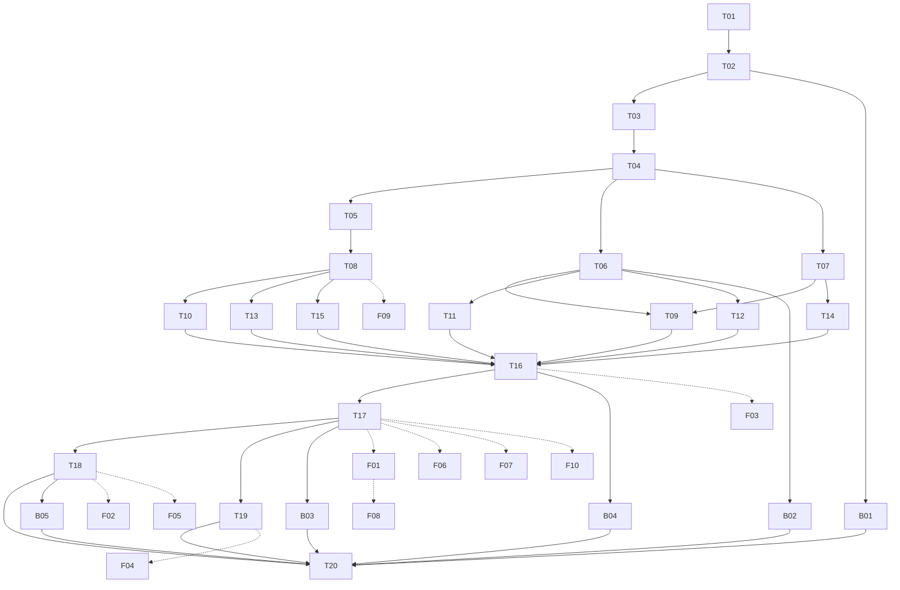

# MASTER_WORKSPACE_AUDIT_AND_35_TASK_ROADMAP — First Colloquium Simulation

Prepared 2026-11-16. Scope: Chemistry_1st_coriculum. Current stage: **material consolidation and implementation planning complete; simulator implementation not started**. This is an independent study-tool proposal based on the supplied 2025 programme, not an official RSU exam blueprint. All future tasks below remain `[TARGET]` / NOT STARTED. English planning prose; Latvian learner-facing prompts.

## 1. Executive Decision Brief & First-Principles Workspace Profile

Build one offline Latvian practice workspace for all seven first-colloquium topics, with varied constructed responses, explicit partial credit, meaningful variants and paper rehearsal. The supplied programme states an in-person written-on-paper assessment with a maximum of 180 minutes. It does not state the number of questions, weights, pass mark, allowed aids, actual question formats or whether the 2025 document governs a later cohort. Keep those unknown; use the proposed weights only as study design.

The intake copied **7 canonical HTML masters, 35 course PDFs/DOCX, 65 supporting data/source records, 18 planning references and 49 archived governance files**: 174 byte-verified files, 30,083,827 bytes. Their originals remain in Chemistry_1–7. COPY_MANIFEST.json records source/destination, role, bytes and SHA-256. These are reference snapshots, not complete rebuildable source checkouts. Never execute an imported builder in the snapshots.

Recommended baseline: 28 question families (four per topic), four reviewed variants per family (target 112 instances), 18 supported response types, and three deterministic full practice forms A/B/C. Each full form has 21 composite tasks, 100 practice points and 170 working minutes plus 10 review minutes. At least eight response types per form; at least 70% of points require constructed responses; selecting prewritten answers is capped at 10%. All quantities except the programme’s seven topics/paper modality/180-minute limit are proposed and require trial.

## 2. Workspace, Architecture & Skills Inventory + File-by-File Inspection Ledger

The destination initially contained only the programme PDF. Parent AGENTS.md and VISUAL_VERIFICATION.md were inspected. Root copies and source records were inventoried; all seven canonical masters were parsed for section IDs, headings and local references; the programme’s four pages were extracted and visually inspected; current source/conflict records were sampled. Each workspace’s master-roadmap headings and a T01 card were inspected; Chemistry_7’s expanded execution-card edition was also sampled. This does not claim every imported document, scientific assertion or historical check was reverified.

| Topic | Material snapshot | Source structure / content |
|---|---|---|
| 1 | [Master_temats_1_skidumi_un_kimiskas_reakcijas.html](<materials/Chemistry_1/Master_temats_1_skidumi_un_kimiskas_reakcijas.html>) | Ievads, šķīdumi un ķīmiskās reakcijas; programme PDF page 1. |
| 2 | [Master_2_tema_merijumi_un_grafiki.html](<materials/Chemistry_2/Master_2_tema_merijumi_un_grafiki.html>) | Aprēķini, mērījumi un grafiskās metodes; programme PDF page 1. |
| 3 | [Master_3_tema_skidumi_un_koncentracijas.html](<materials/Chemistry_3/Master_3_tema_skidumi_un_koncentracijas.html>) | Šķīdumi un koncentrāciju aprēķini; programme PDF page 2. |
| 4 | [Master_4_temats_termodinamika.html](<materials/Chemistry_4/Master_4_temats_termodinamika.html>) | Termodinamika; programme PDF page 2. |
| 5 | [Master_5_tema_kinetika_un_katalize.html](<materials/Chemistry_5/Master_5_tema_kinetika_un_katalize.html>) | Kinētika un katalīze; programme PDF page 3. |
| 6 | [Master_oksidesanas_reducesanas_procesi.html](<materials/Chemistry_6/Master_oksidesanas_reducesanas_procesi.html>) | Oksidēšanās un reducēšanās; programme PDF page 3. |
| 7 | [Master_spektrofotometrija_SEM7_LD6B.html](<materials/Chemistry_7/Master_spektrofotometrija_SEM7_LD6B.html>) | Spektrofotometrija un analīzes metodes; programme PDF page 4. |

Chemistry_6 is the redox workspace even though its own AGENTS labels it Topic 13; in this project the programme mapping is Topic 6. Chemistry_7 is spectroscopy and includes Lab 6B; do not confuse its lab number with programme Topic 6. The five source-governance shards per workspace are archived with AGENTS.snapshot.md; these describe their source workspaces and are not inherited runtime budgets for the new simulator.

Read [evidence/INSPECTION_LEDGER.md](evidence/INSPECTION_LEDGER.md), [COPY_MANIFEST.json](COPY_MANIFEST.json), [docs/PROGRAMME_COVERAGE_MATRIX.csv](docs/PROGRAMME_COVERAGE_MATRIX.csv) and [docs/QUESTION_TYPES_AND_VARIANTS.md](docs/QUESTION_TYPES_AND_VARIANTS.md). Source master links and anchors are mechanically checked by the preparation verifier. Current file hashes, not historical PASS banners, identify evidence.

Architecture proposed: Python validates sources, computations, variant generation and form assembly; semantic HTML/CSS presents the material and print forms; strict TypeScript handles user responses, unit-aware checking, session timing and rubric state; compiled local JS is the only browser runtime. No network, CDN, remote fonts or analytics. Use in-memory state initially. The seven chapter-master micro-runtime caps are historical source contracts, not a suitable inherited cap for this multi-type simulation. Measure and set a new runtime budget at T04/T05; avoid arbitrary claims that all grading fits a few kilobytes.

Only the PDF skill was used for this preparation (read-only programme extraction/rendering). No frontend skill or external research was invoked: the current deliverable is a plan. Implementation should select relevant skills when their work begins, read their actual SKILL.md then, and follow the local visual contract.

Proposed implementation tree (all new targets, absent at preparation): data/sources.json, data/questions/topic1…topic7/, data/forms/, data/reference_tables/, src/templates/, src/styles/, src/runtime/*.ts, tools/build.py, tools/validate_bank.py, tools/assemble_forms.py, tools/verify_release.py, output/simulator.html and output/forms/. Current docs and tools/verify_preparation.py are preparation artifacts, not the application.

## 3. Diagnostic Triage: Confirmed Gaps vs. Suspected Risks vs. Opportunities

| Class | Finding | Consequence / owner |
|---|---|---|
| `[INSPECTED]` confirmed initial gap | Destination contained the PDF only | Source consolidation delivered; T01 registry still future. |
| `[INSPECTED]` confirmed scope mismatch | Chemistry_6 uses local Topic 13 label | Explicit Topic 6 mapping in coverage, T02. |
| `[INSPECTED]` inherited conflicts | Source ledgers preserve percentage, enzyme, potential, endpoint and optical limitations | T03 must review key-bearing facts; no automatic promotion to verified. |
| `[UNVERIFIED]` simulator behavior | No simulator or bank generator exists | Every runtime/print/assessment gate remains future. |
| `[INFERRED]` transfer risk | Random numbers can change chemistry, precision and feasibility | T16 plus B02/B04 must constrain parameters. |
| `[INFERRED]` assessment risk | Open prose cannot be graded by answer-word presence | T17 separates automatic and self/human points. |
| `[TARGET]` opportunity | Paper exam plus digital practice | Separate paper forms and rubrics, T19. |

## 4. Domain Terminology, Fact, Applicability & Warrant Verification Ledger

| ID | Source / observation | Treatment in the new bank | Release condition |
|---|---|---|---|
| C01 | Programme pp.1–4: seven topics, paper, ≤180 min `[TEXT-VERIFIED]` | Authoritative for this supplied scope only | Do not invent official weights/types/pass mark. |
| C02 | Programme p.2 has a malformed mass/volume conversion example (`mg ⇔ g ⇔ L`) `[INSPECTED]` | Preserve original; mass↔volume requires density | Dimension gate rejects automatic mg→L. |
| C03 | Medical percentages may differ in basis; Chemistry_3 conflict ledger `[INSPECTED]` | Every task states m/m, m/V or V/V | Ambiguous scored key withheld. |
| C04 | Thermodynamics masters distinguish signs, ΔG and kinetic speed `[INSPECTED]` at section level | Explicit system, kelvin, consistent energy units, conditions | Reopen exact primary passages at authoring. |
| C05 | Chemistry_5 K10 catalase Eₐ and K17 induced-reaction example remain conditional/open in source records `[INSPECTED]` | Do not use as a single unqualified fact key | Resolve exact source/conditions or exclude. |
| C06 | Chemistry_6 source label Topic 13; source records mix E°, E°′ and conditional E `[INSPECTED]` | Topic 6 mapping; supply consistent values and convention | Q, n, T, medium and approximation stated. |
| C07 | Chemistry_6 endpoint persistence differs between source passages `[INSPECTED]` | Use a criterion explicitly supplied in the practice task | No invented universal time. |
| C08 | Chemistry_7 C-04/E24 separates 440 nm setting, literature maximum and unverified local flatness `[INSPECTED]` | Do not key “flat maximum at 440 nm” as established | Require matching spectrum/conditions or bounded inference. |
| C09 | Chemistry_7 C-05/C-06 distinguish calibration models and assumed optical path `[INSPECTED]` | Name fit, concentration axis, blank/intercept and assumptions | Check actual data and full-precision calculation per instance. |
| C10 | Current plan’s 14 examples are synthetic givens `[TARGET]` | Arithmetic can be independently checked; no official-source attribution | Numeric checks plus later content review. |

The coverage CSV records heading/topic alignment, not passage-level scientific approval. Imported “text verified” labels retain their historical context; this preparation does not renew them. A claim is released only after its own source, conditions, locator and answer implications have been reviewed.

## 5. Authoritative Source Register & Literature Verification Boundary

Primary source for requested scope: [RSU_MedChem_Colloq1_Prog_LV_2025.pdf](RSU_MedChem_Colloq1_Prog_LV_2025.pdf), four pages, inspected visually and as extracted text. Topic locations: p.1 Topics 1–2; p.2 Topics 3–4; p.3 Topics 5–6; p.4 Topic 7. The programme’s external links were not opened and are not treated as verified research.

The 35 copied course files preserve original names and versions, including newer 2026 answer sheets. The programme defines inclusion; a 2026 worksheet does not silently amend that 2025 scope. Course data, an author’s correction, an external statement and synthetic practice inputs remain separate roles. COPY_MANIFEST.json is the complete file register; source ledgers and their conflict notes are supporting references.

Inherited references to IUPAC, SI/BIPM, Atkins, Laidler, Cornish-Bowden, OpenStax and other literature are leads only in this preparation. No new edition/page/quotation or current authority is claimed. Before an implementation correction depends on them, open the exact primary publication or official standard, record the passage and applicability, and keep unmatched or inaccessible claims pending. External literature review is a future T03 activity, not a completed deliverable.

## 6. Pedagogy, Assessment Design, Accessibility & Figure Inventory

Full response and variant specifications are in [docs/QUESTION_TYPES_AND_VARIANTS.md](docs/QUESTION_TYPES_AND_VARIANTS.md); [docs/EXAMPLE_QUESTIONS.json](docs/EXAMPLE_QUESTIONS.json) contains 14 worked proposals, two per topic. They demonstrate calculations, reasoning and concrete variants. The family specifications total 28×4=112 planned variants; neither 112 released questions nor three completed forms are claimed.

Practice flow: choose topic/skill → attempt without solution → request an optional graduated hint → submit → inspect criterion feedback → read the linked source section → try a distinct variant. Exam flow: show practice rules and proposed aids → freeze A/B/C form/version/seed → work with navigation and flag-for-review → finalize → inspect confirmed and pending points → self-/human-review explanations. The timer is advisory; zero time does not destroy answers. Reload discards memory unless an explicitly adopted export feature is used.

| Topic | Points (proposed) | Working minutes (proposed) | Three tasks |
|---|---:|---:|---|
| 1 | 10 | 16 | Classification or particles/bonding; Balance + stoichiometry; Periodic/solubility table use |
| 2 | 12 | 20 | Equipment + units/sig figs through subparts; Scale reading + delivered volume; Axes, units, plotting and graph read |
| 3 | 20 | 32 | Definitions + m/n/c/w/γ/ρ conversions; Dilution calculation + preparation sequence; Explicit label basis + missing-data reasoning |
| 4 | 15 | 25 | Systems + laws + calorimetry through subparts; Hess + reaction ΔS; ΔG + temperature + sign interpretation |
| 5 | 16 | 27 | Factors + catalyst/enzymes/mechanism through subparts; Order + k + k unit; Half-life graph + calculation + model assumptions |
| 6 | 15 | 28 | Roles + supplied E° table + Nernst subpart; Half reactions + atom/charge balance in stated medium; Titration equipment/endpoint + stoichiometric concentration |
| 7 | 12 | 22 | Law + variables + method use; Calibration axes + slope/intercept/range; Unknown c/m/n + dilution + validity subpart |

Total 100 points, 170 minutes plus 10 review. Topic-level totals are fixed for A/B/C. Proposed difficulty mix: 25 points foundational, 50 application, 25 transfer/error diagnosis. Every form covers all seven topics and required slot subparts; full-bank coverage includes all CSV outcomes. Optional F features do not become hidden prerequisites of core release.

Figure inventory is proposed, not implemented: burette/meniscus and balance scales; blank coordinate grids; calibration scatter/line with nonzero intercept; concentration-time and transformed-order graphs; half-life graph; activation-energy profiles; Maxwell–Boltzmann curves; Hess/energy diagrams. Generate each from a single numeric record. Every figure requires semantic labels, units, scale, task-appropriate text alternative and print-safe contrast; no answer embedded in pre-submit alt text. Current masters were not screen/print reverified in this pass.

## 7. Twenty Core Implementation Tasks (T01–T20) — Execution Cards

### T01 — Freeze the preparation inputs and source identity

**Status:** `[TARGET]` NOT STARTED. **Priority:** P0. **Owner boundary:** provenance. **Dependencies:** none. **Problem / evidence:** A copied master is a snapshot; it is not automatically a reviewed source or a rebuildable checkout. **Scope:** destination-owned implementation only; imported materials remain immutable references.

**Three main implementation steps**

1. Read COPY_MANIFEST.json and the 2025 programme; preserve the seven workspace identities.
2. Create a source registry with programme, master, course, derived and synthetic-example roles.
3. Rehash before authoring and record an intake decision for any changed input.

**Subtask T01.1 — Establish the owned data and behavior**

- **T01.1.1:** Register every file used by a question with path and hash.
- **T01.1.2:** Namespace inherited source IDs by Chemistry_n to avoid collisions.
- **T01.1.3:** Compare source and destination hashes; fail on a missing or altered input.

**Subtask T01.2 — Integrate and verify the release boundary**

- **T01.2.1:** Record PDF page or master anchor per claim, retaining uncertainty.
- **T01.2.2:** Mark reference-governance files as historical, not active rules.
- **T01.2.3:** Prove an unavailable or replaced source blocks release of dependent items.

**Affected targets:** COPY_MANIFEST.json; data/sources.json (new); evidence/intake.md (new). **Acceptance / positive-negative boundary:** Every released source ref resolves to its frozen hash and scoped locator; missing-file and changed-hash fixtures fail.

**Risk and collision guard:** provenance owns the listed targets; coordinate shared schema/manifest changes through T04/T16. **Rollback:** restore only the task-owned destination files from the pre-task snapshot; regenerate outputs; retain failed evidence. **Done:** acceptance evidence refers to current input/output hashes, all named dependencies are complete, and required source/keyboard/visual/print checks are either passed or explicitly blocking. A static check never substitutes for a human or visual gate.

### T02 — Complete the programme-to-question coverage map

**Status:** `[TARGET]` NOT STARTED. **Priority:** P0. **Owner boundary:** coverage. **Dependencies:** T01. **Problem / evidence:** Heading-level mappings cover the programme but do not yet establish question-level coverage. **Scope:** destination-owned implementation only; imported materials remain immutable references.

**Three main implementation steps**

1. Review every PROGRAMME_COVERAGE_MATRIX.csv row against the full PDF page.
2. Reopen the relevant master passages and primary course pages for each authored family.
3. Assign reviewed instances and make full-bank coverage a release gate.

**Subtask T02.1 — Establish the owned data and behavior**

- **T02.1.1:** Distinguish the 2025 programme from 2026 supporting answer sheets.
- **T02.1.2:** Preserve Chemistry_6 → programme Topic 6 despite its local Topic 13 label.
- **T02.1.3:** Keep the page-2 mass/volume conversion typo in the source record, not in a teaching rule.

**Subtask T02.2 — Integrate and verify the release boundary**

- **T02.2.1:** Add question IDs, source locators and reviewer status to each outcome.
- **T02.2.2:** Tag supplementary details separately from literal programme requirements.
- **T02.2.3:** Fail a bank with any required row lacking a reviewed instance.

**Affected targets:** docs/PROGRAMME_COVERAGE_MATRIX.csv; data/coverage.json (new). **Acceptance / positive-negative boundary:** All programme requirements mapped; no bare heading match counted as verified chemistry; omitted Nernst or graph construction fails.

**Risk and collision guard:** coverage owns the listed targets; coordinate shared schema/manifest changes through T04/T16. **Rollback:** restore only the task-owned destination files from the pre-task snapshot; regenerate outputs; retain failed evidence. **Done:** acceptance evidence refers to current input/output hashes, all named dependencies are complete, and required source/keyboard/visual/print checks are either passed or explicitly blocking. A static check never substitutes for a human or visual gate.

### T03 — Resolve notation, assumptions and source conflicts

**Status:** `[TARGET]` NOT STARTED. **Priority:** P0. **Owner boundary:** content. **Dependencies:** T01, T02. **Problem / evidence:** Inherited sources preserve disagreements about percentages, units, potentials and optical claims. **Scope:** destination-owned implementation only; imported materials remain immutable references.

**Three main implementation steps**

1. Create a bounded conflict registry for facts that affect an answer key.
2. Declare a local notation map and explicit per-question givens.
3. Release only resolved or explicitly conditional questions; defer unresolved key-bearing disputes.

**Subtask T03.1 — Establish the owned data and behavior**

- **T03.1.1:** Specify m/m, m/V or V/V for every percentage.
- **T03.1.2:** Specify kelvin, J/kJ, system/work sign and constant-pressure assumptions.
- **T03.1.3:** Specify redox medium, E°/E°′ convention, Q and activity/concentration approximation.

**Subtask T03.2 — Integrate and verify the release boundary**

- **T03.2.1:** Keep K10/K17 enzyme claims and titration endpoint timing unresolved unless sources establish them.
- **T03.2.2:** Keep 440 nm setting separate from maximum/flatness and state optical-path assumptions.
- **T03.2.3:** Test one ambiguous percent, one mixed-potential and one unsupported R² claim; each must be withheld or explicitly bounded.

**Affected targets:** data/conventions.json; data/conflicts.csv (new); materials/** source records (read-only). **Acceptance / positive-negative boundary:** No scored key depends on an unstated density, percentage basis, reaction medium, wavelength claim or instructor convention.

**Risk and collision guard:** content owns the listed targets; coordinate shared schema/manifest changes through T04/T16. **Rollback:** restore only the task-owned destination files from the pre-task snapshot; regenerate outputs; retain failed evidence. **Done:** acceptance evidence refers to current input/output hashes, all named dependencies are complete, and required source/keyboard/visual/print checks are either passed or explicitly blocking. A static check never substitutes for a human or visual gate.

### T04 — Implement and validate the question data contract

**Status:** `[TARGET]` NOT STARTED. **Priority:** P0. **Owner boundary:** data. **Dependencies:** T02, T03. **Problem / evidence:** Freeform questions without rubrics and provenance cannot be reliably varied or assessed. **Scope:** destination-owned implementation only; imported materials remain immutable references.

**Three main implementation steps**

1. Refine QUESTION_SCHEMA.json into a complete typed instance contract.
2. Add schema and cross-record validators with explicit versions.
3. Validate one instance of every response type before bulk authoring.

**Subtask T04.1 — Establish the owned data and behavior**

- **T04.1.1:** Define field IDs, units, numeric/symbolic/manual key branches and dependency graphs.
- **T04.1.2:** Require per-criterion points and review states without embedding display strings as identifiers.
- **T04.1.3:** Reject duplicate IDs, dangling source/outcome refs and rubric cycles.

**Subtask T04.2 — Integrate and verify the release boundary**

- **T04.2.1:** Model prompt assets and keyboard alternatives without giving away answers.
- **T04.2.2:** Validate fixtures for all 18 proposed types.
- **T04.2.3:** Reject missing units, negative point maxima, unknown type IDs and incomplete keys.

**Affected targets:** docs/QUESTION_SCHEMA.json; data/questions/; tools/validate_bank.py (new). **Acceptance / positive-negative boundary:** Positive fixtures validate; malformed data fails with question/field ID; pending questions cannot enter release forms.

**Risk and collision guard:** data owns the listed targets; coordinate shared schema/manifest changes through T04/T16. **Rollback:** restore only the task-owned destination files from the pre-task snapshot; regenerate outputs; retain failed evidence. **Done:** acceptance evidence refers to current input/output hashes, all named dependencies are complete, and required source/keyboard/visual/print checks are either passed or explicitly blocking. A static check never substitutes for a human or visual gate.

### T05 — Build semantic response components

**Status:** `[TARGET]` NOT STARTED. **Priority:** P1. **Owner boundary:** interface. **Dependencies:** T04. **Problem / evidence:** Variety must come from different learner reasoning, with consistent operable response fields. **Scope:** destination-owned implementation only; imported materials remain immutable references.

**Three main implementation steps**

1. Define HTML templates for numeric, matching, classification, ordering and explanations.
2. Add typed rendering contracts for graph/equation components owned by T07/T08.
3. Provide no-JS reading and practice answer disclosures plus explicit assessment limits.

**Subtask T05.1 — Establish the owned data and behavior**

- **T05.1.1:** Use fieldset/legend and stable labels/IDs.
- **T05.1.2:** Use selects or buttons as a keyboard alternative to drag-and-drop.
- **T05.1.3:** Keep prompt, help, response, errors and feedback in predictable reading order.

**Subtask T05.2 — Integrate and verify the release boundary**

- **T05.2.1:** Keep correct answers out of assessment labels and pre-submit descriptions.
- **T05.2.2:** Provide empty, partially answered, invalid and submitted states.
- **T05.2.3:** Verify keyboard paths and no-JS fallbacks on authored component fixtures.

**Affected targets:** src/templates/; src/styles/; src/runtime/components.ts (new). **Acceptance / positive-negative boundary:** All controls labeled; no required drag action; no fake no-JS grading claim; no response lost on validation.

**Risk and collision guard:** interface owns the listed targets; coordinate shared schema/manifest changes through T04/T16. **Rollback:** restore only the task-owned destination files from the pre-task snapshot; regenerate outputs; retain failed evidence. **Done:** acceptance evidence refers to current input/output hashes, all named dependencies are complete, and required source/keyboard/visual/print checks are either passed or explicitly blocking. A static check never substitutes for a human or visual gate.

### T06 — Implement numeric, unit and precision checking

**Status:** `[TARGET]` NOT STARTED. **Priority:** P0. **Owner boundary:** grading. **Dependencies:** T04. **Problem / evidence:** A numerically equal value can be dimensionally wrong or display unjustified precision. **Scope:** destination-owned implementation only; imported materials remain immutable references.

**Three main implementation steps**

1. Implement a restricted quantity parser shared with build-time reference cases.
2. Compare normalized dimensions using declared tolerances.
3. Score numeric value, units and requested rounding as separate rubric criteria.

**Subtask T06.1 — Establish the owned data and behavior**

- **T06.1.1:** Accept decimal comma/point, scientific notation and Unicode minus with explicit grammar.
- **T06.1.2:** Reject mixed separators, nonfinite numbers and executable expressions.
- **T06.1.3:** Retain user precision tokens and exact conversion-factor metadata.

**Subtask T06.2 — Integrate and verify the release boundary**

- **T06.2.1:** Test mL/L, mg/g, J/kJ, mol/L and mg/mL equivalence cases.
- **T06.2.2:** Test zero, boundary tolerance, trailing zeros and exact versus measured inputs.
- **T06.2.3:** Independently compare runtime outputs to Python golden vectors, including a 1000-fold error.

**Affected targets:** src/runtime/quantity.ts; tools/reference_math.py; tests/quantity-fixtures.json (new). **Acceptance / positive-negative boundary:** Equivalent units pass; wrong dimensions and code fail; significant-figure deductions do not erase valid method credit.

**Risk and collision guard:** grading owns the listed targets; coordinate shared schema/manifest changes through T04/T16. **Rollback:** restore only the task-owned destination files from the pre-task snapshot; regenerate outputs; retain failed evidence. **Done:** acceptance evidence refers to current input/output hashes, all named dependencies are complete, and required source/keyboard/visual/print checks are either passed or explicitly blocking. A static check never substitutes for a human or visual gate.

### T07 — Implement equation and half-reaction checks

**Status:** `[TARGET]` NOT STARTED. **Priority:** P0. **Owner boundary:** grading. **Dependencies:** T04. **Problem / evidence:** String equality cannot establish atom, charge and electron conservation. **Scope:** destination-owned implementation only; imported materials remain immutable references.

**Three main implementation steps**

1. Represent a reviewed fixed species list with elemental composition and charge.
2. Check coefficients, atom balance, charge and electron cancellation independently.
3. Allow alternate written methods via rubric review without claiming a universal equation parser.

**Subtask T07.1 — Establish the owned data and behavior**

- **T07.1.1:** Include H⁺, OH⁻, H₂O and electrons only as allowed by stated medium.
- **T07.1.2:** Compute conserved counts from structured species data.
- **T07.1.3:** Distinguish balanced proportional coefficients from lowest integer ratio.

**Subtask T07.2 — Integrate and verify the release boundary**

- **T07.2.1:** Test Mg/O₂ and permanganate/Fe²⁺ positive keys.
- **T07.2.2:** Reject an atom-balanced but charge-unbalanced vector.
- **T07.2.3:** Reject a neutral/basic key used for an acidic-medium instance.

**Affected targets:** data/species.json; src/runtime/balance.ts; tools/check_equations.py (new). **Acceptance / positive-negative boundary:** Positive and conservation-breaking fixtures produce independent diagnostics; no unchecked chemical species substitution.

**Risk and collision guard:** grading owns the listed targets; coordinate shared schema/manifest changes through T04/T16. **Rollback:** restore only the task-owned destination files from the pre-task snapshot; regenerate outputs; retain failed evidence. **Done:** acceptance evidence refers to current input/output hashes, all named dependencies are complete, and required source/keyboard/visual/print checks are either passed or explicitly blocking. A static check never substitutes for a human or visual gate.

### T08 — Build scales and graph tasks from shared data

**Status:** `[TARGET]` NOT STARTED. **Priority:** P1. **Owner boundary:** figures. **Dependencies:** T04, T05. **Problem / evidence:** Plotting, scale reading and graph interpretation are explicit programme skills. **Scope:** destination-owned implementation only; imported materials remain immutable references.

**Three main implementation steps**

1. Generate SVG scales and axes from named source coordinates in Python.
2. Support coordinate-table entry and keyboard plotting alongside pointer input.
3. Make tolerances depend on displayed resolution and model constraints.

**Subtask T08.1 — Establish the owned data and behavior**

- **T08.1.1:** Cover downward burette scales and analog/digital measurement distinctions.
- **T08.1.2:** Render axes, units, ticks, data marks and captions from the same numeric record.
- **T08.1.3:** Keep solution coordinates out of the accessible pre-submit prompt.

**Subtask T08.2 — Integrate and verify the release boundary**

- **T08.2.1:** Score independent/dependent axes, units, points and inference separately.
- **T08.2.2:** Test calibration with a nonzero intercept and half-life plots.
- **T08.2.3:** Inspect 390/768/1280 px captures and printed diagrams; reject clipped or unreadable ticks.

**Affected targets:** data/figures/; tools/render_svg.py; src/runtime/plot.ts; src/templates/graph.html (new). **Acceptance / positive-negative boundary:** Text/table alternative preserves task meaning; coordinate and graphic keys agree; SVG titles/labels are accessible without exposing answers.

**Risk and collision guard:** figures owns the listed targets; coordinate shared schema/manifest changes through T04/T16. **Rollback:** restore only the task-owned destination files from the pre-task snapshot; regenerate outputs; retain failed evidence. **Done:** acceptance evidence refers to current input/output hashes, all named dependencies are complete, and required source/keyboard/visual/print checks are either passed or explicitly blocking. A static check never substitutes for a human or visual gate.

### T09 — Author Topic 1 families

**Status:** `[TARGET]` NOT STARTED. **Priority:** P1. **Owner boundary:** bank-1. **Dependencies:** T02, T03, T04, T06, T07. **Problem / evidence:** Recall must also test conservation, species reasoning and actual table use. **Scope:** destination-owned implementation only; imported materials remain immutable references.

**Three main implementation steps**

1. Author FAM-1A–1D with four reviewed variants each.
2. Use provided periodic/solubility tables and explicit conditions.
3. Review all Topic 1 outcomes and candidate form subparts.

**Subtask T09.1 — Establish the owned data and behavior**

- **T09.1.1:** Allow a reaction to have more than one classification.
- **T09.1.2:** Distinguish atoms, ions, molecules and electrolyte behavior.
- **T09.1.3:** Build a balanced stoichiometric key with reagent excess stated.

**Subtask T09.2 — Integrate and verify the release boundary**

- **T09.2.1:** Create a precipitate case and a no-net-reaction counterexample.
- **T09.2.2:** Provide meaningful correction and explanation criteria.
- **T09.2.3:** Verify all 16 instances against source locators and independent balances/calculations.

**Affected targets:** data/questions/topic1/; data/reference_tables/ (new). **Acceptance / positive-negative boundary:** P1 outcomes covered by reviewed instances; alternative correct classifications and net ionic equations receive credit.

**Risk and collision guard:** bank-1 owns the listed targets; coordinate shared schema/manifest changes through T04/T16. **Rollback:** restore only the task-owned destination files from the pre-task snapshot; regenerate outputs; retain failed evidence. **Done:** acceptance evidence refers to current input/output hashes, all named dependencies are complete, and required source/keyboard/visual/print checks are either passed or explicitly blocking. A static check never substitutes for a human or visual gate.

### T10 — Author Topic 2 measurement and graph families

**Status:** `[TARGET]` NOT STARTED. **Priority:** P1. **Owner boundary:** bank-2. **Dependencies:** T02, T03, T04, T06, T08. **Problem / evidence:** Equipment, unit arithmetic, scales, significant figures and graph drawing need distinct tasks. **Scope:** destination-owned implementation only; imported materials remain immutable references.

**Three main implementation steps**

1. Author FAM-2A–2D, including the complete prefix and instrument lists.
2. Use equipment selection, burette reading and graph construction.
3. Review four variants per family with resolution-aware keys.

**Subtask T10.1 — Establish the owned data and behavior**

- **T10.1.1:** Include a balance, pipette filler and qualitative/quantitative observations.
- **T10.1.2:** Check direct/inverse proportion, powers and arithmetic order.
- **T10.1.3:** Keep exact unit factors separate from measurement precision.

**Subtask T10.2 — Integrate and verify the release boundary**

- **T10.2.1:** Score actual choice of axes, scale and plotted coordinates.
- **T10.2.2:** Cross-check scale-generated values and required decimal places.
- **T10.2.3:** Review 16 instances for coverage and accessible equivalent input.

**Affected targets:** data/questions/topic2/; data/figures/topic2/ (new). **Acceptance / positive-negative boundary:** All P2 rows covered; graph construction cannot be replaced by choosing a chart thumbnail.

**Risk and collision guard:** bank-2 owns the listed targets; coordinate shared schema/manifest changes through T04/T16. **Rollback:** restore only the task-owned destination files from the pre-task snapshot; regenerate outputs; retain failed evidence. **Done:** acceptance evidence refers to current input/output hashes, all named dependencies are complete, and required source/keyboard/visual/print checks are either passed or explicitly blocking. A static check never substitutes for a human or visual gate.

### T11 — Author Topic 3 concentration and preparation families

**Status:** `[TARGET]` NOT STARTED. **Priority:** P0. **Owner boundary:** bank-3. **Dependencies:** T02, T03, T04, T06, T05. **Problem / evidence:** Concentration bases, density and final volume are common sources of plausible but wrong answers. **Scope:** destination-owned implementation only; imported materials remain immutable references.

**Three main implementation steps**

1. Author FAM-3A–3D with explicit chemical/percentage definitions.
2. Independently recompute m,n,c,w,γ,ρ conversions and dilution keys.
3. Use labeled medical examples strictly as chemistry practice.

**Subtask T11.1 — Establish the owned data and behavior**

- **T11.1.1:** Require a density whenever w and volume-based quantities are linked.
- **T11.1.2:** Include known-to-unknown reversals and ion dissociation subparts.
- **T11.1.3:** Contrast added water volume with final solution volume.

**Subtask T11.2 — Integrate and verify the release boundary**

- **T11.2.1:** Cover the named NaCl/glucose/H₂O₂/ethanol/iodine label contexts from explicit givens.
- **T11.2.2:** Include one intentional insufficient-data task with a justification rubric.
- **T11.2.3:** Check 16 variants for units, precision, feasible dilution and source traceability.

**Affected targets:** data/questions/topic3/; tools/reference_math.py (new). **Acceptance / positive-negative boundary:** All P3 rows covered; no product recommendation, implied universal percent basis or mass↔volume conversion without ρ.

**Risk and collision guard:** bank-3 owns the listed targets; coordinate shared schema/manifest changes through T04/T16. **Rollback:** restore only the task-owned destination files from the pre-task snapshot; regenerate outputs; retain failed evidence. **Done:** acceptance evidence refers to current input/output hashes, all named dependencies are complete, and required source/keyboard/visual/print checks are either passed or explicitly blocking. A static check never substitutes for a human or visual gate.

### T12 — Author Topic 4 thermodynamics families

**Status:** `[TARGET]` NOT STARTED. **Priority:** P0. **Owner boundary:** bank-4. **Dependencies:** T02, T03, T04, T06. **Problem / evidence:** Signs and applicability must be assessed alongside ΔH, ΔS and ΔG calculations. **Scope:** destination-owned implementation only; imported materials remain immutable references.

**Three main implementation steps**

1. Author FAM-4A–4D with system boundary and work convention.
2. Compute Hess combinations, reaction entropy, Gibbs values and heat balances.
3. Add interpretive and error-correction subparts.

**Subtask T12.1 — Establish the owned data and behavior**

- **T12.1.1:** Cover open/closed/isolated systems, laws and standard conditions.
- **T12.1.2:** Supply all thermochemical table entries and units.
- **T12.1.3:** Distinguish system entropy, total entropy and kinetic speed.

**Subtask T12.2 — Integrate and verify the release boundary**

- **T12.2.1:** Test J/kJ conversion and kelvin in a temperature threshold case.
- **T12.2.2:** State approximations for constant ΔH/ΔS and ignored calorimeter capacity.
- **T12.2.3:** Verify 16 variants including negative ΔS but permitted spontaneous process.

**Affected targets:** data/questions/topic4/; data/reference_tables/thermo.json (new). **Acceptance / positive-negative boundary:** All P4 rows covered; ΔG<0 never auto-means fast; calorimetry key assigns opposite reaction/environment heat signs.

**Risk and collision guard:** bank-4 owns the listed targets; coordinate shared schema/manifest changes through T04/T16. **Rollback:** restore only the task-owned destination files from the pre-task snapshot; regenerate outputs; retain failed evidence. **Done:** acceptance evidence refers to current input/output hashes, all named dependencies are complete, and required source/keyboard/visual/print checks are either passed or explicitly blocking. A static check never substitutes for a human or visual gate.

### T13 — Author Topic 5 kinetics families

**Status:** `[TARGET]` NOT STARTED. **Priority:** P1. **Owner boundary:** bank-5. **Dependencies:** T02, T03, T04, T06, T08. **Problem / evidence:** Order, k, half-life and catalyst effects need data and graphs, not definition-only recall. **Scope:** destination-owned implementation only; imported materials remain immutable references.

**Three main implementation steps**

1. Author FAM-5A–5D across zero/first/second order.
2. Create energy-profile and Maxwell–Boltzmann interpretation tasks.
3. Use mechanism, catalyst/enzyme comparison and model-limited half-life cases.

**Subtask T13.1 — Establish the owned data and behavior**

- **T13.1.1:** Derive k and its unit from order-specific data.
- **T13.1.2:** Specify the rate definition and coefficient convention.
- **T13.1.3:** Assess factors while stating controlled conditions and gas-only pressure context.

**Subtask T13.2 — Integrate and verify the release boundary**

- **T13.2.1:** Check energy barriers relative to reactant/product levels.
- **T13.2.2:** Ensure a catalyst does not change reaction ΔH or equilibrium constant.
- **T13.2.3:** Verify 16 variants without importing disputed K10/K17 as settled keys.

**Affected targets:** data/questions/topic5/; data/figures/topic5/ (new). **Acceptance / positive-negative boundary:** All P5 rows covered; first-order pharmacokinetic assumptions explicit; multiple-step mechanisms are not inferred from net coefficients.

**Risk and collision guard:** bank-5 owns the listed targets; coordinate shared schema/manifest changes through T04/T16. **Rollback:** restore only the task-owned destination files from the pre-task snapshot; regenerate outputs; retain failed evidence. **Done:** acceptance evidence refers to current input/output hashes, all named dependencies are complete, and required source/keyboard/visual/print checks are either passed or explicitly blocking. A static check never substitutes for a human or visual gate.

### T14 — Author Topic 6 redox, Nernst and titration families

**Status:** `[TARGET]` NOT STARTED. **Priority:** P0. **Owner boundary:** bank-6. **Dependencies:** T02, T03, T04, T06, T07, T08. **Problem / evidence:** The local Topic 13 source must cover programme Topic 6, including Nernst and titration. **Scope:** destination-owned implementation only; imported materials remain immutable references.

**Three main implementation steps**

1. Author FAM-6A–6D using supplied, internally consistent potential tables.
2. Balance reviewed half-reactions for acidic, neutral and basic variants.
3. Connect titration readings, stoichiometry and concentration with explicit endpoint criteria.

**Subtask T14.1 — Establish the owned data and behavior**

- **T14.1.1:** Distinguish donor/acceptor, E°, E°′ and nonstandard E.
- **T14.1.2:** Supply T, n, constants and Q/activity assumptions for Nernst.
- **T14.1.3:** Use biological roles only within a sourced or explicit simplified model.

**Subtask T14.2 — Integrate and verify the release boundary**

- **T14.2.1:** Check atom/charge balance and permanganate medium-dependent product.
- **T14.2.2:** Recompute Fe²⁺ titration from 1:5 stoichiometry.
- **T14.2.3:** Verify 16 variants; conflicting endpoint persistence is not settled silently.

**Affected targets:** data/questions/topic6/; data/reference_tables/redox.json (new). **Acceptance / positive-negative boundary:** All P6 rows covered; a mixed E°/E°′ case is flagged; Nernst remains in every full-form core slot.

**Risk and collision guard:** bank-6 owns the listed targets; coordinate shared schema/manifest changes through T04/T16. **Rollback:** restore only the task-owned destination files from the pre-task snapshot; regenerate outputs; retain failed evidence. **Done:** acceptance evidence refers to current input/output hashes, all named dependencies are complete, and required source/keyboard/visual/print checks are either passed or explicitly blocking. A static check never substitutes for a human or visual gate.

### T15 — Author Topic 7 spectrophotometry families

**Status:** `[TARGET]` NOT STARTED. **Priority:** P1. **Owner boundary:** bank-7. **Dependencies:** T02, T03, T04, T06, T08. **Problem / evidence:** The programme requires quantitative use of calibration graphs, including mass and amount. **Scope:** destination-owned implementation only; imported materials remain immutable references.

**Three main implementation steps**

1. Author FAM-7A–7D for method/law, calibration and unknown samples.
2. Use named axes and concentration basis, blank/intercept and range.
3. Add dilution correction and conditional inference tasks.

**Subtask T15.1 — Establish the owned data and behavior**

- **T15.1.1:** Supply l, ε and c units when applying A=εlc.
- **T15.1.2:** Distinguish γ and c; supply M for mass-to-amount conversion.
- **T15.1.3:** Do not claim a protocol optical path or local spectral flatness was measured when it was assumed.

**Subtask T15.2 — Integrate and verify the release boundary**

- **T15.2.1:** Verify calibration slope/intercept from shared plotted data.
- **T15.2.2:** Check original versus measured concentration and allowed interpolation range.
- **T15.2.3:** Review 16 variants; high R² alone never earns method-validity proof credit.

**Affected targets:** data/questions/topic7/; data/figures/topic7/ (new). **Acceptance / positive-negative boundary:** All P7 core rows and supplementary application row covered; no unmarked extrapolation or dropped intercept.

**Risk and collision guard:** bank-7 owns the listed targets; coordinate shared schema/manifest changes through T04/T16. **Rollback:** restore only the task-owned destination files from the pre-task snapshot; regenerate outputs; retain failed evidence. **Done:** acceptance evidence refers to current input/output hashes, all named dependencies are complete, and required source/keyboard/visual/print checks are either passed or explicitly blocking. A static check never substitutes for a human or visual gate.

### T16 — Assemble deterministic, balanced A/B/C forms

**Status:** `[TARGET]` NOT STARTED. **Priority:** P1. **Owner boundary:** assembly. **Dependencies:** T09, T10, T11, T12, T13, T14, T15. **Problem / evidence:** Random sampling alone can omit a skill, duplicate a family or change workload. **Scope:** destination-owned implementation only; imported materials remain immutable references.

**Three main implementation steps**

1. Implement the 21-slot blueprint with mandatory composite subparts.
2. Select only reviewed instances using a documented seeded generator.
3. Freeze three distinct forms and their answer manifests.

**Subtask T16.1 — Establish the owned data and behavior**

- **T16.1.1:** Require seven topics, 100 points and 170+10 minutes.
- **T16.1.2:** Require ≥8 response types, ≥70 constructed-response points and ≤10 selection points.
- **T16.1.3:** Enforce no repeated instance or family origin and deterministic replay.

**Subtask T16.2 — Integrate and verify the release boundary**

- **T16.2.1:** Validate required subskills per slot, not merely primary family labels.
- **T16.2.2:** Record every composite subpart origin and avoid cross-question answer leakage.
- **T16.2.3:** If constraints are unsatisfied, fail with a shortage report; never silently relax them.

**Affected targets:** docs/SIMULATION_BLUEPRINT.json; tools/assemble_forms.py; data/forms/ (new). **Acceptance / positive-negative boundary:** Same version/seed reproduces identical form hashes; A/B/C differ beyond order; feasibility/point/duration reports pass.

**Risk and collision guard:** assembly owns the listed targets; coordinate shared schema/manifest changes through T04/T16. **Rollback:** restore only the task-owned destination files from the pre-task snapshot; regenerate outputs; retain failed evidence. **Done:** acceptance evidence refers to current input/output hashes, all named dependencies are complete, and required source/keyboard/visual/print checks are either passed or explicitly blocking. A static check never substitutes for a human or visual gate.

### T17 — Integrate partial-credit grading and honest results

**Status:** `[TARGET]` NOT STARTED. **Priority:** P0. **Owner boundary:** grading. **Dependencies:** T06, T07, T08, T16. **Problem / evidence:** Open explanations and carried-forward errors cannot be represented as a single all-or-nothing score. **Scope:** destination-owned implementation only; imported materials remain immutable references.

**Three main implementation steps**

1. Aggregate independent rubric criteria with dependency-aware method credit.
2. Separate confirmed, self-assessed, human-reviewed and pending points.
3. Produce targeted feedback tied to outcomes and variants after submission.

**Subtask T17.1 — Establish the owned data and behavior**

- **T17.1.1:** Clamp scores and prevent double penalties for one inherited unit error.
- **T17.1.2:** Keep correctness versus method criteria distinct.
- **T17.1.3:** Handle blank, invalid, skipped and unreviewed responses explicitly.

**Subtask T17.2 — Integrate and verify the release boundary**

- **T17.2.1:** Test a correct answer, propagated error, wrong model and unreviewed explanation.
- **T17.2.2:** Expose rubric edits/self-grading as learner actions rather than machine verification.
- **T17.2.3:** Show confirmed-to-possible range, no invented official pass mark.

**Affected targets:** src/runtime/grading.ts; data/rubrics/; src/templates/results.html (new). **Acceptance / positive-negative boundary:** Rubric sums match blueprint; manual work remains pending until reviewed; reported scoring origin is visible.

**Risk and collision guard:** grading owns the listed targets; coordinate shared schema/manifest changes through T04/T16. **Rollback:** restore only the task-owned destination files from the pre-task snapshot; regenerate outputs; retain failed evidence. **Done:** acceptance evidence refers to current input/output hashes, all named dependencies are complete, and required source/keyboard/visual/print checks are either passed or explicitly blocking. A static check never substitutes for a human or visual gate.

### T18 — Build offline practice and exam flows

**Status:** `[TARGET]` NOT STARTED. **Priority:** P1. **Owner boundary:** interface. **Dependencies:** T05, T16, T17. **Problem / evidence:** The interface must support varied work while preserving exam/practice feedback boundaries. **Scope:** destination-owned implementation only; imported materials remain immutable references.

**Three main implementation steps**

1. Build a Latvian start flow, topic practice and full-paper route.
2. Add in-memory responses, navigation, flag-for-review and elapsed/remaining time.
3. Separate exam submission/results from practice hints and variant retries.

**Subtask T18.1 — Establish the owned data and behavior**

- **T18.1.1:** Warn before discarding in-memory work and document reload behavior.
- **T18.1.2:** Use timestamp differences for timing and preserve work at zero; permit continued practice marked overtime.
- **T18.1.3:** Keep exam answer feedback hidden until finalization and no network required.

**Subtask T18.2 — Integrate and verify the release boundary**

- **T18.2.1:** Set focus and error announcements on navigation/submit.
- **T18.2.2:** Support 390/768/1280 widths, zoom, reduced motion and forced colors.
- **T18.2.3:** Test keyboard and offline loading with permitted Falkon tooling; record unsupported browser features.

**Affected targets:** src/index.html; src/runtime/session.ts; src/styles/; tools/build.py (new). **Acceptance / positive-negative boundary:** Full session completes without network or response loss; timer is advisory, no claim of proctoring or secure answer secrecy.

**Risk and collision guard:** interface owns the listed targets; coordinate shared schema/manifest changes through T04/T16. **Rollback:** restore only the task-owned destination files from the pre-task snapshot; regenerate outputs; retain failed evidence. **Done:** acceptance evidence refers to current input/output hashes, all named dependencies are complete, and required source/keyboard/visual/print checks are either passed or explicitly blocking. A static check never substitutes for a human or visual gate.

### T19 — Create paper-mode question and answer artifacts

**Status:** `[TARGET]` NOT STARTED. **Priority:** P1. **Owner boundary:** print. **Dependencies:** T08, T16, T17. **Problem / evidence:** The supplied programme explicitly describes a written-on-paper examination. **Scope:** destination-owned implementation only; imported materials remain immutable references.

**Three main implementation steps**

1. Generate separate question-only and answer/rubric HTML artifacts per form.
2. Provide writing space, graph grids, equation fields and supplied reference tables.
3. Verify browser print output and inspect all rendered pages before print acceptance.

**Subtask T19.1 — Establish the owned data and behavior**

- **T19.1.1:** Keep all keys, explanatory alt-answer text and solution data out of question-only exports.
- **T19.1.2:** Break pages between complete task blocks and repeat necessary table headers.
- **T19.1.3:** Include form/version/seed and consistent task/point numbering.

**Subtask T19.2 — Integrate and verify the release boundary**

- **T19.2.1:** Check grayscale legibility, graph scale and room for calculations.
- **T19.2.2:** Compare question IDs and rubric points between screen and paper manifests.
- **T19.2.3:** Render and inspect every final PDF page if PDFs are generated; unavailable evidence stays UNVERIFIED.

**Affected targets:** tools/build_print.py; output/forms/; src/styles/print.css (new). **Acceptance / positive-negative boundary:** Question-only file contains no answers; answer file matches IDs; all pages inspected with no clipping or split response areas.

**Risk and collision guard:** print owns the listed targets; coordinate shared schema/manifest changes through T04/T16. **Rollback:** restore only the task-owned destination files from the pre-task snapshot; regenerate outputs; retain failed evidence. **Done:** acceptance evidence refers to current input/output hashes, all named dependencies are complete, and required source/keyboard/visual/print checks are either passed or explicitly blocking. A static check never substitutes for a human or visual gate.

### T20 — Run release gates and student trial

**Status:** `[TARGET]` NOT STARTED. **Priority:** P0. **Owner boundary:** release. **Dependencies:** T01, T02, T03, T04, T05, T06, T07, T08, T09, T10, T11, T12, T13, T14, T15, T16, T17, T18, T19. **Problem / evidence:** Static correctness cannot establish scientific acceptance, usability, timing or equivalent difficulty. **Scope:** destination-owned implementation only; imported materials remain immutable references.

**Three main implementation steps**

1. Run source, coverage, schema, numeric, equation, assembly and scoring checks.
2. Inspect all required UI and paper states, then conduct a bounded student/instructor trial.
3. Freeze release evidence with exact artifact hashes and disclose remaining limits.

**Subtask T20.1 — Establish the owned data and behavior**

- **T20.1.1:** Require 28 reviewed families and 112 accepted instances before the full-bank target is claimed.
- **T20.1.2:** Review all required programme outcomes and every scored condition.
- **T20.1.3:** Test negative fixtures and reproducibility from a clean destination build.

**Subtask T20.2 — Integrate and verify the release boundary**

- **T20.2.1:** Measure task completion times and compare A/B/C workload and outcomes.
- **T20.2.2:** Correct only destination-owned sources and regenerate outputs.
- **T20.2.3:** Publish a release checklist separating static, visual, source and human evidence; block unmet mandatory gates.

**Affected targets:** tools/verify_release.py; evidence/release/; output/ (new). **Acceptance / positive-negative boundary:** No skipped mandatory gates, no stale evidence labels, reviewed form equivalence and explicit unresolved decisions; originals remain unchanged.

**Risk and collision guard:** release owns the listed targets; coordinate shared schema/manifest changes through T04/T16. **Rollback:** restore only the task-owned destination files from the pre-task snapshot; regenerate outputs; retain failed evidence. **Done:** acceptance evidence refers to current input/output hashes, all named dependencies are complete, and required source/keyboard/visual/print checks are either passed or explicitly blocking. A static check never substitutes for a human or visual gate.

## 8. Ten Additive Feature Proposals (F01–F10) — Adoption Verdicts

### F01 — Outcome-based repair route

**Verdict:** ADOPT. **Status:** `[TARGET]` NOT STARTED. **Dependency:** T17. **Behavior/value:** After submission, link each error to a copied master anchor and offer a different reviewed variant. **Boundary / kill criterion:** Click counts do not infer mastery; links must resolve and preserve source snapshot identity. **Acceptance:** demonstrate the named learner action on a reviewed instance and verify the boundary with a negative case. **Rollback:** remove only this feature path and its controls; preserve core questions, responses and rubrics. Deferred/rejected features are excluded from the baseline; ADOPT means recommended for its linked core task, not already implemented.

### F02 — Graduated hints in practice

**Verdict:** ADOPT. **Status:** `[TARGET]` NOT STARTED. **Dependency:** T18. **Behavior/value:** Concept → formula → first step; mark attempts assisted and retain independent retry records. **Boundary / kill criterion:** Never show hints in exam mode; avoid embedding the final number as an early hint. **Acceptance:** demonstrate the named learner action on a reviewed instance and verify the boundary with a negative case. **Rollback:** remove only this feature path and its controls; preserve core questions, responses and rubrics. Deferred/rejected features are excluded from the baseline; ADOPT means recommended for its linked core task, not already implemented.

### F03 — Topic/time/response-type practice filters

**Verdict:** ADOPT. **Status:** `[TARGET]` NOT STARTED. **Dependency:** T16. **Behavior/value:** Filter reviewed bank by topic, skill and time estimate; show shortages. **Boundary / kill criterion:** No selection can claim full colloquium coverage unless it passes the full blueprint. **Acceptance:** demonstrate the named learner action on a reviewed instance and verify the boundary with a negative case. **Rollback:** remove only this feature path and its controls; preserve core questions, responses and rubrics. Deferred/rejected features are excluded from the baseline; ADOPT means recommended for its linked core task, not already implemented.

### F04 — Paper rehearsal and separate rubric booklet

**Verdict:** ADOPT. **Status:** `[TARGET]` NOT STARTED. **Dependency:** T19. **Behavior/value:** Question-only form plus separate solutions mirrors the documented paper modality. **Boundary / kill criterion:** Reference-table permission is a study setting, not an official examination rule. **Acceptance:** demonstrate the named learner action on a reviewed instance and verify the boundary with a negative case. **Rollback:** remove only this feature path and its controls; preserve core questions, responses and rubrics. Deferred/rejected features are excluded from the baseline; ADOPT means recommended for its linked core task, not already implemented.

### F05 — Manual session export/import

**Verdict:** DEFER. **Status:** `[TARGET]` NOT STARTED. **Dependency:** T18. **Behavior/value:** Optional explicit JSON download/import for local continuation after refresh. **Boundary / kill criterion:** Version, size, IDs and content validation required; no automatic browser storage baseline. **Acceptance:** demonstrate the named learner action on a reviewed instance and verify the boundary with a negative case. **Rollback:** remove only this feature path and its controls; preserve core questions, responses and rubrics. Deferred/rejected features are excluded from the baseline; ADOPT means recommended for its linked core task, not already implemented.

### F06 — Confidence estimate and calibration

**Verdict:** DEFER. **Status:** `[TARGET]` NOT STARTED. **Dependency:** T17. **Behavior/value:** Ask confidence after answers and compare to reviewed outcomes. **Boundary / kill criterion:** No confidence-to-grade conversion or unsupported learning-efficacy claim. **Acceptance:** demonstrate the named learner action on a reviewed instance and verify the boundary with a negative case. **Rollback:** remove only this feature path and its controls; preserve core questions, responses and rubrics. Deferred/rejected features are excluded from the baseline; ADOPT means recommended for its linked core task, not already implemented.

### F07 — Student rubric comparison

**Verdict:** ADOPT. **Status:** `[TARGET]` NOT STARTED. **Dependency:** T17. **Behavior/value:** Compare a written explanation with visible criteria and mark self-assessed points. **Boundary / kill criterion:** Do not imply a keyword matcher or self-score is instructor evaluation. **Acceptance:** demonstrate the named learner action on a reviewed instance and verify the boundary with a negative case. **Rollback:** remove only this feature path and its controls; preserve core questions, responses and rubrics. Deferred/rejected features are excluded from the baseline; ADOPT means recommended for its linked core task, not already implemented.

### F08 — Targeted spaced variant queue

**Verdict:** DEFER. **Status:** `[TARGET]` NOT STARTED. **Dependency:** F01. **Behavior/value:** A future explicit practice queue can revisit missed concepts with fresh parameters. **Boundary / kill criterion:** Needs persistence/data ownership decision; no scheduling implemented by this plan. **Acceptance:** demonstrate the named learner action on a reviewed instance and verify the boundary with a negative case. **Rollback:** remove only this feature path and its controls; preserve core questions, responses and rubrics. Deferred/rejected features are excluded from the baseline; ADOPT means recommended for its linked core task, not already implemented.

### F09 — Live graph exploration after submission

**Verdict:** DEFER. **Status:** `[TARGET]` NOT STARTED. **Dependency:** T08. **Behavior/value:** A bounded post-answer control can explore a parameter while retaining the exam dataset. **Boundary / kill criterion:** Only adopt if it teaches a specified programme inference and adds no answer leakage. **Acceptance:** demonstrate the named learner action on a reviewed instance and verify the boundary with a negative case. **Rollback:** remove only this feature path and its controls; preserve core questions, responses and rubrics. Deferred/rejected features are excluded from the baseline; ADOPT means recommended for its linked core task, not already implemented.

### F10 — LLM grader, cloud analytics and proctoring

**Verdict:** REJECT. **Status:** `[TARGET]` NOT STARTED. **Dependency:** T17. **Behavior/value:** Exclude remote grading, analytics accounts and claims of secure browser examination. **Boundary / kill criterion:** Local rubrics and transparent manual review satisfy the planned practice goal without those services. **Acceptance:** demonstrate the named learner action on a reviewed instance and verify the boundary with a negative case. **Rollback:** remove only this feature path and its controls; preserve core questions, responses and rubrics. Deferred/rejected features are excluded from the baseline; ADOPT means recommended for its linked core task, not already implemented.

## 9. Five Corrective & Diagnostic Packages (B01–B05)

### B01 — Detect missing or falsely claimed coverage

**Status:** `[TARGET]` NOT STARTED, preventive diagnostic. **Priority:** P0. **Dependencies:** T02. **Investigation / negative fixture:** Remove one required Nernst/graph/percentage-basis outcome from a fixture; the release gate must fail. **Targets:** data/coverage.json; tools/validate_bank.py. **Guard:** No question bank exists yet; this is a future preventive diagnostic, not an observed simulator bug. **Acceptance:** both positive baseline and named broken fixture produce the expected distinct result, with current artifact hashes; actual manual/visual checks carry their own evidence. **Rollback:** revert only diagnostic/task-owned changes; retain the failure report and do not close an unresolved gate.

### B02 — Catch arithmetic, units, sign and medium errors

**Status:** `[TARGET]` NOT STARTED, preventive diagnostic. **Priority:** P0. **Dependencies:** T06;T07. **Investigation / negative fixture:** Mutate a 1000-fold unit factor, J/kJ sign, Q direction and acidic/basic key; expect distinct failures. **Targets:** tools/reference_math.py; tests/domain-negative/. **Guard:** Use independent calculations, not expected values imported from the implementation under test. **Acceptance:** both positive baseline and named broken fixture produce the expected distinct result, with current artifact hashes; actual manual/visual checks carry their own evidence. **Rollback:** revert only diagnostic/task-owned changes; retain the failure report and do not close an unresolved gate.

### B03 — Catch answer leakage and scoring overclaims

**Status:** `[TARGET]` NOT STARTED, preventive diagnostic. **Priority:** P0. **Dependencies:** T17;T19. **Investigation / negative fixture:** Inject a solution into question-only output or mark an unreviewed explanation machine-correct; fail release. **Targets:** tools/check_exports.py; src/runtime/grading.ts. **Guard:** Practice disclosures and answer booklet remain valid; exam/paper export boundaries are explicit. **Acceptance:** both positive baseline and named broken fixture produce the expected distinct result, with current artifact hashes; actual manual/visual checks carry their own evidence. **Rollback:** revert only diagnostic/task-owned changes; retain the failure report and do not close an unresolved gate.

### B04 — Catch repeated, invalid or unreplayable variants

**Status:** `[TARGET]` NOT STARTED, preventive diagnostic. **Priority:** P0. **Dependencies:** T16. **Investigation / negative fixture:** Seed duplicate family origins, impossible dilution, out-of-range calibration and nondeterministic draws; fail assembly. **Targets:** tools/assemble_forms.py; tests/assembly-negative/. **Guard:** Do not weaken coverage or uniqueness when a bank shortage is discovered. **Acceptance:** both positive baseline and named broken fixture produce the expected distinct result, with current artifact hashes; actual manual/visual checks carry their own evidence. **Rollback:** revert only diagnostic/task-owned changes; retain the failure report and do not close an unresolved gate.

### B05 — Diagnose inaccessible input and unverified print

**Status:** `[TARGET]` NOT STARTED, preventive diagnostic. **Priority:** P1. **Dependencies:** T18;T19. **Investigation / negative fixture:** Attempt the complete form by keyboard and render every print page; record failure instead of a static-only PASS. **Targets:** evidence/ui/; evidence/print/; src/templates/. **Guard:** Blank lite-shot output, inaccessible graph entry or missing print capture cannot close this package. **Acceptance:** both positive baseline and named broken fixture produce the expected distinct result, with current artifact hashes; actual manual/visual checks carry their own evidence. **Rollback:** revert only diagnostic/task-owned changes; retain the failure report and do not close an unresolved gate.

## 10. Master 35-Package Priority & Cross-Reference Matrix

| ID | Priority / verdict | Owner or boundary | Dependencies | State |
|---|---|---|---|---|
| T01 | P0 | provenance | none | NOT STARTED |
| T02 | P0 | coverage | T01 | NOT STARTED |
| T03 | P0 | content | T01, T02 | NOT STARTED |
| T04 | P0 | data | T02, T03 | NOT STARTED |
| T05 | P1 | interface | T04 | NOT STARTED |
| T06 | P0 | grading | T04 | NOT STARTED |
| T07 | P0 | grading | T04 | NOT STARTED |
| T08 | P1 | figures | T04, T05 | NOT STARTED |
| T09 | P1 | bank-1 | T02, T03, T04, T06, T07 | NOT STARTED |
| T10 | P1 | bank-2 | T02, T03, T04, T06, T08 | NOT STARTED |
| T11 | P0 | bank-3 | T02, T03, T04, T06, T05 | NOT STARTED |
| T12 | P0 | bank-4 | T02, T03, T04, T06 | NOT STARTED |
| T13 | P1 | bank-5 | T02, T03, T04, T06, T08 | NOT STARTED |
| T14 | P0 | bank-6 | T02, T03, T04, T06, T07, T08 | NOT STARTED |
| T15 | P1 | bank-7 | T02, T03, T04, T06, T08 | NOT STARTED |
| T16 | P1 | assembly | T09, T10, T11, T12, T13, T14, T15 | NOT STARTED |
| T17 | P0 | grading | T06, T07, T08, T16 | NOT STARTED |
| T18 | P1 | interface | T05, T16, T17 | NOT STARTED |
| T19 | P1 | print | T08, T16, T17 | NOT STARTED |
| T20 | P0 | release | T01, T02, T03, T04, T05, T06, T07, T08, T09, T10, T11, T12, T13, T14, T15, T16, T17, T18, T19 | NOT STARTED |
| F01 | ADOPT | optional feature | T17 | NOT STARTED / proposal |
| F02 | ADOPT | optional feature | T18 | NOT STARTED / proposal |
| F03 | ADOPT | optional feature | T16 | NOT STARTED / proposal |
| F04 | ADOPT | optional feature | T19 | NOT STARTED / proposal |
| F05 | DEFER | optional feature | T18 | NOT STARTED / proposal |
| F06 | DEFER | optional feature | T17 | NOT STARTED / proposal |
| F07 | ADOPT | optional feature | T17 | NOT STARTED / proposal |
| F08 | DEFER | optional feature | F01 | NOT STARTED / proposal |
| F09 | DEFER | optional feature | T08 | NOT STARTED / proposal |
| F10 | REJECT | optional feature | T17 | NOT STARTED / proposal |
| B01 | P0 | preventive diagnostic | T02 | NOT STARTED |
| B02 | P0 | preventive diagnostic | T06;T07 | NOT STARTED |
| B03 | P0 | preventive diagnostic | T17;T19 | NOT STARTED |
| B04 | P0 | preventive diagnostic | T16 | NOT STARTED |
| B05 | P1 | preventive diagnostic | T18;T19 | NOT STARTED |

## 11. Dependency DAG, File-Collision Guards & Wave-by-Wave Execution

Sequence work by these dependencies; no delegation or concurrent agent execution is requested by this plan. Logical independence allows later scheduling but does not authorize additional agents. One owner at a time changes shared schema, conventions, form manifests, runtime grading or generated output. Domain authors edit distinct topic files, then T16 alone assembles forms.

The matrix/card dependency lists are authoritative; the diagram shows principal edges and optional proposals, not every prerequisite. Wave 0: T01–T03; freeze and review sources. Wave 1: T04–T08; data and response/checking foundations. Wave 2: T09–T15; author/review the seven topic banks. Wave 3: T16–T19; assembly, rubrics, session and paper artifacts. Wave 4: B01–B05 diagnostic closure and T20 release/student trial. Additive proposals enter only through their adoption decision and declared dependency.

## 12. Comprehensive Verification & QA Matrix

| Gate | What must be shown | Positive/negative evidence | Current state |
|---|---|---|---|
| PREP-01 | 174 copied files match source SHA-256 | COPY_MANIFEST plus preparation verifier | Verified by preparation command; see evidence report. |
| PREP-02 | Source workspaces unchanged | 15,978-file before/after hashes and inventory | Verified by preparation command; see evidence report. |
| PREP-03 | Plan structure and mappings | 14 sections, 20 T/10 F/5 B; 28 families; four variant specs each; all coverage anchors | Verified by preparation command; not product acceptance. |
| PREP-04 | Worked-example arithmetic | Independent recomputation for 13 numeric examples | Verified by preparation command; explanation/science review pending. |
| SRC | Exact source and conditions per released instance | Missing/changed source and unreviewed key fail | `[TARGET]` |
| BANK | 112 reviewed instances; every required outcome mapped | Missing Nernst/graph requirement fails | `[TARGET]` |
| FORM | A/B/C constraints, stable seed and point/time/type totals | Duplicate family or shortage fails | `[TARGET]` |
| NUM | Units, tolerances and precision | Wrong dimension, 1000× factor, trailing-zero cases | `[TARGET]` |
| EQ | Atoms, charge, electrons and medium | Charge-unbalanced / wrong-medium vectors fail | `[TARGET]` |
| SCORE | Rubric sums, carry-forward, pending/manual state | Unreviewed explanation cannot gain automatic points | `[TARGET]` |
| FLOW | Practice hints, exam finalize, timer and no work loss | Zero-time, reload and partial-entry behavior | `[TARGET]` |
| A11Y | Keyboard, labeled fields, graph alternative and error focus | Complete all forms without drag or color inference | `[UNVERIFIED]` |
| VIS | 390/768/1280 px, zoom, light/dark if implemented | Permitted lite-shot/Falkon captures directly inspected | `[UNVERIFIED]` |
| PRINT | Every question/answer page and matching manifest | No keys in question-only output, no clipping | `[UNVERIFIED]` |
| OFFLINE | Local runtime/assets only, no network dependence | Disable network and complete a form | `[UNVERIFIED]` |
| HUMAN | Scientific review, timing and form equivalence | Student/instructor trial and recorded changes | `[UNVERIFIED]` |

Current preparation command: `python3 tools/verify_preparation.py --report evidence/PREPARATION_VERIFICATION.json`. It checks copying, preserved sources, plan/data structure, links/anchors and exemplar arithmetic; it does not execute imported source builders or claim browser/render/assessment acceptance. Future product commands are proposed in the task cards and must not be described as existing until implemented. Browser screenshots follow lite-shot with Falkon; a blank capture or display denial remains UNVERIFIED and does not authorize Chrome.

## 13. Open Questions, Source Conflicts & Inspection Limits

The supplied document is Autumn 2025; its present-cohort applicability has not been confirmed. Official score distribution, pass threshold, exact formats and aid permissions remain unspecified. The plan proceeds with an explicitly labeled practice design and can configure those later without inventing them. No online source or programme URL was opened in this pass. Only the programme PDF received fresh full-page visual review; copied masters received structural/source-context inspection, not browser or print QA.

Source ledgers are historical records, not renewed proof. Some contain external corrections, unmatched assays and unresolved instructor decisions. The copied code/data modules are reference inputs and may depend on uncopied generator modules; do not run them as a complete build or claim that source snapshot is a full clone. Master pages may cover topics beyond this programme (for example extra pH/hydrolysis or detailed enzyme content); the coverage map gates assessment scope. All rendered UI, timing, print forms, scientific keys and equivalent difficulty remain pending implementation/review.

## 14. Implementation Handoff Protocol

Start at README.md, AGENTS.md, this roadmap, COPY_MANIFEST.json and the preparation report. Read the supplied programme and coverage CSV. Re-run the preparation verifier to identify input drift before modifying destination-owned authoring files. Pick the earliest unmet task with satisfied dependencies, declare its owned files, save a local baseline and execute its card. Imported masters, course documents, reference plans/governance and Chemistry_1–7 remain read-only; changes belong to new data/src/tools/output paths.

Each task completion record must include task ID, changed paths, source/question IDs, input/output hashes, checks actually run, positive/negative results, direct visual/print evidence where applicable, unresolved conditions and next dependency. Keep failed fixtures and pending manual reviews visible. Never claim a created plan is a completed simulator, shuffled answers are meaningful variants, a syntax check establishes chemistry, or a self-score is an official grade. Completion of this preparation authorizes a concrete implementation path; it does not imply the future tasks have been executed.
