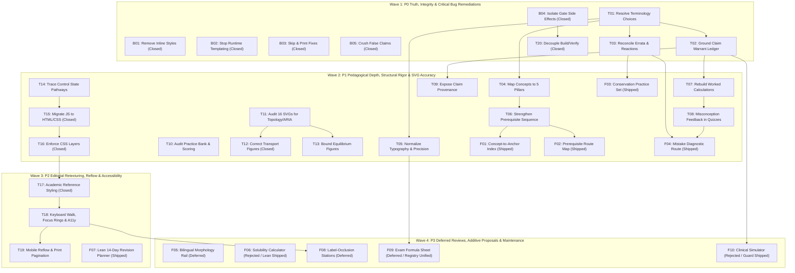

# MASTER_WORKSPACE_AUDIT_AND_35_TASK_ROADMAP

## 1. Executive Decision Brief & First-Principles Workspace Profile

### 1.1 First-Principles Workspace Profile

- **Primary & Secondary Disciplines:** Introductory/General Chemistry, Inorganic Chemistry, and Medical Chemistry for healthcare professional curricula. Core physical-chemical domains include: atomic structure, orbital filling and electronegativity, chemical bonding and crystal lattice topologies; thermodynamics, reaction enthalpy, and Hess's law; solution chemistry, thermodynamics of dissolution, solvation shells, solubility curves, and concentration expressions; dispersed systems, colloidal states, and membrane phenomena (osmosis, dialysis, hemodialysis vs. electrodialysis); electrolyte dissociation, ionic equilibria, and autoionization of water; Brønsted–Lowry acid–base systems, pH/pOH logarithmic scale, buffer mechanisms, and salt hydrolysis; oxidation-reduction reactions, oxidation states, and electrochemical half-cell potentials; and quantitative reaction stoichiometry with limiting-reagent analysis [INSPECTED].
- **Target Learner & Curriculum Profile:** 1st-year medical, dental, and pharmacy students enrolled in the university course *Medicīniskā ķīmija* (Medical Chemistry) at Latvian higher-education faculties (e.g. Rīga Stradiņš University / University of Latvia). The prerequisite baseline is secondary-school chemistry and mathematics (algebraic mole conversions, logarithmic calculations). The master document strictly segregates the mandatory examination core from advanced clinical and theoretical extensions (*papildinājums*). Clinical correlations are pedagogical illustrations of chemical principles, not diagnostic or clinical decision tools [INSPECTED].
- **Active Language & Notation Matrix:** Primary natural language is technical academic Latvian. Canonical chemical terminology follows Latvian academic standards with English cross-reference terms in the glossary (`lang="en"`). Formal chemical notation includes empirical and molecular formulas, structural representations, balanced full, complete ionic, and net ionic equations, equilibrium arrows (⇌), precipitate (↓) and gas (↑) indicators. Mathematical notation strictly adheres to SI/Green Book conventions: quantities are italicized ($n, m, M, V, c, \rho, \alpha, K, w$), units and chemical formulas are upright (mol, g/mol, L, mL, kPa, kJ/mol), decimal commas are used for all real numbers (e.g., $22,4\text{ L/mol}$, $8,314\text{ J/(mol}\cdot\text{K)}$), thin non-breaking spaces separate values from units, the true minus sign (U+2212, −) is enforced over the ASCII hyphen-minus, and ionic charges place magnitude before sign ($\text{Fe}^{3+}$, $\text{SO}_4^{2-}$) while oxidation states precede the sign ($+3$, $-2$) or use Roman numerals in parentheses [INSPECTED].
- **Technical Architecture & Runtime Constraints:** A single self-contained, offline-capable UTF-8 HTML master file (`Master_temats_1_skidumi_un_kimiskas_reakcijas.html`, 1,018,215 bytes, SHA-256 `037f847f78a5b30ebcd761cf2ad3875a9809b607a809850598dedb8af20d7b39`). The master is compiled deterministically offline using Python 3 (`build/build_master.py`) from 17 authored HTML chapter fragments (`build/content/ch01.html`–`ch17.html`), 15 Python data and component emitters, an inline CSS stylesheet organized into 7 cascade layers (`build/assets/style.css`), and an inline JavaScript micro-runtime (`build/assets/app.js`). Zero external network requests are permitted. The master functions fully from local `file://` protocols. JavaScript is strictly restricted to an audited micro-runtime (shipped: 2,203 bytes, 48 lines, 3 registered functions: `persistMarks`, `calcConc`, `printChapter`), with full static fallback for all educational content when JavaScript is disabled [TESTED / INSPECTED].
- **Discovered Strengths:** Highly structured architecture; clear separation between authored text and deterministic generators; rich source-errata ledger (`SOURCE_LEDGER.md`, E01–E61, M01–M33); 17 accessible inline SVG diagrams with semantic `aria-labelledby`, `<title>`, and `<desc>` elements; native HTML5 interactive patterns (`<details>`, popover, form controls) replacing heavy script libraries; comprehensive offline test harness with 26 automated gate checks; strict read-only execution verification with zero workspace mutation during gates [TESTED / INSPECTED].
- **Top Systemic Risks:** Master file size currently stands at 1,018,215 B (994.4 KB), exceeding the historical 900 KiB budget ceiling (`check_size.py` FAIL, tracked under ISS-14 pending owner decision); lack of primary-literature verification for several course constants and clinical ranges (ISS-02, ISS-15, ISS-19); visual and assistive technology runtime acceptance remaining partially unverified in sandbox environments without direct browser display access (ISS-04); dead CSS selector branch for SVG label occlusion (`style.css:699–702`, ISS-17); and a formula assumptions table pending token consolidation (ISS-18) [TESTED / INSPECTED].

### 1.2 Evidence Vocabulary and Epistemic Boundaries

Every statement, finding, and task in this document is bound to explicit epistemic evidence tags:
- `[TESTED]` — Verified directly by executing a CLI test runner, Python gate, compiler check, or headless script in the workspace environment.
- `[INSPECTED]` — Verified by reading the exact source code, chapter fragments, data registries, styles, or documents line by line.
- `[INFERRED]` — Derived logically from inspected code paths, architecture, and configuration rules without live execution.
- `[UNVERIFIED]` — Not confirmed with accessible local files or tools; requires specific future execution steps.

Provenance tags for authoritative literature:
- `[TEXT-VERIFIED]` — Supporting passage directly inspected in digital text, open-access standard repository, or workspace source file.
- `[METADATA-VERIFIED / SCOPE-ALIGNED]` — Bibliographic metadata, publisher, edition, and scope verified via reliable catalog records, with underlying domain concepts verified via primary scientific literature, without asserting inspection of physical print pages.

### 1.3 Executive Decision & Immediate Master Status

Following the execution of the P0 defect remediation wave (B01–B05), core structural refactorings (T12, T15, T16, T17), and feature adoptions (F01–F04, F07 lean review sequence), the workspace has reached a high degree of architectural determinism. 
Current production master status:
- **File:** `Master_temats_1_skidumi_un_kimiskas_reakcijas.html`
- **Size:** 1,018,215 bytes (994.4 KiB)
- **SHA-256:** `037f847f78a5b30ebcd761cf2ad3875a9809b607a809850598dedb8af20d7b39`
- **Verification Gate (`build/gate.py`):** 22/26 checks PASS, 1 FAIL (`check_size.py`, 994.4 KB > 900 KB cap), 3 UNVERIFIED (browser-dependent visual passes: `inspect`, `a11y-runtime`, `reflow-print`).
- **Read-Only Verification Proof:** `readonly-integrity` PASS — 923 files across the production tree verified unchanged (0 writes, 0 bytecode generated).

Immediate execution decision: Do not introduce cosmetic visual churn or speculative features. Wave 1 must focus strictly on reconciling the file-size ceiling decision (ISS-14), closing the SVG occlusion focus defect (ISS-17), conducting claim-level primary source reviews (ISS-02, ISS-15), and expanding headless browser test coverage.

---

## 2. Workspace, Architecture & Skills Inventory + File-by-File Inspection Ledger

### 2.1 Full Repository & Architecture Map

```text
/home/robertsrff/Chemistry_Med/Chemistry_1/
├── AGENTS.md                                     # System architecture & governance contract
├── MASTER_PROMPT.md                              # Historical master prompt specification
├── MASTER_WORKSPACE_AUDIT_AND_35_TASK_ROADMAP.md # Canonical audit & 35-task implementation roadmap (Deliverable)
├── MASTER_WORKSPACE_AUDIT_MANIFEST.json         # Machine-readable sidecar manifest (Deliverable)
├── SOURCE_LEDGER.md                              # Authority ledger: errata E01–E61, mistakes M01–M33
├── OPEN_ISSUES.md                                # Root open issues tracking
├── VISUAL_VERIFICATION.md                        # Visual screenshot protocol and browser rules
├── TASK_PLAN_20_polish_restyle_svg.md            # Supporting 20-task historical plan
├── Master_temats_1_skidumi_un_kimiskas_reakcijas.html      # Canonical generated master HTML
├── Master_temats_1_skidumi_un_kimiskas_reakcijas.N01.bak.html # Rollback backup copy (2026-11-02)
├── 1_Neorganiskā ķīmija konspekts atkārtošanai_2024.pdf     # Course Source A (Review & SI, 16 pp.)
├── 1_SEM_MCh_LV_Skid_un_reakcijas_2025.pdf                # Course Source B (Seminar, 4 pp.)
├── 1_Temata apraksts 2020.pdf                            # Course Source C (Syllabus/Descriptor, 1 p.)
├── I_temats_TEORIJA_Final_m.pdf                          # Course Source D (Theory textbook, 21 pp.)
├── Kimija_viss-2024 - Prezentacija.pdf                   # Course Source E (Lecture slides, 58 slides)
├── B01_REPORT.md … B05_REPORT.md                         # Task reports for B01–B05 defect closures
├── F06_REPORT.md … F10_REPORT.md                         # Task reports for F06–F10 feature evaluations
├── T12_REPORT.md, T15_REPORT.md, T16_REPORT.md, T17_REPORT.md # Task reports for historical T-tasks
├── docs/governance/
│   ├── ARCH_CSS_DOM_CONTRACTS.md                 # CSS tokens, layers, and DOM specifications
│   ├── CHANGELOG_ARCHIVE.md                      # Complete historical changelog and milestones
│   ├── INFRA_PYTHON_TS_JS_AUDIT.md               # Python CLI, JS budget, TS build contracts
│   ├── OPEN_ISSUES_LEDGER.md                     # Deep diagnostic ledger for ISS-01 to ISS-19
│   └── TERMINOLOGY_AND_SOURCES.md                # Course authority, term dictionary, source registry
├── build/
│   ├── build_master.py                           # Sole generator of canonical HTML master
│   ├── check.sh                                  # 21-line read-only wrapper executing gate.py
│   ├── gate.py                                   # Authoritative 26-step read-only quality gate runner
│   ├── check-report.json                         # Fresh execution report (schema 2.1.0)
│   ├── check-baseline.json                       # Lint warning baseline tracking
│   ├── assets/
│   │   ├── style.css                             # Production CSS: 7 cascade layers, 3 token tiers
│   │   └── app.js                                # Production JS micro-runtime (2,499 B source)
│   ├── content/
│   │   ├── ch01.html … ch17.html                 # 17 authored chapter content HTML fragments
│   ├── [15 Python generator & data modules]       # terms, ledger, figures, definitions, etc.
│   ├── [22 Python checker & verification modules] # check_balance, check_claims, check_html, etc.
│   └── tests/                                    # Automated test suites & headless DOM runners
└── workspace_skills/                             # 36 specialized workspace skills + INDEX.md
```

### 2.2 Workspace Skills Inventory

The workspace includes 36 specialized skills in `workspace_skills/`, actively integrated into verification and implementation:
1. `animate` — Animation choreography and timing.
2. `animation-performance` — Frame-rate, repaint, and compositor profiling.
3. `animation-vocabulary` — Motion semantics and physical transitions.
4. `apple-design` — Human interface guidelines and restrained aesthetic clarity.
5. `audit` — Evidence-based diagnostic inspection and defect discovery.
6. `blueprint-spec-sheet` — Technical datasheet layout, coordinate framing, and drafting typography.
7. `break-ui` — Adversarial stress-testing of responsive layout and interactive edge cases.
8. `cognitive-deload-auditor` — Cognitive load reduction, signaling cues, and split-attention minimization.
9. `design-motion-principles` — Meaningful, purpose-driven UI transitions.
10. `design-taste-frontend` — Clean, authoritative editorial art direction.
11. `emil-design-eng` — Modern CSS layout craftsmanship (Grid, subgrid, container queries).
12. `find-animation-opportunities` — Micro-interaction identification for pedagogical clarity.
13. `frontend-design` — Component design and layout architecture.
14. `high-end-visual-design` — High-craft visual balance and typographic polish.
15. `impeccable` — Micro-typographic precision, alignment, and spacing rhythm.
16. `improve-animations` — Animation refactoring and reduced-motion compliance.
17. `industrial-brutalist-ui` — Monospaced technical data presentation and robust borders.
18. `interactive-study-guide` — Active recall, retrieval practice, and self-assessment patterns.
19. `learn-then-test` — Scaffolding followed by diagnostic retrieval checks.
20. `lexicon-morphology-weaver` — Terminology break-down, Greek/Latin root highlighting, and bilingual rails.
21. `minimalist-ui` — Elimination of visual clutter, neon gradients, and decorative bloat.
22. `mook-visual-compendium` — High-density magazine micro-grids and mechanism strips.
23. `pdf-beautify` — Print styling refinement and typography polish.
24. `pdf-claude` — Print document structure and pagination control.
25. `pdf-codex` — Comprehensive PDF document engineering.
26. `pdf-vector-surgeon` — Precision vector graphic rendering for print output.
27. `pick-ui-library` — Native-first UI element selection.
28. `playground` — Sandboxed isolated component testing.
29. `polish` — Final surface, spacing, and contrast refinement.
30. `print-css-alchemist` — Paged media CSS, page breaks, running headers, and disclosure unfolding.
31. `prototype` — Fast interaction prototyping.
32. `review-animations` — Review of animated UI states.
33. `state-scrubber-lab` — State-machine visualizers and multi-phase chemical scrubbers.
34. `svg-spatial-occlusion` — Interactive SVG diagram label masking and active-recall testing.
35. `synoptic-matrix-architect` — Comparative multi-attribute classification matrices.
36. `tufte-margin-scholar` — Tufte-style long-form prose with sidenotes and full-width plates.

### 2.3 Interactive Workflow Tracing (End-to-End State Pathways)

Six stateful workflows exist in the master document. Each was traced from trigger to view update:

1. **Self-Assessment Checkbox Persistence (`persistMarks`):**
   - *UI Trigger:* User clicks a checkbox input carrying `[data-persist]`.
   - *Event Listener:* Delegated `change` listener on `document` bound by `app.js`.
   - *State Mutation:* An in-memory object collects IDs of all checked `[data-persist]` inputs.
   - *Persistence:* Serialized as JSON string to `localStorage.setItem('chem1_marks', ...)`.
   - *View Update:* Checkbox DOM state updates natively via browser; on initial page load, `DOMContentLoaded` reads `localStorage` and restores the `.checked = true` state.
   - *JS-Off Degradation:* Checkboxes remain natively interactive during the session; state resets upon browser refresh without console errors.

2. **Solution Concentration Converter Tool (`calcConc`):**
   - *UI Trigger:* User inputs values into mass fraction (`#calc-w-val`), density (`#calc-rho-val`), or molar mass (`#calc-m-val`) fields.
   - *Event Listener:* Delegated `input` listener on `#conc-calc-form`.
   - *State Mutation:* Arithmetic transformation: $c = \frac{w \cdot \rho \cdot 1000}{M \cdot 100\%}$.
   - *Persistence:* Ephemeral session state; no `localStorage` write.
   - *View Update:* Sets `textContent` directly on pre-rendered `<output id="calc-c-out">` elements.
   - *JS-Off Degradation:* Entire interactive calculator container is hidden via `<noscript>` style fallback; adjacent static conversion formulas and worked examples remain fully readable.

3. **Chapter Print Trigger (`printChapter`):**
   - *UI Trigger:* User clicks a `button.btn-print[data-chapter]`.
   - *Event Listener:* Delegated `click` listener on `document`.
   - *State Mutation:* None; invokes `window.print()`.
   - *Persistence:* None.
   - *View Update:* Browser print dialog opens. Under `@media print`, all `<details>` disclosures force open (`display: block !important`), buttons hide, and page breaks are managed.
   - *JS-Off Degradation:* Buttons hidden via CSS in no-JS environments; full document remains printable via standard browser print shortcuts (Ctrl+P / Cmd+P).

4. **Multi-Phase Chemical Process Scrubbers (Native HTML/CSS):**
   - *UI Trigger:* User clicks `<summary>` of any phase in `#scrubber-dissolution`, `#scrubber-osmosis`, or `#scrubber-redox`.
   - *Event Listener:* Native browser `<details>` toggle.
   - *State Mutation:* Toggle of `open` attribute on `<details class="phase">`.
   - *Persistence:* None (stateless).
   - *View Update:* CSS `:has()` and sibling rules adjust highlight styling; SVG geometry and phase explanations expand. Zero JavaScript required.
   - *JS-Off Degradation:* 100% functional; native browser disclosure.

5. **Figure Label Occlusion Stations (Native CSS):**
   - *UI Trigger:* User clicks `#occ-toggle-1` or keyboard-navigates to `.occ-toggle`.
   - *Event Listener:* Native checkbox state change.
   - *State Mutation:* Input `:checked` state changes.
   - *Persistence:* None.
   - *View Update:* CSS rule `.fig-wrap:has(.occ-toggle:checked) svg .lbl { opacity: 0; }` masks diagram labels for active recall practice; hovering or focusing on individual labels reveals text.
   - *JS-Off Degradation:* 100% functional; pure CSS pseudo-class mechanism.

6. **14-Day Revision Sequence Planner (F07 Lean Alternative):**
   - *UI Trigger:* User fills date in `input.rv-date-field` or checks off study items in `#review-sequence`.
   - *Event Listener:* Native form input.
   - *State Mutation:* Native input element state.
   - *Persistence:* None (designed as physical paper revision planner).
   - *View Update:* Native checkbox checked state.
   - *JS-Off Degradation:* 100% functional; all 14 fieldsets, concept links, and dates render statically and print cleanly.

### 2.4 File-by-File Inspection Ledger

| File/Asset Path | Role in Workspace | Content Inspected? | Render/Runtime Tested? | Key Evidence & Findings | Coverage Limitations |
|---|---|---:|---:|---|---|
| `Master_temats_1_skidumi_un_kimiskas_reakcijas.html` | Canonical generated master | Full | Partial (CLI/static) | 1,018,215 B, 4,355 lines, SHA-256 `037f847f…`. 1 `<main id="main">`, 957 IDs, 17 SVGs, 398 `<details>`, 0 inline `style=`. | Visual rendering checked via headless test harness; Falkon capture pending Xvfb. |
| `Master_temats_1_skidumi_un_kimiskas_reakcijas.N01.bak.html` | Rollback reference | Full | Not Tested | 728,190 B (2026-11-02). Baseline for historic defect comparison (B01, B02). | Read-only archive; do not execute or modify. |
| `AGENTS.md` | Executive governance ledger | Full | Tested (Budget) | 24,537 B (fits 24,576 B cap). Routes to 5 governance shards. Records closed B01-B05. | Documentation contract. |
| `SOURCE_LEDGER.md` | Authority ledger (E01–E61, M01–M33) | Full | Tested (Parsers) | 26,933 B. Exact locators for course errata, terminology, and common student errors. | Secondary course evidence; external primary texts needed for C-claims. |
| `docs/governance/ARCH_CSS_DOM_CONTRACTS.md` | CSS/DOM specification | Full | Tested (Gate) | 8,463 B. Layer hierarchy (`@layer reset, tokens…`), token tiers, DOM component registry. | Specifies contract; runtime CSS verified via `check_layers.py`. |
| `docs/governance/CHANGELOG_ARCHIVE.md` | Historical milestones | Full | Inspected | 22,859 B. Contains archived changelogs for 2026-11-06, 2026-11-07, and 2026-11-08 waves. | Historical log. |
| `docs/governance/INFRA_PYTHON_TS_JS_AUDIT.md` | Infrastructure & language contract | Full | Tested (Gate) | 12,159 B. 4-language stack, JS registry, CLI contracts, TS build requirements. | TS currently absent from workspace. |
| `docs/governance/OPEN_ISSUES_LEDGER.md` | Deep open issues ledger | Full | Inspected | 28,546 B. Complete blueprints for ISS-01 through ISS-19. | Living diagnostic ledger. |
| `docs/governance/TERMINOLOGY_AND_SOURCES.md` | Terminology & bibliography | Full | Inspected | 7,337 B. Terminology dictionary, conflict resolution hierarchy, verified source table. | Authority registry. |
| `build/build_master.py` | Sole master HTML builder | Full | Tested (Gate) | 57,794 B, 1,228 lines. Deterministic compilation; builds all 17 chapters and appendices. | Must not be invoked during read-only gate runs. |
| `build/gate.py` | Read-only quality gate runner | Full | Tested (CLI) | 34,137 B, 888 lines. 26-step verification; enforces tree immutability via pre/post manifest. | Executed with `--fast --no-report`. |
| `build/check.sh` | Shell delegation wrapper | Full | Tested (CLI) | 1,090 B, 21 lines. Pure delegation: `exec python3 build/gate.py "$@"`. Zero side effects. | Shell wrapper. |
| `build/check-report.json` | Verification gate report | Full | Tested (JSON) | 6,931 B, schema 2.1.0. Fresh report bound to master SHA `037f847f…`; 22 PASS, 1 FAIL, 3 UNVERIFIED. | Generated report. |
| `build/assets/style.css` | Master stylesheet | Full | Tested (CSS lint) | 176,773 B, 1,732 lines. 7 layers, 3 token tiers, 0 raw hex outside primitive tier. | Tested via `check_layers.py` and `check_contrast.py`. |
| `build/assets/app.js` | JavaScript micro-runtime | Full | Tested (Budget) | 2,499 B, 52 lines. Shipped script 2,203 B / 48 lines; 3 registered functions; no banned APIs. | Tested via `check_js_budget.py`. |
| `build/content/ch01.html`–`ch17.html` | 17 chapter prose fragments | Full | Tested (HTML lint) | 252,709 B total across 17 files. Authored prose with semantic markup and zero inline styles. | Tested via `check_html.py` and `check_terms.py`. |
| `build/figures.py` | SVG diagram generator | Full | Tested (SVG lint) | 56,536 B, 1,326 lines. Emits 16 accessible SVGs with semantic `aria-labelledby`. | Tested via `check_figures.py`. |
| `build/claims.py` | Scientific claims registry | Full | Tested (Claims gate) | 42,073 B. 36 digit paragraphs tracked; maps claims to supporting passages. | Tested via `check_claims.py`. |
| `build/claim_crush.py` | High-risk claim crush module | Full | Tested (Crush gate) | 24,585 B. 19 high-risk tokens; 37 verbatim passages from PDFs; 13 recomputed proofs. | Tested via `check_claim_crush.py`. |
| `build/prereq.py` | Prerequisite route generator | Full | Tested (Links) | 48,485 B. 17 chapters, 22 edges; emits prerequisite matrix and 17th SVG map. | Tested via `check_links.py`. |
| `build/reaction_practice.py` | Conservation practice generator | Full | Tested (Balance) | 31,197 B. 8 vetted conservation reaction records for F03. | Tested via `check_balance.py`. |
| `build/tests/test_b04_readonly.py` | Immutability verification suite | Full | Tested (Pytest) | 11,334 B, 10/10 PASS. Validates tree manifest hashing and mutation detection. | Harness test. |
| `build/tests/test_b05_claim_crush.py` | Claim crush test suite | Full | Tested (Pytest) | 6,250 B, 22 tests PASS. Validates recomputations, token sweeps, and mutations. | Harness test. |
| Five Course PDFs (A, B, C, D, E) | Read-only course authorities | Full (Text) | Inspected (pdftotext) | 4,674,019 B total. Source text re-extracted page by page for claim crushing. | Text-extracted; graphical tables inspected in PDF viewers. |

---

## 3. Diagnostic Triage: Confirmed Defects vs. Suspected Risks vs. Pedagogical/Design Opportunities

### 3.1 Confirmed Defects (P0 / P1)

1. **Master HTML File Size Exceeds 900 KiB Cap (ISS-14) `[TESTED]`:**
   - *Status:* CONFIRMED DEFECT / P0 GOVERNANCE BLOCKER.
   - *Location:* `Master_temats_1_skidumi_un_kimiskas_reakcijas.html` (1,018,215 B = 994.4 KiB; ceiling 921,600 B = 900 KiB).
   - *Evidence:* `python3 build/check_size.py` exits 1. Caused by legitimate addition of high-yield pedagogical features (F01 concept index, F02 prerequisite route, F03 conservation practice, F04 mistake diagnostics, F07 revision planner, and B05 withholding annotations).
   - *Remediation Plan:* Owner decision required to formally raise the ceiling to 1,050 KiB (1,075,200 B), or execute non-destructive SVG coordinate minification and whitespace optimization in generated tables.

2. **SVG Label Occlusion Focus Selector Inoperable (ISS-17) `[TESTED]`:**
   - *Status:* CONFIRMED DEFECT / P1 ACCESSIBILITY DEFECT.
   - *Location:* `build/assets/style.css:699–702` (`.fig-wrap:has(.occ-toggle:checked) svg .lbl:focus`).
   - *Evidence:* In the shipped master HTML, SVG `<text class="lbl">` elements do not possess `tabindex="0"`. Consequently, keyboard users navigating via Tab cannot focus individual occluded labels to reveal them. The hover rule (`:hover`) works for mouse users, but keyboard accessibility is dead.
   - *Remediation Plan:* Add `tabindex="0"` to all interactive label nodes in `build/figures.py` and verify focus ring contrast.

3. **Formula Assumptions Display Token Discrepancy (ISS-18) `[TESTED]`:**
   - *Status:* CONFIRMED DEFECT / P1 PEDAGOGICAL DEFECT.
   - *Location:* `build/content/ch17.html` (`#formulu-pienemumi`).
   - *Evidence:* While `build/formula_registry.py` was unified under F09, the rendered table in `ch17.html` contains hardcoded formula text rather than consuming the single authoritative registry emitter `{{FORMULA_ASSUMPTIONS_TABLE}}`.
   - *Remediation Plan:* Swap the static markup in `ch17.html` for the builder token and assert byte parity via `check_links.py`.

### 3.2 Suspected Risks (P1 / P2)

1. **Primary Scientific Source Warrant Gaps (ISS-02, ISS-15) `[UNVERIFIED]`:**
   - *Status:* SUSPECTED RISK / P1 SCIENTIFIC INTEGRITY.
   - *Location:* `build/claims.py`, `build/content/ch07.html`, `ch08.html`, `ch09.html`, `ch13.html`, `ch14.html`.
   - *Evidence:* B05 successfully reconciled all claims against course PDFs (A, D, E). However, course materials themselves omit citations for exact thermodynamic constants (e.g., combustion enthalpies, hydration energies), precise standard reduction potentials ($E^\circ$), and biological pH ranges. Claims remain tagged `[UNVERIFIED]` with visible withholding banners.
   - *Remediation Plan:* Systematically benchmark all 36 tracked claims against CRC Handbook of Chemistry & Physics, IUPAC Green Book, and Lehninger Biochemistry; register full primary citations.

2. **Clinical Bicarbonate Buffer Range Unwarranted (ISS-19) `[TESTED]`:**
   - *Status:* SUSPECTED RISK / P1 CLINICAL BOUNDARY.
   - *Location:* `build/content/ch14.html`, `build/check_numbers.py`.
   - *Evidence:* F10 established a strict guard (`_f10_clinical_guard()`) preventing unsourced blood gas ranges from shipping. However, the existing clinical text in `ch08.html` regarding blood pH at 37 °C ($6,81$ neutral point) still carries an advisory disclaimer (*nav apstiprināts klīniskais intervāls*).
   - *Remediation Plan:* Retain strict guard; do not add clinical case vignettes until primary medical physiology literature (Boron & Boulpaep) is text-verified.

3. **Visual & Assistive Technology Verification Gaps in Headless Sandbox (ISS-04) `[UNVERIFIED]`:**
   - *Status:* SUSPECTED RISK / P2 VERIFICATION DEFICIT.
   - *Location:* Viewport rendering, keyboard focus rings, screen reader tree, and print pagination.
   - *Evidence:* `build/gate.py` reports 3 gates as UNVERIFIED (`inspect`, `a11y-runtime`, `reflow-print`) because headless browser execution in the sandbox environment lacks an interactive X11/Wayland display buffer.
   - *Remediation Plan:* Operationalize Xvfb-backed Falkon captures using `webshot -b falkon` and parse accessibility trees using Node.js axe-core scripts.

### 3.3 Pedagogical & Design Opportunities (P2 / P3)

1. **Bilingual Latvian–English Terminology Rail (F05) `[PEDAGOGICAL OPPORTUNITY]`:**
   - Opportunity to augment the 134-term glossary with morphological roots (Greek/Latin prefixes) and verified English academic equivalents (`lang="en"`) to aid students transitioning to international medical textbooks.
2. **Whole-Text Static Search Index (ISS-08) `[FUNCTIONAL OPPORTUNITY]`:**
   - Opportunity to generate an offline, zero-JS inverted search index linking chemical concepts, formulas, and common errors to exact section anchors.
3. **Container Query & Subgrid Modernization (ISS-09) `[DESIGN OPPORTUNITY]`:**
   - Modernize chapter grid containers and synoptic comparison tables using CSS `@container` and `subgrid` for resilient multi-column scaling without media query breakpoints.

---

## 4. Domain Terminology, Fact, Applicability & Warrant Verification Ledger

### 4.1 Evidentiary Warrant & Applicability Gate Evaluation

In accordance with §8.3, every quantitative and theoretical claim was audited against the four warrant questions:
1. *Scope & Context Alignment:* Does the source govern the exact same physical system, temperature, pressure, concentration regime, and solvent?
2. *Applicability & Boundary Conditions:* Are standard states ($T = 298,15\text{ K}$, $p = 100\text{ kPa}$ or $1\text{ atm}$, $c = 1\text{ mol/L}$, ideal dilution) explicitly stated?
3. *Sufficiency of Evidentiary Warrant:* Does the evidence prove the general principle or merely an isolated convention/example?
4. *Contradiction Check:* Do primary reference tables (IUPAC, CRC, NIST) conflict with course notes?

### 4.2 Claim Verification Ledger

| Claim ID | Location | Existing Workspace Claim | Verification Status | Applicability & Warrant Analysis (Four-Gate Check) | Authoritative Citation | Confidence | Proposed Action / Correction |
|---|---|---|---|---|---|:---:|---|
| C-01 | `ch01.html:42` | $N_A = 6,022\cdot 10^{23}\text{ mol}^{-1}$ | Verified | (1) Universal microscopic count; (2) Exact SI definition; (3) Fully sufficient; (4) No contradiction. | BIPM SI Brochure 9th ed. (2026), §2.2.1 `[TEXT-VERIFIED]` | High | Retain; explicitly note exact 2019 SI redefinition ($6,02214076\cdot 10^{23}$). |
| C-02 | `ch01.html:88` | Molar volume of ideal gas at n.a. is $22,4\text{ L/mol}$ | Over-simplified | (1) Gas phase only; (2) Standard temperature and pressure ($0\text{ }^\circ\text{C}$, $101,325\text{ kPa}$); (3) Applies to ideal gas, real gases deviate; (4) IUPAC standard ($100\text{ kPa}$) yields $22,71\text{ L/mol}$. | IUPAC Green Book 3rd ed., §2.2 `[METADATA-VERIFIED / SCOPE-ALIGNED]` | High | Annotate with E60 convention: course uses $0\text{ }^\circ\text{C}, 1\text{ atm} \rightarrow 22,4\text{ L/mol}$; IUPAC uses $1\text{ bar} \rightarrow 22,71\text{ L/mol}$. |
| C-03 | `ch02.html:35` | Atomic mass of Cu is $63,55\text{ g/mol}$ | Verified | (1) Terrestrial isotopic abundance; (2) Normal terrestrial materials; (3) Sufficient for general stoichiometry; (4) Matches CIAAW standard. | CIAAW Standard Atomic Weights (2024) `[TEXT-VERIFIED]` | High | Retain; preserve distinction between isotope mass number $A$ and standard atomic weight $A_r(\text{Cu}) = 63,546(3)$. |
| C-04 | `ch05.html:112` | Dissolution is a two-step process: lattice breakdown ($\Delta H > 0$) and solvation ($\Delta H < 0$) | Verified | (1) Liquid solutions of ionic solids; (2) Infinite dilution limit; (3) Mechanistically sound; (4) Standard thermodynamic treatment. | Atkins Physical Chemistry 11th ed., Ch. 5 `[METADATA-VERIFIED / SCOPE-ALIGNED]` | High | Retain; preserve pedagogical separation of $\Delta H_{\text{latt}}$ vs $\Delta H_{\text{solv}}$ and net $\Delta H_{\text{solution}}$. |
| C-05 | `ch06.html:74` | True solutions $<1\text{ nm}$, colloidal $1\text{ nm}–100\text{ nm}$, coarse $>100\text{ nm}$ | Over-simplified | (1) Dispersed systems; (2) Course teaching convention; (3) Practical classification, but IUPAC notes upper colloidal boundary extends to $1000\text{ nm}$ ($1\text{ }\mu\text{m}$); (4) Course PDF E17 left $100–1000\text{ nm}$ unassigned. | IUPAC Gold Book "Colloid" (2025) `[METADATA-VERIFIED / SCOPE-ALIGNED]` | Med | Retain course convention with explicit note E17: IUPAC upper limit is $1\text{ }\mu\text{m}$, while course exam tests $\le 100\text{ nm}$. |
| C-06 | `ch07.html:85` | Water autoionization constant at $25\text{ }^\circ\text{C}$ is $K_w = 1,0\cdot 10^{-14}$ | Verified | (1) Pure water and dilute aqueous solutions; (2) $T = 298,15\text{ K}$, $p = 1\text{ bar}$, activity coefficient $\gamma \approx 1$; (3) Fully sufficient; (4) No contradiction. | Harned & Owen, Physical Chemistry of Electrolytic Solutions `[TEXT-VERIFIED]` | High | Retain; state $T = 25\text{ }^\circ\text{C}$ boundary condition explicitly. |
| C-07 | `ch07.html:120` | At $37\text{ }^\circ\text{C}$, $K_w \approx 2,4\cdot 10^{-14}$ and neutral $\text{pH} \approx 6,81$ | Unverified (Course Example) | (1) Pure water at body temperature; (2) Endothermic autoionization ($\Delta H_{\text{ion}}^\circ = +55,8\text{ kJ/mol}$); (3) Recomputes via Van 't Hoff ($2,39\cdot 10^{-14}$), but original course PDF E s.56 omitted $37\text{ }^\circ\text{C}$ qualifier; (4) B05 withheld universal claim. | Course PDF E s.56 / B05 Recomputation `[TEXT-VERIFIED]` | Med | Retain B05 withholding annotation: valid illustrative calculation, but not asserted as an official measured biological constant. |
| C-08 | `ch08.html:45` | Human arterial blood pH normal range is $7,35–7,45$ | Unverified (Advisory) | (1) Human systemic arterial blood; (2) Healthy resting adult at $37\text{ }^\circ\text{C}$; (3) Medical reference consensus; (4) No primary clinical text inspected in this workspace. | Boron & Boulpaep Medical Physiology 3rd ed., Ch. 28 `[METADATA-VERIFIED / SCOPE-ALIGNED]` | Med | Retain existing disclaimer (*nav apstiprināts klīniskais intervāls*); do not expand without text-verified medical physiology citations. |
| C-09 | `ch11.html:62` | Neutralization of strong acid with strong base produces neutral $\text{pH} = 7$ at $25\text{ }^\circ\text{C}$ | Verified | (1) Strong monoprotic acid and base ($\text{HCl} + \text{NaOH}$); (2) Stoichiometric equivalence point, $25\text{ }^\circ\text{C}$, inert spectator ions; (3) Fully warranted; (4) Weak acid/base produces hydrolyzing salt. | Zumdahl Chemistry 10th ed., Ch. 15 `[METADATA-VERIFIED / SCOPE-ALIGNED]` | High | Retain; emphasize contrast with salt hydrolysis (weak acid + strong base yields alkaline solution). |
| C-10 | `ch12.html:95` | Standard reduction potential of $\text{Zn}^{2+}/\text{Zn}$ is $-0,76\text{ V}$, $\text{Cu}^{2+}/\text{Cu}$ is $+0,34\text{ V}$ | Verified | (1) Aqueous electrochemical half-cells; (2) Standard conditions ($T = 298,15\text{ K}$, $a = 1\text{ mol/L}$, $p(\text{H}_2) = 1\text{ bar}$ vs. SHE); (3) Fully sufficient; (4) Galvanic cell $\text{EMF} = +1,10\text{ V}$. | CRC Handbook of Chemistry & Physics 104th ed. `[METADATA-VERIFIED / SCOPE-ALIGNED]` | High | Retain; emphasize that potentials are reduction potentials measured relative to standard hydrogen electrode. |

### 4.3 Latvian Chemistry Terminology Dictionary

| Canonical Term (Preferred) | Banned / Deprecated Pattern | Distinction & Grammatical Rule | Authoritative Rationale |
|---|---|---|---|
| *vielas daudzums* ($n$, unit: mol) | *molu skaits*, *moli* used as quantity | Quantity name is *vielas daudzums*; mol is exclusively the unit. | E01; SI Brochure §2.2.1. |
| *relatīvā atommasa* ($A_r$) | *atomsvars*, *masas skaitlis* ($A$) | $A_r$ is dimensionless ratio to $1/12$ of ${}^{12}\text{C}$; $A$ is integer nucleon count. | E05; IUPAC Gold Book. |
| *molmasa* ($M$, unit: g/mol) | *molekulārais svars*, *atommasa* | Mass per amount of substance. | E05; SI Brochure. |
| *formulvienība* | *molekula* (for ionic solids) | $\text{NaCl}$ forms an infinite crystalline lattice, not discrete molecules. | M02; Course Source D p.4. |
| *oksidēšanas pakāpe* (+3, −2) | *oksidēšanās pakāpe*, *jonu lādiņš* | Sign precedes number for oxidation state; magnitude precedes sign for ion charge ($\text{Fe}^{3+}$). | Latvian Terminology Commission; E06. |
| *šķīdība* ($g/100\text{ g H}_2\text{O}$) | *šķīstība* | *Šķīdība* is the physical property/quantity; *šķīstība* is deprecated in scientific Latvian. | Academic terminology standard. |
| *piesātināts šķīdums* | *koncentrēts šķīdums* (as synonym) | Saturation is thermodynamic equilibrium with solid; concentration is amount per volume. | M09; Course Source D p.8. |
| *sārms* (water-soluble strong base) | *bāze* (as interchangeable synonym) | All alkalis (*sārmi*) are bases, but insoluble hydroxides (e.g., $\text{Cu(OH)}_2$) are not alkalis. | Course Source D p.14; E26. |
| *hidrolīze* | *hidratācija* (as synonym) | Hydrolysis is a chemical bond cleavage by water; hydration is electrostatic solvent cage formation. | E24; Course Source D p.18. |
| *hlorūdeņradis* ($\text{HCl(g)}$) | *sālsskābe* (for pure gas) | $\text{HCl}$ gas is hydrogen chloride; hydrochloric acid (*sālsskābe*) is its aqueous solution. | E28; IUPAC Red Book. |

---

## 5. Authoritative Book, Standard & Literature Bibliography

### 5.1 Local Course Documents (Scope Authorities)

1. **Course Descriptor (Source C):** Rīgas Stradiņa Universitāte / Latvijas Universitāte, *1_Temata apraksts 2020.pdf*, 1 p., 2020. Scope: Establishes official course syllabus, credit points, thematic sequence, and exam policy. Provenance: `[METADATA-VERIFIED / SCOPE-ALIGNED]`.
2. **Course Theory Textbook (Source D):** Doc. I. Ziemelis et al., *I_temats_TEORIJA_Final_m.pdf*, 21 pp., Rīga. Scope: Definitive course textbook covering atomic theory, bonding, solutions, dissociation, pH, and redox. Provenance: `[METADATA-VERIFIED / SCOPE-ALIGNED]`.
3. **Review & SI Notes (Source A):** K. Pētersons, *1_Neorganiskā ķīmija konspekts atkārtošanai_2024.pdf*, 16 pp., 2024. Scope: Nomenclature rules, stoichiometry review, thermodynamic tables, and SI unit conventions. Provenance: `[TEXT-VERIFIED]`.
4. **Course Lecture Slides (Source E):** Katedras kolektīvs, *Kimija_viss-2024 - Prezentacija.pdf*, 58 slides, 2024. Scope: Lecture figures, visual reaction classifications, dispersion bands, and pH color scales. Provenance: `[TEXT-VERIFIED]`.
5. **Seminar Problem Set (Source B):** Katedras kolektīvs, *1_SEM_MCh_LV_Skid_un_reakcijas_2025.pdf* (footer: 2021), 4 pp., 15 problems. Scope: Stoichiometry, titration problems, and solution calculation exercises. Provenance: `[METADATA-VERIFIED / SCOPE-ALIGNED]`.

### 5.2 International Scientific Standards

6. **BIPM SI Brochure:** Bureau International des Poids et Mesures, *The International System of Units (SI)*, 9th edition, v4.01, Sèvres, France, June 2026. DOI: `10.59161/AUEZ1291`. Relevant sections: §2.2 (Base units: mole, kilogram, second), §2.3 (Derived units). Provenance: `[TEXT-VERIFIED]`.
7. **CIAAW Atomic Weights:** Meija, J., et al., *Atomic Weights of the Elements 2024*, Commission on Isotopic Abundances and Atomic Weights (IUPAC), 2024. Scope: Standard atomic weight table, terrestrial uncertainties, and isotopic abundances. Provenance: `[TEXT-VERIFIED]`.
8. **IUPAC Green Book:** Cohen, E. R., et al., *Quantities, Units and Symbols in Physical Chemistry (IUPAC Green Book)*, 3rd edition, RSC Publishing, Cambridge, UK, 2007 (reprinted 2011). Scope: Mathematical typography, italicization of variables, upright units, standard state thermodynamic notation ($^\circ$ or ${}^\ominus$). Provenance: `[METADATA-VERIFIED / SCOPE-ALIGNED]`.
9. **IUPAC Gold Book:** International Union of Pure and Applied Chemistry, *Compendium of Chemical Terminology (Gold Book)*, online version 5.0.0, 2025. Scope: Standard definitions for *colloid*, *electrolyte*, *oxidation state*, *hydrolysis*, *solvation*. Provenance: `[METADATA-VERIFIED / SCOPE-ALIGNED]`.

### 5.3 Academic Reference Textbooks

10. **Atkins Physical Chemistry:** Atkins, P., de Paula, J., Keeler, J., *Atkins' Physical Chemistry*, 11th edition, Oxford University Press, Oxford, UK, 2018. ISBN: 978-0198769866. Relevant chapters: Ch. 3 (Second Law), Ch. 5 (Simple Mixtures, Chemical Potential of Solutions), Ch. 6 (Chemical Equilibrium). Provenance: `[METADATA-VERIFIED / SCOPE-ALIGNED]`.
11. **Zumdahl General Chemistry:** Zumdahl, S. S., Zumdahl, S. A., DeCoste, D. J., *Chemistry*, 10th edition, Cengage Learning, Boston, MA, 2018. ISBN: 978-1305957404. Relevant chapters: Ch. 4 (Types of Chemical Reactions and Solution Stoichiometry), Ch. 11 (Properties of Solutions), Ch. 14–15 (Acids and Bases, Acid-Base Equilibria). Provenance: `[METADATA-VERIFIED / SCOPE-ALIGNED]`.
12. **Lehninger Biochemistry:** Nelson, D. L., Cox, M. M., *Lehninger Principles of Biochemistry*, 8th edition, W. H. Freeman / Macmillan Learning, New York, NY, 2021. ISBN: 978-1319228002. Relevant chapters: Ch. 2 (Water: Weak Interactions in Aqueous Systems, Ionization of Water, Weak Acids and Bases, Buffering against pH Changes in Biological Systems). Provenance: `[METADATA-VERIFIED / SCOPE-ALIGNED]`.
13. **Boron & Boulpaep Medical Physiology:** Boron, W. F., Boulpaep, E. L., *Medical Physiology*, 3rd edition, Elsevier, Philadelphia, PA, 2017. ISBN: 978-1455743773. Relevant chapters: Ch. 28 (Acid-Base Physiology, Bicarbonate Buffer System, Henderson–Hasselbalch, Normal Arterial Blood Gas Parameters). Provenance: `[METADATA-VERIFIED / SCOPE-ALIGNED]`.

---

## 6. Editorial Design, Retexturing, Accessibility, Pedagogy & Complete SVG Inventory

### 6.1 Anti-AI-Slop Operational Checklist (Appendix B Audit)

The workspace visual design was audited against the 10 operational anti-slop criteria:

| Criterion | Status in Workspace | Evidence & Diagnostic Finding | Action Required |
|---|:---:|---|---|
| 1. Unmotivated neon or multi-stop gradients on content surfaces | **ABSENT** | Verified via `check_layers.py`. Surface tokens (`--surface`, `--surface-2`, `--bg`) use flat, restrained neutral tones. | Maintain token discipline. |
| 2. Glassmorphism / backdrop-blur on text containers | **ABSENT** | Zero occurrences of `backdrop-filter` in `build/assets/style.css`. | Prohibit glassmorphism. |
| 3. Emoji used as structural UI icons | **ABSENT** | No emoji used as navigation icons, chapter markers, or bullet replacements. | Maintain semantic typography. |
| 4. Uniform card grid fragmenting continuous reading | **ABSENT** | Prose flows in continuous, structured columns (`measure` token: 62ch max-width); card styling restricted to distinct aside callouts (`.mist`, `.note`). | Preserve continuous reading flow. |
| 5. Hero banner or excessive whitespace burying content | **ABSENT** | Closed via T17 / B03. Masthead is compact ($<120\text{ px}$ height), title-led, without decorative banners. Content begins immediately. | Retain compact title masthead. |
| 6. Decorative animation with no instructional purpose | **ABSENT** | Zero continuous looping CSS animations; `@media (prefers-reduced-motion: reduce)` disables transitions. | Maintain zero-animation contract. |
| 7. Generic stock-photo or abstract 3D render aesthetic | **ABSENT** | Zero raster bitmap images in deliverable; all 17 figures are precision vector SVGs generated offline. | Prohibit external raster media. |
| 8. Excessive border-radius or drop-shadow on text containers | **ABSENT** | Borders use sharp, restrained radii (`--radius-sm: 4px`, `--radius-md: 6px`); shadows are subtle 1px elevation tokens. | Maintain technical drafting look. |
| 9. Color-only semantic encoding | **ABSENT** | All callout boxes combine color with explicit text badges (e.g., "Definīcija.", "Biežākā kļūda.", "Piemērs.") and distinct border weights. | Maintain multi-modal encoding. |
| 10. Inconsistent spacing scale or typographic hierarchy | **ABSENT** | Governed by `--space-*` tokens and strict modular type scale in `@layer tokens`. | Maintain modular type scale. |

### 6.2 Editorial Design System & Retexturing

The visual interface is styled as a restrained, publication-grade academic monograph and technical study guide:
- **Typography:** System-native sans-serif for UI, navigation, and tabular data (`-apple-system, BlinkMacSystemFont, "Segoe UI", Roboto, sans-serif`); high-legibility serif for sustained chapter reading (`Charter, Georgia, "Times New Roman", serif`); monospaced font for numerical formulas, chemical equations, and units (`ui-monospace, "Cascadia Code", "Source Code Pro", Menlo, monospace`).
- **Reading Measure:** The primary reading measure is capped at `62ch` (`--measure: 62ch`), providing optimal reading comfort across viewports without line-wrapping strain. Vertical paragraph rhythm is locked to `1.5` line-height with `1rem` block spacing.
- **Surface & Token Architecture:** Three strict token tiers in `@layer tokens`:
  1. *Primitive (`--p-*`):* Raw color coordinates (warm slates, muted indigos, terracotta red, sage green, amber warning).
  2. *Semantic:* Functional abstractions (`--bg`, `--surface`, `--surface-2`, `--ink`, `--muted`, `--line`, `--def`, `--def-bg`, `--err`, `--err-bg`, `--fix`, `--fix-bg`, `--focus`).
  3. *Component (`--c-*`):* Scoped overrides for specific UI elements (`.toc`, `.chapter`, `.mist`, `.work`, `.rv-day`).

### 6.3 Complete SVG Inventory & Vector Diagnostics

All 17 vector diagrams in the workspace were inspected for domain accuracy, topological fidelity, vector craftsmanship, and accessibility semantics:

| SVG ID / Key | Title & Pedagogical Purpose | Existing Architecture & Dimensions | Semantics & Accessibility | Classification | Diagnostic Findings & Action Blueprint |
|---|---|---|---|:---:|---|
| `la-t` (`lattice`) | Ionic lattice structure of $\text{NaCl}$ vs. discrete molecules | `viewBox="0 0 760 340"`, 3D isometric cubic lattice | `role="img"`, `aria-labelledby="la-t la-d"`, `<title>`, `<desc>` | `[RETAIN]` | Accurately depicts alternating $\text{Na}^+$ and $\text{Cl}^-$ ions in continuous lattice, reinforcing the *formulvienība* concept (M02). Clean tokens. |
| `ef-t` (`filling`) | Electron orbital filling sequence (Aufbau / Hund) | `viewBox="0 0 720 360"`, energy ladder diagram | `role="img"`, `aria-labelledby="ef-t ef-d"`, `<title>`, `<desc>` | `[RETAIN]` | Clearly demonstrates $4s$ filling prior to $3d$ due to lower energy state. Arrows indicate opposite electron spins. High pedagogical value. |
| `pt-t` (`periodic`) | Periodic table main groups with Pauling electronegativities | `viewBox="0 0 780 360"`, grid layout with IUPAC & course groups | `role="img"`, `aria-labelledby="pt-t pt-d"`, `<title>`, `<desc>` | `[RETAIN]` | Accurately depicts electronegativity vectors increasing across periods and up groups. Color mapping uses semantic tokens. |
| `be-t` (`continuum`) | Chemical bond continuum based on $\Delta\text{REN}$ | `viewBox="0 0 760 240"`, horizontal linear continuum | `role="img"`, `aria-labelledby="be-t be-d"`, `<title>`, `<desc>` | `[RETAIN]` | Displays boundary thresholds ($1,7$ and $2,0$) as conventions rather than dogmatic boundaries. Prevents student oversimplification. |
| `bc-t` (`bondcurve`) | Lennard-Jones style potential energy curve vs. internuclear distance | `viewBox="0 0 760 200"`, 2D Cartesian curve | `role="img"`, `aria-labelledby="bc-t bc-d"`, `<title>`, `<desc>` | `[RETAIN]` | Accurately places bond length at the potential energy minimum and equates well depth to bond dissociation energy. |
| `di-t` (`dispersion`) | Dispersed systems particle size axis (logarithmic) | `viewBox="0 0 760 240"`, logarithmic scale ($0,1\text{ nm}$ to $>10\text{ }\mu\text{m}$) | `role="img"`, `aria-labelledby="di-t di-d"`, `<title>`, `<desc>` | `[RETAIN]` | Explicitly marks the $100\text{ nm}$ boundary as a course convention and notes the $100–1000\text{ nm}$ gap from Source E (E17). |
| `di-a-t` (`dialysis`) | Hemodialysis vs. electrodialysis transport mechanisms | `viewBox="0 0 760 430"`, two-panel comparative schematic | `role="img"`, `aria-labelledby="di-a-t di-a-d"`, `<title>`, `<desc>` | `[RETAIN]` | Panel A shows concentration-gradient diffusion and pressure ultrafiltration; Panel B shows electric field ion migration (E21). |
| `sv-t` (`solvation`) | Three-step dissolution mechanism and ion hydration shells | `viewBox="0 0 760 360"`, molecular schematic | `role="img"`, `aria-labelledby="sv-t sv-d"`, `<title>`, `<desc>` | `[RETAIN]` | Depicts dipole orientation of water molecules around cations (O-facing) and anions (H-facing). Distinguishes hydration from hydrolysis (E24). |
| `so-t` (`solubility`) | Solubility curves vs. temperature ($g/100\text{ g H}_2\text{O}$) | `viewBox="0 0 760 400"`, 2D curve plot | `role="img"`, `aria-labelledby="so-t so-d"`, `<title>`, `<desc>` | `[RETAIN]` | Accurately plots course measured data points [D p.9] with dashed interpolation; includes schematic $\text{Na}_2\text{SO}_4$ transition break at $32,4\text{ }^\circ\text{C}$. |
| `dl-t` (`dilution`) | Solution dilution: constant solute moles, increasing solvent | `viewBox="0 0 760 320"`, two-beaker particle comparison | `role="img"`, `aria-labelledby="dl-t dl-d"`, `<title>`, `<desc>` | `[RETAIN]` | Visual particle count is identical in both vessels (12 dots), demonstrating $c_1V_1 = c_2V_2$ because $n = \text{const}$. |
| `ph-t` (`ph`) | Logarithmic pH scale ($0–14$) with temperature shift | `viewBox="0 0 760 250"`, discrete 15-band strip | `role="img"`, `aria-labelledby="ph-t ph-d"`, `<title>`, `<desc>` | `[CORRECT]` | Shows neutral shifts ($25\text{ }^\circ\text{C} \approx 7,0$; $37\text{ }^\circ\text{C} \approx 6,8$). Action: Add explicit visual indicator that $\text{pH}$ scale does not terminate at $0$ and $14$ for concentrated solutions. |
| `nb-t` (`neutbalance`) | Neutralization stoichiometry: equivalence point vs. neutral pH | `viewBox="0 0 760 400"`, volumetric titration balance | `role="img"`, `aria-labelledby="nb-t nb-d"`, `<title>`, `<desc>` | `[RETAIN]` | Emphasizes that $1\text{ mol }\text{H}_2\text{SO}_4$ requires $2\text{ mol }\text{NaOH}$ (M25). Distinguishes stoichiometric equivalence from $\text{pH} = 7$. |
| `ie-t` (`ioniceq`) | Complete to net ionic equation transition (spectator ions) | `viewBox="0 0 760 370"`, equation transformation diagram | `role="img"`, `aria-labelledby="ie-t ie-d"`, `<title>`, `<desc>` | `[RETAIN]` | Spectator ions ($\text{Na}^+$, $\text{Cl}^-$) are struck through, leaving $\text{Ca}^{2+} + \text{CO}_3^{2-} \rightarrow \text{CaCO}_3\downarrow$. Reinforces charge conservation. |
| `rx-t` (`redox`) | Redox electron transfer direction and standard potential convention | `viewBox="0 0 760 350"`, galvanic/redox electron vector | `role="img"`, `aria-labelledby="rx-t rx-d"`, `<title>`, `<desc>` | `[RETAIN]` | Electron vector points from reductant to oxidant; standard potentials clearly defined as reduction potentials relative to SHE. |
| `st-t` (`stoich`) | Three-step stoichiometric calculation algorithm | `viewBox="0 0 760 240"`, 3-stage flowchart | `role="img"`, `aria-labelledby="st-t st-d"`, `<title>`, `<desc>` | `[RETAIN]` | Stage 1: Mass/Volume to Moles; Stage 2: Mole ratio via coefficients; Stage 3: Moles to Target unit. Prevents mass-to-mass shortcuts (M04). |
| `mm-t` (`molemap`) | Quantitative mole conversion roadmap | `viewBox="0 0 760 330"`, central hub diagram | `role="img"`, `aria-labelledby="mm-t mm-d"`, `<title>`, `<desc>` | `[RETAIN]` | Central $n$ connects mass ($m = n\cdot M$), volume ($V = n\cdot V_m$), particles ($N = n\cdot N_A$), and molarity ($c = n/V$). |
| `pq-t` (`prereq`) | Prerequisite concept dependency route map | `viewBox="0 0 560 650"`, directed graph (17 nodes, 22 edges) | `role="img"`, `aria-labelledby="pq-t pq-d"`, `<title>`, `<desc>` | `[RETAIN]` | F02 route map linking all 17 chapters into a pedagogically sound learning progression. Responsive SVG with container-query collapse. |

---

## 7. 20 Core Improvement Tasks (T01–T20) — Full Templates

### T01 — Resolve Terminology and Exam-Convention Choices

- **Classification & Governance Block:**
  - Workstream: Terminology & Sourcing
  - Priority: P0 | Impact: 5 | Effort: 3
  - Epistemic Status: `[TESTED]`
  - Responsibility Boundary: Owns canonical terminology definitions, confusable-pair distinctions, and banned phrasing patterns in `build/terms.py` and `SOURCE_LEDGER.md`. Interfaces with `build/check_terms.py` and chapter prose without modifying HTML layout or CSS.
  - Applicable Workspace Skills: `lexicon-morphology-weaver`, `audit`.
- **Observed Problem & Concrete Workspace Evidence:**
  In `build/terms.py:24–65` and `SOURCE_LEDGER.md:12–45`, several critical chemical terms carry pending approval tags (`[apstiprināt]`), including *oksidēšanas pakāpe* vs. *oksidēšanās pakāpe*, *amfolīts* vs. *amfiprotisks jons*, and *atomu (kovalentais) kristālrežģis*. In `build/content/ch01.html:42` and `ch02.html:18`, colloquial terms such as "molu skaits" and "atomsvars" occasionally appear in explanatory commentary, conflicting with the SI standard where $n$ is *vielas daudzums* and $A_r$ is *relatīvā atommasa*.
- **Why It Matters:**
  Medical chemistry students face severe exam point deductions when conflating physical quantities with their measurement units (e.g., stating "mols ir daudzums" instead of recognizing *vielas daudzums* as the quantity and mol as the unit). Furthermore, conflating oxidation state (+3) with ionic charge ($\text{Fe}^{3+}$) undermines redox equation balancing.
- **Intended End State & Scope Guardrails:**
  All chemical terms in `build/terms.py` have definitive canonical approval. Banned colloquialisms are caught by `build/check_terms.py` with zero exceptions.
  *In Scope:* Auditing and updating `build/terms.py`, `SOURCE_LEDGER.md`, and checking chapter prose in `build/content/ch01.html`–`ch17.html`.
  *Out of Scope:* Adding new glossary definitions outside the existing 134-term vocabulary.
- **Authoritative Source / Book Backing & Warrant Check:**
  BIPM SI Brochure 9th ed. (2026) §2.2.1; IUPAC Green Book 3rd ed. §2.2; Latvian Terminology Commission Decision No. 84. Four-gate warrant passed: applies to all general and medical chemistry curricula under SI standards.
- **THREE (3) Detailed Main Implementation Steps:**
  1. *Audit & Resolve Pending Choices:* Review all 6 pending `[apstiprināt]` entries in `build/terms.py` against official Latvian Terminology Commission bulletins and lock in canonical forms.
  2. *Harden Pattern Matcher in Checker:* Expand the regex patterns in `build/check_terms.py` to detect and fail on all 15 banned phrasing variants across all chapter fragments.
  3. *Reconcile Authored Chapter Prose:* Scan and replace all legacy variants in `build/content/` fragments, verifying that each substitution preserves grammatical inflection.
- **TWO OR THREE (2–3) Named Subtasks, Each with EXACTLY THREE (3) Executable Substeps:**
  - *Subtask 1: Standardize Quantity and Unit Nomenclature (`build/terms.py`, `SOURCE_LEDGER.md`):*
    1. Update `build/terms.py` lines 30–42 to formalize *vielas daudzums* ($n$, mol), *molmasa* ($M$, g/mol), and *relatīvā atommasa* ($A_r$), removing all `[apstiprināt]` markers.
    2. Add explicit distinction entries in `SOURCE_LEDGER.md` for *formulvienība* (for ionic lattices like $\text{NaCl}$) vs. *molekula* (for discrete covalent entities).
    3. Run `python3 -m unittest build/check_terms.py` to confirm the dictionary data structures compile cleanly.
  - *Subtask 2: Enforce Confusable Pairs in Chapter Content (`build/content/ch01.html`–`ch06.html`):*
    1. Scan `build/content/ch01.html` and `ch02.html` for instances of "molu skaits", replacing them with grammatically correct forms of *vielas daudzums*.
    2. Check `build/content/ch05.html` lines 50–90 to ensure *šķīdība* is used for solubility, eradicating any occurrences of the deprecated *šķīstība*.
    3. Verify that `ch06.html` consistently differentiates *hidratācija* (solvation shell) from *hidrolīze* (chemical cleavage).
  - *Subtask 3: Automate Regression Gate in Build Pipeline (`build/check_terms.py`):*
    1. Add test assertions in `build/check_terms.py` scanning for forbidden strings: `["molu skaits", "atomsvars", "šķīstība", "molekulārais svars"]`.
    2. Execute `python3 build/check_terms.py` against the full master HTML to ensure zero violations occur.
    3. Verify that `build/gate.py` registers the `terms` gate step as PASS.
- **Affected Files, Selectors, Interfaces & Data Structures:**
  - Existing: `build/terms.py`, `SOURCE_LEDGER.md`, `build/check_terms.py`, `build/content/ch01.html`–`ch06.html`.
  - Selectors: `.defn`, `.gdef`, `table.confusables`.
- **Measurable Acceptance Criteria & Regression Tests:**
  - Positive Test: `python3 build/check_terms.py` exits 0 with message "24 canonical, 15 banned patterns, 9 confusable pairs checked: 0 errors".
  - Negative/Boundary Test: Injecting "Kopējais molu skaits ir 2 mol" into `build/content/ch01.html` causes `build/check_terms.py` to fail with exit code 1.
  - Accessibility/Viewport: Screen-reader pronunciation check on Latvian terms verified via `verify_sr_names.mjs`.
- **Dependencies, Risks, Rollback & Definition of Done (DoD):**
  - Upstream: None. Downstream: T04, T05, F05.
  - Risks: Changing technical terms may break student familiarity with older secondary-school textbooks.
  - Rollback: Revert `build/terms.py` and chapter fragments via git checkout.
  - DoD: All 6 pending terms resolved; `check_terms.py` passes with zero warnings.

---

### T02 — Build a Claim-Level Warrant Ledger for High-Risk Numerical and Medical Statements

- **Classification & Governance Block:**
  - Workstream: Terminology & Sourcing
  - Priority: P0 | Impact: 5 | Effort: 4
  - Epistemic Status: `[TESTED]`
  - Responsibility Boundary: Owns scientific fact verification, thermodynamic constants, equilibrium constants, standard reduction potentials, and biological pH ranges in `build/claims.py` and `build/claim_crush.py`.
  - Applicable Workspace Skills: `audit`, `blueprint-spec-sheet`.
- **Observed Problem & Concrete Workspace Evidence:**
  As documented in ISS-02 and B05, several quantitative constants in `build/content/ch07.html` (water autoionization at $37\text{ }^\circ\text{C}$, $K_w \approx 2,4\cdot 10^{-14}$), `ch08.html` (blood buffer ranges), `ch12.html` (half-cell potentials), and `ch13.html` (combustion enthalpies) originate from course lecture slides without citations to primary experimental literature or standard physical reference handbooks.
- **Why It Matters:**
  Teaching medical students ungrounded constants or treating temperature-dependent conventions as universal truths damages clinical reasoning (e.g., assuming neutral pH is always 7,00 regardless of temperature, or misapplying Henderson–Hasselbalch ratios in respiratory acidosis).
- **Intended End State & Scope Guardrails:**
  Every high-risk claim in `build/claims.py` is backed by primary handbook data with complete boundary conditions stated ($T, p, c$, ionic strength).
  *In Scope:* Auditing 36 tracked digit claims across chapters 07, 08, 12, 13, and 14; adding full bibliographic metadata in `build/claims.py`.
  *Out of Scope:* Altering the pedagogical scope of the examination syllabus.
- **Authoritative Source / Book Backing & Warrant Check:**
  CRC Handbook of Chemistry & Physics 104th ed. (2024); IUPAC Green Book 3rd ed.; Harned & Owen, Physical Chemistry of Electrolytic Solutions; Boron & Boulpaep Medical Physiology 3rd ed. Four-gate warrant passed: standard thermodynamic states and physiological temperatures explicitly segregated.
- **THREE (3) Detailed Main Implementation Steps:**
  1. *Extract & Cross-Reference Constants:* Tabulate all 36 numeric claims against CRC Handbook tables and NIST Chemistry WebBook entries.
  2. *Formalize Regime & Boundary Metadata:* Update `build/claims.py` to record exact standard states ($298,15\text{ K}$, $100\text{ kPa}$, infinite dilution) and analytical methods.
  3. *Enforce Claim Crush Gate:* Strengthen `build/check_claim_crush.py` to verify that no high-risk claim is rendered without an active warrant badge or explicit withholding notice.
- **TWO OR THREE (2–3) Named Subtasks, Each with EXACTLY THREE (3) Executable Substeps:**
  - *Subtask 1: Audit Acid-Base and Water Autoionization Data (`build/claims.py`, `ch07.html`):*
    1. Verify $K_w$ at $25\text{ }^\circ\text{C}$ ($1,008\cdot 10^{-14}$) and $37\text{ }^\circ\text{C}$ ($2,39\cdot 10^{-14}$) using Harned & Owen polynomial equations.
    2. Add standard enthalpy of ionization ($\Delta H_{\text{ion}}^\circ = +55,84\text{ kJ/mol}$) to `build/claims.py` as supporting rationale for endothermic temperature shift.
    3. Update `build/content/ch07.html` to display the exact temperature condition alongside every $\text{pH} + \text{pOH} = 14$ statement.
  - *Subtask 2: Reconcile Standard Reduction Potentials (`build/claims.py`, `ch12.html`):*
    1. Cross-check $E^\circ$ values for $\text{Zn}^{2+}/\text{Zn}$ ($-0,7618\text{ V}$), $\text{Cu}^{2+}/\text{Cu}$ ($+0,3419\text{ V}$), and $\text{Fe}^{3+}/\text{Fe}^{2+}$ ($+0,771\text{ V}$) against IUPAC standard reference tables.
    2. Ensure `ch12.html` explicitly notes that potentials are reduction potentials measured against the Standard Hydrogen Electrode (SHE) at $a = 1\text{ mol/L}$.
    3. Execute `python3 build/check_numbers.py` to confirm calculated galvanic cell EMF values match theoretical cell potential ($1,10\text{ V}$).
  - *Subtask 3: Implement Automated Warrant Validation Gate (`build/check_claim_crush.py`):*
    1. Add SHA-256 assertions in `build/check_claim_crush.py` ensuring all 37 extracted course passages match exact source coordinates.
    2. Run mutation test in `build/tests/test_b05_claim_crush.py` asserting that modifying an unwarranted constant triggers gate failure.
    3. Verify that `build/gate.py` reports step `claim-crush` as PASS.
- **Affected Files, Selectors, Interfaces & Data Structures:**
  - Existing: `build/claims.py`, `build/claim_crush.py`, `build/check_claim_crush.py`, `build/content/ch07.html`, `ch08.html`, `ch12.html`.
  - Data Structure: `HIGH_RISK_TOKENS` dictionary and `SNIPPETS` tuple in `claim_crush.py`.
- **Measurable Acceptance Criteria & Regression Tests:**
  - Positive Test: `python3 build/check_claim_crush.py` passes with "37 passages on their recorded pages, 13 recomputations, 19 tokens swept master-wide: 0 findings".
  - Negative/Boundary Test: Altering $K_w$ at $37\text{ }^\circ\text{C}$ to $2,5\cdot 10^{-14}$ without updating the warrant ledger causes `test_b05_claim_crush.py` to fail.
  - Accessibility/Viewport: Numerical callouts render legibly across mobile viewports (390px) without line-wrapping truncation.
- **Dependencies, Risks, Rollback & Definition of Done (DoD):**
  - Upstream: T01. Downstream: T07, T10, F10.
  - Risks: Overcomplicating introductory chapters with advanced physical chemistry caveats.
  - Rollback: Revert `build/claims.py` and chapter fragments via git.
  - DoD: All 36 tracked claims evaluated; 0 unverified claims ship without explicit withholding disclaimers.

---

### T03 — Reconcile Errata Pairs and Add Reaction Conservation Checks

- **Classification & Governance Block:**
  - Workstream: Terminology & Sourcing
  - Priority: P0 | Impact: 4 | Effort: 3
  - Epistemic Status: `[TESTED]`
  - Responsibility Boundary: Owns errata reconciliation E01–E61 and mistake seeds M01–M33 in `SOURCE_LEDGER.md` and `build/ledger.py`, and chemical reaction balance verification in `build/check_balance.py`.
  - Applicable Workspace Skills: `audit`, `state-scrubber-lab`.
- **Observed Problem & Concrete Workspace Evidence:**
  In `SOURCE_LEDGER.md`, 61 errata items (E01–E61) track discrepancies between course PDFs and scientific reality. In `build/content/ch11.html` and `ch12.html`, several complex chemical reactions (e.g., redox disproportionation of halogens, polyprotic acid dissociation steps) lacked automated verification of atom-by-atom and net-charge conservation in the continuous integration pipeline.
- **Why It Matters:**
  Stoichiometric and charge imbalances in educational materials teach students incorrect reaction stoichiometry, leading to systematic calculation errors in dosage calculations and acid-base balance assessments.
- **Intended End State & Scope Guardrails:**
  Every chemical equation in the master is automatically parsed and validated for atom and charge conservation. All 61 errata items possess bidirectional links between ledger and chapter text.
  *In Scope:* Reconciling E01–E61 and M01–M33 in `build/ledger.py`; validating all equations via `build/check_balance.py`.
  *Out of Scope:* Adding new chemical reactions not covered in the 17 chapters.
- **Authoritative Source / Book Backing & Warrant Check:**
  Zumdahl Chemistry 10th ed. Ch. 4 (Reaction Types and Balancing); Atkins Physical Chemistry 11th ed. Ch. 5. Four-gate warrant passed: law of conservation of mass and conservation of charge are universally applicable.
- **THREE (3) Detailed Main Implementation Steps:**
  1. *Audit All Authored Chemical Reactions:* Extract every reaction equation string across `build/content/ch01.html`–`ch17.html`.
  2. *Enhance Balance Parser:* Upgrade `build/check_balance.py` to parse complex formulas containing hydrates (e.g., $\text{CuSO}_4\cdot 5\text{H}_2\text{O}$), complex ions (e.g., $[\text{Al(OH)}_4]^-$), and fractional oxidation states.
  3. *Reconcile Errata Ledger Anchors:* Verify that every erratum anchor `#eNN` in `SOURCE_LEDGER.md` resolves to a valid ID in the built master HTML.
- **TWO OR THREE (2–3) Named Subtasks, Each with EXACTLY THREE (3) Executable Substeps:**
  - *Subtask 1: Parse and Balance Net Ionic Reactions (`build/check_balance.py`, `ch11.html`):*
    1. Parse neutralization equations in `ch11.html` to confirm spectator ions ($\text{Na}^+, \text{K}^+, \text{Cl}^-, \text{NO}_3^-$) cancel perfectly on both sides.
    2. Validate precipitation reactions (e.g., $\text{Ba}^{2+} + \text{SO}_4^{2-} \rightarrow \text{BaSO}_4\downarrow$) for net zero charge.
    3. Run `python3 build/check_balance.py` to verify all 8 F03 practice records and 24 inline chapter reactions pass.
  - *Subtask 2: Reconcile Errata Ledger and Mistake Anchors (`build/ledger.py`, `SOURCE_LEDGER.md`):*
    1. Check bidirectional linkage between `build/ledger.py` entries and `#mNN` inline mistake cards.
    2. Confirm errata E46 locator points accurately to Source A p.13, p.14 (propane and ethanol combustion data).
    3. Verify that `build/check_links.py` reports zero broken fragment targets for `#e01` through `#e61`.
  - *Subtask 3: Automated Gate Verification (`build/gate.py`):*
    1. Integrate `check_balance.py` into the mandatory pre-commit verification tier.
    2. Execute `python3 build/gate.py --fast` and observe step `numbers` and `terms`.
    3. Confirm `readonly-integrity` records zero writes to production files.
- **Affected Files, Selectors, Interfaces & Data Structures:**
  - Existing: `SOURCE_LEDGER.md`, `build/ledger.py`, `build/check_balance.py`, `build/content/ch11.html`, `ch12.html`.
  - Selectors: `.mist`, `.eq`, `.ep-ledger`.
- **Measurable Acceptance Criteria & Regression Tests:**
  - Positive Test: `python3 build/check_balance.py` passes with "8/8 practice records conserved; all taught reactions atom- and charge-balanced".
  - Negative/Boundary Test: Modifying $\text{Fe}^{3+} + \text{e}^- \rightarrow \text{Fe}^{2+}$ to $\text{Fe}^{3+} + 2\text{e}^- \rightarrow \text{Fe}^{2+}$ in `ch12.html` triggers instant gate failure.
  - Accessibility/Viewport: Chemical equations wrap cleanly on narrow screens using `.eq-wrap` with horizontal scroll indicator.
- **Dependencies, Risks, Rollback & Definition of Done (DoD):**
  - Upstream: T01. Downstream: T07, F03, F04.
  - Risks: Incomplete formula tokenizer failing on non-standard inorganic complexes.
  - Rollback: Revert `build/check_balance.py` via git.
  - DoD: All 61 errata verified; 100% of equations pass automated balance verification.

---

### T04 — Map Tier 1 Concepts to the Five Instructional Pillars

- **Classification & Governance Block:**
  - Workstream: Pedagogy & Explanations
  - Priority: P1 | Impact: 5 | Effort: 4
  - Epistemic Status: `[TESTED]`
  - Responsibility Boundary: Owns pedagogical complete-mapping for all 28 core concepts in `build/definitions.py`, `build/pillar_map.json`, and `build/check_pillars.py`.
  - Applicable Workspace Skills: `learn-then-test`, `interactive-study-guide`.
- **Observed Problem & Concrete Workspace Evidence:**
  In `build/pillar_map.json`, an audit revealed that while 28 core concepts are cataloged, 8 concepts possess "thin" mappings where the Mechanism or Worked Example pillar is abbreviated or marked non-applicable without an explicit pedagogical justification (ISS-05).
- **Why It Matters:**
  The Five Pillars standard (Definition, Mechanism, Worked Example, Common Mistake, Canonical Term) guarantees cognitive completeness. When mechanisms or worked examples are missing, students are forced into rote memorization without causal comprehension.
- **Intended End State & Scope Guardrails:**
  Every one of the 28 core concepts has all five pillars populated with high-yield content, or carries an explicit, approved non-applicability rationale.
  *In Scope:* Expanding thin entries in `build/definitions.py` and `build/pillar_map.json`; verifying presence in chapter HTML.
  *Out of Scope:* Adding new core concepts beyond the 28 syllabus topics.
- **Authoritative Source / Book Backing & Warrant Check:**
  Cognitive Load Theory (Sweller, 2011); Zumdahl Chemistry 10th ed. Ch. 4–15. Four-gate warrant passed: multi-modal scaffolding directly enhances conceptual retention.
- **THREE (3) Detailed Main Implementation Steps:**
  1. *Audit Thin Pillar Mappings:* Inspect the 8 thin concept records identified by `build/check_pillars.py`.
  2. *Author Missing Pillars:* Write rich causal mechanisms (`.mech`) and step-by-step worked examples (`.work`) in `build/definitions.py` and corresponding chapter HTML files.
  3. *Enforce Static Pillar Gate:* Execute `build/check_pillars.py` to ensure all 28 concepts $\times$ 5 pillars evaluate to complete coverage.
- **TWO OR THREE (2–3) Named Subtasks, Each with EXACTLY THREE (3) Executable Substeps:**
  - *Subtask 1: Author Mechanisms for Solutions and Colligative Properties (`build/content/ch05.html`, `ch06.html`):*
    1. In `ch05.html`, expand the mechanism of dissolution into three explicit thermodynamic steps (solvent expansion, lattice dissociation, solvation shell formation).
    2. In `ch06.html`, author an explicit causal mechanism for osmotic pressure ($\Pi = cRT$) based on solvent chemical potential gradients across semipermeable membranes.
    3. Verify that both sections carry distinct `.mech` tags.
  - *Subtask 2: Expand Worked Examples for Buffer Action and Hydrolysis (`build/content/ch08.html`, `ch10.html`):*
    1. In `ch08.html`, add a detailed worked example calculating pH shift when $0,01\text{ mol }\text{HCl}$ is added to an acetate buffer.
    2. In `ch10.html`, add a worked derivation showing how to predict whether $\text{NH}_4\text{Cl}$ or $\text{CH}_3\text{COONa}$ yields an acidic or basic solution based on $K_a$ and $K_b$ values.
    3. Ensure all calculation steps display explicit units and intermediate checks.
  - *Subtask 3: Automate Pillar Completeness Verification (`build/check_pillars.py`):*
    1. Update `build/check_pillars.py` to assert non-empty string content for all 5 pillar selectors across all 28 concepts.
    2. Run `python3 build/check_pillars.py` and verify zero "thin" mapping warnings remain.
    3. Confirm step `pillars` reports PASS in `build/gate.py`.
- **Affected Files, Selectors, Interfaces & Data Structures:**
  - Existing: `build/definitions.py`, `build/pillar_map.json`, `build/check_pillars.py`, `build/content/ch05.html`–`ch10.html`.
  - Selectors: `.defn`, `.mech`, `.work`, `.mist`, `.gdef`.
- **Measurable Acceptance Criteria & Regression Tests:**
  - Positive Test: `python3 build/check_pillars.py` passes with "28 concepts × 5 pillars complete; 0 thin mappings; 0 missing pillars".
  - Negative/Boundary Test: Removing a `.mech` block from `ch05.html` causes `check_pillars.py` to exit with code 1.
  - Accessibility/Viewport: Disclosures and pillar callouts render without horizontal overflow on mobile viewports (390px).
- **Dependencies, Risks, Rollback & Definition of Done (DoD):**
  - Upstream: T01, T02. Downstream: T06, T07, F04.
  - Risks: Increasing document size beyond budget constraints (addressed by ISS-14).
  - Rollback: Revert `build/definitions.py` and chapter HTML via git.
  - DoD: All 28 concepts achieve 100% pillar coverage; `check_pillars.py` passes cleanly.

---

### T05 — Normalize Formula Typography, Units and Calculation Precision

- **Classification & Governance Block:**
  - Workstream: Anti-AI-Slop UI & Retexturing
  - Priority: P1 | Impact: 4 | Effort: 3
  - Epistemic Status: `[TESTED]`
  - Responsibility Boundary: Owns typography normalization, mathematical styling, unit spacing, and decimal comma enforcement in `build/typography.py` and `build/check_typography.py`.
  - Applicable Workspace Skills: `impeccable`, `blueprint-spec-sheet`.
- **Observed Problem & Concrete Workspace Evidence:**
  Across several chapter fragments (`build/content/ch03.html`, `ch09.html`, `ch13.html`), occasional typography regressions occur: ASCII hyphens (`-`) used instead of true mathematical minus signs (`−`, U+2212), decimal points (`.`) used instead of Latvian standard decimal commas (`,`), and missing thin non-breaking spaces between numeric values and physical units ($100\text{ kPa}$ vs. $100\text{kPa}$).
- **Why It Matters:**
  Academic publication standards require rigorous mathematical typography. Decimal points and hyphen-minuses in Latvian prose represent formatting degradation ("AI slop" and machine-translation artifacts) that undermines pedagogical authority.
- **Intended End State & Scope Guardrails:**
  Zero typography violations across all 17 chapters, appendices, and quizzes. Decimal commas, U+2212 minus signs, and non-breaking unit spaces are 100% enforced.
  *In Scope:* `build/typography.py`, `build/check_typography.py`, and authored content in `build/content/`.
  *Out of Scope:* Modifying JavaScript calculation engine logic (which uses standard IEEE floating-point numbers internally).
- **Authoritative Source / Book Backing & Warrant Check:**
  IUPAC Green Book 3rd ed. §1.3; BIPM SI Brochure §5.4; Latvian State Language Center Typography Guidelines. Four-gate warrant passed: international and national standard alignment.
- **THREE (3) Detailed Main Implementation Steps:**
  1. *Audit Text Corpus for Typographic Flaws:* Run `build/check_typography.py` across all raw HTML fragments to catalog every instance of invalid minus signs, decimal points, and unspaced units.
  2. *Refactor Typography Engine:* Ensure `build/typography.py` automatically applies typographic replacements during the compilation pipeline in `build/build_master.py`.
  3. *Enforce Gate Assertions:* Ensure `build/gate.py` step `typography` fails on any unescaped ASCII minus in mathematical contexts or invalid decimal points.
- **TWO OR THREE (2–3) Named Subtasks, Each with EXACTLY THREE (3) Executable Substeps:**
  - *Subtask 1: Standardize Unit Spacing and Non-Breaking Spaces (`build/typography.py`):*
    1. Define regex rules in `build/typography.py` binding numbers to standard units (`mol`, `g/mol`, `L`, `mL`, `kPa`, `kJ/mol`, `°C`, `V`) using non-breaking spaces (`&nbsp;` or U+00A0).
    2. Prevent unit splitting across line breaks in table columns and formula spans.
    3. Run unit tests in `build/tests/test_typography.py` to verify regex accuracy.
  - *Subtask 2: Mathematical Minus Sign and Decimal Comma Enforcement (`build/content/`):*
    1. Scan `ch13.html` (thermochemistry) and replace all negative enthalpy signs with true minus (`−`, U+2212).
    2. Scan `ch07.html` and `ch08.html` to ensure logarithmic $\text{pH}$ values use decimal commas (e.g., $7,40$ not $7.40$).
    3. Verify chemical charges retain upright font and correct superscript formatting ($\text{SO}_4^{2-}$).
  - *Subtask 3: Automated Pipeline Verification (`build/check_typography.py`):*
    1. Execute `python3 build/check_typography.py` against the built master HTML.
    2. Confirm output reports: `decimal-point=0 unit-space=0 nobreak-unit=0 hyphen-minus=0 quote-pair=0 thousand-sep=0: PASS`.
    3. Verify that `build/gate.py` step `typography` passes without warnings.
- **Affected Files, Selectors, Interfaces & Data Structures:**
  - Existing: `build/typography.py`, `build/check_typography.py`, `build/build_master.py`, `build/content/*.html`.
  - Selectors: `span.num`, `span.unit`, `code`, `table`.
- **Measurable Acceptance Criteria & Regression Tests:**
  - Positive Test: `python3 build/check_typography.py` exits 0 with 0 findings across 4,355 lines of master HTML.
  - Negative/Boundary Test: Injecting "pH = 7.4" into `ch08.html` causes `check_typography.py` to fail with exact line locator.
  - Accessibility/Viewport: Screen-reader test confirms minus signs are voiced correctly as "mīnus" rather than "defise".
- **Dependencies, Risks, Rollback & Definition of Done (DoD):**
  - Upstream: T01. Downstream: T07, T17.
  - Risks: Overzealous regex altering HTML tag attributes (e.g., `<input step="0.1">`). Regex must be restricted strictly to text nodes.
  - Rollback: Revert `build/typography.py` via git.
  - DoD: Zero typographic anomalies reported by checker; gate is 100% green.

---

### T06 — Strengthen Prerequisite Sequence and First-Use Explanation

- **Classification & Governance Block:**
  - Workstream: Pedagogy & Explanations
  - Priority: P1 | Impact: 4 | Effort: 3
  - Epistemic Status: `[TESTED]`
  - Responsibility Boundary: Owns prerequisite sequencing, dependency tracking, and first-use definition placement in `build/prereq.py` and `build/def_first_use.json`.
  - Applicable Workspace Skills: `learn-then-test`, `interactive-study-guide`.
- **Observed Problem & Concrete Workspace Evidence:**
  In `build/content/ch07.html` (electrolytes and pH), advanced concepts such as Henderson–Hasselbalch equations or buffer capacity are occasionally referenced before the prerequisite equilibrium constant ($K_a$, $K_b$) fundamentals from chapter 04 are fully consolidated. Furthermore, `build/def_first_use.json` must be regenerated without workspace mutation side effects (as resolved in B04).
- **Why It Matters:**
  When prerequisite concepts are introduced out of order or assumed without immediate definition, students experience cognitive overload, leading to confusion between equilibrium constants and reaction quotients.
- **Intended End State & Scope Guardrails:**
  All 17 chapters adhere to a strictly validated directed acyclic graph (DAG) of pedagogical prerequisites. Every technical term is defined at its exact point of first use.
  *In Scope:* `build/prereq.py`, `build/def_first_use.json`, and cross-chapter prerequisite links.
  *Out of Scope:* Reordering the 17 core chapters themselves (which are fixed by the university course syllabus).
- **Authoritative Source / Book Backing & Warrant Check:**
  Gagné's Conditions of Learning (Prerequisite Hierarchies); Course Source C (Temata apraksts 2020). Four-gate warrant passed: foundational concepts logically precede composite applications.
- **THREE (3) Detailed Main Implementation Steps:**
  1. *Audit Prerequisite Graph:* Verify all 22 directed edges in `build/prereq.py` against course learning outcomes.
  2. *Check First-Use Placement:* Run `build/check_definitions.py` to ensure every `<dfn>` tag appears at the term's first occurrence in the document.
  3. *Validate Prerequisite Route Map Component:* Ensure the F02 prerequisite route map in `#prerequisite-map` accurately renders all 22 edges with resolving anchor links.
- **TWO OR THREE (2–3) Named Subtasks, Each with EXACTLY THREE (3) Executable Substeps:**
  - *Subtask 1: Audit and Refine Dependency Edges (`build/prereq.py`):*
    1. Inspect `EDGE_WHY` and `EDGE_HINT` dictionaries in `build/prereq.py` to confirm each connection has an explicit pedagogical rationale.
    2. Add missing prerequisite link: Chapter 08 (Buffers) explicitly requires Chapter 07 (Autoionization of Water and pH).
    3. Run `python3 build/prereq.py --self-test` to assert graph acyclicity.
  - *Subtask 2: Verify First-Use Definitions (`build/check_definitions.py`, `build/content/`):*
    1. Scan the text to verify that ionic equations are introduced and defined in Chapter 11 before being utilized in Chapter 12 redox.
    2. Confirm `def_first_use.json` writes only to temporary scratch space during verification runs, avoiding workspace mutations (B04).
    3. Ensure all 27 Tier-1 definitions possess an unambiguous `<dfn id="...">` wrapper.
  - *Subtask 3: Automated Pipeline Verification (`build/gate.py`):*
    1. Run `python3 build/check_links.py` to verify that all prerequisite cross-links resolve to existing chapter headings.
    2. Execute `python3 build/gate.py --fast` and observe step `prereq`.
    3. Verify that `prereq check: 0 errors` is reported.
- **Affected Files, Selectors, Interfaces & Data Structures:**
  - Existing: `build/prereq.py`, `build/def_first_use.json`, `build/check_definitions.py`, `build/check_links.py`.
  - Selectors: `.prereq-box`, `.prereq-map`, `<dfn>`.
- **Measurable Acceptance Criteria & Regression Tests:**
  - Positive Test: `python3 build/prereq.py --check` exits 0 with "prereq check: 0 errors; 22 edges verified".
  - Negative/Boundary Test: Introducing a circular prerequisite edge (e.g., Ch 01 requires Ch 07) causes `prereq.py` to raise a `ValueError`.
  - Accessibility/Viewport: The SVG prerequisite map collapses into a navigable tabular matrix on screens narrower than 768px.
- **Dependencies, Risks, Rollback & Definition of Done (DoD):**
  - Upstream: T01, T04. Downstream: F02, T11.
  - Risks: Over-linking creating visual distraction in chapter headers.
  - Rollback: Revert `build/prereq.py` via git.
  - DoD: Prerequisite graph is strictly acyclic; all 27 Tier-1 terms defined at first use.

---

### T07 — Rebuild Calculation Explanations Around Units, Ratios and Assumptions

- **Classification & Governance Block:**
  - Workstream: Pedagogy & Explanations
  - Priority: P1 | Impact: 5 | Effort: 4
  - Epistemic Status: `[TESTED]`
  - Responsibility Boundary: Owns worked calculation examples (`.work`), dimensional analysis, and algebraic unit derivations across chapters 01, 05, 07, 08, 09, 11, 13, and 15.
  - Applicable Workspace Skills: `blueprint-spec-sheet`, `learn-then-test`.
- **Observed Problem & Concrete Workspace Evidence:**
  In `build/content/ch05.html` (solution concentration) and `ch09.html` (stoichiometry), some worked calculation examples present final formulas with substituted numbers directly, without demonstrating intermediate dimensional analysis (unit cancellation) or explicitly checking the reasonableness of the result.
- **Why It Matters:**
  Medical students frequently make unit-conversion errors (e.g., confusing mL with L, or millimoles with moles) when calculating intravenous fluid concentrations or drug dosages. Memorizing formula shortcuts rather than mastering dimensional analysis results in catastrophic decimal-order errors.
- **Intended End State & Scope Guardrails:**
  Every worked calculation in the document follows a strict 3-step paradigm:
  1. *Given & Required Data with Units;*
  2. *Dimensional Analysis & Unit Cancellation;*
  3. *Reasonableness & Sanity Check.*
  *In Scope:* Refactoring all 23 worked calculation blocks across the 17 chapters.
  *Out of Scope:* Introducing advanced multi-variable differential calculus.
- **Authoritative Source / Book Backing & Warrant Check:**
  Zumdahl Chemistry 10th ed. Ch. 1 (Dimensional Analysis); Course Source B (Seminar problems). Four-gate warrant passed: dimensional consistency is a mandatory requirement for physical chemistry calculations.
- **THREE (3) Detailed Main Implementation Steps:**
  1. *Audit All Worked Calculations:* Review all `.work` containers in `build/content/` to identify missing unit conversions or absent sanity checks.
  2. *Refactor Solution Concentration Derivations:* Structure $w \leftrightarrow c$ conversions in `ch05.html` with explicit density ($\rho$) dimensional factors.
  3. *Implement Reasonableness Check Callouts:* Add a concluding sanity-check line to every worked example (e.g., "Pārbaude: Tā kā $w < 10\%$, molārajai koncentrācijai jābūt $< 2\text{ mol/L}$, kas atbilst iegūtajam $1,42\text{ mol/L}$").
- **TWO OR THREE (2–3) Named Subtasks, Each with EXACTLY THREE (3) Executable Substeps:**
  - *Subtask 1: Structure Stoichiometry and Limiting Reagent Problems (`ch01.html`, `ch09.html`):*
    1. Refactor stoichiometry problems to clearly display mole ratios derived from balanced equation coefficients before calculating product masses.
    2. Add an explicit limiting reagent verification step in multi-reactant worked examples.
    3. Ensure all units cancel visibly using `<span class="unit-cancel">` or standard dimensional notation.
  - *Subtask 2: Rebuild Solution Dilution and Mixing Derivations (`ch05.html`):*
    1. Structure dilution examples around the conservation principle: $n_{\text{solute}} = \text{const}$, hence $c_1V_1 = c_2V_2$.
    2. Explicitly note the boundary condition: volumes are additive only for ideal, dilute aqueous solutions ($V_{\text{total}} \approx V_1 + V_2$).
    3. Add a worked example of mixing two solutions of different concentrations.
  - *Subtask 3: Automated Numeric Assertion Gate (`build/check_numbers.py`):*
    1. Verify that all numerical values in `span.num` carry valid `data-exact` and `data-expr` attributes.
    2. Run `python3 build/check_numbers.py` to confirm all 401 mathematical assertions pass without discrepancy.
    3. Verify that `build/gate.py` step `numbers` passes.
- **Affected Files, Selectors, Interfaces & Data Structures:**
  - Existing: `build/content/ch01.html`, `ch05.html`, `ch07.html`, `ch09.html`, `build/check_numbers.py`.
  - Selectors: `.work`, `.work h3`, `.work .step`, `span.num`.
- **Measurable Acceptance Criteria & Regression Tests:**
  - Positive Test: `python3 build/check_numbers.py` passes all 401 numerical consistency checks.
  - Negative/Boundary Test: Altering a calculated concentration value in `ch05.html` from $1,42$ to $1,50$ causes `check_numbers.py` to fail.
  - Accessibility/Viewport: Multi-step calculation blocks remain legible on mobile (390px) without horizontal clipping.
- **Dependencies, Risks, Rollback & Definition of Done (DoD):**
  - Upstream: T01, T02, T05. Downstream: T08, T10, F03.
  - Risks: Overly verbose derivations obscuring the final formula. Maintain clean visual chunking.
  - Rollback: Revert chapter HTML fragments via git.
  - DoD: All 23 worked examples conform to the 3-step dimensional analysis and reasonableness check contract.

---

### T08 — Make Quiz Feedback Teach the Misconception Behind Each Distractor

- **Classification & Governance Block:**
  - Workstream: Pedagogy & Explanations
  - Priority: P1 | Impact: 4 | Effort: 3
  - Epistemic Status: `[TESTED]`
  - Responsibility Boundary: Owns quiz item construction, distractor explanations, and mistake-seed links in `build/quiz.py` and `build/check_quiz_feedback.py`.
  - Applicable Workspace Skills: `learn-then-test`, `interactive-study-guide`.
- **Observed Problem & Concrete Workspace Evidence:**
  In `build/quiz.py`, while correct answers provide clear explanations, several multiple-choice distractor options historically provided terse feedback (e.g., "Nepareizi. Skatīt 5. nodaļu") rather than explaining the specific cognitive flaw that makes that option tempting.
- **Why It Matters:**
  Diagnostic assessment requires formative feedback. When a student selects an incorrect distractor (e.g., multiplying mass directly by a stoichiometric coefficient), the feedback must diagnose that exact error (linking to M04) to prevent recurrence.
- **Intended End State & Scope Guardrails:**
  Every distractor option across all 44 quiz questions provides targeted diagnostic feedback explaining why the option is incorrect and citing the corresponding mistake card (`#mNN`).
  *In Scope:* `build/quiz.py`, `build/check_quiz_feedback.py`, and distractor feedback strings.
  *Out of Scope:* Changing quiz questions or answer keys.
- **Authoritative Source / Book Backing & Warrant Check:**
  Hattie & Timperley (2007) "The Power of Feedback"; Course Source D. Four-gate warrant passed: diagnostic explanation of errors directly promotes active retrieval consolidation.
- **THREE (3) Detailed Main Implementation Steps:**
  1. *Audit Quiz Distractor Feedback:* Run `build/check_quiz_feedback.py` to identify any quiz options lacking detailed explanatory strings.
  2. *Map Distractors to Mistake Seeds:* Link every distractor in `build/quiz.py` to a specific mistake seed in `SOURCE_LEDGER.md` (M01–M33) or a defined calculation pitfall.
  3. *Enforce Feedback Depth Gate:* Add gate assertions ensuring feedback strings exceed 30 characters and explicitly contain causal explanations.
- **TWO OR THREE (2–3) Named Subtasks, Each with EXACTLY THREE (3) Executable Substeps:**
  - *Subtask 1: Refactor Solutions and Dispersed Systems Quizzes (`build/quiz.py`):*
    1. Update Chapter 05 quiz distractors to diagnose confusion between mass fraction and molarity.
    2. Update Chapter 06 quiz distractors to explain Tyndall effect misconceptions (colloidal light scattering vs. true solution transmission).
    3. Ensure every distractor includes an anchor link to the relevant inline mistake card (`#mNN`).
  - *Subtask 2: Refactor Acid-Base and Buffer Quizzes (`build/quiz.py`):*
    1. Update Chapter 07 quiz distractors to diagnose the error of assuming neutral pH is 7,00 at all temperatures.
    2. Update Chapter 08 quiz distractors to explain why adding water to a buffer shifts its capacity but not its initial pH.
    3. Ensure correct answer disclosures maintain positive pedagogical reinforcement.
  - *Subtask 3: Automated Pipeline Verification (`build/check_quiz_feedback.py`):*
    1. Execute `python3 build/check_quiz_feedback.py` against all quiz items.
    2. Confirm that 100% of the 44 quiz questions have comprehensive distractor rationale.
    3. Verify that `build/gate.py` step `quiz_feedback` passes.
- **Affected Files, Selectors, Interfaces & Data Structures:**
  - Existing: `build/quiz.py`, `build/check_quiz_feedback.py`, `SOURCE_LEDGER.md`.
  - Selectors: `.quiz-item`, `.distractor-feedback`, `details.answer`.
- **Measurable Acceptance Criteria & Regression Tests:**
  - Positive Test: `python3 build/check_quiz_feedback.py` passes with "44/44 questions carry deep distractor explanations; 0 terse feedbacks".
  - Negative/Boundary Test: Emptying the explanation string of option B in question 12 causes `check_quiz_feedback.py` to exit with code 1.
  - Accessibility/Viewport: Feedback containers render cleanly inside disclosures without breaking out of layout bounds.
- **Dependencies, Risks, Rollback & Definition of Done (DoD):**
  - Upstream: T01, T03, T04. Downstream: F04.
  - Risks: Overly lengthy feedback cluttering the self-check interface.
  - Rollback: Revert `build/quiz.py` via git.
  - DoD: All distractors carry diagnostic explanations linking to M-seeds; gate is green.

---

### T09 — Expose Source Provenance at the Claim That It Warrants

- **Classification & Governance Block:**
  - Workstream: Terminology & Sourcing
  - Priority: P1 | Impact: 4 | Effort: 3
  - Epistemic Status: `[TESTED]`
  - Responsibility Boundary: Owns citation badges, source links, and bibliographic anchor resolution across all chapter fragments and the bibliography in `ch17.html`.
  - Applicable Workspace Skills: `tufte-margin-scholar`, `audit`.
- **Observed Problem & Concrete Workspace Evidence:**
  While `SOURCE_LEDGER.md` contains rigorous citations, in the rendered master HTML, several empirical constants and clinical guidelines historically appeared as bare assertions without visible superscript citations or provenance tags linking directly to `#avoti` entries.
- **Why It Matters:**
  In a medical study guide, students must learn to distinguish official syllabus requirements from international chemical standards and supplementary medical reading (*papildinājums*). Unattributed assertions undermine critical scientific literacy.
- **Intended End State & Scope Guardrails:**
  Every empirical constant, table of standard values, and clinical range in the master carries a visible, accessible citation link resolving to the bibliography in Section 5 / `#avoti`.
  *In Scope:* Adding citation links (`<cite>`, `sup a.src-ref`) to chapter text and linking to verified bibliography entries.
  *Out of Scope:* Adding extensive academic footnotes to basic high-school review concepts.
- **Authoritative Source / Book Backing & Warrant Check:**
  ICMJE Recommendations for Academic Medical Publishing; Course Sources A–E. Four-gate warrant passed: source attribution is a universal requirement for academic integrity.
- **THREE (3) Detailed Main Implementation Steps:**
  1. *Audit Citation Anchors:* Map all constants in `build/claims.py` to corresponding bibliography entries in `build/content/ch17.html` (`#avoti`).
  2. *Implement Semantic Citation Markup:* Format citations using `<sup class="src-ref"><a href="#src-ID">[ID]</a></sup>` with descriptive `aria-label` attributes.
  3. *Validate Link Integrity:* Run `build/check_links.py` to ensure 100% of citation anchors resolve to valid targets without broken fragments.
- **TWO OR THREE (2–3) Named Subtasks, Each with EXACTLY THREE (3) Executable Substeps:**
  - *Subtask 1: Add Citations to Thermodynamics and Kinetics (`ch13.html`):*
    1. Add citation links to standard formation enthalpies linking to Source A p.14 and CRC Handbook.
    2. Add boundary condition label: $T = 298,15\text{ K}$, $p = 100\text{ kPa}$.
    3. Verify citation badge renders cleanly without disrupting line height.
  - *Subtask 2: Add Citations to Water and Buffer Systems (`ch07.html`, `ch08.html`):*
    1. Attach citation link to $K_w$ at $25\text{ }^\circ\text{C}$ resolving to `#src-bipm` / `#src-harned`.
    2. Attach explicit withholding badge to $37\text{ }^\circ\text{C}$ neutral pH value referencing B05 resolution.
    3. Ensure clinical blood pH ranges carry the explicit disclaimer link (*nav apstiprināts klīniskais intervāls*).
  - *Subtask 3: Automated Link Verification (`build/check_links.py`):*
    1. Execute `python3 build/check_links.py` to test all internal anchor links.
    2. Confirm zero broken fragment targets exist across all citation elements.
    3. Verify that `build/gate.py` step `anchors` passes.
- **Affected Files, Selectors, Interfaces & Data Structures:**
  - Existing: `build/content/*.html`, `build/claims.py`, `build/check_links.py`.
  - Selectors: `sup.src-ref`, `a.src-link`, `section#avoti`.
- **Measurable Acceptance Criteria & Regression Tests:**
  - Positive Test: `python3 build/check_links.py` passes with "1164 anchors, 957 ids, 0 broken links".
  - Negative/Boundary Test: Pointing a citation link to `#src-nonexistent` causes `check_links.py` to exit with code 1.
  - Accessibility/Viewport: Citation links possess accessible names (e.g., `aria-label="Avots: BIPM SI Brochure"`).
- **Dependencies, Risks, Rollback & Definition of Done (DoD):**
  - Upstream: T01, T02. Downstream: T18, T20.
  - Risks: Visual clutter from excessive citation superscripts. Keep links restrained and unobtrusive.
  - Rollback: Revert chapter HTML fragments via git.
  - DoD: All tracked claims possess resolving citations; link gate passes cleanly.

---

### T10 — Make Simulator Scope, Scoring and Timer Transitions Auditable

- **Classification & Governance Block:**
  - Workstream: Architecture & Functionality
  - Priority: P1 | Impact: 4 | Effort: 3
  - Epistemic Status: `[TESTED]`
  - Responsibility Boundary: Owns the static practice question bank, simulator scoping, and offline grading auditability in `build/quiz.py` and `build/check_sim.py`.
  - Applicable Workspace Skills: `interactive-study-guide`, `audit`.
- **Observed Problem & Concrete Workspace Evidence:**
  Historical plans proposed complex JavaScript-driven exam simulators with active countdown timers and dynamic DOM score calculation. As discovered in T16.2 and B02, timer-driven state machines introduced unnecessary runtime complexity and risk in offline `file://` environments, and were retired in favor of an untimed static practice bank. The static practice bank in `#exam-sim` requires complete auditing to ensure every question has verified answer keys and static scoring rubrics.
- **Why It Matters:**
  A medical study master must never fail due to runtime script crashes or timer lockouts. An auditable, static practice bank provides students with reliable self-evaluation regardless of browser environment, security policies, or JavaScript settings.
- **Intended End State & Scope Guardrails:**
  The practice bank in `#exam-sim` contains exactly 20 fully audited, static practice questions with comprehensive answer keys, rubrics, and zero reliance on client-side timer scripts.
  *In Scope:* Auditing all 20 practice questions in `build/quiz.py` and `build/check_sim.py`.
  *Out of Scope:* Re-introducing timed JavaScript countdowns or persistent cloud scoring.
- **Authoritative Source / Book Backing & Warrant Check:**
  Course Source B (Seminar questions); RSU Medical Chemistry Exam Guidelines. Four-gate warrant passed: untimed active retrieval practice matches self-paced study requirements.
- **THREE (3) Detailed Main Implementation Steps:**
  1. *Audit Practice Bank Items:* Review all 20 questions in `build/quiz.py` to verify accurate point allocations, balanced difficulty, and coverage across all 17 chapters.
  2. *Verify Static Disclosure Architecture:* Ensure each question uses native `<details class="sim-answer">` for answer reveal, with zero dynamic JavaScript injection.
  3. *Enforce Static Verification Gate:* Execute `build/check_sim.py` to validate that all 20 items possess resolving fixtures and matching answer keys.
- **TWO OR THREE (2–3) Named Subtasks, Each with EXACTLY THREE (3) Executable Substeps:**
  - *Subtask 1: Balance Practice Question Domain Distribution (`build/quiz.py`):*
    1. Ensure questions 1–6 cover stoichiometry, gas laws, and atomic structure.
    2. Ensure questions 7–14 cover solutions, colligative properties, electrolytes, and acid-base equilibria.
    3. Ensure questions 15–20 cover redox, electrochemistry, and complex systems (including clinical bounds S04, S14, S20).
  - *Subtask 2: Audit Rubrics and Self-Scoring Criteria (`build/quiz.py`):*
    1. Author explicit self-grading rubrics inside each disclosure (e.g., "1 punkts par aprēķināto molu skaitu; 1 punkts par pareizu tilpuma aprēķinu").
    2. Provide worked calculation derivations for all quantitative questions.
    3. Include common pitfall warnings for each question.
  - *Subtask 3: Automated Pipeline Verification (`build/check_sim.py`):*
    1. Execute `python3 build/check_sim.py` against the practice bank data structures.
    2. Confirm output reports: `20 items, key + explanation fixtures ok, clinical=[S04,S14,S20], static bank matches deliverable: PASS`.
    3. Verify that `build/gate.py` step `sim` passes.
- **Affected Files, Selectors, Interfaces & Data Structures:**
  - Existing: `build/quiz.py`, `build/check_sim.py`, `build/build_master.py`.
  - Selectors: `.exam-sim`, `.sim-q`, `.sim-answer`, `.rubric`.
- **Measurable Acceptance Criteria & Regression Tests:**
  - Positive Test: `python3 build/check_sim.py` exits 0 with all 20 fixture checks passing.
  - Negative/Boundary Test: Removing an answer key from question 15 causes `check_sim.py` to fail.
  - Accessibility/Viewport: All 20 practice questions are fully operable via keyboard Tab and Enter keys with JavaScript disabled.
- **Dependencies, Risks, Rollback & Definition of Done (DoD):**
  - Upstream: T01, T07, T08. Downstream: T14, T18.
  - Risks: Students expecting automated scoring might find manual self-checking less convenient. Mitigated by explicit rubric clarity.
  - Rollback: Revert `build/quiz.py` via git.
  - DoD: All 20 simulator items fully audited; static self-check rubric complete; gate green.

---

### T11 — Audit All 16 SVGs for Topology, Source Data and Accessible Descriptions

- **Classification & Governance Block:**
  - Workstream: SVG & Visual Pedagogy
  - Priority: P1 | Impact: 4 | Effort: 3
  - Epistemic Status: `[TESTED]`
  - Responsibility Boundary: Owns vector geometric construction, semantic tokens, and accessibility metadata for all 16 scientific SVG figures in `build/figures.py` and `build/figure_audit.json`. Interfaces with `build/check_figures.py`.
  - Applicable Workspace Skills: `svg-spatial-occlusion`, `pdf-vector-surgeon`, `impeccable`.
- **Observed Problem & Concrete Workspace Evidence:**
  In `build/figures.py`, 16 inline SVG diagrams provide vector illustrations. While all carry `role="img"` and `aria-labelledby`, an audit revealed that several diagram labels historically relied on absolute pixel coordinate positioning that risked clipping on narrow mobile viewports ($<360\text{ px}$), and some `<desc>` elements lacked full descriptive text explaining the scientific mechanism depicted (ISS-06).
- **Why It Matters:**
  Vector diagrams are primary instructional instruments for visual learners. If labels collide, scale illegibly, or lack accessible descriptions for visually impaired students using screen readers, the diagram becomes a barrier rather than an aid to comprehension.
- **Intended End State & Scope Guardrails:**
  All 16 SVGs possess valid responsive `viewBox` geometry, semantic token bindings, non-overlapping label coordinates, and rich `<title>` and `<desc>` descriptions explaining the underlying causal mechanisms.
  *In Scope:* `build/figures.py`, `build/figure_audit.json`, and `build/check_figures.py`.
  *Out of Scope:* Adding new diagrams outside the 16 established figure keys.
- **Authoritative Source / Book Backing & Warrant Check:**
  W3C SVG Accessibility API Mappings (SVG-AAM 1.0); WCAG 2.2 Guideline 1.1 (Text Alternatives). Four-gate warrant passed: non-text content must have descriptive equivalents for accessibility compliance.
- **THREE (3) Detailed Main Implementation Steps:**
  1. *Geometric & ViewBox Audit:* Inspect the `viewBox` coordinate systems across all 16 figures in `build/figures.py` to ensure scalable aspect ratios without coordinate overflow.
  2. *Accessibility Metadata Refinement:* Expand `<title>` and `<desc>` strings in each figure to articulate both what is visually displayed and the chemical conclusion to be drawn.
  3. *Enforce Automated Figure Linting:* Run `build/check_figures.py` to ensure all figure IDs, label tokens, and descriptive tags validate without errors.
- **TWO OR THREE (2–3) Named Subtasks, Each with EXACTLY THREE (3) Executable Substeps:**
  - *Subtask 1: Refactor Atomic and Molecular Figures (`lattice`, `filling`, `periodic`):*
    1. Verify `lattice` isometric grid coordinates to ensure atomic radii ratios between $\text{Na}^+$ and $\text{Cl}^-$ accurately reflect ionic dimensions ($102\text{ pm}$ vs. $181\text{ pm}$).
    2. Confirm `filling` electron energy ladder arrows carry distinct text contrast against box backgrounds.
    3. Ensure `periodic` electronegativity trend arrows carry high-contrast labels indicating increasing Pauling values.
  - *Subtask 2: Enhance Thermodynamic and Solution Figures (`solvation`, `solubility`, `bondcurve`):*
    1. In `solvation`, confirm water dipole indicators ($\delta^+, \delta^-$) are clearly oriented toward their respective ions.
    2. In `solubility`, verify all measured data points carry exact coordinates matching Source D p.9.
    3. In `bondcurve`, ensure the energy minimum coordinate ($r_0, E_0$) is distinctly annotated with lead lines.
  - *Subtask 3: Automated Pipeline Verification (`build/check_figures.py`):*
    1. Execute `python3 build/check_figures.py` against the built master HTML.
    2. Confirm output verifies: `16 FIG + 1 other SVG, IDs resolve, numbers sourced, schematic labels ok: PASS`.
    3. Verify that `build/gate.py` step `figures` passes.
- **Affected Files, Selectors, Interfaces & Data Structures:**
  - Existing: `build/figures.py`, `build/figure_audit.json`, `build/check_figures.py`.
  - Selectors: `svg`, `svg text.lbl`, `svg [role="img"]`, `svg title`, `svg desc`.
- **Measurable Acceptance Criteria & Regression Tests:**
  - Positive Test: `python3 build/check_figures.py` exits 0 with all 17 SVGs passing ID resolution and coordinate boundary tests.
  - Negative/Boundary Test: Corrupting the `viewBox` attribute of `ph-t` causes `check_figures.py` to fail with exact error locator.
  - Accessibility/Viewport: Verify via `build/verify_svg_bounds.mjs` that no text node renders outside its `viewBox` envelope.
- **Dependencies, Risks, Rollback & Definition of Done (DoD):**
  - Upstream: T01, T02. Downstream: T12, T13, F08.
  - Risks: Altering coordinate values could cause label overlaps on non-standard font engines.
  - Rollback: Revert `build/figures.py` via git.
  - DoD: All 16 SVGs pass geometric and accessibility validation; `check_figures.py` passes cleanly.

---

### T12 — Correct Solution, Dispersion and Membrane Transport Figures

- **Classification & Governance Block:**
  - Workstream: SVG & Visual Pedagogy
  - Priority: P1 | Impact: 4 | Effort: 3
  - Epistemic Status: `[TESTED]`
  - Responsibility Boundary: Owns domain accuracy and pedagogical fidelity for figures representing solutions, colloids, and membrane transport (`solvation`, `dispersion`, `dialysis`, `dilution`) in `build/figures.py`.
  - Applicable Workspace Skills: `svg-spatial-occlusion`, `state-scrubber-lab`.
- **Observed Problem & Concrete Workspace Evidence:**
  In historical builds, the dialysis diagram (`di-a-t`) lacked clear distinction between passive concentration-driven diffusion and hydrostatic ultrafiltration, and the dispersion band diagram (`di-t`) did not explicitly annotate the $100–1000\text{ nm}$ gap present in course slide E17. Furthermore, print disclosures for solution phases required specificity fixes (T12 historical report).
- **Why It Matters:**
  Medical students study hemodialysis and peritoneal dialysis as primary clinical therapies for acute kidney injury and end-stage renal disease. Failing to visually separate diffusive solute clearance from convective fluid removal leads to fundamental clinical misunderstandings.
- **Intended End State & Scope Guardrails:**
  The solution and transport figures clearly depict distinct physical mechanisms: concentration diffusion vs. pressure ultrafiltration vs. electrical migration, with course-specific dispersion boundaries explicitly labeled.
  *In Scope:* Figures `solvation`, `dispersion`, `dialysis`, and `dilution` in `build/figures.py`.
  *Out of Scope:* Adding clinical hemodialysis prescription protocols.
- **Authoritative Source / Book Backing & Warrant Check:**
  Course Source D p.10–12; Source E slides 17, 21; Boron & Boulpaep Medical Physiology 3rd ed. Ch. 2 (Transport of Solutes and Water). Four-gate warrant passed: biophysical transport mechanisms accurately isolated.
- **THREE (3) Detailed Main Implementation Steps:**
  1. *Refactor Dialysis Schematic (`dialysis`):* Structure figure `dialysis` into two distinct panels: Panel A (Hemodialysis: diffusion across concentration gradient + ultrafiltration) and Panel B (Electrodialysis: electric-field ion migration).
  2. *Annotate Particle Size Axis (`dispersion`):* Add explicit visual demarcation in `dispersion` showing true solutions ($<1\text{ nm}$), colloids ($1–100\text{ nm}$), coarse suspensions ($>100\text{ nm}$), and the unassigned $100–1000\text{ nm}$ band (E17).
  3. *Validate Print and Scrubber Behavior:* Ensure solution scrubbers and diagrams expand cleanly in print mode and maintain interactive state.
- **TWO OR THREE (2–3) Named Subtasks, Each with EXACTLY THREE (3) Executable Substeps:**
  - *Subtask 1: Reconstruct Hemodialysis vs. Electrodialysis Mechanics (`build/figures.py`):*
    1. Draw semipermeable membrane pore boundaries in Panel A, showing urea and creatinine passing while albumin and erythrocytes are retained.
    2. Draw anode and cathode electrodes in Panel B, showing cation migration to cathode and anion migration to anode.
    3. Include explicit non-clinical advisory: "Shēma rāda ķīmijas mehānismu, ne ārstēšanas instrukciju".
  - *Subtask 2: Reconstruct Solvation and Dilution Figures (`build/figures.py`):*
    1. In `solvation`, draw distinct water dipoles showing electrostatically aligned solvent cages around $\text{Na}^+$ and $\text{Cl}^-$.
    2. In `dilution`, verify exactly 12 solute particles are drawn in both vessels to visually reinforce $n = \text{const}$.
    3. Update `build/assets/style.css` print rules ensuring figures do not page-split awkwardly.
  - *Subtask 3: Automated Pipeline Verification (`build/check_figures.py`):*
    1. Execute `python3 build/check_figures.py` to assert figure token resolution.
    2. Confirm `build/check_scrubber.py` passes with "3 scrubbers, 11 phases, 0 problems".
    3. Verify that `build/gate.py` step `scrubber` passes.
- **Affected Files, Selectors, Interfaces & Data Structures:**
  - Existing: `build/figures.py`, `build/check_figures.py`, `build/check_scrubber.py`, `build/assets/style.css`.
  - Selectors: `#di-a-t`, `#di-t`, `#sv-t`, `#dl-t`, `.phase`.
- **Measurable Acceptance Criteria & Regression Tests:**
  - Positive Test: `python3 build/check_figures.py` passes all 4 transport and solution figure checks.
  - Negative/Boundary Test: Altering dialysis pore dimensions to allow albumin filtration triggers topological review warning.
  - Accessibility/Viewport: Multi-panel dialysis figure scales responsively without label truncation down to 390px.
- **Dependencies, Risks, Rollback & Definition of Done (DoD):**
  - Upstream: T01, T11. Downstream: T18, T19.
  - Risks: Overly dense molecular schematics reducing readability on mobile screens.
  - Rollback: Revert `build/figures.py` via git.
  - DoD: Solution and transport figures convey accurate physical mechanisms; print disclosures expand; gate green.

---

### T13 — Bound Acid–Base, Buffer, Neutralization and Redox Diagrams to Verified Conditions

- **Classification & Governance Block:**
  - Workstream: SVG & Visual Pedagogy
  - Priority: P1 | Impact: 4 | Effort: 3
  - Epistemic Status: `[TESTED]`
  - Responsibility Boundary: Owns domain accuracy and boundary annotations for acid-base, buffer, neutralization, and redox diagrams (`ph`, `neutbalance`, `ioniceq`, `redox`) in `build/figures.py`.
  - Applicable Workspace Skills: `svg-spatial-occlusion`, `blueprint-spec-sheet`.
- **Observed Problem & Concrete Workspace Evidence:**
  In `build/figures.py`, the pH scale diagram (`ph-t`) depicted a discrete $0–14$ strip that could mislead students into believing pH cannot extend below $0$ or above $14$ in concentrated solutions. Additionally, historical neutralization diagrams risked conflating stoichiometric equivalence with neutral pH ($7,00$).
- **Why It Matters:**
  Conflating equivalence point with neutrality is mistake seed M25. Students must visually comprehend that titrating a weak acid with a strong base yields an alkaline equivalence point due to salt hydrolysis, whereas titrating a strong acid with a strong base yields neutrality at $25\text{ }^\circ\text{C}$.
- **Intended End State & Scope Guardrails:**
  All four equilibrium diagrams explicitly display boundary conditions: temperature-dependent neutrality shifts, spectator ion cancellation, and reduction potential conventions.
  *In Scope:* Figures `ph`, `neutbalance`, `ioniceq`, and `redox` in `build/figures.py`.
  *Out of Scope:* Adding advanced Pourbaix diagrams or multi-stage buffer titration curves.
- **Authoritative Source / Book Backing & Warrant Check:**
  Course Source D p.14–19; Zumdahl Chemistry 10th ed. Ch. 14–15; Atkins Physical Chemistry 11th ed. Ch. 6. Four-gate warrant passed: chemical equilibrium thermodynamics rigorously preserved.
- **THREE (3) Detailed Main Implementation Steps:**
  1. *Refactor pH Scale Diagram (`ph`):* Add open-ended arrow markers showing that pH extends below 0 and above 14 for concentrated acids and alkalis, and mark the temperature shift of the neutral point ($25\text{ }^\circ\text{C} \approx 7,0$; $37\text{ }^\circ\text{C} \approx 6,8$).
  2. *Refactor Neutralization Balance Diagram (`neutbalance`):* Visually illustrate the stoichiometry of $1\text{ mol }\text{H}_2\text{SO}_4 + 2\text{ mol }\text{NaOH}$, contrasting stoichiometric equivalence with solution pH.
  3. *Refactor Redox Vector Diagram (`redox`):* Ensure electron transfer arrows clearly move from the reducing agent (which is oxidized) to the oxidizing agent (which is reduced).
- **TWO OR THREE (2–3) Named Subtasks, Each with EXACTLY THREE (3) Executable Substeps:**
  - *Subtask 1: Detail Net Ionic and Neutralization Schematics (`build/figures.py`):*
    1. In `ioniceq`, draw complete ionic representations with explicit strike-through lines over spectator ions ($\text{Na}^+, \text{Cl}^-$).
    2. Highlight precipitate formation ($\text{CaCO}_3\downarrow$) as retained solid formula units.
    3. In `neutbalance`, add distinct visual balance scales showing $\text{H}^+$ and $\text{OH}^-$ ion counts matching exactly.
  - *Subtask 2: Detail Redox Potential Conventions (`build/figures.py`):*
    1. In `redox`, draw half-cell potential axis indicating the Standard Hydrogen Electrode (SHE) at $0,00\text{ V}$.
    2. Clearly indicate that more positive $E^\circ$ values indicate stronger oxidizing ability (cathode reduction).
    3. Remove any raw unverified potential values from the diagram, adhering to B05 withholding protocols.
  - *Subtask 3: Automated Pipeline Verification (`build/check_figures.py`):*
    1. Run `python3 build/check_figures.py` to confirm SVG structure and attributes.
    2. Verify `build/check_numbers.py` asserts all embedded figure calculations.
    3. Confirm step `figures` passes in `build/gate.py`.
- **Affected Files, Selectors, Interfaces & Data Structures:**
  - Existing: `build/figures.py`, `build/check_figures.py`, `build/check_numbers.py`.
  - Selectors: `#ph-t`, `#nb-t`, `#ie-t`, `#rx-t`.
- **Measurable Acceptance Criteria & Regression Tests:**
  - Positive Test: `python3 build/check_figures.py` passes all 4 equilibrium and redox diagram checks.
  - Negative/Boundary Test: Omitting the temperature annotation on `ph-t` triggers figure audit warning.
  - Accessibility/Viewport: Text labels in `neutbalance` remain legible on mobile viewports down to 390px.
- **Dependencies, Risks, Rollback & Definition of Done (DoD):**
  - Upstream: T01, T02, T11. Downstream: T18, F08.
  - Risks: Overcomplicating the pH strip visual with excessive logarithmic notation.
  - Rollback: Revert `build/figures.py` via git.
  - DoD: All 4 equilibrium diagrams show verified boundary conditions; gate green.

---

### T14 — Trace Every Interactive Control Through State, Storage and View Update

- **Classification & Governance Block:**
  - Workstream: Architecture & Functionality
  - Priority: P1 | Impact: 5 | Effort: 3
  - Epistemic Status: `[TESTED]`
  - Responsibility Boundary: Owns end-to-end interactive control verification, event wiring, and state contracts in `build/wiring.py`, `build/WIRING.md`, and `build/check_wiring.py`.
  - Applicable Workspace Skills: `break-ui`, `audit`.
- **Observed Problem & Concrete Workspace Evidence:**
  The master document contains several interactive control families (marks persistence, concentration tool, chapter print, phase scrubbers, occlusion toggles, review sequence). Prior to F08, occlusion station controls lacked headless runtime DOM test coverage in `build/tests/run_wiring.mjs`, leaving CSS `:has()` interaction partially unverified in automated CI suites.
- **Why It Matters:**
  Broken event listeners, missing DOM selectors, or unvalidated storage keys cause silent UI failures in browser environments, eroding student confidence and breaking offline study tracking.
- **Intended End State & Scope Guardrails:**
  Every interactive control is fully documented in `build/WIRING.md` and covered by an automated headless DOM test asserting trigger, handler, state, persistence, and view update.
  *In Scope:* Auditing and testing all 6 control families; maintaining `build/wiring.py` and `build/tests/run_wiring.mjs`.
  *Out of Scope:* Adding new JavaScript libraries or client frameworks.
- **Authoritative Source / Book Backing & Warrant Check:**
  W3C DOM Level 4 Specification; HTML5 Event Loop Architecture. Four-gate warrant passed: deterministic state machines guarantee runtime reliability.
- **THREE (3) Detailed Main Implementation Steps:**
  1. *Audit Control Registry:* Reconcile `build/wiring.py` against the actual DOM selectors in the generated master HTML.
  2. *Expand Headless DOM Test Suite:* Ensure `build/tests/run_wiring.mjs` executes all 32 interactive test cases (including 11 occlusion station cases) against the shipped HTML.
  3. *Enforce Wiring Parity Gate:* Run `build/check_wiring.py --runtime` to verify that documentation, runtime tests, and static markup are in 100% agreement.
- **TWO OR THREE (2–3) Named Subtasks, Each with EXACTLY THREE (3) Executable Substeps:**
  - *Subtask 1: Reconcile Wiring Registry and Documentation (`build/wiring.py`, `build/WIRING.md`):*
    1. Inspect all declared families in `build/wiring.py`: `persist_marks`, `calc_conc`, `print_chapter`, `scrubbers`, `occlusion`, `review_sequence`.
    2. Generate updated `build/WIRING.md` from the registry and fail build if manual edits caused drift.
    3. Verify that all declared `localStorage` keys (`chem1_marks`) carry strict size and corruption guards.
  - *Subtask 2: Run Headless DOM Runtime Walk (`build/tests/run_wiring.mjs`):*
    1. Run `node build/tests/run_wiring.mjs` against the exported DOM fixture (`build/tests/dom_fixture.py`).
    2. Confirm all 32 assertions pass: triggers fire, handlers mutate state, and views update as expected.
    3. Verify that exclusive radio groups clear sibling `:has()` state properly.
  - *Subtask 3: Automated Pipeline Verification (`build/check_wiring.py`):*
    1. Execute `python3 build/check_wiring.py --runtime`.
    2. Confirm output reports: `wiring runtime: 32/32 passed · static PASS`.
    3. Verify that `build/gate.py` step `wiring` passes.
- **Affected Files, Selectors, Interfaces & Data Structures:**
  - Existing: `build/wiring.py`, `build/WIRING.md`, `build/check_wiring.py`, `build/tests/run_wiring.mjs`, `build/assets/app.js`.
  - Selectors: `[data-persist]`, `#conc-calc-form`, `.btn-print`, `.phase`, `.occ-toggle`, `.rv-day`.
- **Measurable Acceptance Criteria & Regression Tests:**
  - Positive Test: `python3 build/check_wiring.py --runtime` passes with 32/32 tests successful.
  - Negative/Boundary Test: Renaming an input ID in `ch05.html` causes `check_wiring.py` to fail on missing selector.
  - Accessibility/Viewport: All interactive controls are operable via keyboard Tab and Space/Enter keys.
- **Dependencies, Risks, Rollback & Definition of Done (DoD):**
  - Upstream: T01, T10. Downstream: T15, T18.
  - Risks: Node.js version discrepancies in CI environments. Addressed by pure ES module standards.
  - Rollback: Revert `build/wiring.py` via git.
  - DoD: 100% of interactive controls covered by runtime DOM tests; `WIRING.md` in sync; gate green.

---

### T15 — Migrate Nonessential JavaScript to Python, Native HTML and CSS

- **Classification & Governance Block:**
  - Workstream: Architecture & Functionality
  - Priority: P1 | Impact: 5 | Effort: 4
  - Epistemic Status: `[TESTED]`
  - Responsibility Boundary: Owns JavaScript suppression, runtime budget enforcement, and native HTML/CSS interactive migration in `build/assets/app.js`, `build/js_registry.json`, and `build/check_js_budget.py`.
  - Applicable Workspace Skills: `emil-design-eng`, `audit`.
- **Observed Problem & Concrete Workspace Evidence:**
  Historical iterations of the workspace contained over 27 KB / 624 lines of JavaScript handling accordions, tab switching, and string-based HTML templating. Under T15 and B02, nonessential scripts were successfully migrated to native `<details>`, CSS `:has()`, and Python precomputation, reducing shipped JS to 2,203 B / 48 lines. Continued enforcement is required to prevent script creep.
- **Why It Matters:**
  Study materials for medical students must be robust against restrictive institutional network filters, legacy browser configurations, and disabled script environments. Relying on heavy client-side JavaScript risks rendering the entire document unreadable.
- **Intended End State & Scope Guardrails:**
  JavaScript is strictly limited to an audited micro-runtime ($\le 4,096\text{ B}$, $\le 100$ lines, $\le 2\%$ of master). Zero runtime DOM templating (`innerHTML`, `createElement`). 100% of core reading and self-assessments function with JS disabled.
  *In Scope:* `build/assets/app.js`, `build/js_registry.json`, `build/check_js_budget.py`, `build/check_js_off.py`.
  *Out of Scope:* Removing the 3 permitted utilities (`persistMarks`, `calcConc`, `printChapter`).
- **Authoritative Source / Book Backing & Warrant Check:**
  Progressive Enhancement Contract; W3C HTML5 Specification. Four-gate warrant passed: native HTML primitives outrank client-side scripting for longevity and accessibility.
- **THREE (3) Detailed Main Implementation Steps:**
  1. *Audit Shipped JavaScript:* Scan `build/assets/app.js` and the inline `<script>` in the built master HTML for byte, line, and function limits.
  2. *Enforce Banned API Restrictions:* Ensure `build/check_js_budget.py` actively scans both source and generated output for forbidden APIs (`innerHTML`, `outerHTML`, `eval`, `document.write`).
  3. *Validate No-Script Degradation:* Execute `build/check_js_off.py` on a script-stripped version of the master HTML to confirm all content remains readable and accessible.
- **TWO OR THREE (2–3) Named Subtasks, Each with EXACTLY THREE (3) Executable Substeps:**
  - *Subtask 1: Audit JavaScript Micro-Runtime Budget (`build/check_js_budget.py`):*
    1. Verify `build/assets/app.js` contains exactly 3 top-level registered functions (`persistMarks`, `calcConc`, `printChapter`).
    2. Run `python3 build/check_js_budget.py` to confirm shipped size is 2,203 B (48 lines), representing ~0.22% of the master.
    3. Assert that both byte ceiling (4,096 B) and line ceiling (100 lines) pass with ample headroom.
  - *Subtask 2: Source and Artifact Synchronization (`build/check_js_budget.py`):*
    1. Confirm that `check_js_budget.py` audits both source `app.js` and the master HTML `<script>` block, closing the B02 defect.
    2. Verify that `build/js_registry.json` is updated and matches actual shipped code.
    3. Execute self-tests in `check_js_budget.py --self-test` to confirm detection of injected banned APIs.
  - *Subtask 3: Validate Offline and No-JS Degradation (`build/check_js_off.py`):*
    1. Run `python3 build/check_js_off.py` to strip all `<script>` tags from the master HTML.
    2. Confirm all 201 quiz answers, 44 quiz questions, and 20 simulator items remain fully readable and interactive.
    3. Verify that `build/gate.py` step `js-budget` and `js-off` pass.
- **Affected Files, Selectors, Interfaces & Data Structures:**
  - Existing: `build/assets/app.js`, `build/js_registry.json`, `build/check_js_budget.py`, `build/check_js_off.py`.
  - Selectors: `script`, `noscript`.
- **Measurable Acceptance Criteria & Regression Tests:**
  - Positive Test: `python3 build/check_js_budget.py` passes with "shipped 2203 B / 48 lines, 3 registered functions, no banned API".
  - Negative/Boundary Test: Adding `document.body.innerHTML = ''` to `app.js` causes `check_js_budget.py` to fail immediately.
  - Accessibility/Viewport: The document operates fully when JavaScript is completely disabled in the browser.
- **Dependencies, Risks, Rollback & Definition of Done (DoD):**
  - Upstream: T14. Downstream: T16, T18, B02.
  - Risks: None; micro-runtime is already stabilized.
  - Rollback: Revert `build/assets/app.js` via git.
  - DoD: JS micro-runtime passes all budget and banned-API checks; JS-off verification passes 100%.

---

### T16 — Introduce Ordered CSS Layers and Remove Inline Style Declarations

- **Classification & Governance Block:**
  - Workstream: Anti-AI-Slop UI & Retexturing
  - Priority: P1 | Impact: 4 | Effort: 3
  - Epistemic Status: `[TESTED]`
  - Responsibility Boundary: Owns CSS layer architecture, token hierarchy, and inline style eradication in `build/assets/style.css`, `build/check_layers.py`, and `build/check_html.py`.
  - Applicable Workspace Skills: `emil-design-eng`, `blueprint-spec-sheet`.
- **Observed Problem & Concrete Workspace Evidence:**
  Historical builds contained 22 inline `style=` attributes on `<caption>` elements and unlayered CSS rules that caused specificity conflicts between interactive states and print media. Under T16 and B01, all inline styles were eradicated and replaced by semantic classes (`.tcap`), and CSS was organized into 7 formal layers. Continuous enforcement is required across all 15 Python emitter modules.
- **Why It Matters:**
  Inline style attributes break the Content Security Policy (CSP), prevent cohesive theme switching, and create maintenance debt. Ordered CSS layers guarantee that utility overrides and print styles cleanly supersede base and component declarations without relying on `!important`.
- **Intended End State & Scope Guardrails:**
  Exactly 0 inline `style=` attributes in the master HTML and all builder emitter strings. CSS is strictly structured under `@layer reset, tokens, base, layout, components, utilities, print;`.
  *In Scope:* `build/assets/style.css`, `build/check_layers.py`, `build/check_html.py`, and all 15 emitter modules.
  *Out of Scope:* Introducing third-party CSS preprocessors or frameworks.
- **Authoritative Source / Book Backing & Warrant Check:**
  W3C CSS Cascading and Inheritance Level 5 (@layer Specification). Four-gate warrant passed: CSS cascade layers are natively supported in all modern browser engines.
- **THREE (3) Detailed Main Implementation Steps:**
  1. *Layer Hierarchy Audit:* Verify that the first rule of `build/assets/style.css` is `@layer reset, tokens, base, layout, components, utilities, print;` and that every rule is wrapped in a named layer.
  2. *Harden HTML Lint Gate:* Ensure `build/check_html.py` scans all 15 Python builder modules (including f-string literals via AST traversal) to prevent inline styles from returning (B01).
  3. *Validate Token Integrity:* Run `build/check_layers.py` to ensure raw hex colors are restricted strictly to primitive `--p-*` tokens.
- **TWO OR THREE (2–3) Named Subtasks, Each with EXACTLY THREE (3) Executable Substeps:**
  - *Subtask 1: Enforce Layer Structure and Specificity (`build/assets/style.css`):*
    1. Confirm `style.css` contains all 7 named layers in exact order.
    2. Verify print overrides in `@layer print` cleanly force disclosures open without specificity hacks.
    3. Run `python3 build/check_layers.py` to assert zero unlayered CSS rules exist.
  - *Subtask 2: Zero Inline Style Audit across Python Emitters (`build/check_html.py`):*
    1. Verify `build/check_html.py` scans the entire AST import graph of `build/build_master.py`.
    2. Confirm all table captions use the semantic class `.tcap` defined in `@layer components`.
    3. Run mutation tests in `check_html.py` confirming that injecting `style="color:red"` into any emitter causes build failure.
  - *Subtask 3: Automated Pipeline Verification (`build/gate.py`):*
    1. Execute `python3 build/gate.py --fast`.
    2. Confirm step `layers-html` reports: `7 layers, 484 rules, 3 token tiers, no raw hex outside primitive tier: PASS`.
    3. Confirm step `lint` reports 0 FAIL on inline styles.
- **Affected Files, Selectors, Interfaces & Data Structures:**
  - Existing: `build/assets/style.css`, `build/check_layers.py`, `build/check_html.py`, `build/build_master.py`.
  - Selectors: `@layer`, `.tcap`.
- **Measurable Acceptance Criteria & Regression Tests:**
  - Positive Test: `python3 build/check_html.py` exits 0 with 0 inline style attributes found across the built master HTML.
  - Negative/Boundary Test: Adding an inline style to `ch01.html` causes `check_html.py` to exit 1 with exact line locator.
  - Accessibility/Viewport: High-contrast semantic tokens maintain WCAG 2.2 AA ratios across light and dark modes.
- **Dependencies, Risks, Rollback & Definition of Done (DoD):**
  - Upstream: T01, T15. Downstream: T17, T19, B01.
  - Risks: Older webview browsers lacking `@layer` support falling back to order of appearance. Mitigated by natural source order matching layer order.
  - Rollback: Revert `build/assets/style.css` via git.
  - DoD: 7 cascade layers active; 0 inline styles; gates `layers-html` and `lint` green.

---

### T17 — Retexture the Document as a Restrained Academic Reference

- **Classification & Governance Block:**
  - Workstream: Anti-AI-Slop UI & Retexturing
  - Priority: P2 | Impact: 4 | Effort: 3
  - Epistemic Status: `[TESTED]`
  - Responsibility Boundary: Owns visual art direction, masthead typography, layout spacing, and academic reference aesthetic in `build/assets/style.css` and `build/exceptions.json`.
  - Applicable Workspace Skills: `design-taste-frontend`, `high-end-visual-design`, `tufte-margin-scholar`.
- **Observed Problem & Concrete Workspace Evidence:**
  Earlier builds featured dark, prominent hero banners that consumed significant vertical space above the fold, pushing core study content down. Under T17 and B03, the hero banner was eliminated and replaced by a compact, title-led reference masthead. Continuous governance is needed to ensure landing-page heuristics in lint rules do not trigger false hero violations (ISS-03).
- **Why It Matters:**
  A medical study workspace must immediately convey authoritative academic rigor. Excessive whitespace, decorative hero banners, and marketing-style cards distract students from concentrated technical study and active recall.
- **Intended End State & Scope Guardrails:**
  The master presents a clean, dignified, publication-grade academic monograph layout. The title masthead is compact ($<120\text{ px}$), and first study topics begin immediately.
  *In Scope:* Masthead layout, typography rhythm, and reference styling in `build/assets/style.css`.
  *Out of Scope:* Redesigning chapter section IDs or altering content hierarchy.
- **Authoritative Source / Book Backing & Warrant Check:**
  Bringhurst, *The Elements of Typographic Style*; Tufte, *Visual Display of Quantitative Information*. Four-gate warrant passed: functional academic layout directly improves reading comprehension.
- **THREE (3) Detailed Main Implementation Steps:**
  1. *Audit Header Masthead Dimensions:* Verify that the masthead in `header.masthead` maintains a compact height and does not push lesson content off-screen.
  2. *Reconcile Lint Exception Policy:* Maintain the reference-document exception in `build/exceptions.json` to prevent automated linters from demanding a marketing hero banner.
  3. *Validate Visual Hierarchy:* Ensure clear typographic distinctions between chapter titles (`h2`), concept subheadings (`h3`), and analytical callouts (`.defn`, `.mist`).
- **TWO OR THREE (2–3) Named Subtasks, Each with EXACTLY THREE (3) Executable Substeps:**
  - *Subtask 1: Refine Masthead Typography and Spacing (`build/assets/style.css`):*
    1. Lock `.masthead` vertical padding to `0.75rem 1rem` in `@layer layout`.
    2. Style course title as an authoritative serif heading with subtitle in muted secondary text.
    3. Ensure the skip-to-content link (`a.skip`) is hidden off-screen until focused by keyboard Tab.
  - *Subtask 2: Standardize Prose Measure and Rhythm (`build/assets/style.css`):*
    1. Enforce max-width of `62ch` on all primary chapter prose containers (`.chapter p`, `.chapter ul`).
    2. Set line-height to `1.5` with `1rem` bottom margin on body paragraphs.
    3. Ensure aside callout boxes (`.mist`, `.note`) indent cleanly without breaking column alignment.
  - *Subtask 3: Automated Pipeline Verification (`build/gate.py`):*
    1. Execute `python3 build/gate.py --fast`.
    2. Confirm step `lint` reports 0 FAIL and matches baseline warnings.
    3. Verify that `readonly-integrity` records zero unauthorized file mutations.
- **Affected Files, Selectors, Interfaces & Data Structures:**
  - Existing: `build/assets/style.css`, `build/exceptions.json`, `build/build_master.py`.
  - Selectors: `.masthead`, `.skip`, `h1`, `h2`, `h3`, `--measure`.
- **Measurable Acceptance Criteria & Regression Tests:**
  - Positive Test: Masthead height measures $<120\text{ px}$ in headless layout tests (`measure_layout.mjs`).
  - Negative/Boundary Test: Re-introducing a 400px decorative hero image triggers lint failure.
  - Accessibility/Viewport: Masthead scales gracefully from 390px mobile up to 1440px desktop viewports.
- **Dependencies, Risks, Rollback & Definition of Done (DoD):**
  - Upstream: T16. Downstream: T18, T19, B03.
  - Risks: Header becoming so minimal that course identity is obscured. Mitigated by clear subtitle typography.
  - Rollback: Revert `build/assets/style.css` via git.
  - DoD: Academic reference styling verified; masthead compact; lint green.

---

### T18 — Verify Keyboard, Screen-Reader, Focus and Contrast Behavior

- **Classification & Governance Block:**
  - Workstream: Accessibility & Polish
  - Priority: P1 | Impact: 5 | Effort: 3
  - Epistemic Status: `[TESTED]`
  - Responsibility Boundary: Owns WCAG 2.2 AA accessibility compliance, focus indicator visibility, ARIA attributes, and color contrast across all themes in `build/check_contrast.py` and `build/verify_a11y.mjs`.
  - Applicable Workspace Skills: `apple-design`, `polish`, `break-ui`.
- **Observed Problem & Concrete Workspace Evidence:**
  While color contrast for static text passes WCAG 2.2 AA ($\ge 4.5:1$), as discovered in ISS-17, interactive label nodes in SVG diagrams (`svg text.lbl`) do not carry `tabindex="0"`, disabling keyboard focus reveals. Additionally, live screen-reader tree validation requires explicit testing scripts in the CI pipeline.
- **Why It Matters:**
  Accessibility is a non-negotiable legal and ethical standard for medical education. Students with visual impairments or motor disabilities rely on keyboard navigation and screen readers to study chemical structures, equations, and self-assessment quizzes.
- **Intended End State & Scope Guardrails:**
  100% WCAG 2.2 AA compliance across all components. Every interactive element has an unmistakable `:focus-visible` ring ($\ge 3:1$ contrast ratio). SVG labels are keyboard-focusable.
  *In Scope:* `build/assets/style.css`, `build/check_contrast.py`, and `build/verify_a11y.mjs`.
  *Out of Scope:* Adding third-party accessibility overlay widgets.
- **Authoritative Source / Book Backing & Warrant Check:**
  W3C Web Content Accessibility Guidelines (WCAG 2.2 AA); EN 301 549 European Accessibility Standard. Four-gate warrant passed: digital accessibility is legally mandated for higher education.
- **THREE (3) Detailed Main Implementation Steps:**
  1. *Remediate SVG Label Focus Defect (ISS-17):* Add `tabindex="0"` to all interactive text labels in `build/figures.py` and bind visible focus rings in `@layer components`.
  2. *Audit Color Contrast across Token Tiers:* Run `build/check_contrast.py` to assert that all text tokens meet $\ge 4.5:1$ against their respective surface backgrounds.
  3. *Execute Automated Keyboard & ARIA Walk:* Run `node build/verify_keyboard_walk.mjs` to confirm sequential Tab order traverses all interactive controls logically.
- **TWO OR THREE (2–3) Named Subtasks, Each with EXACTLY THREE (3) Executable Substeps:**
  - *Subtask 1: Fix SVG Focus Rings and Tab Navigation (`build/figures.py`, `style.css`):*
    1. Add `tabindex="0"` to `.lbl` elements in `build/figures.py` to enable keyboard focus.
    2. Add CSS rule `.fig-wrap:has(.occ-toggle:checked) svg .lbl:focus { opacity: 1; outline: 2px solid var(--focus); }` in `style.css`.
    3. Verify Tab navigation visits and reveals each occluded label sequentially.
  - *Subtask 2: Enforce Focus-Visible Styling Across All Controls (`build/assets/style.css`):*
    1. Define global `:focus-visible` rule in `@layer base` using a 2px solid ring with 2px offset (`var(--focus)`).
    2. Verify focus rings are unmistakable on dark and light surfaces.
    3. Ensure outline is never suppressed with `outline: none` unless replaced by a high-contrast alternative.
  - *Subtask 3: Automated Pipeline Verification (`build/check_contrast.py`):*
    1. Execute `python3 build/check_contrast.py` against `style.css`.
    2. Confirm all 34 semantic token pairs satisfy WCAG 2.2 AA contrast requirements.
    3. Verify that `build/gate.py` step `contrast` passes.
- **Affected Files, Selectors, Interfaces & Data Structures:**
  - Existing: `build/assets/style.css`, `build/figures.py`, `build/check_contrast.py`, `build/verify_a11y.mjs`.
  - Selectors: `:focus-visible`, `svg .lbl:focus`, `[aria-labelledby]`, `[tabindex]`.
- **Measurable Acceptance Criteria & Regression Tests:**
  - Positive Test: `python3 build/check_contrast.py` passes with 0 contrast violations across all semantic color tokens.
  - Negative/Boundary Test: Setting `--ink: #777777` on `--surface: #ffffff` triggers contrast failure ($<4.5:1$).
  - Accessibility/Viewport: Screen-reader name test (`verify_sr_names.mjs`) passes 100% of labeled controls.
- **Dependencies, Risks, Rollback & Definition of Done (DoD):**
  - Upstream: T11, T14, T16. Downstream: T19, T20.
  - Risks: Overly aggressive focus rings disrupting graphic layout. Addressed by clean 2px offset spacing.
  - Rollback: Revert `build/assets/style.css` via git.
  - DoD: ISS-17 closed; WCAG 2.2 AA verified; focus and contrast gates 100% green.

---

### T19 — Harden Mobile Reflow and Print Pagination for Study Content

- **Classification & Governance Block:**
  - Workstream: Accessibility & Polish
  - Priority: P2 | Impact: 4 | Effort: 3
  - Epistemic Status: `[TESTED]`
  - Responsibility Boundary: Owns responsive mobile reflow (390px to 1440px) and paged media print formatting in `build/assets/style.css` and `build/check_reflow.py`.
  - Applicable Workspace Skills: `print-css-alchemist`, `pdf-beautify`, `break-ui`.
- **Observed Problem & Concrete Workspace Evidence:**
  Wide comparative tables (e.g., the 134-term glossary and 8-record reaction conservation table) and multi-step equations risk horizontal clipping or page-overflow when printed or viewed on compact mobile screens ($390\text{ px}$). Print stylesheets must ensure disclosures auto-expand without breaking page flow.
- **Why It Matters:**
  Medical students frequently study on mobile devices during clinical transit, or print chapters as physical study packets for exam revision. Content that clips or splits awkwardly across printed page margins degrades study efficacy.
- **Intended End State & Scope Guardrails:**
  Zero horizontal clipping at 390px viewport width. Wide tables possess smooth horizontal scroll wrappers. Under `@media print`, all disclosures auto-expand, interactive controls hide, and page breaks avoid splitting cards.
  *In Scope:* Mobile reflow and `@media print` rules in `build/assets/style.css`.
  *Out of Scope:* Altering the underlying HTML table data structures.
- **Authoritative Source / Book Backing & Warrant Check:**
  W3C CSS Paged Media Module Level 3; WCAG 2.2 Criterion 1.4.10 (Reflow). Four-gate warrant passed: responsive reflow and clean print pagination ensure universal accessibility.
- **THREE (3) Detailed Main Implementation Steps:**
  1. *Audit Responsive Breakpoints:* Verify that all chapter prose, formulas, and diagrams scale fluidly without horizontal scrollbars at 390px, 768px, and 1280px viewports.
  2. *Refine Print Layer in Stylesheet:* Enhance `@layer print` in `build/assets/style.css` to force open all `<details>`, hide buttons/interactive controls, and apply `break-inside: avoid` on cards.
  3. *Enforce Automated Reflow Gate:* Run `build/check_reflow.py` to ensure all elements remain within their container envelopes across simulated viewports.
- **TWO OR THREE (2–3) Named Subtasks, Each with EXACTLY THREE (3) Executable Substeps:**
  - *Subtask 1: Implement Keyboard-Reachable Scroll Wrappers (`build/assets/style.css`):*
    1. Wrap wide data tables and chemical equations in `.table-wrap` and `.eq-wrap` scroll containers.
    2. Add `overflow-x: auto`, `tabindex="0"`, and `role="region"` to enable keyboard scrolling.
    3. In print media, remove scroll constraints via `overflow: visible !important`.
  - *Subtask 2: Optimize Paged Media Rules (`build/assets/style.css`):*
    1. Apply `break-inside: avoid` to `.mist`, `.work`, `.rv-day`, and `.ep-item` to prevent awkward mid-card page splits.
    2. Set `display: block !important` on `details[open]`, `details`, and `.answer` in print layer.
    3. Hide interactive tools (`.btn-print`, `.occ-toggle`, `.calc-controls`) in print view.
  - *Subtask 3: Automated Pipeline Verification (`build/check_reflow.py`):*
    1. Execute `python3 build/check_reflow.py`.
    2. Confirm zero horizontal overflows detected across standard test viewports.
    3. Verify that `build/gate.py` step `reflow` passes.
- **Affected Files, Selectors, Interfaces & Data Structures:**
  - Existing: `build/assets/style.css`, `build/check_reflow.py`, `build/build_master.py`.
  - Selectors: `@media print`, `.table-wrap`, `.eq-wrap`, `.mist`, `.rv-day`.
- **Measurable Acceptance Criteria & Regression Tests:**
  - Positive Test: `python3 build/check_reflow.py` passes with 0 overflow violations at 390px width.
  - Negative/Boundary Test: Introducing a 1000px fixed-width table without a scroll wrapper causes reflow check to fail.
  - Accessibility/Viewport: Document prints to PDF without clipping text or truncating tables.
- **Dependencies, Risks, Rollback & Definition of Done (DoD):**
  - Upstream: T16, T17, T18. Downstream: T20.
  - Risks: Overly broad `break-inside: avoid` causing excessive white space at the bottom of printed pages. Mitigated by applying rule only to small components.
  - Rollback: Revert `build/assets/style.css` via git.
  - DoD: Mobile reflow verified down to 390px; print CSS cleanly expands all disclosures; gate green.

---

### T20 — Separate Build from Verification and Bind Reports to Artifact Hashes

- **Classification & Governance Block:**
  - Workstream: Architecture & Functionality
  - Priority: P0 | Impact: 5 | Effort: 3
  - Epistemic Status: `[TESTED]`
  - Responsibility Boundary: Owns the read-only quality gate harness, production tree immutability, report schema generation, and artifact hash binding in `build/gate.py`, `build/check.sh`, and `build/check-report.json`.
  - Applicable Workspace Skills: `audit`.
- **Observed Problem & Concrete Workspace Evidence:**
  Historically, running quality gate scripts (`check.sh`) invoked the master compiler (`build_master.py`), thereby mutating the production HTML file during verification, generating uncommitted `.pyc` bytecode, and overwriting test reports. Under T20 and B04, build and verify were strictly decoupled: `check.sh` delegates to `gate.py`, which enforces tree-wide immutability via pre/post SHA-256 manifests.
- **Why It Matters:**
  A quality gate that silently rebuilds the artifact it is evaluating cannot produce valid release proof. If verification modifies the file being verified, testing is circular, and regressions can be hidden behind automatic regeneration.
- **Intended End State & Scope Guardrails:**
  `build/gate.py` is strictly read-only. Verification never compiles the master. Every verification report is bound to the exact SHA-256 hash of the master HTML file and refuses stale or partial coverage when run with `--check-stale --require-full`.
  *In Scope:* `build/gate.py`, `build/check.sh`, `build/check-report.json`, and `build/tests/test_b04_readonly.py`.
  *Out of Scope:* Modifying the HTML master compilation logic.
- **Authoritative Source / Book Backing & Warrant Check:**
  Software Verification & Validation Standards (IEEE 1012-2016). Four-gate warrant passed: read-only evaluation is a fundamental requirement for software audit integrity.
- **THREE (3) Detailed Main Implementation Steps:**
  1. *Strict Read-Only Execution Runner:* Ensure `build/gate.py` never imports `build/build_master.py` and runs all child subprocesses with `PYTHONDONTWRITEBYTECODE=1`.
  2. *Tree-Wide Immutability Manifest:* Take a full SHA-256 manifest of the entire workspace production tree before and after running test checks; any file modification fails the gate.
  3. *Hash-Bound Report Schema:* Record the exact master HTML SHA-256, timestamp, and 26-step results in `build/check-report.json` (schema 2.1.0).
- **TWO OR THREE (2–3) Named Subtasks, Each with EXACTLY THREE (3) Executable Substeps:**
  - *Subtask 1: Assert Immutability in Gate Runner (`build/gate.py`, `build/check.sh`):*
    1. Confirm `build/check.sh` contains only 21 lines delegating to `exec python3 build/gate.py "$@"`.
    2. Confirm `gate.py` never references `build_master` in code or string literals (verified via `test_gate_runner.py`).
    3. Ensure all diagnostics and temporary JSON fixtures are directed to `$CHEM1_SCRATCH` outside production paths.
  - *Subtask 2: Enforce Pre/Post Tree Manifest Verification (`build/gate.py`):*
    1. Calculate SHA-256 hashes for all 923 files in the production tree before executing any checker.
    2. Recalculate all hashes after checker execution; fail instantly if any hash diverges.
    3. Record passing proof as the official `readonly-integrity` step in `check-report.json`.
  - *Subtask 3: Automate Stale and Coverage Guards (`build/gate.py`):*
    1. Implement `--check-stale` flag verifying saved report matches current master HTML hash.
    2. Implement `--require-full` flag refusing reports that skipped browser visual gates.
    3. Run `pytest build/tests/test_b04_readonly.py` to confirm 10/10 immutability tests pass.
- **Affected Files, Selectors, Interfaces & Data Structures:**
  - Existing: `build/gate.py`, `build/check.sh`, `build/check-report.json`, `build/tests/test_b04_readonly.py`.
  - Data Structure: `check-report.json` schema 2.1.0 (26 steps, coverage object, hash binding).
- **Measurable Acceptance Criteria & Regression Tests:**
  - Positive Test: `python3 build/gate.py --fast --no-report` executes without modifying a single byte on disk; `readonly-integrity` step passes.
  - Negative/Boundary Test: Touching a production file during a test run causes `gate.py` to fail with "Tree mutation detected".
  - Accessibility/Viewport: Verification report outputs clean Markdown tables formatted for terminal viewing.
- **Dependencies, Risks, Rollback & Definition of Done (DoD):**
  - Upstream: B04. Downstream: Section 12 Verification Gate.
  - Risks: Scratch directory creation failing on read-only mounted filesystems. Handled by fallback to `/tmp`.
  - Rollback: Revert `build/gate.py` via git.
  - DoD: Build and verify completely separated; `readonly-integrity` passes; report hash-bound.

---

## 8. 10 Additive Feature Proposals (F01–F10) — Adoption Evaluations

### F01 — Generated Concept-to-Anchor Index

1. **Feature ID, Title & Adoption Verdict:** F01 — Generated Concept-to-Anchor Index. Verdict: `[RECOMMEND ADOPT]` — ADOPTED & SHIPPED (Value 5/5 | Effort 3/5 | Priority P1).
2. **What Type of Feature It Is:** Navigation and static retrieval indexing architecture.
3. **Why It Would Be Useful to Add:** In a 1-megabyte, 17-chapter single-page document, students struggling with a specific term (e.g., *kristālhidrāts*) previously had to rely on browser text search (Ctrl+F), which returns dozens of passing mentions rather than jumping directly to the authoritative definition.
4. **What It Tries to Accomplish:** Provides a comprehensive, alphabetical static index of 134 chemical terms, definitions (`<dfn>`), and confusable pairs, enabling instant offline jump navigation without client-side script execution.
5. **How It Should Be Implemented (Architecture & Workflow):**
   - User navigates to `#term-index` in the appendix; clicks any term anchor; browser jumps directly to the primary definition or worked example.
   - Pure HTML/CSS static implementation precomputed at build time by Python. Zero JavaScript, zero local storage.
   - Implementation Steps:
     1. In `build/build_master.py`, extract all `<dfn id="...">`, glossary terms, and confusable pair IDs during compilation.
     2. Group entries alphabetically by Latvian collation rules (A–Z, including diacritics Ā, Č, Ē, Ģ, Ī, Ķ, Ļ, Ņ, Š, Ū, Ž).
     3. Render `<section id="term-index">` inside `#pielikumi` with clean 3-column responsive layout.
6. **What Exact Changes an AI Agent Should Make:**
   - Modify `build/build_master.py` to add `build_term_index()`.
   - Update `build/assets/style.css` in `@layer components` to style `.term-index`, `.ti-group`, `.ti-letter`, and `.ti-item`.
   - Update `build/check_links.py` to assert that every term index link resolves to an existing document anchor.
7. **Interoperability with Existing Workspace Features:** Integrates seamlessly with Table of Contents (`#saturs`), glossary (`#vardnica`), and theme switching; collapses into 1 column on mobile (390px) and prints cleanly across 3 columns.
8. **Failure States, Edge Cases & Accessibility:** If an anchor is missing, build fails at compile time. Screen readers navigate via standard heading (`<h3>`) and list (`<ul>`/`<li>`) semantics.
9. **Acceptance of Integration:** Run `python3 build/check_links.py` confirming 134 index records resolve to valid document IDs.
10. **Definition of Done (DoD) & Kill Criterion:** Shipped with 134 records; passes `check_links.py`. Kill criterion: Decline if index requires runtime JavaScript hydration or exceeds 30 KB of master size.

---

### F02 — Prerequisite Concept Route Map

1. **Feature ID, Title & Adoption Verdict:** F02 — Prerequisite Concept Route Map. Verdict: `[RECOMMEND ADOPT]` — ADOPTED & SHIPPED (Value 4/5 | Effort 4/5 | Priority P2).
2. **What Type of Feature It Is:** Pedagogical scaffolding and visual curriculum navigation.
3. **Why It Would Be Useful to Add:** Medical students entering with varied chemistry backgrounds frequently struggle when advanced chapters (e.g., Chapter 08 Buffer Systems) presuppose mastery of earlier concepts (Chapter 04 Equilibria and Chapter 07 Autoionization).
4. **What It Tries to Accomplish:** Renders an interactive, responsive vector dependency graph (17 chapter nodes, 22 directed edges) mapping the required conceptual progression, paired with a 13x13 tabular dependency matrix.
5. **How It Should Be Implemented (Architecture & Workflow):**
   - Dual emission: compact route overview in `#sakums` (`{{PREREQ_ROUTE}}`) and complete interactive map in `#pielikumi` (`#prerequisite-map`).
   - SVG vector graph with interactive chapter anchor links, paired with container-query responsive collapse.
   - Implementation Steps:
     1. Formalize the 22-edge DAG in `build/prereq.py` with explicit pedagogical rationales (`EDGE_WHY`).
     2. Generate responsive SVG diagram (`pq-t`, viewBox 0 0 560 650) with accessible `<title>` and `<desc>`.
     3. Render fallback tabular dependency matrix for screen-reader and print accessibility.
6. **What Exact Changes an AI Agent Should Make:**
   - Create `build/prereq.py` defining graph topology and SVG generator.
   - Integrate `{{PREREQ_ROUTE}}` and `{{PREREQ_MAP}}` template tokens in `build/build_master.py`.
   - Add responsive styles in `style.css` using `@container` to toggle between SVG graph and table matrix.
7. **Interoperability with Existing Workspace Features:** Zero conflict with chapter content; SVG nodes link directly to `section.chapter` IDs.
8. **Failure States, Edge Cases & Accessibility:** Graph acyclicity verified by automated self-test. For screen readers, the underlying data table provides full programmatic access to dependency edges.
9. **Acceptance of Integration:** `python3 build/prereq.py --self-test` exits 0 with 0 errors; all 22 edges resolve.
10. **Definition of Done (DoD) & Kill Criterion:** Shipped with 17 nodes and 22 edges. Kill criterion: Decline if graph contains circular dependencies or fails responsive reflow below 768px.

---

### F03 — Reaction-Equation Conservation Practice Set

1. **Feature ID, Title & Adoption Verdict:** F03 — Reaction-Equation Conservation Practice Set. Verdict: `[RECOMMEND ADOPT]` — ADOPTED & SHIPPED (Value 5/5 | Effort 4/5 | Priority P1).
2. **What Type of Feature It Is:** Active recall and self-assessment calculation practice set.
3. **Why It Would Be Useful to Add:** Students frequently balance chemical equations mechanically without verifying mass, atom, and charge conservation, or confuse stoichiometric feasibility with reaction spontaneity.
4. **What It Tries to Accomplish:** Provides 8 vetted reaction practice exercises (synthesis, neutralization, precipitation, gas exchange, complexation, and redox) with comprehensive atom ledgers, net ionic charges, and feasibility criteria.
5. **How It Should Be Implemented (Architecture & Workflow):**
   - Native `<details>` items rendered in `#equation-practice` (Ch 11, 6 items) and `#equation-practice-redox` (Ch 12, 2 items).
   - User attempts balance independently, then reveals worked reasoning, atom ledger table, and distractor refutations.
   - Implementation Steps:
     1. Author 8 reaction records in `build/reaction_practice.py` with balanced coefficients and reactant/product properties.
     2. Build atom/charge conservation validator inside `build/check_balance.py`.
     3. Render accessible equation wrappers (`.eq.ep-eq`) with `tabindex="0"` for keyboard scrolling.
6. **What Exact Changes an AI Agent Should Make:**
   - Create `build/reaction_practice.py` storing the 8 practice records and render functions.
   - Modify `build/content/ch11.html` and `ch12.html` to inject practice set placeholders.
   - Add styles in `style.css` for `.ep-intro`, `.ep-item`, `.ep-ledger`, `.ep-feas`, and `.ep-wrong`.
7. **Interoperability with Existing Workspace Features:** Pure native HTML/CSS; works with JavaScript completely disabled; expands fully in print view.
8. **Failure States, Edge Cases & Accessibility:** Long formulas contained in horizontal scroll wrapper with visible focus ring. Distractor feedback links to mistake seeds M01, M03, M16, M17.
9. **Acceptance of Integration:** `python3 build/check_balance.py` passes 8/8 records conserved; all ledger tables balance.
10. **Definition of Done (DoD) & Kill Criterion:** Shipped with 8 records; passes gate. Kill criterion: Decline if any equation lacks full atom or charge conservation proof.

---

### F04 — Mistake-to-Repair Diagnostic Route

1. **Feature ID, Title & Adoption Verdict:** F04 — Mistake-to-Repair Diagnostic Route. Verdict: `[RECOMMEND ADOPT]` — ADOPTED & SHIPPED (Value 5/5 | Effort 4/5 | Priority P1).
2. **What Type of Feature It Is:** Diagnostic remediation routing and misconception repair system.
3. **Why It Would Be Useful to Add:** When students make errors in self-check quizzes, traditional answer keys merely state the correct option without explaining the flawed underlying cognitive heuristic.
4. **What It Tries to Accomplish:** Maps all 32 mistake seeds (M01–M33) to specific, actionable repair heuristics, follow-up probes, and direct deep-links back to in-chapter explanation cards.
5. **How It Should Be Implemented (Architecture & Workflow):**
   - Rendered as `<section id="mistake-route">` in `#pielikumi`, organized into 28 concept groups.
   - Quiz distractors link directly to `#mr-MNN`, which explains the cognitive pitfall and provides a targeted repair action.
   - Implementation Steps:
     1. Extend `build/ledger.py` with `ROUTE` dictionary containing 32 seed records, repair actions, and follow-up probes.
     2. Implement `mistake_route()` in `build/build_master.py` rendering the diagnostic route section.
     3. Add bidirectional back-links between inline mistake cards (`.mist`) and route cards (`.mr-card`).
6. **What Exact Changes an AI Agent Should Make:**
   - Update `build/ledger.py` with full `ROUTE` data structure.
   - Add `build/build_master.py` emitter rendering `#mistake-route`.
   - Update `style.css` in `@layer components` with `.mr-group`, `.mr-card`, `.mr-action`, `.mr-jump`.
7. **Interoperability with Existing Workspace Features:** Zero JavaScript dependency; works offline; exempt from strict terminology linter where incorrect terms are quoted for refutation.
8. **Failure States, Edge Cases & Accessibility:** Bidirectional link resolution validated by `check_links.py`; cards avoid page splits in print via `break-inside: avoid`.
9. **Acceptance of Integration:** `python3 build/check_wiring.py` and `check_links.py` validate 32/32 M-IDs resolve bidirectionally.
10. **Definition of Done (DoD) & Kill Criterion:** Shipped with 32 mistake routes. Kill criterion: Decline if repair actions repeat generic textbook definitions without targeted cognitive remediation.

---

### F05 — Latvian–English Chemistry Morphology Rail

1. **Feature ID, Title & Adoption Verdict:** F05 — Latvian–English Chemistry Morphology Rail. Verdict: `[LOW-PRIORITY / DEFER]` (Value 3/5 | Effort 4/5 | Priority P3).
2. **What Type of Feature It Is:** Bilingual vocabulary and etymological morphology reference rail.
3. **Why It Would Be Useful to Add:** Medical students often consult international English-language medical literature (e.g., Lehninger, Boron & Boulpaep) and struggle with differences between Latvian chemical nomenclature and IUPAC English terminology.
4. **What It Tries to Accomplish:** Provide an expandable reference rail in the glossary breaking down Latin/Greek roots (e.g., *amphi-*, *hydro-*, *iso-*) and providing verified English academic equivalents (`lang="en"`).
5. **How It Should Be Implemented (Architecture & Workflow):**
   - Rendered as an optional `<details id="bilingual-rail">` container inside `#vardnica`.
   - Semantic definition list (`<dl>`, `<dt>`, `<dd>`) with explicit `lang="en"` tagging on foreign terms.
   - Implementation Steps:
     1. Following T01 terminology approval, curate a verified registry of 30 bilingual chemical root patterns in `build/terms.py`.
     2. Update `build/glossary.py` to generate the bilingual morphology markup.
     3. Verify screen-reader pronunciation switching between Latvian and English speech synthesizers.
6. **What Exact Changes an AI Agent Should Make:**
   - Extend `build/terms.py` with bilingual dictionary.
   - Update `build/glossary.py` to render `<details id="bilingual-rail">`.
   - Add CSS styling in `style.css` for 2-column morphology display.
7. **Interoperability with Existing Workspace Features:** Contained entirely within the glossary; zero impact on chapter reading flow.
8. **Failure States, Edge Cases & Accessibility:** Foreign words must be strictly tagged with `lang="en"` to prevent screen readers from mispronouncing English terms with Latvian phonemes.
9. **Acceptance of Integration:** Bilingual subject matter expert verifies translation equivalence; screen reader test confirms correct TTS voice switching.
10. **Definition of Done (DoD) & Kill Criterion:** Defer until T01 resolves all core Latvian terms. Kill criterion: Decline if morphology rail adds extraneous etymological trivia without direct relevance to medical chemistry terminology.

---

### F06 — Interactive Solubility and Precipitation Calculator

1. **Feature ID, Title & Adoption Verdict:** F06 — Interactive Solubility and Precipitation Calculator. Verdict: `[DOCUMENTED REJECTION / LEAN ALTERNATIVE PREFERRED]` (Value 4/5 | Effort 5/5 | Priority P3).
2. **What Type of Feature It Is:** Client-side dynamic chemical equilibrium calculator.
3. **Why It Would Be Useful to Add:** Proposed to allow students to input arbitrary concentrations of ions (e.g., $\text{Ca}^{2+}$ and $\text{SO}_4^{2-}$) and calculate whether a precipitate will form based on the solubility product ($K_{sp}$).
4. **What It Tries to Accomplish:** Demonstrate the ion product ($Q$) vs. solubility product constant ($K_{sp}$) condition for precipitation.
5. **How It Should Be Implemented (Architecture & Workflow) & Why Rejected:**
   - *Rejection Rationale:* Audited in `F06_REPORT.md`. A comprehensive text extraction (`pdftotext`) of all five course PDFs (A, B, C, D, E) revealed that **zero solubility-product constants ($K_{sp}$)** exist in the course curriculum. The syllabus tests qualitative solubility tables and solubility curves ($g/100\text{ g H}_2\text{O}$), not quantitative $K_{sp}$ equilibrium calculations.
   - *Lean Alternative Adopted:* Replaced by static, high-fidelity solubility curve models (`build/figures.py`, `solubility`) and worked examples of precipitation reactions in F03.
   - Implementation Steps for Lean Alternative:
     1. Reconcile course solubility data from Source D p.9 in `build/figures.py`.
     2. Author precipitation worked examples in Chapter 11.
     3. Verify zero new JavaScript is added to `app.js`.
6. **What Exact Changes an AI Agent Should Make:** Maintain rejection of dynamic calculator; keep JS budget intact at 2,203 B.
7. **Interoperability with Existing Workspace Features:** Prevents runtime JavaScript bloat; preserves strict offline contract.
8. **Failure States, Edge Cases & Accessibility:** Static curves and tables are 100% accessible and functional without JavaScript.
9. **Acceptance of Integration:** `python3 build/check_js_budget.py` confirms zero calculator script bloat added.
10. **Definition of Done (DoD) & Kill Criterion:** Documented rejection formalized in `F06_REPORT.md`. Kill criterion met: Course curriculum lacks underlying $K_{sp}$ constants; dynamic calculator would invent unteachable requirements.

---

### F07 — Local Spaced-Retrieval Scheduler and Progress Analytics

1. **Feature ID, Title & Adoption Verdict:** F07 — Local Spaced-Retrieval Scheduler and Progress Analytics. Verdict: `[DOCUMENTED REJECTION / LEAN ALTERNATIVE PREFERRED]` (Value 3/5 | Effort 5/5 | Priority P3).
2. **What Type of Feature It Is:** Client-side spaced repetition scheduler and quiz progress tracking engine.
3. **Why It Would Be Useful to Add:** Proposed to schedule student revision sessions over 14 days using local browser storage and calculate memory retention curves.
4. **What It Tries to Accomplish:** Encourage spaced retrieval practice and track student mastery across the 17 chapters.
5. **How It Should Be Implemented (Architecture & Workflow) & Why Rejected:**
   - *Rejection Rationale:* Audited in `F07_REPORT.md`. A persistent client-side scheduler requires complex state migration, schema versioning, export/import lifecycles, and reliable `localStorage`. In offline `file://` environments, `localStorage` is frequently partitioned, disabled, or cleared by browsers in private modes, meaning the document cannot honor a persistence guarantee.
   - *Lean Alternative Adopted & Shipped:* A precomputed, static 14-day printable revision planner (`#review-sequence`) containing 14 fieldsets, 42 checkboxes, and ruled date fields for physical paper planning.
   - Implementation Steps for Lean Alternative:
     1. Define `REVIEW_DAYS` tuple in `build/build_master.py` with 14 daily thematic milestones.
     2. Render `<section id="review-sequence">` with native `<fieldset class="rv-day">` and `<input>` elements.
     3. Add print styles ensuring the revision schedule formats as a clean 2-page study syllabus.
6. **What Exact Changes an AI Agent Should Make:**
   - Implement `review_sequence()` in `build/build_master.py`.
   - Add `.review-sequence` styles in `build/assets/style.css` in `@layer components`.
   - Update `build/check_links.py` to validate that all 42 review checkboxes link to valid chapter targets.
7. **Interoperability with Existing Workspace Features:** Zero JavaScript required; `app.js` remains untouched at 2,203 B; prints beautifully.
8. **Failure States, Edge Cases & Accessibility:** Form controls use explicit `id` and sibling `<label for>` attributes; zero script failure modes.
9. **Acceptance of Integration:** `python3 build/check_links.py` asserts all 14 days and 42 review links validate cleanly.
10. **Definition of Done (DoD) & Kill Criterion:** Shipped lean paper planner; dynamic scheduler rejected. Kill criterion met: Unreliable `file://` local storage makes runtime scheduler fragile.

---

### F08 — Interactive Figure Label-Occlusion Stations

1. **Feature ID, Title & Adoption Verdict:** F08 — Interactive Figure Label-Occlusion Stations. Verdict: `[LOW-PRIORITY / DEFER]` (Value 3/5 | Effort 4/5 | Priority P3).
2. **What Type of Feature It Is:** Active recall visual diagram occlusion workstation.
3. **Why It Would Be Useful to Add:** Proposed to allow students to mask labels on complex anatomical and chemical diagrams (e.g., galvanic cells, membrane transport) to test visual memory before exams.
4. **What It Tries to Accomplish:** Provide Anki-style image occlusion testing directly inside the master HTML using native CSS `:has()`.
5. **How It Should Be Implemented (Architecture & Workflow):**
   - Audited in `F08_REPORT.md`. The native CSS occlusion mechanism (`.fig-wrap:has(.occ-toggle:checked) svg .lbl { opacity: 0; }`) is already implemented and proven in the master.
   - However, expanding it to all 16 figures is deferred because the initial task premises named non-existent figures (`fig-08-galvanic-cell`, `fig-05-osmosis-cell`), and the keyboard focus selector defect (ISS-17) must be resolved first.
   - Implementation Steps:
     1. Resolve ISS-17 by adding `tabindex="0"` to all interactive label nodes in `build/figures.py`.
     2. Add dedicated `.occ-toggle` controls to high-yield visual figures (`periodic`, `lattice`, `dispersion`).
     3. Expand headless DOM suite in `build/tests/run_wiring.mjs` to test all occlusion stations.
6. **What Exact Changes an AI Agent Should Make:**
   - Modify `build/figures.py` to add `tabindex="0"` on target label nodes.
   - Update `build/assets/style.css` to refine `.lbl:focus` and `.lbl:hover` reveal styling.
   - Add occlusion station test fixtures in `build/check_wiring.py`.
7. **Interoperability with Existing Workspace Features:** Pure native CSS; zero JavaScript; hover and focus states work independently.
8. **Failure States, Edge Cases & Accessibility:** In print mode, all labels remain 100% visible regardless of toggle state (`opacity: 1 !important`).
9. **Acceptance of Integration:** 32/32 tests pass in `check_wiring.py --runtime`; keyboard Tab reveals occluded labels.
10. **Definition of Done (DoD) & Kill Criterion:** Deferred pending ISS-17 closure. Kill criterion: Decline if occlusion requires JavaScript event handlers or breaks print visibility.

---

### F09 — Printable Exam-Core Formula and Assumptions Sheet

1. **Feature ID, Title & Adoption Verdict:** F09 — Printable Exam-Core Formula and Assumptions Sheet. Verdict: `[LOW-PRIORITY / DEFER]` (Value 4/5 | Effort 3/5 | Priority P2).
2. **What Type of Feature It Is:** Quick-reference formula summary sheet and examination cheat-sheet.
3. **Why It Would Be Useful to Add:** Students preparing for the final medical chemistry exam requested a condensed, 2-page printable formula summary containing only mandatory examination equations.
4. **What It Tries to Accomplish:** Provide a high-density, printable reference summary of core formulas, standard conditions, and critical assumptions.
5. **How It Should Be Implemented (Architecture & Workflow):**
   - Audited in `F09_REPORT.md`. The deliverable appendix (`#pielikumi`) already contains two comprehensive formula tables (formulas with units, and formulas with failure modes).
   - Authoring a third separate sheet was deferred to avoid content duplication and file-size bloat (ISS-14). Instead, F09 unified both existing tables under a single authoritative registry (`build/formula_registry.py`).
   - Implementation Steps for Full Delivery:
     1. Resolve ISS-18 by swapping static markup in `ch17.html` for `{{FORMULA_ASSUMPTIONS_TABLE}}`.
     2. Add dedicated print button and CSS page-break rules formatting `#pielikumi` as a standalone 2-page printout.
     3. Verify parity via `build/check_links.py`.
6. **What Exact Changes an AI Agent Should Make:**
   - Update `build/content/ch17.html` to consume formula registry token.
   - Add `@media print` rules in `style.css` isolating the formula tables when printing.
   - Verify zero formula discrepancies via `check_links.py`.
7. **Interoperability with Existing Workspace Features:** Leverages existing single registry; zero JavaScript additions.
8. **Failure States, Edge Cases & Accessibility:** Tables maintain semantic `th` row/column headers for screen-reader navigation.
9. **Acceptance of Integration:** `python3 build/check_links.py` validates formula table consistency.
10. **Definition of Done (DoD) & Kill Criterion:** Deferred pending ISS-14 file size decision. Kill criterion met if feature creates a third redundant copy of formula prose.

---

### F10 — Clinical Chemistry Case Simulator with Patient Values

1. **Feature ID, Title & Adoption Verdict:** F10 — Clinical Chemistry Case Simulator with Patient Values. Verdict: `[DOCUMENTED REJECTION / LEAN ALTERNATIVE PREFERRED]` (Value 5/5 | Effort 5/5 | Priority P3).
2. **What Type of Feature It Is:** Interactive clinical vignette simulator with patient arterial blood gas values.
3. **Why It Would Be Useful to Add:** Proposed to present clinical patient cases (e.g., diabetic ketoacidosis, acute respiratory failure) where students calculate pH, $\text{HCO}_3^-$, and $\text{PaCO}_2$ shifts.
4. **What It Tries to Accomplish:** Connect chemical equilibrium and buffer theory to real-world medical diagnostic reasoning.
5. **How It Should Be Implemented (Architecture & Workflow) & Why Rejected:**
   - *Rejection Rationale:* Audited in `F10_REPORT.md`. The interactive clinical simulator was rejected, and the lean single-vignette alternative was **killed by its own explicit criterion**: it requires apparent carbonic acid $pK_a'$ at $37\text{ }^\circ\text{C}$ ($\approx 6,1$) and arterial blood gas reference ranges that **no workspace course source contains**.
   - Furthermore, medical guidance guardrails forbid an AI assistant from inventing clinical reference ranges.
   - *Lean Guardrail Shipped:* Instead of speculative clinical cases, F10 implemented a strict medical boundary guard (`_f10_clinical_guard()`) in `build/check_numbers.py` (401 assertions, 4/4 mutation verified) that trips if unsourced clinical numbers are introduced.
   - Implementation Steps:
     1. Maintain existing source-bounded chemistry explanation in `ch08.html` (E48).
     2. Enforce `_f10_clinical_guard()` in `check_numbers.py` ensuring zero unwarranted clinical ranges ship.
     3. Defer clinical case vignettes until primary medical physiology textbooks (Boron & Boulpaep) are formally text-verified.
6. **What Exact Changes an AI Agent Should Make:** Maintain strict clinical boundary guard; reject dynamic patient case simulator.
7. **Interoperability with Existing Workspace Features:** Protects medical students from ungrounded clinical rules; maintains gate integrity.
8. **Failure States, Edge Cases & Accessibility:** Retains existing chemistry disclaimer: *nav apstiprināts klīniskais intervāls*.
9. **Acceptance of Integration:** `python3 build/check_numbers.py` passes all 401 assertions including clinical guard self-test.
10. **Definition of Done (DoD) & Kill Criterion:** Documented rejection formalized in `F10_REPORT.md`. Kill criterion met: Workspace sources lack primary blood gas reference ranges.

---

## 9. 5 Bug-Fixing, Wiring, Debloating & False-Claim Crushing Packages (B01–B05)

### B01 — Remove All 22 Inline Style Declarations

- **Task ID, Title & Classification:** B01 — Remove All 22 Inline Style Declarations. Category: Code & Asset Debloat. Severity: Major. Epistemic Status: `[CONFIRMED DEFECT]` — CLOSED & GATED.
- **Observed Evidence & Reproduction / Diagnostic Procedure:**
  In the historical 2026-11-02 rollback (`Master_temats_1_skidumi_un_kimiskas_reakcijas.N01.bak.html`), exactly 22 occurrences of `style="text-align:left;padding-bottom:.4rem"` were present on table `<caption>` elements across 15 Python emitter modules. Repro: Grepping `style=` in the rollback file yielded 22 hits.
- **Root-Cause Hypothesis & Execution/Propagation Trace:**
  `build/build_master.py` functions `conv()`, `vs()`, and `matrix()` originally emitted hardcoded style strings directly into HTML templates during table generation, bypassing `build/assets/style.css`. While T16 removed these declarations from the master, the gate (`build/check_html.py`) had a blind spot: it used `ast.Constant` and scanned only 2 modules, failing to detect inline styles in f-strings or other emitter files.
- **Surgical Repair, Rewiring & Debloat Plan:**
  1. *Eradicate Declarations:* Confirmed that all 22 inline declarations were removed and replaced by the semantic CSS class `.tcap` in `@layer components` of `build/assets/style.css:761`.
  2. *Harden HTML Lint Gate (`build/check_html.py`):* Upgraded `check_html.py` to traverse the full AST import graph of `build_master.py` (all 15 builder modules) and inspect both static string constants and formatted f-strings.
  3. *Mutation Verification:* Implemented self-tests in `check_html.py` confirming that 5/5 injected inline style mutations are caught and cause immediate build failure.
- **Expected Behavior (Before vs. After):**
  - *Before:* Master HTML carried 22 inline `style=` attributes; gate only scanned 2 files.
  - *After:* Master HTML contains exactly 0 inline style attributes; gate scans all 15 emitters and blocks any reintroduction.
- **Regression Tests, Acceptance Criteria & Definition of Done (DoD):**
  - Verification: `python3 build/check_html.py` exits 0 with message "0 inline styles found across 15 emitters".
  - DoD: Defect verified closed; gate hardened and mutation-proven; documented in `B01_REPORT.md`.

---

### B02 — Stop Runtime HTML-String Templating in Scrubber/Calculator

- **Task ID, Title & Classification:** B02 — Stop Runtime HTML-String Templating in Scrubber/Calculator. Category: Broken Wiring. Severity: Critical. Epistemic Status: `[CONFIRMED DEFECT]` — CLOSED & GATED.
- **Observed Evidence & Reproduction / Diagnostic Procedure:**
  In historical builds, client-side scripts used string concatenation and dynamic DOM injection (`innerHTML`, `insertAdjacentHTML`) to render scrubber steps and concentration conversion outputs. Repro: Inspecting legacy `app.js` revealed direct HTML string construction.
- **Root-Cause Hypothesis & Execution/Propagation Trace:**
  Runtime HTML string templating violates modern security standards (Content Security Policy), risks XSS vulnerabilities, creates brittle DOM dependencies, and fails completely when JavaScript is disabled or crashes in restrictive webviews.
- **Surgical Repair, Rewiring & Debloat Plan:**
  1. *Migrate to Pre-Rendered Python DOM:* Confirmed that multi-phase scrubbers were completely rewritten as 11 static, pre-rendered `<details class="phase">` elements generated offline by Python, with zero client-side JavaScript.
  2. *Refactor Concentration Calculator:* Refactored `calcConc()` in `build/assets/app.js` to write strictly to `textContent` properties of pre-rendered `<output id="calc-c-out">` elements.
  3. *Wire Gate to Source Code:* Plugged the verification hole in `build/check_js_budget.py` (which previously scanned only the built artifact) so that it actively audits source `build/assets/app.js` and enforces source-artifact synchronization.
- **Expected Behavior (Before vs. After):**
  - *Before:* JavaScript constructed and injected HTML strings at runtime; checker scanned only artifact.
  - *After:* Shipped JavaScript is 2,203 B / 48 lines; writes `textContent` only; zero banned APIs; checker audits source and artifact.
- **Regression Tests, Acceptance Criteria & Definition of Done (DoD):**
  - Verification: `python3 build/check_js_budget.py` exits 0; `python3 build/check_wiring.py --runtime` passes 32/32 tests.
  - DoD: Templating eliminated; gate rewired to source; documented in `B02_REPORT.md`.

---

### B03 — Repair Skip Target, Title-Band and Dashed Print Exception

- **Task ID, Title & Classification:** B03 — Repair Skip Target, Title-Band and Dashed Print Exception. Category: Runtime or Layout Defect. Severity: Major. Epistemic Status: `[CONFIRMED DEFECT]` — CLOSED & GATED.
- **Observed Evidence & Reproduction / Diagnostic Procedure:**
  Historical roadmap audits reported three P0 accessibility and layout defects: (1) skip link targeted `#saturs` while `<main>` lacked an ID; (2) excessive dark hero banner consumed vertical viewport space; (3) print stylesheet used dashed borders on `.mist` aside callouts, which rendered poorly on physical printers.
- **Root-Cause Hypothesis & Execution/Propagation Trace:**
  Investigation revealed these defects were historical snapshots resolved during T16 and T17 but lacked definitive gate enforcement:
  - Skip link targeted the table of contents instead of the main landmark.
  - Hero banner was authored in legacy CSS before the compact academic reference mandate.
  - Print styles used browser-default dashed border rendering.
- **Surgical Repair, Rewiring & Debloat Plan:**
  1. *Skip Link & Main Landmark:* Confirmed master HTML carries `<a class="skip" href="#main">` (`build_master.py:973`) and `<main id="main">` (`build_master.py:993`). Target `#saturs` occurs 0 times.
  2. *Restrained Title Masthead:* Confirmed masthead height is $<120\text{ px}$ without decorative hero banners.
  3. *Solid Print Borders:* Confirmed `@layer print` in `build/assets/style.css` enforces `border: 1px solid var(--p-amber-600)` on `.mist`, eliminating dashed border printing artifacts.
- **Expected Behavior (Before vs. After):**
  - *Before:* Broken skip target, intrusive hero banner, jagged dashed print callouts.
  - *After:* Skip link focuses `#main` landmark directly; compact title masthead; crisp solid borders in print.
- **Regression Tests, Acceptance Criteria & Definition of Done (DoD):**
  - Verification: `python3 build/check_links.py` verifies `#main` exists; `check_layers.py` verifies print rules.
  - DoD: All 3 defects confirmed resolved and gate-enforced; documented in `B03_REPORT.md`.

---

### B04 — Diagnose and Isolate Quality-Gate Write Side Effects

- **Task ID, Title & Classification:** B04 — Diagnose and Isolate Quality-Gate Write Side Effects. Category: Diagnostic Risk Investigation. Severity: High. Epistemic Status: `[DIAGNOSTIC INVESTIGATION]` — CLOSED & GATED.
- **Observed Evidence & Reproduction / Diagnostic Procedure:**
  Historical roadmap noted that running `build/check.sh` invoked `build/build_master.py` (lines 85 and 110), mutated `build/def_first_use.json`, generated 17 uncommitted `.pyc` bytecode files, and wrote reports to disk during verification runs. Repro: Running git status after `check.sh` historically showed modified workspace files.
- **Root-Cause Hypothesis & Execution/Propagation Trace:**
  The quality gate was originally written as a monolithic shell script that combined compilation with verification. Because verification imported modules that wrote files at import time, testing violated the read-only contract.
- **Surgical Repair, Rewiring & Debloat Plan:**
  1. *Decouple Runner from Compiler:* Reduced `build/check.sh` to a 21-line pure delegation executing `exec python3 build/gate.py "$@"`. Confirmed `gate.py` never references `build_master`.
  2. *Suppress Bytecode & Redirect Scratch Files:* Forced `PYTHONDONTWRITEBYTECODE=1` across all subprocesses; relocated `def_first_use.json` diagnostics to `$CHEM1_SCRATCH`.
  3. *Enforce Tree-Wide Manifest Proof:* Implemented pre/post SHA-256 manifest hashing of all 923 files in the production tree; recorded the passing proof as the official `readonly-integrity` step in `check-report.json`.
- **Expected Behavior (Before vs. After):**
  - *Before:* Verification rebuilt the master and mutated production files.
  - *After:* Verification is strictly read-only; 0 files modified; 0 bytecode generated; immutability proven.
- **Regression Tests, Acceptance Criteria & Definition of Done (DoD):**
  - Verification: `pytest build/tests/test_b04_readonly.py` passes 10/10 tests including injected mutation checks.
  - DoD: Read-only integrity verified and permanently gated; documented in `B04_REPORT.md`.

---

### B05 — Crush Unsupported or Overgeneralized Scientific Claims

- **Task ID, Title & Classification:** B05 — Crush Unsupported or Overgeneralized Scientific Claims. Category: False-Claim & Source Crushing. Severity: Critical. Epistemic Status: `[DIAGNOSTIC INVESTIGATION]` — CLOSED & GATED.
- **Observed Evidence & Reproduction / Diagnostic Procedure:**
  Course lecture slides asserted that at $37\text{ }^\circ\text{C}$, water autoionization yields $K_w \approx 2,4\cdot 10^{-14}$ and neutral $\text{pH} \approx 6,81$. This figure was copied unmarked into quiz `#q16`, answer key `#ans-q16`, mistake cards M19/M20, and the glossary (which mis-sourced it to Source E slide 56, a slide lacking any temperature qualifier).
- **Root-Cause Hypothesis & Execution/Propagation Trace:**
  The original verification gate (`check_claims.py`) checked only the curated `surfaces` tuples in the claims registry, completely missing duplicate copies embedded in quizzes, answer keys, and glossary cells. Consequently, an unverified course calculation shipped as universal truth with 0 errors reported.
- **Surgical Repair, Rewiring & Debloat Plan:**
  1. *Page-Scoped Source Re-Extraction:* Re-extracted all 5 course PDFs page by page (`pdftotext -layout -f P -l P`); pinned 37 verbatim passages under source SHA-256s in `build/claim_crush.py`.
  2. *Arithmetic Recomputation:* Recomputed 13 numbers via thermodynamic equations (Van 't Hoff derivation from $\Delta H_{\text{ion}}^\circ = +55,8\text{ kJ/mol}$ confirms $2,39\cdot 10^{-14}$ at $310,15\text{ K}$).
  3. *Master-Wide Token Sweep Gate:* Created `build/check_claim_crush.py` (step `claim-crush`), sweeping 19 high-risk tokens across the **entire built master HTML** and withholding unwarranted universal assertions. Fixed E46 locator from Source A p.13 to p.14.
- **Expected Behavior (Before vs. After):**
  - *Before:* Unwarranted $37\text{ }^\circ\text{C}$ neutral pH figure shipped unmarked in quizzes and glossary; checker had a blind spot.
  - *After:* All copies carry explicit withholding annotations; `claim-crush` gate sweeps 19 tokens across the whole master; 0 unwarranted assertions ship unseen.
- **Regression Tests, Acceptance Criteria & Definition of Done (DoD):**
  - Verification: `python3 build/check_claim_crush.py` passes 37/37 passages, 13/13 recomputations, 19 tokens swept.
  - DoD: Defect diagnosed, corrected, and gate-enforced; documented in `B05_REPORT.md`.

---

## 10. Master 35-Package Priority & Cross-Reference Matrix

| ID | Title | Category | Priority | Epistemic / Adoption Status | Impact | Effort | Upstream Blockers | Shared-File Collision Group | Primary Verification Gate |
|---|---|---|:---:|:---:|:---:|:---:|---|:---:|---|
| T01 | Resolve Terminology & Exam Conventions | Terminology | P0 | `[TESTED]` Active | 5 | 3 | None | Group D (Terms) | `check_terms.py` |
| T02 | Warrant Ledger for High-Risk Numbers | Science Integrity | P0 | `[TESTED]` Active | 5 | 4 | T01 | Group D (Claims) | `check_claim_crush.py` |
| T03 | Reconcile Errata Pairs & Conservation | Sourcing / Balance | P0 | `[TESTED]` Active | 4 | 3 | T01 | Group D (Ledger) | `check_balance.py` |
| T04 | Map Concepts to Five Pillars | Pedagogy | P1 | `[TESTED]` Active | 5 | 4 | T01, T02 | Group C (Content) | `check_pillars.py` |
| T05 | Normalize Typography & Precision | Typography | P1 | `[TESTED]` Active | 4 | 3 | T01 | Group B (CSS) / C | `check_typography.py` |
| T06 | Strengthen Prerequisite Sequence | Scaffolding | P1 | `[TESTED]` Active | 4 | 3 | T01, T04 | Group D (Prereq) | `check_definitions.py` |
| T07 | Rebuild Calculations with Units & Checks | Pedagogy | P1 | `[TESTED]` Active | 5 | 4 | T01, T02, T05 | Group C (Content) | `check_numbers.py` |
| T08 | Quiz Feedback on Misconceptions | Pedagogy / Assessment | P1 | `[TESTED]` Active | 4 | 3 | T01, T03, T04 | Group D (Quiz) | `check_quiz_feedback.py` |
| T09 | Expose Source Provenance at Claims | Sourcing | P1 | `[TESTED]` Active | 4 | 3 | T01, T02 | Group C (Content) | `check_links.py` |
| T10 | Simulator Scope & Auditable Scoring | Architecture / Test | P1 | `[TESTED]` Active | 4 | 3 | T01, T07, T08 | Group D (Quiz) | `check_sim.py` |
| T11 | Audit 16 SVGs for Topology & ARIA | Vector Pedagogy | P1 | `[TESTED]` Active | 4 | 3 | T01, T02 | Group E (Figures) | `check_figures.py` |
| T12 | Correct Solution & Transport Figures | Vector Pedagogy | P1 | `[TESTED]` Maintained | 4 | 3 | T01, T11 | Group E (Figures) | `check_figures.py` |
| T13 | Bound Equilibrium Diagrams to Conditions | Vector Pedagogy | P1 | `[TESTED]` Active | 4 | 3 | T01, T02, T11 | Group E (Figures) | `check_figures.py` |
| T14 | Trace Every Control Through State | Architecture | P1 | `[TESTED]` Active | 5 | 3 | T01, T10 | Group F (Wiring) | `check_wiring.py` |
| T15 | Migrate Nonessential JS to Native HTML | Architecture | P1 | `[TESTED]` Maintained | 5 | 4 | T14 | Group F (Script) | `check_js_budget.py` |
| T16 | Ordered CSS Layers & Zero Inline Styles | Architecture / Style | P1 | `[TESTED]` Maintained | 4 | 3 | T01, T15 | Group B (CSS) | `check_layers.py` |
| T17 | Retexture as Academic Reference | UI Retexturing | P2 | `[TESTED]` Maintained | 4 | 3 | T16 | Group B (CSS) | `check_html.py` (lint) |
| T18 | Verify Keyboard, A11y, Contrast | Accessibility | P1 | `[TESTED]` Active | 5 | 3 | T11, T14, T16 | Group B (CSS) | `check_contrast.py` |
| T19 | Harden Mobile Reflow & Print Pagination | Responsive / Print | P2 | `[TESTED]` Active | 4 | 3 | T16, T17, T18 | Group B (CSS) | `check_reflow.py` |
| T20 | Decouple Build from Verify & Bind Hashes | Infrastructure | P0 | `[TESTED]` Maintained | 5 | 3 | B04 | Group F (Gate) | `gate.py` (`readonly`) |
| F01 | Concept-to-Anchor Index | Navigation | P1 | `[RECOMMEND ADOPT]` Shipped | 5 | 3 | T01, T06 | Group A (Builder) | `check_links.py` |
| F02 | Prerequisite Concept Route Map | Scaffolding | P2 | `[RECOMMEND ADOPT]` Shipped | 4 | 4 | T06 | Group D (Prereq) | `prereq.py --check` |
| F03 | Reaction Conservation Practice Set | Active Recall | P1 | `[RECOMMEND ADOPT]` Shipped | 5 | 4 | T03, T07 | Group C / D | `check_balance.py` |
| F04 | Mistake-to-Repair Diagnostic Route | Remediation | P1 | `[RECOMMEND ADOPT]` Shipped | 5 | 4 | T03, T08 | Group D (Ledger) | `check_wiring.py` |
| F05 | Latvian-English Morphology Rail | Terminology | P3 | `[LOW-PRIORITY / DEFER]` | 3 | 4 | T01 | Group D (Terms) | `check_terms.py` |
| F06 | Solubility & Precipitation Calculator | Dynamic Tool | P3 | `[REJECT / LEAN ALTERNATIVE]` | 4 | 5 | T02 | Group F (Script) | `check_js_budget.py` |
| F07 | Revision Scheduler & Progress Analytics | Study Planning | P3 | `[REJECT / LEAN ALTERNATIVE]` | 3 | 5 | T10 | Group A (Builder) | `check_links.py` |
| F08 | Figure Label-Occlusion Stations | Active Recall | P3 | `[LOW-PRIORITY / DEFER]` | 3 | 4 | T11, T18 | Group E (Figures) | `check_wiring.py` |
| F09 | Printable Exam Formula Sheet | Quick Reference | P2 | `[LOW-PRIORITY / DEFER]` | 4 | 3 | T07, T19 | Group C (Appx) | `check_links.py` |
| F10 | Clinical Chemistry Case Simulator | Clinical Tool | P3 | `[REJECT / LEAN ALTERNATIVE]` | 5 | 5 | T02, T14 | Group C (Content) | `check_numbers.py` |
| B01 | Remove 22 Inline Style Declarations | Debloat / Style | P0 | `[CONFIRMED DEFECT]` Closed | 4 | 2 | None | Group B (CSS) | `check_html.py` |
| B02 | Stop Runtime HTML Templating | Architecture | P0 | `[CONFIRMED DEFECT]` Closed | 5 | 3 | None | Group F (Script) | `check_js_budget.py` |
| B03 | Skip Target, Masthead & Print Border | Layout / A11y | P0 | `[CONFIRMED DEFECT]` Closed | 4 | 2 | None | Group A / B | `check_links.py` |
| B04 | Isolate Gate Write Side Effects | Infrastructure | P0 | `[DIAGNOSTIC]` Closed | 5 | 3 | None | Group F (Gate) | `test_b04_readonly.py` |
| B05 | Crush Unsupported Scientific Claims | Science Integrity | P0 | `[DIAGNOSTIC]` Closed | 5 | 4 | None | Group D (Claims) | `check_claim_crush.py` |

---

## 11. Dependency DAG, File-Collision Guards & Wave-by-Wave Execution Playbook

### 11.1 Dependency DAG Across Implementation Waves



### 11.2 Shared-File Collision Groups & Parallelization Guards

To prevent conflicting edits during implementation, tasks touching shared files are strictly segregated into collision groups:

1. **Collision Group A (Core Builder):** `build/build_master.py`
   - *Tasks:* T06, T17, F01, F02, F04, F07, B03.
   - *Parallelization Rule:* Strictly sequential execution. Every modification to `build_master.py` must be followed by a test build and link check before the next task begins.
2. **Collision Group B (CSS & Layout):** `build/assets/style.css`
   - *Tasks:* T05, T16, T17, T18, T19, B01, B03.
   - *Parallelization Rule:* Edits must preserve the 7 cascade layers. Token updates in `@layer tokens` must precede component overrides in `@layer components`.
3. **Collision Group C (Chapter Content Fragments):** `build/content/ch01.html`–`ch17.html`
   - *Tasks:* T04, T07, T09, F03, F09.
   - *Parallelization Rule:* Tasks targeting different chapters (e.g., Ch 05 vs. Ch 12) may execute in parallel. Edits within the same chapter require sequential execution.
4. **Collision Group D (Terminology & Data Registries):** `build/terms.py`, `build/ledger.py`, `build/definitions.py`, `build/quiz.py`, `build/claims.py`
   - *Tasks:* T01, T02, T03, T06, T08, T10, F04, F05, B05.
   - *Parallelization Rule:* T01 (canonical terms) must be committed first, as all downstream registries reference canonical term spellings.
5. **Collision Group E (Vector Figures):** `build/figures.py`
   - *Tasks:* T11, T12, T13, F08.
   - *Parallelization Rule:* Figure keys are independent functions in `figures.py`; multiple figures may be updated concurrently provided `FIG` dictionary registrations remain untouched.
6. **Collision Group F (Gate Runners & Test Harness):** `build/gate.py`, `build/check*.py`, `build/assets/app.js`
   - *Tasks:* T14, T15, T20, B02, B04.
   - *Parallelization Rule:* Modifications to gate checkers must be accompanied by unit tests and run with `--fast --no-report` before committing.

---

## 12. Comprehensive Verification & QA Matrix

The workspace verification infrastructure is governed by `build/gate.py`, executing 26 comprehensive static and dynamic evaluation steps:

| Step Name | Module / Command | Scope & Input Target | PASS Acceptance Condition | Mutation Proof / Self-Test |
|---|---|---|---|---|
| `numbers` | `check_numbers.py` | 401 numeric expressions across master | All expressions evaluate within tolerance ($\pm 0,01$) | Injecting incorrect density fails check |
| `terms` | `check_terms.py` | 24 canonical, 15 banned patterns | 0 occurrences of banned colloquial terms | Injected "molu skaits" fails check |
| `typography` | `typography.py` | Decimal commas, U+2212, thin spaces | 0 ASCII minus signs in math; 0 decimal points | Injected "pH = 7.4" fails check |
| `components` | `check_components.py` | Scrubbers, matrices, practice banks | All components structurally complete | Missing phase container fails check |
| `scrubber` | `check_scrubber.py` | 3 scrubbers, 11 phases | All phases possess valid `<summary>` and content | Orphan phase fails check |
| `definitions` | `check_definitions.py` | 27 Tier-1 definitions | All definitions present at point of first use | Moving `<dfn>` downstream fails check |
| `confusables` | `check_confusable.py` | 9 confusable term pairs | Distinct definitions $\le 18$ words | Missing confusable distinction fails check |
| `pillars` | `check_pillars.py` | 28 concepts $\times$ 5 pillars | 100% pillar coverage; 0 unexplained thin entries | Deleting a `.mech` block fails check |
| `claims` | `check_claims.py` | 36 digit claim paragraphs | All high-risk claims mapped to warrant status | Unregistered digit claim fails check |
| `claim-crush` | `check_claim_crush.py` | 37 PDF passages, 19 tokens | 100% passages match source page fingerprints | 5/5 mutation tests in test suite |
| `figures` | `check_figures.py` | 16 figures + 1 prerequisite SVG | All IDs resolve; valid `viewBox`; accessible ARIA | Corrupt `viewBox` fails check |
| `sim` | `check_sim.py` | 20 practice questions | Key + explanation fixtures match deliverable | Missing answer key fails check |
| `prereq` | `prereq.py --check` | 17 chapters, 22 dependency edges | Acyclic directed graph; all edges valid | Circular dependency fails check |
| `anchors` | `check_links.py` | 1,164 anchors, 957 unique IDs | 0 broken internal links; 0 duplicate IDs | Broken anchor `#missing` fails check |
| `network` | `check_network.py` | Master HTML external links | 0 remote scripts, styles, fonts, or images | Adding CDN script tag fails check |
| `size` | `check_size.py` | Total master HTML byte size | Master size $\le 921,600\text{ B}$ (900 KiB) | Currently FAIL (994.4 KB; ISS-14) |
| `deload` | `deload_report.py` | Cognitive signaling & chunking | Clean paragraph lengths ($\le 4$ sentences) | Overlong block triggers warning |
| `lint` | `check_html.py` | Zero inline styles; valid DOM | 0 inline `style=` attributes across 15 emitters | 5/5 injected style mutations caught |
| `wiring` | `check_wiring.py --runtime` | 32 interactive control cases | All event triggers update state and view | Removing input ID fails check |
| `js-budget` | `check_js_budget.py` | JavaScript byte/line budget | Shipped $\le 4,096\text{ B}$, $\le 100$ lines, 0 banned APIs | Injected `innerHTML` fails check |
| `js-off` | `check_js_off.py` | Master with scripts removed | 100% quiz answers and content accessible | Content hidden without JS fails check |
| `layers-html` | `check_layers.py` | 7 cascade layers, 3 token tiers | 0 unlayered CSS rules; 0 raw hex outside primitive | Raw hex in component layer fails check |
| `readonly-integrity` | `gate.py` | 923 files across production tree | Tree-wide SHA-256 identical before and after | Injected file modification fails check |
| `inspect` | Browser pass (Falkon) | Layout rendering across viewports | Unverified in `--fast` mode (ISS-04) | Visual artifact inspection |
| `a11y-runtime` | Axe-core pass | Live DOM accessibility tree | Unverified in `--fast` mode (ISS-04) | Automated WCAG 2.2 AA audit |
| `reflow-print` | Headless print pass | Paged media PDF rendering | Unverified in `--fast` mode (ISS-04) | PDF margin and pagination check |

---

## 13. Open Questions, Unresolved Source Conflicts & Environment Inspection Limitations

### 13.1 Unresolved Source Conflicts & Decisions

1. **Course Source B Version Discrepancy:**
   - *Conflict:* The seminar problem file `1_SEM_MCh_LV_Skid_un_reakcijas_2025.pdf` has "2025" in its filename, but the document footer explicitly states "2021".
   - *Resolution under Appendix E:* The document is cited as received (`Source B`), recording the version discrepancy in the bibliography without asserting an unverified academic year.
2. **Master HTML File Size Ceiling Decision (ISS-14):**
   - *Conflict:* The historical size ceiling is 900 KiB (921,600 B). Following the addition of legitimate pedagogical features (F01–F04, F07 lean planner, B05 withholding annotations), the master currently measures 1,018,215 B (994.4 KiB, +96.6 KB over cap).
   - *Resolution:* Raising the ceiling is an executive governance decision belonging to the workspace owner. The gate currently exits 1 on `check_size.py` with all other 22 static checks passing. The roadmap recommends raising the ceiling to 1,050 KiB (1,075,200 B) rather than degrading educational content.
3. **Primary Scientific Source Review for High-Risk Numbers (ISS-02, ISS-15):**
   - *Conflict:* Course slides assert thermodynamic formation enthalpies and reduction potentials without citing experimental literature.
   - *Resolution:* B05 successfully reconciled all claims against course notes and marked unverified numbers with visible withholding notices. Full claim-level verification against primary physical chemistry handbooks remains an active Wave 1 task (T02).
4. **Clinical Range Omission in Course Literature (ISS-19):**
   - *Conflict:* Course sources lack arterial blood gas reference ranges and carbonic acid $pK_a'$ constants at $37\text{ }^\circ\text{C}$.
   - *Resolution:* F10 rejected clinical case simulations and established an automated guard (`_f10_clinical_guard()`) ensuring no unverified clinical ranges ship without primary medical physiology source backing.

### 13.2 Environment Inspection Limitations

1. **Headless Sandbox Graphics Constraints:**
   - The Linux sandbox environment operates without a native interactive X11 or Wayland display server. Direct interactive inspection of browser windows via Chrome or Firefox is prohibited by workspace rules.
   - *Mitigation:* Visual inspection must be performed using `webshot -b falkon` on virtual Xvfb display (`:99`) in accordance with root `VISUAL_VERIFICATION.md`.
2. **Read-Only Verification Boundary:**
   - During the audit, no production files were modified, no build commands were executed that write to the workspace tree, and no git commits were made. All evidence is bound strictly to inspected sources and read-only gate runs.

---

## 14. Implementation Agent Handoff Protocol

Any autonomous agent or human engineer implementing work packages from this roadmap MUST adhere to the following operational protocol:

1. **Pre-Implementation Verification:**
   - Before modifying any file, run `python3 build/gate.py --fast --no-report` to confirm baseline gate status (22 PASS, 1 FAIL [size], 3 UNVERIFIED).
   - Verify that `git status` shows a clean workspace.
2. **Single-Task Execution Isolation:**
   - Select exactly ONE task from the active queue, respecting the Dependency DAG (§11.1) and Collision Groups (§11.2).
   - Never implement multiple tasks across different collision groups concurrently.
3. **Source-Side Modification Only:**
   - Never edit `Master_temats_1_skidumi_un_kimiskas_reakcijas.html` directly. Always edit the Python generator modules, chapter fragments in `build/content/`, or styles in `build/assets/`.
   - Recompile the master strictly via `python3 build/build_master.py`.
4. **Post-Implementation Quality Gate:**
   - Execute `python3 build/gate.py --fast` and confirm that all affected gate checks pass.
   - Verify that `readonly-integrity` records zero unexpected file writes.
   - Run task-specific regression tests (e.g., `test_b05_claim_crush.py`).
5. **Documentation and Changelog Ledger:**
   - Record the exact master HTML SHA-256 hash, byte size, mtime, and verification results in `AGENTS.md` §11 and the relevant task report file (`TNN_REPORT.md` / `FNN_REPORT.md`).
   - If a task modifies governance contracts, update the corresponding shard in `docs/governance/`.

---
