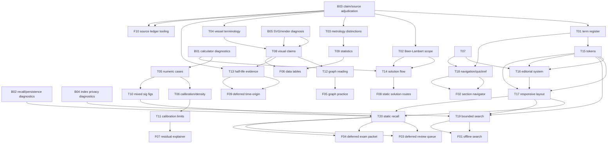

# Evidence-Led Workspace Audit & 35-Task Roadmap

**Workspace:** `/home/robertsrff/Chemistry_Med/Chemistry_2`  
**Audit date:** 2026-11-06 (Europe/Riga)  
**Scope:** Read-only audit and implementation planning. No production file, source PDF, frozen baseline, build source, workspace skill, or generated master was edited. This roadmap is a new deliverable.  
**Evidence rule:** `[TESTED]` means a command/tool was run in this audit; `[INSPECTED]` means source text or markup was read; `[INFERRED]` means a conclusion from static evidence; `[UNVERIFIED]` marks remaining proof. Existing AGENTS ledgers and old plan claims are historical evidence unless rechecked here.

## 1. Executive Decision Brief & First-Principles Workspace Profile

### Decision

Treat this as an offline, single-file Latvian textbook generated from canonical HTML/CSS/JS and data sources. Wave 1 should establish provenance and resolve high-risk claims, then enforce script/index/privacy limits and confirm the calculators with boundary cases. Freeze feature expansion until this stability work has evidence. The roadmap contains exactly 20 core tasks, 10 separately evaluated feature proposals, and five corrective/diagnostic packages; priorities do not authorize implementation by themselves.

### Discovered profile

- **Disciplines:** introductory analytical and medical chemistry; measurement science/metrology; laboratory practice; elementary statistics, graph reading/calibration, solution preparation, significant figures, radioactive decay and density. `[INSPECTED]` AGENTS.md §§1, 3, 5; `build/sections/01_ch1.html`–`16_ch16.html`; `build/concepts.json`.
- **Learner:** first-year RSU medical student, with introductory chemistry assumed. Learning goals include selecting laboratory equipment, measuring, propagating/reporting errors, reading graphs, preparing solutions, and interpreting density/half-life. `[INSPECTED]` AGENTS.md §1 and `PROMPT_Master_html_2_tema.md` §§2–5. Actual syllabus/exam acceptance is not independently confirmed.
- **Language and notation:** Latvian is the document language (`lang="lv"`); English metrology/chemistry equivalents occur in glossary and technical terms; SI quantity symbols, Greek letters, subscripts/superscripts, isotope notation (Hg-203, Cs-133), logarithms, confidence/statistical notation, formulas and decimal comma are active. English run tagging is required but not audited exhaustively. `[INSPECTED]` files above; `[UNVERIFIED]` every English span.
- **Architecture/runtime:** generated self-contained HTML; `build/build_doc.py` assembles 19 section fragments, `build/style.css`, `build/app.js`, figure markup/assets and data JSON. Inline CSS, inline JS and embedded search JSON ship in one 1,296,228-byte master. It has 16 chapters, 75 tables, 21 SVGs, 147 `
`, 442 IDs, 2 script blocks (one executable block, one JSON index); executable script is 101,982 bytes and JSON index 458,977 bytes. `[TESTED]` local Python regex inventory and hashes; count semantics depend on regex and should be standardized.
- **Offline requirement:** no external links or HTTP(S) resource references were found by the tested static scan. This does not prove the absence of every network-capable API or runtime request. `[TESTED]` scan; runtime network capture `[UNVERIFIED]`.
- **Current strengths:** explicit course-source/correction separation, many worked examples and recall prompts, chapter structure, locally embedded fonts and figures, offline build, a calculator/recall suite, historical QA harnesses, plus detailed governance and terminology standards. `[INSPECTED]` and file inventory; functionality is not thereby certified.
- **Top systemic risks:** oversized shipped JS and JSON index; no strict TS/budget/privacy gates; source ledger absent; known course-source discrepancies not all reconciled to PDFs; calculator and persistence runtime behavior not freshly tested; mobile and print appearance lacks a fresh screenshot/export audit; prior reports can be mistaken for current evidence.

### Inspection limits

The master and AGENTS were fingerprinted; static regex inventory and targeted source searches were run. No production build, QA runner, browser, print export, screen-reader session, live calculator interaction, contrast measurement, or external book inspection was run. AGENTS.md disallows Chrome unless separately allowed and asks for `lite-shot` + falkon/falkon. This audit therefore makes no fresh visual acceptance claim. Three audit inputs named by AGENTS are absent: `Master_Final_Perfected.md`, `MASTER_WORKSPACE_AUDIT_AND_35_TASK_ROADMAP.md` (the requested output was absent at audit start), and `HTML_MASTER_BUILD_PROMPT.md`; the user-supplied prompt is the operative scope, and no absent input was reconstructed.

## 2. Workspace, Architecture & Skills Inventory + File-by-File Inspection Ledger

### Architecture and file map

`Master_2_tema_merijumi_un_grafiki.html` is the generated canonical artifact. Canonical sources are `build/sections/00_front.html`, `01_ch1.html`–`16_ch16.html`, `98_quickref.html`, `99_footer.html`, `build/style.css`, `build/app.js`, figure files, JSON datasets, and `build/build_doc.py`. Build-time helpers include `build/gen_figures.py`, `build/build_recall.py`, `build/build_link_glossary.py`, `build/build_search_index.py`, `build/check_*.py`, `build/verify_numbers.py`, and `build/audit_tables.py`. Four Node harnesses (`qa.mjs`, `shots.mjs`, `final_check.mjs`, `final_behaviour.mjs`) are present. Their names are not evidence of fresh passing execution. PDFs include five course inputs and frozen baseline PDFs. `workspace_skills/` contains a skill manifest/index plus design, study, SVG, print, PDF, audit, and motion skills; 100+ files are present. Only the relevant skills listed in task packages should be invoked, and AGENTS/user instructions take precedence.

### Inspection ledger

| File/asset path | Role | Inspected? | Render/runtime tested? | Key evidence and findings | Coverage limits |
|---|---|---:|---:|---|---|
| `AGENTS.md` | Governance, source authority, issue ledger | Full | No | 24,822 B; scope and 28+ issues; strict generated-master lock; Open Issues are existing evidence, not wholesale reverified. | Full semantics not all cross-checked. |
| `Master_2_tema_merijumi_un_grafiki.html` | Canonical generated guide | Partial (structural scan) | No | 1,296,228 B; 16 chapters, 75 tables, 21 SVG, 147 details, 442 IDs; one 101,982-B executable script; 458,977-B JSON index. | No prose-by-prose or visual review. |
| `build/sections/00_front.html`, `01_ch1`–`16_ch16`, `98_quickref`, `99_footer` | Canonical chapter/source fragments | Partial (inventory/search) | No | Chapters map scope; quickref/footer; chapter 11 carries Hg-203 example; ch16 contains provenance/change material per registers. | Not all 19 fragments read end-to-end. |
| `build/style.css` | Canonical styles | Partial (governance selectors + search results) | No | Governance records absent `@layer`, mobile figure fixed width, extra shadow/role concerns. | No full cascade audit or screenshots. |
| `build/app.js` | Hand-written shipped interactions | Partial (targeted indexed search) | No | Search, glossary, persistence/recall, calibration, significant-figure, half-life, solution, graph trainer, print/state listeners; `innerHTML`, DOM construction; no handler executed. | No complete function-by-function trace. |
| `build/build_doc.py` | HTML assembly | Partial | No | Named by governance as canonical builder; no recent execution in this audit. | Build side effects not tested. |
| `build/gen_figures.py`; `build/figures/*.svg` | Figure generation and 10 standalone SVG assets | Partial | No | Ten SVGs: burette-readings, calibration-residuals, calibration-scheme, calibration, ci-coverage, density, half-life-Hg, half-life-hydrolysis, meniscus-parallax, prefix-ladder, target-plot (11 names as listed; see count note). | Master contains 21 SVG; standalone count and generated/inline relationship must be reconciled. No optical review. |
| `build/figures/glassware.html` | Inline equipment SVG collection | Partial | No | Multiple vessel drawings and captions. | No dimensional/source check. |
| `build/concepts.json`, `terminology.json`, `sigfig_cases.json`, `verified*.json` | Concept/term/case/numeric data | Partial (file list, selected refs) | No | Numeric and term data support build/check flow. | Contents not exhaustively validated. |
| `build/check_*.py`, `verify_numbers.py`, `audit_tables.py` | Verification scripts | Partial (names only) | No | Existing checks cover some topic-specific claims. | Not run; possible side effects in `--check` modes require inspection before use. |
| `build/*.mjs` | QA and browser harnesses | Partial (inventory) | No | Four files exist, plus screenshots/PDF residue. | Runner write/network/browser behavior not audited in this pass. |
| Five root course PDFs | Curriculum and source statements | Not inspected in this audit | No | AGENTS metadata says course source set; previous plan cites them. | Need direct text/page locator read for every disputed claim. |
| `build/baseline/**` | Frozen historical baseline | Not inspected | No | Protected by AGENTS. | Must not modify; compare by hash if needed. |
| `PROMPT_Master_html_2_tema.md`, `..._v3.md` | Editorial/source prompts | Partial | No | v1 fact base and v3 source-layer direction; primary sources still need direct verification. | Not every passage reconciled. |
| `Master_2_tema_20_task_plan_v2.md`, `...improvement_plan.md` | Historical planning docs | Partial | No | Existing 20-task plan includes 20 core tasks and 14 proposed features; useful leads only, not completion proof. | Staleness and historical counts. |
| `VISUAL_VERIFICATION.md` | Rendering protocol | Not read end-to-end | No | AGENTS requires falkon/falkon screenshots; Chrome prohibited without explicit current-turn allowance. | Render tool availability not exercised. |
| `workspace_skills/INDEX.md`, `COPY_MANIFEST.json`, skill directories | Workspace skill ecosystem | Partial (file inventory) | No | Skills include cognitive-deload-auditor, SVG spatial occlusion, print CSS, lexicon, synoptic matrix, study-guide, audit/design, PDF skills. | No full skill-by-skill inventory. |
| `ts/`, `tsconfig.json`, `pyproject.toml`, `tools/`, `build/sources.json` | Target infrastructure | Not present per AGENTS | N/A | Governance marks absent; targeted `rg --files` confirms target paths are not in listed root inventory. | Verify with dedicated exact `test -e` before implementation. |

**Inventory reconciliation note:** a concise target file inventory lists 10 named standalone SVG paths, while the path list actually contains 11 SVG filenames; the generated master has 21 inline SVG elements. Do not repeat either count as a reconciled source-of-truth until `gen_figures.py`, section references, and output are traced. `[INSPECTED]` file list; `[INFERRED]` relationship unresolved.

### Skills relevant to implementation

Use only when task scope warrants it: `workspace_skills/cognitive-deload-auditor` for prose/load review; `lexicon-morphology-weaver` for sourced terms; `svg-spatial-occlusion` for diagrams only where spatial retrieval adds learning value; `print-css-alchemist` for HTML/PDF state; `synoptic-matrix-architect` for genuinely high-dimensional comparisons; `interactive-study-guide` and `learn-then-test` for retrieval patterns; `design-taste-frontend` / `impeccable` for audit-led interface hierarchy, bounded by AGENTS anti-slop rules; `pdf-vector-surgeon` for later PDF work if authorized; `audit` for structured quality review. None was invoked during this read-only audit. Do not import skill assets wholesale or let skill advice override workspace contracts.

## 3. Diagnostic Triage: Confirmed Defects vs. Suspected Risks vs. Pedagogical/Design Opportunities

| ID | Finding | Status | Priority | Evidence / exact verification |
|---|---|---|---|---|
| D01 | Executable script and JSON index exceed governance budget by a large margin. | [TESTED] static size count | P0 | Master/source byte counts; AGENTS JS-01/02. Runtime performance not tested. |
| D02 | Script makes DOM via `createElement` and uses `innerHTML` in search, glossary, recall, trainer rendering. | [INSPECTED] | P0 | `build/app.js` search/glossary/recall/case blocks; see lines in source using `rg -n`. Security and user input exploitability not tested. |
| D03 | Search index is very large and recall-answer privacy is a stated invariant, but no current audit verifies exclusions. | [INSPECTED]/[UNVERIFIED] | P0 | JSON index size observed; `check_index_privacy.py` absent per governance. |
| D04 | No fresh runtime traces of calculator/input validation, persistence, recall/reset, print controls, or theme. | [UNVERIFIED] | P0 | Run adversarial procedure in B01/B02; current audit executed no harness. |
| D05 | Source layer requires direct reconciliation of S1–S23 and D24–D51, including blank course Q5, burette reading, SI update, Beer–Lambert, Hg-203, significant figures and statistics. | [INSPECTED] issue register; claims individually [UNVERIFIED] | P0 | AGENTS §§2–3 and prompt fact base; read PDF passages and authoritative sources before editing. |
| D06 | CSS architecture/mobile overflow concerns are governance findings, but not fresh rendered observations. | [INSPECTED] source selectors / [UNVERIFIED] appearance | P1 | CSS lines selectors listed in AGENTS; capture permitted falkon/falkon screenshots. |
| D07 | Ten named standalone SVG source files versus 21 inline master SVGs lack reconciled provenance. | [INSPECTED] | P1 | Inventory, `build/gen_figures.py`, section includes, master. |
| D08 | Semantic theme, contrast, keyboard, AT, target size and print gates are not measured here. | [UNVERIFIED] | P1 | Dedicated script + permitted visual/AT inspection. |
| D09 | Existing plans contain historical totals that conflict with current structural scan. | [TESTED] current counts; [INSPECTED] plans | P1 | Reconcile dated evidence, don't silently change history. |
| D10 | Concept-to-five-pillar coverage and question feedback quality lack an executable audit. | [UNVERIFIED] | P2 | Generate concept coverage and answer rationale audits. |
| D11 | Broad redesign/add-on catalogue risks duplication and answer leakage. | [INFERRED] | P2 | Prefer native HTML, static tables and generated quick reference; kill proposal if it adds a second state store. |

No non-reproducible issue is called a confirmed runtime bug. B01–B05 therefore reserve claims requiring live verification as diagnostic investigations where necessary.

## 4. Domain Terminology, Fact, Applicability & Warrant Verification Ledger

The ledger distinguishes the course's expected account from disciplinary truth. Every correction must cite exact PDF locator and classify whether it changes course policy. Matching a number or keyword alone is insufficient: record the physical/statistical model, quantity definition, conditions, units, uncertainty, and inference limit.

| Claim ID | Location | Existing claim / issue | Status | Applicability & warrant analysis | Authority | Confidence | Proposed correction / action |
|---|---|---|---|---|---|---|---|
| C01 | ch2; S1 | mol to µmol conversion defect noted in source ledger | Unverified | Check quantity equation and prefix factor in exact course context; do not infer from string alone. | SI Brochure, prefix rules | Medium | Correct only after locator reproduction; preserve “avotā” text and explain factor. |
| C02 | ch2; S2 | isotope symbol `¹³³Cz` vs Cs noted | Inaccurate if literal | Element symbol for caesium is Cs; inspect whether source is isotope or typographic artifact. | BIPM SI; IUPAC element symbols | High for symbol, source occurrence unverified | Use ¹³³Cs and keep quoted course form in defect log. |
| C03 | ch2; S3 | Pre-2019 SI basis in course text | Outdated | Exact passage may describe historical definitions, not current definition; temporal scope matters. | BIPM SI Brochure 9th ed., updated 2026 | High | Label historical account and current defining-constants framework separately. |
| C04 | ch2; S4 | mass/amount equation | Unverified | Check whether stated equation uses molar mass and units consistently and whether it is a quantity equation. | VIM quantity calculus; course PDF | Medium | Re-derive symbolically and dimensional-check before correction. |
| C05 | ch3; S5 | Beer–Lambert coefficient/symbol/units | Warrant flaw risk | Law assumes suitable radiation bandwidth and homogeneous sample; concentration/path units determine coefficient units. General relation is not proof for every instrument/sample. | IUPAC Gold Book entry B00626 | High for stated scope; local application unverified | Distinguish absorbance from absorption; list conditions and unit conversion. |
| C06 | ch6; S6 | precision/trueness/accuracy and repeatability | Terminology disputed/unverified | VIM defines distinct concepts; course may use local pedagogical convention. Scope and lecturer policy must be separated. | JCGM 200:2012 VIM terms 2.13–2.20 | High for VIM, local policy unverified | Use sourced definitions, mark course wording, ask lecturer before exam-specific replacement. |
| C07 | ch4; S7 | class-B 0.5% tolerance | Unverified | A tolerance cannot be inferred from class alone without applicable standard, instrument type, capacity and marking. | Manufacturer/standard required; none checked | Low | State only the exact cited source claim; don't generalize to every class-B vessel. |
| C08 | ch7; S8 | sample standard deviation, t statistic, terms | Partly unverified | Formula validity depends on sample, estimator, degrees of freedom and interval assumptions; three titrations are small-n. | VIM + course/statistics primary source needed | Medium | Explicitly identify s (n−1), df and assumptions; avoid asserting coverage without model checks. |
| C09 | ch8; S9–S10 | significant digits/decimal places and ambiguous trailing zeros | Inaccurate risk | Notation precision depends on written value; 450 is ambiguous without context, while scientific notation disambiguates. | Course fact base; metrology guidance needed | Medium | Distinguish significant figures from decimal places and retain guard digits. |
| C10 | ch4–5; S11, S21–22 | pipette naming/caption, Mora vs graduated pipette, burette | Unverified | Equipment geometry and delivery/calibration marking matter; translation alone cannot establish use or tolerance. | Course PDFs + equipment documentation required | Low | Verify actual illustrated instrument and marking; describe delivered vs contained volume only if supported. |
| C11 | ch7; S12 | Q3 titre/outlier interpretation | Unverified | Rejection cannot follow from a numeric mismatch alone; predeclared criterion, repeat recommendation and source task wording matter. | Worksheet and course rubric | Low | Preserve raw values; explain statistical and procedural limits; lecturer confirms expected answer. |
| C12 | ch10; S18 | graph axes and fit | Warrant flaw risk | Axis assignment and fit interpretation require actual plotted variables and measurement model; high R² does not validate calibration. | IUPAC Gold Book; data/model validation source needed | Medium | State calibration domain, residual pattern, range and extrapolation prohibition. |
| C13 | ch11; S17 | Hg-203 t½ = 46,595 days | Unverified | Course's plotted value may be instructional datum; nuclear-data estimate needs nuclide state, evaluation date and uncertainty. A possible alternative is not enough to replace it. | NuDat/ENSDF or LNHB-DDEP required; not consulted | Low | Mark “avotā” and avoid claiming evaluated standard until primary record is read. |
| C14 | ch12; S16 | solvent volume vs final solution volume | Unverified | Dilution/preparation instruction depends on whether volume denotes solvent added or final solution; conservation/formulation context matters. | Course worksheet; primary chemistry text needed | Medium | Use final volume wording when the specified quantity is solution volume; show make-up step. |
| C15 | ch4; S19 | worksheet Q5 blank, proposed equipment answers | Unverified/addition | Multiple equipment choices may be valid under different tolerance/volume constraints; absent answer key is not proof of a unique answer. | Worksheet + lecturer confirmation | Low | Label suggestions “papildinājums” and accept justified alternatives. |
| C16 | ch8; S23 | double rounding | Unverified | Intermediate rounding can change results; exact arithmetic and final precision rules must be applied to operation sequence. | Course fact base; recomputation required | Medium | Keep guard digits, round once at the reporting endpoint. |
| C17 | ch6 | error vs uncertainty and “true/reference value” | Over-simplified risk | VIM's measurement error is a result minus reference value; uncertainty characterizes dispersion of values attributed to a measurand. They are not interchangeable. | VIM terms 2.16, 2.26 and related entries | High for distinction | Define terms with caveat that true value is conceptually distinct and often not known. |
| C18 | ch3 | absorbance *A* | Terminology risk | IUPAC defines absorbance as logarithmic quantity; absorption names a process. “Absorption” cannot be substituted for “absorbance.” | IUPAC Gold Book, B00626 | High | Use Latvian quantity equivalent consistently; preserve source label where required. |
| C19 | ch7 | 95% confidence interval | Warrant risk | Correct multiplier alone is insufficient: sampling model, df, independence and interval construction govern interpretation. | VIM/statistics source needed | Medium | Explain repeated-sampling interpretation and assumptions; don't say 95% probability parameter is inside this realized interval. |
| C20 | all | course claim vs correction ledger D24–D51 | Unverified | Existing summary is not a direct source comparison. Each row needs exact page/question, exact text, correction rationale and confidence. | Five course PDFs | Low | Reconcile line by line; no unsupported metadata or invented locators. |

## 5. Authoritative Book, Standard & Literature Bibliography

### Authority ranking

1. **Normative metrology:** BIPM/CIPM SI Brochure and JCGM VIM; for specific instrument tolerance, applicable national/international standard and manufacturer documentation must be identified.
2. **Discipline-specific authoritative definitions:** IUPAC Gold Book; then peer-reviewed primary literature/data evaluations for specific chemistry or isotope values.
3. **University textbooks and reference monographs:** useful for pedagogy only after edition and relevant chapter are checked; no textbook page is claimed as read here.
4. **Course PDFs and prompts:** authoritative for intended curriculum and “what the course says,” not automatically factually authoritative. Preserve conflicts.

### Verified sources

| Source | Metadata and scope | Provenance | Use and limits |
|---|---|---|---|
| Bureau International des Poids et Mesures. *The International System of Units (SI Brochure)*, 9th ed. (2019), complete brochure updated 2026. BIPM. DOI 10.59161/AUEZ1291. | Unit definitions, prefixes, notation, current SI and historical context. | [TEXT-VERIFIED] BIPM publication landing-page text and official SI page inspected via web on 2026-11-06; specific brochure passages for every local claim still require direct locator check. | Governs SI; does not verify course equipment tolerance or local exam convention. [https://www.bipm.org/en/publications/si-brochure/](https://www.bipm.org/en/publications/si-brochure/) |
| Joint Committee for Guides in Metrology. *International Vocabulary of Metrology — Basic and General Concepts and Associated Terms (VIM)*, JCGM 200:2012, 3rd ed. JCGM/BIPM. | Terms: measurement, accuracy, trueness, precision, error, repeatability, calibration. | [TEXT-VERIFIED] official annotated VIM scope and term listing inspected; annotations are expressly informative. | Use the VIM definitions, not annotations as normative text. [https://jcgm.bipm.org/vim/en/](https://jcgm.bipm.org/vim/en/) |
| IUPAC. “Beer–Lambert law (or Beer–Lambert–Bouguer law),” *Compendium of Chemical Terminology (Gold Book)*, online entry B00626. DOI/book edition not asserted. | Absorbance relation, monochromatic/narrow-band and homogeneous-medium context, unit dependence for molar absorption coefficient. | [TEXT-VERIFIED] accessible Gold Book entry text inspected. | Entry supports scoped law statement; it does not validate every local calibration or instrument result. [https://www.old.goldbook.iupac.org/html/B/B00626.html](https://www.old.goldbook.iupac.org/html/B/B00626.html) |

### Local curriculum materials

The five PDFs named in AGENTS §3 are source-set metadata only in this audit: `2_Temata apraksts 2020.docx.pdf`, `Analitiskas-metodes_2024.pdf`, `2A_SEM_MCh_LV_Merijumi,grafiki_2025.pdf`, `2B_SEM_MCh_LV_Trauki,skidumi_2025.pdf`, `2_SEM_MCh_LV_Trauki_Grafiki_Cipari_2026_Atbildes.pdf`. Their exact authors, publishers, ISBNs and page locators are not invented. [UNVERIFIED] Direct PDF passages must be read for each ledger row before implementation.

No textbook citation is included because no textbook passage or complete bibliographic record was inspected. Future implementers should prefer an accessible analytical chemistry textbook only after confirming author/editor, exact title, edition, year, publisher, ISBN/DOI, and chapter scope from a reliable catalog, then tag [METADATA-VERIFIED / SCOPE-ALIGNED] unless the actual text is read. Do not populate page numbers from search snippets.

## 6. Editorial Design (“Anti-AI-Slop”), Retexturing, Accessibility, Pedagogy & Complete SVG Inventory/Diagnostics

### Design and pedagogy audit

The governance contract already specifies low-chroma surfaces, limited roles, 60–75ch measure, tabular numerals, no gradients/glow/glass/emoji/card grids/hero banners/gamification, reduced motion, semantic focus, and print flattening. Preserve it. Current style and appearance remain unverified by screenshot. Token tiering, WCAG contrast, 44px target coverage, typography hierarchy, large tables on narrow viewports, theme consistency, and print pagination need measured checks. Prefer one continuous editorial reading column, figure plates with nearby explanation, tables only for actual comparison, restrained semantic rules, and formula typography with accessible text equivalents.

Pedagogy should consistently connect (1) term/symbol/unit, (2) mechanism and assumptions, (3) a recomputed worked example with intermediate units, (4) symptom → cause → correction, (5) source-backed canonical term. For each chapter, state prerequisite links; distinguish course statement, sourced addition and illustrative number. Retrieval answers need a rationale and boundary case, and closed answers must never leak through search indexing.

### SVG inventory and classification

| Asset | Current disposition | Evidence / issue | Proposed blueprint |
|---|---|---|---|
| `burette-readings.svg` | [CORRECT] pending content check | Readings, meniscus and scale values are domain-sensitive; no fresh visual inspection. | Show scale direction, increments, bottom meniscus, eye line and units; no misleading scale direction. |
| `calibration-residuals.svg` | [RETAIN] pending numeric reconciliation | Concept directly supports model diagnosis; validate residuals against fitted line. | Residual zero-line and signed residuals; don't imply high R² proves validity. |
| `calibration-scheme.svg` | [CORRECT] | Process figure can collapse calibration and unknown measurement. | Distinguish standards, model fit, unknown interpolation and range boundary. |
| `calibration.svg` | [CORRECT] | Axes/units/fit and example values require source reconciliation. | Preserve data markers, fit line, equation, range and uncertainty/context. |
| `ci-coverage.svg` | [REDESIGN] | Coverage interpretation needs repeated-sampling context and interval assumptions. | Repeated samples/intervals with population parameter; forbid “95% chance this fixed parameter lies here.” |
| `density.svg` | [RETAIN] pending data audit | Density formula graphic may aid mass/volume relation; verify slopes and labels. | Mass versus volume, unit-consistent slope and intercept; no claim density independent of conditions. |
| `half-life-hg.svg` | [CORRECT] | Hg-203 value/origin unresolved; date axis and half-time must be intervals. | Label source course data, nonzero t0 if applicable, successive halves; avoid presenting unverified nuclear value as authoritative. |
| `half-life-hydrolysis.svg` | [CORRECT] | Distinguish first plotted time from interval length. | Explicit t0 and Δt brackets; avoid treating a time coordinate as elapsed half-life. |
| `meniscus-parallax.svg` | [CORRECT] | Vessel/eye geometry needs validation against actual reading protocol. | Eye at meniscus plane, scale and parallax rays; no unexplained distortion. |
| `prefix-ladder.svg` | [RETAIN] pending SI audit | Prefix powers and symbols require complete consistency. | Ordered powers, symbol case, quantity examples with dimensional checks. |
| `target-plot.svg` | [REDESIGN] | Precision/trueness depiction is a teaching model, not literal instrument uncertainty. | Label center/reference and scatter; use shape/line cues as well as color. |
| `build/figures/glassware.html` inline vessels | [REDESIGN] | Vessel identity, markings and proportional cues need course/material check. | Correct geometry/marking with labels and stated illustrative scale; don't infer tolerance from sketch. |
| New: uncertainty/error distinction | [ADD NEW SVG] | Learner must distinguish result-reference difference from uncertainty interval. | Paired number line: signed error vs interval; separate graphic labels and caveats. |
| New: solution preparation | [ADD NEW SVG] | Final volume vs solvent volume is easy to conflate. | Dissolve → transfer/rinse → make to final mark; avoid implying add solvent to final volume directly. |

**Construction acceptance:** every SVG uses `viewBox`, responsive max-width/height, accessible `<title>`/`<desc>` and `aria-labelledby`, semantic CSS tokens, legible light/dark and forced-light print styles, non-color cues, and an adjacent text/table alternative. Render at 390px and desktop using the allowed falkon/falkon workflow; inspect clipping/labels and print export. These are planned tests, not observed passes. Do not create figures until claim sources and numerical data are settled.

## 7. 20 Core Improvement Tasks (T01–T20) — Full exhaustive templates

### T01 — Canonical terminology register and enforceable lint

**Workstream:** Terminology & Sourcing  
**Priority:** P0 | **Impact:** 5/5 | **Effort:** 3/5  
**Epistemic status:** [INSPECTED] for source/path evidence; content-specific uncertainty remains as stated below.  
**Responsibility boundary:** Owns the named source transformation and acceptance checks only; shared chapter edits require this package-specific selectors and a merge review.  
**Applicable workspace skills/tools:** cognitive-deload-auditor; lexicon-morphology-weaver; build/check_terms.py. Use skills as bounded advice under AGENTS.  
**Observed problem and concrete evidence:** AGENTS §§6,10; terminology JSON, ch14/ch16; checker exists but scope is unverified. [INSPECTED] Evidence from old plans is a lead, not fresh acceptance evidence.  
**Why it matters:** Terminology drift can teach non-equivalent concepts.  
**Intended end state and scope guardrails:** A sourced register drives checks and glossary rows; quotations and V items stay explicit. **In scope:** build/terminology.json; build/check_terms.py; sections/14_ch14.html; 16_ch16.html; build_doc.py. **Out of scope:** PDF/baseline edits, unsourced corrections, generated-master hand edits, unrelated redesign, and new dependencies.  
**Authoritative source / book backing and warrant check:** No correction until course passage is read; VIM/IUPAC only where in scope. A source establishes only its stated scope; it cannot by itself establish course policy, local apparatus performance or a broader inference.

#### Three detailed Main Implementation Steps

**Main Step 1:** Define the evidence model and freeze a baseline for canonical terminology register and enforceable lint; map current owners, source evidence, and rollback point in the named files.
**Main Step 2:** Implement the task-owned transformation in canonical build sources across the task boundary, keeping generated output derived and preserving adjacent task ownership.
**Main Step 3:** Regenerate and verify positive, negative, accessibility and viewport cases against positive, negative, accessibility and viewport criteria; leave unrun gates open.

#### Named subtasks and executable substeps

**Subtask T01.1 — Term corpus audit:**

**Substep T01.1.1:** Inspect `build/terminology.json` and record current strings, IDs, data and exact source locator for the owned change.

**Substep T01.1.2:** Implement the task-owned schema/prose/markup change at `build/terminology.json`; preserve quotes, IDs and source labels.

**Substep T01.1.3:** Run the focused term/source/content check and inspect one valid and one conflicting case in generated output.

**Subtask T01.2 — Register and glossary generation:**

**Substep T01.2.1:** Inspect `build_doc.py` and identify downstream consumers, print behavior and accessibility names.

**Substep T01.2.2:** Update `build_doc.py` and its existing checker/generator; do not add a parallel source of truth.

**Substep T01.2.3:** Test missing, boundary and no-JS/print cases; compare output to the authoritative data record.

**Affected files, selectors, interfaces and data structures:** Existing: build/terminology.json; build/check_terms.py; sections/14_ch14.html; 16_ch16.html; build_doc.py. Proposed structures only if the named task evidence supports them. Dependency/collision: B03; T03/T04.

**Measurable acceptance criteria and regression tests:** Positive: intended source and output agree, with a direct locator or recomputed result. Negative/boundary: preserve source quotation, reject unsupported claim or invalid input as applicable. Accessibility/viewport: keyboard focus and semantic labels retained; inspect 390px and 1280px through falkon/falkon and print/no-JS when relevant. Record exact commands/results; roadmap criteria are not test passes.

**Dependencies, risks, rollback and DoD:** Upstream: B03; T03/T04. Risk: shared chapter data or global CSS/JS; sequence with named owner. Rollback: revert only task-owned source changes and regenerate from unchanged canonical inputs. Done when locator, implementation, positive/negative and a11y/viewport checks pass, generated diff is reviewed, and unresolved source/render gates are explicitly left open.

### T02 — Separate absorbance from absorption; bound Beer–Lambert claims

**Workstream:** Terminology & Sourcing  
**Priority:** P0 | **Impact:** 5/5 | **Effort:** 3/5  
**Epistemic status:** [INSPECTED] for source/path evidence; content-specific uncertainty remains as stated below.  
**Responsibility boundary:** Owns the named source transformation and acceptance checks only; shared chapter edits require this package-specific selectors and a merge review.  
**Applicable workspace skills/tools:** cognitive-deload-auditor; lexicon-morphology-weaver; build/check_terms.py. Use skills as bounded advice under AGENTS.  
**Observed problem and concrete evidence:** ch3, ch14 glossary, S5 and app glossary data; local passage not freshly read. [INSPECTED] Evidence from old plans is a lead, not fresh acceptance evidence.  
**Why it matters:** Confusing a process with a measured quantity and omitting conditions misleads measurement interpretation.  
**Intended end state and scope guardrails:** Scoped absorbance relation, clear units and conditions, course distinction retained. **In scope:** sections/03_ch3.html; 14_ch14.html; terminology.json; calibration graphics. **Out of scope:** PDF/baseline edits, unsourced corrections, generated-master hand edits, unrelated redesign, and new dependencies.  
**Authoritative source / book backing and warrant check:** IUPAC Gold Book B00626 [TEXT-VERIFIED]; narrow bandwidth/homogeneous medium conditions apply; local apparatus remains unverified. A source establishes only its stated scope; it cannot by itself establish course policy, local apparatus performance or a broader inference.

#### Three detailed Main Implementation Steps

**Main Step 1:** Define the evidence model and freeze a baseline for separate absorbance from absorption; bound beer–lambert claims; map current owners, source evidence, and rollback point in the named files.
**Main Step 2:** Implement the task-owned transformation in canonical build sources across the task boundary, keeping generated output derived and preserving adjacent task ownership.
**Main Step 3:** Regenerate and verify positive, negative, accessibility and viewport cases against positive, negative, accessibility and viewport criteria; leave unrun gates open.

#### Named subtasks and executable substeps

**Subtask T02.1 — Claim context audit:**

**Substep T02.1.1:** Inspect `sections/03_ch3.html` and record current strings, IDs, data and exact source locator for the owned change.

**Substep T02.1.2:** Implement the task-owned schema/prose/markup change at `sections/03_ch3.html`; preserve quotes, IDs and source labels.

**Substep T02.1.3:** Run the focused term/source/content check and inspect one valid and one conflicting case in generated output.

**Subtask T02.2 — Definition and worked example:**

**Substep T02.2.1:** Inspect `calibration graphics` and identify downstream consumers, print behavior and accessibility names.

**Substep T02.2.2:** Update `calibration graphics` and its existing checker/generator; do not add a parallel source of truth.

**Substep T02.2.3:** Test missing, boundary and no-JS/print cases; compare output to the authoritative data record.

**Affected files, selectors, interfaces and data structures:** Existing: sections/03_ch3.html; 14_ch14.html; terminology.json; calibration graphics. Proposed structures only if the named task evidence supports them. Dependency/collision: T01; B03.

**Measurable acceptance criteria and regression tests:** Positive: intended source and output agree, with a direct locator or recomputed result. Negative/boundary: preserve source quotation, reject unsupported claim or invalid input as applicable. Accessibility/viewport: keyboard focus and semantic labels retained; inspect 390px and 1280px through falkon/falkon and print/no-JS when relevant. Record exact commands/results; roadmap criteria are not test passes.

**Dependencies, risks, rollback and DoD:** Upstream: T01; B03. Risk: shared chapter data or global CSS/JS; sequence with named owner. Rollback: revert only task-owned source changes and regenerate from unchanged canonical inputs. Done when locator, implementation, positive/negative and a11y/viewport checks pass, generated diff is reviewed, and unresolved source/render gates are explicitly left open.

### T03 — Define precision, trueness, error, uncertainty and repeatability

**Workstream:** Terminology & Sourcing  
**Priority:** P0 | **Impact:** 5/5 | **Effort:** 4/5  
**Epistemic status:** [INSPECTED] for source/path evidence; content-specific uncertainty remains as stated below.  
**Responsibility boundary:** Owns the named source transformation and acceptance checks only; shared chapter edits require this package-specific selectors and a merge review.  
**Applicable workspace skills/tools:** cognitive-deload-auditor; lexicon-morphology-weaver; build/check_terms.py. Use skills as bounded advice under AGENTS.  
**Observed problem and concrete evidence:** ch6–7 and VIM terms 2.13–2.20; exact local course passages pending. [INSPECTED] Evidence from old plans is a lead, not fresh acceptance evidence.  
**Why it matters:** Students can conflate scatter, closeness, signed error and interval estimates.  
**Intended end state and scope guardrails:** Formal terms and local exam language are distinct, with worked examples and limitations. **In scope:** sections/06_ch6.html; 07_ch7.html; 14_ch14.html; target-plot.svg. **Out of scope:** PDF/baseline edits, unsourced corrections, generated-master hand edits, unrelated redesign, and new dependencies.  
**Authoritative source / book backing and warrant check:** JCGM 200:2012 VIM [TEXT-VERIFIED]; course convention/lecturer acceptance unverified. A source establishes only its stated scope; it cannot by itself establish course policy, local apparatus performance or a broader inference.

#### Three detailed Main Implementation Steps

**Main Step 1:** Define the evidence model and freeze a baseline for define precision, trueness, error, uncertainty and repeatability; map current owners, source evidence, and rollback point in the named files.
**Main Step 2:** Implement the task-owned transformation in canonical build sources across the task boundary, keeping generated output derived and preserving adjacent task ownership.
**Main Step 3:** Regenerate and verify positive, negative, accessibility and viewport cases against positive, negative, accessibility and viewport criteria; leave unrun gates open.

#### Named subtasks and executable substeps

**Subtask T03.1 — Term-example map:**

**Substep T03.1.1:** Inspect `sections/06_ch6.html` and record current strings, IDs, data and exact source locator for the owned change.

**Substep T03.1.2:** Implement the task-owned schema/prose/markup change at `sections/06_ch6.html`; preserve quotes, IDs and source labels.

**Substep T03.1.3:** Run the focused term/source/content check and inspect one valid and one conflicting case in generated output.

**Subtask T03.2 — Statistics and visual reconciliation:**

**Substep T03.2.1:** Inspect `target-plot.svg` and identify downstream consumers, print behavior and accessibility names.

**Substep T03.2.2:** Update `target-plot.svg` and its existing checker/generator; do not add a parallel source of truth.

**Substep T03.2.3:** Test missing, boundary and no-JS/print cases; compare output to the authoritative data record.

**Affected files, selectors, interfaces and data structures:** Existing: sections/06_ch6.html; 07_ch7.html; 14_ch14.html; target-plot.svg. Proposed structures only if the named task evidence supports them. Dependency/collision: T01; T09; B03.

**Measurable acceptance criteria and regression tests:** Positive: intended source and output agree, with a direct locator or recomputed result. Negative/boundary: preserve source quotation, reject unsupported claim or invalid input as applicable. Accessibility/viewport: keyboard focus and semantic labels retained; inspect 390px and 1280px through falkon/falkon and print/no-JS when relevant. Record exact commands/results; roadmap criteria are not test passes.

**Dependencies, risks, rollback and DoD:** Upstream: T01; T09; B03. Risk: shared chapter data or global CSS/JS; sequence with named owner. Rollback: revert only task-owned source changes and regenerate from unchanged canonical inputs. Done when locator, implementation, positive/negative and a11y/viewport checks pass, generated diff is reviewed, and unresolved source/render gates are explicitly left open.

### T04 — Verify vessel names, markings, use and tolerance claims

**Workstream:** Terminology & Sourcing  
**Priority:** P0 | **Impact:** 5/5 | **Effort:** 4/5  
**Epistemic status:** [INSPECTED] for source/path evidence; content-specific uncertainty remains as stated below.  
**Responsibility boundary:** Owns the named source transformation and acceptance checks only; shared chapter edits require this package-specific selectors and a merge review.  
**Applicable workspace skills/tools:** cognitive-deload-auditor; lexicon-morphology-weaver; build/check_terms.py. Use skills as bounded advice under AGENTS.  
**Observed problem and concrete evidence:** ch4–5; glassware.html; S7/S11/S21/S22. [INSPECTED] inventory, not actual instrument validation. Evidence from old plans is a lead, not fresh acceptance evidence.  
**Why it matters:** Wrong equipment naming or generic tolerance claims can produce bad choices and unsafe expectations.  
**Intended end state and scope guardrails:** Verified equipment matrix separates use, marking, capacity and tolerance provenance. **In scope:** sections/04_ch4.html; 05_ch5.html; figures/glassware.html; gen_figures.py. **Out of scope:** PDF/baseline edits, unsourced corrections, generated-master hand edits, unrelated redesign, and new dependencies.  
**Authoritative source / book backing and warrant check:** Course PDF and device/standard required; class alone does not warrant a universal tolerance. A source establishes only its stated scope; it cannot by itself establish course policy, local apparatus performance or a broader inference.

#### Three detailed Main Implementation Steps

**Main Step 1:** Define the evidence model and freeze a baseline for verify vessel names, markings, use and tolerance claims; map current owners, source evidence, and rollback point in the named files.
**Main Step 2:** Implement the task-owned transformation in canonical build sources across the task boundary, keeping generated output derived and preserving adjacent task ownership.
**Main Step 3:** Regenerate and verify positive, negative, accessibility and viewport cases against positive, negative, accessibility and viewport criteria; leave unrun gates open.

#### Named subtasks and executable substeps

**Subtask T04.1 — Course equipment trace:**

**Substep T04.1.1:** Inspect `sections/04_ch4.html` and record current strings, IDs, data and exact source locator for the owned change.

**Substep T04.1.2:** Implement the task-owned schema/prose/markup change at `sections/04_ch4.html`; preserve quotes, IDs and source labels.

**Substep T04.1.3:** Run the focused term/source/content check and inspect one valid and one conflicting case in generated output.

**Subtask T04.2 — Matrix and SVG alignment:**

**Substep T04.2.1:** Inspect `gen_figures.py` and identify downstream consumers, print behavior and accessibility names.

**Substep T04.2.2:** Update `gen_figures.py` and its existing checker/generator; do not add a parallel source of truth.

**Substep T04.2.3:** Test missing, boundary and no-JS/print cases; compare output to the authoritative data record.

**Affected files, selectors, interfaces and data structures:** Existing: sections/04_ch4.html; 05_ch5.html; figures/glassware.html; gen_figures.py. Proposed structures only if the named task evidence supports them. Dependency/collision: T01; B03.

**Measurable acceptance criteria and regression tests:** Positive: intended source and output agree, with a direct locator or recomputed result. Negative/boundary: preserve source quotation, reject unsupported claim or invalid input as applicable. Accessibility/viewport: keyboard focus and semantic labels retained; inspect 390px and 1280px through falkon/falkon and print/no-JS when relevant. Record exact commands/results; roadmap criteria are not test passes.

**Dependencies, risks, rollback and DoD:** Upstream: T01; B03. Risk: shared chapter data or global CSS/JS; sequence with named owner. Rollback: revert only task-owned source changes and regenerate from unchanged canonical inputs. Done when locator, implementation, positive/negative and a11y/viewport checks pass, generated diff is reviewed, and unresolved source/render gates are explicitly left open.

### T05 — Recompute significant-figure cases and rounding endpoints

**Workstream:** Pedagogy & Explanations  
**Priority:** P0 | **Impact:** 5/5 | **Effort:** 3/5  
**Epistemic status:** [INSPECTED] for source/path evidence; content-specific uncertainty remains as stated below.  
**Responsibility boundary:** Owns the named source transformation and acceptance checks only; shared chapter edits require this package-specific selectors and a merge review.  
**Applicable workspace skills/tools:** cognitive-deload-auditor; build/verify_numbers.py. Use skills as bounded advice under AGENTS.  
**Observed problem and concrete evidence:** ch8, sigfig_cases.json, verify_numbers.py, S9/S10/S23. [INSPECTED] Evidence from old plans is a lead, not fresh acceptance evidence.  
**Why it matters:** Premature rounding and place/digit confusion alters answers.  
**Intended end state and scope guardrails:** All cases independently recomputed; guard digits retained and final rounding stated. **In scope:** sections/08_ch8.html; sigfig_cases.json; verify_numbers.py; check_sigfig_cases.py. **Out of scope:** PDF/baseline edits, unsourced corrections, generated-master hand edits, unrelated redesign, and new dependencies.  
**Authoritative source / book backing and warrant check:** Course examples plus independent arithmetic; course tie-rounding convention still needs source. A source establishes only its stated scope; it cannot by itself establish course policy, local apparatus performance or a broader inference.

#### Three detailed Main Implementation Steps

**Main Step 1:** Define the evidence model and freeze a baseline for recompute significant-figure cases and rounding endpoints; map current owners, source evidence, and rollback point in the named files.
**Main Step 2:** Implement the task-owned transformation in canonical build sources across the task boundary, keeping generated output derived and preserving adjacent task ownership.
**Main Step 3:** Regenerate and verify positive, negative, accessibility and viewport cases against positive, negative, accessibility and viewport criteria; leave unrun gates open.

#### Named subtasks and executable substeps

**Subtask T05.1 — Case arithmetic audit:**

**Substep T05.1.1:** Inspect `sections/08_ch8.html` and record current strings, IDs, data and exact source locator for the owned change.

**Substep T05.1.2:** Implement the task-owned schema/prose/markup change at `sections/08_ch8.html`; preserve quotes, IDs and source labels.

**Substep T05.1.3:** Run the focused term/source/content check and inspect one valid and one conflicting case in generated output.

**Subtask T05.2 — Precision rule explanations:**

**Substep T05.2.1:** Inspect `check_sigfig_cases.py` and identify downstream consumers, print behavior and accessibility names.

**Substep T05.2.2:** Update `check_sigfig_cases.py` and its existing checker/generator; do not add a parallel source of truth.

**Substep T05.2.3:** Test missing, boundary and no-JS/print cases; compare output to the authoritative data record.

**Affected files, selectors, interfaces and data structures:** Existing: sections/08_ch8.html; sigfig_cases.json; verify_numbers.py; check_sigfig_cases.py. Proposed structures only if the named task evidence supports them. Dependency/collision: T01; B01.

**Measurable acceptance criteria and regression tests:** Positive: intended source and output agree, with a direct locator or recomputed result. Negative/boundary: preserve source quotation, reject unsupported claim or invalid input as applicable. Accessibility/viewport: keyboard focus and semantic labels retained; inspect 390px and 1280px through falkon/falkon and print/no-JS when relevant. Record exact commands/results; roadmap criteria are not test passes.

**Dependencies, risks, rollback and DoD:** Upstream: T01; B01. Risk: shared chapter data or global CSS/JS; sequence with named owner. Rollback: revert only task-owned source changes and regenerate from unchanged canonical inputs. Done when locator, implementation, positive/negative and a11y/viewport checks pass, generated diff is reviewed, and unresolved source/render gates are explicitly left open.

### T06 — Synchronize calibration and density reporting

**Workstream:** Pedagogy & Explanations  
**Priority:** P1 | **Impact:** 4/5 | **Effort:** 4/5  
**Epistemic status:** [INSPECTED] for source/path evidence; content-specific uncertainty remains as stated below.  
**Responsibility boundary:** Owns the named source transformation and acceptance checks only; shared chapter edits require this package-specific selectors and a merge review.  
**Applicable workspace skills/tools:** cognitive-deload-auditor; build/verify_numbers.py. Use skills as bounded advice under AGENTS.  
**Observed problem and concrete evidence:** ch10 and plots; source/value reconciliation pending. [INSPECTED] Evidence from old plans is a lead, not fresh acceptance evidence.  
**Why it matters:** Equation, units, fit, plot and precision can diverge and teach inconsistent reporting.  
**Intended end state and scope guardrails:** One validated dataset/model connects plot, table, calculation and limitation. **In scope:** sections/10_ch10.html; 12_ch12.html; calibration*.svg; density.svg; verified.json. **Out of scope:** PDF/baseline edits, unsourced corrections, generated-master hand edits, unrelated redesign, and new dependencies.  
**Authoritative source / book backing and warrant check:** Course inputs and independently recomputed fit required; no value claimed verified here. A source establishes only its stated scope; it cannot by itself establish course policy, local apparatus performance or a broader inference.

#### Three detailed Main Implementation Steps

**Main Step 1:** Define the evidence model and freeze a baseline for synchronize calibration and density reporting; map current owners, source evidence, and rollback point in the named files.
**Main Step 2:** Implement the task-owned transformation in canonical build sources across the task boundary, keeping generated output derived and preserving adjacent task ownership.
**Main Step 3:** Regenerate and verify positive, negative, accessibility and viewport cases against positive, negative, accessibility and viewport criteria; leave unrun gates open.

#### Named subtasks and executable substeps

**Subtask T06.1 — Dataset provenance:**

**Substep T06.1.1:** Inspect `sections/10_ch10.html` and record current strings, IDs, data and exact source locator for the owned change.

**Substep T06.1.2:** Implement the task-owned schema/prose/markup change at `sections/10_ch10.html`; preserve quotes, IDs and source labels.

**Substep T06.1.3:** Run the focused term/source/content check and inspect one valid and one conflicting case in generated output.

**Subtask T06.2 — Fit and reporting:**

**Substep T06.2.1:** Inspect `verified.json` and identify downstream consumers, print behavior and accessibility names.

**Substep T06.2.2:** Update `verified.json` and its existing checker/generator; do not add a parallel source of truth.

**Substep T06.2.3:** Test missing, boundary and no-JS/print cases; compare output to the authoritative data record.

**Affected files, selectors, interfaces and data structures:** Existing: sections/10_ch10.html; 12_ch12.html; calibration*.svg; density.svg; verified.json. Proposed structures only if the named task evidence supports them. Dependency/collision: T05; T11.

**Measurable acceptance criteria and regression tests:** Positive: intended source and output agree, with a direct locator or recomputed result. Negative/boundary: preserve source quotation, reject unsupported claim or invalid input as applicable. Accessibility/viewport: keyboard focus and semantic labels retained; inspect 390px and 1280px through falkon/falkon and print/no-JS when relevant. Record exact commands/results; roadmap criteria are not test passes.

**Dependencies, risks, rollback and DoD:** Upstream: T05; T11. Risk: shared chapter data or global CSS/JS; sequence with named owner. Rollback: revert only task-owned source changes and regenerate from unchanged canonical inputs. Done when locator, implementation, positive/negative and a11y/viewport checks pass, generated diff is reviewed, and unresolved source/render gates are explicitly left open.

### T07 — Edit prose rhythm without flattening scientific nuance

**Workstream:** Pedagogy & Explanations  
**Priority:** P2 | **Impact:** 3/5 | **Effort:** 3/5  
**Epistemic status:** [INSPECTED] for source/path evidence; content-specific uncertainty remains as stated below.  
**Responsibility boundary:** Owns the named source transformation and acceptance checks only; shared chapter edits require this package-specific selectors and a merge review.  
**Applicable workspace skills/tools:** build_search_index.py; build_link_glossary.py; proposed privacy checker. Use skills as bounded advice under AGENTS.  
**Observed problem and concrete evidence:** All chapter fragments; prompts specify depth, but not read end-to-end. [INSPECTED] Evidence from old plans is a lead, not fresh acceptance evidence.  
**Why it matters:** Dense or repetitive text obscures causal reasoning; overcompression can erase assumptions.  
**Intended end state and scope guardrails:** Sequence prerequisites, rule, why, example, error and retrieval while keeping caveats. **In scope:** sections/*.html; terminology report; ch13. **Out of scope:** PDF/baseline edits, unsourced corrections, generated-master hand edits, unrelated redesign, and new dependencies.  
**Authoritative source / book backing and warrant check:** No unsupported new factual content; Latvian language review required. A source establishes only its stated scope; it cannot by itself establish course policy, local apparatus performance or a broader inference.

#### Three detailed Main Implementation Steps

**Main Step 1:** Define the evidence model and freeze a baseline for edit prose rhythm without flattening scientific nuance; map current owners, source evidence, and rollback point in the named files.
**Main Step 2:** Implement the task-owned transformation in canonical build sources across the task boundary, keeping generated output derived and preserving adjacent task ownership.
**Main Step 3:** Regenerate and verify positive, negative, accessibility and viewport cases against positive, negative, accessibility and viewport criteria; leave unrun gates open.

#### Named subtasks and executable substeps

**Subtask T07.1 — Chapter learning map:**

**Substep T07.1.1:** Inspect `sections/*.html` and record current strings, IDs, data and exact source locator for the owned change.

**Substep T07.1.2:** Implement the task-owned schema/prose/markup change at `sections/*.html`; preserve quotes, IDs and source labels.

**Substep T07.1.3:** Run the focused term/source/content check and inspect one valid and one conflicting case in generated output.

**Subtask T07.2 — Editorial review:**

**Substep T07.2.1:** Inspect `ch13` and identify downstream consumers, print behavior and accessibility names.

**Substep T07.2.2:** Update `ch13` and its existing checker/generator; do not add a parallel source of truth.

**Substep T07.2.3:** Test missing, boundary and no-JS/print cases; compare output to the authoritative data record.

**Affected files, selectors, interfaces and data structures:** Existing: sections/*.html; terminology report; ch13. Proposed structures only if the named task evidence supports them. Dependency/collision: T01–T14.

**Measurable acceptance criteria and regression tests:** Positive: intended source and output agree, with a direct locator or recomputed result. Negative/boundary: preserve source quotation, reject unsupported claim or invalid input as applicable. Accessibility/viewport: keyboard focus and semantic labels retained; inspect 390px and 1280px through falkon/falkon and print/no-JS when relevant. Record exact commands/results; roadmap criteria are not test passes.

**Dependencies, risks, rollback and DoD:** Upstream: T01–T14. Risk: shared chapter data or global CSS/JS; sequence with named owner. Rollback: revert only task-owned source changes and regenerate from unchanged canonical inputs. Done when locator, implementation, positive/negative and a11y/viewport checks pass, generated diff is reviewed, and unresolved source/render gates are explicitly left open.

### T08 — Audit each table and figure claim, caption and alternative

**Workstream:** Pedagogy & Explanations  
**Priority:** P1 | **Impact:** 4/5 | **Effort:** 4/5  
**Epistemic status:** [INSPECTED] for source/path evidence; content-specific uncertainty remains as stated below.  
**Responsibility boundary:** Owns the named source transformation and acceptance checks only; shared chapter edits require this package-specific selectors and a merge review.  
**Applicable workspace skills/tools:** cognitive-deload-auditor; build/verify_numbers.py. Use skills as bounded advice under AGENTS.  
**Observed problem and concrete evidence:** 75 tables/21 output SVG; table register exists; exact source mapping pending. [TESTED]/[INSPECTED] Evidence from old plans is a lead, not fresh acceptance evidence.  
**Why it matters:** Visuals can encode claims absent from prose and hide unsupported units.  
**Intended end state and scope guardrails:** Every visual has source, data derivation, text alternative, caption and limits. **In scope:** table_register.md; figures; sections; audit_tables.py; gen_figures.py. **Out of scope:** PDF/baseline edits, unsourced corrections, generated-master hand edits, unrelated redesign, and new dependencies.  
**Authoritative source / book backing and warrant check:** Each domain datum needs course or authoritative source, matched to scope. A source establishes only its stated scope; it cannot by itself establish course policy, local apparatus performance or a broader inference.

#### Three detailed Main Implementation Steps

**Main Step 1:** Define the evidence model and freeze a baseline for audit each table and figure claim, caption and alternative; map current owners, source evidence, and rollback point in the named files.
**Main Step 2:** Implement the task-owned transformation in canonical build sources across the task boundary, keeping generated output derived and preserving adjacent task ownership.
**Main Step 3:** Regenerate and verify positive, negative, accessibility and viewport cases against positive, negative, accessibility and viewport criteria; leave unrun gates open.

#### Named subtasks and executable substeps

**Subtask T08.1 — Visual claim ledger:**

**Substep T08.1.1:** Inspect `table_register.md` and record current strings, IDs, data and exact source locator for the owned change.

**Substep T08.1.2:** Implement the task-owned schema/prose/markup change at `table_register.md`; preserve quotes, IDs and source labels.

**Substep T08.1.3:** Run the focused term/source/content check and inspect one valid and one conflicting case in generated output.

**Subtask T08.2 — Caption/data alternative:**

**Substep T08.2.1:** Inspect `gen_figures.py` and identify downstream consumers, print behavior and accessibility names.

**Substep T08.2.2:** Update `gen_figures.py` and its existing checker/generator; do not add a parallel source of truth.

**Substep T08.2.3:** Test missing, boundary and no-JS/print cases; compare output to the authoritative data record.

**Affected files, selectors, interfaces and data structures:** Existing: table_register.md; figures; sections; audit_tables.py; gen_figures.py. Proposed structures only if the named task evidence supports them. Dependency/collision: T02–T06; T11–T14; B03.

**Measurable acceptance criteria and regression tests:** Positive: intended source and output agree, with a direct locator or recomputed result. Negative/boundary: preserve source quotation, reject unsupported claim or invalid input as applicable. Accessibility/viewport: keyboard focus and semantic labels retained; inspect 390px and 1280px through falkon/falkon and print/no-JS when relevant. Record exact commands/results; roadmap criteria are not test passes.

**Dependencies, risks, rollback and DoD:** Upstream: T02–T06; T11–T14; B03. Risk: shared chapter data or global CSS/JS; sequence with named owner. Rollback: revert only task-owned source changes and regenerate from unchanged canonical inputs. Done when locator, implementation, positive/negative and a11y/viewport checks pass, generated diff is reviewed, and unresolved source/render gates are explicitly left open.

### T09 — Teach degrees of freedom, SEM and confidence intervals

**Workstream:** Pedagogy & Explanations  
**Priority:** P1 | **Impact:** 5/5 | **Effort:** 4/5  
**Epistemic status:** [INSPECTED] for source/path evidence; content-specific uncertainty remains as stated below.  
**Responsibility boundary:** Owns the named source transformation and acceptance checks only; shared chapter edits require this package-specific selectors and a merge review.  
**Applicable workspace skills/tools:** cognitive-deload-auditor; build/verify_numbers.py. Use skills as bounded advice under AGENTS.  
**Observed problem and concrete evidence:** ch7 formulas/examples; existing plan flags n=3 interpretation; not recomputed in this audit. [INSPECTED] Evidence from old plans is a lead, not fresh acceptance evidence.  
**Why it matters:** A memorized multiplier can imply unjustified certainty for small samples.  
**Intended end state and scope guardrails:** Each statistic states target, sample, df, units, interpretation and assumptions. **In scope:** sections/07_ch7.html; verify_numbers.py; ci-coverage.svg. **Out of scope:** PDF/baseline edits, unsourced corrections, generated-master hand edits, unrelated redesign, and new dependencies.  
**Authoritative source / book backing and warrant check:** VIM terminology checked; suitable statistical textbook passage not yet sourced. A source establishes only its stated scope; it cannot by itself establish course policy, local apparatus performance or a broader inference.

#### Three detailed Main Implementation Steps

**Main Step 1:** Define the evidence model and freeze a baseline for teach degrees of freedom, sem and confidence intervals; map current owners, source evidence, and rollback point in the named files.
**Main Step 2:** Implement the task-owned transformation in canonical build sources across the task boundary, keeping generated output derived and preserving adjacent task ownership.
**Main Step 3:** Regenerate and verify positive, negative, accessibility and viewport cases against positive, negative, accessibility and viewport criteria; leave unrun gates open.

#### Named subtasks and executable substeps

**Subtask T09.1 — Statistic assumptions:**

**Substep T09.1.1:** Inspect `sections/07_ch7.html` and record current strings, IDs, data and exact source locator for the owned change.

**Substep T09.1.2:** Implement the task-owned schema/prose/markup change at `sections/07_ch7.html`; preserve quotes, IDs and source labels.

**Substep T09.1.3:** Run the focused term/source/content check and inspect one valid and one conflicting case in generated output.

**Subtask T09.2 — Worked example and visual:**

**Substep T09.2.1:** Inspect `ci-coverage.svg` and identify downstream consumers, print behavior and accessibility names.

**Substep T09.2.2:** Update `ci-coverage.svg` and its existing checker/generator; do not add a parallel source of truth.

**Substep T09.2.3:** Test missing, boundary and no-JS/print cases; compare output to the authoritative data record.

**Affected files, selectors, interfaces and data structures:** Existing: sections/07_ch7.html; verify_numbers.py; ci-coverage.svg. Proposed structures only if the named task evidence supports them. Dependency/collision: T03; T05.

**Measurable acceptance criteria and regression tests:** Positive: intended source and output agree, with a direct locator or recomputed result. Negative/boundary: preserve source quotation, reject unsupported claim or invalid input as applicable. Accessibility/viewport: keyboard focus and semantic labels retained; inspect 390px and 1280px through falkon/falkon and print/no-JS when relevant. Record exact commands/results; roadmap criteria are not test passes.

**Dependencies, risks, rollback and DoD:** Upstream: T03; T05. Risk: shared chapter data or global CSS/JS; sequence with named owner. Rollback: revert only task-owned source changes and regenerate from unchanged canonical inputs. Done when locator, implementation, positive/negative and a11y/viewport checks pass, generated diff is reviewed, and unresolved source/render gates are explicitly left open.

### T10 — Teach mixed significant-figure operations as a decision procedure

**Workstream:** Pedagogy & Explanations  
**Priority:** P1 | **Impact:** 4/5 | **Effort:** 3/5  
**Epistemic status:** [INSPECTED] for source/path evidence; content-specific uncertainty remains as stated below.  
**Responsibility boundary:** Owns the named source transformation and acceptance checks only; shared chapter edits require this package-specific selectors and a merge review.  
**Applicable workspace skills/tools:** cognitive-deload-auditor; build/verify_numbers.py. Use skills as bounded advice under AGENTS.  
**Observed problem and concrete evidence:** ch8 decision tree/trainer; execution unverified. [INSPECTED] Evidence from old plans is a lead, not fresh acceptance evidence.  
**Why it matters:** Applying one rule to a mixed expression or rounding each intermediate step can change results.  
**Intended end state and scope guardrails:** Static cases show operation sequence and final precision. **In scope:** sections/08_ch8.html; sigfig_cases.json; app.js. **Out of scope:** PDF/baseline edits, unsourced corrections, generated-master hand edits, unrelated redesign, and new dependencies.  
**Authoritative source / book backing and warrant check:** Course arithmetic plus independently checked calculations. A source establishes only its stated scope; it cannot by itself establish course policy, local apparatus performance or a broader inference.

#### Three detailed Main Implementation Steps

**Main Step 1:** Define the evidence model and freeze a baseline for teach mixed significant-figure operations as a decision procedure; map current owners, source evidence, and rollback point in the named files.
**Main Step 2:** Implement the task-owned transformation in canonical build sources across the task boundary, keeping generated output derived and preserving adjacent task ownership.
**Main Step 3:** Regenerate and verify positive, negative, accessibility and viewport cases against positive, negative, accessibility and viewport criteria; leave unrun gates open.

#### Named subtasks and executable substeps

**Subtask T10.1 — Rule decision table:**

**Substep T10.1.1:** Inspect `sections/08_ch8.html` and record current strings, IDs, data and exact source locator for the owned change.

**Substep T10.1.2:** Implement the task-owned schema/prose/markup change at `sections/08_ch8.html`; preserve quotes, IDs and source labels.

**Substep T10.1.3:** Run the focused term/source/content check and inspect one valid and one conflicting case in generated output.

**Subtask T10.2 — Static case/rationale:**

**Substep T10.2.1:** Inspect `app.js` and identify downstream consumers, print behavior and accessibility names.

**Substep T10.2.2:** Update `app.js` and its existing checker/generator; do not add a parallel source of truth.

**Substep T10.2.3:** Test missing, boundary and no-JS/print cases; compare output to the authoritative data record.

**Affected files, selectors, interfaces and data structures:** Existing: sections/08_ch8.html; sigfig_cases.json; app.js. Proposed structures only if the named task evidence supports them. Dependency/collision: T05; B01.

**Measurable acceptance criteria and regression tests:** Positive: intended source and output agree, with a direct locator or recomputed result. Negative/boundary: preserve source quotation, reject unsupported claim or invalid input as applicable. Accessibility/viewport: keyboard focus and semantic labels retained; inspect 390px and 1280px through falkon/falkon and print/no-JS when relevant. Record exact commands/results; roadmap criteria are not test passes.

**Dependencies, risks, rollback and DoD:** Upstream: T05; B01. Risk: shared chapter data or global CSS/JS; sequence with named owner. Rollback: revert only task-owned source changes and regenerate from unchanged canonical inputs. Done when locator, implementation, positive/negative and a11y/viewport checks pass, generated diff is reviewed, and unresolved source/render gates are explicitly left open.

### T11 — Explain calibration evidence, residuals and model limits

**Workstream:** Pedagogy & Explanations  
**Priority:** P1 | **Impact:** 5/5 | **Effort:** 4/5  
**Epistemic status:** [INSPECTED] for source/path evidence; content-specific uncertainty remains as stated below.  
**Responsibility boundary:** Owns the named source transformation and acceptance checks only; shared chapter edits require this package-specific selectors and a merge review.  
**Applicable workspace skills/tools:** cognitive-deload-auditor; build/verify_numbers.py. Use skills as bounded advice under AGENTS.  
**Observed problem and concrete evidence:** ch10 and calibration-residuals.svg; known contract says high R² alone insufficient. [INSPECTED] Evidence from old plans is a lead, not fresh acceptance evidence.  
**Why it matters:** Fit does not prove method validity or authorize extrapolation.  
**Intended end state and scope guardrails:** Teach range, residuals, model assumptions, interpolation and limits. **In scope:** sections/10_ch10.html; calibration*.svg; verified.json. **Out of scope:** PDF/baseline edits, unsourced corrections, generated-master hand edits, unrelated redesign, and new dependencies.  
**Authoritative source / book backing and warrant check:** Course data plus domain source; no LOD/LOQ thresholds without specific authority. A source establishes only its stated scope; it cannot by itself establish course policy, local apparatus performance or a broader inference.

#### Three detailed Main Implementation Steps

**Main Step 1:** Define the evidence model and freeze a baseline for explain calibration evidence, residuals and model limits; map current owners, source evidence, and rollback point in the named files.
**Main Step 2:** Implement the task-owned transformation in canonical build sources across the task boundary, keeping generated output derived and preserving adjacent task ownership.
**Main Step 3:** Regenerate and verify positive, negative, accessibility and viewport cases against positive, negative, accessibility and viewport criteria; leave unrun gates open.

#### Named subtasks and executable substeps

**Subtask T11.1 — Fit and data audit:**

**Substep T11.1.1:** Inspect `sections/10_ch10.html` and record current strings, IDs, data and exact source locator for the owned change.

**Substep T11.1.2:** Implement the task-owned schema/prose/markup change at `sections/10_ch10.html`; preserve quotes, IDs and source labels.

**Substep T11.1.3:** Run the focused term/source/content check and inspect one valid and one conflicting case in generated output.

**Subtask T11.2 — Limits and diagnostics:**

**Substep T11.2.1:** Inspect `verified.json` and identify downstream consumers, print behavior and accessibility names.

**Substep T11.2.2:** Update `verified.json` and its existing checker/generator; do not add a parallel source of truth.

**Substep T11.2.3:** Test missing, boundary and no-JS/print cases; compare output to the authoritative data record.

**Affected files, selectors, interfaces and data structures:** Existing: sections/10_ch10.html; calibration*.svg; verified.json. Proposed structures only if the named task evidence supports them. Dependency/collision: T06; T08; B03.

**Measurable acceptance criteria and regression tests:** Positive: intended source and output agree, with a direct locator or recomputed result. Negative/boundary: preserve source quotation, reject unsupported claim or invalid input as applicable. Accessibility/viewport: keyboard focus and semantic labels retained; inspect 390px and 1280px through falkon/falkon and print/no-JS when relevant. Record exact commands/results; roadmap criteria are not test passes.

**Dependencies, risks, rollback and DoD:** Upstream: T06; T08; B03. Risk: shared chapter data or global CSS/JS; sequence with named owner. Rollback: revert only task-owned source changes and regenerate from unchanged canonical inputs. Done when locator, implementation, positive/negative and a11y/viewport checks pass, generated diff is reviewed, and unresolved source/render gates are explicitly left open.

### T12 — Make graph reading a stable accessible procedure

**Workstream:** Pedagogy & Explanations  
**Priority:** P1 | **Impact:** 4/5 | **Effort:** 4/5  
**Epistemic status:** [INSPECTED] for source/path evidence; content-specific uncertainty remains as stated below.  
**Responsibility boundary:** Owns the named source transformation and acceptance checks only; shared chapter edits require this package-specific selectors and a merge review.  
**Applicable workspace skills/tools:** cognitive-deload-auditor; build/verify_numbers.py. Use skills as bounded advice under AGENTS.  
**Observed problem and concrete evidence:** ch9 and app graph trainer; no runtime test. [INSPECTED] Evidence from old plans is a lead, not fresh acceptance evidence.  
**Why it matters:** Numeric feedback without scale reasoning rewards guessing.  
**Intended end state and scope guardrails:** Teach axes, units, ticks, interpolation, precision and defensible tolerance. **In scope:** sections/09_ch9.html; app.js graph trainer; calibration/density SVGs. **Out of scope:** PDF/baseline edits, unsourced corrections, generated-master hand edits, unrelated redesign, and new dependencies.  
**Authoritative source / book backing and warrant check:** Course graph resolution must determine acceptance tolerance. A source establishes only its stated scope; it cannot by itself establish course policy, local apparatus performance or a broader inference.

#### Three detailed Main Implementation Steps

**Main Step 1:** Define the evidence model and freeze a baseline for make graph reading a stable accessible procedure; map current owners, source evidence, and rollback point in the named files.
**Main Step 2:** Implement the task-owned transformation in canonical build sources across the task boundary, keeping generated output derived and preserving adjacent task ownership.
**Main Step 3:** Regenerate and verify positive, negative, accessibility and viewport cases against positive, negative, accessibility and viewport criteria; leave unrun gates open.

#### Named subtasks and executable substeps

**Subtask T12.1 — Task and axis audit:**

**Substep T12.1.1:** Inspect `sections/09_ch9.html` and record current strings, IDs, data and exact source locator for the owned change.

**Substep T12.1.2:** Implement the task-owned schema/prose/markup change at `sections/09_ch9.html`; preserve quotes, IDs and source labels.

**Substep T12.1.3:** Run the focused term/source/content check and inspect one valid and one conflicting case in generated output.

**Subtask T12.2 — Trainer and static cases:**

**Substep T12.2.1:** Inspect `calibration/density SVGs` and identify downstream consumers, print behavior and accessibility names.

**Substep T12.2.2:** Update `calibration/density SVGs` and its existing checker/generator; do not add a parallel source of truth.

**Substep T12.2.3:** Test missing, boundary and no-JS/print cases; compare output to the authoritative data record.

**Affected files, selectors, interfaces and data structures:** Existing: sections/09_ch9.html; app.js graph trainer; calibration/density SVGs. Proposed structures only if the named task evidence supports them. Dependency/collision: T08; B01.

**Measurable acceptance criteria and regression tests:** Positive: intended source and output agree, with a direct locator or recomputed result. Negative/boundary: preserve source quotation, reject unsupported claim or invalid input as applicable. Accessibility/viewport: keyboard focus and semantic labels retained; inspect 390px and 1280px through falkon/falkon and print/no-JS when relevant. Record exact commands/results; roadmap criteria are not test passes.

**Dependencies, risks, rollback and DoD:** Upstream: T08; B01. Risk: shared chapter data or global CSS/JS; sequence with named owner. Rollback: revert only task-owned source changes and regenerate from unchanged canonical inputs. Done when locator, implementation, positive/negative and a11y/viewport checks pass, generated diff is reviewed, and unresolved source/render gates are explicitly left open.

### T13 — Correct half-life origin, units and decay interpretation

**Workstream:** Terminology & Sourcing  
**Priority:** P0 | **Impact:** 5/5 | **Effort:** 4/5  
**Epistemic status:** [INSPECTED] for source/path evidence; content-specific uncertainty remains as stated below.  
**Responsibility boundary:** Owns the named source transformation and acceptance checks only; shared chapter edits require this package-specific selectors and a merge review.  
**Applicable workspace skills/tools:** cognitive-deload-auditor; lexicon-morphology-weaver; build/check_terms.py. Use skills as bounded advice under AGENTS.  
**Observed problem and concrete evidence:** ch11; Hg-203 value noted in AGENTS; source evaluation not read. [INSPECTED] Evidence from old plans is a lead, not fresh acceptance evidence.  
**Why it matters:** Time coordinate can be confused with elapsed interval; course datum may be overclaimed.  
**Intended end state and scope guardrails:** Show t0 and Δt; label course values and verify any nuclear-data assertion. **In scope:** sections/11_ch11.html; half-life SVGs; verified.json. **Out of scope:** PDF/baseline edits, unsourced corrections, generated-master hand edits, unrelated redesign, and new dependencies.  
**Authoritative source / book backing and warrant check:** NuDat/ENSDF or LNHB-DDEP primary evaluated data required; not consulted in this audit. A source establishes only its stated scope; it cannot by itself establish course policy, local apparatus performance or a broader inference.

#### Three detailed Main Implementation Steps

**Main Step 1:** Define the evidence model and freeze a baseline for correct half-life origin, units and decay interpretation; map current owners, source evidence, and rollback point in the named files.
**Main Step 2:** Implement the task-owned transformation in canonical build sources across the task boundary, keeping generated output derived and preserving adjacent task ownership.
**Main Step 3:** Regenerate and verify positive, negative, accessibility and viewport cases against positive, negative, accessibility and viewport criteria; leave unrun gates open.

#### Named subtasks and executable substeps

**Subtask T13.1 — Primary data check:**

**Substep T13.1.1:** Inspect `sections/11_ch11.html` and record current strings, IDs, data and exact source locator for the owned change.

**Substep T13.1.2:** Implement the task-owned schema/prose/markup change at `sections/11_ch11.html`; preserve quotes, IDs and source labels.

**Substep T13.1.3:** Run the focused term/source/content check and inspect one valid and one conflicting case in generated output.

**Subtask T13.2 — Time-origin diagram:**

**Substep T13.2.1:** Inspect `verified.json` and identify downstream consumers, print behavior and accessibility names.

**Substep T13.2.2:** Update `verified.json` and its existing checker/generator; do not add a parallel source of truth.

**Substep T13.2.3:** Test missing, boundary and no-JS/print cases; compare output to the authoritative data record.

**Affected files, selectors, interfaces and data structures:** Existing: sections/11_ch11.html; half-life SVGs; verified.json. Proposed structures only if the named task evidence supports them. Dependency/collision: T08; B03.

**Measurable acceptance criteria and regression tests:** Positive: intended source and output agree, with a direct locator or recomputed result. Negative/boundary: preserve source quotation, reject unsupported claim or invalid input as applicable. Accessibility/viewport: keyboard focus and semantic labels retained; inspect 390px and 1280px through falkon/falkon and print/no-JS when relevant. Record exact commands/results; roadmap criteria are not test passes.

**Dependencies, risks, rollback and DoD:** Upstream: T08; B03. Risk: shared chapter data or global CSS/JS; sequence with named owner. Rollback: revert only task-owned source changes and regenerate from unchanged canonical inputs. Done when locator, implementation, positive/negative and a11y/viewport checks pass, generated diff is reviewed, and unresolved source/render gates are explicitly left open.

### T14 — Reorganize solution preparation and density around decision flow

**Workstream:** Pedagogy & Explanations  
**Priority:** P1 | **Impact:** 5/5 | **Effort:** 4/5  
**Epistemic status:** [INSPECTED] for source/path evidence; content-specific uncertainty remains as stated below.  
**Responsibility boundary:** Owns the named source transformation and acceptance checks only; shared chapter edits require this package-specific selectors and a merge review.  
**Applicable workspace skills/tools:** cognitive-deload-auditor; build/verify_numbers.py. Use skills as bounded advice under AGENTS.  
**Observed problem and concrete evidence:** ch12, solution/density tools, S16; no runtime test. [INSPECTED] Evidence from old plans is a lead, not fresh acceptance evidence.  
**Why it matters:** Solvent volume vs final solution volume changes concentration.  
**Intended end state and scope guardrails:** Choose route, calculate, prepare to final volume and explain density units. **In scope:** sections/12_ch12.html; density.svg; app.js solution tool; verified.json. **Out of scope:** PDF/baseline edits, unsourced corrections, generated-master hand edits, unrelated redesign, and new dependencies.  
**Authoritative source / book backing and warrant check:** Worksheet and authoritative procedure source; avoid generalizing lab safety/procedure. A source establishes only its stated scope; it cannot by itself establish course policy, local apparatus performance or a broader inference.

#### Three detailed Main Implementation Steps

**Main Step 1:** Define the evidence model and freeze a baseline for reorganize solution preparation and density around decision flow; map current owners, source evidence, and rollback point in the named files.
**Main Step 2:** Implement the task-owned transformation in canonical build sources across the task boundary, keeping generated output derived and preserving adjacent task ownership.
**Main Step 3:** Regenerate and verify positive, negative, accessibility and viewport cases against positive, negative, accessibility and viewport criteria; leave unrun gates open.

#### Named subtasks and executable substeps

**Subtask T14.1 — Quantity route map:**

**Substep T14.1.1:** Inspect `sections/12_ch12.html` and record current strings, IDs, data and exact source locator for the owned change.

**Substep T14.1.2:** Implement the task-owned schema/prose/markup change at `sections/12_ch12.html`; preserve quotes, IDs and source labels.

**Substep T14.1.3:** Run the focused term/source/content check and inspect one valid and one conflicting case in generated output.

**Subtask T14.2 — Worked procedure and calculator:**

**Substep T14.2.1:** Inspect `verified.json` and identify downstream consumers, print behavior and accessibility names.

**Substep T14.2.2:** Update `verified.json` and its existing checker/generator; do not add a parallel source of truth.

**Substep T14.2.3:** Test missing, boundary and no-JS/print cases; compare output to the authoritative data record.

**Affected files, selectors, interfaces and data structures:** Existing: sections/12_ch12.html; density.svg; app.js solution tool; verified.json. Proposed structures only if the named task evidence supports them. Dependency/collision: T02; T06; B01.

**Measurable acceptance criteria and regression tests:** Positive: intended source and output agree, with a direct locator or recomputed result. Negative/boundary: preserve source quotation, reject unsupported claim or invalid input as applicable. Accessibility/viewport: keyboard focus and semantic labels retained; inspect 390px and 1280px through falkon/falkon and print/no-JS when relevant. Record exact commands/results; roadmap criteria are not test passes.

**Dependencies, risks, rollback and DoD:** Upstream: T02; T06; B01. Risk: shared chapter data or global CSS/JS; sequence with named owner. Rollback: revert only task-owned source changes and regenerate from unchanged canonical inputs. Done when locator, implementation, positive/negative and a11y/viewport checks pass, generated diff is reviewed, and unresolved source/render gates are explicitly left open.

### T15 — Introduce layered design tokens and measurable type scale

**Workstream:** Anti-AI-Slop UI & Retexturing  
**Priority:** P2 | **Impact:** 3/5 | **Effort:** 4/5  
**Epistemic status:** [INSPECTED] for source/path evidence; content-specific uncertainty remains as stated below.  
**Responsibility boundary:** Owns the named source transformation and acceptance checks only; shared chapter edits require this package-specific selectors and a merge review.  
**Applicable workspace skills/tools:** design-taste-frontend audit; impeccable audit. Use skills as bounded advice under AGENTS.  
**Observed problem and concrete evidence:** AGENTS CSS contract and build/style.css; no complete cascade audit. [INSPECTED] Evidence from old plans is a lead, not fresh acceptance evidence.  
**Why it matters:** Unstructured values make light/dark/print consistency hard to maintain.  
**Intended end state and scope guardrails:** Primitive, semantic and component tokens with controlled layers and readable measures. **In scope:** build/style.css; build_doc.py; master CSS output. **Out of scope:** PDF/baseline edits, unsourced corrections, generated-master hand edits, unrelated redesign, and new dependencies.  
**Authoritative source / book backing and warrant check:** No domain changes; appearance requires screenshot proof. A source establishes only its stated scope; it cannot by itself establish course policy, local apparatus performance or a broader inference.

#### Three detailed Main Implementation Steps

**Main Step 1:** Define the evidence model and freeze a baseline for introduce layered design tokens and measurable type scale; map current owners, source evidence, and rollback point in the named files.
**Main Step 2:** Implement the task-owned transformation in canonical build sources across the task boundary, keeping generated output derived and preserving adjacent task ownership.
**Main Step 3:** Regenerate and verify positive, negative, accessibility and viewport cases against positive, negative, accessibility and viewport criteria; leave unrun gates open.

#### Named subtasks and executable substeps

**Subtask T15.1 — Token inventory:**

**Substep T15.1.1:** Inspect `build/style.css` and record current strings, IDs, data and exact source locator for the owned change.

**Substep T15.1.2:** Implement the task-owned schema/prose/markup change at `build/style.css`; preserve quotes, IDs and source labels.

**Substep T15.1.3:** Run the focused term/source/content check and inspect one valid and one conflicting case in generated output.

**Subtask T15.2 — Layered migration:**

**Substep T15.2.1:** Inspect `master CSS output` and identify downstream consumers, print behavior and accessibility names.

**Substep T15.2.2:** Update `master CSS output` and its existing checker/generator; do not add a parallel source of truth.

**Substep T15.2.3:** Test missing, boundary and no-JS/print cases; compare output to the authoritative data record.

**Affected files, selectors, interfaces and data structures:** Existing: build/style.css; build_doc.py; master CSS output. Proposed structures only if the named task evidence supports them. Dependency/collision: T16; T17.

**Measurable acceptance criteria and regression tests:** Positive: intended source and output agree, with a direct locator or recomputed result. Negative/boundary: preserve source quotation, reject unsupported claim or invalid input as applicable. Accessibility/viewport: keyboard focus and semantic labels retained; inspect 390px and 1280px through falkon/falkon and print/no-JS when relevant. Record exact commands/results; roadmap criteria are not test passes.

**Dependencies, risks, rollback and DoD:** Upstream: T16; T17. Risk: shared chapter data or global CSS/JS; sequence with named owner. Rollback: revert only task-owned source changes and regenerate from unchanged canonical inputs. Done when locator, implementation, positive/negative and a11y/viewport checks pass, generated diff is reviewed, and unresolved source/render gates are explicitly left open.

### T16 — De-card the interface and clarify masthead and semantic roles

**Workstream:** Anti-AI-Slop UI & Retexturing  
**Priority:** P2 | **Impact:** 4/5 | **Effort:** 4/5  
**Epistemic status:** [INSPECTED] for source/path evidence; content-specific uncertainty remains as stated below.  
**Responsibility boundary:** Owns the named source transformation and acceptance checks only; shared chapter edits require this package-specific selectors and a merge review.  
**Applicable workspace skills/tools:** design-taste-frontend audit; impeccable audit. Use skills as bounded advice under AGENTS.  
**Observed problem and concrete evidence:** AGENTS §7 flags extra labels/shadows; screenshot not captured. [INSPECTED] Evidence from old plans is a lead, not fresh acceptance evidence.  
**Why it matters:** Repeated boxes fragment continuous study and blur semantic hierarchy.  
**Intended end state and scope guardrails:** Single editorial system, three callout roles, neutral metadata and restrained figure plates. **In scope:** 00_front.html; style.css; chapters; footer. **Out of scope:** PDF/baseline edits, unsourced corrections, generated-master hand edits, unrelated redesign, and new dependencies.  
**Authoritative source / book backing and warrant check:** Workspace design contract; visual acceptance awaits falkon/falkon inspection. A source establishes only its stated scope; it cannot by itself establish course policy, local apparatus performance or a broader inference.

#### Three detailed Main Implementation Steps

**Main Step 1:** Define the evidence model and freeze a baseline for de-card the interface and clarify masthead and semantic roles; map current owners, source evidence, and rollback point in the named files.
**Main Step 2:** Implement the task-owned transformation in canonical build sources across the task boundary, keeping generated output derived and preserving adjacent task ownership.
**Main Step 3:** Regenerate and verify positive, negative, accessibility and viewport cases against positive, negative, accessibility and viewport criteria; leave unrun gates open.

#### Named subtasks and executable substeps

**Subtask T16.1 — Component classification:**

**Substep T16.1.1:** Inspect `00_front.html` and record current strings, IDs, data and exact source locator for the owned change.

**Substep T16.1.2:** Implement the task-owned schema/prose/markup change at `00_front.html`; preserve quotes, IDs and source labels.

**Substep T16.1.3:** Run the focused term/source/content check and inspect one valid and one conflicting case in generated output.

**Subtask T16.2 — Role and masthead update:**

**Substep T16.2.1:** Inspect `footer` and identify downstream consumers, print behavior and accessibility names.

**Substep T16.2.2:** Update `footer` and its existing checker/generator; do not add a parallel source of truth.

**Substep T16.2.3:** Test missing, boundary and no-JS/print cases; compare output to the authoritative data record.

**Affected files, selectors, interfaces and data structures:** Existing: 00_front.html; style.css; chapters; footer. Proposed structures only if the named task evidence supports them. Dependency/collision: T15; T17.

**Measurable acceptance criteria and regression tests:** Positive: intended source and output agree, with a direct locator or recomputed result. Negative/boundary: preserve source quotation, reject unsupported claim or invalid input as applicable. Accessibility/viewport: keyboard focus and semantic labels retained; inspect 390px and 1280px through falkon/falkon and print/no-JS when relevant. Record exact commands/results; roadmap criteria are not test passes.

**Dependencies, risks, rollback and DoD:** Upstream: T15; T17. Risk: shared chapter data or global CSS/JS; sequence with named owner. Rollback: revert only task-owned source changes and regenerate from unchanged canonical inputs. Done when locator, implementation, positive/negative and a11y/viewport checks pass, generated diff is reviewed, and unresolved source/render gates are explicitly left open.

### T17 — Replace forced mobile overflow with deliberate responsive patterns

**Workstream:** Accessibility & Polish  
**Priority:** P1 | **Impact:** 5/5 | **Effort:** 4/5  
**Epistemic status:** [INSPECTED] for source/path evidence; content-specific uncertainty remains as stated below.  
**Responsibility boundary:** Owns the named source transformation and acceptance checks only; shared chapter edits require this package-specific selectors and a merge review.  
**Applicable workspace skills/tools:** design-taste-frontend audit; impeccable audit. Use skills as bounded advice under AGENTS.  
**Observed problem and concrete evidence:** AGENTS HTML-02 names 820px figure width and masthead selectors; not freshly rendered. [INSPECTED] Evidence from old plans is a lead, not fresh acceptance evidence.  
**Why it matters:** Fixed-width figures can force page-level overflow on narrow devices.  
**Intended end state and scope guardrails:** Responsive figures and tables preserve relationships and readable labels. **In scope:** style.css; figure-scroll; outcomes-map; masthead__meta; tables. **Out of scope:** PDF/baseline edits, unsourced corrections, generated-master hand edits, unrelated redesign, and new dependencies.  
**Authoritative source / book backing and warrant check:** No claim that overflow is visible until screenshot evidence. A source establishes only its stated scope; it cannot by itself establish course policy, local apparatus performance or a broader inference.

#### Three detailed Main Implementation Steps

**Main Step 1:** Define the evidence model and freeze a baseline for replace forced mobile overflow with deliberate responsive patterns; map current owners, source evidence, and rollback point in the named files.
**Main Step 2:** Implement the task-owned transformation in canonical build sources across the task boundary, keeping generated output derived and preserving adjacent task ownership.
**Main Step 3:** Regenerate and verify positive, negative, accessibility and viewport cases against positive, negative, accessibility and viewport criteria; leave unrun gates open.

#### Named subtasks and executable substeps

**Subtask T17.1 — Viewport content classification:**

**Substep T17.1.1:** Inspect `style.css` and record current strings, IDs, data and exact source locator for the owned change.

**Substep T17.1.2:** Implement the task-owned schema/prose/markup change at `style.css`; preserve quotes, IDs and source labels.

**Substep T17.1.3:** Run the focused term/source/content check and inspect one valid and one conflicting case in generated output.

**Subtask T17.2 — Responsive patterns:**

**Substep T17.2.1:** Inspect `tables` and identify downstream consumers, print behavior and accessibility names.

**Substep T17.2.2:** Update `tables` and its existing checker/generator; do not add a parallel source of truth.

**Substep T17.2.3:** Test missing, boundary and no-JS/print cases; compare output to the authoritative data record.

**Affected files, selectors, interfaces and data structures:** Existing: style.css; figure-scroll; outcomes-map; masthead__meta; tables. Proposed structures only if the named task evidence supports them. Dependency/collision: T15; T16; T08.

**Measurable acceptance criteria and regression tests:** Positive: intended source and output agree, with a direct locator or recomputed result. Negative/boundary: preserve source quotation, reject unsupported claim or invalid input as applicable. Accessibility/viewport: keyboard focus and semantic labels retained; inspect 390px and 1280px through falkon/falkon and print/no-JS when relevant. Record exact commands/results; roadmap criteria are not test passes.

**Dependencies, risks, rollback and DoD:** Upstream: T15; T16; T08. Risk: shared chapter data or global CSS/JS; sequence with named owner. Rollback: revert only task-owned source changes and regenerate from unchanged canonical inputs. Done when locator, implementation, positive/negative and a11y/viewport checks pass, generated diff is reviewed, and unresolved source/render gates are explicitly left open.

### T18 — Generate section navigation and print quick reference from canonical data

**Workstream:** Architecture & Functionality  
**Priority:** P2 | **Impact:** 3/5 | **Effort:** 4/5  
**Epistemic status:** [INSPECTED] for source/path evidence; content-specific uncertainty remains as stated below.  
**Responsibility boundary:** Owns the named source transformation and acceptance checks only; shared chapter edits require this package-specific selectors and a merge review.  
**Applicable workspace skills/tools:** interactive-study-guide; print-css-alchemist; build_recall.py. Use skills as bounded advice under AGENTS.  
**Observed problem and concrete evidence:** TOC, quickref/footer and toggle code; historical plan flags duplicate-data drift. [INSPECTED] Evidence from old plans is a lead, not fresh acceptance evidence.  
**Why it matters:** Long navigation and copied summaries can distract or go stale.  
**Intended end state and scope guardrails:** Native anchors/disclosures and generated quickref with source trace. **In scope:** 00_front.html; 98_quickref.html; build_recall.py; build_doc.py; style.css. **Out of scope:** PDF/baseline edits, unsourced corrections, generated-master hand edits, unrelated redesign, and new dependencies.  
**Authoritative source / book backing and warrant check:** No pagination claim until PDF export is inspected. A source establishes only its stated scope; it cannot by itself establish course policy, local apparatus performance or a broader inference.

#### Three detailed Main Implementation Steps

**Main Step 1:** Define the evidence model and freeze a baseline for generate section navigation and print quick reference from canonical data; map current owners, source evidence, and rollback point in the named files.
**Main Step 2:** Implement the task-owned transformation in canonical build sources across the task boundary, keeping generated output derived and preserving adjacent task ownership.
**Main Step 3:** Regenerate and verify positive, negative, accessibility and viewport cases against positive, negative, accessibility and viewport criteria; leave unrun gates open.

#### Named subtasks and executable substeps

**Subtask T18.1 — Navigation structure:**

**Substep T18.1.1:** Inspect `00_front.html` and record current strings, IDs, data and exact source locator for the owned change.

**Substep T18.1.2:** Implement the task-owned schema/prose/markup change at `00_front.html`; preserve quotes, IDs and source labels.

**Substep T18.1.3:** Run the focused term/source/content check and inspect one valid and one conflicting case in generated output.

**Subtask T18.2 — Quickref source generation:**

**Substep T18.2.1:** Inspect `style.css` and identify downstream consumers, print behavior and accessibility names.

**Substep T18.2.2:** Update `style.css` and its existing checker/generator; do not add a parallel source of truth.

**Substep T18.2.3:** Test missing, boundary and no-JS/print cases; compare output to the authoritative data record.

**Affected files, selectors, interfaces and data structures:** Existing: 00_front.html; 98_quickref.html; build_recall.py; build_doc.py; style.css. Proposed structures only if the named task evidence supports them. Dependency/collision: T01; T08; T15; T17.

**Measurable acceptance criteria and regression tests:** Positive: intended source and output agree, with a direct locator or recomputed result. Negative/boundary: preserve source quotation, reject unsupported claim or invalid input as applicable. Accessibility/viewport: keyboard focus and semantic labels retained; inspect 390px and 1280px through falkon/falkon and print/no-JS when relevant. Record exact commands/results; roadmap criteria are not test passes.

**Dependencies, risks, rollback and DoD:** Upstream: T01; T08; T15; T17. Risk: shared chapter data or global CSS/JS; sequence with named owner. Rollback: revert only task-owned source changes and regenerate from unchanged canonical inputs. Done when locator, implementation, positive/negative and a11y/viewport checks pass, generated diff is reviewed, and unresolved source/render gates are explicitly left open.

### T19 — Bound search and glossary while preserving answer privacy

**Workstream:** Architecture & Functionality  
**Priority:** P0 | **Impact:** 5/5 | **Effort:** 5/5  
**Epistemic status:** [INSPECTED] for source/path evidence; content-specific uncertainty remains as stated below.  
**Responsibility boundary:** Owns the named source transformation and acceptance checks only; shared chapter edits require this package-specific selectors and a merge review.  
**Applicable workspace skills/tools:** build_search_index.py; build_link_glossary.py; proposed privacy checker. Use skills as bounded advice under AGENTS.  
**Observed problem and concrete evidence:** JSON index 458,977 B; app search/glossary DOM code; privacy checker absent per AGENTS. [TESTED]/[INSPECTED] Evidence from old plans is a lead, not fresh acceptance evidence.  
**Why it matters:** Large index and generated snippets create bloat and possible answer leaks.  
**Intended end state and scope guardrails:** Bounded generated public index, native glossary fallback, no answer indexing. **In scope:** build_search_index.py; build_link_glossary.py; app.js; index JSON; HTML. **Out of scope:** PDF/baseline edits, unsourced corrections, generated-master hand edits, unrelated redesign, and new dependencies.  
**Authoritative source / book backing and warrant check:** Privacy must be tested; closed visual disclosure alone is insufficient. A source establishes only its stated scope; it cannot by itself establish course policy, local apparatus performance or a broader inference.

#### Three detailed Main Implementation Steps

**Main Step 1:** Define the evidence model and freeze a baseline for bound search and glossary while preserving answer privacy; map current owners, source evidence, and rollback point in the named files.
**Main Step 2:** Implement the task-owned transformation in canonical build sources across the task boundary, keeping generated output derived and preserving adjacent task ownership.
**Main Step 3:** Regenerate and verify positive, negative, accessibility and viewport cases against positive, negative, accessibility and viewport criteria; leave unrun gates open.

#### Named subtasks and executable substeps

**Subtask T19.1 — Index privacy contract:**

**Substep T19.1.1:** Inspect `build_search_index.py` and record current strings, IDs, data and exact source locator for the owned change.

**Substep T19.1.2:** Implement the task-owned schema/prose/markup change at `build_search_index.py`; preserve quotes, IDs and source labels.

**Substep T19.1.3:** Run the focused term/source/content check and inspect one valid and one conflicting case in generated output.

**Subtask T19.2 — Bounded output and glossary:**

**Substep T19.2.1:** Inspect `HTML` and identify downstream consumers, print behavior and accessibility names.

**Substep T19.2.2:** Update `HTML` and its existing checker/generator; do not add a parallel source of truth.

**Substep T19.2.3:** Test missing, boundary and no-JS/print cases; compare output to the authoritative data record.

**Affected files, selectors, interfaces and data structures:** Existing: build_search_index.py; build_link_glossary.py; app.js; index JSON; HTML. Proposed structures only if the named task evidence supports them. Dependency/collision: T01; B01/B02/B04.

**Measurable acceptance criteria and regression tests:** Positive: intended source and output agree, with a direct locator or recomputed result. Negative/boundary: preserve source quotation, reject unsupported claim or invalid input as applicable. Accessibility/viewport: keyboard focus and semantic labels retained; inspect 390px and 1280px through falkon/falkon and print/no-JS when relevant. Record exact commands/results; roadmap criteria are not test passes.

**Dependencies, risks, rollback and DoD:** Upstream: T01; B01/B02/B04. Risk: shared chapter data or global CSS/JS; sequence with named owner. Rollback: revert only task-owned source changes and regenerate from unchanged canonical inputs. Done when locator, implementation, positive/negative and a11y/viewport checks pass, generated diff is reviewed, and unresolved source/render gates are explicitly left open.

### T20 — Reduce recall/exam state to native disclosure and static print variants

**Workstream:** Architecture & Functionality  
**Priority:** P0 | **Impact:** 5/5 | **Effort:** 5/5  
**Epistemic status:** [INSPECTED] for source/path evidence; content-specific uncertainty remains as stated below.  
**Responsibility boundary:** Owns the named source transformation and acceptance checks only; shared chapter edits require this package-specific selectors and a merge review.  
**Applicable workspace skills/tools:** interactive-study-guide; print-css-alchemist; build_recall.py. Use skills as bounded advice under AGENTS.  
**Observed problem and concrete evidence:** 147 details; app recall code with DOM construction; no runtime test. [TESTED]/[INSPECTED] Evidence from old plans is a lead, not fresh acceptance evidence.  
**Why it matters:** Complex generated state adds privacy, storage and maintenance risk.  
**Intended end state and scope guardrails:** Native disclosures and generated static answer sheet with explicit print behavior. **In scope:** build_recall.py; sections/01–16; app.js; print CSS. **Out of scope:** PDF/baseline edits, unsourced corrections, generated-master hand edits, unrelated redesign, and new dependencies.  
**Authoritative source / book backing and warrant check:** No new state store; index privacy and answer provenance required. A source establishes only its stated scope; it cannot by itself establish course policy, local apparatus performance or a broader inference.

#### Three detailed Main Implementation Steps

**Main Step 1:** Define the evidence model and freeze a baseline for reduce recall/exam state to native disclosure and static print variants; map current owners, source evidence, and rollback point in the named files.
**Main Step 2:** Implement the task-owned transformation in canonical build sources across the task boundary, keeping generated output derived and preserving adjacent task ownership.
**Main Step 3:** Regenerate and verify positive, negative, accessibility and viewport cases against positive, negative, accessibility and viewport criteria; leave unrun gates open.

#### Named subtasks and executable substeps

**Subtask T20.1 — Question/answer map:**

**Substep T20.1.1:** Inspect `build_recall.py` and record current strings, IDs, data and exact source locator for the owned change.

**Substep T20.1.2:** Implement the task-owned schema/prose/markup change at `build_recall.py`; preserve quotes, IDs and source labels.

**Substep T20.1.3:** Run the focused term/source/content check and inspect one valid and one conflicting case in generated output.

**Subtask T20.2 — Native/static recall:**

**Substep T20.2.1:** Inspect `print CSS` and identify downstream consumers, print behavior and accessibility names.

**Substep T20.2.2:** Update `print CSS` and its existing checker/generator; do not add a parallel source of truth.

**Substep T20.2.3:** Test missing, boundary and no-JS/print cases; compare output to the authoritative data record.

**Affected files, selectors, interfaces and data structures:** Existing: build_recall.py; sections/01–16; app.js; print CSS. Proposed structures only if the named task evidence supports them. Dependency/collision: T15; T17; B01/B02.

**Measurable acceptance criteria and regression tests:** Positive: intended source and output agree, with a direct locator or recomputed result. Negative/boundary: preserve source quotation, reject unsupported claim or invalid input as applicable. Accessibility/viewport: keyboard focus and semantic labels retained; inspect 390px and 1280px through falkon/falkon and print/no-JS when relevant. Record exact commands/results; roadmap criteria are not test passes.

**Dependencies, risks, rollback and DoD:** Upstream: T15; T17; B01/B02. Risk: shared chapter data or global CSS/JS; sequence with named owner. Rollback: revert only task-owned source changes and regenerate from unchanged canonical inputs. Done when locator, implementation, positive/negative and a11y/viewport checks pass, generated diff is reviewed, and unresolved source/render gates are explicitly left open.

## 8. 10 Additive Feature Proposals (F01–F10) — Full exhaustive templates

### F01 — Bounded offline search

**Feature ID, Title & Adoption Verdict:** F01; RECOMMEND ADOPT; Navigation/search; value 4 effort 4 P2. Adoption is a recommendation, not production authorization.

**What type of feature it is:** Navigation/search; value 4 effort 4 P2

**Why it would be useful to add:** Long guide makes browser Find coarse; search adds value only if answer-safe.

**What it tries to accomplish:** Find public concept and navigate to source.

**How it should be implemented (architecture and workflow):** Allowlisted headings/captions/definitions; generated locally; no persistence/network. 1 define schema/exclusions 2 generate/check index 3 implement minimal UI if budget permits.

1. Establish outcome, source IDs, exclusion rules, data owner and baseline.
2. Implement the smallest offline/static version in canonical build sources; avoid external dependencies.
3. Integrate navigation, privacy, theme, mobile, print and keyboard paths; run positive and failure-case checks.

**What exact changes an AI agent should make:** Existing build_search_index.py/app.js; proposed privacy checker and index schema. Check live selectors before editing; keep the generated master derived. Add schema fields only when required by source provenance; version any persistent schema.

**Interoperability with existing workspace features:** TOC remains fallback; theme shared; print hides search; recall answers excluded. Browser Find/TOC remains a fallback; semantic tokens and current print contract apply; no duplicate persistence store or unbounded search indexing.

**Failure states, edge cases and accessibility:** Empty/malformed index falls back; keyboard Escape/Enter; 44px controls; live status. Add static fallback for missing/corrupt data, visible focus, labelled controls, keyboard operation and text equivalents; reduced motion and screen-reader names required.

**Acceptance of integration:** Search accented and unaccented term; mutate answer text into index and assert checker fails; test offline/mobile/print. Additionally verify no external request, generated output reproducibility, 390px/desktop, keyboard-only path and print behavior. No acceptance test has been run in this audit.

**Definition of Done and Kill Criterion:** DoD requires source-backed outcome, end-to-end checks and measured size/state cost. Kill criterion: Kill if index exceeds budget or requires answer text.

### F02 — Chapter-local section navigator

**Feature ID, Title & Adoption Verdict:** F02; RECOMMEND ADOPT; Navigation/accessibility; value 4 effort 2 P1. Adoption is a recommendation, not production authorization.

**What type of feature it is:** Navigation/accessibility; value 4 effort 2 P1

**Why it would be useful to add:** Long global TOC can overwhelm; headings already provide anchor structure.

**What it tries to accomplish:** Reach a chapter section with native anchors.

**How it should be implemented (architecture and workflow):** 1 validate headings/IDs 2 generate chapter links 3 style focus and print order.

1. Establish outcome, source IDs, exclusion rules, data owner and baseline.
2. Implement the smallest offline/static version in canonical build sources; avoid external dependencies.
3. Integrate navigation, privacy, theme, mobile, print and keyboard paths; run positive and failure-case checks.

**What exact changes an AI agent should make:** 00_front.html, build_doc.py, chapters; proposed anchor checker. Check live selectors before editing; keep the generated master derived. Add schema fields only when required by source provenance; version any persistent schema.

**Interoperability with existing workspace features:** Native href; no state; same theme; print contents only; narrow wrapping. Browser Find/TOC remains a fallback; semantic tokens and current print contract apply; no duplicate persistence store or unbounded search indexing.

**Failure states, edge cases and accessibility:** Duplicate heading IDs fail; keyboard links and ordered list semantics. Add static fallback for missing/corrupt data, visible focus, labelled controls, keyboard operation and text equivalents; reduced motion and screen-reader names required.

**Acceptance of integration:** Test first/middle/last anchor, all target refs, 390px and print. Additionally verify no external request, generated output reproducibility, 390px/desktop, keyboard-only path and print behavior. No acceptance test has been run in this audit.

**Definition of Done and Kill Criterion:** DoD requires source-backed outcome, end-to-end checks and measured size/state cost. Kill criterion: Kill if existing navigation fully supports this without added duplication.

### F03 — Unknown-only recall queue

**Feature ID, Title & Adoption Verdict:** F03; LOW-PRIORITY / DEFER; Retrieval workflow; value 3 effort 5 P3. Adoption is a recommendation, not production authorization.

**What type of feature it is:** Retrieval workflow; value 3 effort 5 P3

**Why it would be useful to add:** Recall exists; persistent marks add consent and state complexity.

**What it tries to accomplish:** Revisit learner-selected unknowns without analytics.

**How it should be implemented (architecture and workflow):** 1 measure need 2 prototype native filters 3 consent/privacy review; prefer static unknown checklist first.

1. Establish outcome, source IDs, exclusion rules, data owner and baseline.
2. Implement the smallest offline/static version in canonical build sources; avoid external dependencies.
3. Integrate navigation, privacy, theme, mobile, print and keyboard paths; run positive and failure-case checks.

**What exact changes an AI agent should make:** Existing recall sources; proposed versioned `{itemId,mark}` only with explicit consent. Check live selectors before editing; keep the generated master derived. Add schema fields only when required by source provenance; version any persistent schema.

**Interoperability with existing workspace features:** No cloud; no silent storage; clear/reset; print all questions. Browser Find/TOC remains a fallback; semantic tokens and current print contract apply; no duplicate persistence store or unbounded search indexing.

**Failure states, edge cases and accessibility:** Corrupt/denied storage falls back; controls labelled; keyboard usable. Add static fallback for missing/corrupt data, visible focus, labelled controls, keyboard operation and text equivalents; reduced motion and screen-reader names required.

**Acceptance of integration:** Test consent off/on, malformed storage, reload and reset. Additionally verify no external request, generated output reproducibility, 390px/desktop, keyboard-only path and print behavior. No acceptance test has been run in this audit.

**Definition of Done and Kill Criterion:** DoD requires source-backed outcome, end-to-end checks and measured size/state cost. Kill criterion: Kill if persistence is not explicitly opted into and recoverable.

### F04 — Printable mixed exam packet

**Feature ID, Title & Adoption Verdict:** F04; LOW-PRIORITY / DEFER; Assessment/print; value 3 effort 4 P3. Adoption is a recommendation, not production authorization.

**What type of feature it is:** Assessment/print; value 3 effort 4 P3

**Why it would be useful to add:** Exam practice useful but static recall exists and shuffle risks source leakage.

**What it tries to accomplish:** Practice mixed recall with separate answer sheet.

**How it should be implemented (architecture and workflow):** 1 define lecturer-approved blueprint 2 select vetted questions 3 generate static sheets.

1. Establish outcome, source IDs, exclusion rules, data owner and baseline.
2. Implement the smallest offline/static version in canonical build sources; avoid external dependencies.
3. Integrate navigation, privacy, theme, mobile, print and keyboard paths; run positive and failure-case checks.

**What exact changes an AI agent should make:** build_recall.py; proposed exam manifest keyed by source IDs. Check live selectors before editing; keep the generated master derived. Add schema fields only when required by source provenance; version any persistent schema.

**Interoperability with existing workspace features:** No runtime state; not searchable answers; print-first; no local storage. Browser Find/TOC remains a fallback; semantic tokens and current print contract apply; no duplicate persistence store or unbounded search indexing.

**Failure states, edge cases and accessibility:** Missing IDs fail; no-JS works; headings/page breaks accessible. Add static fallback for missing/corrupt data, visible focus, labelled controls, keyboard operation and text equivalents; reduced motion and screen-reader names required.

**Acceptance of integration:** Check answer parity, duplicate IDs, and inspect every PDF page. Additionally verify no external request, generated output reproducibility, 390px/desktop, keyboard-only path and print behavior. No acceptance test has been run in this audit.

**Definition of Done and Kill Criterion:** DoD requires source-backed outcome, end-to-end checks and measured size/state cost. Kill criterion: Kill if blueprint is unapproved or duplicates assessment already present.

### F05 — Graph-reading diagnostic set

**Feature ID, Title & Adoption Verdict:** F05; RECOMMEND ADOPT; Active retrieval; value 4 effort 3 P2. Adoption is a recommendation, not production authorization.

**What type of feature it is:** Active retrieval; value 4 effort 3 P2

**Why it would be useful to add:** Graph reasoning is core; current graph trainer needs live verification.

**What it tries to accomplish:** Practice axis, tick, interpolation and precision choices.

**How it should be implemented (architecture and workflow):** 1 verify datasets 2 add static cases/rationales 3 optional minimal trainer and print fallback.

1. Establish outcome, source IDs, exclusion rules, data owner and baseline.
2. Implement the smallest offline/static version in canonical build sources; avoid external dependencies.
3. Integrate navigation, privacy, theme, mobile, print and keyboard paths; run positive and failure-case checks.

**What exact changes an AI agent should make:** ch9, gr trainer, existing SVGs; case data only if deduplicated. Check live selectors before editing; keep the generated master derived. Add schema fields only when required by source provenance; version any persistent schema.

**Interoperability with existing workspace features:** No persistence; no network; print has answers; no state collision. Browser Find/TOC remains a fallback; semantic tokens and current print contract apply; no duplicate persistence store or unbounded search indexing.

**Failure states, edge cases and accessibility:** Decimal comma, endpoints, nonnumeric input; keyboard/status; non-color cue. Add static fallback for missing/corrupt data, visible focus, labelled controls, keyboard operation and text equivalents; reduced motion and screen-reader names required.

**Acceptance of integration:** Recompute answers/tolerance from graph resolution; mobile/print check. Additionally verify no external request, generated output reproducibility, 390px/desktop, keyboard-only path and print behavior. No acceptance test has been run in this audit.

**Definition of Done and Kill Criterion:** DoD requires source-backed outcome, end-to-end checks and measured size/state cost. Kill criterion: Kill dynamic UI if static cases meet same objective.

### F06 — Accessible data tables for plotted data

**Feature ID, Title & Adoption Verdict:** F06; RECOMMEND ADOPT; Accessibility/analysis; value 5 effort 3 P1. Adoption is a recommendation, not production authorization.

**What type of feature it is:** Accessibility/analysis; value 5 effort 3 P1

**Why it would be useful to add:** Plots may not expose numeric values accessibly.

**What it tries to accomplish:** Read underlying values/units and compare with plotted model.

**How it should be implemented (architecture and workflow):** 1 identify data plots 2 generate table from same data source 3 verify parity and headers.

1. Establish outcome, source IDs, exclusion rules, data owner and baseline.
2. Implement the smallest offline/static version in canonical build sources; avoid external dependencies.
3. Integrate navigation, privacy, theme, mobile, print and keyboard paths; run positive and failure-case checks.

**What exact changes an AI agent should make:** SVGs/verified JSON/audit_tables.py; proposed figure-data mapping. Check live selectors before editing; keep the generated master derived. Add schema fields only when required by source provenance; version any persistent schema.

**Interoperability with existing workspace features:** Same data source; print expands; table scroll stays local; index avoids duplicate noise. Browser Find/TOC remains a fallback; semantic tokens and current print contract apply; no duplicate persistence store or unbounded search indexing.

**Failure states, edge cases and accessibility:** Long tables, scope headers, JS-off and narrow display. Add static fallback for missing/corrupt data, visible focus, labelled controls, keyboard operation and text equivalents; reduced motion and screen-reader names required.

**Acceptance of integration:** Compare every plotted point to table and inspect table semantics. Additionally verify no external request, generated output reproducibility, 390px/desktop, keyboard-only path and print behavior. No acceptance test has been run in this audit.

**Definition of Done and Kill Criterion:** DoD requires source-backed outcome, end-to-end checks and measured size/state cost. Kill criterion: Kill for purely schematic diagrams; use text description instead.

### F07 — Calibration residuals and model limits

**Feature ID, Title & Adoption Verdict:** F07; RECOMMEND ADOPT; Analytical reasoning; value 5 effort 3 P2. Adoption is a recommendation, not production authorization.

**What type of feature it is:** Analytical reasoning; value 5 effort 3 P2

**Why it would be useful to add:** Fit may be misread as proof of method validity.

**What it tries to accomplish:** Interpret residuals, range, interpolation and model assumptions.

**How it should be implemented (architecture and workflow):** 1 verify data/model 2 add diagnostic cases 3 state limit and source.

1. Establish outcome, source IDs, exclusion rules, data owner and baseline.
2. Implement the smallest offline/static version in canonical build sources; avoid external dependencies.
3. Integrate navigation, privacy, theme, mobile, print and keyboard paths; run positive and failure-case checks.

**What exact changes an AI agent should make:** calibration-residuals.svg, ch10; proposed data only if needed. Check live selectors before editing; keep the generated master derived. Add schema fields only when required by source provenance; version any persistent schema.

**Interoperability with existing workspace features:** No persistence/network; print interpretation; distinct from generic graph reading. Browser Find/TOC remains a fallback; semantic tokens and current print contract apply; no duplicate persistence store or unbounded search indexing.

**Failure states, edge cases and accessibility:** Signed residual/units explicit; no invented LOD; keyboard prompts. Add static fallback for missing/corrupt data, visible focus, labelled controls, keyboard operation and text equivalents; reduced motion and screen-reader names required.

**Acceptance of integration:** Recompute residuals; test structured residual example and grayscale. Additionally verify no external request, generated output reproducibility, 390px/desktop, keyboard-only path and print behavior. No acceptance test has been run in this audit.

**Definition of Done and Kill Criterion:** DoD requires source-backed outcome, end-to-end checks and measured size/state cost. Kill criterion: Kill if duplicate of T11 without distinct learning outcome.

### F08 — Solution/dilution decision table

**Feature ID, Title & Adoption Verdict:** F08; RECOMMEND ADOPT; Concept scaffold; value 4 effort 3 P2. Adoption is a recommendation, not production authorization.

**What type of feature it is:** Concept scaffold; value 4 effort 3 P2

**Why it would be useful to add:** Calculator alone may conceal route selection and final-volume concept.

**What it tries to accomplish:** Choose calculation route and verify units before preparation.

**How it should be implemented (architecture and workflow):** 1 define problem classes 2 make static route table 3 link existing calculator and caveat.

1. Establish outcome, source IDs, exclusion rules, data owner and baseline.
2. Implement the smallest offline/static version in canonical build sources; avoid external dependencies.
3. Integrate navigation, privacy, theme, mobile, print and keyboard paths; run positive and failure-case checks.

**What exact changes an AI agent should make:** ch12, solution tool, verified.json; proposed static route table. Check live selectors before editing; keep the generated master derived. Add schema fields only when required by source provenance; version any persistent schema.

**Interoperability with existing workspace features:** No storage/network; static route works in print; calculator isolated. Browser Find/TOC remains a fallback; semantic tokens and current print contract apply; no duplicate persistence store or unbounded search indexing.

**Failure states, edge cases and accessibility:** Zero/negative/impossible values; decimal comma; accessible errors. Add static fallback for missing/corrupt data, visible focus, labelled controls, keyboard operation and text equivalents; reduced motion and screen-reader names required.

**Acceptance of integration:** Check route answers independently against calculator vectors. Additionally verify no external request, generated output reproducibility, 390px/desktop, keyboard-only path and print behavior. No acceptance test has been run in this audit.

**Definition of Done and Kill Criterion:** DoD requires source-backed outcome, end-to-end checks and measured size/state cost. Kill criterion: Kill calculator additions if JS budget is exceeded; retain table.

### F09 — Nonzero time-origin half-life explorer

**Feature ID, Title & Adoption Verdict:** F09; LOW-PRIORITY / DEFER; Visual reasoning; value 3 effort 3 P3. Adoption is a recommendation, not production authorization.

**What type of feature it is:** Visual reasoning; value 3 effort 3 P3

**Why it would be useful to add:** Static diagrams may suffice and Hg claim is unresolved.

**What it tries to accomplish:** Separate absolute time from elapsed interval.

**How it should be implemented (architecture and workflow):** 1 verify data 2 create paired static diagrams 3 only then test learner value of control.

1. Establish outcome, source IDs, exclusion rules, data owner and baseline.
2. Implement the smallest offline/static version in canonical build sources; avoid external dependencies.
3. Integrate navigation, privacy, theme, mobile, print and keyboard paths; run positive and failure-case checks.

**What exact changes an AI agent should make:** half-life SVGs; proposed second illustrative dataset. Check live selectors before editing; keep the generated master derived. Add schema fields only when required by source provenance; version any persistent schema.

**Interoperability with existing workspace features:** No persistence/network; both cases printed; no shared calculator state. Browser Find/TOC remains a fallback; semantic tokens and current print contract apply; no duplicate persistence store or unbounded search indexing.

**Failure states, edge cases and accessibility:** Nonzero start and imperfect half points; text equivalent. Add static fallback for missing/corrupt data, visible focus, labelled controls, keyboard operation and text equivalents; reduced motion and screen-reader names required.

**Acceptance of integration:** Verify successive interval subtraction and inspect graphic. Additionally verify no external request, generated output reproducibility, 390px/desktop, keyboard-only path and print behavior. No acceptance test has been run in this audit.

**Definition of Done and Kill Criterion:** DoD requires source-backed outcome, end-to-end checks and measured size/state cost. Kill criterion: Kill interaction if no added learning value or source remains unresolved.

### F10 — Claim-source ledger checker

**Feature ID, Title & Adoption Verdict:** F10; LOW-PRIORITY / DEFER; Editorial provenance tooling; value 4 effort 4 P3. Adoption is a recommendation, not production authorization.

**What type of feature it is:** Editorial provenance tooling; value 4 effort 4 P3

**Why it would be useful to add:** Claim ledger absent; editors need applicability and source review.

**What it tries to accomplish:** Catch unsupported claim edits before regeneration.

**How it should be implemented (architecture and workflow):** 1 define claim schema 2 link locators and scope 3 emit fail-on-missing report.

1. Establish outcome, source IDs, exclusion rules, data owner and baseline.
2. Implement the smallest offline/static version in canonical build sources; avoid external dependencies.
3. Integrate navigation, privacy, theme, mobile, print and keyboard paths; run positive and failure-case checks.

**What exact changes an AI agent should make:** Proposed build/sources.json and claim register/checker. Check live selectors before editing; keep the generated master derived. Add schema fields only when required by source provenance; version any persistent schema.

**Interoperability with existing workspace features:** Build-time only; no learner state, network, or theme conflict. Browser Find/TOC remains a fallback; semantic tokens and current print contract apply; no duplicate persistence store or unbounded search indexing.

**Failure states, edge cases and accessibility:** Missing locator remains open, never inferred; report accessible if HTML. Add static fallback for missing/corrupt data, visible focus, labelled controls, keyboard operation and text equivalents; reduced motion and screen-reader names required.

**Acceptance of integration:** Seed C01–C20 and test missing-source mutation failure. Additionally verify no external request, generated output reproducibility, 390px/desktop, keyboard-only path and print behavior. No acceptance test has been run in this audit.

**Definition of Done and Kill Criterion:** DoD requires source-backed outcome, end-to-end checks and measured size/state cost. Kill criterion: Kill if metadata is unverified or report becomes unchecked paperwork.

## 9. 5 Bug-Fixing, Wiring, Debloating & False-Claim Crushing Tasks (B01–B05) — Full exhaustive templates

### B01 — Calculator input and result integrity

**Task ID, title and classification:** Category: Diagnostic Risk Investigation; Severity: High; Epistemic status: [DIAGNOSTIC INVESTIGATION]. This is an investigation until reproduced; do not report a defect as confirmed from static code alone.

**Observed evidence and reproduction/diagnostic procedure:** `build/app.js` calculator sections: calibration (~1130+), significant figures (~1300+), half-life (~1550+), solution (~1630+), graph (~1740+); handler references were statically located. Procedure: For each tool: load generated master, run valid vector, empty value, whitespace, comma decimal, NaN text, Infinity, zero denominator, negative/impossible concentration, very large exponent, unit switch, Enter and button path; compare output to independent arithmetic.

**Root-cause hypothesis and execution/propagation trace:** Input → handler (`calRun`, `runSf`, `runHl`, `runSol`, `runGr`) → parsing/conversion → result update; exact propagation and validation not executed. Hypothesis remains provisional until the described procedure shows an actual mismatch.

**Surgical repair, rewiring and debloat plan:**

1. Audit handler/parser and selectors for null assumptions and stale listeners. 2. Define valid domain and independent vector table, including boundaries. 3. Repair only reproducible incorrect parsing/math/state; add a no-JS worked case beside each tool.

**Expected behavior (before vs. after):** Before: no runtime result evidence; potential invalid value and unit edge behavior unknown. After: every accepted input produces unit-correct result, invalid inputs explain failure and preserve prior state.

**Regression tests, acceptance criteria and DoD:** Regression: positive reference vectors; negative/zero/large boundaries; decimal comma/dot; repeated mode/unit switching; keyboard; no-JS worked values. Done when all actual handler routes pass and no unsupported instrument precision is implied. Also verify generated output against the pre-audit hash baseline, and report browser/AT/print limitations separately.

### B02 — Recall/exam wiring, answer concealment and persistence recovery

**Task ID, title and classification:** Category: Diagnostic Risk Investigation; Severity: High; Epistemic status: [DIAGNOSTIC INVESTIGATION]. This is an investigation until reproduced; do not report a defect as confirmed from static code alone.

**Observed evidence and reproduction/diagnostic procedure:** `build/app.js` lines around 580–1070 include STORE_KEY, filters, queue, exam, consent/clear, answer building; 147 details statically counted; exact live UI behavior not run. Procedure: Toggle each recall filter, mark/reset, consent off/on, reload, clear, malformed localStorage value, print answer sheet; search exact unique answer substring.

**Root-cause hypothesis and execution/propagation trace:** Control → listener → filter/mark → optional localStorage → generated DOM answer view/print; privacy and corruption flow are unverified. Hypothesis remains provisional until the described procedure shows an actual mismatch.

**Surgical repair, rewiring and debloat plan:**

1. Execute walkthrough with clean profile and malformed storage. 2. Inspect whether hidden answers are in search index or DOM and whether consent controls actually gate writes. 3. Fix only reproduced wiring/privacy failures; prefer static/native disclosure and keep explicit reset.

**Expected behavior (before vs. after):** Before: user-visible labels imply behavior but no fresh proof. After: states match controls; storage is opt-in/recoverable; closed answer absent from search result/snippet.

**Regression tests, acceptance criteria and DoD:** Keyboard walkthrough, reload/denied storage, malformed JSON, clear state, print, index substring leak test. Done only with actual browser evidence under allowed renderer/browser policy. Also verify generated output against the pre-audit hash baseline, and report browser/AT/print limitations separately.

### B03 — High-risk source claim and course-conflict adjudication

**Task ID, title and classification:** Category: Diagnostic Risk Investigation; Severity: Critical; Epistemic status: [DIAGNOSTIC INVESTIGATION]. This is an investigation until reproduced; do not report a defect as confirmed from static code alone.

**Observed evidence and reproduction/diagnostic procedure:** AGENTS §§2–3 identify S1–S23, D24–D51 and Hg-203 t½ claim in ch11; exact PDF passages not read here. Procedure: For each claim select a source-ledger row; locate the exact course PDF page/question; transcribe only necessary short phrase; compare definition, context, units, assumptions and lecturer policy; consult primary authority.

**Root-cause hypothesis and execution/propagation trace:** Course source statement → document correction/source note → figures, examples, quickref and checker. One unverified correction propagates through multiple outputs. Hypothesis remains provisional until the described procedure shows an actual mismatch.

**Surgical repair, rewiring and debloat plan:**

1. Read all five PDFs and reconcile every source discrepancy with locators. 2. Verify high-risk metrology against BIPM/JCGM/IUPAC and Hg data against primary evaluated nuclear data. 3. Publish only evidence-backed changes; retain course value with “avotā” label when warranted and open V questions.

**Expected behavior (before vs. after):** Before: summary ledger exists, direct support incomplete. After: each disputed claim has exact source, applicability analysis, confidence and documented disposition.

**Regression tests, acceptance criteria and DoD:** Check all D rows against PDFs; test generated source appendix; compare course text unchanged in quotes; source metadata not inferred. Done after qualified editorial review. Also verify generated output against the pre-audit hash baseline, and report browser/AT/print limitations separately.

### B04 — Search/index privacy and stale generated-data leakage

**Task ID, title and classification:** Category: Diagnostic Risk Investigation; Severity: High; Epistemic status: [DIAGNOSTIC INVESTIGATION]. This is an investigation until reproduced; do not report a defect as confirmed from static code alone.

**Observed evidence and reproduction/diagnostic procedure:** Master has 458,977-byte JSON search index; app.js reads `#search-index`, builds result markup; privacy checker absent per AGENTS. Procedure: Extract `.recall-answer` texts and unique answer fragments; normalize diacritics/case/whitespace; search embedded index and generated results for exact and partial phrases, then rebuild after content change.

**Root-cause hypothesis and execution/propagation trace:** Question/answer source → build_search_index.py extraction → embedded JSON → runtime result snippet. Exclusion failure can reveal answer even if details closed. Hypothesis remains provisional until the described procedure shows an actual mismatch.

**Surgical repair, rewiring and debloat plan:**

1. Trace extractor skip logic and source selector coverage. 2. Add automated answer-set vs index comparison and mutation test. 3. Set output budget and fail closed when a recall answer enters index.

**Expected behavior (before vs. after):** Before: index is large; privacy status unknown. After: only approved public text is indexed and tests catch leaks after edits.

**Regression tests, acceptance criteria and DoD:** Test unchanged closed answers, paraphrase-boundary samples, generated index drift, quote-only texts, diacritics, and empty data. Done with mutation test proving failure on injected leak. Also verify generated output against the pre-audit hash baseline, and report browser/AT/print limitations separately.

### B05 — Generated SVG duplication and responsive clipping audit

**Task ID, title and classification:** Category: Diagnostic Risk Investigation; Severity: Medium; Epistemic status: [DIAGNOSTIC INVESTIGATION]. This is an investigation until reproduced; do not report a defect as confirmed from static code alone.

**Observed evidence and reproduction/diagnostic procedure:** AGENTS CSS-02/HTML-02 records repeated inline SVG style and 820px inner width; 21 SVG in output and 11 standalone filenames in current list. No screenshot captured. Procedure: Run generator and map every emitted `<svg>` to source/generator; inspect CSS computed width at 320/390/768/1280 using allowed falkon/falkon screenshot; print critical figures and inspect clipping.

**Root-cause hypothesis and execution/propagation trace:** Figure source/generator → embedded markup/style → responsive wrapper → printed page; duplicate style and fixed width can increase bytes or force page overflow. Hypothesis remains provisional until the described procedure shows an actual mismatch.

**Surgical repair, rewiring and debloat plan:**

1. Reconcile generated/source SVG inventory, IDs and duplicated style origins. 2. Reproduce mobile and print overflow with screenshot evidence. 3. If reproduced, move shared styles to safe tokens/symbols or revise responsive wrapper, retaining accessible title/desc and figure-specific geometry.

**Expected behavior (before vs. after):** Before: suspected duplication and forced overflow from code-level ledger; visual defect not confirmed. After: inventory reconciles and each figure fits or has an intentional accessible scroll container.

**Regression tests, acceptance criteria and DoD:** Positive: all figure IDs/title/desc retained. Negative: longest labels and widest chart at 320px, grayscale and print. Done only after image inspection; otherwise report unverified. Also verify generated output against the pre-audit hash baseline, and report browser/AT/print limitations separately.

## 10. Master 35-Package Priority & Cross-Reference Matrix

| ID | Title | Category | Priority | Epistemic/adoption status | Impact | Effort | Upstream blockers | Shared-file collision group | Primary verification gate |
|---|---|---|---|---|---:|---:|---|---|---|
| T01 | Canonical terminology register and enforceable lint | Terminology & Sourcing | P0 | [INSPECTED] | 5 | 3 | See task dependencies | content-data | source/numeric/build gate |
| T02 | Separate absorbance from absorption; bound Beer–Lambert claims | Terminology & Sourcing | P0 | [INSPECTED] | 5 | 3 | See task dependencies | content-data | source/numeric/build gate |
| T03 | Define precision, trueness, error, uncertainty and repeatability | Terminology & Sourcing | P0 | [INSPECTED] | 5 | 4 | See task dependencies | content-data | source/numeric/build gate |
| T04 | Verify vessel names, markings, use and tolerance claims | Terminology & Sourcing | P0 | [INSPECTED] | 5 | 4 | See task dependencies | content-data | source/numeric/build gate |
| T05 | Recompute significant-figure cases and rounding endpoints | Pedagogy & Explanations | P0 | [INSPECTED] | 5 | 3 | See task dependencies | content-data | source/numeric/build gate |
| T06 | Synchronize calibration and density reporting | Pedagogy & Explanations | P1 | [INSPECTED] | 4 | 4 | See task dependencies | content-data | source/numeric/build gate |
| T07 | Edit prose rhythm without flattening scientific nuance | Pedagogy & Explanations | P2 | [INSPECTED] | 3 | 3 | See task dependencies | content-data | source/numeric/build gate |
| T08 | Audit each table and figure claim, caption and alternative | Pedagogy & Explanations | P1 | [INSPECTED] | 4 | 4 | See task dependencies | content-data | source/numeric/build gate |
| T09 | Teach degrees of freedom, SEM and confidence intervals | Pedagogy & Explanations | P1 | [INSPECTED] | 5 | 4 | See task dependencies | content-data | source/numeric/build gate |
| T10 | Teach mixed significant-figure operations as a decision procedure | Pedagogy & Explanations | P1 | [INSPECTED] | 4 | 3 | See task dependencies | content-data | source/numeric/build gate |
| T11 | Explain calibration evidence, residuals and model limits | Pedagogy & Explanations | P1 | [INSPECTED] | 5 | 4 | See task dependencies | content-data | source/numeric/build gate |
| T12 | Make graph reading a stable accessible procedure | Pedagogy & Explanations | P1 | [INSPECTED] | 4 | 4 | See task dependencies | content-data | source/numeric/build gate |
| T13 | Correct half-life origin, units and decay interpretation | Terminology & Sourcing | P0 | [INSPECTED] | 5 | 4 | See task dependencies | content-data | source/numeric/build gate |
| T14 | Reorganize solution preparation and density around decision flow | Pedagogy & Explanations | P1 | [INSPECTED] | 5 | 4 | See task dependencies | content-data | source/numeric/build gate |
| T15 | Introduce layered design tokens and measurable type scale | Anti-AI-Slop UI & Retexturing | P2 | [INSPECTED] | 3 | 4 | See task dependencies | CSS-A | source/numeric/build gate |
| T16 | De-card the interface and clarify masthead and semantic roles | Anti-AI-Slop UI & Retexturing | P2 | [INSPECTED] | 4 | 4 | See task dependencies | CSS-A | source/numeric/build gate |
| T17 | Replace forced mobile overflow with deliberate responsive patterns | Accessibility & Polish | P1 | [INSPECTED] | 5 | 4 | See task dependencies | CSS-A | source/numeric/build gate |
| T18 | Generate section navigation and print quick reference from canonical data | Architecture & Functionality | P2 | [INSPECTED] | 3 | 4 | See task dependencies | JS-A | source/numeric/build gate |
| T19 | Bound search and glossary while preserving answer privacy | Architecture & Functionality | P0 | [INSPECTED] | 5 | 5 | See task dependencies | JS-A | source/numeric/build gate |
| T20 | Reduce recall/exam state to native disclosure and static print variants | Architecture & Functionality | P0 | [INSPECTED] | 5 | 5 | See task dependencies | JS-A | source/numeric/build gate |
| F01 | Bounded offline search | Feature proposal | P2 | RECOMMEND ADOPT | 4 | 3 | See F package | isolated; shared source data | integration/privacy/print |
| F02 | Chapter-local section navigator | Feature proposal | P1 | RECOMMEND ADOPT | 4 | 3 | See F package | isolated; shared source data | integration/privacy/print |
| F03 | Unknown-only recall queue | Feature proposal | P3 | LOW-PRIORITY / DEFER | 4 | 3 | See F package | isolated; shared source data | integration/privacy/print |
| F04 | Printable mixed exam packet | Feature proposal | P3 | LOW-PRIORITY / DEFER | 4 | 3 | See F package | isolated; shared source data | integration/privacy/print |
| F05 | Graph-reading diagnostic set | Feature proposal | P2 | RECOMMEND ADOPT | 4 | 3 | See F package | isolated; shared source data | integration/privacy/print |
| F06 | Accessible data tables for plotted data | Feature proposal | P1 | RECOMMEND ADOPT | 4 | 3 | See F package | isolated; shared source data | integration/privacy/print |
| F07 | Calibration residuals and model limits | Feature proposal | P2 | RECOMMEND ADOPT | 4 | 3 | See F package | isolated; shared source data | integration/privacy/print |
| F08 | Solution/dilution decision table | Feature proposal | P2 | RECOMMEND ADOPT | 4 | 3 | See F package | isolated; shared source data | integration/privacy/print |
| F09 | Nonzero time-origin half-life explorer | Feature proposal | P3 | LOW-PRIORITY / DEFER | 4 | 3 | See F package | isolated; shared source data | integration/privacy/print |
| F10 | Claim-source ledger checker | Feature proposal | P3 | LOW-PRIORITY / DEFER | 4 | 3 | See F package | isolated; shared source data | integration/privacy/print |
| B01 | Calculator input and result integrity | Diagnostic Risk Investigation | P0 | [DIAGNOSTIC INVESTIGATION] | 5 | 4 | None; diagnostic first | JS-A | reproduction/source/render |
| B02 | Recall/exam wiring, answer concealment and persistence recovery | Diagnostic Risk Investigation | P0 | [DIAGNOSTIC INVESTIGATION] | 5 | 4 | None; diagnostic first | JS-A | reproduction/source/render |
| B03 | High-risk source claim and course-conflict adjudication | Diagnostic Risk Investigation | P0 | [DIAGNOSTIC INVESTIGATION] | 5 | 4 | None; diagnostic first | content-data | reproduction/source/render |
| B04 | Search/index privacy and stale generated-data leakage | Diagnostic Risk Investigation | P0 | [DIAGNOSTIC INVESTIGATION] | 5 | 4 | None; diagnostic first | JS-A | reproduction/source/render |
| B05 | Generated SVG duplication and responsive clipping audit | Diagnostic Risk Investigation | P1 | [DIAGNOSTIC INVESTIGATION] | 3 | 4 | None; diagnostic first | SVG-CSS | reproduction/source/render |

**Count check:** 20 T packages + 10 F proposals + 5 B investigations = 35 unique IDs. Feature priorities express recommendation staging, not approval. Current master and source files remain unmodified.

## 11. Dependency DAG, File-Collision Guards & Wave-by-Wave Execution Playbook

### Dependency DAG

Remaining core work T07 editorial copy, T18 navigation, F decisions, and B tasks are sequenced by their matrix dependencies; the diagram intentionally emphasizes prerequisite edges, not every review relationship.

### Waves

1. **Wave 1 — P0 truth and functional stability:** B03 source adjudication and B01/B02/B04 diagnostics; then T01–T05, T13. Resolve lecturer V items before exam-facing wording. All B packages remain investigations until reproduction/source comparison.
2. **Wave 2 — P1 pedagogy, structure and SVG accuracy:** T06, T08–T14; F06 only after dataset owners are stable. Recompute numerical data and approve figure concepts before visual redesign.
3. **Wave 3 — P2 editorial design and accessibility:** T07, T15–T18, T20; then T19 only if its bounded index passes the privacy/budget gate. Render each meaningful visual/layout change with falkon/falkon and inspect screenshots.
4. **Wave 4 — P3 approved additive proposals and final debloat:** adopt F01/F02/F05/F06/F07/F08 only after value and cost gates; F03/F04/F09/F10 remain deferred pending specific evidence. Finish with B05 and post-build budgets. No feature is automatically authorized by this roadmap.

### File-collision and parallelization guards

- `build/style.css` is CSS-A: T15 → T16 → T17 should be sequential. Do not parallel-edit global token/layer rules.
- `build/app.js`, recall, search and calculator sections are JS-A: B01/B02/B04 diagnosis first; T19/T20 and any feature code after diagnostics, one integrator owns the file.
- Source/claim data is content-data: B03 → T01–T14; concurrent chapter writers require a claim/section ownership map and one conflict-resolution review.
- SVG-CSS: B05 maps generator and assets before T08 or any figure edit. `gen_figures.py` and inline styles have one owner per pass.
- Safe parallel candidates after inputs freeze: isolated term research (T01), pure prose edits in non-overlapping chapters (T07), and static accessibility descriptions for distinct figures. Merge only at a build checkpoint; regenerate once and rerun cross-file checks.
- Root output builder/build directory is shared. Never run QA runners concurrently with source mutation until their write side effects have been inspected.

## 12. Comprehensive Verification & QA Matrix

| Gate | Method | Positive criteria | Negative/boundary criteria | Evidence state |
|---|---|---|---|---|
| Domain claims and warrant | Claim ledger + direct course PDF locators + BIPM/JCGM/IUPAC or primary domain source | Same concept/context, assumptions, units and source scope; correction reason and confidence recorded. | Reject keyword match, unverified manufacturer tolerance, unbounded law, unsupported nuclear value. | Not completed for all claims. |
| Build/markup/code validity | `python3 -I build/build_doc.py` after authorized implementation; proposed anchor/HTML validators | Deterministic standalone HTML, unique IDs, ordered headings, no missing local targets. | Duplicate IDs, missing assets, broken targets, unexpected output drift fail. | Build not run in audit. |
| Budget and self-containment | proposed `tools/check_budget.py`, `check_selfcontained.py`; current static scan | Script bytes/lines/ratio under contract; index bounded; no network references. | Inject an answer into index or external URL and confirm failure. | Static link scan passed for found external links; budget violation observed. |
| State and persistence | Runtime walkthrough for theme, calculators, recall, consent, clear, reload | State matches explicit control, storage opt-in and recoverable, no stale listener effects. | malformed/denied storage; invalid inputs; repeated toggles; zero/negative/out-of-range. | Not run. |
| Responsive layout | lite-shot with falkon or falkon at 320/390/768/1280, direct image inspection | No page-level overflow; plot/table alternatives readable; 44px interactions. | Long Latvian terms, wide units, keyboard zoom, dense tables. | Not run; Chrome prohibited unless current turn allows. |
| Themes/contrast/focus | light/dark and forced colors/print token pairs, contrast script, keyboard | WCAG 2.2 AA text 4.5:1, large/UI 3:1; visible focus 3:1; non-color cues. | Verify every semantic pair and disabled/error state. | Not measured. |
| Screen reader/keyboard | landmarks/headings/name/role inspection and AT spot check | Read/operate all content and disclosures; table headers and SVG text equivalents. | No-JS; tab sequence; popover Escape; long content. | Not run. |
| SVG accuracy | claim ledger and dataset recomputation, viewBox/title/desc/label check | Correct direction/scale/units/data, semantic text alternative, no clipping. | Grayscale, dark, 320px, print, out-of-range and nonzero-origin cases. | Source scan only; no visual evidence. |
| Print | authorized browser export per AGENTS tier policy; inspect every page | Details expanded once, no sticky controls, page numbering/contents/colophon, readable tables. | Orphan headings, split rows, duplicate answers, clipped figures. | No fresh PDF export/inspection. |
| Regression and integrity | hashes, sizes, mtimes, file inventory before/after; no Git claim | Protected sources unchanged in this audit; implementation diffs only authorized source files. | Unexpected build overwrite, deleted residue, modified PDFs/baseline fails. | Master/AGENTS pre-fingerprint captured; final fingerprint check still required. |

Acceptance is layered: passing a static check never substitutes for visual, source, runtime, screen-reader, print, lecturer, or expert review.

## 13. Open Questions, Unresolved Source Conflicts & Environment Inspection Limitations

1. Exact course PDF locators and wording for S1–S23 and D24–D51; which corrections are lecturer-approved versus explanatory additions?
2. Is class-B 0.5% a course convention, vessel-specific tolerance, or misapplication? Which actual standard/device marking applies?
3. What is the intended Hg-203 nuclear datum, evaluation, nuclide state, source and date? Is the graph explicitly an illustrative course dataset?
4. Which reading of worksheet Q5 is expected, given its answer key is blank? Are multiple equipment choices acceptable with justification?
5. What is the intended tolerance for graph-reading tasks and how does it derive from printed scale resolution?
6. Is the course terminology for precision/accuracy/repeatability mandated on assessments despite VIM distinctions?
7. Are the generated-output SVG count and 11 standalone source files expected to map one-to-one? Which figures are inline-generated or repeated?
8. Does each calculator support decimal comma, reject non-finite values, handle persistence/storage failure, and preserve output after a failed entry?
9. Which rendering environment is available for lite-shot? No fresh falkon/falkon capture was run. `VISUAL_VERIFICATION.md` needs a full read before visual tests.
10. No primary book pages were inspected; no bibliographic book citations are made. No browser, AT, contrast, print or clinical/lab safety acceptance is claimed.
11. `build/*.mjs` runners may write generated artifacts; inspect each before running. Build/check modes can be side-effectful; no such command was run.
12. Git availability is not claimed. Direct pre/post fingerprints are required instead.

## 14. Implementation Agent Handoff Protocol (Wave 1 through Wave 4)

1. Read `AGENTS.md`, the relevant prompt, task package, current issue rows, and only the relevant workspace skills. Keep scope locks and source hierarchy in force.
2. At task start, fingerprint master, canonical sources, PDFs and frozen baseline; record size, mtime and SHA-256. Confirm exact paths exist and check the requested source passage before relying on old plan text.
3. For any factual task, create or update a claim row with exact source locator, quotation/minimal excerpt, paraphrase, applicability, assumptions, warrant, confidence and disposition. Mark course statements `avotā`, sourced additions `papildinājums`, and illustrative values accordingly.
4. Work only in canonical `build/` source files and existing infrastructure, never hand-edit generated HTML or SVG, PDFs, baseline or workspace skills unless separately authorized. Add no package/dependency without separate approval.
5. Make one task-owned change set at a time. Keep main implementation steps as system-level sequence and subtasks as atomic file/selector actions. Do not combine unrelated changes to make a gate appear green.
6. Before running a script, inspect it for writes, network calls, browser launches and deletion. Preserve QA residue; do not claim old QA as fresh. Capture exact command/output for each test actually run.
7. Run source-level numeric, term, link and privacy checks, then regenerate with `python3 -I build/build_doc.py`; inspect generated diff and verify the master remains self-contained. Respect side effects and budgets in AGENTS.
8. For visual claims, use falkon/falkon plus `lite-shot` and inspect images. Chrome is prohibited by AGENTS unless this user explicitly permits it in that implementation turn. If rendering is blocked, record `[UNVERIFIED]` and the exact gate; do not infer screenshot results from CSS.
9. Run mobile, desktop, theme, keyboard, screen-reader and print checks separately. Inspect every exported page for print acceptance. A successful build does not imply any of these gates passed.
10. Before closing a package, compare hashes/sizes/mtimes and changed-file inventory, verify dependencies and criteria, and record rollback point. Report what changed, why, tests run, exact limitations and unresolved questions. Wave completion requires all prerequisite tasks and cross-file collision reviews, not merely task-count completion.

### On-disk adversarial completion gate

- [ ] Fourteen ordered section headings exist exactly once.
- [ ] Exactly 20 core IDs T01–T20, 10 F01–F10 and 5 B01–B05 exist exactly once (35 unique IDs).
- [ ] Each T package has exactly Main Step 1–3, two named subtasks, and exactly three numbered substeps under each; verify generated text has distinct macro and atomic action layers.
- [ ] Each F package includes verdict, feature type, utility, outcome, three implementation steps, exact source targets, interoperability, edge/accessibility states, integration acceptance, DoD and kill criterion.
- [ ] Each B package includes category/severity/status, evidence/reproduction, trace, at least three repair/diagnostic steps, before/after and regression/DoD.
- [ ] Bibliographic records distinguish text verification from metadata/scope verification and contain no invented textbook page/quote/edition/ISBN.
- [ ] Every task/source/figure finding maps to a ledger or explicitly states unresolved source verification.
- [ ] All 35 packages appear in Section 10 matrix; major dependencies and all packages appear in the DAG/wave playbook.
- [ ] Confirm production files were not modified; compare master, AGENTS and source fingerprints. No Git status claim unless Git is actually available.
