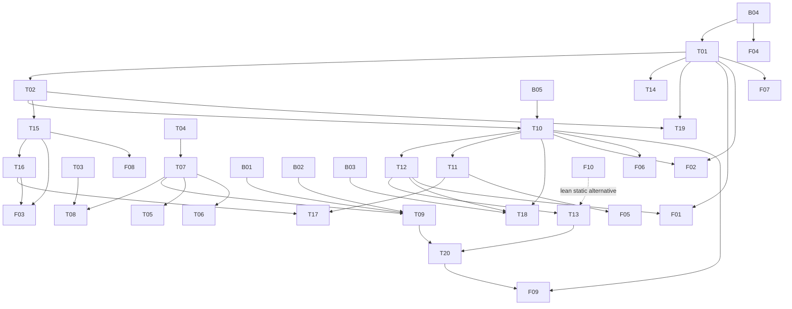

# Master Workspace Audit and 35-Task Implementation Roadmap

**Workspace:** Chemistry_3 · **Audit date:** 2026-11-06 · **Status:** read-only audit and implementation plan. This document is the only new deliverable. It does not authorize changes to the generated master, course sources, skill files or QA artifacts.

**Evidence vocabulary:** [TESTED] = command/runtime executed during this audit; [INSPECTED] = directly read; [INFERRED] = reasoned from inspected evidence; [UNVERIFIED] = requires a named check. Historical results are not current acceptance. Provenance: [TEXT-VERIFIED] means the cited passage was directly available and read; [METADATA-VERIFIED / SCOPE-ALIGNED] means metadata and topic scope checked, without claiming an inaccessible passage was read.

## 1. Executive Decision Brief and First-Principles Workspace Profile

### Decision brief

The workspace is a Latvian-language, single-file study reference for solutions and concentration calculations in first-year medical chemistry. Its canonical HTML is assembled from Python-owned fragments and data; the editable product is therefore the build source, not the generated HTML. The guide is content-rich and has source-conflict, equation, unit, terminology and layout evidence in governance and QA records. This audit finds no basis to claim a current runtime failure: the current render could not be captured under the required falkon workflow, and the build was not run because it writes the canonical HTML. The urgent work is to resolve high-impact source/math ambiguity without erasing provenance, then make generated checks traceable to a source revision.

### Discovered profile

| Dimension | Workspace-grounded profile |
|---|---|
| Primary disciplines | General chemistry; solution chemistry; chemical quantities and concentration calculations. |
| Secondary domains | Introductory physical chemistry (electrolyte dissociation/equilibrium), stoichiometry, volumetry, and contextual medical arithmetic. The latter is arithmetic practice, not clinical guidance. |
| Learner and curriculum | First-year RSU medical students; seminar and introductory/final tests; passing threshold ≥55% stated in AGENTS.md. Prerequisites include arithmetic, unit conversion, formula rearrangement, chemical formulas/equations and basic algebra. Cohort accommodations and official exam rubric were not inspected. |
| Language and notation | Main language Latvian, with English source/tool terms and chemical Latin-letter symbols. Decimal comma; Latvian diacritics. Notation includes n, M(B), c(B), w(B), γ(B), ρ, V, m, α, Kₐ/Kᵦ, subscripts/superscripts, ionic charges, reaction arrows and SI-derived units. Course convention M for mol/L coexists with M for molar mass and needs explicit mapping. Percent basis (m/m, m/V, V/V) must not be inferred from % alone. |
| Technical form | One offline HTML5 document generated by build/build.py; HTML/CSS own presentation and most interaction, Python assembles/checks data and markup, one embedded raw-JS runtime for recall/navigation/print. Fonts and nine generated SVGs are embedded. No package manifest or framework runtime was found in the scoped inventory. |
| State/network | Recall mode is intended as page-local, in-memory interaction; storage/network behavior was not runtime-proven here. Fresh request monitoring is [UNVERIFIED]. |
| Strengths | Canonical-source discipline; 16 chapters; 67 worked tasks; 144 recall prompts; 25 term anchors; nine registered SVGs; K1–K23 source-conflict log; math fixtures/check modules; offline-first target; explicit visual QA protocol. Counts derive from artifact inspection or supplied governance baseline. |
| Systemic risks | Course handout conflicts may be mistaken for chemical truth; assessment and medical-adjacent examples can overstate assumptions; build can overwrite HTML; script budget and QA code have known debt; old screenshots can be mistaken for current proof; no Git history means rollback relies on fingerprints/backups. |
| Audit limits | No Git repository; no fresh browser/runtime; falkon lite-shot exited 75 because X display :99 could not open; no Chrome fallback used. A–F source files were inventoried but not every page and key re-read. Bibliographic web research is limited to primary BIPM/IUPAC/WHO and official publisher sources. Screen-reader/manual keyboard and current PDF export were not performed. |

### Artifact baseline before planning file

Master_3_tema_skidumi_un_koncentracijas.html: **579,768 bytes**, **3,698 lines**, SHA-256 **41ea63bf27c1d0aa9c10def533bd4099e4430a65caf730e63a254622c4d4d618** (matches supplied AGENTS.md fingerprint). Modification time in supplied baseline: 2026-11-01 16:58:17 +0200. AGENTS.md says the master is generated; do not edit directly. Workspace is not a Git repository [TESTED: git status reports no repository], so there is no commit history or Git rollback.

## 2. Workspace, Architecture and Skills Inventory + File-by-File Inspection Ledger

### Architecture and skills

build/build.py assembles build/head.html, five chapter fragments, generated task/recall/figure output, and build/foot.html into the canonical HTML. build/calc.py, equations.py, equation_fixtures.py, unitcheck.py, rolecheck.py, compositioncheck.py, terms.py, routes.py, taskbase.py, tasks_a.py, tasks_b.py, recall.py, figures.py and font helpers supply content, checks and output. build/qa.js, build/qa/report.json, build/qa/master-print.pdf, build/qa/*.png and build/scratch/ are prior QA/scratch evidence; regeneration may overwrite artifacts and was not done. workspace_skills/INDEX.md and COPY_MANIFEST.json enumerate a broad local catalog. Relevant implementation references: interactive-study-guide, learn-then-test, cognitive-deload-auditor, svg-spatial-occlusion, synoptic-matrix-architect, tufte-margin-scholar, print-css-alchemist, pdf-vector-surgeon, lexicon-morphology-weaver, blueprint-spec-sheet, audit, break-ui, design-motion-principles, review-animations and VISUAL_VERIFICATION.md. Invoke only the smallest relevant subset per task; skills are read-only references.

### Inspection ledger

Coverage labels are literal: direct file findings are [INSPECTED], executed inventory/measurement commands are [TESTED], and unavailable rendering/runtime outcomes are [UNVERIFIED]. “Partial” means the named paths were not exhaustively read.

| File/asset path | Role | Content inspected? | Runtime tested? | Key evidence and findings | Coverage limits |
|---|---|---:|---:|---|---|
| AGENTS.md | Governance/source authority | Full | No | 12-section contract; generated master; K1–K23 and J/I/E/G issues; 4-tier architecture; lite-shot restriction; snapshot/hash. | Full line-by-line not repeated. |
| VISUAL_VERIFICATION.md and workspace_skills/VISUAL_VERIFICATION.md | Render protocol | Full/partial | Capture attempted | falkon then falkon, screenshot/direct inspection required, Chrome prohibited unless user permits. Current capture exits 75 at X display probe. | No current screenshot. |
| PROMPT_Master_html_3_tema*.md | Historical requirements | Partial | No | Older requirements; AGENTS.md has precedence. | Not treated as current authority. |
| TASKS_20_* plans | Historical backlog/evidence | Partial | No | v2 supplies 20 topic clusters and 2026-11-01 measurements/proposals. | Stale figures and proposals not asserted current. |
| Master_3_tema_skidumi_un_koncentracijas.html | Sole generated output | Partial structural scan | No | 579,768 B; 3,698 lines; 16 chapters per baseline; embeds task/recall content. | No full prose audit or current rendering. |
| build/build.py | Build assembly/gates | Partial | Not run | Central mutating build; AGENTS says it writes HTML before gates. | No clean-build result. |
| build/head.html, build/foot.html | Shared CSS/runtime | Partial | No | head 26,081 B; foot 2,691 B/62 lines. Footer lines 11–60 include scroll-spy and print handlers. | Browser behavior unverified. |
| build/ch01_04.html through ch15_16.html | Five chapter fragments | Partial | No | Chemistry, exercises, appendices, source ledger and recall material. | No complete scientific proofread. |
| build/tasks_a.py, tasks_b.py, taskbase.py | Problem data and renderer | Partial | No | Structured task records hold givens, routes, calculations, answers/check/why and optional source notes. | Not every task reviewed. |
| build/calc.py, equations.py, equation_fixtures.py | Calculation/check sources | Partial | No | Arithmetic/check infrastructure exists. Historical report said 264 equalities/12 fixtures; not rerun. | No current numeric pass claimed. |
| build/terms.py, routes.py, unitcheck.py, rolecheck.py, compositioncheck.py | Terms/routes/unit/role gates | Partial | No | Modules present. | Current check output unavailable. |
| build/recall.py, recall_mode.js | Recall source and runtime | Partial | No | Python pre-renders questions; JS creates actions using createElement/innerHTML, delegated click, in-page state. | Keyboard/no-JS behavior unverified. |
| build/qa.js | QA runtime | Partial | No | 7,153 B / 151 lines in current inventory; outside intended TS/Python tiers per governance. | Invocation/dependency graph incomplete. |
| build/figures.py, build/figures/*.svg, index.json | Nine SVG generators | Partial | No | Nine IDs registered; figures.py includes inline style declarations per AGENTS. | No current image inspection. |
| build/fonts.py, build/fonts/ | Font embedding | Partial | No | Five WOFF2 assets. Prior Type 3/missing glyph finding is historical. | No current PDF. |
| build/qa/*, build/scratch/*, .taste-skill/inspect/* | Historical QA/captures | Partial metadata/text | No current evidence | Old report includes viewport values and transparent-background contrast 1.445. | Not fresh acceptance evidence. |
| A PDF, B PDF, C DOCX, D/E/F PDFs | Course scope, exercises, keys | Not fully inspected | No | Roles and K-row pointers in AGENTS. | Exact passages/pages must reopen in Wave 1. |
| workspace_skills/** | Local skill library | Index/manifest and selected descriptions | No | Broad design, pedagogy, SVG, print, PDF, animation and audit catalog; read-only. | Not every body opened. |
| .claude/, .qoder/, .taste-skill/ | Tool settings and inspection files | Partial | No | Present; screenshots/report are historical. | Sensitive values omitted. |
| Root/nested runtime manifests and nested AGENTS | Configuration discovery | Inventory scan | No | No package.json, pyproject, tsconfig, Makefile or nested AGENTS found in scoped filenames. | Ignored/hidden files not exhaustively audited. |

## 3. Diagnostic Triage: Confirmed Defects vs. Suspected Risks vs. Opportunities

### Confirmed by live source inspection

| ID | Triage | Evidence | Consequence/disposition |
|---|---|---|---|
| D-01 | Architecture | build/foot.html:11–60 has scroll-spy (scroll, IntersectionObserver) and print open/restore code. [INSPECTED] | Governance flags scroll-spy as unregistered; 2026-11-06 baseline exceeded 4096 B/100-line JS budget. Replace with CSS or keep only a tested, registered print fallback. |
| D-02 | Runtime size | build/qa.js is 7,153 B/151 lines; recall_mode.js is 3,861 B/75 lines [TESTED: wc]. | QA source is outside intended TS/Python ownership; recall exceeds registered 2,400 B/60-line target and uses templating patterns flagged by AGENTS. |
| D-03 | SVG authoring | build/figures.py uses inline style declarations [INSPECTED]. | Token and inline-style gates absent; visual changes must be source-owned and regenerated. |
| D-04 | Evidence freshness | build/qa/report.json is a prior report; contrast.ink_verified=1.445 with transparent compositing noted by AGENTS. [INSPECTED] | Does not establish current contrast/layout; transparent background calculation may be meaningless. |
| D-05 | Source conflict risk | K1–K23 identify competing definitions, symbols, percent basis, typos, rounding, density and medical-adjacent claims. [INSPECTED] | Keep source text and warranted calculation distinct; exact passages need re-opening. |
| D-06 | Current visual blocker | falkon lite-shot exited 75: X display :99 unavailable. [TESTED] | Current layout claims remain [UNVERIFIED]; rerun only under permitted renderer/environment. |
| D-07 | Rollback | git status reports no repository. [TESTED] | Record hashes and backup before any authorized build pass. |
| D-08 | Governance byte budget | AGENTS.md is 25,357 bytes; contract maximum is 24,576 bytes, an overrun of 781 bytes. [TESTED: stat/wc] | Governance compaction is a separate documentation task; this audit does not edit AGENTS.md. Recheck path references and exactly 12 sections before a later authorized edit. |

### High-risk diagnostic investigations

| ID | Risk | Required diagnostic |
|---|---|---|
| R-01 | Recall JS-off, keyboard or falkon/falkon behavior | Inspect #n15; test with JS disabled and keyboard-only; confirm hidden defaults and focus sequence. |
| R-02 | Print handler can mutate open states or mishandle cancellation | Record selected details state, print/cancel/complete, compare state in permitted renderer. |
| R-03 | SVG clipping, type size, dark/print legibility | Fresh captures at 390/768/1280–1440 CSS px, light/system dark and print; inspect geometry. |
| R-04 | Course answers may conflate intended and chemically determined results | Reopen exact exercise/key; compute with explicit assumptions; preserve both readings. |
| R-05 | Scratch extracts may diverge from live A–F | Extract current files to temp; compare per question/page and verify edition/metadata. |
| R-06 | Rehydron/ACC/Maalox facts may be market/formulation/date-specific | Use exact official national label; otherwise remove product claim and keep hypothetical arithmetic only. |

### Opportunities, not defects

Prerequisite map, one-source answer reuse, first-error practice, transfer prompts, mobile SVG reflow, offline search, accessible print outline and standalone study sheets are candidates only. Adopt if they reduce a named learner cost and remain derivable from source data. This audit makes no positive visual observation.

## 4. Domain Terminology, Fact, Applicability and Warrant Verification Ledger

Status describes this audit’s evidence, not a blanket certification. Warrant check asks whether the source governs the same context and whether assumptions are present.

| Claim ID | Location | Existing claim/conflict | Status | Applicability and warrant | Authority | Confidence | Proposed disposition |
|---|---|---|---|---|---|---|---|
| C-01 | #n4, B p.3 / K1 | Mole as fixed entity count vs fixed carbon-12 mass definition. | Disputed | Current SI fixes N_A exactly; older wording is historical. Course handout cannot establish current SI definition. | BIPM SI; Gold Book A00297 [TEXT-VERIFIED] | High | Teach current definition; label historical source wording and retain K row. |
| C-02 | #n2, B p.1 / K2 | Particle-size bands leave gaps. | Unverified | Thresholds are classification conventions; cannot interpolate without course authority. | Local B, exact page pending | Low | Preserve gap and ask lecturer about endpoints. |
| C-03 | #n3, B p.2/C Q19–20 / K3 | α omitted; full dissociation assumed. | Over-simplified | Stoichiometry gives ideal fully dissociated relation; real speciation depends on equilibrium, concentration and medium. | IUPAC D01566 [TEXT-VERIFIED definition only] | High caveat; answer pending | Mark α=1 as an exercise assumption; avoid general claim. |
| C-04 | #n3, B p.2 / K4 | Ammonia notation, base constant, Ostwald conflict. | Disputed | NH3 + H2O equilibrium is basic; Ostwald approximation has restricted assumptions, not general use. | Local B pending; primary equilibrium reference required | Medium | Separate notation from model; preserve question for lecturer. |
| C-05 | #n5/#n7/#n14 / K5 | M means molar mass and course mol/L convention. | Over-simplified | IUPAC notes mol/L and sometimes M for amount concentration; local style may prefer c and mol/L but cannot say M is globally invalid. | Gold Book A00295; Green Book [TEXT-VERIFIED] | High | Explain course mapping; use c(B), mol/L in new prose. |
| C-06 | #n6, B p.3 / K6 | Density conversion between g/mL and L. | Inaccurate risk | A factor 1000 is required; unit conversion does not assume solution density. | SI units + dimensional analysis [TEXT-VERIFIED] | High | Write unit cancellation and reject missing factor. |
| C-07 | #n16a, C labels / K7 | Duplicate formula labels and skipped number. | Inspected pointer | Numbering breaks traceability, not chemistry. | Local C, exact labels pending | Medium | Keep source labels; use stable document IDs. |
| C-08 | #n6–#n7, B Ex2/Ex5* / K8 | KOH header on Na2CO3; Ex5* conflict. | Disputed | Formula, header and answer may refer to different species; matching a number does not identify intended chemistry. | Exact B pages and lecturer policy pending | Low | Reopen original, compute each reading and ask lecturer. |
| C-09 | #n11, B Ex10 / K9 | Stoichiometric ratio reversed/duplicated. | Inaccurate risk | Ratio follows balanced equation; intended acid/base must be known first. | Exact B page + balanced-equation reference | Medium | Rebuild from equation and preserve source line. |
| C-10 | #n5–#n6, A/B / K10 | 0.9% vs 0.88% saline. | Disputed | Could differ by percent basis, recipe, density or exercise convention; clinical standard cannot resolve exam intent. | A/B; WHO only if relevant [TEXT-VERIFIED] | High scope distinction | Name basis and source; do not conflate course/external values. |
| C-11 | #n6/#n13, B 9a / K11 | 0.85 g without density for w/w. | Warrant flaw | 0.85 g/100 mL is m/V; mass fraction requires total solution mass, hence density if volume is given. | Gold Book M03722 [TEXT-VERIFIED] | High | Conditional m/V answer; w/w underdetermined without density. |
| C-12 | #n9, B Ex7 / K12 | 2.77 vs 2.78 mL after early rounding. | Disputed | Recompute full precision; final digits depend on input precision and course convention. | B exact exercise and arithmetic | Medium | Show full intermediate and single final rounding; ask policy if divergent. |
| C-13 | #n8, C Q10 / K13 | 300.0 mL water treated as final solution volume for γ. | Warrant flaw | Mass concentration denominator is mixture volume; solvent volume alone does not supply it absent assumption. | Gold Book M03713 [TEXT-VERIFIED] | High | State missing final volume or conditional answer. |
| C-14 | #n6/#n9, C / K14 | Given densities appear atypical. | Unverified | Need solute, concentration, temperature, phase and source; remembered typical value cannot replace a given. | Source/primary density data pending | Low | Call them given exercise values pending provenance. |
| C-15 | #n1/#n13/#n16c, C key / K15 | Significant-digit and ion-label errors. | Disputed | Numeric match alone cannot establish species/charge/precision; check equation, coefficient, units and rounding. | Exact C source/key pending | Medium | Keep key separate from recomputation. |
| C-16 | #n10, D/E P5 / K16 | “Formalin (HCOOH)” conflates formaldehyde and formic acid. | Inaccurate | HCHO and HCOOH are different chemical identities; data cannot transfer between them. | IUPAC nomenclature + exact source pending | High | Correct explanatory prose, retain original as quoted error. |
| C-17 | #n10, E P7/C Q17/B Ex8 / K17 | Solute called solution mass; volumes assumed additive. | Warrant flaw | Mass and volume denominators differ; volume additivity is an approximation, not a general law. | IUPAC quantity definitions [TEXT-VERIFIED] | High | State denominator and label additive-volume assumption. |
| C-18 | #n12, D/E/F P10 / K18 | Rehydron sum omits KCl; water mass unstated. | Disputed | Sum depends on exact formulation and basis; WHO ORS formula is not evidence for Rehydron. | Exact official leaflet needed | Medium | Use conditional arithmetic or remove product-specific detail. |
| C-19 | #n12, E/F P11 / K19 | Only ACC maximum and implicit percent kind. | Unverified | Dosing/label is market/date/formulation-specific; arithmetic alone cannot establish safe range. | Exact official leaflet/register required | Low | Remove therapeutic guidance; fictional values preferred. |
| C-20 | #n12, D/E/F P12 / K20 | Powder vs solution denominator. | Warrant flaw | Powder mass fraction and prepared-solution concentration answer different questions and need explicit system/volume. | Gold Book M03722/A00295/M03713 [TEXT-VERIFIED] | High | Name system, quantity kind, denominator. |
| C-21 | #n12/#n13, E P13 / K21 | 13.4 g truncation vs 13.5 g rounded. | Disputed | Correct value depends on original givens and rounding convention. | Exact E/F + recomputation pending | Medium | Preserve both original result and recomputed method. |
| C-22 | #n12/#n14, D/E/F / K22 | Typos and mixed language. | Inspected pointer | Editorial defects can alter variable identity; each needs exact collation and Latvian review. | Original D/E/F and terminology source pending | Medium | Correct after source comparison; log transcription. |
| C-23 | #n5/#n12, A / K23 | Percent basis unstated. | Over-simplified | m/m, m/V and V/V are distinct; familiar value/product convention does not generalize. | IUPAC quantity terms [TEXT-VERIFIED] | High | State basis or mark underdetermined. |
| C-24 | #n4, current SI statement | n is an entity-count-like quantity. | Verified with scope note | Amount n measures number of specified entities in mol; N is raw count and N=nN_A only for matching entity type. | BIPM SI; Gold Book A00297 [TEXT-VERIFIED] | High | Keep entity explicit; distinguish n from N. |
| C-25 | #n7/#n8 | γ=cM; same solution-volume basis. | Verified with conditions | Follows definitions for same constituent/system and consistent units; density is unnecessary for this conversion but required to relate w and c. | Gold Book M03713/A00295 + algebra [TEXT-VERIFIED] | High | Keep species and unit cancellation beside formula. |

**Warrant protocol:** reopen exact question/page; record source/edition; identify system and denominator; list assumptions; independently recompute; test negative/boundary cases; label course-intended and chemically warranted result separately. No uninspected textbook page or quotation is asserted.

## 5. Authoritative Book, Standard and Literature Bibliography

### Authority hierarchy

1. Measurement/quantity definitions: BIPM/CGPM SI Brochure; IUPAC Gold Book and Green Book. They do not decide lecturer intent or a medicine label.
2. Chemistry principles: IUPAC recommendations and primary experimental references, then canonical university texts.
3. Product examples: current national regulator/product information for exact market/strength/formulation; WHO only for the named WHO ORS formulation.
4. Curriculum intent: A–F handouts in their AGENTS-defined roles. They establish scope and wording, not infallible general chemistry.

### Bibliography and warrant

| Rank/source | Full metadata | Scope/provenance and limits |
|---|---|---|
| 1 | BIPM. [The International System of Units (SI Brochure)](https://www.bipm.org/en/web/guest/publications/si-brochure). 9th edition (2019), English text updated 2026. BIPM. DOI 10.59161/AUEZ1291. | Mole definition and quantity/units sections. Official page and current PDF content inspected [TEXT-VERIFIED]. Recheck exact PDF version before implementation citations; establishes SI, not course policy. |
| 1 | IUPAC. [Compendium of Chemical Terminology (Gold Book)](https://goldbook.iupac.org/), 5th ed., online v5.0.0 (2025). Relevant entries [A00297](https://goldbook.iupac.org/terms/view/A00297), DOI 10.1351/goldbook.A00297; [A00295](https://goldbook.iupac.org/terms/view/A00295), DOI 10.1351/goldbook.A00295; [M03722](https://goldbook.iupac.org/terms/view/M03722), DOI 10.1351/goldbook.M03722; [M03713](https://goldbook.iupac.org/terms/view/M03713), DOI 10.1351/goldbook.M03713; [D01566](https://goldbook.iupac.org/terms/view/D01566), DOI 10.1351/goldbook.D01566. Publisher: IUPAC. | Direct entry text inspected [TEXT-VERIFIED]. Living resource; recheck with access date. |
| 1 | Brett, Christopher M. A.; Frey, Jeremy G.; Hinde, Robert; Kuroda, Yutaka; Marquardt, Roberto; Pavese, Franco; Quack, Martin; Stohner, Juergen; Thor, Anders J. (eds.). [Quantities, Units, and Symbols in Physical Chemistry: IUPAC Green Book](https://iupac.org/what-we-do/books/greenbook/). 4th ed., abridged, 2023. Royal Society of Chemistry. DOI 10.1039/9781839163180. | Scope: physical-chemistry quantities, units and symbols; exact chapter/section was not used or verified in this audit. Official metadata inspected [METADATA-VERIFIED / SCOPE-ALIGNED]. |
| 2 | Stock, Michael; Davis, Richard; de Mirandés, Emmanuel; Milton, Martin J. T. “[The revision of the SI — the result of three decades of progress in metrology](https://doi.org/10.1088/1681-7575/ab0013).” Metrologia 56 (2019), 022001. DOI 10.1088/1681-7575/ab0013. | BIPM summary inspected; history only. Article text not opened; [METADATA-VERIFIED / SCOPE-ALIGNED]. |
| 2 | WHO. [Oral rehydration salts: production of the new ORS](https://www.who.int/publications/i/item/WHO-FCH-CAH-06.1). WHO/FCH/CAH/06.1, 2006. World Health Organization. | Official WHO source opened; applies to WHO reduced-osmolarity ORS, not Rehydron or Latvian product facts. [TEXT-VERIFIED]. |
| Local curriculum | A: 3. temata apraksts.pdf; B: 3. Sem_Koncentrāciju_apr_Darab_lapa_2020_MF.pdf; C: 3_Seminars_Koncentraciju aprekini_2023.docx; D/E/F: additional exercises/key/solutions PDFs named in workspace. | Roles checked against AGENTS only; exact source text not fully reopened. [METADATA-VERIFIED / SCOPE-ALIGNED]. |

No canonical textbook citation is used as factual support because edition, publisher, ISBN and chapter were not verified from a publisher catalog in this audit. Implementation agent should add one only after checking all required metadata and applicable chapter scope; do not invent ISBN/page/quotation.

## 6. Editorial Design, Accessibility, Pedagogy and Complete SVG Inventory/Diagnostics

### Editorial/accessibility contract

Retain the calm reference-book identity where screenshots support it; no gradients, glow, glass, decorative motion, emoji controls, generic card grids or oversized hero. Use primitive, semantic light/dark, then component tokens; exact @layer order from AGENTS. Keep prose 60–75ch; formulas and units use semantic markup and tabular numerals. Provide visible focus, targets ≥44px, contrast ≥4.5:1 text/3:1 large/UI against resolved background in both themes, non-color meaning, reduced-motion handling, keyboard workflow and readable print. Print must preserve disclosure content, user state where supported, underlined links, table headers, row integrity and navigation/outlines. These are targets, not current passes.

### Pedagogy audit frame

Each concept/task: prerequisite → definition/symbol/unit → mechanism/derivation → boundary conditions → example → first likely error or explicit no-trap note → dimensional/magnitude/reverse check → transfer. Distinguish given assumptions from laws. Keep answers in native disclosures with print fallback. Medical arithmetic must not become dose advice or include unsourced clinical ranges; fictional inputs are preferred.

### SVG inventory and blueprint

Nine figures are generated by build/figures.py and registered in build/figures/index.json. [INSPECTED: IDs/index; no visual classification accepted without capture.] Actions below are provisional source-based targets, not visual verdicts.

| Figure/source | Role | Action | Objective/topology/forbidden depiction | Construction and acceptance |
|---|---|---|---|---|
| particle_scale | Dispersed-system size bands | [CORRECT] | Show source bands, endpoints and uncovered gap; do not invent continuous classification. | Repair .fig-leader; title/desc; labels ≥12px at 390px and no clipping. |
| ostwald | Weak-electrolyte equilibrium | [CORRECT] | Distinguish exact expression and α≪1 approximation; label assumptions; no universal-law implication. | Separate line styles; text equivalent; numerical boundary cases. |
| ion_strip | Formula unit to ions | [CORRECT] | Show coefficients and conditional α=1; do not imply all real electrolytes fully dissociate. | Species/charges/units; charge-balance gate; color-independent meaning. |
| unit_ladder | Conversion chain | [RETAIN] (visual check still required) | Show direction and conversion factor; no unlabeled arrow. | Responsive units; accessible arrow text; unit-cancellation verification. |
| quantity_map | Relations among quantities | [CORRECT] | Put formulas/operators on correct edges: c=n/V on n–V; γ=cM; no c=n·V implication. | Generate edge map from data; test routes with calc.py. |
| volumetric | Final solution volume | [RETAIN] (visual check still required) | Meniscus at mark; distinguish water volume from final solution volume. | Explicit final-volume label; alt text and print check. |
| dilution_ladder | Amount conserved in dilution | [CORRECT] | n constant, V changes; preserve displayed precision; no general volume-additivity claim. | Generate values from calculation source; compare figure and task digits. |
| mixing | Mixing concentrations | [RETAIN] (visual check still required) | Add amounts before dividing by final volume; qualify additive-volume assumption. | Formula/dimensions; unequal-volume and caveat boundary test. |
| neutralisation | Stoichiometric mole relation | [RETAIN] (visual check still required) | Balanced coefficients and equivalence; no universal 1:1 or pH 7 claim. | Tie labels to balanced equation; verify coefficients, grayscale and AT text. |

For every modified/new SVG: record misconception; exact scene/topology; labels/units and assumptions; forbidden misleading depiction; viewBox; responsive strategy; semantic tokens; print behavior; title/desc; screenshot pass/fail. Candidate additions: percent-basis comparison, weak-electrolyte speciation, mass vs volume balance, fictional unit-chain arithmetic, lab-result line anatomy without invented intervals, prerequisite map, concentration-route decision tree, balanced-reaction ratio. Build only where it resolves a named misconception.

## 7. 20 Core Improvement Tasks (T01–T20) — Full templates

Task contracts below are proposals, not permission to alter production. Each implementation agent first records source/output hashes and uses the build-source-to-generated-output chain. Epistemic status pertains to the observed problem. Domain touches cite the Claim Ledger (CL).

### T01 — Canonical quantity lexicon and course-notation map

**Workstream:** Terminology & Sourcing · **Priority:** P0 · **Impact/Effort:** 5/3 · **Status:** [INSPECTED] · **Boundary:** Own term data and lint only; T14 owns Latvian prose editing. **Skills:** learn-then-test, lexicon-morphology-weaver. **Evidence:** K5; build/terms.py and #n14 already hold a canonical vocabulary, while course aliases C_M/M and molar-mass M need one explicit mapping. **Why:** a learner may confuse quantity identity, unit and source convention. **End state:** data-driven aliases, canonical document form c(B)/mol/L and source-context exception handling. In scope: glossary/notation mapping and lint. Out: changing source quotations or lecturer convention. **Authority/warrant:** CL C-05, IUPAC A00295 establishes amount concentration and permits M in some contexts; local style remains editorial.

**Main Step 1:** Define the quantity schema and provenance boundary in the build layer. **Main Step 2:** Render one course-to-document mapping where students meet formulas. **Main Step 3:** Run lint and check glossary/formula-sheet parity.

**Subtask T01.1 — Lexicon data/gate:**  
Substep T01.1.1: Add build/lexicon.py rows for n, M(B), c(B), w(B), γ(B), ρ, m(solution), aliases and units; assert unique keys.  
Substep T01.1.2: Add lexicon.audit(document) after unitcheck in build/build.py; report first prose context and exempt quoted source/change-log passages.  
Substep T01.1.3: Add fixtures where C_M in new prose fails, while source quotation passes; record both expected results.

**Subtask T01.2 — Learner-facing mapping:**  
Substep T01.2.1: Add six-row mapping table to build/ch13_14.html with course form, canonical form and ambiguity explanation.  
Substep T01.2.2: Link from chapter 5 and formula appendix without duplicating the table.  
Substep T01.2.3: Compare rendered glossary and formula rows one-to-one and inspect Latvian diacritics in print.

**Files/interfaces:** existing build/terms.py, build/ch13_14.html, build/ch15_16.html, build/build.py; proposed build/lexicon.py and fixtures. **Acceptance:** positive canonical forms pass; quoted legacy form passes; unquoted alias fails; screen reader can hear quantity and unit. **Dependencies/risks/DoD:** none upstream; T14 and T20 downstream. Roll back lexicon module and its single wiring commit if false positives occur; retain CL/K ledger.

### T02 — Significant-figure contract and numeric display consistency

**Workstream:** Terminology & Sourcing · **Priority:** P0 · **Impact/Effort:** 5/4 · **Status:** [INSPECTED] · **Boundary:** Precision rules and generated figure/task digit alignment; T15 owns diagram correctness. **Skills:** learn-then-test, break-ui. **Evidence:** K12/K15/K21; v2 ledger E11 records 0,10 vs 0,1 mismatch, but exact old counts need remeasurement. **Why:** premature rounding and mixed displayed precision teach inconsistent reporting. **End state:** one rule, full-precision computation, final-only rounding, test vectors. Out: changing lecturer’s answer policy without consultation. **Authority/warrant:** CL C-12/C-15/C-21; source inputs and course significant-figure policy must govern.

**Main Step 1:** Specify rounding policy with source-derived examples and disputed cases. **Main Step 2:** Make display labels derive from the same numeric records as answers. **Main Step 3:** Add drift checks that distinguish deliberate source quotations.

**Subtask T02.1 — Precision record:**  
Substep T02.1.1: Add a precision table to build/ch15_16.html listing input precision, guard digits and final report.  
Substep T02.1.2: Add fmt_sig in build/calc.py with decimal-comma formatting and explicit significant-digit argument.  
Substep T02.1.3: Create test vectors for exact values, trailing zero, exponent form and half-rounding boundary.

**Subtask T02.2 — Figure/task parity:**  
Substep T02.2.1: Inventory numeric SVG labels in build/figures.py; map each data-derived value to calc.py key.  
Substep T02.2.2: Add build/digitcheck.py to compare matching answer and figure displays; exempt axis ticks and clearly marked source quotes.  
Substep T02.2.3: Run 0,10/0,1 plus K12/K21 cases and require explainable diffs in the QA report.

**Files/interfaces:** build/calc.py, equations.py, figures.py, tasks_a.py, tasks_b.py, ch15_16.html; proposed digitcheck.py. **Acceptance:** a deliberate lost trailing zero fails; an unmatched illustrative tick is excluded; units/screen-reader reading remain intact. **Dependencies/risks/DoD:** T01 convention first; T15 figure patch follows. Revert only formatter/check if legacy values become silently rounded.

### T03 — Font subset, PDF outline and tagged-output investigation

**Workstream:** Accessibility & Polish · **Priority:** P1 · **Impact/Effort:** 4/5 · **Status:** [INSPECTED] historical defect, current state [UNVERIFIED] · **Boundary:** Own fonts and export metadata; T09 owns page layout. **Skills:** pdf-vector-surgeon, print-css-alchemist, PDF skill. **Evidence:** AGENTS E06–E08 records Type 3 fallback, missing glyphs and no outline/tags from historical export. **Why:** formulas may render with fallback and long PDF navigation/accessibility is impaired. **End state:** fresh export with zero Type 3, complete glyph coverage, outline; tags or dated limitation. Out: claiming PDF/UA conformance without validation. **Authority/warrant:** no chemistry claim; glyph inventory and actual exported PDF are required evidence.

**Main Step 1:** Freeze a current glyph and PDF baseline without altering sources. **Main Step 2:** Adjust subset/export sources and metadata only after locating ownership. **Main Step 3:** Re-export and inspect representative pages and document structure.

**Subtask T03.1 — Glyph coverage:**  
Substep T03.1.1: Build character inventory from assembled HTML and compare against build/fonts subset maps.  
Substep T03.1.2: Add missing symbols to the proper source subset; preserve licensing and font metadata.  
Substep T03.1.3: Export with the governed tool and inspect pdffonts, missing glyphs, and pages containing math.

**Subtask T03.2 — Navigation/accessibility:**  
Substep T03.2.1: Identify export path in build/fonts.py and document exact CLI/version in QA manifest.  
Substep T03.2.2: Generate bookmark outline from 16 chapter IDs and validate target order.  
Substep T03.2.3: Inspect tags with a PDF structure tool; if unavailable, record a dated limitation and accessible HTML fallback.

**Files/interfaces:** build/fonts.py, build/fonts/*, build/build.py, build/qa/report.json; generated PDF only in approved QA output. **Acceptance:** positive glyph specimen renders; negative missing-glyph test fails; PDF has 0 Type 3 and 16 ordered outline items or explicit unresolved limitation; keyboard/AT claim remains scoped. **Dependencies/risks/DoD:** T09 print CSS; preserve font licenses and prior PDF backup.

### T04 — QA report provenance and contrast calculation repair

**Workstream:** Architecture & Functionality · **Priority:** P0 · **Impact/Effort:** 5/3 · **Status:** [INSPECTED] · **Boundary:** QA result schema, not style remediation (T07/T16). **Skills:** audit, break-ui. **Evidence:** build/qa/report.json has historical ink_verified 1.445; AGENTS diagnoses transparent surface composited as black. **Why:** false failures waste effort and stale PASS values obscure the artifact actually measured. **End state:** report binds input hash, renderer, date, gates, and resolved background calculations. Out: claiming WCAG until both themes/current palette tested. **Authority/warrant:** WCAG contrast algorithm requires actual foreground/background; transparency needs compositing against real parent.

**Main Step 1:** Define evidence schema with artifact hash and run metadata. **Main Step 2:** Fix color resolution and distinguish unavailable measurements. **Main Step 3:** Ensure report exits nonzero on failed gates and never labels missing checks PASS.

**Subtask T04.1 — Contrast:**  
Substep T04.1.1: Trace build/qa.js luminance inputs and find every alpha/transparency branch.  
Substep T04.1.2: Resolve computed background through parent stack for light, dark and print fixtures.  
Substep T04.1.3: Add transparent-over-light and transparent-over-dark fixtures with independently calculated expected ratios.

**Subtask T04.2 — Evidence binding:**  
Substep T04.2.1: Add artifact SHA, tool version, viewport/theme and timestamp fields to report generation.  
Substep T04.2.2: Represent NOT RUN/UNAVAILABLE separately from PASS in build/qa/report.json writer.  
Substep T04.2.3: Verify stale report hash is rejected by a read-only validation command.

**Files/interfaces:** build/qa.js or successor, build/qa/report.json schema, build/build.py; proposed fixtures. **Acceptance:** opaque ratio matches a hand calculation; transparent fixture gets correct resolved ratio; stale/missing evidence never passes. **Dependencies/risks/DoD:** prerequisite for T07/T16 contrast claims; roll back report schema independently if consumers break.

### T05 — Use desktop reading rail for definitions and bounded notes

**Workstream:** Anti-AI-Slop UI & Retexturing · **Priority:** P2 · **Impact/Effort:** 3/3 · **Status:** [INFERRED] · **Boundary:** Place optional contextual notes in existing layout; T07 owns global token system. **Skills:** tufte-margin-scholar, cognitive-deload-auditor. **Evidence:** old E15 reports wasted right-side space at 1440px; fresh render blocked. **Why:** unused space could support nearby definitions, but overuse fragments reading. **End state:** occasional notes linked to exact paragraphs; collapse into reading order on narrow screens/print. Out: sidebar navigation or advertising rail. **Authority/warrant:** only notes drawn from CL verified entries.

**Main Step 1:** Identify paragraphs where a marginal note prevents a documented misconception. **Main Step 2:** Design a semantic aside relationship and desktop placement. **Main Step 3:** Verify at wide, narrow, keyboard and print modes before keeping.

**Subtask T05.1 — Content selection:**  
Substep T05.1.1: Inventory candidates in build/ch05_08.html and ch09_12.html using K5/K13/K17 only.  
Substep T05.1.2: Draft note text ≤45 words with source/status and link back to full explanation.  
Substep T05.1.3: Reject any note that repeats adjacent prose or removes a prerequisite.

**Subtask T05.2 — Layout:**  
Substep T05.2.1: Add aside markup with aria-labelledby and stable target IDs in chapter fragments.  
Substep T05.2.2: Use intrinsic grid/container CSS in build/head.html; notes enter document flow below tablet threshold.  
Substep T05.2.3: Screenshot-inspect 1280 desktop and 390 phone, plus print; measure no overlap or order inversion.

**Files/interfaces:** build/head.html, selected chapter fragments, generated master. **Acceptance:** desktop note aligns with source paragraph; 390px linear order is sensible; keyboard/print preserve relation; if no screenshot, status stays unknown. **Dependencies/risks/DoD:** T07 before production styling; remove rail if it splits reading.

### T06 — Remove templated surface repetition while preserving hierarchy

**Workstream:** Anti-AI-Slop UI & Retexturing · **Priority:** P2 · **Impact/Effort:** 3/4 · **Status:** [INSPECTED] from old ledger, remeasure required · **Boundary:** Surface classes and repeated labels; T10 owns teaching content. **Skills:** cognitive-deload-auditor, design-taste-frontend, polish. **Evidence:** E05/E17/E27/E28 historical counts cite repeated details/callouts and uppercase labels. **Why:** repeated visual emphasis makes key cautions indistinguishable. **End state:** prose-led surface hierarchy with emphasis reserved by semantic function. Out: removing valid role classes or source notes. **Authority/warrant:** design change only; preserve all claims and K provenance.

**Main Step 1:** Recount styles and surfaces from current source. **Main Step 2:** Consolidate visual rules by semantic role. **Main Step 3:** Compare representative chapters for hierarchy and content retention.

**Subtask T06.1 — Surface census:**  
Substep T06.1.1: Count .task, details, .role-* and repeated labels in assembled output with selectors.  
Substep T06.1.2: Map each role class to purpose and identify duplicate selectors in head.html.  
Substep T06.1.3: Record protected semantics and save source/output fingerprints before refactor.

**Subtask T06.2 — Retexture:**  
Substep T06.2.1: Replace decoration-only wrappers with semantic paragraphs/lists in chapter fragments.  
Substep T06.2.2: Consolidate CSS rules; retain contrast/focus and print overrides.  
Substep T06.2.3: Compare chapters 5, 9, 12 and 15 under fresh approved screenshots; no screenshot means pending.

**Files/interfaces:** build/head.html, ch*.html, taskbase.py. **Acceptance:** semantic role count unchanged, wrappers reduced only where redundant; no missing content; headings and focus visible. **Dependencies/risks/DoD:** T07/T08 foundation; revert selector consolidation if role distinctions disappear.

### T07 — Primitive/semantic/component design tokens

**Workstream:** Anti-AI-Slop UI & Retexturing · **Priority:** P1 · **Impact/Effort:** 4/4 · **Status:** [INSPECTED] historical flat token baseline · **Boundary:** Tokens and layer migration; T08 typography and T16 figure tokens consume them. **Skills:** design-taste-frontend, impeccable, audit. **Evidence:** AGENTS J05/J06 describes no @layer and flat :root tokens. **Why:** unstructured palette makes theme and component changes inconsistent. **End state:** exact layer order and three token tiers; restrained semantic colors. Out: new decorative brand system. **Authority/warrant:** design contract in AGENTS §7.

**Main Step 1:** Inventory all current color, type, spacing and component declarations. **Main Step 2:** Introduce tiered tokens without changing rendered meaning by intent. **Main Step 3:** Migrate selectors in layer order and measure contrast from resolved values.

**Subtask T07.1 — Token schema:**  
Substep T07.1.1: Add @layer reset,tokens,base,layout,components,utilities,print as first stylesheet statement.  
Substep T07.1.2: Move palette values into --p-* primitives and semantic --t-* aliases.  
Substep T07.1.3: Add component-role --c-* tokens only for repeated semantic surfaces; lint for orphans.

**Subtask T07.2 — Theme mapping:**  
Substep T07.2.1: Remap semantic tier in light and prefers-color-scheme dark; do not duplicate component literals.  
Substep T07.2.2: Wire contrast checker from T04 and report every foreground/background pair.  
Substep T07.2.3: Screenshot desktop/mobile light/dark and print in permitted engine; inspect before claiming pass.

**Files/interfaces:** build/head.html, QA contrast output. **Acceptance:** token graph complete; no ad-hoc color outside approved exceptions; contrast thresholds pass; focus remains visible. **Dependencies/risks/DoD:** T04 schema; T06/T08/T16 downstream. Roll back layer migration separately if cascade changes unexpectedly.

### T08 — Typography, formula rhythm and Latvian line quality

**Workstream:** Anti-AI-Slop UI & Retexturing · **Priority:** P2 · **Impact/Effort:** 4/3 · **Status:** [INFERRED] · **Boundary:** Type scale and line breaks; T14 owns copyediting. **Skills:** tufte-margin-scholar, lexicon-morphology-weaver, cognitive-deload-auditor. **Evidence:** AGENTS token contract gives 18px body/66ch; old plan flags formula/symbol and vertical rhythm review. **Why:** dense equations need distinct reading rhythm without shrinking prose. **End state:** stable hierarchy for prose, headings, captions, tables and symbols. Out: wholesale font replacement absent glyph evidence. **Authority/warrant:** no domain claim; typography must preserve subscripts and diacritics.

**Main Step 1:** Inventory font faces and semantic text roles. **Main Step 2:** Establish scale/measure and formula alignment. **Main Step 3:** validate glyphs, wrapping and print page breaks.

**Subtask T08.1 — Type scale:**  
Substep T08.1.1: Map h1–h4, body, labels, caption, table and SVG text selectors in head.html.  
Substep T08.1.2: Define component scale tokens; keep body measure 60–75ch and body size ≥16px.  
Substep T08.1.3: Check formulas with sub/superscripts and Latvian letters against embedded font coverage.

**Subtask T08.2 — Rhythm:**  
Substep T08.2.1: Normalize paragraph/list/formula spacing with line-height and measure tokens.  
Substep T08.2.2: Apply tabular numerals to numeric tables and align units without altering source values.  
Substep T08.2.3: Inspect dense chapters 6, 9, 10, 12 at mobile and print; record actual pagination changes.

**Files/interfaces:** build/head.html, build/fonts/*, chapter fragments. **Acceptance:** no clipped formula, no lost diacritic, desktop measure 60–75ch; narrow text wraps naturally; keyboard zoom to 200% remains usable. **Dependencies/risks/DoD:** T03 font inventory and T07 tokens; revert font changes if fallback or pagination regresses.

### T09 — Responsive figures/tables and print document spine

**Workstream:** Accessibility & Polish · **Priority:** P1 · **Impact/Effort:** 5/4 · **Status:** [UNVERIFIED] current visuals · **Boundary:** Layout behavior and print navigation; T15 owns SVG geometry. **Skills:** print-css-alchemist, pdf-vector-surgeon, audit. **Evidence:** E04 historical report of fixed-width figures/tables; E06–E08 PDF concerns. **Why:** phone panning and long print output hinder access. **End state:** responsive or clearly scrollable figures/tables and navigable print. Out: asserting tagged PDF unless tested. **Authority/warrant:** no chemistry claim.

**Main Step 1:** Inventory intrinsic widths, overflow containers and print page furniture. **Main Step 2:** Reflow or label horizontal scroll using semantic accessible regions. **Main Step 3:** Generate and inspect print output only after evidence path is safe.

**Subtask T09.1 — Small screens:**  
Substep T09.1.1: Measure .figure-scroll/.table-wrap min-width and overflow from generated markup.  
Substep T09.1.2: Replace fixed minimums with reflow where legible; otherwise add visible keyboard/touch instructions.  
Substep T09.1.3: Test 320/390/768 widths, zoom and focus scrolling with a fresh screenshot.

**Subtask T09.2 — Print:**  
Substep T09.2.1: Move print rules into @layer print and preserve summary/content visibility.  
Substep T09.2.2: Add repeated thead, avoid row splitting, preserve reference underlines and chapter start behavior.  
Substep T09.2.3: Inspect first, middle and final pages plus open/closed details in falkon/falkon print pipeline.

**Files/interfaces:** build/head.html, build/foot.html, figures.py, print QA. **Acceptance:** no page-level horizontal overflow; focusable scroll regions have accessible names; print includes answer content and chapter navigation. **Dependencies/risks/DoD:** T03/T07; current screenshot gate required; restore baseline PDF on failure.

### T10 — Explain mechanisms, assumptions and first wrong step

**Workstream:** Pedagogy & Explanations · **Priority:** P0 · **Impact/Effort:** 5/5 · **Status:** [INFERRED] historical counts, current recount required · **Boundary:** Task prose and explanation schema; T12 owns route-map pedagogy. **Skills:** cognitive-deload-auditor, learn-then-test. **Evidence:** E13 historically found uneven “why”, assumptions and error explanations among 67 tasks. **Why:** answer-only procedures conceal why denominator/route is valid. **End state:** each task has rule/mechanism, assumption and first likely mistake or explicit none. Out: inventing distractors. **Authority/warrant:** CL C-11–C-23; each note cites task source/assumption.

**Main Step 1:** Audit task records for explanation fields and misconception coverage. **Main Step 2:** Write explanations from quantities and equations, not answer paraphrases. **Main Step 3:** Add structure gate and review high-risk calculations.

**Subtask T10.1 — Record schema:**  
Substep T10.1.1: Extend taskbase.py with separate mechanism, assumption and first-error fields.  
Substep T10.1.2: Inventory tasks_a.py/tasks_b.py and mark fields absent without auto-filling.  
Substep T10.1.3: Make build gate require nonempty field or explicit “no common error identified” rationale.

**Subtask T10.2 — Content pass:**  
Substep T10.2.1: Revise K11/K13/K17 examples to name numerator, denominator and missing data.  
Substep T10.2.2: For each task, explain the first invalid line and corrected line with units.  
Substep T10.2.3: Review transfer prompt against neighboring task; remove duplicate canned language.

**Files/interfaces:** taskbase.py, tasks_a.py/tasks_b.py, ch09_12.html. **Acceptance:** positive fully warranted example; negative underdetermined prompt refuses unique answer; all explanations sit beside task and remain printable/readable. **Dependencies/risks/DoD:** T01/T02 for conventions; T12 uses structure. Source ambiguity remains logged.

### T11 — Prerequisite graph and coverage repair

**Workstream:** Pedagogy & Explanations · **Priority:** P1 · **Impact/Effort:** 4/4 · **Status:** [INSPECTED] historical coverage list · **Boundary:** Coverage model and links; T17 may render a diagram. **Skills:** learn-then-test, synoptic-matrix-architect. **Evidence:** AGENTS E14 reports 58/66 with eight missing codes A2,A8,D1,D2,M7,M8,R1,S1. **Why:** a student may face an assessed concept without a prerequisite cue. **End state:** every scoped learning outcome maps to explanation, task, retrieval item. Out: adding content beyond course scope. **Authority/warrant:** A is scope authority; re-open exact syllabus outcomes first.

**Main Step 1:** Define outcome IDs and dependency edges from A/course documents. **Main Step 2:** Map each outcome to source lesson/task/recall. **Main Step 3:** close verified gaps or mark source absence and ask lecturer.

**Subtask T11.1 — Curriculum graph:**  
Substep T11.1.1: Reopen A and map assessed outcomes into build/coverage data with exact source reference.  
Substep T11.1.2: Add prerequisite edges in a machine-readable structure separate from prose.  
Substep T11.1.3: Detect cycles, orphan nodes and outcomes without an explanatory anchor.

**Subtask T11.2 — Coverage rendering:**  
Substep T11.2.1: Add target lesson/task IDs for each confirmed missing code; do not fabricate outcomes.  
Substep T11.2.2: Add gate that counts outcome→explanation→practice→recall coverage.  
Substep T11.2.3: Review matrix with lecturer questions for ambiguous A scope items.

**Files/interfaces:** A source PDF, proposed build/coverage.py and data, chapter fragments, recall.py. **Acceptance:** all confirmed outcomes linked; one synthetic missing node fails; keyboard links and printable matrix work. **Dependencies/risks/DoD:** source reopening; T17 optional. Roll back graph additions if they imply unsupported curriculum.

### T12 — Make task routes explain quantities, not merely arrows

**Workstream:** Pedagogy & Explanations · **Priority:** P1 · **Impact/Effort:** 4/4 · **Status:** [INSPECTED] source structure; visual unknown · **Boundary:** Route reasoning text and validation; T15 repairs diagram labels. **Skills:** cognitive-deload-auditor, svg-spatial-occlusion. **Evidence:** routes.py, task route strings and quantity_map figure; AGENTS E09–E12 flags edge labels/precision. **Why:** path selection must arise from the target quantity and known values. **End state:** given→asked→relation→units→check narrated on each task family. Out: duplicating the diagram as prose. **Authority/warrant:** CL C-06, C-11, C-13 and C-25.

**Main Step 1:** Formalize route graph from quantity definitions. **Main Step 2:** Make each task point to the relation and assumption it uses. **Main Step 3:** validate paths and explain unavailable routes.

**Subtask T12.1 — Route data:**  
Substep T12.1.1: Normalize routes.py nodes as quantity IDs and edges as equation IDs, not display labels.  
Substep T12.1.2: Add denominator/system metadata for w, c and γ edges.  
Substep T12.1.3: Add positive route and missing-density/no-route fixtures.

**Subtask T12.2 — Task integration:**  
Substep T12.2.1: Update taskbase renderer to name known quantity and target quantity.  
Substep T12.2.2: Attach unit cancellation and assumption sentence to route explanation.  
Substep T12.2.3: Compare each generated route with quantity_map edge registry and fail on mismatch.

**Files/interfaces:** routes.py, taskbase.py, figures.py, selected task records. **Acceptance:** correct route passes; missing ρ case reports underdetermined; no edge-label mismatch; diagram gets fresh visual review. **Dependencies/risks/DoD:** T10 and T15; rollback route schema if data no longer matches task equations.

### T13 — Chapter synthesis and decision aids

**Workstream:** Pedagogy & Explanations · **Priority:** P2 · **Impact/Effort:** 3/3 · **Status:** [INFERRED] · **Boundary:** Synthesis summaries from verified concepts; F01/F02 feature proposals separate. **Skills:** synoptic-matrix-architect, cognitive-deload-auditor. **Evidence:** 16 chapters contain related quantity routes, but old plan reports no per-chapter transfer summary. **Why:** exam revision needs a concise way to discriminate quantity types. **End state:** each chapter closes with summary, contrast and one transfer prompt. Out: novel claims or a large dashboard. **Authority/warrant:** CL IDs for every formula and contrast.

**Main Step 1:** Select only concepts supported by the chapter and source ledger. **Main Step 2:** Draft contrasting decisions and transfer prompts. **Main Step 3:** build a compact print-safe synthesis index.

**Subtask T13.1 — Content:**  
Substep T13.1.1: Add one-sentence takeaway to each ch*.html from existing explanation, with source tag.  
Substep T13.1.2: Create comparison rows separating w/c/γ and dilution/mixing.  
Substep T13.1.3: Add transfer question with one answer disclosure and no new assessment weight.

**Subtask T13.2 — Index:**  
Substep T13.2.1: Render decision tree from routes.py data after CL corrections.  
Substep T13.2.2: Add reciprocal links from summary to chapter anchors.  
Substep T13.2.3: Check grayscale print and 390px linear reading order.

**Files/interfaces:** build/ch*.html, routes.py, recall.py. **Acceptance:** examples have unique inputs; negative ambiguity case names missing information; summaries work without JS and in print. **Dependencies/risks/DoD:** T10/T12; remove summaries that merely repeat lead paragraphs.

### T14 — Latvian terminology, orthography and register review

**Workstream:** Terminology & Sourcing · **Priority:** P2 · **Impact/Effort:** 4/4 · **Status:** [INSPECTED] mixed-language/typo pointers · **Boundary:** Editorial Latvian pass; T01 owns quantity lexicon and source facts. **Skills:** polish, lexicon-morphology-weaver. **Evidence:** K22 and AGENTS G02; source handouts include variant notation/terms. **Why:** spelling/inflection and inconsistent register can obscure quantity meaning. **End state:** plain Latvian explanatory prose, consistent diacritics, terms defined once. Out: declaring a term officially canonical without terminology authority. **Authority/warrant:** local course term plus verifiable IUPAC/official Latvian terminology source; uncertain forms flagged.

**Main Step 1:** Extract document prose and build a term/variant sheet. **Main Step 2:** Edit high-impact explanations while preserving quotations and formulas. **Main Step 3:** run language lint and human review.

**Subtask T14.1 — Terminology audit:**  
Substep T14.1.1: Extract paragraphs from build/ch*.html and tasks data to temporary review text.  
Substep T14.1.2: Compare term inflections and units against T01 lexicon; keep quoted source exceptions.  
Substep T14.1.3: Add unresolved Latvian terminology queries with source links, not unsupported verdicts.

**Subtask T14.2 — Editorial pass:**  
Substep T14.2.1: Rewrite K22 sentences only after exact D/E/F collation.  
Substep T14.2.2: Check decimal comma, nonbreaking unit spaces, subscripts and Latvian punctuation.  
Substep T14.2.3: Review with native Latvian chemistry editor and diff all changed claims.

**Files/interfaces:** build/ch*.html, task data, terms.py. **Acceptance:** no lost scientific token; quoted typo remains traceable; screen reader pronunciation and print diacritics checked. **Dependencies/risks/DoD:** T01/CL source verification; revert any edit with uncertain technical meaning.

### T15 — Correct existing SVG data, topology and labels

**Workstream:** SVG & Visual Pedagogy · **Priority:** P0 · **Impact/Effort:** 5/4 · **Status:** [INSPECTED] issue pointers; render [UNVERIFIED] · **Boundary:** Existing nine figures only; T16 owns visual tokens and T17 new figures. **Skills:** svg-spatial-occlusion, blueprint-spec-sheet. **Evidence:** AGENTS E09–E12 and figure audit scratch report; source pointers identify missing leader styling, wrong quantity-map edges and precision mismatch. **Why:** a diagram can teach a false equation even when prose is correct. **End state:** every arrow/label traces to an equation or explicit illustration. Out: adding new figure concepts. **Authority/warrant:** CL C-03/C-05/C-06/C-25; formulas checked against calc.py and IUPAC definitions.

**Main Step 1:** Audit SVG source data and create edge/label inventories. **Main Step 2:** Correct equation topology and text semantics. **Main Step 3:** regenerate, compare and inspect actual renders.

**Subtask T15.1 — Quantity map/leader:**  
Substep T15.1.1: Replace tuple-based edge labels in figures.py with named relation IDs.  
Substep T15.1.2: Correct quantity_map arrows from equation records; add test for c=n/V and γ=cM.  
Substep T15.1.3: Define .fig-leader in head.html or remove unused leader markup with source proof.

**Subtask T15.2 — Figure-specific labels:**  
Substep T15.2.1: Compare dilution_ladder numeric labels with T02 formatting and correct only generated values.  
Substep T15.2.2: Add alpha/assumption qualifiers to Ostwald and ion_strip text.  
Substep T15.2.3: Inspect each modified SVG at 390px, dark theme and grayscale print using permitted renderer.

**Files/interfaces:** build/figures.py, build/calc.py, build/head.html, build/figures/index.json. **Acceptance:** wrong-edge fixture fails; correct edge passes; no clipped label and SVG accessible name is present. **Dependencies/risks/DoD:** T02/T07; no visual acceptance without screenshot. Keep current master untouched until build authorized.

### T16 — SVG typography, theme, responsive and accessibility system

**Workstream:** SVG & Visual Pedagogy · **Priority:** P1 · **Impact/Effort:** 4/4 · **Status:** [UNVERIFIED] visual · **Boundary:** SVG craft system, not scientific labels (T15). **Skills:** svg-spatial-occlusion, audit, print-css-alchemist. **Evidence:** AGENTS E12 and J07/J09 cite small SVG text, inline style and semantic gaps. **Why:** inaccessible labels make otherwise correct figures unusable on phone/print/AT. **End state:** tokens, minimum legibility, title/desc, color-independent encoding. Out: forcing all figures to same geometry. **Authority/warrant:** visual language only; labels use T15 verified values.

**Main Step 1:** Specify SVG token and semantic conventions. **Main Step 2:** migrate generator primitives and accessible structure. **Main Step 3:** inspect all modes and enforce gates.

**Subtask T16.1 — SVG primitives:**  
Substep T16.1.1: Add reusable Python helpers for title, desc, text classes and stable viewBox.  
Substep T16.1.2: Replace style attributes with generated class/data attributes and CSS rules.  
Substep T16.1.3: Add uniqueness check for SVG IDs and aria-labelledby references.

**Subtask T16.2 — Legibility:**  
Substep T16.2.1: Set responsive type floor via viewBox/display ratio so labels render ≥12px at 390px.  
Substep T16.2.2: Add line/dash/shape redundancy for each semantic color category.  
Substep T16.2.3: Capture and inspect all nine figures at mobile, desktop, dark and print.

**Files/interfaces:** figures.py, head.html, nine SVGs after regeneration, proposed SVG checker. **Acceptance:** duplicate ID negative fixture fails; title/desc positive fixture passes; no color-only meaning, clipping, or low-contrast critical labels. **Dependencies/risks/DoD:** T07 and T15; rollback helper if output semantics change.

### T17 — Add only misconception-driven explanatory SVGs

**Workstream:** SVG & Visual Pedagogy · **Priority:** P3 · **Impact/Effort:** 3/5 · **Status:** [INFERRED] · **Boundary:** New SVG proposals only; T15/T16 existing figure corrections. **Skills:** mook-visual-compendium, svg-spatial-occlusion, blueprint-spec-sheet. **Evidence:** existing nine figures do not cover all percent bases, volume distinction or prerequisite graph per source inventory. **Why:** some distinctions are spatial/comparative, but each new figure increases maintenance. **End state:** at most four additions after pilot; remaining concepts stay text/matrix if SVG not materially better. Out: blanket eight-figure commitment. **Authority/warrant:** CL C-11/C-13/C-17/C-23 and source-verified content only.

**Main Step 1:** Rank misconception/medium fit and reject decorative candidates. **Main Step 2:** Prototype one spec and obtain subject review. **Main Step 3:** add/register only figures that pass screen, print and content gates.

**Subtask T17.1 — Percent/volume pilot:**  
Substep T17.1.1: Draft percent_kinds spec with separate m/m, m/V, V/V systems and explicit basis.  
Substep T17.1.2: Draft volume_accounting spec distinguishing solvent volume from final volume; avoid invented contraction amount.  
Substep T17.1.3: Verify every numeral against source or mark illustrative before drawing.

**Subtask T17.2 — Registration/review:**  
Substep T17.2.1: Add only approved figure IDs to FIG_ORDER and index.json.  
Substep T17.2.2: Place each figure beside the exact explanation it serves and update cross-reference.  
Substep T17.2.3: Inspect mobile, light/dark, print grayscale and accessible descriptions.

**Files/interfaces:** figures.py, index.json, relevant chapter fragments, figure register. **Acceptance:** one prototype is rejected if text/matrix performs equally well; positive pilot solves a stated misconception; no data without source. **Dependencies/risks/DoD:** T11/T13/T16; kill at four figures unless evidence supports more.

### T18 — Optional solve-along with bounded numeric feedback

**Workstream:** Architecture & Functionality · **Priority:** P3 · **Impact/Effort:** 3/5 · **Status:** [INFERRED] · **Boundary:** Optional practice for computable single-value tasks; F06 is proposal-level companion, not duplicate implementation. **Skills:** interactive-study-guide, learn-then-test, break-ui. **Evidence:** task answers are already rendered; recall mode exists; no numeric solve interaction is registered. **Why:** learners need to attempt route before seeing solution. **End state:** progressive hints, unit-aware response, no score/storage. Out: clinical dose checking or multi-answer grading. **Authority/warrant:** answer source must be calc.py and CL; assumptions surfaced.

**Main Step 1:** Split task statement from optional worked solution in data model. **Main Step 2:** derive answer records and implement explicit parser/tolerance. **Main Step 3:** integrate static fallback, print and keyboard behavior.

**Subtask T18.1 — Data/answer contract:**  
Substep T18.1.1: Add answer record {task_id,value,unit,precision,assumptions} from calc.py, never scrape prose.  
Substep T18.1.2: Exclude multi-part or disputed items unless each result is separately modeled.  
Substep T18.1.3: Compare answer record against displayed response and flag drift at build time.

**Subtask T18.2 — Interaction:**  
Substep T18.2.1: Add labeled input and three native hint disclosures in taskbase.py.  
Substep T18.2.2: Parse decimal comma/point without eval; classify correct, ×1000, wrong unit, precision difference.  
Substep T18.2.3: Announce feedback with aria-live; ensure no cookies/storage/network and full JS-off solution.

**Files/interfaces:** taskbase.py, calc.py, recall or proposed solve.js/TS; head.html. **Acceptance:** positive value and comma/point; negative ×1000 and malformed input; keyboard-only and print fallback. **Dependencies/risks/DoD:** T02/T10/T12; kill if tolerance masks wrong units or feedback becomes score-based.

### T19 — Dimension-checked offline conversion practice

**Workstream:** Architecture & Functionality · **Priority:** P3 · **Impact/Effort:** 3/5 · **Status:** [INFERRED] · **Boundary:** Small supported quantity graph; T12 owns task route pedagogy. **Skills:** interactive-study-guide, break-ui. **Evidence:** conversions w↔c, c↔γ and m↔n recur; no calculator is registered by AGENTS. **Why:** factor-of-1000 and missing-density errors are hard to self-diagnose. **End state:** solver returns only determined quantities with formula/unit trail. Out: general-purpose calculator or silent density assumptions. **Authority/warrant:** CL C-06/C-11/C-13/C-25.

**Main Step 1:** Declare supported equations/dimensions and missing inputs. **Main Step 2:** implement deterministic solver and boundary failures. **Main Step 3:** add a modest offline panel with static worked examples.

**Subtask T19.1 — Calculation core:**  
Substep T19.1.1: Define typed relation records in build/calc.py or strict TS bridge for c, γ, w, ρ, M and m.  
Substep T19.1.2: Refuse underdetermined input; require explicit checkbox for any ρ≈1 approximation.  
Substep T19.1.3: Test unit dimensions, zero/negative input, comma/point and factor-of-1000 cases.

**Subtask T19.2 — Learner surface:**  
Substep T19.2.1: Place panel after chapter 9 formula explanation and link from formula appendix.  
Substep T19.2.2: Show formula, substitutions, unit cancellation and missing-input message in DOM order.  
Substep T19.2.3: Verify no eval/network/storage; keyboard, 320px reflow, print static example.

**Files/interfaces:** calc.py, proposed lab markup/script, head.html, ch09 fragment. **Acceptance:** known case agrees with calc; underdetermined w-only case refuses c; boundary inputs announced accessibly. **Dependencies/risks/DoD:** T01/T02/T12; kill if scope becomes general calculator.

### T20 — Generated exam reference pack and offline search

**Workstream:** Architecture & Functionality · **Priority:** P3 · **Impact/Effort:** 3/4 · **Status:** [INFERRED] · **Boundary:** Generated study index and compact reference; F09/F10 remain distinct study options. **Skills:** print-css-alchemist, pdf-vector-surgeon, interactive-study-guide. **Evidence:** 16 chapters/67 tasks make navigation and last-minute review costly; current guide already has formula appendix. **Why:** small derived index may reduce retrieval time but risks duplicating facts. **End state:** generated, not hand-copied; search is local/in-memory and static print fallback. Out: copy-pasted second source or persistence. **Authority/warrant:** formulas from verified source records only.

**Main Step 1:** Select a minimal high-value reference set and generate from source data. **Main Step 2:** create anchor index from tasks/terms/tables. **Main Step 3:** verify page count, search semantics, offline behavior and source parity.

**Subtask T20.1 — Pack:**  
Substep T20.1.1: Add an optional build target using terms/routes/task records, not hand-maintained HTML.  
Substep T20.1.2: Limit content to a two-page A4 formula/reference sheet with source/date cues and no clinical advice.  
Substep T20.1.3: Export and inspect page count, glyphs, clipping and formula/source parity.

**Subtask T20.2 — Search:**  
Substep T20.2.1: Emit index entries for headings, tasks, tables and term anchors at build time.  
Substep T20.2.2: Add accessible search dialog with keyboard open/close, arrow navigation and focus return.  
Substep T20.2.3: Search offline with zero network/storage; verify results link to unique live IDs.

**Files/interfaces:** build.py, terms.py, routes.py, task sources, proposed pack/search modules. **Acceptance:** 2-page maximum; exact formula parity; no-result, malformed query and 390px tests; keyboard and JS-off content route. **Dependencies/risks/DoD:** T01/T09/T13; kill pack if maintenance duplicates source; search separately removable.

## 8. 10 Additive Feature Proposals (F01–F10) — Exhaustive evaluation

These are independent proposals, not additional commitments hidden inside T01–T20. Adoption requires a product decision after Wave 1; every proposal carries a kill criterion.

### F01 — “Which concentration?” decision tree

**Verdict:** [RECOMMEND ADOPT] · **Value/Effort:** 5/2 · **Priority:** P2. **Type:** Conceptual scaffolding / route selection. **Use:** learners often see mass, volume and amount together and choose a familiar formula before identifying the requested quantity. **Outcome/story:** student selects known and asked quantities and receives a short path plus missing inputs; discrimination practice.

**Architecture/workflow:** Place a static decision tree after chapter 5 and link from formula appendix. Inputs are checkboxes/selects for known/asked quantity, no free text. Pure local computation from named relations in routes.py; no persistence/network. Unknown input returns “not enough information” and chapter link.

1. Normalize relation IDs and preconditions in routes.py.
2. Render progressive native disclosure choices and route explanations in ch13_14.html.
3. Add route tests and a text-only print version before enabling optional JS highlighting.

**Exact agent changes:** build/routes.py relation schema; build/ch13_14.html tree markup; build/head.html semantic control styling; proposed routecheck fixtures. **Interoperability:** links to chapters/task anchors; theme from tokens; print expands; no dependency on search/quiz state. **Failure/accessibility:** empty selection prompts next step; impossible combination says which variable is missing; keyboard and screen-reader labels; 320px stack; reduced motion means no animated path. **Acceptance of Integration:** trace w→c with ρ/M; omit ρ and ensure refusal; print and keyboard test. **DoD:** route source-backed, linked, no duplicate equations. **Kill:** reject if choice tree merely duplicates #n16a or requires guessing hidden defaults.

### F02 — Percent-basis comparison workstation

**Verdict:** [RECOMMEND ADOPT] · **Value/Effort:** 5/3 · **Priority:** P1. **Type:** Active retrieval / terminology. **Use:** K11/K23 document that % alone may not identify denominator. **Outcome/story:** compare m/m, m/V and V/V on an explicitly stated system and explain why equal numeral does not mean equal composition.

**Architecture/workflow:** Place near chapter 6; user chooses basis and examines denominator, units and a hypothetical example. Data schema stores basis, numerator entity, denominator system/unit, equation and illustrative flag. No product labels, network or saved state. Print shows comparison table.

1. Define three typed basis records with explicit units and warnings.
2. Generate native table and optional single-choice prompt from data.
3. Verify each example dimensionally and mark all invented values illustrative.

**Exact agent changes:** proposed build/percent_basis.py; build/ch05_08.html insertion; build/head.html table styles; optional build/percent_basis.js only if registered. **Interoperability:** anchor links from K11/K23 examples, uses global theme and print CSS; no assessment state collision. **Failure/accessibility:** no basis selected shows prompt; incompatible unit combination blocks calculation; keyboard select, caption/scope, 320px horizontal-scroll fallback; no motion. **Acceptance of Integration:** 0.85 g/100 mL classified m/V; w/w remains unknown without solution mass; source label not silently classified. **DoD:** three bases, one explicit denominator per row, screen-reader and print check. **Kill:** remove calculator interaction if it could imply converting bases without density/final-volume data; retain static table.

### F03 — Weak-electrolyte speciation slider

**Verdict:** [LOW-PRIORITY / DEFER] · **Value/Effort:** 3/5 · **Priority:** P3. **Type:** Interactive visual / equilibrium model. **Use:** learners may interpret α as a label rather than a fraction and overgeneralize full dissociation (K3/K4). **Outcome:** connect initial concentration, α and equilibrium species under explicitly declared ideal model.

**Architecture/workflow:** Proposed only after subject review; chapter 3 figure. Schema includes formula, reaction, c₀, α, equilibrium expression and validity notes. Slider changes illustrative α only; it must not imply deriving α from arbitrary K or concentration unless equation solver is verified. No storage/network.

1. Define limited model and validity statement from a verified chemistry source.
2. Render static SVG baseline first; add slider only if learner test shows benefit over figure.
3. Connect labels to equations and include a static print snapshot.

**Exact agent changes:** proposed build/speciation_data.py, figures.py renderer, optional src/ts/speciation.ts, ch01_04.html anchor, head.html controls. **Interoperability:** theme tokens, print defaults to a representative state, no navigation/search collision. **Failure/accessibility:** invalid/out-of-model range disabled; labelled range with text values; keyboard arrows and reduced-motion; no color-only species. **Acceptance of Integration:** mass balance and charge balance for boundary α=0/1; static text when JS off; expert review. **DoD:** model assumptions and tested output documented. **Kill:** reject if α range would be arbitrary or the interaction suggests real electrolyte behavior beyond the declared model.

### F04 — Source-conflict comparison view

**Verdict:** [RECOMMEND ADOPT] · **Value/Effort:** 4/3 · **Priority:** P2. **Type:** Source literacy / provenance. **Use:** K1–K23 must preserve course text and correction without making either invisible. **Outcome:** learner can distinguish “what handout says,” “what calculation follows,” and “what remains uncertain.”

**Architecture/workflow:** Appendix #n16c; collapsed native sections per conflict ID; record fields source_id, exact source wording (short permitted excerpt), document treatment, warrant, confidence, lecturer status, date. Data is static and offline.

1. Normalize conflict ledger as data; cite question/page only after reopening source.
2. Render three columns/sections for source, analysis, unresolved policy.
3. Add filter by K ID/topic only if native anchor list is insufficient.

**Exact agent changes:** proposed build/conflicts.py; build/ch15_16.html; build/qa.js checker; source inventory metadata. **Interoperability:** navigable from task notes; no search state reliance; print shows all evidence. **Failure/accessibility:** missing source location blocks “verified”; long tables become focusable scroll region; keyboard links and table headers; no animated filter. **Acceptance of Integration:** K13 has conditional answer and missing final volume; missing provenance cannot appear as verified. **DoD:** every entry dated/tagged and traceable. **Kill:** reject verbatim long source reproduction; use paraphrase and short excerpt only.

### F05 — Question bank coverage map

**Verdict:** [LOW-PRIORITY / DEFER] · **Value/Effort:** 3/4 · **Priority:** P3. **Type:** Assessment coverage / curriculum navigation. **Use:** outcome coverage is historically reported 58/66; current mapping must be re-opened first (E14). **Outcome:** let student find which concept/practice question targets an assessed objective.

**Architecture/workflow:** Static table in #n15/#n16; rows are only verified outcome IDs, task anchors and recall IDs. No learner scoring or progress analytics.

1. Verify outcome list against A and obtain lecturer interpretation for unclear codes.
2. Define relation table outcome→lesson→task→recall in coverage.py.
3. Render filters only if table becomes too large; otherwise leave static.

**Exact agent changes:** proposed build/coverage.py, recall.py metadata, ch15_16.html matrix and head.html table styles. **Interoperability:** hyperlinks to chapters; theme/print native; no session state. **Failure/accessibility:** missing task shows “not mapped”; no invented coverage percent; keyboard table and mobile scroll instructions. **Acceptance of Integration:** one mapped and one absent synthetic outcome produce correct state; compare with A. **DoD:** all rows backed by source. **Kill:** defer if official outcome list cannot be confirmed or matrix duplicates table of contents.

### F06 — First-error diagnosis practice

**Verdict:** [RECOMMEND ADOPT] · **Value/Effort:** 4/4 · **Priority:** P2. **Type:** Retrieval practice / misconception diagnosis. **Use:** many errors are in the first wrong line, while finished answers are immediately visible. **Outcome:** student selects first invalid line, identifies the violated denominator/unit/reaction rule, then compares correction.

**Architecture/workflow:** Put one optional “find the first error” task within existing task details. Record line sequence, valid_until index, error type, corrected line, rationale and source task. Use native radio controls; no score/history.

1. Select 8–12 verified tasks with distinct error classes.
2. Create structured wrong-solution records and validate each correct prefix against calc.py.
3. Render feedback in details so core answer remains available without JS.

**Exact agent changes:** proposed build/error_cases.py; taskbase.py hook; tasks_a/b curated IDs; ch15_16 navigation note; optional JS only for live reveal. **Interoperability:** task anchors, theme tokens, print includes answer, no search conflict. **Failure/accessibility:** no selection prompts; invalid index rejected; fieldset/legend, keyboard and SR announce; 320px line wraps. **Acceptance of Integration:** known wrong line selected succeeds; earlier valid line is explicitly rejected; no points. **DoD:** every wrong solution is chemically recomputed. **Kill:** strip interactive selection if it adds clicks without improved error reasoning; keep static annotated solution.

### F07 — Unit-cancellation rehearsal strips

**Verdict:** [RECOMMEND ADOPT] · **Value/Effort:** 4/2 · **Priority:** P2. **Type:** Analytical scaffold / dimensional analysis. **Use:** conversions combine L/mL and g/mg and can conceal ×1000 slips. **Outcome:** arrange factors and see units cancel before arithmetic.

**Architecture/workflow:** Small native static worked strips near chapter 4/8; user expands one factor sequence. Data stores factors, units, result and source/illustrative label. No free-form arithmetic.

1. Select four high-frequency conversions from current tasks.
2. Generate fraction-factor notation from structured unit records.
3. Print strips as text/math with no interactive dependency.

**Exact agent changes:** build/unitcheck.py test vectors; proposed build/unit_strips.py; ch01_04/ch05_08 fragments; head.html math styles. **Interoperability:** anchors to source tasks, inherits theme/print; no state. **Failure/accessibility:** unmatched units identified; semantic text equivalent to stacked factors; keyboard disclosure; reduced motion not applicable. **Acceptance of Integration:** g↔mg and mL↔L round trips; wrong factor negative example fails; 200% zoom. **DoD:** dimensions cancel line-by-line. **Kill:** reject if duplicate of existing unit_ladder without a distinct practice benefit.

### F08 — Volumetric preparation and final-volume sequence

**Verdict:** [RECOMMEND ADOPT] · **Value/Effort:** 4/3 · **Priority:** P2. **Type:** Procedural conceptual model. **Use:** K13 reflects confusion between water added and final solution volume. **Outcome:** learners order dissolve → transfer → rinse → fill to mark → mix, and identify which volume belongs in c/γ.

**Architecture/workflow:** Static sequence and optionally a reduced-motion step selector beside volumetric figure. State is one current step in memory; print shows all steps.

1. Verify procedural wording with current lab course material.
2. Add numbered semantic stages and label final-volume endpoint.
3. Optional control only after image/text alternative is complete.

**Exact agent changes:** proposed build/volumetric_steps.py; figures.py volumetric labels; ch05_08.html; head.html. **Interoperability:** anchor from C10/K13; native colors and print; no modal/search interference. **Failure/accessibility:** default all stages readable; no animation; step buttons keyboard and announce current stage. **Acceptance of Integration:** student identifies flask mark as final volume; adding-solvent volume is not substituted; print and no-JS preserve all steps. **DoD:** lab educator validates sequence. **Kill:** no interactive staging if it implies unsafe lab instruction or unsupported procedure.

### F09 — Printable misconception index

**Verdict:** [LOW-PRIORITY / DEFER] · **Value/Effort:** 3/2 · **Priority:** P3. **Type:** Print synthesis / metacognitive reference. **Use:** source ledger is detailed but not an exam-facing quick guide. **Outcome:** distinguish common mistake from source conflict and point to chapter correction.

**Architecture/workflow:** Generate one-page index from T10’s verified first-error data and K ledger; no user-specific checklist or saved state.

1. Choose no more than 12 high-frequency verified errors.
2. Generate rows: tempting move, invalidity, fast check, chapter link.
3. Include a small “source dispute” marker distinct from learner error.

**Exact agent changes:** proposed build/mistake_index.py, taskbase.py structured fields, ch15_16 print appendix, print layer. **Interoperability:** hyperlinks online, page/chapter refs in print, theme neutral; no assessment dependency. **Failure/accessibility:** missing cause excludes row; plain language; mobile table scroll region; print contrast. **Acceptance of Integration:** every row traces to a task and CL/K ID; synthetic unsupported row is rejected. **DoD:** one-page export source parity. **Kill:** defer if T20 formula pack already contains same rows or it encourages memorizing labels.

### F10 — Local session planner with no tracking

**Verdict:** [REJECT IN FAVOR OF LEAN ALTERNATIVE] · **Value/Effort:** 2/3 · **Priority:** P3. **Type:** Study workflow. **Use:** learner may benefit from a 20-minute revision sequence, but a planner risks persistence, telemetry or gamified progress prohibited by AGENTS. **Outcome:** provide an actionable order without recording the learner.

**Architecture/workflow:** Static “20-minute route” paragraph and checkboxes that are ordinary transient controls; no localStorage, timers, score or completion percentage.

1. Derive sequence from confirmed prerequisites and examination outcomes.
2. Render a static checklist with linked anchors and a print-friendly version.
3. Reject any stateful planner or analytics implementation.

**Exact agent changes:** edit only approved chapter/appendix build fragment; no new JS or data store; CSS uses existing checklist styles. **Interoperability:** links to nav and tasks; print marks by hand; no theme/state collision. **Failure/accessibility:** empty checklist means start anywhere; keyboard native input; no motion; labels descriptive. **Acceptance of Integration:** all links resolve; print checkbox visible; JS disabled behaves identically. **DoD:** content-only plan with cited scope. **Kill:** remove checkboxes too if they crowd the chapter; keep three linked study steps as prose.

## 9. 5 Bug-Fixing, Wiring, Debloating and False-Claim / Diagnostic Packages

### B01 — Remove unregistered scroll-spy runtime

**Category:** Broken Wiring / Architecture · **Severity:** Medium · **Status:** [CONFIRMED DEFECT] (governance mismatch confirmed; user-visible failure not claimed). **Evidence/reproduction:** build/foot.html:11–43 installs window scroll handler, IntersectionObserver and aria-current updates; compare functions against JS registry in AGENTS §4. Static reproduction: search registry and find no scroll-spy entry. **Propagation:** scroll → mark() → entry visibility/current link → aria-current mutation. This duplicates native anchor navigation and spends script budget.

**Surgical plan:** 1) Capture current nav markup and script size. 2) Replace current-state treatment with CSS :target or native navigation styling, without changing anchors. 3) Delete only scroll-spy code and rerun JS budget/anchor gates.

**Before/after:** before JS computes nav current state; after stable URL-fragment navigation and CSS state with JS disabled. **Acceptance/DoD:** every TOC link resolves; JS-off nav works; no scroll listener remains; keyboard focus/current location understandable. Rollback if target styling fails the approved renderer.

### B02 — Diagnose and repair print state restoration

**Category:** Diagnostic Risk Investigation · **Severity:** Medium · **Status:** [DIAGNOSTIC INVESTIGATION]. **Evidence/procedure:** build/foot.html:45–58 opens all details beforeprint and restores selected indexes afterprint. Reproduce with one open and one closed detail, invoke print, cancel, then invoke and complete; compare original open states. Test falkon/falkon per policy. **Root-cause hypothesis/trace:** handler saves index list, mutates all open states, print pipeline may dispatch events differently or details index order may shift; restoration could be incomplete.

**Plan:** 1) Add isolated state fixture and record event support per renderer. 2) Compare CSS print expansion with handler behavior and cancellation. 3) Keep minimal registered fallback only if repeatable CSS failure requires it.

**Before/after:** current behavior unverified; target is all answer content printable with exact original open state restored. **Acceptance/DoD:** 0 state drift across cancel/complete; no permanent open of 151 details; report renderer/version. Do not remove handler absent test evidence.

### B03 — Recall-mode budget, DOM-templating and event trace

**Category:** Code Debloat / Broken Wiring investigation · **Severity:** Medium · **Status:** [CONFIRMED DEFECT] for budget/source patterns; runtime fault unconfirmed. **Evidence:** build/recall_mode.js:2–75 is 3,861 B/75 lines; lines 16–21 use createElement/innerHTML; AGENTS registry target ≤2,400 B/60 lines and bans templating patterns. Trace Python renders #recall-controls hidden → JS selects items and inserts actions → delegated click changes Map → update toggles answers/actions.

**Plan:** 1) Record exact DOM contract and interaction states. 2) Pre-render controls through recall.py, add no-script/static answer fallback, and reduce JS to state toggles. 3) Add keyboard/click/missing-selector regression fixtures and remeasure budget.

**Before/after:** generated HTML currently depends on JS insertion for enhanced controls; target is complete static content with bounded JS enhancement. **Acceptance/DoD:** no innerHTML/createElement in runtime; 0 JS without control still readable; known/unknown toggles correct; mode passes no-storage/network scan; budget within registry. Rollback if JS-off answers become hidden.

### B04 — Crush false or unsupported chemistry statements with source-by-source warrant

**Category:** False-Claim & Source Crushing · **Severity:** High · **Status:** [DIAGNOSTIC INVESTIGATION] (issue pointers exist; source passages not fully reopened). **Evidence/reproduction:** AGENTS K1–K17 and C-01–C-17; exact locations listed in Section 4. Reopen source A/B/C and key at specified pages/questions, compare literal task, formula and answer; recompute with explicitly stated entity/system/units.

**Root-cause hypothesis/trace:** errors propagate from handout typo or answer-key shortcut → copied task record → rendered solution/recall duplicates → learner treats a conditional answer as a general rule.

**Plan:** 1) Extract and transcribe exact passages into temporary evidence ledger. 2) Evaluate applicability/assumptions and calculate independently. 3) Keep source statement, conditional correction and lecturer question distinct; add tests only for resolved cases.

**Before/after:** present course/master conflict status is not independently re-established here; target is a dated, evidence-backed resolution per K row. **Acceptance/DoD:** every edited claim cites exact read source; conflicting answer remains visible; no source-only wording is called chemistry fact. Preserve rollback via source hash/diff.

### B05 — Verify high-risk medical-adjacent claims and product composition

**Category:** False-Claim & Source Crushing / Diagnostic Risk Investigation · **Severity:** High · **Status:** [DIAGNOSTIC INVESTIGATION]. **Evidence/procedure:** K18–K21 in #n12; identify exact brand, jurisdiction, strength, formulation and leaflet date; locate official regulator record; compare composition and denominator before touching wording. WHO ORS formula cannot establish Rehydron composition.

**Root-cause hypothesis/trace:** historical product exercise → master arithmetic → recall prompt; product name invites learner to interpret a classroom calculation as current use guidance.

**Plan:** 1) Confirm source worksheet/key text and extraction. 2) Verify official Latvian product information or classify facts unverified. 3) Remove clinical recommendation/maximum, or rewrite with hypothetical values and explicit arithmetic-only label.

**Before/after:** no fresh leaflet verification established; target is either dated source-backed product arithmetic or non-product hypothetical. **Acceptance/DoD:** all composition values trace to official exact formulation; no dose advice; unit denominator explicit; no official source means product claim removed/qualified. Revert only affected educational example, retain K issue.

## 10. Master 35-Package Priority and Cross-Reference Matrix

| ID | Title | Category | Priority | Epistemic/adoption status | Impact | Effort | Upstream blockers | Collision group | Primary gate |
|---|---|---|---|---|---:|---:|---|---|---|
| T01 | Canonical quantity lexicon | Terminology | P0 | [INSPECTED] | 5 | 3 | — | Data/terms | Lexicon audit |
| T02 | Precision consistency | Terminology/math | P0 | [INSPECTED] | 5 | 4 | T01 | calc/figures | Digit parity |
| T03 | Font/PDF integrity | Accessibility/print | P1 | [INSPECTED historical] | 4 | 5 | — | fonts/export | PDF glyph/outline |
| T04 | QA provenance/contrast | Architecture | P0 | [INSPECTED] | 5 | 3 | — | QA | Resolved contrast/hash |
| T05 | Reading rail | Editorial UI | P2 | [INFERRED] | 3 | 3 | T07 | head/ch fragments | Screenshots |
| T06 | Surface repetition | Editorial UI | P2 | [INSPECTED historical] | 3 | 4 | T07 | head/taskbase | Role/content parity |
| T07 | Token architecture | Editorial UI | P1 | [INSPECTED] | 4 | 4 | T04 | head.html | Theme contrast |
| T08 | Typography/rhythm | Editorial UI | P2 | [INFERRED] | 4 | 3 | T03,T07 | head/fonts | Wrap/glyph/print |
| T09 | Responsive/print | Accessibility | P1 | [UNVERIFIED] | 5 | 4 | T03,T07 | head/foot | viewport/PDF |
| T10 | Explanation depth | Pedagogy | P0 | [INFERRED] | 5 | 5 | T01,T02 | taskbase/tasks | Explanation audit |
| T11 | Prerequisite coverage | Pedagogy | P1 | [INSPECTED historical] | 4 | 4 | Reopen A | coverage/chapters | 66-outcome trace |
| T12 | Route reasoning | Pedagogy | P1 | [INSPECTED] | 4 | 4 | T10,T15 | routes/taskbase/figures | Route fixtures |
| T13 | Chapter synthesis | Pedagogy | P2 | [INFERRED] | 3 | 3 | T10,T12 | chapters/routes | Source parity |
| T14 | Latvian editorial pass | Terminology | P2 | [INSPECTED pointers] | 4 | 4 | T01, source review | chapters/terms | Native review |
| T15 | Existing SVG corrections | SVG | P0 | [INSPECTED pointers] | 5 | 4 | T02,T07 | figures.py/SVG | Equation-edge gate |
| T16 | SVG accessibility system | SVG | P1 | [UNVERIFIED] | 4 | 4 | T07,T15 | figures/head | SVG/mobile/AT |
| T17 | New SVG pilots | SVG | P3 | [INFERRED] | 3 | 5 | T11,T13,T16 | figures/index/chaps | Misconception tests |
| T18 | Solve-along | Functionality | P3 | [INFERRED] | 3 | 5 | T02,T10,T12 | taskbase/runtime | answer/keyboard |
| T19 | Unit lab | Functionality | P3 | [INFERRED] | 3 | 5 | T01,T02,T12 | calc/runtime | dimensional tests |
| T20 | Pack/search | Functionality | P3 | [INFERRED] | 3 | 4 | T01,T09,T13 | build/appendix/runtime | parity/offline |
| F01 | Concentration decision tree | Scaffolding | P2 | [RECOMMEND ADOPT] | 5 | 2 | T12 | routes/ch14 | underdetermined case |
| F02 | Percent basis workstation | Retrieval/terms | P1 | [RECOMMEND ADOPT] | 5 | 3 | T01,T10 | ch06/percent data | basis distinction |
| F03 | Speciation slider | Interactive visual | P3 | [LOW-PRIORITY / DEFER] | 3 | 5 | T15,T16 + chemistry review | figures/runtime | model boundary |
| F04 | Source conflict view | Provenance | P2 | [RECOMMEND ADOPT] | 4 | 3 | source reopening | ch16/ledger | source warrant |
| F05 | Coverage map | Curriculum | P3 | [LOW-PRIORITY / DEFER] | 3 | 4 | T11/A verification | coverage/recall | outcome trace |
| F06 | First-error practice | Retrieval | P2 | [RECOMMEND ADOPT] | 4 | 4 | T10 | taskbase/error data | first invalid line |
| F07 | Unit-cancellation strips | Analysis | P2 | [RECOMMEND ADOPT] | 4 | 2 | T01 | unitcheck/chapters | roundtrip units |
| F08 | Volumetric sequence | Visual scaffold | P2 | [RECOMMEND ADOPT] | 4 | 3 | T15/source review | figure/ch05 | final volume |
| F09 | Misconception index | Print synthesis | P3 | [LOW-PRIORITY / DEFER] | 3 | 2 | T10,T20 | appendix/print | source parity |
| F10 | Session planner | Workflow | P3 | [REJECT IN FAVOR OF LEAN ALTERNATIVE] | 2 | 3 | — | chapter text | links/no tracking |
| B01 | Remove unregistered scroll-spy | Broken wiring/architecture | P1 | [CONFIRMED DEFECT] | 4 | 2 | T09 renderer | foot/nav | JS-off anchor nav |
| B02 | Print state diagnosis | Diagnostic investigation | P1 | [DIAGNOSTIC INVESTIGATION] | 4 | 3 | permitted renderer | foot/details | state restore |
| B03 | Recall runtime diet | Debloat/wiring | P1 | [CONFIRMED DEFECT] | 4 | 3 | T01/T04 gates | recall.py/JS | budget + state |
| B04 | Chemistry claim warrant audit | False-claim investigation | P0 | [DIAGNOSTIC INVESTIGATION] | 5 | 5 | reopen A–F | source/task/content | claim ledger |
| B05 | Product claims primary-source audit | False-claim investigation | P0 | [DIAGNOSTIC INVESTIGATION] | 5 | 4 | official local leaflet | ch12/recall | exact formulation |

## 11. Dependency DAG, File-Collision Guards and Wave-by-Wave Execution Playbook

### DAG (all 35 IDs accounted for)

### Execution waves

| Wave | Order | Exit gate |
|---|---|---|
| 1 — P0 truth and functional stability | B04/B05 source review in parallel; then T01 and T02; T04 and B03 can proceed independently; T10 after term/precision contracts; T15 after T02/T07 foundation; B01/B02 after permitted renderer check. | Exact source excerpts and assumptions; no high-risk unresolved correction presented as fact; term/number fixtures pass; QA binds report to artifact hash; no unverified runtime issue falsely closed. |
| 2 — P1 pedagogy, structure and SVG accuracy | T11, T12, T15, T03; then T16; T09 after T03/T07; F02/F07/F08 may be approved only after their dependencies. | Outcome trace, route/unit and SVG equation gates pass; current screenshots/print inspected under allowed renderer; manual keyboard run recorded. |
| 3 — P2 editorial/accessibility | T07 then T05/T06/T08/T13/T14; F01/F04/F06 may be scheduled after source/route readiness. | Light/dark/phone/print screenshots and resolved contrast; no source/content loss; Latvian editorial sign-off. |
| 4 — P3 approved features and final debloat | T17/T18/T19/T20 only if value gates pass; F03/F05/F09 deferred pending case; F10 rejected in favor of static sequence. | End-to-end offline, unit, keyboard, reduced-motion, print and kill-criterion check; remove dead code only after reference trace. |

### File collision and parallelization controls

**Central shared files:** head.html is touched by T05–T09, T15–T16, T18–T19 and F01/F02/F07/F08; serialize global CSS edits by feature branch and screenshot checkpoint. build.py is touched by T01/T04/T11/T20 and gates; one owner at a time. taskbase.py/tasks_a.py/tasks_b.py are shared by T02/T10/T12/T14/T18/F06; separate content/data migrations from renderer changes and merge only after fixture run. figures.py/index.json are shared by T02/T15/T16/T17/F03/F08; only one SVG migration per merge. ch15_16.html receives T01–T04/T13/T20 and F04/F05/F09; append by source ID and recheck anchors.

**Safe parallel work:** source A–F re-reading (B04 vs B05 by disjoint documents), bibliography metadata, and isolated test fixtures that do not write shared output. **Sequential work:** T01 before T02/T14; T02 before figure precision; T04 before theme contrasts; T07 before component restyle; T15 before T16/T17; T10 before retrieval features; each build/QA output run serially. No multi-agent parallel code edits without an explicitly approved coordination task; use isolated worktrees if the workspace later becomes versioned.

**Collision group labels:** G1 source ledger/A–F; G2 build orchestration/QA; G3 head/foot global presentation/runtime; G4 task records/renderer; G5 SVG generation/register; G6 appendix/print; G7 proposed feature runtime. Record changed file list and hashes at each merge boundary.

## 12. Comprehensive Verification and QA Matrix

| Gate | Procedure | Pass condition | Current audit status |
|---|---|---|---|
| Domain/source warrant | Reopen exact A–F question/page; verify authority, context, assumptions, denominator and answer independently. | Every edited claim tagged and traceable; disputed items retain alternatives. | Partial; C-01–C-25 ledger created; source pages mostly not re-read. |
| Numeric correctness | Run build/equation fixtures after preserving output hash; compare task, recall, table and SVG values. | No unexplained equation mismatch; precision/units consistent. | Not run in this audit. |
| Markup/IDs | Run HTML parser, duplicate ID, broken anchor, headings, table header and inline-style checks. | Zero broken/duplicate IDs; one h1; semantic regions correct. | Not run fresh; historical results stale. |
| Runtime/state | Exercise recall, reset, missing controls, JS disabled, event propagation, print state. | No hidden core content; state resets/restores; no storage/network. | Not run. |
| Script budget | Count executable inline bytes/lines and scan banned APIs/registry. | ≤4096 B, ≤100 lines, ≤2% file; only registry functions. | Existing source metrics exceed current target per AGENTS; fresh assembled count not run. |
| Theme/contrast | Resolve inherited backgrounds and calculate text/UI ratios in light, dark, print. | ≥4.5:1 text; ≥3:1 large/UI; actual background used. | Historical report only; current unverified. |
| Viewports | Allowed lite-shot falkon then falkon at 390/768/1280+; inspect captured PNG directly. | No clipping/page overflow; figure labels ≥12px; measure and order acceptable. | falkon attempt failed exit 75; falkon not tried after policy blocker. |
| SVG correctness | Equation edge registry, title/desc, IDs, label/units and visual review. | Each figure maps to correct concept; no misleading geometry or hidden labels. | Structural partial only; visual unverified. |
| Keyboard/AT | Manual keyboard path, screen-reader review if available, focus return and live regions. | Complete access; names/instructions; errors announced; no traps. | Not run. |
| Print/PDF | Export current build only in authorized QA location; inspect first/middle/last pages; pdffonts/outlines/tags. | Details visible, rows intact, links underlined, 0 Type 3; outlines; tags or dated limitation. | Existing PDF is historical; not refreshed. |
| Offline/privacy | Observe requests; scan network/storage APIs; open from file:// with JS disabled. | Zero external requests; no persistence unless registered; reading/navigation work. | Static scan partial; runtime not run. |
| Regression/scope | Compare pre/post file hashes and source ownership; validate K ledger and package gates. | Only authorized source files changed; no deleted/weakened checks; unresolved issues remain listed. | No production changed; no Git history. |

## 13. Open Questions, Unresolved Source Conflicts and Environment Limitations

### Questions requiring lecturer/source-owner answer

1. For K1, which current SI wording should be examined, and should the historical handout definition remain as a quoted conflict?
2. For K2, what size-band endpoints and gaps are intended?
3. For K3/K4, what α assumptions and equilibrium notation are expected in seminar answers?
4. For K5, does the course require M as mol/L in exams, and where should the c(B)/mol/L mapping appear?
5. For K8/K9, which chemical species/reaction does each malformed header/ratio intend?
6. For K10/K11/K13/K23, what percent basis and final-volume assumptions are intended in each question?
7. For K12/K15/K21, what significant-figure policy governs keyed answers?
8. For K14, are densities stipulated educational values or sourced measurements with temperature/composition?
9. For K16–K22, should named products remain, and can official Latvian leaflets/course labelling be cited?
10. Which PDF tagging/accessibility limitations are acceptable if the available export tool cannot produce tagged output?

### Unresolved sources and environment

- Exact source pages for K1–K23 need live re-reading; this audit has not certified those source passages.
- Current Latvian terminology portal and product leaflet details were not verified; no official-term verdict or medicine guidance is made.
- falkon screenshot unavailable because X display probe failed. Per visual policy, Chrome is not an allowed fallback here. Ask for an unsandboxed lite-shot run only if visual acceptance is required; until then retain [UNVERIFIED].
- Build scripts can rewrite the canonical output, and QA tools may overwrite build/qa/*; do not run without before hashes, safe output isolation and an authorized implementation pass.
- No repository history; source backups and hashes are mandatory for later authorized changes.
- Historical Chrome screenshots, current QA JSON and old PDF do not establish current visual or runtime behavior.

## 14. Implementation Agent Handoff Protocol

1. Read this roadmap, current AGENTS.md and only the task-relevant skill files. User instructions override backlog and skills; do not copy workspace skills into production.
2. Before a mutating task, record date, source and output SHA-256/bytes/mtime, exact files allowed to change, and a restorable copy. The HTML master is generated; change build sources and regenerate only in an authorized implementation pass.
3. Reopen exact A–F source pages for any chemistry or terminology change. Log source edition/page/question, literal course wording, current authority, applicability limits, calculation and unresolved lecturer policy. Never silently repair source.
4. Implement one task boundary at a time. Keep main-step architecture separate from atomic substeps. Avoid shared head.html/build.py/taskbase.py/figures.py collisions; serialize merges and rerun all affected gates.
5. Preserve data provenance: numbers in task, answer, recall, table and SVG must come from one structured record or be explicitly illustrative. Keep unit dimensions and assumptions with the result.
6. Inspect test scripts before running. A script that writes the generated master or QA files needs an isolated output path or a recorded/restorable baseline. A saved report is historical until its artifact hash matches.
7. For visual changes, use lite-shot with falkon first, then falkon, and inspect each PNG. If exit 75, mark visual acceptance [UNVERIFIED] and request an unsandboxed approved run; do not switch to Chrome without explicit permission in that implementation turn.
8. Validate positive, negative and boundary cases; test 390px, desktop, theme, print, keyboard, reduced motion, JS-off and offline behavior where applicable. Do not claim WCAG/AT/PDF conformance from static inspection alone.
9. Update K/E/J/I/G issue rows and dated changelog only when evidence closes them; preserve unresolved alternatives and original source wording.
10. Definition of done includes a post-change hash, changed-file list, exact commands/results, fresh screenshot/PDF if applicable, limitations, and explicit pass/unknown per Section 12. No commits are created unless separately requested. Note that current AGENTS.md exceeds its 24,576-byte contract; this audit leaves it unchanged.

