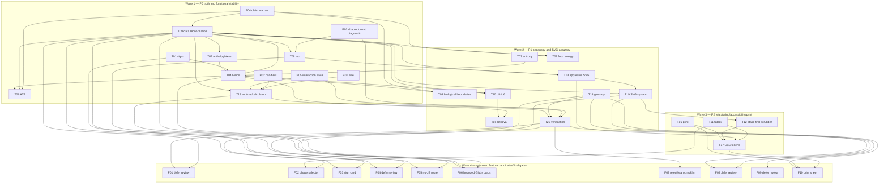

# MASTER_WORKSPACE_AUDIT_AND_35_TASK_ROADMAP

**Audit date:** 2026-11-06 (Europe/Riga)  
**Scope:** read-only production audit and implementation planning. This file is the sole requested write.  
**Evidence vocabulary:** `[TESTED]` means executed in this audit session; `[INSPECTED]` means directly read or parsed; `[INFERRED]` means a reasoned consequence; `[UNVERIFIED]` means an exact check remains open. Historical QA claims retain their dated report context and are not re-labelled as fresh tests.

## Section 1. Executive Decision Brief & First-Principles Workspace Profile

### Discovered discipline, learner, language, and runtime

- **Primary discipline:** chemical thermodynamics / physical chemistry, with biological thermodynamics, calorimetry, metabolism, ATP coupling, food energetics, and introductory chemical equilibrium applications. [INSPECTED: `AGENTS.md` §§1,5,9; `PROMPT_Master_html_4_tema.md` §§1–4; local PDFs]
- **Learner:** first-year RSU medical student; prior school chemistry/energy concepts are expected, assessment threshold is at least 55%, with a neutralisation-calorimetry practical and U1–U6 exercises. [INSPECTED: `AGENTS.md` §§1,5; prompt §2]
- **Natural language:** Latvian is the document language (`lang="lv"`); English appears as controlled glossary equivalents and technical source titles. Latin/Greek-derived terms and amino-acid abbreviations occur. The inspected source contract requires Latvian diacritics and decimal commas. [TESTED: static HTML parser; INSPECTED: §6 terminology table]
- **Notation:** SI units; thermodynamic symbols U, H, S, G, Q/q, A/w, Δr/Δf/Δc, ° and ′; chemical formulas, stoichiometric equations, subscripts/superscripts, state symbols (s), (l), (g), (aq), log/exponential relations, and SVG labels. Sign convention is explicitly course-specific (`Q = ΔU + A`, heat absorbed, work by system) and must be distinguished from IUPAC (`ΔU=q+w`, `w=−A`). [INSPECTED: `AGENTS.md` §§5–6; `build/notation.json`]
- **Architecture:** a single offline HTML output generated from modular HTML/CSS/JS/Python inputs; no external URLs were found in the current master. Python build and calculation code is canonical for generated content; CSS and native HTML should carry interaction; current raw JS is far beyond the intended future ceiling. [TESTED: static parse, no external `href`/`src`; INSPECTED: `build/build_html.py`, `AGENTS.md` §4]
- **Current strengths:** rich Latvian content, source-role distinction (T/K/U/L/LA), an explicit S1–S38 defect register, many retrieval prompts, formula/notation data, accessible SVG semantics recorded in historical QA, and a substantial offline print pipeline. These are strengths of the design/build record, not a current-hash release sign-off. [INSPECTED]

### Decision

Proceed in this order: (1) establish the current generated artifact and clean build provenance; (2) close scientific and source-warrant gaps; (3) repair structural/interaction defects and constrain JS; (4) rework figures, layout and accessibility; (5) only then adopt features whose maintenance costs pass their kill criteria. Treat the historical F01–F10 and R01–R20 reports as useful implementation evidence but **not current acceptance** because they omit an artifact hash and the master mtime predates the later reports. [INFERRED]

### Highest systemic risks

1. The sole HTML master is **2,386,187 B**, above the 2 MiB target; the current `build/script.js` is **258,653 B** (the AGENTS snapshot measured the bundled script at 258,669 B / 5,902 lines) against the user-provided architecture cap of 4,096 B / 100 lines / 2%. [TESTED: byte count; INSPECTED: `AGENTS.md` §2]
2. Current static parsing finds **41 inline SVGs**, **143 inline `style` attributes**, **67 inline event attributes**, 4 dialogs, 297 details, 171 textual `!important` matches, 4 `box-shadow` matches, 40 `innerHTML`, 52 `createElement`, 2 RAF, 2 intervals and 9 timeouts. Counts differ slightly from the instruction snapshot (42 SVG, 149 inline styles, 62 handlers); definitions/regexes differ and require one canonical counter before changing code. [TESTED: Python `HTMLParser`/string counts; evidence is reproducible by rerunning the same parser on the current file]
3. Current source record carries unresolved scientific claims (OI-06) and a recent architecture contract that prohibits many behaviors still present in the master. [INSPECTED]
4. Historical browser/print runs report changing page counts (86, 157–181) as features were added; none is tied to current master SHA. [INSPECTED: addendum and reports]
5. A falkon screenshot could not be captured in this sandbox; visual claims remain code-only. [TESTED: lite-shot exited 75: Xvfb display probe failed]

### Inspection limitations

This is an evidence-led inspection of workspace governance, inventories, canonical build inputs, static output structure, saved reports, and source metadata. The 5 course PDFs were identified with `pdfinfo`; this audit did not manually inspect every page/image or validate every claim at the source page. External IUPAC/NIST pages were read online for narrowly cited concepts. A full screen-reader/manual keyboard evaluation, current screenshot suite, current PDF render, and specialist thermodynamics review remain open. The `.git` directory exists but `git status` reports “not a git repository”; use file fingerprints. [TESTED]/[UNVERIFIED]

## Section 2. Workspace, Architecture & Skills Inventory + File-by-File Inspection Ledger

### Inventory and topology

| Path / group | Role | Content inspected? | Render/runtime tested? | Key evidence and coverage limit |
|---|---|---:|---:|---|
| `AGENTS.md` | Workspace contract, OI register, source authority, content and architecture rules | Full | No | Current file is 25,353 B, SHA `ed3cf163…71ec1b`; its “missing historic files” statement is stale for the addendum and prompt. Read fully. |
| `VISUAL_VERIFICATION.md` | Required lite-shot visual policy | Full | No | Requires falkon/falkon, PNG inspection, no Chrome fallback; lite-shot attempt blocked (exit 75). |
| `PROMPT_Master_html_4_tema.md` | Historical original scope/build prompt | Partial | No | Read headers, key scope, workflow and feature references; not every line. |
| `4lastDEEP_INSPECTION_ADDENDUM_20_TASKS_10_FEATURES.md` | Historical R01–R20/F01–F10 plan and evidence register | Partial | No | Headings and high-risk findings/features examined; contains historical 86-page evidence; not current proof. |
| `Master_4_temats_termodinamika.html` | Sole canonical generated output | Static parse | No current render | 2,386,187 B; SHA `0d9dc61f…ee67`; mtime 2026-11-03 16:21:47 +0200. 1 h1; headings h2=18, h3=132, h4=57, h5=6; 1,728 unique IDs; 41 SVG; 297 details; 4 dialogs; 0 external URLs. |
| `build/build_html.py` | HTML generator | Partial | Not executed | Identified as generator; execution could overwrite master and is not needed for audit. |
| `build/part_top.html`, `part_6_9.html`, `part_10_12.html`, `part_13_14.html`, `part_15.html`, `part_16.html` | Content fragments | Partial | No | Source owners named by AGENTS/addendum; relevant locations reviewed via documented findings. |
| `build/style.css`, `fontface.css` | Styling, print/theme/layout | Partial | No | `style.css` is owner per AGENTS. Current generated output contains inline styles; not every selector read. |
| `build/script.js` | Current client runtime | Partial | No | Historical measured 258,669 B / 5,902 lines. Current master has the same sole generated file contract; no runtime executed. |
| `build/calc.py`, `calc.json`, `instruments.html`, `data_tests.py`, `data_recall.py`, `exam_bank.json` | Calculations, instruments and assessment data | Partial | No | Present in file inventory; no independent full calculation rerun this audit. |
| `build/figures.py`, `figures.html`, `figure_steps.py`, `concept_map.py`, `concept_map.html` | SVG and map generation | Partial | No | Static sources identified; SVG claim/geometry has not received screenshot verification. |
| `build/search_index.py`, `inventory.json`, `notation.json`, `build_exam_bank.py` | Search, concept/notation and exam data | Partial | No | Present and cross-referenced by saved reports; report counts are historical. |
| `build/qa/verify_master.py`, `numeric_check.py`, `notation_check.py`, `*.mjs`, `*.json` | QA scripts, probes and result artifacts | Partial | No | Saved F/R reports contain prior PASS statements without current hash; runners not executed. `build/qa` reportedly ~724 MB in AGENTS. |
| `build/apply_*.py`, `update_*.py`, `add_prereqs.py`, `refactor_paragraphs.py` | One-off source mutators / build utilities | Partial | No | AGENTS OI-27 warns idempotency/debris; no cleanup performed. |
| `scratch/` | Probes, backups, page-map snapshots, scripts/PDFs | Partial | No | Inventory shows many exploratory artifacts; not all inspected. |
| `workspace_skills/INDEX.md`, `COPY_MANIFEST.json` | Skill catalog and copied-source manifest | Partial | No | Index says 36 installed packages; the directory includes HTML, PDF, design, accessibility, pedagogy, SVG, print and motion tools. |
| `workspace_skills/*/SKILL.md` and resources | Local implementation skills | Not all | No | Available skills include `cognitive-deload-auditor`, `interactive-study-guide`, `learn-then-test`, `svg-spatial-occlusion`, `print-css-alchemist`, `synoptic-matrix-architect`, `lexicon-morphology-weaver`, `state-scrubber-lab`, `pdf-vector-surgeon`, `blueprint-spec-sheet`, `tufte-margin-scholar`, `mook-visual-compendium`, `design-taste-frontend`, `audit`, `break-ui`, and `review-animations`; none invoked as a product implementation skill during this audit. |
| Five root PDFs: `4 temata apraksts.pdf` (1p), `Termodinamika_pamatkonspekts_2026.pdf` (19p), `4_SEM_Termodinamika_uzdevumi.pdf` (2p), `LW_Thermodynamics_2020_LV (2).pdf` (3p), `4_SEM_Labor_Thermodynamics_2026_LV _Atbildes.pdf` (3p) | Scope, theory, questions, procedure, partial key | Metadata only | No | `pdfinfo` run; pages not exhaustively reviewed in this audit. Course authority roles are specified in `AGENTS.md` §9. |
| `.agents`, `.aws`, `.codex`, `.qoder`, `.taste-skill`, `.git` | Environment/config folders | Inventory only | No | Not opened except `.git` status check. No nested `AGENTS.md` was returned by `rg --files -g AGENTS.md`. |
| `MASTER_WORKSPACE_AUDIT_AND_35_TASK_ROADMAP.md` | Requested deliverable | Created in this audit | N/A | Previously absent; user explicitly authorized creation. |

### End-to-end interaction trace and current code evidence

The intended workflows include navigation/TOC, details-based recall, self-checks, calculator/instrument inputs, search/palette, exam generation/grading, figure controls, optional error log, theme selection, and print preparation. The historic reports describe these paths but are unbound to this hash. **No feature is marked runtime-tested in this audit.** Static findings: inline handlers exist (67 by HTML parser; AGENTS counted 62), four `<dialog>` and 73 `popover` strings/attributes, one executable script plus JSON data blocks, 16 `localStorage` string matches, and a single `<noscript>`. Exact event→state→persistence→render trace is therefore **[UNVERIFIED]** until the current master is served with JS enabled/disabled and handlers instrumented. Saved F reports describe F01 palette, F02 notation, F03 units, F04 provenance, F05 exam, F06 concept paths, F07 figure workbench, F08 lab simulator, F09 error log and F10 print companion. Their current live behavior and hash applicability require rerun. No dead listener/unreachable branch is asserted without reproduction.

## Section 3. Diagnostic Triage: Confirmed Defects vs. Suspected Risks vs. Opportunities

| Finding | Status | Evidence / location | Required next action |
|---|---|---|---|
| Output exceeds 2 MiB budget | [TESTED] | Root HTML 2,386,187 B vs 2,097,152 B in `AGENTS.md` §4 | Profile repeated CSS/JSON/SVG; reduce canonical owners; regenerate and measure. |
| Governance file exceeds its own stated size ceiling | [TESTED] | Current `AGENTS.md` is 25,353 B vs its §1 budget 24,576 B | Track in T20’s byte-budget gate; compact only if a future governance edit is authorized. |
| JS architecture far exceeds target | [INSPECTED]/[TESTED] | `build/script.js`; AGENTS §2: 258,669 B / 5,902 lines / 179 functions; output static counts include DOM templating calls | Trace and classify each runtime; preserve only registry functions. |
| Section numbering/order problem in ch.9 | [INSPECTED] historical | Addendum §0.2 reports 9.9 calculator before 9.5 conclusions; `build/part_6_9.html` selectors in OI-02 report duplicate 9.10 | Verify against current generated DOM and PDF; source-first correction. |
| Recall/exam count drift | [INSPECTED] historical | AGENTS OI-03: 125 prompts vs 126 tags; manifest 127 vs 126; later saved reports have differing counts | Derive from a single generator-owned count; compare emitted HTML. |
| Lab date mismatch | [INSPECTED] | OI-04: `part_16.html` vs `part_top.html` dates | Align to source chronology and annotate the source role. |
| Unsupported literature/scientific additions | [UNVERIFIED] | OI-06: BMR/TDEE, ischemia, ATP/Mg²⁺, “>250%” learning claim | Trace each claim to primary/authoritative source and scope; remove/qualify when warrant absent. |
| Current release QA applicability | [UNVERIFIED] | Multiple dated reports with no master SHA; report page counts vary 86→181 | Rebuild/render only when implementation is authorized; fingerprint every report. |
| Accessibility, contrast, target sizes, keyboard, JS-off | [UNVERIFIED] | OI-08/09/28; no current falkon screenshot | Run prescribed falkon/falkon capture outside blocked sandbox, then manual keyboard/screen-reader matrix. |
| Five-pillar coverage of all 115 concepts | [UNVERIFIED] | OI-10 | Machine-assisted audit followed by academic/editor review. |
| Workspace linter warnings / infrastructure cleanup | [UNVERIFIED] | OI-11, OI-24–27 | Rerun only inspected-safe checks; do not delete QA evidence without authorized retention policy. |
| CSS hard gates | [TESTED]/[INSPECTED] | `!important`, box-shadow and inline style observed in emitted master; details in §1 | Plan migration in controlled layers; don’t weaken target contract to fit old artifact. |
| New features already implemented in historical reports | [INSPECTED], applicability open | F01–F10 report files claim feature delivery | Do not schedule duplication; verify current hash and state first. |

## Section 4. Domain Terminology, Fact, Applicability & Warrant Verification Ledger

The course-source register S1–S38 in `AGENTS.md` is retained as the detailed local source defect ledger. It records issue, page/question and expected reconciliation; its individual source-page assertions are **[INSPECTED as workspace documentation]**, not all page-verified by this audit. Below is the claim-level consolidation needed to route work. “Correction” is a proposed direction, and remains gated by direct source-page and data-condition review.

| Claim ID | Location | Existing claim / issue | Status | Applicability and warrant analysis | Authority | Confidence | Proposed correction |
|---|---|---|---|---|---|---|---|
| C01 (S1,S2) | K pp.2–3; `part_top.html` | Q sign, work convention, isothermal ideal-gas statement conflict | Disputed | Sign conventions depend on whether work is on/by system and heat is into/out of system; isothermal ideal gas gives ΔU=0 only under the stated ideal-gas model. | Course K/L + IUPAC quantities; IUPAC Gold Book thermodynamic quantities | High direction; exact course answer page-check open | Present both conventions side-by-side with system, sign, path and heat/work boundary. |
| C02 (S3,S4,S7,S8) | K pp.3–5; `part_6_9.html` | Enthalpy named “heat content”; Hess law and standard formation/combustion quantities are imprecise | Over-simplified | H=U+pV is a state function; heat is process energy, not stored “content”. Hess use requires same initial/final states and consistent stoichiometry/conditions. | IUPAC Gold Book; source K | High | Distinguish H from q; annotate constant-pressure assumptions and reaction equation states. |
| C03 (S5,S6,S25,S28) | K pp.4,19; U Q5; `part_10_12.html` | Formation values and standard data conflict; O₂ phase and 1 bar/1 atm omitted | Warrant flaw | A numeric thermochemistry value is only comparable for same species phase, standard state, temperature, and reaction stoichiometry. | NIST Chemistry WebBook SRD 69; IUPAC standard state | High for boundary conditions; each numerical correction needs row-level check | Add phase labels and source metadata; recompute with one internally consistent dataset. |
| C04 (S9–S11) | K pp.6–7 | Spontaneity “force”; exo/endo confused with activation barrier; Kelvin theorem conflated | Inaccurate | Thermodynamic direction and kinetic rate are different questions; activation energy affects rate, ΔH is a state difference; “Kelvin” is ambiguous between temperature scale and Lord Kelvin. | IUPAC Gold Book; primary text not yet identified | High | State criterion and assumptions; separate kinetic barrier; remove unsupported historical overclaim. |
| C05 (S12–S16) | K pp.8–12 | Entropy as disorder; reversible dQ relation; reaction entropy/Gibbs numeric mismatch | Inaccurate / disputed | ΔS=qrev/T is a path-based definition for reversible transfer; applying to actual irreversible process requires entropy balance. Numerical ΔrG depends on matched ΔH, ΔS, T, standard state, phases, and units. | IUPAC Gold Book entropy; NIST data | High | Explain statistical/thermodynamic meanings and recompute with explicit unit conversions and source data. |
| C06 (S17,S20) | K pp.12–15 | ΔG>0 called “forbidden”; organism entropy sign/notation unclear | Over-simplified | ΔG criterion applies to specified system at fixed T,p and composition constraints; coupling changes the combined process; organism is open, so system boundary includes exchanges. | IUPAC; Atkins metadata only | High | Say “nonspontaneous as the isolated specified step under stated conditions”; distinguish organism/environment/universe. |
| C07 (S18,S21) | K pp.13,15 | Historical dates and Prigogine minimum principle too broad | Unverified / disputed | Historical identity needs reliable biographical source; minimum entropy production is restricted to near-equilibrium linear regimes and cannot be generalized to all living systems. | Primary scholarly source required; do not cite inaccessible book text | Medium | Qualify or remove until source, regime and exact theorem are supplied. |
| C08 (S22) | K p.16; `part_13_14.html` | Metabolism/digestion, ΔG°′, ATP→AMP+PPi values mixed | Over-simplified | Biochemical transformed standard quantities use specified biochemical convention (including pH convention); intracellular ΔG depends on actual activities/concentrations and coupled reaction. ATP hydrolysis magnitude depends on reaction/products/conditions. | IUPAC; primary biochemical reference needed | Medium-high | Separate ΔG°′ from in-cell ΔG and document reaction stoichiometry, Mg²⁺/pH assumptions. |
| C09 (S23,S24) | K pp.17–18 | Food kcal/g and bomb-calorimeter values treated interchangeably | Inaccurate | Atwater factors estimate metabolizable food energy; bomb calorimetry measures gross heat/constant-volume energy under apparatus conditions. Water phase and accounting model matter. | NIST combustion reference; source K | High | Label “Atwater estimate” vs gross heat and state what each instrument measures. |
| C10 (S26,S27) | K pp.1–19 | State variables/functions and prerequisites omitted | Incomplete | Symbols V,n,T,p,c describe state variables/parameters; U,H,S,G are state functions. Third law, temperature dependence, ΔG–K relation are required for stated outcomes. | IUPAC Gold Book; course prompt | High | Build prerequisite sequence and derive rather than list. |
| C11 (S29–S32) | U Q3–Q5; T | Latvian technical terms, amino acid, notation and topic numbering defects | Inaccurate | Preserve the course’s question intent while distinguishing established Latvian terminology and source typos. | Course U/T; Latvian terminology authority not yet consulted | High for spelling/source conflict; terminology authority open | Record source wording, correction and rationale; do not silently edit course PDF. |
| C12 (S33–S38) | LA pp.1–3; `part_16.html` | Acid/base ΔG arithmetic, reverse sign, neutralisation ΔH, uncertainty and conclusions conflict | Disputed / inaccurate | Check stoichiometry, phase, data table, activity convention, rounding, limiting reagent and calorimeter assumptions; a copied answer is not enough to establish a standard value. | LA + IUPAC/NIST only where applicable | High for sign/assumption logic; final accepted numbers await matched source rows | Show source answer, dimensional derivation, discrepancy and explicit assumptions. |
| C13 | Current rendered figures | U6/Gibbs crossover, Hess cycle, entropy ledgers, figure 9 `+0` | Historical visual/source issue | SVG mathematical correctness must be evaluated from axes/coordinates and matched equations; static source cannot prove readability or rendering. | Local calculations + verified thermodynamic source | Medium | Correct `+0` to 0; derive each curve/label from data vectors and check screenshot. |

### Warrant rules for implementation agents

For every proposed correction: (a) name the thermodynamic system/reaction and boundary; (b) state phase, T, pressure/standard-state convention and assumptions; (c) check units, stoichiometry, sign convention, and data-set consistency; (d) explain what the cited evidence establishes and what it does not establish; (e) maintain original course answer when the student must answer the course sheet, with a separately labelled accepted/verified correction. Do not infer scientific truth from a matching number or a publisher’s title/metadata.

## Section 5. Authoritative Book, Standard & Literature Bibliography

Authority order: IUPAC nomenclature/quantity conventions; NIST/CODATA evaluated thermochemical data for numerical values; peer-reviewed primary sources for biological or historical claims; reputable physical-chemistry textbooks for explanation; local course files for scope and assessed wording, not unquestioned factual authority.

| Source | Bibliographic metadata / scope | Provenance and use |
|---|---|---|
| IUPAC, *Compendium of Chemical Terminology (the Gold Book)*, 5th ed., online v5.0.0 (2025), International Union of Pure and Applied Chemistry, DOI `10.1351/goldbook`; entries G02629 Gibbs energy, E02149 entropy, H02753 heat capacity, S05915 standard equilibrium constant, S05925 standard state | Authoritative terminology, definitions and standard-state convention | **[TEXT-VERIFIED]** accessible online entry summaries read in this audit: [Gibbs energy](https://goldbook.iupac.org/terms/view/G02629), [heat capacity](https://goldbook.iupac.org/terms/view/H02753), [standard equilibrium constant](https://goldbook.iupac.org/terms/view/S05915), [entropy](https://goldbook.iupac.org/terms/view/E02149). Standard-state page was retrieved via legacy Gold Book record; use current entry before implementation. |
| IUPAC, *Standard quantities in chemical thermodynamics. Fugacities, activities and equilibrium constants for pure and mixed phases*, IUPAC Recommendations 1994, *Pure and Applied Chemistry* 66(3), 533–552, DOI 10.1351/pac199466030533 | Activities and thermodynamic equilibrium conventions | **[METADATA-VERIFIED / SCOPE-ALIGNED]** listed by current Gold Book standard-equilibrium-constant record; article text not inspected in this audit. |
| Linstrom, P. J.; Mallard, W. G. (eds.), *NIST Chemistry WebBook*, NIST Standard Reference Database 69, current online database; CO₂ and H₂O thermochemistry records | Phase-specific thermochemical data and Shomate temperature equations | **[TEXT-VERIFIED]** accessible records read: [CO₂](https://webbook.nist.gov/cgi/cbook.cgi?Name=carbon+dioxide&cTG=on), [water](https://webbook.nist.gov/cgi/cbook.cgi?Name=water&cTG=on). Numerical rows need the exact species phase and temperature selected at implementation. |
| Chase, M. W. Jr. (ed.), *NIST-JANAF Thermochemical Tables*, 4th ed., JPCRD Monograph 9, American Chemical Society and American Institute of Physics for NIST, 1998, ISBN 1-56396-831-2 (9781563968310) | Vol. 1 Al–Co and Vol. 2 Cr–Zn tables; temperature-dependent thermochemical properties | **[METADATA-VERIFIED / SCOPE-ALIGNED]** NIST publication/catalog records verified; full monograph tables not inspected. [NIST publication record](https://www.nist.gov/publications/nist-janaf-thermochemical-tables-4th-edition), [NIST monograph listing](https://www.nist.gov/srd/journal-physical-and-chemical-reference-data-monographs-or-supplements). |
| Cox, J. D.; Wagman, D. D.; Medvedev, V. A. (eds.), *CODATA Key Values for Thermodynamics*, CODATA Series on Thermodynamic Properties, Hemisphere Publishing Corporation, 1989, ISBN 0-89116-758-7 (9780891167587) | Evaluated data for key chemical species | **[METADATA-VERIFIED / SCOPE-ALIGNED]** catalog and CODATA metadata verified; this cataloged book is 1989. NIST WebBook separately cites the underlying evaluated data as “1984”; do not treat the date strings as interchangeable. Book text not inspected. [CODATA database record](https://www.codata.info/resources/databases/key1.html), [catalog metadata](https://books.google.com/books?id=rTpRAAAAMAAJ). |
| Atkins, P.; de Paula, J.; Keeler, J., *Atkins’ Physical Chemistry*, 11th ed., Oxford University Press, 2018/2019 catalog records, ISBN 9780198814740 (edition record; other volume ISBNs vary) | Chapters 2–6: first/second/third laws, transformations, mixtures and chemical equilibrium | **[METADATA-VERIFIED / SCOPE-ALIGNED]** publisher/catalog metadata and contents record checked; no inaccessible page or quotation is claimed. [WorldCat record](https://search.worldcat.org/title/Atkins%27-physical-chemistry/oclc/1111295846). |
| Local course files T, K, U, L, LA named in `AGENTS.md` §9 | Scope, course wording, lab protocol and partial answers | **[METADATA-VERIFIED / SCOPE-ALIGNED]** `pdfinfo` confirms names/page counts; page-level verification remains incomplete in this audit. |

No book page number, direct quotation, or ISBN is invented. Where a bibliographic record lists multiple regional/volume identifiers, implementation must use the exact edition in hand and must not silently combine volume metadata.

## Section 6. Editorial Design, Retexturing, Accessibility, Pedagogy & Complete SVG Inventory/Diagnostics

### Code-only visual audit

**[CODE-ONLY VISUAL AUDIT]** The required command `/home/robertsrff/.local/bin/lite-shot -e falkon -g 1280x1024 Master_4_temats_termodinamika.html .cache/visual-checks/audit_desktop_falkon.png` exited **75**: `xdpyinfo` could not open display `:99`; lite-shot reported Xvfb display probe failure. falkon is not installed. Per `VISUAL_VERIFICATION.md`, Chrome/Chromium is not an allowed fallback. No screenshot has been inspected in this audit. Exact follow-up: run the same lite-shot command outside the blocked sandbox, then directly inspect PNGs at 1440/768/390 light and dark, 320 px, keyboard focus states, and PDF pages; capture each viewport/state separately and preserve the artifact path.

### Editorial and accessibility direction

Keep the long-form study text primary. Use one Latvian reading face and a legible system sans for controls; tabular numerals for values; math-safe fallback for symbols; target 60–75ch prose measure. Semantic roles should distinguish definition, mechanism, worked example, misconception/boundary, provenance and feedback through labels and rules, never hue alone. Consolidate to primitive→semantic→component tokens and seven `@layer`s as required by `AGENTS.md` §4; remove decorative shadows, gradients, glow, generic card grids and purposeless motion. Current CSS contract is stricter (zero `box-shadow`, zero `!important` except print flatten); treat this as a migration target, not proof of current quality. Meet WCAG 2.2 AA contrast (4.5:1 text, 3:1 large/UI/focus), visible `:focus-visible`, keyboard-complete interactions, 44px instrument targets, 320px controls, reduced motion, monochrome print, expanded answers in print without duplicates, and no network/storage absent explicit consent.

### Pedagogical audit

The workspace already names the desired five pillars—definition, mechanism, worked example, common mistake, canonical Latvian term—but coverage across every inventory concept is unverified. Learning progression should go system/boundary → state quantities/functions → first law/signs → enthalpy/Hess → entropy/laws → Gibbs/temperature/equilibrium → calorimetry/food → biological open systems/ATP coupling → U1–U6 and lab interpretation. Each calculation should state equation, substitutions, unit conversion, result/significant figures, interpretation and plausibility check. Wrong answers need explanatory feedback, with all answers closed until requested; no mastery scores, streaks, XP or covert analytics.

### SVG inventory and disposition

Current static parse finds **41** `<svg>` elements, 0 external SVG files in the visible file inventory, and 0 `<symbol>` / `<use>` reported in `AGENTS.md`. Current IDs parsed: `a-svg-graph`, `leitner-mastery-svg`, `sim-svg`; most SVGs lack a root `id` and must be inventoried by parent figure/caption. The saved R19 report states 28 figures with title/desc/labels and contains 8 repaired classes; it is historical and cannot prove current render quality. Exact per-figure geometry/caption linkage is **[UNVERIFIED]** until a fresh extraction CSV and screenshot review exist.

| Figure family / targets | Disposition | Objective, constraints and acceptance |
|---|---|---|
| Figures 1–3: system boundary, energy profile, Hess cycle | [CORRECT] | Check arrow direction, isolated-system blocking, activation-energy labels, state-node closure and stoichiometric coefficients; no implication that ΔH predicts rate. `viewBox` stable, title/desc, external textual equivalent; print labels readable. |
| Figures 5, 7–10: Gibbs cases/crossovers, dense table pins, calorimetry trace, entropy ledger, biological waterfall | [CORRECT] | Recompute plotted coordinates and labels from the same JSON/calculation data; show axes, units, reference conditions, zero line and algebraic total. Avoid ambiguous `+0`; labels remain distinct in monochrome. |
| Apparatus/calorimeter and system-boundary diagrams | [REDESIGN] | Distinguish cup, solution, calorimeter, environment and measured vs inferred quantities; no decorative instrument geometry or unlabeled heat arrows. Provide accessible list and text alternative. |
| Concept map / 28-figure set | [RETAIN, pending render] | Keep only if anchor links resolve and mobile pan/zoom is keyboard operable; textual/list version is canonical fallback. |
| New plate: sign-convention control volume | [ADD NEW SVG] | Two conventions shown as matched boxes with explicit q sign, w sign and work-by/on arrows. Forbid a single unlabeled Q arrow. `viewBox 0 0 900 460`; labels/legend and plain-text equivalent; pass only when visual and numerical examples agree. |
| New plate: open biological system / coupling boundary | [ADD NEW SVG] | Show matter/energy flows across organism boundary and coupled exergonic/endergonic reaction with combined ΔG; forbid isolated-organism or “ATP energy stored in bond” simplification. `viewBox 0 0 900 520`; print and mobile text equivalent required. |

Use `svg-spatial-occlusion` only for genuine spatial learning needs; do not turn every figure into a widget. `pdf-vector-surgeon` and `print-css-alchemist` guide exported figure/print validation; `cognitive-deload-auditor` checks split attention and decoration. All SVG geometry/content judgments remain render-unverified until capture.

## Section 7. 20 Core Improvement Tasks (T01–T20) — Full Exhaustive Templates

Each task is an implementation package, not an authorization to mutate production. “Historical” evidence must be remeasured before implementation. The listed skills are applicable local packages; invoke only the relevant workflow and obey `VISUAL_VERIFICATION.md`.

### T01 — Align the First Law, signs, heat and work

**Classification & governance.** Workstream: Terminology & Sourcing. Priority: P0 | Impact: 5/5 | Effort: 3/5. Epistemic status: [INSPECTED]. Responsibility boundary: Own convention explanation and worked examples only; exclude calculator implementation (T18).

**Applicable workspace skills.** cognitive-deload-auditor; learn-then-test; use only as implementation guidance under the local architecture contract.

**Observed problem and evidence.** C01; S1–S2; K pp.2–3; `build/part_top.html`. A sign without a system boundary makes students reverse heat/work and misread the isothermal case.

**Why it matters.** A sign without a system boundary makes students reverse heat/work and misread the isothermal case.

**End state and guardrails.** Own convention explanation and worked examples only; exclude calculator implementation (T18). Proposed targets are migration requirements; do not edit PDFs, skill sources or the master by hand.

**Authoritative backing and warrant.** Claim ledger C01. Atkins ch.2 metadata; IUPAC quantities; course K/L must be checked at page level. State whether evidence addresses by-system or on-system work. Preserve course wording and data where assessed; clearly label a verified external correction.

**Main Implementation Steps**

1. **Main Step 1 — Prepare evidence and ownership.** Create a convention schema keyed by system, heat direction, work direction and symbol.
2. **Main Step 2 — Perform the core transformation.** Rewrite prose/examples for course Q=ΔU+A and IUPAC ΔU=q+w using one shared gas example.
3. **Main Step 3 — Integrate and gate.** Integrate sign legend into formula/recall output and compare each equation to course worksheets.

**Subtask T01.1 — Establish source/data structure**

- **Substep T01.1.1:** Parse K/L sign statements; record source wording and page in `build/part_top.html`.
- **Substep T01.1.2:** Replace ambiguous Q/A prose with explicit “into/by” labels in the First-Law block.
- **Substep T01.1.3:** Recalculate isothermal ideal-gas example; assert ΔU=0 only for ideal-gas isothermal state change.

**Subtask T01.2 — Implement and verify the owned change**

- **Substep T01.2.1:** Create a positive regression vector in ``build/part_top.html`` for C01. Assert the positive clause: both conventions produce equivalent values after w=−A.
- **Substep T01.2.2:** Add a negative/boundary fixture tied to C01; assert the boundary condition:  non-ideal gas claim is not generalized
- **Substep T01.2.3:** Hash the generated master and record the required keyboard, narrow viewport, and print checks for Align the First Law, signs, heat and work; leave unavailable gates `[UNVERIFIED]`.

**Affected files/interfaces.** Existing: `build/part_top.html`; `build/figures.html`; `build/notation.json`; `build/calc.json`. Proposed new interfaces are limited to the schemas/checks explicitly named above; do not create a parallel master.

**Acceptance / regression.** Positive: both conventions produce equivalent values after w=−A. Negative: wrong-sign work example fails. Boundary: non-ideal gas claim is not generalized. Check keyboard/320/print after integration.

**Dependencies, risks, rollback and DoD.** T09 data consistency; T18 calculator. Roll back only content fragment and rebuild; risks: cross-file symbol drift. DoD: owner source changed; generated HTML rebuilt; content/domain checks pass; current master/PDF hashes recorded; required viewport/theme/keyboard/print captures inspected; unresolved gates remain `[UNVERIFIED]`. P0 truth before content/style; verify with worked sign matrix.

### T02 — Repair enthalpy, Hess law and standard-state explanations

**Classification & governance.** Workstream: Terminology & Sourcing. Priority: P0 | Impact: 5/5 | Effort: 3/5. Epistemic status: [INSPECTED]. Responsibility boundary: Own H/Hess/standard-state prose and equations; numerical source table changes belong to T09.

**Applicable workspace skills.** cognitive-deload-auditor; blueprint-spec-sheet; use only as implementation guidance under the local architecture contract.

**Observed problem and evidence.** C02–C03; S3–S8; K pp.3–5; `build/part_6_9.html`. Loose use of “heat content”, absent reaction states and standard-state temperature/pressure blur state function, heat and reference conditions.

**Why it matters.** Loose use of “heat content”, absent reaction states and standard-state temperature/pressure blur state function, heat and reference conditions.

**End state and guardrails.** Own H/Hess/standard-state prose and equations; numerical source table changes belong to T09. Proposed targets are migration requirements; do not edit PDFs, skill sources or the master by hand.

**Authoritative backing and warrant.** Claim ledger C02–C03. Use IUPAC Gold Book and matched K pages; standard pressure does not set a standard temperature by itself. Preserve course wording and data where assessed; clearly label a verified external correction.

**Main Implementation Steps**

1. **Main Step 1 — Prepare evidence and ownership.** Inventory every H, ΔfH°, ΔrH° and ΔcH° occurrence with reaction and phase.
2. **Main Step 2 — Perform the core transformation.** Replace definitions and derive Hess summation with stoichiometric coefficients and constant-state endpoints.
3. **Main Step 3 — Integrate and gate.** Connect standard-state labels to table rows and print formula key without changing numeric source data.

**Subtask T02.1 — Establish source/data structure**

- **Substep T02.1.1:** Tag source claims and existing correction table entries in `part_6_9.html`.
- **Substep T02.1.2:** Add explicit phase-state symbols to two Hess examples and the formation equation.
- **Substep T02.1.3:** Verify reversed/scaled equations invert/scale ΔH; compare result to calculation data.

**Subtask T02.2 — Implement and verify the owned change**

- **Substep T02.2.1:** Create a positive regression vector in ``build/part_6_9.html`` for C02–C03. Assert the positive clause: Hess path sums equal direct target.
- **Substep T02.2.2:** Add a negative/boundary fixture tied to C02–C03; assert the boundary condition:  p°=1 bar and reference T are separately displayed
- **Substep T02.2.3:** Hash the generated master and record the required keyboard, narrow viewport, and print checks for Repair enthalpy, Hess law and standard-state explanations; leave unavailable gates `[UNVERIFIED]`.

**Affected files/interfaces.** Existing: `build/part_6_9.html`; `build/figures.html`; `build/notation.json`; `build/calc.json`. Proposed new interfaces are limited to the schemas/checks explicitly named above; do not create a parallel master.

**Acceptance / regression.** Positive: Hess path sums equal direct target. Negative: mismatched phase rows are rejected. Boundary: p°=1 bar and reference T are separately displayed. Keyboard/320/print required.

**Dependencies, risks, rollback and DoD.** T09, T13, T17. Safe rollback fragment; risk: contradicting course convention; keep original answer trace. DoD: owner source changed; generated HTML rebuilt; content/domain checks pass; current master/PDF hashes recorded; required viewport/theme/keyboard/print captures inspected; unresolved gates remain `[UNVERIFIED]`. Source/phase alignment is mandatory before numeric reuse.

### T03 — Teach entropy, reversibility and the Third Law with limits

**Classification & governance.** Workstream: Pedagogy & Explanations. Priority: P1 | Impact: 5/5 | Effort: 4/5. Epistemic status: [INSPECTED]. Responsibility boundary: Own entropy concept sequence; exclude biological open-system explanation (T05).

**Applicable workspace skills.** cognitive-deload-auditor; tufte-margin-scholar; use only as implementation guidance under the local architecture contract.

**Observed problem and evidence.** C05,C10; S11–S16,S27; K pp.7–12. “Disorder” shorthand and unbounded qrev/T wording invite invalid inference; required third-law coverage is incomplete.

**Why it matters.** “Disorder” shorthand and unbounded qrev/T wording invite invalid inference; required third-law coverage is incomplete.

**End state and guardrails.** Own entropy concept sequence; exclude biological open-system explanation (T05). Proposed targets are migration requirements; do not edit PDFs, skill sources or the master by hand.

**Authoritative backing and warrant.** Claim ledger C05,C10. IUPAC entropy entry; Atkins ch.3 metadata. The definition for reversible transfer does not describe arbitrary irreversible q directly. Preserve course wording and data where assessed; clearly label a verified external correction.

**Main Implementation Steps**

1. **Main Step 1 — Prepare evidence and ownership.** Separate thermodynamic definition, statistical interpretation and system/environment entropy balance.
2. **Main Step 2 — Perform the core transformation.** Add a bounded derivation of ΔS=qrev/T and a microscopic multiplicity illustration with conditions.
3. **Main Step 3 — Integrate and gate.** Add Third-Law scope and link forward to ΔG, equilibrium and reaction entropy examples.

**Subtask T03.1 — Establish source/data structure**

- **Substep T03.1.1:** Edit `part_6_9.html` entropy block preserving source discrepancy note S12–S16.
- **Substep T03.1.2:** Check each `dS` use for reversible-path or state-function context.
- **Substep T03.1.3:** Recompute reaction-entropy worked example with consistent phases and J/kJ conversion.

**Subtask T03.2 — Implement and verify the owned change**

- **Substep T03.2.1:** Create a positive regression vector in ``build/part_6_9.html`` for C05,C10. Assert the positive clause: reversible and irreversible examples distinguish system ΔS from q/T.
- **Substep T03.2.2:** Add a negative/boundary fixture tied to C05,C10; assert the boundary condition:  Third Law phrasing limited to perfect crystal at 0 K
- **Substep T03.2.3:** Hash the generated master and record the required keyboard, narrow viewport, and print checks for Teach entropy, reversibility and the Third Law with limits; leave unavailable gates `[UNVERIFIED]`.

**Affected files/interfaces.** Existing: `build/part_6_9.html`; `build/figures.html`; `build/calc.json`; `build/figure_steps.py`. Proposed new interfaces are limited to the schemas/checks explicitly named above; do not create a parallel master.

**Acceptance / regression.** Positive: reversible and irreversible examples distinguish system ΔS from q/T. Negative: generic “entropy=disorder” definition fails. Boundary: Third Law phrasing limited to perfect crystal at 0 K. Run 320/keyboard/print checks.

**Dependencies, risks, rollback and DoD.** T04,T13,T19; sequential with T02 for data units. Roll back content only; risk: overclaiming statistical analogy. DoD: owner source changed; generated HTML rebuilt; content/domain checks pass; current master/PDF hashes recorded; required viewport/theme/keyboard/print captures inspected; unresolved gates remain `[UNVERIFIED]`. Keep process and state-property distinction explicit.

### T04 — Bound Gibbs spontaneity, temperature and equilibrium claims

**Classification & governance.** Workstream: Terminology & Sourcing. Priority: P0 | Impact: 5/5 | Effort: 4/5. Epistemic status: [INSPECTED]. Responsibility boundary: Own Gibbs spontaneity/equilibrium model; numerical disputes stay in T09.

**Applicable workspace skills.** learn-then-test; cognitive-deload-auditor; use only as implementation guidance under the local architecture contract.

**Observed problem and evidence.** C05–C06; S16–S17,S20; K pp.10–15. ΔG sign is stated too broadly and linked to “forbidden”; ΔG°–K and crossover claims need assumptions and consistent units.

**Why it matters.** ΔG sign is stated too broadly and linked to “forbidden”; ΔG°–K and crossover claims need assumptions and consistent units.

**End state and guardrails.** Own Gibbs spontaneity/equilibrium model; numerical disputes stay in T09. Proposed targets are migration requirements; do not edit PDFs, skill sources or the master by hand.

**Authoritative backing and warrant.** Claim ledger C05–C06. IUPAC G02629/S05915; conditions: T,p and reaction direction; ΔrG=ΔrG°+RT ln Q applies via activity-based convention. Preserve course wording and data where assessed; clearly label a verified external correction.

**Main Implementation Steps**

1. **Main Step 1 — Prepare evidence and ownership.** Specify system constraints and distinguish ΔG° from actual ΔrG.
2. **Main Step 2 — Perform the core transformation.** Derive ΔG°=−RT ln K and the sign relation for K using dimensionless thermodynamic activities.
3. **Main Step 3 — Integrate and gate.** Redraw four ΔH/ΔS cases and label crossover temperatures only where assumptions justify linearity.

**Subtask T04.1 — Establish source/data structure**

- **Substep T04.1.1:** Revise `part_10_12.html` Gibbs section and table headings.
- **Substep T04.1.2:** Add comparison “spontaneous ≠ fast” with activation barrier pointer.
- **Substep T04.1.3:** Test K>1/K<1 limiting cases and ΔG sign at equilibrium (ΔrG=0).

**Subtask T04.2 — Implement and verify the owned change**

- **Substep T04.2.1:** Create a positive regression vector in ``build/part_10_12.html`` for C05–C06. Assert the positive clause: derived equilibrium example returns ΔrG=0 at Q=K.
- **Substep T04.2.2:** Add a negative/boundary fixture tied to C05–C06; assert the boundary condition:  crossover is not extrapolated outside range/constant ΔH,ΔS
- **Substep T04.2.3:** Hash the generated master and record the required keyboard, narrow viewport, and print checks for Bound Gibbs spontaneity, temperature and equilibrium claims; leave unavailable gates `[UNVERIFIED]`.

**Affected files/interfaces.** Existing: `build/part_10_12.html`; `build/figures.html`; `build/notation.json`; `build/calc.py`. Proposed new interfaces are limited to the schemas/checks explicitly named above; do not create a parallel master.

**Acceptance / regression.** Positive: derived equilibrium example returns ΔrG=0 at Q=K. Negative: ΔG° sign alone asserted as actual direction fails. Boundary: crossover is not extrapolated outside range/constant ΔH,ΔS. Check mobile, keyboard and monochrome print.

**Dependencies, risks, rollback and DoD.** T03,T09,T19. Roll back prose/SVG jointly; risk: standard vs actual mixing. DoD: owner source changed; generated HTML rebuilt; content/domain checks pass; current master/PDF hashes recorded; required viewport/theme/keyboard/print captures inspected; unresolved gates remain `[UNVERIFIED]`. Use actual reaction quotient and state assumptions.

### T05 — Explain biological systems as open and coupled systems

**Classification & governance.** Workstream: Pedagogy & Explanations. Priority: P1 | Impact: 5/5 | Effort: 4/5. Epistemic status: [INSPECTED]. Responsibility boundary: Own biological system boundaries and steady-state explanation; ATP reaction specifics are T06.

**Applicable workspace skills.** cognitive-deload-auditor; svg-spatial-occlusion; use only as implementation guidance under the local architecture contract.

**Observed problem and evidence.** C06–C08; S19–S22; K pp.14–16; Appendix H. Living-system examples can be misconstrued as isolated equilibrium systems; “Prigogine minimum” is overgeneralized.

**Why it matters.** Living-system examples can be misconstrued as isolated equilibrium systems; “Prigogine minimum” is overgeneralized.

**End state and guardrails.** Own biological system boundaries and steady-state explanation; ATP reaction specifics are T06. Proposed targets are migration requirements; do not edit PDFs, skill sources or the master by hand.

**Authoritative backing and warrant.** Claim ledger C06–C07. Primary source needed for Prigogine claim; distinguish near-equilibrium theorem from organism-wide behavior. Preserve course wording and data where assessed; clearly label a verified external correction.

**Main Implementation Steps**

1. **Main Step 1 — Prepare evidence and ownership.** Map matter/energy crossing boundary for organism, cell and reaction system.
2. **Main Step 2 — Perform the core transformation.** Rewrite steady state vs equilibrium and entropy production with explicit scope.
3. **Main Step 3 — Integrate and gate.** Integrate a text-equivalent open-system diagram and link to ATP coupling.

**Subtask T05.1 — Establish source/data structure**

- **Substep T05.1.1:** Edit `part_13_14.html` boundary prose and label external source claims.
- **Substep T05.1.2:** Create two cases: constant internal concentrations with flux vs thermodynamic equilibrium.
- **Substep T05.1.3:** Add `data-prov`/citations only after exact source warrant is verified.

**Subtask T05.2 — Implement and verify the owned change**

- **Substep T05.2.1:** Create a positive regression vector in ``build/part_13_14.html`` for C06–C07. Assert the positive clause: student classifies open system and steady state correctly.
- **Substep T05.2.2:** Add a negative/boundary fixture tied to C06–C08; assert the boundary condition:  remove Prigogine generalization without a primary source
- **Substep T05.2.3:** Hash the generated master and record the required keyboard, narrow viewport, and print checks for Explain biological systems as open and coupled systems; leave unavailable gates `[UNVERIFIED]`.

**Affected files/interfaces.** Existing: `build/part_13_14.html`; `build/figures.html`; Appendix H source list. Proposed new interfaces are limited to the schemas/checks explicitly named above; do not create a parallel master.

**Acceptance / regression.** Positive: student classifies open system and steady state correctly. Negative: organism called isolated/equilibrium without assumptions fails. Boundary: remove Prigogine generalization without a primary source. Mobile/print accessibility required.

**Dependencies, risks, rollback and DoD.** T06,T13,T19. Risk: importing unsupported biological claims; rollback source note and figure together. DoD: owner source changed; generated HTML rebuilt; content/domain checks pass; current master/PDF hashes recorded; required viewport/theme/keyboard/print captures inspected; unresolved gates remain `[UNVERIFIED]`. Primary-source gate blocks broad claims.

### T06 — Separate ATP standard transformation from cellular Gibbs energy

**Classification & governance.** Workstream: Terminology & Sourcing. Priority: P0 | Impact: 5/5 | Effort: 4/5. Epistemic status: [INSPECTED]. Responsibility boundary: Own biochemical thermodynamic notation and warrant; no generalized physiology/clinical recommendations.

**Applicable workspace skills.** cognitive-deload-auditor; learn-then-test; use only as implementation guidance under the local architecture contract.

**Observed problem and evidence.** C08; S22; K p.16; `part_13_14.html`. ΔG°′, actual cellular ΔG, ATP hydrolysis products and Mg²⁺ assumptions are not yet source-verified.

**Why it matters.** ΔG°′, actual cellular ΔG, ATP hydrolysis products and Mg²⁺ assumptions are not yet source-verified.

**End state and guardrails.** Own biochemical thermodynamic notation and warrant; no generalized physiology/clinical recommendations. Proposed targets are migration requirements; do not edit PDFs, skill sources or the master by hand.

**Authoritative backing and warrant.** Claim ledger C08. IUPAC notation plus a verified biochemistry reference for pH/Mg²⁺ conditions; OI-06 remains open. Preserve course wording and data where assessed; clearly label a verified external correction.

**Main Implementation Steps**

1. **Main Step 1 — Prepare evidence and ownership.** Define the reaction equation and standard transformed state before displaying a value.
2. **Main Step 2 — Perform the core transformation.** Show actual reaction quotient/activities separately from ΔG°′ and explain coupling sum.
3. **Main Step 3 — Integrate and gate.** Integrate linked reactant/product stoichiometry into recall and exam content after source review.

**Subtask T06.1 — Establish source/data structure**

- **Substep T06.1.1:** Collect source identity and page/section for ATP→ADP+Pi vs ATP→AMP+PPi.
- **Substep T06.1.2:** Mark Mg²⁺/pH conventions and determine whether included reference applies.
- **Substep T06.1.3:** Use calculation test cases to demonstrate ΔGtotal<0 condition without asserting every cell value.

**Subtask T06.2 — Implement and verify the owned change**

- **Substep T06.2.1:** Create a positive regression vector in ``build/part_13_14.html`` for C08. Assert the positive clause: coupled net reaction sign is calculated from stoichiometric sums.
- **Substep T06.2.2:** Add a negative/boundary fixture tied to C08; assert the boundary condition:  each ATP value names products and conditions
- **Substep T06.2.3:** Hash the generated master and record the required keyboard, narrow viewport, and print checks for Separate ATP standard transformation from cellular Gibbs energy; leave unavailable gates `[UNVERIFIED]`.

**Affected files/interfaces.** Existing: `build/part_13_14.html`; `build/notation.json`; `build/data_recall.py`; `build/data_tests.py`. Proposed new interfaces are limited to the schemas/checks explicitly named above; do not create a parallel master.

**Acceptance / regression.** Positive: coupled net reaction sign is calculated from stoichiometric sums. Negative: mixing ΔG°′ and actual ΔG is caught. Boundary: each ATP value names products and conditions. Keyboard/print gates.

**Dependencies, risks, rollback and DoD.** T05,T09,T20. Roll back content until citations pass. DoD: owner source changed; generated HTML rebuilt; content/domain checks pass; current master/PDF hashes recorded; required viewport/theme/keyboard/print captures inspected; unresolved gates remain `[UNVERIFIED]`. Do not assert Mg²⁺/pH claims without text-level authority.

### T07 — Separate Atwater estimates from bomb-calorimeter results

**Classification & governance.** Workstream: Pedagogy & Explanations. Priority: P1 | Impact: 4/5 | Effort: 3/5. Epistemic status: [INSPECTED]. Responsibility boundary: Own food-energy explanation and figure; lab neutralisation is T08.

**Applicable workspace skills.** cognitive-deload-auditor; pdf-vector-surgeon; use only as implementation guidance under the local architecture contract.

**Observed problem and evidence.** C09; S23–S24; K pp.17–18. 9/4/4 kcal/g factors and bomb values are conflated; gross heat and metabolizable energy answer different questions.

**Why it matters.** 9/4/4 kcal/g factors and bomb values are conflated; gross heat and metabolizable energy answer different questions.

**End state and guardrails.** Own food-energy explanation and figure; lab neutralisation is T08. Proposed targets are migration requirements; do not edit PDFs, skill sources or the master by hand.

**Authoritative backing and warrant.** Claim ledger C09. NIST combustion source supports heat-of-combustion distinctions; Atwater factors need a verified primary/nutrition source. Preserve course wording and data where assessed; clearly label a verified external correction.

**Main Implementation Steps**

1. **Main Step 1 — Prepare evidence and ownership.** Label each measured/estimated quantity and boundary.
2. **Main Step 2 — Perform the core transformation.** Rebuild the worked comparison with consistent units and food-energy convention.
3. **Main Step 3 — Integrate and gate.** Add caption that prevents bomb output from being read as metabolizable energy.

**Subtask T07.1 — Establish source/data structure**

- **Substep T07.1.1:** Revise `part_13_14.html` food-energy section with A/P provenance.
- **Substep T07.1.2:** Check `cal`/`Cal` and J conversion definitions against source.
- **Substep T07.1.3:** Compare combustion data phase (water liquid/gas) and instrument condition in figure labels.

**Subtask T07.2 — Implement and verify the owned change**

- **Substep T07.2.1:** Create a positive regression vector in ``build/part_13_14.html`` for C09. Assert the positive clause: learner identifies which method gives gross vs usable estimate.
- **Substep T07.2.2:** Add a negative/boundary fixture tied to C09; assert the boundary condition:  water phase and energy accounting named
- **Substep T07.2.3:** Hash the generated master and record the required keyboard, narrow viewport, and print checks for Separate Atwater estimates from bomb-calorimeter results; leave unavailable gates `[UNVERIFIED]`.

**Affected files/interfaces.** Existing: `build/part_13_14.html`; `build/figures.html`; `build/calc.json`. Proposed new interfaces are limited to the schemas/checks explicitly named above; do not create a parallel master.

**Acceptance / regression.** Positive: learner identifies which method gives gross vs usable estimate. Negative: kcal/g factors labelled bomb measurements fails. Boundary: water phase and energy accounting named. Print/320 and contrast required.

**Dependencies, risks, rollback and DoD.** T09,T19. Risk: unsupported daily-intake number (2680 kcal); keep out pending source. DoD: owner source changed; generated HTML rebuilt; content/domain checks pass; current master/PDF hashes recorded; required viewport/theme/keyboard/print captures inspected; unresolved gates remain `[UNVERIFIED]`. Atwater source required before final values.

### T08 — Reorder the neutralisation lab and build conclusion scaffolds

**Classification & governance.** Workstream: Architecture & Functionality. Priority: P0 | Impact: 5/5 | Effort: 3/5. Epistemic status: [INSPECTED]. Responsibility boundary: Own lab sequence, source-traced prose and conclusion scaffold; calculator behavior belongs to T18.

**Applicable workspace skills.** learn-then-test; print-css-alchemist; use only as implementation guidance under the local architecture contract.

**Observed problem and evidence.** C12; S36–S38; `build/part_6_9.html`, `part_16.html`. Historical addendum reports 9.9 calculator preceding 9.5 conclusions; LA has sign/conclusion errors and blank conclusions.

**Why it matters.** Historical addendum reports 9.9 calculator preceding 9.5 conclusions; LA has sign/conclusion errors and blank conclusions.

**End state and guardrails.** Own lab sequence, source-traced prose and conclusion scaffold; calculator behavior belongs to T18. Proposed targets are migration requirements; do not edit PDFs, skill sources or the master by hand.

**Authoritative backing and warrant.** Claim ledger C12. Local L/LA procedure and answers; assumptions density=1.00, calorimeter heat capacity omission, no loss must be stated. Preserve course wording and data where assessed; clearly label a verified external correction.

**Main Implementation Steps**

1. **Main Step 1 — Prepare evidence and ownership.** Reconcile current chapter source order against HTML anchors and latest generated print sequence.
2. **Main Step 2 — Perform the core transformation.** Present protocol as numbered operations with reason, variables, sign path and uncertainty.
3. **Main Step 3 — Integrate and gate.** Separate source answer, corrected derivation and student-written conclusion prompts.

**Subtask T08.1 — Establish source/data structure**

- **Substep T08.1.1:** Inspect `build/part_6_9.html` around `#lab-sim`/`#sec-ch9-*`; renumber source-owned headings.
- **Substep T08.1.2:** Correct ΔH_r sign chain `q_solution>0 ⇒ q_rxn<0` and identify limiting amount n.
- **Substep T08.1.3:** Map LA conclusions to evidence without inventing measured data.

**Subtask T08.2 — Implement and verify the owned change**

- **Substep T08.2.1:** Create a positive regression vector in ``build/part_6_9.html`` for C12. Assert the positive clause: source sequence is monotonic and conclusion cites data.
- **Substep T08.2.2:** Add a negative/boundary fixture tied to C12; assert the boundary condition:  unknown calorimeter correction remains unknown
- **Substep T08.2.3:** Hash the generated master and record the required keyboard, narrow viewport, and print checks for Reorder the neutralisation lab and build conclusion scaffolds; leave unavailable gates `[UNVERIFIED]`.

**Affected files/interfaces.** Existing: `build/part_6_9.html`; `build/part_16.html`; `build/instruments.html`; print map source. Proposed new interfaces are limited to the schemas/checks explicitly named above; do not create a parallel master.

**Acceptance / regression.** Positive: source sequence is monotonic and conclusion cites data. Negative: positive ΔH for exothermic neutralisation fails. Boundary: unknown calorimeter correction remains unknown. Check print order, 320, keyboard.

**Dependencies, risks, rollback and DoD.** T09,T18,T16. Shared ch9 requires sequential merge. Rollback fragment and rebuild. DoD: owner source changed; generated HTML rebuilt; content/domain checks pass; current master/PDF hashes recorded; required viewport/theme/keyboard/print captures inspected; unresolved gates remain `[UNVERIFIED]`. Historical order must be rechecked against current master before patch.

### T09 — Reconcile thermochemical tables and recalculation vectors

**Classification & governance.** Workstream: Terminology & Sourcing. Priority: P0 | Impact: 5/5 | Effort: 4/5. Epistemic status: [INSPECTED]. Responsibility boundary: Own data provenance, phase labels and calculation vectors; explanatory prose stays with T02–T08.

**Applicable workspace skills.** pdf-vector-surgeon; blueprint-spec-sheet; use only as implementation guidance under the local architecture contract.

**Observed problem and evidence.** C03,C05,C08,C12; S5,S16,S22,S25,S28,S33–S38. Source data rows conflict in phases, signs, values and rounding; matching numbers alone do not settle the discrepancy.

**Why it matters.** Source data rows conflict in phases, signs, values and rounding; matching numbers alone do not settle the discrepancy.

**End state and guardrails.** Own data provenance, phase labels and calculation vectors; explanatory prose stays with T02–T08. Proposed targets are migration requirements; do not edit PDFs, skill sources or the master by hand.

**Authoritative backing and warrant.** Claim ledger C03,C05,C08,C12. IUPAC/NIST/CODATA matched conditions; preserve course answer and add accepted comparison. Preserve course wording and data where assessed; clearly label a verified external correction.

**Main Implementation Steps**

1. **Main Step 1 — Prepare evidence and ownership.** Normalize source records: species, state, T, p°, reaction, value, unit, uncertainty and provenance.
2. **Main Step 2 — Perform the core transformation.** Recompute U1–U6, water/acid-base and calorimetry cases from consistent records.
3. **Main Step 3 — Integrate and gate.** Wire generated values to HTML tables/figures and independent check vectors.

**Subtask T09.1 — Establish source/data structure**

- **Substep T09.1.1:** Create/update `build/calc.json` data rows with full state symbols.
- **Substep T09.1.2:** Run `python3 -I build/calc.py`; resolve rather than suppress every inconsistent vector.
- **Substep T09.1.3:** Emit discrepancy table that distinguishes source value from evaluated value and assumptions.

**Subtask T09.2 — Implement and verify the owned change**

- **Substep T09.2.1:** Create a positive regression vector in ``build/calc.json`` for C03,C05,C08,C12. Assert the positive clause: independent reaction sum reproduces chosen dataset.
- **Substep T09.2.2:** Add a negative/boundary fixture tied to C03,C05,C08,C12; assert the boundary condition:  source/course and corrected answer both retained
- **Substep T09.2.3:** Hash the generated master and record the required keyboard, narrow viewport, and print checks for Reconcile thermochemical tables and recalculation vectors; leave unavailable gates `[UNVERIFIED]`.

**Affected files/interfaces.** Existing: `build/calc.json`; `build/calc.py`; `build/instruments.html`; `build/data_tests.py`; figures. Proposed new interfaces are limited to the schemas/checks explicitly named above; do not create a parallel master.

**Acceptance / regression.** Positive: independent reaction sum reproduces chosen dataset. Negative: mixed aqueous/gas oxygen row fails. Boundary: source/course and corrected answer both retained. Numerical tests plus print/keyboard after regeneration.

**Dependencies, risks, rollback and DoD.** T02,T04,T06,T07,T08,T18,T19. Central data collision—serial ownership; rollback JSON before regeneration. DoD: owner source changed; generated HTML rebuilt; content/domain checks pass; current master/PDF hashes recorded; required viewport/theme/keyboard/print captures inspected; unresolved gates remain `[UNVERIFIED]`. Use one data source but do not erase course task identity.

### T10 — Strengthen U1–U6 solution reasoning and validity guards

**Classification & governance.** Workstream: Pedagogy & Explanations. Priority: P1 | Impact: 5/5 | Effort: 4/5. Epistemic status: [INSPECTED]. Responsibility boundary: Own worked reasoning and answer rationale, not calculator UI (T18) or source data table (T09).

**Applicable workspace skills.** learn-then-test; cognitive-deload-auditor; use only as implementation guidance under the local architecture contract.

**Observed problem and evidence.** C03–C06; `build/tasks_data_part*.py`, `calc.json`. Solutions need explicit model assumptions, signs, units and plausibility checks; source defects are noted in S5/S28/S29.

**Why it matters.** Solutions need explicit model assumptions, signs, units and plausibility checks; source defects are noted in S5/S28/S29.

**End state and guardrails.** Own worked reasoning and answer rationale, not calculator UI (T18) or source data table (T09). Proposed targets are migration requirements; do not edit PDFs, skill sources or the master by hand.

**Authoritative backing and warrant.** Claim ledger C03–C06. Course U1–U6 are task authority; accepted corrections require C03/C05 warrant. Preserve course wording and data where assessed; clearly label a verified external correction.

**Main Implementation Steps**

1. **Main Step 1 — Prepare evidence and ownership.** Map each problem to concept, knowns, unknown, model and valid range.
2. **Main Step 2 — Perform the core transformation.** Rewrite solution paths showing equation choice, substitution, conversion, result and interpretation.
3. **Main Step 3 — Integrate and gate.** Add distractor explanations for sign/unit/phase mistakes.

**Subtask T10.1 — Establish source/data structure**

- **Substep T10.1.1:** Edit `build/tasks_data_part1.py`…`part4.py` preserving question wording.
- **Substep T10.1.2:** Attach `data-concept` / anchors to each worked solution and recall item.
- **Substep T10.1.3:** Check numeric solution with independent hand/worked derivation and `calc.py` vectors.

**Subtask T10.2 — Implement and verify the owned change**

- **Substep T10.2.1:** Create a positive regression vector in ``build/tasks_data_part1.py`…`part4.py`` for C03–C06. Assert the positive clause: U5 result follows labelled gas/aqueous state input.
- **Substep T10.2.2:** Add a negative/boundary fixture tied to C03–C06; assert the boundary condition:  no precision beyond source data
- **Substep T10.2.3:** Hash the generated master and record the required keyboard, narrow viewport, and print checks for Strengthen U1–U6 solution reasoning and validity guards; leave unavailable gates `[UNVERIFIED]`.

**Affected files/interfaces.** Existing: `build/tasks_data_part1.py`…`part4.py`; `build/tasks_intro_outro.py`; `build/calc.json`. Proposed new interfaces are limited to the schemas/checks explicitly named above; do not create a parallel master.

**Acceptance / regression.** Positive: U5 result follows labelled gas/aqueous state input. Negative: invalid phase or impossible sign rejected. Boundary: no precision beyond source data. Include screen reader, 320 and print checks.

**Dependencies, risks, rollback and DoD.** T09,T18,T20. Risk of answer key drift; one question owner per task. DoD: owner source changed; generated HTML rebuilt; content/domain checks pass; current master/PDF hashes recorded; required viewport/theme/keyboard/print captures inspected; unresolved gates remain `[UNVERIFIED]`. Show reasoning, not just final number.

### T11 — Make comparison matrices and tables responsive and semantic

**Classification & governance.** Workstream: Accessibility & Polish. Priority: P1 | Impact: 4/5 | Effort: 3/5. Epistemic status: [INSPECTED]. Responsibility boundary: Own semantic table markup and responsive wrappers; do not change scientific values (T09).

**Applicable workspace skills.** synoptic-matrix-architect; break-ui; use only as implementation guidance under the local architecture contract.

**Observed problem and evidence.** Current 320 px overflow evidence in addendum; table sources in `build/part_*.html`. Dense comparison tables can overflow on phones and need header/row associations; 65 px overflow is historical, not current-hash tested.

**Why it matters.** Dense comparison tables can overflow on phones and need header/row associations; 65 px overflow is historical, not current-hash tested.

**End state and guardrails.** Own semantic table markup and responsive wrappers; do not change scientific values (T09). Proposed targets are migration requirements; do not edit PDFs, skill sources or the master by hand.

**Authoritative backing and warrant.** Claim ledger C13. WAI table semantics; each table retains labels and associations; preserve print table readability. Preserve course wording and data where assessed; clearly label a verified external correction.

**Main Implementation Steps**

1. **Main Step 1 — Prepare evidence and ownership.** Inventory tables by column count, caption, headers and minimum readable content.
2. **Main Step 2 — Perform the core transformation.** Convert layout tables to semantic data tables and add labelled scroll fallback only where needed.
3. **Main Step 3 — Integrate and gate.** Define narrow-screen linear/list alternatives only when row/column meaning survives.

**Subtask T11.1 — Establish source/data structure**

- **Substep T11.1.1:** Repair `th scope`, captions and row headers in the identified `build/part_*.html` tables.
- **Substep T11.1.2:** Add `.table-scroll` label and visible overflow cue for dense matrices.
- **Substep T11.1.3:** Verify 320/390/768/1440 widths and print column order; compare data cell counts.

**Subtask T11.2 — Implement and verify the owned change**

- **Substep T11.2.1:** Create a positive regression vector in ``build/part_*.html`` for C13. Assert the positive clause: header associations survive narrow layout.
- **Substep T11.2.2:** Add a negative/boundary fixture tied to Current 320 px overflow evidence in addendum; assert the boundary condition:  320 px control remains reachable; keyboard horizontal scroll works; print keeps captions/repeated headers.
- **Substep T11.2.3:** Hash the generated master and record the required keyboard, narrow viewport, and print checks for Make comparison matrices and tables responsive and semantic; leave unavailable gates `[UNVERIFIED]`.

**Affected files/interfaces.** Existing: `build/part_*.html`; `build/style.css`; `build/coverage_table.html`. Proposed new interfaces are limited to the schemas/checks explicitly named above; do not create a parallel master.

**Acceptance / regression.** Positive: header associations survive narrow layout. Negative: hidden/removed data is a fail. Boundary: 320 px control remains reachable; keyboard horizontal scroll works; print keeps captions/repeated headers.

**Dependencies, risks, rollback and DoD.** T17,T16. Shared table classes; merge serially with T19. DoD: owner source changed; generated HTML rebuilt; content/domain checks pass; current master/PDF hashes recorded; required viewport/theme/keyboard/print captures inspected; unresolved gates remain `[UNVERIFIED]`. No numerical or explanatory cell removed during reflow.

### T12 — Reduce scrubber runtime to an accessible static-first model

**Classification & governance.** Workstream: Architecture & Functionality. Priority: P2 | Impact: 3/5 | Effort: 4/5. Epistemic status: [INSPECTED]. Responsibility boundary: Own time/state scrubber interaction and data-to-caption; avoid equation calculators (T18).

**Applicable workspace skills.** state-scrubber-lab; animation-performance; use only as implementation guidance under the local architecture contract.

**Observed problem and evidence.** C13; OI-19; `build/script.js` trace-scrubber and play functions. Animation loops/timers violate future runtime rules; historical scrubber may be useful, but its current static fallback and motion behavior need verification.

**Why it matters.** Animation loops/timers violate future runtime rules; historical scrubber may be useful, but its current static fallback and motion behavior need verification.

**End state and guardrails.** Own time/state scrubber interaction and data-to-caption; avoid equation calculators (T18). Proposed targets are migration requirements; do not edit PDFs, skill sources or the master by hand.

**Authoritative backing and warrant.** Claim ledger C13. State-scrubber-lab patterns; science data from T09; animation only if explanatory and reduced-motion safe. Preserve course wording and data where assessed; clearly label a verified external correction.

**Main Implementation Steps**

1. **Main Step 1 — Prepare evidence and ownership.** Trace slider input→model state→SVG update in current source and define exact useful state variables.
2. **Main Step 2 — Perform the core transformation.** Replace autoplay/timer path with native range/input state and static key frames where possible.
3. **Main Step 3 — Integrate and gate.** Provide no-JS figure and textual phase summary; align keyboard and print behavior.

**Subtask T12.1 — Establish source/data structure**

- **Substep T12.1.1:** Audit `initTraceScrubber`, `toggleCalorimeterPlay`, gas-process play in `build/script.js`.
- **Substep T12.1.2:** Render static states in Python and cap dynamic client logic to approved registry.
- **Substep T12.1.3:** Use reduced-motion and keyboard checks; compare all rendered labels to calculation vectors.

**Subtask T12.2 — Implement and verify the owned change**

- **Substep T12.2.1:** Create a positive regression vector in ``build/script.js`` for C13. Assert the positive clause: slider updates all associated labels consistently.
- **Substep T12.2.2:** Add a negative/boundary fixture tied to C13; assert the boundary condition:  no autoplay when reduced motion; print displays baseline state and steps.
- **Substep T12.2.3:** Hash the generated master and record the required keyboard, narrow viewport, and print checks for Reduce scrubber runtime to an accessible static-first model; leave unavailable gates `[UNVERIFIED]`.

**Affected files/interfaces.** Existing: `build/script.js`; `build/instruments.html`; `build/figure_steps.py`; `build/style.css`. Proposed new interfaces are limited to the schemas/checks explicitly named above; do not create a parallel master.

**Acceptance / regression.** Positive: slider updates all associated labels consistently. Negative: JS-disabled page still explains the curve. Boundary: no autoplay when reduced motion; print displays baseline state and steps.

**Dependencies, risks, rollback and DoD.** T08,T19,T20. Risk: instrument state coupling; migrate one module at a time. DoD: owner source changed; generated HTML rebuilt; content/domain checks pass; current master/PDF hashes recorded; required viewport/theme/keyboard/print captures inspected; unresolved gates remain `[UNVERIFIED]`. Delete playback only after documented learning value review.

### T13 — Correct apparatus and boundary SVG topology

**Classification & governance.** Workstream: SVG & Visual Pedagogy. Priority: P1 | Impact: 5/5 | Effort: 4/5. Epistemic status: [INSPECTED]. Responsibility boundary: Own calorimeter and system-boundary figure accuracy; not all SVG style normalization (T19).

**Applicable workspace skills.** svg-spatial-occlusion; pdf-vector-surgeon; use only as implementation guidance under the local architecture contract.

**Observed problem and evidence.** C13; R19 historical figure register; `build/figures.html`. Apparatus, boundary and heat-flow diagrams require domain geometry and accessible labels; code-only audit cannot certify current rendering.

**Why it matters.** Apparatus, boundary and heat-flow diagrams require domain geometry and accessible labels; code-only audit cannot certify current rendering.

**End state and guardrails.** Own calorimeter and system-boundary figure accuracy; not all SVG style normalization (T19). Proposed targets are migration requirements; do not edit PDFs, skill sources or the master by hand.

**Authoritative backing and warrant.** Claim ledger C12,C13. L/LA procedures plus thermodynamic conservation boundary; no unsourced physical component claims. Preserve course wording and data where assessed; clearly label a verified external correction.

**Main Implementation Steps**

1. **Main Step 1 — Prepare evidence and ownership.** Draw boundaries around system, solution, cup and environment with each exchange arrow named.
2. **Main Step 2 — Perform the core transformation.** Correct coordinates/arrowheads and distinguish sensor reading from inferred reaction heat.
3. **Main Step 3 — Integrate and gate.** Add accessible long description and a text equivalent adjacent to each figure.

**Subtask T13.1 — Establish source/data structure**

- **Substep T13.1.1:** Edit SVG groups in `build/figures.html` and associated caption/`figure_steps.py`.
- **Substep T13.1.2:** Add title/desc IDs and validate viewBox bounds, unique labels and anchor order.
- **Substep T13.1.3:** Capture falkon/falkon at mobile, desktop and print; no claim passes without direct image review.

**Subtask T13.2 — Implement and verify the owned change**

- **Substep T13.2.1:** Create a positive regression vector in ``build/figures.html`` for C12,C13. Assert the positive clause: student traces energy flow and identifies measured ΔT.
- **Substep T13.2.2:** Add a negative/boundary fixture tied to C13; assert the boundary condition:  grayscale and screen reader equivalent.
- **Substep T13.2.3:** Hash the generated master and record the required keyboard, narrow viewport, and print checks for Correct apparatus and boundary SVG topology; leave unavailable gates `[UNVERIFIED]`.

**Affected files/interfaces.** Existing: `build/figures.html`; `build/figure_steps.py`; `build/style.css`. Proposed new interfaces are limited to the schemas/checks explicitly named above; do not create a parallel master.

**Acceptance / regression.** Positive: student traces energy flow and identifies measured ΔT. Negative: boundary includes environment but labels heat as reaction heat fails. Boundary: grayscale and screen reader equivalent.

**Dependencies, risks, rollback and DoD.** T08,T19. Shared figure data; geometry review after content freeze. DoD: owner source changed; generated HTML rebuilt; content/domain checks pass; current master/PDF hashes recorded; required viewport/theme/keyboard/print captures inspected; unresolved gates remain `[UNVERIFIED]`. This audit has no visual pass; baseline screenshot first.

### T14 — Standardize Latvian terminology and glossary warrants

**Classification & governance.** Workstream: Terminology & Sourcing. Priority: P1 | Impact: 4/5 | Effort: 3/5. Epistemic status: [INSPECTED]. Responsibility boundary: Own Latvian canonical term/English glossary mapping; do not rewrite quoted source error without marking it.

**Applicable workspace skills.** lexicon-morphology-weaver; polish; use only as implementation guidance under the local architecture contract.

**Observed problem and evidence.** C11; S3,S6,S10,S17,S22–S26,S29–S32; `build/notation.json`. Known terminology conflicts include state function vs state quantity, endergonic/exergonic, ΔG°′, Lei/Leu, unit symbols and spelling errors.

**Why it matters.** Known terminology conflicts include state function vs state quantity, endergonic/exergonic, ΔG°′, Lei/Leu, unit symbols and spelling errors.

**End state and guardrails.** Own Latvian canonical term/English glossary mapping; do not rewrite quoted source error without marking it. Proposed targets are migration requirements; do not edit PDFs, skill sources or the master by hand.

**Authoritative backing and warrant.** Claim ledger C11. IUPAC terms and current Latvian authority to be consulted; local course wording remains visible as quoted scope. Preserve course wording and data where assessed; clearly label a verified external correction.

**Main Implementation Steps**

1. **Main Step 1 — Prepare evidence and ownership.** Build term ledger with Latvian headword, English equivalent, inflection, definition, source and avoid/use rule.
2. **Main Step 2 — Perform the core transformation.** Normalize prose, glossary, notation and recall using the ledger as source data.
3. **Main Step 3 — Integrate and gate.** Add build check for banned spelling outside quoted/source-defect records.

**Subtask T14.1 — Establish source/data structure**

- **Substep T14.1.1:** Update `build/notation.json` and term data in `part_15.html`.
- **Substep T14.1.2:** Tag each correction with A/P/V provenance and link to S-ID where applicable.
- **Substep T14.1.3:** Scan generated HTML for all known terms; manual review of inflection and quoted exceptions.

**Subtask T14.2 — Implement and verify the owned change**

- **Substep T14.2.1:** Create a positive regression vector in ``build/notation.json`` for C11. Assert the positive clause: canonical Latvian term and glossary equivalent align.
- **Substep T14.2.2:** Add a negative/boundary fixture tied to C11; assert the boundary condition:  source quotations and correction ledger remain traceable
- **Substep T14.2.3:** Hash the generated master and record the required keyboard, narrow viewport, and print checks for Standardize Latvian terminology and glossary warrants; leave unavailable gates `[UNVERIFIED]`.

**Affected files/interfaces.** Existing: `build/notation.json`; `build/part_15.html`; `build/search_index.py`; `build/build_html.py`. Proposed new interfaces are limited to the schemas/checks explicitly named above; do not create a parallel master.

**Acceptance / regression.** Positive: canonical Latvian term and glossary equivalent align. Negative: “enderģisks” used as canonical answer fails. Boundary: source quotations and correction ledger remain traceable. Keyboard/search/print checks.

**Dependencies, risks, rollback and DoD.** T01,T06,T20. Central glossary/schema collisions; serialize. DoD: owner source changed; generated HTML rebuilt; content/domain checks pass; current master/PDF hashes recorded; required viewport/theme/keyboard/print captures inspected; unresolved gates remain `[UNVERIFIED]`. Do not claim Latvian authority verification until source consulted.

### T15 — Repair split attention and strengthen retrieval feedback

**Classification & governance.** Workstream: Pedagogy & Explanations. Priority: P1 | Impact: 5/5 | Effort: 4/5. Epistemic status: [INSPECTED]. Responsibility boundary: Own learning sequence/feedback, not UI redesign (T17) or exam engine (T20).

**Applicable workspace skills.** cognitive-deload-auditor; learn-then-test; use only as implementation guidance under the local architecture contract.

**Observed problem and evidence.** C10; OI-10; `data_recall.py`; `data_tests.py`; cognitive risks in addendum. Dense explanations, isolated definitions and answer-only feedback risk split attention and rote recall. Five-pillar coverage is unverified.

**Why it matters.** Dense explanations, isolated definitions and answer-only feedback risk split attention and rote recall. Five-pillar coverage is unverified.

**End state and guardrails.** Own learning sequence/feedback, not UI redesign (T17) or exam engine (T20). Proposed targets are migration requirements; do not edit PDFs, skill sources or the master by hand.

**Authoritative backing and warrant.** Claim ledger C10,C11. Learning-science claim requires verified source; avoid unsupported percentage claims (OI-06). Preserve course wording and data where assessed; clearly label a verified external correction.

**Main Implementation Steps**

1. **Main Step 1 — Prepare evidence and ownership.** Audit each concept for prior knowledge, definition, mechanism, worked example, misconception and term.
2. **Main Step 2 — Perform the core transformation.** Rewrite high-risk items with explanatory wrong-answer feedback and spaced prerequisite links (no score tracking).
3. **Main Step 3 — Integrate and gate.** Map figure cues beside explanatory text and keep answers closed until reveal.

**Subtask T15.1 — Establish source/data structure**

- **Substep T15.1.1:** Add audit fields to `build/inventory.json`; author feedback in `build/data_recall.py` and `data_tests.py`.
- **Substep T15.1.2:** Run coverage matrix and identify inapplicable pillars with rationale.
- **Substep T15.1.3:** Review sample from each chapter with learner-oriented “why” and boundary rubric.

**Subtask T15.2 — Implement and verify the owned change**

- **Substep T15.2.1:** Create a positive regression vector in ``build/inventory.json`` for C10,C11. Assert the positive clause: wrong response receives specific reasoning cue.
- **Substep T15.2.2:** Add a negative/boundary fixture tied to C10; assert the boundary condition:  no unsupported memory-retention numeric claim
- **Substep T15.2.3:** Hash the generated master and record the required keyboard, narrow viewport, and print checks for Repair split attention and strengthen retrieval feedback; leave unavailable gates `[UNVERIFIED]`.

**Affected files/interfaces.** Existing: `build/inventory.json`; `build/data_recall.py`; `build/data_tests.py`; chapter fragments. Proposed new interfaces are limited to the schemas/checks explicitly named above; do not create a parallel master.

**Acceptance / regression.** Positive: wrong response receives specific reasoning cue. Negative: generic “incorrect” feedback fails. Boundary: no unsupported memory-retention numeric claim. Test keyboard, reduced motion, print answer unfolding.

**Dependencies, risks, rollback and DoD.** T03,T04,T10,T20. Content data central; batch by chapter. DoD: owner source changed; generated HTML rebuilt; content/domain checks pass; current master/PDF hashes recorded; required viewport/theme/keyboard/print captures inspected; unresolved gates remain `[UNVERIFIED]`. Learning outcome claims need source warrant.

### T16 — Make print output stable, navigable and source-honest

**Classification & governance.** Workstream: Accessibility & Polish. Priority: P1 | Impact: 5/5 | Effort: 4/5. Epistemic status: [INSPECTED]. Responsibility boundary: Own print CSS/page map and companion ordering; content corrections belong to upstream tasks.

**Applicable workspace skills.** print-css-alchemist; pdf-vector-surgeon; use only as implementation guidance under the local architecture contract.

**Observed problem and evidence.** OI-08; reports vary 86–181 pages; `build/print_map.py`; `VISUAL_VERIFICATION.md`. Historical print pagination and maps vary; current master-specific PDF/page-map equivalence is unverified.

**Why it matters.** Historical print pagination and maps vary; current master-specific PDF/page-map equivalence is unverified.

**End state and guardrails.** Own print CSS/page map and companion ordering; content corrections belong to upstream tasks. Proposed targets are migration requirements; do not edit PDFs, skill sources or the master by hand.

**Authoritative backing and warrant.** Claim ledger C13. Print CSS alchemist and PDF vector surgeon; Chrome fallback forbidden by current visual contract unless user later permits it. Preserve course wording and data where assessed; clearly label a verified external correction.

**Main Implementation Steps**

1. **Main Step 1 — Prepare evidence and ownership.** Inventory page breaks, hidden interactive states and data-page references from the current build.
2. **Main Step 2 — Perform the core transformation.** Define deterministic static print state, details expansion and no duplicate answer policy.
3. **Main Step 3 — Integrate and gate.** Generate PDF and assert ordering/sparsity/map convergence for the exact master hash.

**Subtask T16.1 — Establish source/data structure**

- **Substep T16.1.1:** Inspect `build/style.css` print layer and `build/print_map.py` before running any mutating pipeline.
- **Substep T16.1.2:** Add exact-hash manifest for PDF, page map, and source master.
- **Substep T16.1.3:** Render/inspect representative pages plus full PDF text/page count and compare all spans.

**Subtask T16.2 — Implement and verify the owned change**

- **Substep T16.2.1:** Create a positive regression vector in ``build/style.css`` for C13. Assert the positive clause: page-map anchors match generated PDF.
- **Substep T16.2.2:** Add a negative/boundary fixture tied to OI-08; assert the boundary condition:  blank worksheet pages allowed only if intentional
- **Substep T16.2.3:** Hash the generated master and record the required keyboard, narrow viewport, and print checks for Make print output stable, navigable and source-honest; leave unavailable gates `[UNVERIFIED]`.

**Affected files/interfaces.** Existing: `build/style.css`; `build/print_map.py`; `build/inject_page_map.py`; `build/qa/`. Proposed new interfaces are limited to the schemas/checks explicitly named above; do not create a parallel master.

**Acceptance / regression.** Positive: page-map anchors match generated PDF. Negative: stale map/hash mismatch fails. Boundary: blank worksheet pages allowed only if intentional. falkon/falkon visual evidence and accessible links required.

**Dependencies, risks, rollback and DoD.** T08,T11,T17,T19,T20. Print driver can overwrite outputs; backup/snapshot. DoD: owner source changed; generated HTML rebuilt; content/domain checks pass; current master/PDF hashes recorded; required viewport/theme/keyboard/print captures inspected; unresolved gates remain `[UNVERIFIED]`. Historical page-count PASS is not current evidence.

### T17 — Migrate toward a restrained semantic CSS system

**Classification & governance.** Workstream: Anti-AI-Slop UI & Retexturing. Priority: P2 | Impact: 4/5 | Effort: 5/5. Epistemic status: [INSPECTED]. Responsibility boundary: Own design tokens, typography and surfaces; SVG correctness remains T19/T13.

**Applicable workspace skills.** design-taste-frontend; audit; impeccable; use only as implementation guidance under the local architecture contract.

**Observed problem and evidence.** OI-13–14,20–22; `build/style.css`. Current stylesheet contract reports no layers, 171 important declarations, parallel palettes, inline styles and shadows; these undermine a single coherent theme.

**Why it matters.** Current stylesheet contract reports no layers, 171 important declarations, parallel palettes, inline styles and shadows; these undermine a single coherent theme.

**End state and guardrails.** Own design tokens, typography and surfaces; SVG correctness remains T19/T13. Proposed targets are migration requirements; do not edit PDFs, skill sources or the master by hand.

**Authoritative backing and warrant.** Claim ledger C13. design-taste-frontend and audit skills as review aids; local visual contract prevails. Preserve course wording and data where assessed; clearly label a verified external correction.

**Main Implementation Steps**

1. **Main Step 1 — Prepare evidence and ownership.** Capture token and selector usage baseline; define reset/tokens/base/layout/components/utilities/print order.
2. **Main Step 2 — Perform the core transformation.** Migrate semantic roles and component tokens in small cascade-preserving batches.
3. **Main Step 3 — Integrate and gate.** Retire inline style/important/shadow debt only with screenshot and print comparison.

**Subtask T17.1 — Establish source/data structure**

- **Substep T17.1.1:** Edit `build/style.css`, `fontface.css`, fragment classes and SVG CSS bindings.
- **Substep T17.1.2:** Replace hard-coded colors in SVG with semantic CSS variables where allowed.
- **Substep T17.1.3:** Run style lint, contrast calculations, reduced-motion and screenshot matrix; zero hard-gate violations.

**Subtask T17.2 — Implement and verify the owned change**

- **Substep T17.2.1:** Create a positive regression vector in ``build/style.css`` for C13. Assert the positive clause: light/dark semantic roles maintain contrast.
- **Substep T17.2.2:** Add a negative/boundary fixture tied to OI-13–14,20–22; assert the boundary condition:  focus indicator remains visible in both themes; 320/print screenshot pass.
- **Substep T17.2.3:** Hash the generated master and record the required keyboard, narrow viewport, and print checks for Migrate toward a restrained semantic CSS system; leave unavailable gates `[UNVERIFIED]`.

**Affected files/interfaces.** Existing: `build/style.css`; `build/fontface.css`; fragments; `figures.html`. Proposed new interfaces are limited to the schemas/checks explicitly named above; do not create a parallel master.

**Acceptance / regression.** Positive: light/dark semantic roles maintain contrast. Negative: box-shadow/gradient and inline-style regressions fail. Boundary: focus indicator remains visible in both themes; 320/print screenshot pass.

**Dependencies, risks, rollback and DoD.** T11,T13,T16,T19. Highest shared-file collision group: only sequential integration. DoD: owner source changed; generated HTML rebuilt; content/domain checks pass; current master/PDF hashes recorded; required viewport/theme/keyboard/print captures inspected; unresolved gates remain `[UNVERIFIED]`. Visual acceptance blocked until required renderer is usable.

### T18 — Constrain calculators with unit-safe validated interfaces

**Classification & governance.** Workstream: Architecture & Functionality. Priority: P0 | Impact: 5/5 | Effort: 5/5. Epistemic status: [INSPECTED]. Responsibility boundary: Own client calculation boundary and input/output states; content models stay in Python.

**Applicable workspace skills.** break-ui; learn-then-test; use only as implementation guidance under the local architecture contract.

**Observed problem and evidence.** OI-15–19,24–25; `build/script.js`; `build/calc.py`; `build/instruments.html`. 40 `innerHTML`, 52 `createElement`, timers, many inline events and raw-JS bloat violate intended architecture; calculator correctness and units are high-risk.

**Why it matters.** 40 `innerHTML`, 52 `createElement`, timers, many inline events and raw-JS bloat violate intended architecture; calculator correctness and units are high-risk.

**End state and guardrails.** Own client calculation boundary and input/output states; content models stay in Python. Proposed targets are migration requirements; do not edit PDFs, skill sources or the master by hand.

**Authoritative backing and warrant.** Claim ledger C01,C03,C12. Strict TypeScript desired but compiler absent; toolchain/dependency setup requires separate authorization. Python static fallback and no-JS table required. Preserve course wording and data where assessed; clearly label a verified external correction.

**Main Implementation Steps**

1. **Main Step 1 — Prepare evidence and ownership.** Trace calculators A–H and arbitrary input workflows; preserve only one residual calculator per current architecture.
2. **Main Step 2 — Perform the core transformation.** Extract formulas/vectors to Python-generated data; author residual client code with typed, null-checked interfaces.
3. **Main Step 3 — Integrate and gate.** Bundle/minify only after compiler is authorized; establish hard JS byte/line budget and static fallback.

**Subtask T18.1 — Establish source/data structure**

- **Substep T18.1.1:** Map `aCalc…hCalc`, `calcDeltaG`, `pgSolutionHtml`, event handlers to owners.
- **Substep T18.1.2:** Add invalid, boundary, locale decimal, unit, zero/negative/non-finite vectors.
- **Substep T18.1.3:** Measure executable JS bytes/lines and verify no forbidden DOM templating remains.

**Subtask T18.2 — Implement and verify the owned change**

- **Substep T18.2.1:** Create a positive regression vector in ``build/script.js`` for C01,C03,C12. Assert the positive clause: recognized explicit unit converts once and gives expected result.
- **Substep T18.2.2:** Add a negative/boundary fixture tied to OI-15–19,24–25; assert the boundary condition:  decimal comma and −0/0 behavior documented
- **Substep T18.2.3:** Hash the generated master and record the required keyboard, narrow viewport, and print checks for Constrain calculators with unit-safe validated interfaces; leave unavailable gates `[UNVERIFIED]`.

**Affected files/interfaces.** Existing: `build/script.js`; `build/calc.py`; `build/calc.json`; proposed `ts/`; `build/instruments.html`. Proposed new interfaces are limited to the schemas/checks explicitly named above; do not create a parallel master.

**Acceptance / regression.** Positive: recognized explicit unit converts once and gives expected result. Negative: invalid temperature, wrong dimension and NaN rejected. Boundary: decimal comma and −0/0 behavior documented. Keyboard/320/no-JS table and test vectors.

**Dependencies, risks, rollback and DoD.** T09,T10,T12,T20. TS toolchain blocker; do not install package absent approval. DoD: owner source changed; generated HTML rebuilt; content/domain checks pass; current master/PDF hashes recorded; required viewport/theme/keyboard/print captures inspected; unresolved gates remain `[UNVERIFIED]`. Do not start toolchain installation without explicit approval.

### T19 — Normalize SVG geometry and add only justified teaching plates

**Classification & governance.** Workstream: SVG & Visual Pedagogy. Priority: P1 | Impact: 5/5 | Effort: 5/5. Epistemic status: [INSPECTED]. Responsibility boundary: Own vector reuse, normalization and new plates; individual calorimeter topology is T13.

**Applicable workspace skills.** svg-spatial-occlusion; pdf-vector-surgeon; use only as implementation guidance under the local architecture contract.

**Observed problem and evidence.** C13; OI-23; 41 current SVG; historical R19 register. SVG repetition, 0 `<use>` in OI-23, hard-coded styling and figure defects increase payload and risk misleading visuals.

**Why it matters.** SVG repetition, 0 `<use>` in OI-23, hard-coded styling and figure defects increase payload and risk misleading visuals.

**End state and guardrails.** Own vector reuse, normalization and new plates; individual calorimeter topology is T13. Proposed targets are migration requirements; do not edit PDFs, skill sources or the master by hand.

**Authoritative backing and warrant.** Claim ledger C13. svg-spatial-occlusion; original geometry only; claims must map to C ledger and calculation vectors. Preserve course wording and data where assessed; clearly label a verified external correction.

**Main Implementation Steps**

1. **Main Step 1 — Prepare evidence and ownership.** Extract all current SVGs with parent/caption/viewBox/IDs/accessibility fields into an inventory.
2. **Main Step 2 — Perform the core transformation.** Deduplicate repeated marks only where identical semantics and IDs can remain unique.
3. **Main Step 3 — Integrate and gate.** Build two approved plates from Section 6 specifications and keep text alternatives authoritative.

**Subtask T19.1 — Establish source/data structure**

- **Substep T19.1.1:** Update `build/figures.py`, `figures.html`, `figure_steps.py`, CSS and generator hooks.
- **Substep T19.1.2:** Add stable viewBox/title/desc/aria-labelledby and collision/overflow structural checks.
- **Substep T19.1.3:** Inspect PNG at mobile/desktop and grayscale print; compare every label/coordinate to source data.

**Subtask T19.2 — Implement and verify the owned change**

- **Substep T19.2.1:** Create a positive regression vector in ``build/figures.py`` for C13. Assert the positive clause: reused SVG IDs remain unique and all captions align.
- **Substep T19.2.2:** Add a negative/boundary fixture tied to C13; assert the boundary condition:  keep 41 count only if each asset has documented owner/use
- **Substep T19.2.3:** Hash the generated master and record the required keyboard, narrow viewport, and print checks for Normalize SVG geometry and add only justified teaching plates; leave unavailable gates `[UNVERIFIED]`.

**Affected files/interfaces.** Existing: `build/figures.py`; `build/figures.html`; `build/style.css`; `build/qa/`. Proposed new interfaces are limited to the schemas/checks explicitly named above; do not create a parallel master.

**Acceptance / regression.** Positive: reused SVG IDs remain unique and all captions align. Negative: clipped labels or unlabelled semantic color fails. Boundary: keep 41 count only if each asset has documented owner/use. Screen reader/text/print gate.

**Dependencies, risks, rollback and DoD.** T03–T13,T17. Geometry work after numeric freeze; shared style sequential. DoD: owner source changed; generated HTML rebuilt; content/domain checks pass; current master/PDF hashes recorded; required viewport/theme/keyboard/print captures inspected; unresolved gates remain `[UNVERIFIED]`. Do not assert visual pass without PNG inspection.

### T20 — Unify recall, exam data and deterministic verification gates

**Classification & governance.** Workstream: Architecture & Functionality. Priority: P1 | Impact: 5/5 | Effort: 4/5. Epistemic status: [INSPECTED]. Responsibility boundary: Own test/coverage harness and assessment wiring; do not add mastery analytics.

**Applicable workspace skills.** audit; break-ui; interactive-study-guide; use only as implementation guidance under the local architecture contract.

**Observed problem and evidence.** OI-03,OI-10,OI-11,OI-28; `build/qa/verify_master.py`; saved reports. Recall counts and historical gates disagree; saved test results lack master hash, and test claims cannot establish current artifact quality.

**Why it matters.** Recall counts and historical gates disagree; saved test results lack master hash, and test claims cannot establish current artifact quality.

**End state and guardrails.** Own test/coverage harness and assessment wiring; do not add mastery analytics. Proposed targets are migration requirements; do not edit PDFs, skill sources or the master by hand.

**Authoritative backing and warrant.** Claim ledger C10,C11. learn-then-test; all tests must be deterministic and hash-bound; no QA runner before side-effect review. Preserve course wording and data where assessed; clearly label a verified external correction.

**Main Implementation Steps**

1. **Main Step 1 — Prepare evidence and ownership.** Inventory exam/retrieval counts, identifiers, answers, targets, stored state and generated output joins.
2. **Main Step 2 — Perform the core transformation.** Create one generator-owned schema for recall/exam counts and stable item IDs.
3. **Main Step 3 — Integrate and gate.** Extend safe structural, math, offline, source and visual gates with current artifact manifest.

**Subtask T20.1 — Establish source/data structure**

- **Substep T20.1.1:** Inspect `verify_master.py`/MJS side effects and migrate exact-value tests as needed.
- **Substep T20.1.2:** Assert every item anchor resolves and there are no duplicated/orphan IDs.
- **Substep T20.1.3:** Write a report with input/output SHA, commands, versions, pass/fail and explicit untested modes.

**Subtask T20.2 — Implement and verify the owned change**

- **Substep T20.2.1:** Create a positive regression vector in ``build/qa/verify_master.py`` for C10,C11. Assert the positive clause: generated counts reconcile across inventory/search/HTML.
- **Substep T20.2.2:** Add a negative/boundary fixture tied to OI-03,OI-10,OI-11,OI-28; assert the boundary condition:  no answer leaks before submit and JS-off fallback is legible
- **Substep T20.2.3:** Hash the generated master and record the required keyboard, narrow viewport, and print checks for Unify recall, exam data and deterministic verification gates; leave unavailable gates `[UNVERIFIED]`.

**Affected files/interfaces.** Existing: `build/qa/verify_master.py`; `build/data_recall.py`; `build/data_tests.py`; `build/search_index.py`; reports. Proposed new interfaces are limited to the schemas/checks explicitly named above; do not create a parallel master.

**Acceptance / regression.** Positive: generated counts reconcile across inventory/search/HTML. Negative: stale hash report is rejected. Boundary: no answer leaks before submit and JS-off fallback is legible. Keyboard/320/print gates.

**Dependencies, risks, rollback and DoD.** T10,T14,T15,T18. Final integration after all content; report outputs protected. DoD: owner source changed; generated HTML rebuilt; content/domain checks pass; current master/PDF hashes recorded; required viewport/theme/keyboard/print captures inspected; unresolved gates remain `[UNVERIFIED]`. Never label a saved PASS fresh without matching hash and rerun.

## Section 8. 10 Additive Feature Proposals (F01–F10) — Full Evaluations

These are evaluations, not simultaneous authorization. This roadmap’s F01–F10 IDs name the proposals in this section; historical reports reused F01–F10 for earlier delivered features with different titles (for example, old F01 is the command palette and old F02 the notation drawer). Compare by feature title and current master hash, never by ID alone, before adding anything. “Adopt” means only if the stated gap remains after that check.

### F01 — Single-source source-discrepancy atlas

**ID, value and adoption.** Value 4/5; effort 2/5; priority P1; Adoption Verdict: [LOW-PRIORITY / DEFER]. K/U/LA values disagree in several cited rows; current reports already claim a provenance lens and searchable defect register, but current hash is unverified. A new overlay would duplicate existing affordances.

**Feature type.** Provenance and source review.

**Utility and target outcome.** K/U/LA values disagree in several cited rows; current reports already claim a provenance lens and searchable defect register, but current hash is unverified. A new overlay would duplicate existing affordances. User story/outcome: Give student and lecturer a compact side-by-side course value / evaluated value / condition / reason view with links to S-ID and exact page.

**Architecture and interaction workflow.** Data: `claim_id, source_role, page_or_question, verbatim_value, normalized_reaction, phase, T, p, proposed_value, warrant, confidence, reviewed_by`. Build at `build/source_conflicts.json`; inject a static table into Appendix C. No persistence, analytics or network.

1. Confirm current master has required F04/source links; hash-check before design.
2. Normalize only claims with source page and condition; produce static table and two-way anchors.
3. Add print and screen modes with shared data rows, then validate crosslinks and value provenance.

**Exact AI-agent changes.** Update `build/part_16.html` Appendix C, `build/search_index.py` defect index, `build/build_html.py` JSON/table injection, `build/style.css` `.source-conflict`; do not create new JS renderer.

**Interoperability.** Works with F04 if current; filter is in-memory; navigation uses existing anchors; print displays all rows and citations; theme uses semantic tokens.

**Failure states and accessibility.** Missing pages render “not verified”; duplicate S-ID is build error; wide comparison table scrolls and has list fallback; keyboard sortable order only if truly needed; screen reader caption and row headers.

**Integration acceptance.** Test one fully verified and one unresolved conflict, click both source/claim anchors, toggle theme, keyboard traverse, and compare print row count to JSON. Do not trust source row merely because numbers match.

**DoD and kill criterion.** DoD: every displayed comparison has source role, location, condition, warrant and status; no CSS-only hidden evidence; no external request. Kill if F04 already exposes all fields or source pages are unavailable.

### F02 — Reaction-condition and phase comparison selector

**ID, value and adoption.** Value 4/5; effort 3/5; priority P2; Adoption Verdict: [RECOMMEND ADOPT]. Students can encounter gas/aqueous oxygen, liquid/gas water and 1-bar/1-atm values as seemingly conflicting numbers. A phase selector helps expose why a table value is inapplicable.

**Feature type.** Conceptual comparison / boundary learning.

**Utility and target outcome.** Students can encounter gas/aqueous oxygen, liquid/gas water and 1-bar/1-atm values as seemingly conflicting numbers. A phase selector helps expose why a table value is inapplicable. User story/outcome: Let learner choose a known reaction/species phase and see which data row is admissible, with the excluded row’s condition explained.

**Architecture and interaction workflow.** Use `build/calc.json` as source, with `species,state,T,p,quantity,value,unit,source,uncertainty`; pre-render all permitted cases in `
` so JS is optional. Interaction flow: choose from native radio group → reveal matching row and warrant; no storage.

1. Add canonical condition schema and reject unlabelled data rows.
2. Generate an HTML comparison table/list with explicit phase and standard state.
3. Link rows from U5 and notation/help; test matching, mismatch and missing-phase cases.

**Exact AI-agent changes.** Add rows in `build/calc.json`; generator in `build/calc.py`; static module in `build/part_10_12.html`; CSS classes `.condition-case`; optional `:checked` controls only. Avoid new JS.

**Interoperability.** Anchors from search and exam point to the selected row; print expands every case; theme and responsive table follow T11/T17.

**Failure states and accessibility.** Unknown phase shows no default and a warning; aqueous/gas are never coerced; radio labels and fieldsets support keyboard/screen reader; static text is visible with JS off.

**Integration acceptance.** Run matching/incorrect phase vectors against NIST data, verify row IDs and cited conditions, inspect print and 320px. Integration must not change course expected answer.

**DoD and kill criterion.** DoD: all examples identify species, phase, T and pressure; impossible comparison is flagged. Kill if the content reduces to one already-understood lookup or requires runtime code beyond the JS cap.

### F03 — Sign-convention comparison card

**ID, value and adoption.** Value 5/5; effort 1/5; priority P1; Adoption Verdict: [RECOMMEND ADOPT]. The course and IUPAC conventions use opposing work signs; a compact card can prevent students applying a remembered sign without identifying the boundary.

**Feature type.** Conceptual scaffolding / quick reference.

**Utility and target outcome.** The course and IUPAC conventions use opposing work signs; a compact card can prevent students applying a remembered sign without identifying the boundary. User story/outcome: Support conversion between `Q = ΔU + A` and `ΔU=q+w` with a fixed system, arrow, work-by/on direction and one reversible numeric example.

**Architecture and interaction workflow.** Static HTML table generated from `build/notation.json`; schema fields `convention, symbol, positive_direction, equation, example, source`. No persistence or JS. Place near first-law chapter and in print formula card.

1. Verify course sign from K/L pages and define shared system boundary.
2. Author matched equation rows and conversion `w=−A`; keep examples dimensionally consistent.
3. Add links at calculator/recall and formula appendix; test equivalent arithmetic.

**Exact AI-agent changes.** Update `build/notation.json`, `build/part_top.html`, `build/part_16.html`, `build/build_html.py`; class `.sign-convention`; no calculator changes.

**Interoperability.** Palette/search can anchor to card; calculator links to it; print includes table once; no collision with theme tokens or details states.

**Failure states and accessibility.** If source convention unresolved, present as two named conventions with uncertainty note; row headers accessible; print monochrome; keyboard order follows reading order.

**Integration acceptance.** Compare converted q/w/A outputs for exothermic and endothermic examples; wrong sign must be easy to detect; inspect at 320, 1440 and print.

**DoD and kill criterion.** DoD: course and IUPAC rows are independently interpretable and source-linked. Kill if an existing equivalent card passes the same criterion.

### F04 — Uncertainty-budget worksheet for neutralisation calorimetry

**ID, value and adoption.** Value 4/5; effort 4/5; priority P2; Adoption Verdict: [LOW-PRIORITY / DEFER]. A saved report claims an uncertainty budget in the virtual lab, but current output hash is unknown. Duplicating it is likely waste.

**Feature type.** Lab analysis / quantitative reasoning.

**Utility and target outcome.** A saved report claims an uncertainty budget in the virtual lab, but current output hash is unknown. Duplicating it is likely waste. User story/outcome: Let student identify which measured quantity dominates ΔH uncertainty and see assumptions in the q/n propagation.

**Architecture and interaction workflow.** Static worked worksheet sourced from `calc.json`; fields `input, uncertainty, sensitivity, contribution, assumption`. If interactive, use native inputs only for one authorized calculator. No local storage.

1. Verify whether F08’s existing budget exists in current master.
2. If absent, define propagation assumptions and calculate a printed worked example.
3. Add a blank learner worksheet and answer reveal using `
`.

**Exact AI-agent changes.** Potential owners: `build/instruments.html`, `build/part_16.html` worksheet, `build/calc.py`; no new simulator until duplicate check.

**Interoperability.** Links from lab chapter and exam; print page map includes worksheet; input calculator and theme unaffected.

**Failure states and accessibility.** Zero/invalid ΔT or n is rejected; uncertainty assumptions explicit; no false precision; accessible table and text description.

**Integration acceptance.** Compare hand propagation to Python vector; verify worksheet print and blank state.

**DoD and kill criterion.** DoD: uncertainty model and all assumptions documented. Kill if F08 already provides equivalent analysis or uncertainties cannot be supported by L/LA data.

### F05 — No-JavaScript core study and print route

**ID, value and adoption.** Value 5/5; effort 3/5; priority P1; Adoption Verdict: [RECOMMEND ADOPT]. A `<noscript>` exists, but OI-28 says JS-off reading/nav and instrument fallbacks are untested; adding more UI could leave core learning inaccessible.

**Feature type.** Accessibility / offline resilience.

**Utility and target outcome.** A `<noscript>` exists, but OI-28 says JS-off reading/nav and instrument fallbacks are untested; adding more UI could leave core learning inaccessible. User story/outcome: Guarantee navigation, essential explanation, static calculations and closed-answer retrieval remain available when scripts fail or are disabled.

**Architecture and interaction workflow.** No-JS is a testable feature contract, primarily semantic HTML and build-time Python output. Use `<noscript>` banner linking to static calculation tables and chapter index; avoid duplicate content.

1. Map every script-dependent content region and identify core learning losses.
2. Generate deterministic static fallback blocks and hide only redundant controls when JS absent.
3. Add a `js=off` browser protocol and compare content/anchors/answers.

**Exact AI-agent changes.** Update `build/build_html.py`, `build/part_top.html`, `build/instruments.html`, `build/style.css`; add Python checker to proposed `tools/check_html.py`.

**Interoperability.** Search/nav, details, figure descriptions, exam and print routes must work or disclose unavailable action; theme falls back to system preference.

**Failure states and accessibility.** Script blocked, malformed storage and disabled JS all leave reading usable; focus remains; no external requests.

**Integration acceptance.** Compare required learning outcomes and anchor counts with/without JS; submit no-JS screenshot only through lite-shot; screen reader label review.

**DoD and kill criterion.** DoD: no core concept/calculation explanation is JS-only. Kill only if all interactive scripts are removed and independent gate proves no content loss.

### F06 — Constraint-aware ΔG temperature comparison cards

**ID, value and adoption.** Value 4/5; effort 3/5; priority P2; Adoption Verdict: [RECOMMEND ADOPT]. Temperature-crossing values are easy to overgeneralize when ΔH and ΔS are treated constant; a bounded card communicates model conditions.

**Feature type.** Thermodynamic derivation / comparison.

**Utility and target outcome.** Temperature-crossing values are easy to overgeneralize when ΔH and ΔS are treated constant; a bounded card communicates model conditions. User story/outcome: Show sign cases and a computed crossover only where assumptions and supported temperature range permit.

**Architecture and interaction workflow.** Python generates precomputed values from `ΔG(T)=ΔH−TΔS`, dataset IDs, validity range and units; static `
` cards. No JavaScript slider.

1. Link each curve to data rows and uncertainty.
2. Generate sign-case table and calculate T*=ΔH/ΔS only if ΔS nonzero and within applicable range.
3. Add boundary text and test values on both sides.

**Exact AI-agent changes.** `build/calc.py`, `calc.json`, `figures.py`, `figures.html`, `part_10_12.html`; colors use semantic tokens, labels carry sign.

**Interoperability.** Concept map and search link to corresponding case; exam uses distinct cases; print figure caption states validity; no custom state.

**Failure states and accessibility.** ΔS=0 has no finite crossover; outside-range crossing is marked extrapolation; accessible table is source of truth; reduced-motion moot.

**Integration acceptance.** Test signs and cases for ΔH/ΔS quadrant, zero denominator, range boundary and print.

**DoD and kill criterion.** DoD: each plotted point traces to data and assumptions. Kill if no verified use case or constant-property assumption misleads beyond the course scope.

### F07 — Course readiness checklist tied to outcomes, without scoring

**ID, value and adoption.** Value 3/5; effort 2/5; priority P3; Adoption Verdict: [REJECT IN FAVOR OF LEAN ALTERNATIVE]. An exam and concept map are already claimed by historical reports; another dashboard risks a mastery layer explicitly banned in AGENTS §8.

**Feature type.** Study workflow / navigation.

**Utility and target outcome.** An exam and concept map are already claimed by historical reports; another dashboard risks a mastery layer explicitly banned in AGENTS §8. User story/outcome: Offer a simple unscored checklist mapping seven course outcomes to chapter/retrieval anchors, with no completion persistence or percent score.

**Architecture and interaction workflow.** Static table and native checkboxes reset on reload; no `localStorage`, streak, XP, progress bar or ranking. This is a lean alternative to analytics.

1. Verify current outcome list from prompt/T.
2. Build outcome→anchor mapping from inventory.
3. Render as printable checklist with non-persistent checkbox affordances.

**Exact AI-agent changes.** `build/inventory.json`, `build/part_16.html` Appendix D, `build/style.css`; no JS or storage.

**Interoperability.** Navigation links to existing retrieval; print shows blank boxes; theme/viewport use standard form controls.

**Failure states and accessibility.** Empty concepts remain visibly “not mapped”; keyboard label association; screen reader indicates optional self-reflection, not grade.

**Integration acceptance.** Click all anchors, keyboard toggle boxes, reload to confirm no persisted state, compare print mapping count.

**DoD and kill criterion.** DoD: full outcome coverage and zero scoring/storage. Kill if `coverage_table.html` already gives equivalent learner-facing checklist.

### F08 — Local source citation and claim-review panel

**ID, value and adoption.** Value 4/5; effort 3/5; priority P2; Adoption Verdict: [LOW-PRIORITY / DEFER]. Appendix C and F04 reportedly provide provenance labels and S-ID links; reviewer needs a claim’s source role and condition beside the text.

**Feature type.** Terminology / citation tooling.

**Utility and target outcome.** Appendix C and F04 reportedly provide provenance labels and S-ID links; reviewer needs a claim’s source role and condition beside the text. User story/outcome: Expose source role, location and confidence for flagged claims without claiming that publisher metadata proves claim text.

**Architecture and interaction workflow.** Build-time static `
` panel per S-ID from a manifest: `claim,source_id,location,role,verification_layer,condition,warrant,status`; no network fetch.

1. Verify F04’s current output and gaps.
2. Extend only if claim ledger fields are missing.
3. Generate anchor-linked citation panel and exact source-role legend.

**Exact AI-agent changes.** `build/build_html.py`, new `build/source_claims.json` only if warranted, `part_16.html`, `search_index.py`; no runtime filter.

**Interoperability.** Search and provenance lens anchors integrate; print emits status tags; theme uses semantic labels and links.

**Failure states and accessibility.** Unknown/conflicting citation remains “unverified”; no invented page or DOI; keyboard disclosure and text-only fallback.

**Integration acceptance.** Sample three S-IDs across T/K/U/L/LA and confirm page mapping, scope, and text verification label.

**DoD and kill criterion.** DoD: no claim presented as verified based only on metadata. Kill if existing F04 covers source roles and the remaining gap is source access, not UI.

### F09 — Vector reading prompts attached to selected figures

**ID, value and adoption.** Value 4/5; effort 3/5; priority P3; Adoption Verdict: [LOW-PRIORITY / DEFER]. Historical F07 claims 3–5 “read the figure” prompts on every one of 28 figures; current source count/hash is unverified.

**Feature type.** Visual active retrieval.

**Utility and target outcome.** Historical F07 claims 3–5 “read the figure” prompts on every one of 28 figures; current source count/hash is unverified. User story/outcome: Ask learners to identify axes, boundary, arrow or sign before revealing interpretation.

**Architecture and interaction workflow.** Use existing `figure_steps.py` and native `
` only; prompts reference figure IDs and never reproduce answers in initial visible summary. No scoring.

1. Verify figure-step coverage in current build.
2. Select only figures with real spatial/graph interpretation demand.
3. Add one question and one explanation per gap, plus equivalent list text.

**Exact AI-agent changes.** `build/figure_steps.py`, `build/figures.html`, `build/search_index.py`; no extra widget or separate SVG.

**Interoperability.** Figure workbench if active, search, print-open details, and captions share one content source.

**Failure states and accessibility.** No prompt on decorative/static icon; answer available keyboard; figure description remains when labels hidden; print includes explanation once.

**Integration acceptance.** Check unique IDs, step count against selected figure set, keyboard reveal, mobile zoom and PDF.

**DoD and kill criterion.** DoD: evidence of a comprehension gap and clear answer warrant. Kill if F07 already supplies equivalent prompts or if prompts merely restate captions.

### F10 — One-page Latvian thermodynamics quick-reference sheet

**ID, value and adoption.** Value 5/5; effort 2/5; priority P1; Adoption Verdict: [RECOMMEND ADOPT]. The master is long; reports claim a 26-row formula appendix but not whether one-page legibility holds for current hash. A compact handout can support review only if readable.

**Feature type.** Print and exam synthesis.

**Utility and target outcome.** The master is long; reports claim a 26-row formula appendix but not whether one-page legibility holds for current hash. A compact handout can support review only if readable. User story/outcome: Provide a one-page print reference for sign conventions, key equations, units, conditions and links/short references to the full derivations.

**Architecture and interaction workflow.** Generate from `notation.json` and verified equations; no duplicated manually maintained values. Dedicated print target with user-controlled print action, no persistent state.

1. Verify present formula card contents/hash and print evidence.
2. Select equations required by outcomes and include assumptions/units.
3. Render A4, test minimum type and correctness, then link from course navigation.

**Exact AI-agent changes.** `build/notation.json`, `build/part_16.html`, `build/style.css`, `build/print_map.py`; source values generated from canonical rows.

**Interoperability.** Print TOC and search link to sheet; screen retains normal reading; theme styles not leaked into print.

**Failure states and accessibility.** No reduction below readable type; one page must not force clipped formulas; if impossible, label as two-page reference; accessible HTML remains source.

**Integration acceptance.** Compare each formula row to source/notation; render PDF and visually inspect at 100%; confirm map and total page count.

**DoD and kill criterion.** DoD: all formulas accurate, legible, sourced and hash-bound. Kill if existing A.1 card meets one-page visual and content criteria.

## Section 9. 5 Bug-Fixing, Wiring, Debloating & False-Claim Crushing Tasks (B01–B05)

### B01 — Bring output size under the 2 MiB ceiling

**Category / severity / status:** Code & asset debloat; High; `[CONFIRMED DEFECT]` [TESTED].

**Evidence and reproduction:** `Master_4_temats_termodinamika.html` is 2,386,187 B, exceeding 2,097,152 B (`AGENTS.md` §4). Reproduce with `wc -c < Master_4_temats_termodinamika.html`. It is one generated artifact, so removal by hand is forbidden.

**Root-cause hypothesis / propagation:** Large inline stylesheet, executable JS, repeated SVG/markup and JSON data islands accumulate in source fragments → `build/build_html.py` embeds them → final file exceeds budget. Root shares architecture with T18/T19; exact contribution by component requires a byte-profile report.

**Surgical plan:** (1) Add read-only source/output byte profiling by section and tag type. (2) Reduce duplication in canonical owners: Python-generated data, deduplicated CSS, reusable identical SVG symbols, and only approved runtime functions. (3) Regenerate through `python3 -I build/build_html.py`, compare section and total bytes, and fail the build above the ceiling.

**Before / after:** Before 2.386 MB (>2 MiB); target after ≤2,097,152 B with the same course concepts, provenance and accessible static fallback.

**Regression / DoD:** Positive test: generated file at or below cap. Negative: a fixture that adds >budget fails with a useful report. Boundary: UTF-8 Latvian/SVG/JSON remains valid and no generated field is silently dropped. Require generated HTML hash, offline check, source/calc counts, viewport and print regression. No acceptance until capture contract is met.

### B02 — Remove inline event attributes and unsafe data-to-HTML rendering

**Category / severity / status:** Broken wiring / code debloat; Critical; `[CONFIRMED DEFECT]` [TESTED].

**Evidence and reproduction:** Static parse of current master finds 67 event attributes (AGENTS snapshot counted 62); string scan finds 40 `innerHTML` and 52 `createElement` calls in the executable bundle. Reproduce with an HTML parser and `rg -n 'onclick=|innerHTML|createElement' build/part_*.html build/script.js`. The agreed future contract bans inline `on*=` and DOM templating.

**Root-cause hypothesis / propagation:** Historical modules bind behavior by inline handlers and generate UI from arrays in JS; build output inherits these patterns, creating a large stateful runtime and duplicated UI ownership. This diagnosis does not claim every call is exploitable or broken; it is contract nonconformance.

**Surgical plan:** (1) Trace each handler to one module and classify CSS/native/Python/runtime ownership. (2) Render data-bearing markup in Python; replace state toggles with native elements where semantics permit; retain only whitelisted runtime code. (3) Add parser gates for zero inline event attributes and banned output templating APIs; test keyboard and JS-off fallbacks.

**Before / after:** Before 67 handlers and templating calls in bundled runtime; target zero inline event attributes and no data-array DOM hydration.

**Regression / DoD:** Positive: each supported control has one valid native or whitelisted handler. Negative: a fixture with `onclick` or `innerHTML` fails. Boundary: hidden/closed answers remain closed until user action, and JS-off text remains. Confirm no missing IDs/listeners at runtime before/after; all UI changes need falkon/falkon screenshots.

### B03 — Reconcile Chapter 9 numbering, order and recall-count drift

**Category / severity / status:** Runtime/layout and content structure; High; `[DIAGNOSTIC INVESTIGATION]` [INSPECTED].

**Evidence and reproduction:** `AGENTS.md` OI-02/OI-03 cites duplicate 9.10 headings, 9.9 calculator before 9.5 conclusions, and recall counts (125 text prompts vs 126 tags; manifest 127 vs 126). Historical report later says numbering/gates changed. First reproduce against current master and fragments: extract headings in source order, IDs, recall item labels, tagged count, `inventory.json`, `search_index.py` manifest and generated search payload.

**Root-cause hypothesis / trace:** A one-off insertion/renumber operation or separate counting sources may have shifted chapter order and count manifests. Because source files and current output may have diverged, no exact active defect is declared until source and output agree on evidence.

**Surgical plan:** (1) Build a read-only mismatch report from source fragments, generated master, inventory and search index. (2) If mismatch reproduces, designate one Python count/number source and fix fragment ordering before generation. (3) Add non-monotone and count-equality gates with source/output hashes.

**Before / after:** Before: reported conflicts, current applicability unknown. After: unique monotone section numbers and reconciled counts—or report documents which old finding is already closed.

**Regression / DoD:** Positive: each chapter heading sequence and count manifest match. Negative: duplicated numbering or one missing recall item makes the gate fail. Boundary: intentional aliases/back-references do not count as duplicate sections. Inspect generated TOC, print sequence and current hash.

### B04 — Verify or withdraw unsupported scientific and learning claims

**Category / severity / status:** False-claim/source investigation; Critical; `[DIAGNOSTIC INVESTIGATION]` [INSPECTED]/[UNVERIFIED].

**Evidence and reproduction:** `AGENTS.md` OI-06 flags BMR/TDEE, ischemia, ATP/Mg²⁺ additions, and “>250%” Roediger–Karpicke claim in Appendix H, §§8,10–11, `part_15.html`, `part_16.html`. Search exact phrases and trace source IDs, bibliography entries, editions, pages and whether accessible source text supports the exact context.

**Root-cause hypothesis / propagation:** Claims may have been added from secondary summaries or a source whose population/regime differs; citation metadata or adjacent terminology might be mistaken for evidence of causal/quantitative conclusion.

**Surgical plan:** (1) Build claim records with exact wording, target population/system, conditions and cited passage. (2) Seek primary/peer-reviewed or official evidence; record sufficiency and limitations. (3) Correct, scope, label “papildinājums/jāpārbauda”, or remove unsupported statement; update claim links and QA.

**Before / after:** Before: material claims are flagged without warrant. After: each has text-level support and applicability, or is clearly unresolved/removed.

**Regression / DoD:** Positive: a supported claim retains a matching scoped citation. Negative: source that supports only a partial condition cannot verify the full claim. Boundary: no page numbers or exact numeric percentage without inspected source text. Require reviewer and bibliography metadata review.

### B05 — Trace current interaction wiring and unreachable paths before repair

**Category / severity / status:** Diagnostic risk investigation; High; `[DIAGNOSTIC INVESTIGATION]` [UNVERIFIED].

**Evidence and reproduction:** Current output has 535 `<button>` tags, 67 inline event attributes, 4 dialogs, 73 popover matches, 16 `localStorage` string matches, and one executable script; none of these counts proves behavior. Instrument one control per class: trigger → handler → state → storage → DOM; check console errors, missing selectors, failed anchors, and disabled-script fallback. Avoid executing a destructive build or old probe before its effects are read.

**Root-cause hypothesis / propagation:** Concurrent revisions and one central script may leave selectors or listeners stale; separate report evidence can concern older HTML. An actual failure is not asserted until reproducible on current hash.

**Surgical plan:** (1) Generate a selector/event/storage inventory from current HTML and JS. (2) Run approved bounded browser probes only after verifying runner side effects and visual policy. (3) Classify each path as working, broken, duplicate, dead or inaccessible and open follow-up defect IDs with trace evidence.

**Before / after:** Before: known architecture inventory but no current end-to-end state trace. After: every high-risk workflow has a current-hash trace and reproducible defect or explicit pass evidence.

**Regression / DoD:** Positive: one trigger mutates expected state and DOM. Negative: missing selector or blocked storage is handled without uncaught error. Boundary: no storage consent preserves in-memory use; JS-off remains readable. Keyboard, theme, 320px, print and screen-reader checks remain separate gates.

## Section 10. Master 35-Package Priority & Cross-Reference Matrix

| ID | Title | Category | Priority | Epistemic / adoption | Impact | Effort | Upstream blockers | Shared-file collision group | Primary verification gate |
|---|---|---|---|---|---:|---:|---|---|---|
| T01 | First Law and sign conventions | Terminology | P0 | [INSPECTED] | 5 | 3 | B04 source check | SG1 theory/notation | Sign-conversion vectors |
| T02 | Enthalpy, Hess, standard state | Terminology | P0 | [INSPECTED] | 5 | 3 | T09 data conditions | SG1 theory/data | Hess path/phase gate |
| T03 | Entropy and Third Law | Pedagogy | P1 | [INSPECTED] | 5 | 4 | T09 units | SG1 theory/figure | Reversible-path warrant |
| T04 | Gibbs, temperature and equilibrium | Terminology | P0 | [INSPECTED] | 5 | 4 | T09, T02 | SG1 theory/figure | ΔG°–K boundary vectors |
| T05 | Open biological systems | Pedagogy | P1 | [INSPECTED] | 5 | 4 | B04 primary source | SG2 biology | Boundary classification |
| T06 | ATP and ΔG°′ | Terminology | P0 | [INSPECTED] | 5 | 4 | B04, T09 | SG2 biology/data | Reaction-condition warrant |
| T07 | Food and bomb calorimetry | Pedagogy | P1 | [INSPECTED] | 4 | 3 | T09 Atwater source | SG2 bio/figures | Gross vs metabolizable check |
| T08 | Neutralisation lab order/conclusions | Architecture/content | P0 | [INSPECTED] | 5 | 3 | B03, T09 | SG3 ch9/print | Number/order/sign gate |
| T09 | Thermochemical data reconciliation | Terminology/data | P0 | [INSPECTED] | 5 | 4 | B04 data sources | SG4 calculation data | Independent matched-phase recalculation |
| T10 | U1–U6 solution reasoning | Pedagogy | P1 | [INSPECTED] | 5 | 4 | T09 | SG4 exercises | Worked derivation and distractor gate |
| T11 | Responsive semantic tables | Accessibility | P1 | [INSPECTED] | 4 | 3 | T09 value freeze | SG5 tables/CSS | 320px + table semantics |
| T12 | Static-first state scrubber | Architecture | P2 | [INSPECTED] | 3 | 4 | T09/T19 | SG6 instruments/runtime | JS-off and reduced-motion |
| T13 | Apparatus/boundary SVG topology | SVG | P1 | [INSPECTED] | 5 | 4 | T08 | SG7 SVG geometry | Screenshot + conservation boundary |
| T14 | Latvian glossary and terminology | Terminology | P1 | [INSPECTED] | 4 | 3 | External Latvian authority | SG8 glossary/search | Spelling/term context audit |
| T15 | Cognitive load and retrieval feedback | Pedagogy | P1 | [INSPECTED] | 5 | 4 | T03/T04/T10 | SG9 recall content | Five-pillar and feedback rubric |
| T16 | Print stability and page map | Accessibility | P1 | [INSPECTED] | 5 | 4 | Content freeze | SG10 print | Current-hash PDF/map/screenshot |
| T17 | Semantic CSS retexturing | UI/accessibility | P2 | [INSPECTED] | 4 | 5 | T11/T13/T16 | SG11 global CSS | Contrast, layers, screenshots |
| T18 | Calculator/runtime contraction | Architecture | P0 | [INSPECTED] | 5 | 5 | B01/B02/B05,T09 | SG12 central JS | JS budget, vectors, no-JS fallback |
| T19 | SVG normalization / new plates | SVG | P1 | [INSPECTED] | 5 | 5 | T09,T13 | SG7 figures/CSS | SVG + captured render review |
| T20 | Recall/exam and verification gate | Architecture | P1 | [INSPECTED] | 5 | 4 | B03/B05,T14,T18 | SG13 data/QA | Hash-bound count/answer integrity |
| F01 | Source discrepancy atlas | Citation tooling | P1 | [LOW-PRIORITY / DEFER] | 4 | 2 | F04 check | SG14 provenance | Duplicate capability/current hash |
| F02 | Phase/condition comparison selector | Conceptual tool | P2 | [RECOMMEND ADOPT] | 4 | 3 | T09,T11 | SG4 data/SG5 tables | Phase mismatch test |
| F03 | Sign convention reference card | Study reference | P1 | [RECOMMEND ADOPT] | 5 | 1 | T01,T14 | SG1 notation | Equivalent sign example |
| F04 | Lab uncertainty worksheet | Lab study | P2 | [LOW-PRIORITY / DEFER] | 4 | 4 | F08 check,T09 | SG3 lab | Existing simulator equivalence |
| F05 | No-JS core study route | Accessibility | P1 | [RECOMMEND ADOPT] | 5 | 3 | T18,T20 | SG12 runtime/SG13 QA | JS-off outcome/anchor parity |
| F06 | Bounded ΔG(T) comparison cards | Conceptual visualization | P2 | [RECOMMEND ADOPT] | 4 | 3 | T04,T09,T19 | SG1 data/figures | Range/crossover boundary |
| F07 | Unscored readiness checklist | Workflow | P3 | [REJECT IN FAVOR OF LEAN ALTERNATIVE] | 3 | 2 | Coverage table check | SG13 outcome map | No score/storage; duplication check |
| F08 | Citation review panel | Provenance | P2 | [LOW-PRIORITY / DEFER] | 4 | 3 | F04/T20 check | SG14 provenance | Claim-level warrant sample |
| F09 | Figure retrieval prompts | Visual retrieval | P3 | [LOW-PRIORITY / DEFER] | 4 | 3 | F07/current figure-step check | SG7 figures | Duplicate prompt check |
| F10 | One-page quick reference | Print synthesis | P1 | [RECOMMEND ADOPT] | 5 | 2 | T14,T16 | SG10 print/SG8 terms | Formula/source/legibility gate |
| B01 | Output size over budget | Debloat | P0 | [CONFIRMED DEFECT] | 5 | 3 | None | SG12/SG11 | `wc -c` ≤2 MiB |
| B02 | Inline handlers and templating | Wiring/debloat | P0 | [CONFIRMED DEFECT] | 5 | 5 | None | SG12 central JS | Zero banned patterns |
| B03 | Ch.9 order and count reconciliation | Structural diagnostic | P0 | [DIAGNOSTIC INVESTIGATION] | 4 | 2 | Current source/output comparison | SG3/SG13 | Number and count equality |
| B04 | Unsupported claim warrant review | Source investigation | P0 | [DIAGNOSTIC INVESTIGATION] | 5 | 4 | Primary-source access | SG14 and biology | Claim-level warrant sheet |
| B05 | Current interaction trace | Wiring diagnostic | P0 | [DIAGNOSTIC INVESTIGATION] | 5 | 4 | Browser/render access | SG12/SG13 | Trigger→state→render trace |

## Section 11. Dependency DAG, File-Collision Guards & Wave-by-Wave Execution Playbook

### Directed acyclic dependency graph

This graph includes every package ID. Deferred/rejected feature nodes are assessment-only endpoints; they do not create build dependencies. Arrows mean “must finish evidence/contract before implementation can start”.

### Wave playbook and collision controls

- **Wave 1:** first run B01 size, B02 static pattern gates, B03 structure diff, B04 source review and B05 state trace. Then resolve matched data in T09 before applying T01/T02/T04/T06/T08 and runtime work T18. Do not hand-edit the generated master. B04/B05 can remain diagnostic if source/browser evidence is unavailable; that status is not a reason to invent a fix.
- **Wave 2:** after Wave 1 data and sign conventions, implement T03/T05/T07/T10/T13/T14/T15/T19/T20. Freeze calculation JSON before figures; run a content review for every numeric figure. T19 and T13 share vector files and require a single geometry review checkpoint.
- **Wave 3:** T11, T16, T19→T12 and T17 move through separate branches only if file ownership is isolated; merge in order table semantics → static figure/runtime state → print → CSS tokens. Theme tokens are global: one owner at a time. Capture each visual change using lite-shot; a blocked capture means visual acceptance stays open.
- **Wave 4:** do not build all feature proposals. First verify whether historical F01–F10 functionality already exists. Adopt F02/F03/F05/F06/F10 only if the stated gap remains; each must pass its kill criterion. F01/F04/F08/F09 defer to avoid duplication; F07 rejected in favor of unscored native checklist if coverage is still missing. B01/B02 final byte/debloat gates close last.

**Shared-file groups:** SG1 theory/notation `part_top`, `part_6_9`, `part_10_12`, `notation.json`; SG2 biology/food `part_13_14`, figures; SG3 ch.9 and lab `part_6_9`, `part_16`; SG4 numeric source `calc.py/json`, `instruments.html`, `data_tests.py`; SG5 tables/global CSS; SG6 JS/runtime `script.js`; SG7 figure geometry `figures.html`, `figures.py`, `figure_steps.py`; SG8 glossary/search; SG9 recall/exam data; SG10 print map/CSS; SG11 global tokens. Parallel work is safe only across disjoint source/data owners and only before shared generated output; all generation, master integration and visual QA are serialized. Save pre/post fingerprints at each merge checkpoint.

## Section 12. Comprehensive Verification & QA Matrix

| Gate | Procedure / target | Required passing evidence | Current status |
|---|---|---|---|
| Artifact identity | Fingerprint master and all canonical sources before and after each build | Path, bytes, mtime, SHA-256 and exact generated input manifest | Master fingerprint captured; no Git status available [TESTED] |
| Build reproducibility | Inspect `build/build_html.py` effects; run `python3 -I build/build_html.py` only after authorization | Two identical builds produce same output hash; source changes are owner-traced | Not run; production mutation excluded |
| Byte / JS budget | Proposed `tools/check_budget.py`; current master and bundle | HTML ≤2,097,152 B; script ≤4,096 B, 100 lines, 2%; no forbidden APIs | Fail by HTML size; script violation documented [TESTED/INSPECTED] |
| CSS architecture | Proposed `tools/check_css.py`; `style.css` and generated output | Correct @layer order; no shadow/gradient/inline styles; zero important outside print exception; hex only token layer | Static violations present [TESTED] |
| HTML integrity | Proposed `tools/check_html.py` | unique IDs, anchors resolve, heading order, one h1, lang=lv, no external resources, details closed | Current parse: 1 h1, 1,728 unique IDs, no external URLs [TESTED]; headings sequence/semantics deeper review open |
| Domain/warrant | Claim ledger C01–C13; S1–S38 pages; IUPAC/NIST | Each numeric row has matched phase/T/p/reaction and source/warrant trail | Partially inspected; complete page-level audit open |
| Calculations | `python3 -I build/calc.py` after side-effect review | Vectors for signs, units, limits, U1–U6, neutralisation, K relation pass independent calculations | Not run this audit |
| State/persistence | Trace each UI control through JS | State, storage consent, delete/export, no unintended network; malformed storage recovery | Historical report only; current trace open |
| Offline behavior | Inspect network API/fetch/external URL and execute offline/no-JS | Zero external calls, static learning access, fallbacks work | Static external URL count 0 [TESTED]; runtime offline/no-JS open |
| Responsive layout | Lite-shot 1440/768/390 light/dark and 320; inspect captures | No clipping/overflow; readable measure/targets at all widths | **[CODE-ONLY VISUAL AUDIT]**; capture blocked by exit 75 |
| Theme/contrast | Calculate token contrast both themes and inspect screenshot | ≥4.5:1 normal, ≥3:1 large/UI/focus; semantics not color-only | Historical 5.53–15.83:1 claim not current hash; not recomputed |
| Keyboard/screen reader | Manual keyboard sequence; NVDA/VoiceOver or available equivalent | Logical focus, escape/return, names/roles/states, form feedback, no trap | Not tested |
| SVG | Extract SVG inventory; validate IDs/viewBox/title/desc; visual capture | No collisions/clipping; labels/axes/data match calculation; text equivalent | 41 current `<svg>` statically counted; screenshot and geometry acceptance open |
| Print | Build exact-hash PDF/page map only after safe runner review; inspect pages | details expanded once, page map matches, no sparse pages unless intentional, grayscale legible | Historical PDFs/report only; no current-hash PDF generated |
| Skills/linter | Inspect runner side effects, then run safe lint with current source | Every warning triaged; skill-copy provenance known | Historical 0 FAIL/13 WARN is not rerun/current-hash evidence |
| Release/handoff | Consolidate evidence by domain, code, visual, accessibility and print | No conflated gates; open issues retained | This roadmap is planning only |

**Visual Verification Evidence (audit):** Engine used: none successfully (falkon invocation failed before capture). Fallback justification: Chrome/Chromium prohibited by local contract. Artifact path: none. Viewport/theme tested: none. Observed visual findings: no screenshot-level findings can be claimed. Visual status: `[UNVERIFIED]`. The exact retry and required viewports are recorded in Sections 1 and 6.

## Section 13. Open Questions, Unresolved Source Conflicts & Environment Inspection Limitations

1. **Source-page confirmation:** Are all S1–S38 page references still accurate to the PDFs currently present? Full page-by-page checking is a prerequisite to marking disputed claims corrected.
2. **Thermochemical tables:** Which internally consistent dataset and temperature are intended for each course calculation, particularly O₂(aq)/O₂(g), H₂O(l)/H₂O(g), CO₂, and the U5 discrepancy? Preserve course-answer compatibility while documenting evaluated values separately.
3. **Biochemical conditions:** Which ATP hydrolysis equation and convention supports the cited value? Are pH, ionic strength and Mg²⁺ assumptions explicit in an accessible source? OI-06 stays open until then.
4. **Unsupported physiology/learning claims:** BMR/TDEE, ischemia and “>250%” claims need exact sources and population/regime applicability; remove or visibly mark if evidence cannot be accessed.
5. **Historical report-to-master mapping:** R01–R20 and F01–F10 reports give successive page counts and feature states, but no report names the output hash. Which exact report corresponds to the 2026-11-03 master SHA?
6. **Section/order/count state:** Does current generated HTML still contain OI-02/OI-03/OI-04? The current master must be compared to fragments and manifests; historical later gates may have closed these issues.
7. **Visual environment:** `lite-shot` exit 75 identifies blocked Xvfb/display socket; no falkon binary. Workspace rules prohibit Chrome fallback unless explicitly allowed in a future task.
8. **Git:** `.git` folder exists, but command reports the directory is not a repository. Use hashes/stat and source inventories; do not claim clean/dirty status from Git.
9. **TypeScript:** `tsc` is absent per supplied AGENTS; adding toolchain/dependencies requires approval under workspace contract. No compiler installation is proposed here.
10. **Complete asset review:** inventory count is 799 files excluding hidden metadata folders from the Python scan; full bytewise/read review of every one of 205 PNGs, 65 PDFs, 145 Markdown files and skill resources is not complete. The ledger states coverage class and exact high-value limits.
11. **AGENTS discrepancy:** current `AGENTS.md` says certain named governance/roadmap files are absent, but workspace inventory shows the original prompt and inspection addendum; only this requested deliverable was absent at audit start. The direct user instruction authorizes creation despite the stale local note.
12. **Skills status:** workspace contains a substantial skill collection, but these are implementation aids rather than scientific sources or evidence that an audit workflow has passed.

## Section 14. Implementation Agent Handoff Protocol

1. Start by rereading current `AGENTS.md`, this roadmap, `VISUAL_VERIFICATION.md`, and the relevant source/skill instructions. Confirm today’s master SHA, byte count and mtime; never rely on evidence rows without matching hashes.
2. Obtain/inspect source pages for the task’s claim IDs. Maintain source role T/K/U/L/LA, preserve question wording, and apply the applicability/warrant gate in Section 4. For any book, record authors/editors, title, edition, year, publisher, verified ISBN/DOI, chapter scope and whether passage text was inspected.
3. Work only in canonical source owners under `build/`. Do not hand-edit `Master_4_temats_termodinamika.html`, PDFs or `workspace_skills/`. Do not install a compiler/package or delete/archive QA evidence without the authorization required by the active workspace contract.
4. Before running a generator or QA script, inspect its file effects, subprocesses, network and browser behavior. Snapshot/compare files it can overwrite. Use `python3 -I` for source-data scripts. Saved PASS reports are historical unless the exact artifact hash matches.
5. Execute dependencies in Section 11. Keep changes isolated by collision group; commit no changes (this workspace is not a Git repository). At each merge checkpoint, record source/output hashes, calculated data diffs, check output and known limitations.
6. Build content/data first; freeze numerical rows before writing prose examples or drawing graph coordinates. Then implement semantic markup, CSS and approved runtime logic. Keep proposed features behind their adoption verdict and kill criterion.
7. Run positive, negative and boundary checks. Verify JS-off, keyboard, focus return, storage consent/delete, no network, 320/390/768/1440, light/dark and print as separate outcomes. Capture with lite-shot and directly inspect PNGs; if exit 75 recurs, leave visual status open and request the permitted external display route rather than switching engines.
8. For each task, report modified canonical sources, regenerated master fingerprint, exact test commands and results, source/claim statuses, visual artifacts, print hash/page count, remaining `[UNVERIFIED]` gates and rollback point. Never call “implemented” equivalent to “accepted”.
9. Close an Open Issue only when current HTML/source behavior is [TESTED] or [INSPECTED] as the issue requires, the acceptance criteria pass, and the evidence is attached to the current output hash. Keep design, scientific, accessibility, print and release judgments separate.
10. This roadmap authorizes documentation/planning only. A later implementation task must specify the production files and gates; this audit did not alter them.
