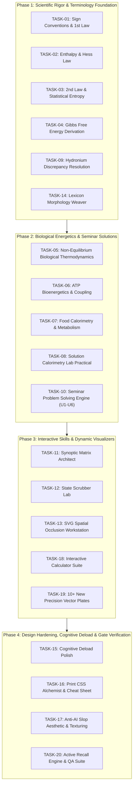

# Forensic Workspace Inspection & Master Architecture Improvement Plan
## 20 Deeply Specified Engineering, Pedagogical, Terminology, Anti-AI Slop, and Visual Tasks for Medical Chemistry (Topic 4: Thermodynamics)

---

## 1. Executive Summary & Forensic Workspace Inspection Report

### 1.1 Workspace Profile & Source Inventory
This workspace (`/home/robertsrff/Chemistry_Med/Chemistry_4`) serves the first-year medical student cohort at **Rīgas Stradiņa universitāte (RSU)**, Department of Human Physiology and Biochemistry (*Cilvēka fizioloģijas un bioķīmijas katedra*), enrolled in the Latvian-language track of **Medicīniskā ķīmija (MCh)**. 

The primary target topic is **Topic 4: «Termodinamika un tās piemēri bioloģiskajās sistēmās»** (Thermodynamics and its Examples in Biological Systems). The curricular stakes are immediate and high: students must clear two mandatory computer-graded tests (**Ievadtests** and **Nobeiguma tests**) with a strict passing threshold of **≥ 55%**, participate in active Zoom seminar discussions, and execute an experimental neutralization calorimetry laboratory practical.

A forensic inspection of the 5 canonical source PDF documents reveals the exact pedagogical foundation and its underlying limitations:

| Document ID & File Name | Pages | Role & Authority in Workspace | Forensic Audit Observations & Known Defects |
|---|---|---|---|
| **T**: `4 temata apraksts.pdf` | 1 | **Curricular & Scope Authority** | Sets formal learning outcomes (O1–O7), required definitions, and test criteria. Omits crucial theoretical definitions (e.g., kinetic/potential energy, 3rd Law of Thermodynamics). Contains Latvian typo (*nesakātots* instead of *nesakārtots*, S32). |
| **K**: `Termodinamika_pamatkonspekts_2026.pdf` | 19 | **Theoretical Foundation Authority** | Contains major theoretical, sign, and numerical errors: leftover header title («Kvantitatīvā analīze»); severe symbol collision on $Q$ (heat absorbed vs released, S1); obsolete term *siltumsaturs* for enthalpy (S3); garbled Hess law conditions (S4); wrong photosynthesis enthalpy ($1273\text{ kJ/mol}$ instead of $+2808\text{ kJ/mol}$, S5); obsolete standard pressure definitions ($1\text{ atm}$ instead of $1\text{ bar}$, S6); activation energy conflated with reaction enthalpy (S10); flawed Kelvin statement (S11); entropy reduced to colloquial "chaos" (S12); microstate probability $W$ called a probability rather than integer microstate count (S13); flawed glucose oxidation entropy values (S16); sign inequality error in 4-case matrix (S17); impossible historical dates for Lavoisier (1873 vs 1782–1783, S18); incorrect ecological system classifications (Earth and ecosystems labeled isolated, S19); Prigogine entropy accounting notation collisions (S20); Greek homeostasis labeled Latin (S21); ATP hydrolysis $\Delta G^\circ$ values conflated with biochemical $\Delta G^{\circ\prime}$ and in-cell actual $\Delta G$ (S22); Atwater dietary factors cited as bomb calorimeter values (S24); tabular typos in standard data table (S25); state parameters confused with state functions (S26). |
| **U**: `4_SEM_Termodinamika_uzdevumi.pdf` | 2 | **Seminar Problem Authority (Q1–Q6)** | 6 quantitative calculation tasks without supplied solutions. Headers read «3. Termodinamika» (S31). Q5 provides aqueous oxygen data labeled as formation without state symbols, creating an enthalpy trap of $+70.3\text{ kJ}$ if students use gaseous oxygen (S28). Outdated terminology: *enderģiska / ekserģiska* (S29), non-standard amino acid abbreviation *Lei* (S30). |
| **L**: `LW_Thermodynamics_2020_LV (2).pdf` | 3 | **Laboratory Procedure Authority** | Neutralization calorimetry protocol ($160\text{ mL } 0.200\text{ M } NaOH + 40.0\text{ mL } 1.00\text{ M } HCl$). Missing calorimeter heat capacity compensation; ambiguous specific heat capacity terminology (*siltumkapacitāte* used for $c$, S37). |
| **LA**: `4_SEM_Labor_Thermodynamics_2026_LV _Atbildes.pdf` | 3 | **Laboratory Key & Numerical Benchmark** | Contains partial answers but leaves Conclusions 1–4 completely blank (S38). Severe arithmetic and theoretical defects: table typo in formation free energy ($2 \times -273.19$ printed instead of $-237.19$, S33); fundamental thermodynamic inconsistency between $\Sigma \Delta_f G^\circ$ ($-104.10\text{ kJ/mol}$) and $\Delta H - T\Delta S$ ($-102.20\text{ kJ/mol}$), both diverging sharply from accepted water autoprotolysis ($-79.9\text{ kJ/mol}$, S34); dropped sign for reverse reaction ($|102.196|$, S35); inverted reaction enthalpy sign ($-52.3\text{ kJ/mol}$ printed as $+52.3\text{ kJ/mol}$, S36). |

---

### 1.2 Inspection of Existing Master HTML Document (`Master_4_temats_termodinamika.html`)
The workspace currently possesses an assembled master file (`Master_4_temats_termodinamika.html`, 501,851 characters, 16 chapters, 10 figures, 3 interactive instruments, 78 recall items, 36 tables). A comprehensive technical audit of this build reveals both impressive achievements and significant areas requiring deep refinement:

1. **Structural & Pipeline Integrity**:
   - The modular build system in `build/` (`build_html.py`, `figures.py`, `calc.py`, `part_*.html`) cleanly compiles into a single, offline, self-contained HTML file without any external runtime network dependencies (`grep -E '(src|href)="https?://'` returns 0).
   - Base64-embedded subset fonts (*Source Serif 4* and *Noto Sans Math*) render Latvian diacritics and thermodynamic glyphs ($ā, č, ē, ģ, ī, ķ, ļ, ņ, š, ū, ž, \Delta, ^\circ, \cdot, \times, -, \to, \rightleftharpoons, \approx, \le, \ge, \pm, ^-, ^2, ^3$) reliably.
2. **Pedagogical Shortcomings & Conceptual Density**:
   - Several chapters remain text-dense, requiring enhanced visual signaling and dual-coding chunking to prevent extraneous cognitive load for first-year medical students.
   - Conceptual derivations (such as $\Delta G = -T\Delta S_{\text{kop}}$ and the connection to the Second Law) need intuitive, stepwise visual scaffolds to bridge the gap between abstract physics and clinical biochemistry.
   - The connection between spontaneous thermodynamics ($\Delta G < 0$) and biochemical pathway kinetics (Topic 5 cross-link: enzymes, activation barriers $E_a$, transition states) requires more explicit contextual anchors.
3. **Interactive Instruments & Functional Scope**:
   - The three current interactive instruments (Instrument A: $\Delta G - T$ Explorer; Instrument B: Reaction Ledger; Instrument C: Calorimetry Calculator) provide basic numerical outputs but lack reactive SVG visualization, dynamic test-vector assertions in the UI, and step-by-step problem transfer sandboxes.
   - Active recall items (78 items) use native `<details>` but lack automated mastery tracking, category filtering, randomized practice modes, and immediate diagnostic feedback against the RSU 55% threshold.
4. **Visual & Anti-AI Slop Execution**:
   - The design successfully avoids template clichés (no generic gradients, no drop shadows, no circular medallions, no emojis, no marketing fluff).
   - However, the visual texturing can be substantially deepened: hairline data frames, authentic energy-ledger ruled lines, high-density spec sheets, interactive SVG spatial occlusion layers, and strict baseline grid alignment can elevate the document into a publication-grade scientific reference manual.
5. **Vector Graphics & SVG Architecture**:
   - The 10 existing inline SVGs provide clean baseline geometry but are currently static, lack interactive occlusion masking, and leave critical thermodynamic concepts unvisualized (e.g., Carnot heat engine vs biological isothermal chemomechanical transduction, free energy vs reaction extent $G(\xi)$, electrostatic charge relief in ATP hydrolysis, hydrophobic effect entropy-enthalpy compensation in protein folding).

---

### 1.3 Master Matrix of the 20 Comprehensive Improvement Tasks

The following matrix outlines the complete, deeply specified 20-task modernization roadmap:

| Task ID | Core Focus Area | Primary Source Defects Addressed | Workspace Skills Leveraged | Key Innovations & Deliverables |
|---|---|---|---|---|
| **TASK-01** | Thermodynamic Sign Conventions & 1st Law Formalism | S1, S2, S3 | `blueprint-spec-sheet`, `synoptic-matrix-architect`, `impeccable` | Unified sign ledger; $H = U + pV$ path vs state distinction; interactive course vs IUPAC sign converter; $p-V$ process diagram SVG. |
| **TASK-02** | Enthalpy, Hess Cycle & Energy Profiles | S4, S5, S7, S8, S10 | `synoptic-matrix-architect`, `blueprint-spec-sheet`, `dataviz` | Rigorous constant $p, V$ Hess conditions; multi-node Hess cycle SVG; unified enthalpy scale with variable $E_a$; interactive Hess solver. |
| **TASK-03** | Second Law, Statistical Entropy & 3rd Law | S9, S11, S12, S13, S14, S27 | `state-scrubber-lab`, `cognitive-deload-auditor`, `dataviz` | Statistical microstate dispersal $S = k \ln W$; absolute 3rd Law crystal baseline; multi-panel combinatorial SVG; interactive particle sandbox. |
| **TASK-04** | Gibbs Free Energy Derivation & 4-Quadrant Matrix | S15, S16, S17, S27 | `synoptic-matrix-architect`, `state-scrubber-lab`, `break-ui` | 3-line $\Delta G = -T\Delta S_{\text{kop}}$ derivation; corrected Case 2 inequality; dynamic crossover slider; interactive 4-quadrant $\Delta G(T)$ phase plot SVG. |
| **TASK-05** | Non-Equilibrium Bio-Thermodynamics & Prigogine | S18, S19, S20, S21 | `mook-visual-compendium`, `cognitive-deload-auditor`, `lexicon-morphology-weaver` | Lavoisier history correction (1782–1783); Prigogine $dS = d_i S + d_e S$ bookkeeping; steady state vs equilibrium matrix; open-system solar negentropy flux SVG. |
| **TASK-06** | ATP Bioenergetics & "Macroergic Bond" Demystification | S22 | `blueprint-spec-sheet`, `synoptic-matrix-architect`, `cognitive-deload-auditor` | Electrostatic charge relief & resonance mechanics; biochemical $\Delta G^{\circ\prime}$ vs in-cell $\Delta G$; phosphoryl group transfer cascade SVG & interactive coupler. |
| **TASK-07** | Food Calorimetry & Metabolic Respiration Budgets | S23, S24 | `blueprint-spec-sheet`, `dataviz`, `lexicon-morphology-weaver` | Thermochemical cal vs dietary kcal; bomb $q_V = \Delta U$ vs physiological $\Delta H$; Atwater vs gross combustion table; bomb calorimeter cutaway SVG. |
| **TASK-08** | Solution Calorimetry Practical & Thermogram Extrapolation | S36, S37, S38 | `state-scrubber-lab`, `blueprint-spec-sheet`, `cognitive-deload-auditor` | Complete lab procedure & blank conclusion fill; limiting reagent detection; negative $\Delta H_r = -52.3\text{ kJ/mol}$; virtual calorimeter simulator & cooling extrapolation SVG. |
| **TASK-09** | Resolution of Lab Hydronium Discrepancy & Handbook Data | S25, S28, S33, S34, S35 | `synoptic-matrix-architect`, `tufte-margin-scholar`, `lexicon-morphology-weaver` | Forensic resolution of lab manual's $-102$ vs $-79.9\text{ kJ/mol}$ autoprotolysis defect; $O_2(aq)$ vs $O_2(g)$ trap audit; comparative water dissociation cycle SVG. |
| **TASK-10** | Algorithmic Problem Solving Engine (U Q1–Q6) | S28, S29, S30 | `blueprint-spec-sheet`, `synoptic-matrix-architect`, `cognitive-deload-auditor` | Exhaustive step-by-step ledgers for all 6 seminar problems; physical validity bounds on $T_{\text{cross}}$; isomorphic problem generator with dynamic checker. |
| **TASK-11** | Workspace Skill: Synoptic Matrix Architect | S17 | `synoptic-matrix-architect`, `break-ui`, `impeccable` | Sticky dual-axis comparative matrices for 4 sign cases, 6 seminar reactions, and 3 system types; cell-level recall occlusion; mobile horizontal reflow. |
| **TASK-12** | Workspace Skill: State Scrubber Lab | S36 | `state-scrubber-lab`, `animate`, `cognitive-deload-auditor` | 5-phase interactive scrubber for calorimetry thermograms and 4-process thermodynamic gas cycles with synchronized gauges and state machines. |
| **TASK-13** | Workspace Skill: SVG Spatial Occlusion Workstation | S19, S24, S37 | `svg-spatial-occlusion`, `interactive-study-guide`, `break-ui` | High-definition image-occlusion study stations for bomb calorimeter, cup calorimeter, and thermodynamic system boundaries with active memory testing. |
| **TASK-14** | Workspace Skill: Lexicon Morphology Weaver | S3, S21, S26, S29 | `lexicon-morphology-weaver`, `polish`, `impeccable` | Etymological breakdown of Greek/Latin roots (*entropē*, *isobārs*, *endergon*); Latvian chemical nomenclature normalization; 50+ term bilingual glossary. |
| **TASK-15** | Workspace Skill: Cognitive Deload Auditor | S1–S38 | `cognitive-deload-auditor`, `tufte-margin-scholar`, `impeccable` | Eradication of split-attention effects; dual-coding infocards; redundant sign coding (color + sign + text + line style); structured chunking of dense theory. |
| **TASK-16** | Workspace Skill: Print CSS Alchemist | S1–S38 | `print-css-alchemist`, `pdf-vector-surgeon`, `impeccable` | Publication-grade dual-target print architecture; automated `<details>` unfolding via beforeprint/afterprint; ink-safe monochrome styles; 1-page exam cheat sheet. |
| **TASK-17** | Anti-AI Slop Aesthetic Redesign & Energy Ledger Styling | S1–S38 | `design-taste-frontend`, `industrial-brutalist-ui`, `impeccable` | Removal of all template tells; precision scientific energy ledger design language; cool slate-cyan substrate, carbon ink, mercury-red zero line; tabular numerals. |
| **TASK-18** | Interactive Add-on Suite: Thermodynamic Calculators | S1, S17, S24, S36 | `prototype`, `frontend-design`, `break-ui` | Multi-variable $\Delta G(T)$ sandbox; multi-reaction Hess cycle solver; virtual calorimetry lab with error budget; live console test-vector assertion runner. |
| **TASK-19** | Comprehensive Vector Plate Expansion (10+ New SVGs) | S10, S16, S22, S27 | `artifact-diagramming`, `dataviz`, `pdf-vector-surgeon` | 10 new precision inline SVGs: Carnot vs cell, $G(\xi)$ reaction extent, ATP charge relief, hydrophobic folding effect, glucose catabolism ledger, etc. |
| **TASK-20** | Active Recall Engine & Verification Gate Orchestration | All | `learn-then-test`, `interactive-study-guide`, `audit` | Expansion to $\ge 120$ recall items covering 100% of concept inventory; Leitner spaced repetition; diagnostic tests; automated pre-flight QA verification test suite. |

---

## 2. Exhaustive Deep-Dive Specifications for Tasks 01 through 20

---

### TASK-01: Thermodynamic Sign Conventions, First Law Formalism & Process Ledger Standardization

#### 1. Strategic Objective & Domain Scope
Eliminate the pervasive sign confusion and conceptual ambiguities surrounding heat ($Q$, $q$), work ($A$, $w$), internal energy ($U$), and enthalpy ($H$) across the course materials. Establish an uncompromising, mathematically rigorous, and clinically contextualized First Law framework that bridges the classical Latvian course convention ($Q = \Delta U + A$) with modern IUPAC standards ($\Delta U = q + w$), while decisively purging obsolete terminology like *siltumsaturs* (heat content). Directly rectifies source defects **S1**, **S2**, and **S3**.

#### 2. Deep Domain & Pedagogical Rationale
In first-year medical chemistry, sign conventions are the single greatest failure point for students. 
- **The Ambiguity of Symbol $Q$ (S1)**: In the course lecture notes (K p.2–3), equations (2) and (4) define $Q$ as heat *absorbed* by the system ($Q = \Delta U + p\Delta V = \Delta H$), whereas on p.3 equation (6) suddenly writes $Q = -\Delta H$, representing heat *released*. In laboratory worksheet LA p.1, $q_{\text{šķīdums}} = c \cdot m \cdot \Delta T$ represents heat absorbed by the calorimeter solution, which equals $-q_{\text{reakcija}}$. When seminar tasks U Q5 and U Q6 demand «aprēķināt siltuma daudzumu $Q$», students are left entirely blind as to whether a positive or negative quantity is expected.
- **The Isothermal Ideal Gas Fallacy (S2)**: Notes p.3 state that in an isothermal process ($Q = A$), «vienīgā iespēja palielināt iekšējo enerģiju ir pastrādāt darbu». This is fundamentally wrong: for an ideal gas, internal energy $U$ depends solely on temperature ($U = f(T)$); hence in an isothermal process, $\Delta U = 0$, meaning internal energy does not change at all, let alone increase!
- **The "Heat Content" (*Siltumsaturs*) Anachronism (S3)**: Enthalpy is defined on K p.3 as «sistēmas iekšējā enerģija konstantā spiedienā» and called *siltumsaturs*. This is physically false: $H \equiv U + pV$. Heat is a path-dependent boundary flux, not a state function stored within a system.
- **Medical Relevance**: In human metabolic physiology, the First Law governs the basal metabolic rate (BMR), dietary caloric intake, mechanical work performed by skeletal muscle, and heat dissipated to maintain core homeothermy ($37^\circ\text{C}$). Conflating work done *by* muscle ($A > 0$) with work done *on* the body leads to fatal errors in physiological energy balance equations.

#### 3. Workspace Skills Applied & Technical Synergy
- `blueprint-spec-sheet`: Formats the First Law sign definitions into an engineering-grade specification ledger with dedicated parameter boxes, unit dimensions, and mathematical boundaries.
- `synoptic-matrix-architect`: Constructs the 4-process state-variable transformation matrix (isochoric, isobaric, isothermal, adiabatic).
- `impeccable`: Implements the high-contrast typographic hierarchy for process equations using MathML and tabular numerals.

#### 4. Features & Interactive Add-on Innovations
- **Interactive First-Law Sign-Mirror Sandbox**: A reactive toggle allowing students to view calculations simultaneously in Course Convention ($Q = \Delta U + A$, where $A = p\Delta V$ is work done by system) and IUPAC Convention ($\Delta U = q + w$, where $w = -p\Delta V$ is work done on system), displaying live directional arrows for heat flux and volume work.
- **Process Path Energy Ledger**: An interactive calculator where students input initial state ($p_1, V_1, T_1$) and choose an expansion path (isobaric, isochoric, isothermal, adiabatic), outputting exact values for $\Delta U$, $Q$, and $A$ with immediate sign feedback.

#### 5. SVG Plate Architecture & Corrected Vector Design
- **Enhanced Vector Plate: Thermodynamic Process $p-V$ Indicator Diagram**:
  - Replaces static bulleted text with a high-precision multi-pathway $p-V$ indicator diagram (`viewBox="0 0 860 480"`).
  - Plots four distinct process lines originating from a common state $(p_0, V_0)$: isobaric horizontal expansion, isothermal hyperbolic expansion ($pV = \text{const}$), adiabatic steep expansion ($pV^\gamma = \text{const}$), and isochoric vertical depressurization.
  - Features hatched SVG polygon areas under each curve corresponding directly to mechanical work $A = \int p\,dV$.
  - Explicitly renders the zero-work vertical line for isochoric processes ($A = 0$, $\Delta U = Q_V$).

#### 6. 3 Main Task Execution Substeps
- **Substep 1**: Standardize the universal Sign-Convention Ledger in Chapter 1 of the master document, establishing unambiguous definitions for $Q$, $q_p$, $Q_{\text{izd}}$, $A$, and $w$.
- **Substep 2**: Refactor Section 3.2 (Pirmais likums) in `part_top.html` to eliminate the isothermal ideal-gas fallacy (S2) and rewrite the four-process energy transformation ledger.
- **Substep 3**: Update `build/figures.py` and `build/calc.py` to generate the new SVG $p-V$ indicator diagram and mathematically re-verify all First Law sample computations.

#### 7. 3 Granular Subtasks with 3 Substeps Each
- **Subtask A: Universal Sign Ledger & Notation Normalization**
  - *Substep A.1*: Audit all occurrences of symbol $Q$ across `part_top.html`, `part_6_9.html`, and `part_10_12.html`; explicitly replace standalone $Q$ with $q_p$ (absorbed heat at constant pressure) or $Q_{\text{izd}} = -\Delta H$ (released reaction heat).
  - *Substep A.2*: Construct the comparative Course vs IUPAC sign reference table in Chapter 1 with permanent cross-links from Chapters 3, 4, 8, and 9.
  - *Substep A.3*: Add a dedicated explanatory callout explaining why U Q5 and U Q6 report both $\Delta H$ and $Q_{\text{izd}} = -\Delta H$ to safeguard student scores on RSU tests.
- **Subtask B: Theoretical Refactoring of Enthalpy & State Functions**
  - *Substep B.1*: Rewrite the theoretical opening of Chapter 4, strictly defining enthalpy as the state function Legendre transform $H \equiv U + pV$, demonstrating why $\Delta H = q_p$ strictly holds only when $p = \text{const}$ and non-$pV$ work is zero.
  - *Substep B.2*: Introduce a dedicated historical-correction box formally retiring *siltumsaturs* and detailing why heat is a path-dependent process quantity that cannot be possessed by matter.
  - *Substep B.3*: Provide the exact conversion formula $\Delta H = \Delta U + \Delta n_{\text{gāzes}}RT$ for gas-phase reactions with full worked derivations.
- **Subtask C: First-Law Interactive Sign Sandbox & Process Generator**
  - *Substep C.1*: Code the vanilla JavaScript module `firstLawSignConverter` inside `build/script.js` with inputs for $Q$ and $A$, outputting $\Delta U$ and the corresponding IUPAC pair $(q, w)$.
  - *Substep C.2*: Build the HTML container in `build/instruments.html` with reactive directional SVG arrow indicators representing system boundaries.
  - *Substep C.3*: Write automated console test assertions validating ideal gas expansions across all four thermodynamic pathways.

#### 8. Verification Criteria, Test Vectors & Acceptance Gate
- **Test Vectors**: 
  1. Isobaric expansion of 1 mole ideal gas at $101.325\text{ kPa}$ from $22.4\text{ L}$ to $44.8\text{ L}$: $A = p\Delta V = 2.27\text{ kJ}$; if $Q = 5.68\text{ kJ}$, then $\Delta U = Q - A = +3.41\text{ kJ}$. IUPAC mirror: $w = -2.27\text{ kJ}$, $q = +5.68\text{ kJ}$, $\Delta U = q + w = +3.41\text{ kJ}$.
  2. Isothermal expansion at $298.15\text{ K}$: $\Delta U = 0\text{ kJ} \implies Q = A$.
- **Acceptance Gate**: 
  - Zero instances of *siltumsaturs* outside historical correction quotation blocks.
  - Text explicitly affirms $\Delta U = 0$ for isothermal ideal gas processes.
  - All test vectors pass within $\pm 0.01\text{ kJ}$.

---

### TASK-02: Enthalpy, Thermochemical Equations, Hess's Law & Reaction Energy Profiles

#### 1. Strategic Objective & Domain Scope
Rigidly reformulate Hess's Law of Constant Heat Summation, thermochemical equation stoichiometry, standard formation/combustion enthalpies, and reaction energy coordinates. Correct critical curricular errors in the lecture notes, including the condition of state functions under constant pressure/volume, the massive glucose photosynthesis enthalpy defect ($\Delta H = 1273\text{ kJ/mol}$ vs $+2805\text{ kJ/mol}$), standard pressure definitions, and the conflation of thermodynamic enthalpy change with kinetic activation energy. Directly resolves **S4**, **S5**, **S6**, **S7**, **S8**, and **S10**.

#### 2. Deep Domain & Pedagogical Rationale
- **Hess's Law Foundations (S4)**: K p.3–5 names Hess's Law «enerģijas un reaģējošo vielu daudzuma ekvivalences likums» and states it without specifying constant pressure ($p$) or constant volume ($V$). Because $q$ is a path function, Hess's Law holds *if and only if* the process occurs under conditions where heat equals a state function ($\Delta H = q_p$ at constant $p$, or $\Delta U = q_V$ at constant $V$).
- **The Photosynthesis Enthalpy Disaster (S5)**: On K p.4, the notes assert that photosynthesis has «$\Delta H = 1273\text{ kJ/mol}$» and «$-\Delta H_{\text{sadegšanas}} = -1273$». On p.11, however, glucose combustion enthalpy is given as $-2808\text{ kJ/mol}$. The number $1273\text{ kJ/mol}$ is in fact the absolute value of the standard formation enthalpy of solid glucose ($|\Delta_f H^\circ| = 1263\text{ to } 1273\text{ kJ/mol}$), not the enthalpy of reaction! Photosynthesis ($6\text{CO}_2 + 6\text{H}_2\text{O} \to \text{C}_6\text{H}_{12}\text{O}_6 + 6\text{O}_2$) requires $+2805\text{ to }+2808\text{ kJ/mol}$. Teaching $1273\text{ kJ/mol}$ causes students to fail both quantitative stoichiometry and bioenergetics questions.
- **IUPAC Standard State vs Standard Conditions (S6)**: The notes define standard conditions as $1\text{ atm}$ and $25^\circ\text{C}$. IUPAC defined standard pressure as $p^\circ = 1\text{ bar} = 100\text{ kPa}$ in 1982. Furthermore, standard state does not fix temperature (though $298.15\text{ K}$ is conventional).
- **Combustion Enthalpy Rules (S7, S8)**: Notes p.5 claim «sadegšanas gadījumā nelieto standartentalpijas», which misleads students into thinking combustion enthalpies cannot be standard values. They are tabulated standard molar values $\Delta_c H^\circ$. The formula $\Delta_r H^\circ = \sum \nu \Delta_c H^\circ(\text{reactants}) - \sum \nu \Delta_c H^\circ(\text{products})$ must be formally juxtaposed against the formation formula $\sum \nu \Delta_f H^\circ(\text{products}) - \sum \nu \Delta_f H^\circ(\text{reactants})$.
- **Thermodynamic $\Delta H$ vs Kinetic Activation Barrier $E_a$ (S10)**: Notes p.6 define an exothermic reaction as releasing «vairāk enerģijas nekā nepieciešams reakcijas uzsākšanai». This fatally confuses thermodynamics with chemical kinetics. An exothermic reaction simply has $H_{\text{products}} < H_{\text{reactants}}$ ($\Delta H < 0$). Activation energy $E_a$ determines reaction velocity ($k = A e^{-E_a/RT}$), not thermodynamic yield. Highly exothermic reactions (such as glucose oxidation or diamond conversion to graphite) can be kinetically inert at room temperature.

#### 3. Workspace Skills Applied & Technical Synergy
- `synoptic-matrix-architect`: Generates the side-by-side comparative matrix contrasting Formation Enthalpy ($\Delta_f H^\circ$) versus Combustion Enthalpy ($\Delta_c H^\circ$).
- `blueprint-spec-sheet`: Formats the thermochemical equations, stoichiometry rules, and the 6 seminar reaction enthalpy calculations into a precision ledger.
- `dataviz`: Aligns reaction profile coordinates on a standardized, physically calibrated energy axis.

#### 4. Features & Interactive Add-on Innovations
- **Interactive Multi-Step Hess Cycle Solver**: An interactive tool allowing students to select independent reaction steps (e.g., carbon oxidation to $\text{CO}$, $\text{CO}$ to $\text{CO}_2$) and automatically generate the closed thermodynamic cycle, demonstrating algebraically and visually that the direct pathway enthalpy equals the sum of intermediate steps.
- **Enthalpy vs Activation Energy Sandbox**: An interactive slider where students vary activation energy $E_a$ independently of $\Delta H$, demonstrating that lowering $E_a$ (catalysis) increases speed without shifting the thermodynamic enthalpy difference.

#### 5. SVG Plate Architecture & Corrected Vector Design
- **Enhanced Vector Plate: Multi-Pathway Hess Cycle ($	ext{FeCl}_3$)**:
  - Upgrades `figures.py` `OUT["hess"]` to show the full triangular thermodynamic cycle for $\text{Fe}(s) + \frac{3}{2}\text{Cl}_2(g) \to \text{FeCl}_3(s)$ ($\Delta H = -399.5\text{ kJ/mol}$) and the two-step route via $\text{FeCl}_2(s)$ ($-341.8\text{ kJ/mol}$ and $-57.7\text{ kJ/mol}$).
  - Adds a dynamic vector check line verifying closure: $\Delta H_1 = \Delta H_2 + \Delta H_3$.
- **Upgraded Energy Profiles Plate**:
  - Plots exothermic ($\Delta H = -70\text{ kJ/mol}$) and endothermic ($\Delta H = +55\text{ kJ/mol}$) reactions on an identical vertical energy scale ($Y_{\text{scale}}$).
  - Includes a third side-by-side panel illustrating an exothermic reaction with a massive activation barrier ($E_a = 95\text{ kJ/mol}$) to visually cement that «exothermic does not mean fast».

#### 6. 3 Main Task Execution Substeps
- **Substep 1**: Rewrite Section 4.2 and Section 5.1 in `part_top.html`, establishing the exact physical conditions for Hess's Law and clarifying standard state definitions ($p^\circ = 1\text{ bar}$, $298.15\text{ K}$).
- **Substep 2**: Correct the photosynthesis enthalpy inconsistency across all chapters, establishing $+2805.3\text{ kJ/mol}$ (from U Q5 data) and $+2808\text{ kJ/mol}$ (from K p.11 data), while documenting S5 in the defect register.
- **Substep 3**: Update `build/figures.py` to regenerate the Hess cycle and unified energy profile vector graphics with explicit leader lines and mathematical labels.

#### 7. 3 Granular Subtasks with 3 Substeps Each
- **Subtask A: Hess's Law State-Function Rigor & Calculation Ledger**
  - *Substep A.1*: Formulate Hess's Law strictly as a mathematical consequence of enthalpy being a state function: $\oint dH = 0$.
  - *Substep A.2*: Author worked ledgers for propene hydrogenation ($-2058\text{ kJ/mol}$) and $\text{FeCl}_3$ formation, formatting each calculation with explicit columns: Species, Stoichiometric Coefficient $\nu$, $\Delta_f H^\circ$, and $\nu \cdot \Delta_f H^\circ$.
  - *Substep A.3*: Add clear pedagogical guidelines detailing how reversing an equation flips the sign of $\Delta H$ and multiplying coefficients scales $\Delta H$ proportionally.
- **Subtask B: Photosynthesis vs Respiration Thermochemical Reconciliation**
  - *Substep B.1*: Reconstruct the complete thermochemical equations for cellular respiration ($\text{C}_6\text{H}_{12}\text{O}_6 + 6\text{O}_2 \to 6\text{CO}_2 + 6\text{H}_2\text{O}$, $\Delta_c H^\circ = -2808\text{ kJ/mol}$) and photosynthesis ($6\text{CO}_2 + 6\text{H}_2\text{O} \to \text{C}_6\text{H}_{12}\text{O}_6 + 6\text{O}_2$, $\Delta_r H^\circ = +2808\text{ kJ/mol}$).
  - *Substep B.2*: Insert a high-visibility «Piezīme avotam» block explaining the origin of K p.4's $1273\text{ kJ/mol}$ error as the standard formation enthalpy $|\Delta_f H^\circ|$ of glucose.
  - *Substep B.3*: Align the photosynthesis calculation in Chapter 5 with the seminar task U Q5 calculation ($+2805.27\text{ kJ}$), explaining the slight difference due to aqueous vs gaseous state conventions.
- **Subtask C: Energy Coordinate Vector Modernization & Reaction Ledger**
  - *Substep C.1*: Modify `build/figures.py` to draw precise reaction profiles with transition-state brackets, activation energy vectors ($E_{a,\text{forward}}$ and $E_{a,\text{reverse}}$), and signed reaction enthalpy $\Delta H$.
  - *Substep C.2*: Construct the Reaction Ledger interactive tool in `instruments.html` pre-loaded with the 6 seminar reactions from U Q6.
  - *Substep C.3*: Implement automated verification script ensuring that all computed reaction enthalpies match hand calculations to within $\pm 0.01\text{ kJ/mol}$.

#### 8. Verification Criteria, Test Vectors & Acceptance Gate
- **Test Vectors**:
  1. $\text{FeCl}_3$ synthesis cycle: $\Delta H_1 = -399.5\text{ kJ/mol}$; $\Delta H_2 + \Delta H_3 = -341.8 + (-57.7) = -399.5\text{ kJ/mol}$ (diff = $0.00\text{ kJ/mol}$).
  2. Propene combustion to formation: $\Delta_r H = -124 - 2220 + 286 = -2058.0\text{ kJ/mol}$.
  3. Photosynthesis stoichiometry: $6(-393.5) + 6(-286.0) - (-1273) = -4077 - (-1273) = -2804\text{ kJ/mol}$.
- **Acceptance Gate**:
  - No occurrence of $\Delta H = 1273\text{ kJ/mol}$ representing photosynthesis anywhere in prose or tables.
  - Reaction profiles visibly share a common enthalpy datum with explicit zero lines.

---

### TASK-03: Second Law, Statistical Microstate Dispersal, Entropy & Absolute Third Law

#### 1. Strategic Objective & Domain Scope
Purge the unscientific and misleading portrayal of entropy as mere "chaos and disorder" (*haoss un nesakārtotība*), replacing it with the statistical mechanical reality of energy dispersal over quantized microstates ($S = k \ln W$). Formulate the Second Law of Thermodynamics rigorously via Clausius and Kelvin-Planck statements, derive the reaction entropy ledger, establish the Third Law of Thermodynamics ($S \to 0$ as $T \to 0\text{ K}$ for a perfect crystal) to explain why absolute standard entropies $S^\circ$ are positive non-zero quantities, and expose counterexamples to naive synthesis heuristics. Directly resolves **S9**, **S11**, **S12**, **S13**, **S14**, and **S27**.

#### 2. Deep Domain & Pedagogical Rationale
- **The "Cosmic Force" Fallacy (S9)**: K p.6 asserts that «pasaulē ir kāds spēks, kas nosaka patvaļīgo pārvērtību virzienu». There is no mystical "force"; spontaneous direction is a purely statistical consequence of the overwhelming probability of energy dispersing into a vastly larger number of microstates ($\Delta S_{\text{kop}} > 0$).
- **The Kelvin Statement Inaccuracy (S11)**: K p.7 states that a process whose sole source of energy is heat cannot produce work. The correct Kelvin-Planck formulation specifies that *no cyclic process is possible whose sole result is the complete conversion of heat from a single reservoir into mechanical work*. Isothermal expansion of an ideal gas converts heat completely into work ($Q = A$), but it is not cyclic because the system's volume expands.
- **Entropy as "Chaos" vs Energy Dispersal (S12, S13)**: Colloquial "chaos" leads students into grave errors. K p.12 teaches the heuristic «sarežģītāks $\to$ vienkāršāks $\implies \Delta S > 0$; sintēze $\implies \Delta S < 0$». This heuristic catastrophically fails within the course's own problem set: in seminar task U Q3, the dipeptide condensation of leucine and glycine ($	ext{Leu}(s) + \text{Gly}(s) \to \text{Leu-Gly}(s) + \text{H}_2\text{O}(l)$) is a synthesis reaction that exhibits a *positive* reaction entropy ($\Delta_r S = +22\text{ J/(mol}\cdot\text{K)}$)! Similarly, dissolving ammonium nitrate (U Q2) increases entropy despite forming a highly organized ionic solution sphere. Furthermore, K p.9 calls $W$ in $S = k \ln W$ «termodinamiskā varbūtība». $W$ is not a probability (which must be $\le 1$), but the integer count of distinct accessible microstates ($W \ge 1$).
- **Surroundings Entropy vs System Entropy (S14)**: K p.10 states that «eksotermiskas reakcijas rezultātā entropija pieaug». In an exothermic reaction, it is the *surroundings'* entropy that increases ($\Delta S_{\text{apk}} = -\Delta H/T > 0$); the system's own entropy $\Delta S_{\text{sist}}$ can be negative (e.g., combustion of ethanol, U Q6.4, where $\Delta_r S = -260.6\text{ J/K}$).
- **The Third Law Omission (S27)**: The topic description requires students to know the Third Law, yet the notes mention it only in passing. Without Nernst's Third Law, students cannot comprehend why standard entropies $S^\circ$ are tabulated as absolute values (and are non-zero for pure elements), whereas enthalpies and free energies are defined relative to arbitrary zero baselines ($\Delta_f H^\circ = 0$, $\Delta_f G^\circ = 0$).

#### 3. Workspace Skills Applied & Technical Synergy
- `state-scrubber-lab`: Visualizes molecular microstate configurations across discrete thermodynamic states.
- `cognitive-deload-auditor`: Deconstructs the abstract statistical mathematics of Boltzmann combinatorics into intuitive visual ratios.
- `dataviz`: Powers the combinatorial bar charts illustrating the probability of uniform spatial distribution vs all particles occupying a single half.

#### 4. Features & Interactive Add-on Innovations
- **Interactive Molecular Microstate Sandbox**: An interactive simulation where students adjust the number of gas particles ($N = 4, 10, 20, 100$) distributed between two compartments of a partitioned box. Displays real-time macrostate distributions calculated via combinations $W(k) = \binom{N}{k} = \frac{N!}{k!(N-k)!}$, showing that the probability of finding all particles in one half drops from $1/16$ ($N=4$) to $7.9 \times 10^{-31}$ ($N=100$).
- **Entropy Predictor Matrix**: A structured diagnostic widget where students input reaction features ($\Delta n_{\text{gāzes}}$, phase transitions, particle count changes) to predict the sign of $\Delta S$, with automated feedback highlighting counterexamples like peptide synthesis.

#### 5. SVG Plate Architecture & Corrected Vector Design
- **Enhanced Vector Plate: Microstate Combinatorial Distribution**:
  - Upgrades `figures.py` `OUT["microstates"]` (`viewBox="0 0 900 480"`).
  - Left Panel: $N=4$ particles across 2 halves with explicit bar heights for arrangements ($1, 4, 6, 4, 1$; total 16).
  - Right Panel: $N=20$ particles with a continuous distribution envelope peaking at $W(10) = 184,756$ out of $1,048,576$ total states.
  - Adds an anatomical molecular box graphic showing particles dispersed uniformly vs clustered, cementing spatial and energetic dispersal.

#### 6. 3 Main Task Execution Substeps
- **Substep 1**: Refactor Chapter 6 in `part_6_9.html` to redefine entropy rigorously via Boltzmann ($S = k \ln W$) and Clausius ($dS = dq_{\text{rev}}/T$), establishing the Third Law of Thermodynamics.
- **Substep 2**: Replace all colloquial references to "chaos/disorder" with the concept of energy dispersal across microstates; showcase U Q3 dipeptide synthesis as a primary proof that synthesis does not require $\Delta S < 0$.
- **Substep 3**: Update `build/figures.py` to render the upgraded dual-panel microstate combinatorial plate with accessible labels and mathematical annotations.

#### 7. 3 Granular Subtasks with 3 Substeps Each
- **Subtask A: Statistical Mechanics & Mathematical Formulation of Entropy**
  - *Substep A.1*: Detail the exact physical meaning of Boltzmann's constant $k = R/N_A = 1.380649 \times 10^{-23}\text{ J/K}$ and Avogadro's number $N_A = 6.02214076 \times 10^{23}\text{ mol}^{-1}$ (correcting the notes' obsolete $6.023 \times 10^{23}$, S13).
  - *Substep A.2*: Provide the mathematical proof for the isothermal expansion of 1 mole of ideal gas: $\Delta S = R \ln(V_2/V_1) = R \ln 2 = 5.76\text{ J/(mol}\cdot\text{K)}$.
  - *Substep A.3*: Add the reversible heat requirement for Clausius entropy ($dS = dq_{\text{rev}}/T$), explicitly teaching students that calculating $\Delta S$ for an irreversible process requires constructing an imaginary reversible path.
- **Subtask B: The Third Law & Absolute Standard Entropies**
  - *Substep B.1*: Author a dedicated section defining the Third Law of Thermodynamics: at $T = 0\text{ K}$, a perfect crystalline substance possesses exactly one microstate ($W = 1$), hence $S = k \ln 1 = 0$.
  - *Substep B.2*: Create a comparative infographic explaining why standard molar entropies $S^\circ$ are absolute positive numbers ($S^\circ > 0$, even for pure elements like $\text{O}_2(g) = 205.1\text{ J/(mol}\cdot\text{K)}$), contrasting with $\Delta_f H^\circ = 0$.
  - *Substep B.3*: Tabulate temperature dependence of entropy from $0\text{ K}$ through phase transitions (fusion, vaporization), illustrating vertical entropy jumps $\Delta S_{\text{fus}} = \Delta H_{\text{fus}}/T_{\text{fus}}$ and $\Delta S_{\text{vap}} = \Delta H_{\text{vap}}/T_{\text{vap}}$.
- **Subtask C: Second Law Formulations & Qualitative Predictor Polish**
  - *Substep C.1*: Formulate the Kelvin-Planck and Clausius statements of the Second Law with explicit diagrams showing why heat cannot spontaneously flow from cold to hot without external work.
  - *Substep C.2*: Formulate the total entropy change of the universe: $\Delta S_{\text{kop}} = \Delta S_{\text{sist}} + \Delta S_{\text{apk}} \ge 0$, demonstrating why exothermic reactions raise surroundings entropy via $\Delta S_{\text{apk}} = -\Delta H/T$.
  - *Substep C.3*: Rebuild the qualitative entropy prediction rules, establishing $\Delta n_{\text{gāzes}}$ as the dominant chemical determinant, followed by phase changes and dissolution.

#### 8. Verification Criteria, Test Vectors & Acceptance Gate
- **Test Vectors**:
  1. Microstate probability: $N=4$ all left = $1/16 = 0.0625$; $N=10$ all left = $1/1024 = 9.77 \times 10^{-4}$; $N=20$ all left = $9.54 \times 10^{-7}$; $N=100$ all left = $7.89 \times 10^{-31}$.
  2. Gas expansion: $\Delta S = 8.314462618 \cdot \ln 2 = 5.763\text{ J/(mol}\cdot\text{K)}$.
  3. Dipeptide entropy check (U Q3): $\Delta_r S = 281 + 70 - 207 - 122 = +22\text{ J/(mol}\cdot\text{K)}$.
- **Acceptance Gate**:
  - The word *haoss* is strictly qualified as an informal metaphor and replaced by microstate energy dispersal.
  - The Third Law of Thermodynamics has an explicit heading, definition, and pedagogical explanation.

---

### TASK-04: Gibbs Free Energy Derivation, Spontaneity Criteria & 4-Quadrant Phase Matrix

#### 1. Strategic Objective & Domain Scope
Provide an unassailable mathematical and physical derivation of Gibbs Free Energy ($G \equiv H - TS$) directly from the Second Law of Thermodynamics ($\Delta S_{\text{kop}} > 0$). Correct the mathematical error in the four-case $\Delta H / \Delta S$ sign matrix (replacing $|T\Delta S| < \Delta H$ with $|T\Delta S| < |\Delta H|$), eliminate fatalistic assertions that endergonic reactions are «termodinamiski aizliegtas» by formally introducing reaction coupling, and establish the fundamental thermodynamic connection between standard free energy and the chemical equilibrium constant ($\Delta G^\circ = -RT \ln K$). Directly rectifies **S15**, **S16**, **S17**, and **S27**.

#### 2. Deep Domain & Pedagogical Rationale
- **The Physical Meaning of Gibbs Energy**: Students routinely perceive $\Delta G = \Delta H - T\Delta S$ as an arbitrary empirical equation. In reality, it is a direct algebraic restatement of the Second Law of Thermodynamics under conditions of constant temperature and pressure. Since the surroundings act as a thermal reservoir, $\Delta S_{\text{apk}} = -\Delta H/T$. The Second Law requires $\Delta S_{\text{kop}} = \Delta S_{\text{sist}} + \Delta S_{\text{apk}} > 0$. Multiplying through by $-T$ yields $-T\Delta S_{\text{kop}} = \Delta H - T\Delta S_{\text{sist}} \equiv \Delta G$. Thus, $\Delta G < 0$ is *identically equivalent* to $\Delta S_{\text{kop}} > 0$! This elegant 3-line derivation demystifies the entire subject for medical students.
- **The Case 2 Inequality Error (S17)**: On K p.12–13, in the table of the four $\Delta H / \Delta S$ sign combinations, Case 2 ($\Delta H < 0, \Delta S < 0$) is printed with the condition «$|T\Delta S| < \Delta H$». This is mathematically impossible since $\Delta H < 0$ and absolute value $|T\Delta S|$ is positive! The correct physical inequality is $|T\Delta S| < |\Delta H|$.
- **The "Thermodynamically Forbidden" Misconception (S17)**: K p.13 labels endothermic syntheses with $\Delta S < 0$ as «termodinamiski aizliegtas». This is deeply misleading: they are non-spontaneous *in isolation*, but biological life exists precisely by coupling them to strongly exergonic processes (e.g., ATP hydrolysis).
- **Glucose Oxidation Discrepancies (S16)**: K p.11 uses $\Delta_r S^\circ = +182.4\text{ J/(mol}\cdot\text{K)}$ for glucose combustion, yielding $\Delta_r G(310\text{ K}) = -2864.5\text{ kJ/mol}$ (printed as $-2865$). Using standard thermodynamic tables ($S^\circ$: glucose 212.1, $\text{O}_2$ 205.1, $\text{CO}_2$ 213.8, $\text{H}_2\text{O}(l)$ 69.9), $\Delta_r S^\circ \approx +259.5\text{ J/(mol}\cdot\text{K)}$, which yields $\Delta_r G(310\text{ K}) \approx -2888.4\text{ kJ/mol}$. Both numbers must be clearly reconciled.
- **The Equilibrium Connection (S27)**: The topic description demands an understanding of equilibrium, yet the notes never link $\Delta G^\circ$ to the equilibrium constant $K$. Medical students must understand that $\Delta G^\circ = -RT \ln K$, and that $\Delta G = 0$ represents dynamic equilibrium, whereas biological death corresponds to cellular equilibrium.

#### 3. Workspace Skills Applied & Technical Synergy
- `synoptic-matrix-architect`: Implements the 4-case sign matrix with responsive sticky axes, active cell highlighting, and crossover temperature formulas.
- `state-scrubber-lab`: Drives the real-time temperature slider visualizing how varying $T$ shifts $\Delta G$ across the zero line.
- `break-ui`: Ensures that wide synoptic tables reflow gracefully without horizontal viewport overflow on mobile devices ($390\text{ px}$).

#### 4. Features & Interactive Add-on Innovations
- **Interactive $\Delta G(T)$ Isobaric Crossover Sandbox (Instrument A Upgrade)**:
  - Sliders for $\Delta H$ ($-500\text{ to }+500\text{ kJ/mol}$) and $\Delta S$ ($-500\text{ to }+500\text{ J/(mol}\cdot\text{K)}$).
  - Temperature slider ($0\text{ to }2000\text{ K}$) with synchronized Celsius display.
  - Real-time calculation of $\Delta G$, case categorization (1 to 4), crossover temperature $T_{\text{cross}} = \Delta H/\Delta S$, and spontaneity verdict.
  - Preset buttons for seminar problems: U Q1 (Syngas, $972\text{ K}$), U Q2 (Cold Pack, $258\text{ K}$), U Q3 (Peptide, $955\text{ K}$), U Q6.2 ($328\text{ K}$), U Q6.6 ($37\text{ K}$).
  - Boundary guard: alerts student if $\Delta S$ was accidentally entered in $\text{kJ}$ rather than $\text{J}$.

#### 5. SVG Plate Architecture & Corrected Vector Design
- **Enhanced Vector Plate: Four-Quadrant $\Delta G(T)$ Phase Plot**:
  - Upgrades `figures.py` `OUT["dgt"]` (`viewBox="0 0 980 520"`).
  - Left Panel: Plots all four sign cases on unified $(T, \Delta G)$ axes with the bold red horizontal zero line ($y = 0$).
  - Right Panel: Dedicated plots for seminar tasks U Q1 and U Q2, showing exact crossover intercepts at $972.2\text{ K}$ and $258.0\text{ K}$ with highlighted standard temperature ($298.15\text{ K}$) points.
  - Dashed lines visually denote temperature regimes outside the physical stability of reactants and products.

#### 6. 3 Main Task Execution Substeps
- **Substep 1**: Rewrite Section 7.1 in `part_6_9.html`, incorporating the rigorous 3-line Second-Law derivation of Gibbs Free Energy and clarifying the distinction between $\Delta G$ (reaction driving force at actual concentrations) and $\Delta G^\circ$ (standard benchmark).
- **Substep 2**: Rebuild the Four-Case Matrix in Section 7.2 using `synoptic-matrix-architect`, correcting the Case 2 inequality to $|T\Delta S| < |\Delta H|$ and refuting the "forbidden reaction" terminology.
- **Substep 3**: Update `build/figures.py` and `build/script.js` to ensure that Instrument A and the $\Delta G(T)$ SVG visualizer interactively synchronize across all viewports.

#### 7. 3 Granular Subtasks with 3 Substeps Each
- **Subtask A: Mathematical Derivation & Equilibrium Thermodynamics**
  - *Substep A.1*: Write the exact mathematical derivation $-T\Delta S_{\text{kop}} = \Delta H - T\Delta S_{\text{sist}} = \Delta G$ in semantic MathML with full explanatory narrative.
  - *Substep A.2*: Author the equilibrium section explaining $\Delta G = \Delta G^\circ + RT \ln Q$ and $\Delta G^\circ = -RT \ln K$, showing that at equilibrium $\Delta G = 0$ and $Q = K$.
  - *Substep A.3*: Calculate the numerical water autoprotolysis test case: $\Delta G^\circ = -8.314 \cdot 298.15 \cdot \ln(10^{-14}) = +79.9\text{ kJ/mol}$.
- **Subtask B: Synoptic Four-Quadrant Matrix Construction**
  - *Substep B.1*: Structure the matrix in semantic HTML with four explicit quadrants: Case 1 ($\Delta H < 0, \Delta S > 0$, spontaneous at all $T$); Case 2 ($\Delta H < 0, \Delta S < 0$, enthalpy-driven, spontaneous below $T_{\text{cross}}$); Case 3 ($\Delta H > 0, \Delta S > 0$, entropy-driven, spontaneous above $T_{\text{cross}}$); Case 4 ($\Delta H > 0, \Delta S < 0$, non-spontaneous at all $T$).
  - *Substep B.2*: Add explicit columns for Physical Mechanism, Dominant Factor, Crossover Formula ($T = \Delta H/\Delta S$), and Biological / Chemical Concrete Example.
  - *Substep B.3*: Apply responsive CSS ensuring the matrix maintains sticky column headers during vertical reading and scrolls with visible edge shadows on narrow screens.
- **Subtask C: Glucose Catabolic Energy Accounting Reconciliation**
  - *Substep C.1*: Present both glucose combustion calculations side by side: the course key value ($\Delta_r S = +182.4\text{ J/(mol}\cdot\text{K)} \implies \Delta G(310\text{ K}) = -2864.5\text{ kJ/mol}$) and the accepted handbook value ($\Delta_r S = +259.5\text{ J/(mol}\cdot\text{K)} \implies \Delta G(310\text{ K}) = -2888.4\text{ kJ/mol}$).
  - *Substep C.2*: Recompute the mechanical work check: lifting a $70\text{ kg}$ student by $3\text{ meters}$ requires $W = mgh = 70 \cdot 9.81 \cdot 3 = 2060.1\text{ J} = 2.06\text{ kJ}$; glucose mass required = $\frac{2.06}{2888.4} \cdot 180.16 = 0.1285\text{ g} \approx 0.13\text{ g}$ (identical to two significant figures).
  - *Substep C.3*: Connect glucose free energy yield to maximum theoretical ATP synthesis: $\frac{2888.4\text{ kJ/mol}}{30.5\text{ kJ/mol}} \approx 94.7\text{ ATP}$ equivalents.

#### 8. Verification Criteria, Test Vectors & Acceptance Gate
- **Test Vectors**:
  1. U Q1 Crossover: $T_{\text{cross}} = \frac{210,000}{216} = 972.22\text{ K} = 699.07^\circ\text{C}$. At $298.15\text{ K}$: $\Delta G = 210 - 298.15 \cdot 0.216 = +145.60\text{ kJ/mol}$.
  2. U Q2 Crossover: $T_{\text{cross}} = \frac{28,050}{108.72} = 258.00\text{ K} = -15.15^\circ\text{C}$. At $298.15\text{ K}$: $\Delta G = 28.05 - 298.15 \cdot 0.10872 = -4.365\text{ kJ/mol}$.
- **Acceptance Gate**:
  - Case 2 condition is strictly printed as $|T\Delta S| < |\Delta H|$.
  - Instrument A passes all test vectors within $\pm 0.05\text{ kJ/mol}$ and displays an explicit warning if $|\Delta S| < 1$.

---

### TASK-05: Non-Equilibrium Biological Thermodynamics, Dissipative Structures & Prigogine Negentropy

#### 1. Strategic Objective & Domain Scope
Formulate the thermodynamics of living organisms as open, non-equilibrium dissipative systems that maintain complex internal structural order by continuously importing free energy (negentropy) and dissipating high-entropy heat to the environment. Correct gross historical errors in the notes (Lavoisier's guinea pig experiment dates: 1782–1783, not 1873!), rectify false ecological system classifications (Earth is closed, ecosystems are open), resolve the Prigogine entropy accounting notation collisions ($dS = d_i S + d_e S$), and rigorously contrast steady state (*stacionārs stāvoklis*) with thermodynamic equilibrium. Directly resolves **S18**, **S19**, **S20**, and **S21**.

#### 2. Deep Domain & Pedagogical Rationale
- **Historical Accuracy (S18)**: K p.13 claims Antoine Lavoisier and Pierre-Simon Laplace conducted ice calorimeter experiments on guinea pigs «1782.–1873. gadā». Lavoisier was executed in 1794 during the French Revolution! The famous experiments occurred in the winter of **1782–1783**. Publishing "1873" destroys academic credibility.
- **Thermodynamic System Classification of Earth and Ecosystems (S19)**: K p.14 lists as examples of isolated systems: «ekosistēma un zemeslode, jūra, ezers, purvs, kontinents, sala». Every single one of these is false! Seas, lakes, swamps, and islands exchange both matter and energy with their surroundings (they are **open systems**). The Earth as a whole exchanges negligible matter with space but absorbs high-grade solar radiation ($T \approx 5800\text{ K}$) and emits low-grade infrared radiation ($T \approx 288\text{ K}$), making it a quintessential **closed system**. There are no isolated systems on Earth, save for an ideal Dewar flask over short intervals.
- **Prigogine Entropy Production Accounting (S20)**: K p.14–15 introduces catastrophic symbol collisions: it denotes organism entropy as $S_i$ and asserts that $\Delta S_i$ is «vienmēr negatīvs», directly contradicting the Second Law. In Ilya Prigogine's non-equilibrium thermodynamics, the entropy change of an open system is partitioned as $dS = d_i S + d_e S$, where $d_i S \ge 0$ is the internal entropy *production* (always positive due to irreversible metabolic processes) and $d_e S$ is the entropy *exchange* with the environment. An organism maintains homeostatic order by exporting entropy ($d_e S < 0$) such that $|d_e S| \ge d_i S$, resulting in $dS_{\text{org}} \le 0$. Meanwhile, the universe's total entropy always increases: $dS_{\text{vis}} = d_i S > 0$.
- **Steady State vs Equilibrium (S21)**: Medical students constantly confuse homeostasis (dynamic steady state) with chemical equilibrium. At equilibrium, free energy is at an absolute minimum ($G = G_{\text{min}}$), net reaction rates are zero ($v_{\text{forward}} = v_{\text{reverse}}$), no work can be extracted, and internal entropy is maximized. For a living cell, thermodynamic equilibrium is biological death. In steady state, continuous flux of matter and energy maintains concentrations constant away from equilibrium, allowing continuous physiological work. Furthermore, K p.15 states that *homeostasis* comes from Latin; it derives from Greek (*homoios* = similar, *stasis* = standing).

#### 3. Workspace Skills Applied & Technical Synergy
- `mook-visual-compendium`: Designs the visual magazine-style micro-spread detailing cellular negentropy import and heat dissipation.
- `cognitive-deload-auditor`: Visually untangles Prigogine's entropy decomposition into clear, color-differentiated balance bars.
- `lexicon-morphology-weaver`: Breaks down the etymologies of homeostasis, dissipative structures, catabolism, and anabolism.

#### 4. Features & Interactive Add-on Innovations
- **Interactive Cellular Negentropy Balance Simulator**: A dynamic widget where students adjust metabolic heat production, nutrient import rate, and growth rate, displaying live signed bar graphs for $\Delta S_{\text{org}}$, $\Delta S_{\text{env}}$, and $\Delta S_{\text{vis}}$. Demonstrates that while $\Delta S_{\text{org}}$ can be negative during tissue growth or zero during steady state, $\Delta S_{\text{vis}}$ is strictly positive at all times.
- **Steady State vs Equilibrium Diagnostic Comparison**: An interactive tabular matrix with revealable clinical scenarios (e.g., cell membrane potential, glucose homeostasis, rigor mortis) prompting students to classify the state and justify their reasoning.

#### 5. SVG Plate Architecture & Corrected Vector Design
- **Enhanced Vector Plate: Organism Entropy Ledger (`entropy_ledger`)**:
  - Upgrades `figures.py` `OUT["entropy_ledger"]` (`viewBox="0 0 860 430"`).
  - Left Panel: "Augšana" (Growth phase) with signed bars: $\Delta S_{\text{org}} = -12\text{ J/K}$, $\Delta S_{\text{env}} = +30\text{ J/K}$, yielding $\Delta S_{\text{vis}} = +18\text{ J/K}$.
  - Right Panel: "Stacionārs stāvoklis" (Steady state) with $\Delta S_{\text{org}} = 0\text{ J/K}$, $\Delta S_{\text{env}} = +18\text{ J/K}$, yielding $\Delta S_{\text{vis}} = +18\text{ J/K}$.
  - Features the bold red vertical zero line as the architectural anchor of the plate.
- **Brand-New Vector Plate: Global Solar-Biosphere Negentropy Cascade**:
  - Schematizes the influx of low-entropy high-energy solar photons ($h\nu$) driving plant photosynthesis, transmitting chemical free energy through trophic food chains, and dissipating high-entropy degraded infrared heat into the cosmic heat sink.

#### 6. 3 Main Task Execution Substeps
- **Substep 1**: Rewrite Section 10 in `part_10_12.html`, correcting Lavoisier's dates (1782–1783), redefining system boundaries (Earth closed, ecosystems open), and providing the Greek etymology of homeostasis.
- **Substep 2**: Re-author the entropy bookkeeping section using the unambiguous notation $\Delta S_{\text{org}}$, $\Delta S_{\text{env}}$, and $\Delta S_{\text{vis}}$, explaining Prigogine's dissipative structures and the theorem of minimum entropy production in linear non-equilibrium regimes.
- **Substep 3**: Update `build/figures.py` to regenerate the organism entropy ledger and create the new biosphere energy cascade diagram.

#### 7. 3 Granular Subtasks with 3 Substeps Each
- **Subtask A: System Classification & Historical Integrity**
  - *Substep A.1*: Create a dedicated table in Chapter 2 classifying natural systems: Open (living cell, human body, ecosystem, lake), Closed (Earth as a planet, sealed ampoule), Isolated (universe, ideal thermos flask).
  - *Substep A.2*: Document the Lavoisier-Laplace ice calorimeter guinea pig experiment of 1782–1783 in Chapter 10, explaining how measuring melted ice proved that respiration is a slow combustion process obeying the First Law.
  - *Substep A.3*: Add a formal change-log entry detailing S18 and S19 with exact page citations and historical handbook verification.
- **Subtask B: Prigogine Non-Equilibrium Entropy Bookkeeping**
  - *Substep B.1*: Detail Prigogine's formulation $dS = d_i S + d_e S$, explicitly proving that the Second Law requires $d_i S \ge 0$, while $d_e S$ can be negative through the export of degraded heat and waste.
  - *Substep B.2*: Provide a clear mathematical walk-through showing why an organism's steady state ($dS_{\text{org}} = 0$) requires $d_e S = -d_i S$, meaning the rate of entropy export must exactly match the rate of internal metabolic entropy production.
  - *Substep B.3*: Contrast Prigogine's minimum entropy production theorem near equilibrium with complex non-linear self-organizing biochemical oscillations (e.g., Belousov-Zhabotinsky reaction, glycolytic oscillations).
- **Subtask C: Steady State vs Chemical Equilibrium Comparative Matrix**
  - *Substep C.1*: Construct a high-density comparative table contrasting Steady State (*stacionārs stāvoklis*) versus Equilibrium (*termodinamiskais līdzsvars*) across 6 parameters: Free energy $G$, Reaction velocity, Entropy production rate, Membrane gradients, Energy requirement, and Biological meaning.
  - *Substep C.2*: Provide a clinical case study on ischemia/anoxia: when blood flow ceases, nutrient and oxygen supply stops ($d_e S \to 0$), cellular ATP depletes, ion pumps fail, and the cell inexorably drifts from steady state toward thermodynamic equilibrium (cell lysis and necrosis).
  - *Substep C.3*: Author closed recall questions testing students' ability to identify steady state vs equilibrium in physiological contexts.

#### 8. Verification Criteria, Test Vectors & Acceptance Gate
- **Test Vectors**:
  1. Steady state balance: $\Delta S_{\text{org}} = 0$; if $\Delta S_{\text{env}} = +18\text{ J/K}$, then $\Delta S_{\text{vis}} = \Delta S_{\text{org}} + \Delta S_{\text{env}} = +18\text{ J/K} > 0$ (Second Law satisfied).
  2. Growth phase balance: $\Delta S_{\text{org}} = -12\text{ J/K}$, $\Delta S_{\text{env}} = +30\text{ J/K} \implies \Delta S_{\text{vis}} = +18\text{ J/K} > 0$.
- **Acceptance Gate**:
  - Year 1873 completely eradicated and replaced by 1782–1783.
  - Earth is categorized as a closed system; living organisms and ecosystems are open systems.
  - Notation strictly uses $\Delta S_{\text{org}}$, $\Delta S_{\text{env}}$, $\Delta S_{\text{vis}}$.

---

### TASK-06: Bioenergetics of ATP Hydrolysis, Phosphoryl Group Transfer Potential & Coupling Mechanics

#### 1. Strategic Objective & Domain Scope
Demystify the chemical and biological nature of adenosine triphosphate (ATP) hydrolysis. Permanently eradicate the widespread biochemical misconception that ATP's phosphoanhydride bonds "store energy" like a physical spring or battery, replacing it with the structural and quantum mechanical realities of electrostatic repulsion relief, resonance stabilization, and superior hydration solvation of products. Distinguish between thermodynamic standard state ($\Delta G^\circ$), biochemical standard state ($\Delta G^{\circ\prime}$ at $\text{pH } 7$), and actual intracellular free energy ($\Delta G_{\text{šūnā}}$). Formulate the concept of Phosphoryl Group Transfer Potential and quantify energetic coupling mechanisms. Directly resolves **S22**.

#### 2. Deep Domain & Pedagogical Rationale
- **The "High-Energy Macroergic Bond" Myth (S22)**: Medical students enter university firmly believing that "breaking high-energy bonds in ATP releases energy". In introductory physics and chemistry, *breaking any chemical bond always requires an input of energy* (bond dissociation energy is strictly positive, $\Delta H > 0$). Energy is released *only* when new, more thermodynamically stable bonds are formed in the products. The lecture notes (K p.16) correctly attempt to dispel this myth by stating that the energy comes from the overall reaction, but immediately reintroduce confusion by citing values like «$-61.0\text{ kJ/mol}$» for $\text{ATP} + 2\text{H}_2\text{O} \to \text{AMP} + \text{PP}_i$ (which looks like a mechanical doubling of $2 \times -30.5\text{ kJ/mol}$, whereas the accepted biochemical $\Delta G^{\circ\prime}$ for pyrophosphate cleavage is $\approx -45.6\text{ kJ/mol}$).
- **The Three Structural Pillars of ATP Exergonicity**:
  1. *Electrostatic Repulsion Relief*: At physiological $\text{pH } 7.4$, ATP carries four localized negative charges ($\text{ATP}^{4-}$). The dense cluster of negative charges on the tri-phosphate chain exerts massive destabilizing Coulombic repulsion. Hydrolysis separates these charges into $\text{ADP}^{3-}$ and $\text{HPO}_4^{2-}$ (inorganic phosphate, $P_i$), drastically lowering electrostatic stress.
  2. *Resonance Stabilization of Products*: In ATP, the bridging oxygen atom between adjacent phosphorus atoms cannot simultaneously participate in resonance with both phosphoryl groups. In free inorganic phosphate ($P_i$), the negative charge is fully delocalized across all four oxygen atoms over multiple equivalent resonance forms, substantially lowering the electronic ground-state energy.
  3. *Solvation Energy*: The separated products $\text{ADP}^{3-}$ and $P_i$ interact more favorably with water dipoles, releasing a significant enthalpy of hydration relative to the more sterically strained $\text{ATP}^{4-}$ molecule.
- **Biochemical Standard State ($\Delta G^{\circ\prime}$) vs Cellular $\Delta G$**: Standard thermodynamic tables assume $[\text{H}^+] = 1\text{ M}$ ($	ext{pH } 0$), an absurdity in human biology where $\text{pH } 7.4$ prevails and $[	ext{H}^+] \approx 4 \times 10^{-8}\text{ M}$. Biochemical tables use $\Delta G^{\circ\prime}$ ($	ext{pH } 7.0$, $[\text{H}_2\text{O}] = 55.5\text{ M}$, $[\text{Mg}^{2+}] = 1\text{ mM}$). Furthermore, inside a functioning human cardiomyocyte or erythrocyte, concentrations are far from $1\text{ M}$ ($[\text{ATP}] \approx 5\text{ mM}$, $[\text{ADP}] \approx 0.5\text{ mM}$, $[P_i] \approx 5\text{ mM}$). Using $\Delta G = \Delta G^{\circ\prime} + RT \ln \frac{[\text{ADP}][P_i]}{[\text{ATP}]}$, the actual in-cell driving force is $\Delta G_{\text{šūnā}} \approx -50\text{ to }-55\text{ kJ/mol}$, nearly double the textbook $-30.5\text{ kJ/mol}$!
- **Phosphoryl Group Transfer Potential**: ATP occupies an intermediate position on the biological thermodynamic scale. Compounds like phosphoenolpyruvate (PEP, $-61.9\text{ kJ/mol}$), 1,3-bisphosphoglycerate (1,3-BPG, $-49.4\text{ kJ/mol}$), and phosphocreatine ($-43.1\text{ kJ/mol}$) have higher group transfer potentials and can phosphorylate ADP to ATP during substrate-level phosphorylation. ATP in turn phosphorylates glucose (glucose-6-phosphate, $-13.8\text{ kJ/mol}$) to trap it within the cell.

#### 3. Workspace Skills Applied & Technical Synergy
- `blueprint-spec-sheet`: Formats the phosphorylated compound hierarchy into an aligned thermodynamic datasheet with reaction schemes, $\Delta G^{\circ\prime}$ values, and clinical physiological functions.
- `synoptic-matrix-architect`: Implements the interactive reaction coupling ledger showing how unfavorable anabolic reactions are driven by exergonic phosphate transfer.
- `cognitive-deload-auditor`: Visually balances the electrostatic and resonance contributions to avoid dense text explanations.

#### 4. Features & Interactive Add-on Innovations
- **Interactive ATP Phosphoryl Transfer & Reaction Coupling Simulator**:
  - Allows students to select an endergonic biological reaction (e.g., Glucose phosphorylation to Glucose-6-P, $\Delta G^{\circ\prime} = +13.8\text{ kJ/mol}$; Glutamate + $\text{NH}_3$ to Glutamine, $\Delta G^{\circ\prime} = +14.2\text{ kJ/mol}$).
  - Pairs the reaction with ATP hydrolysis ($\Delta G^{\circ\prime} = -30.5\text{ kJ/mol}$) via a common phosphorylated intermediate.
  - Generates the net equation and calculates the overall exergonic driving force (e.g., $+13.8 + (-30.5) = -16.7\text{ kJ/mol}$), illustrating why the coupled process proceeds spontaneously.
- **In-Cell Cellular Free Energy Calculator**:
  - Sliders for intracellular $[\text{ATP}]$, $[\text{ADP}]$, and $[P_i]$ in millimolar units, computing the real-time cellular driving force $\Delta G_{\text{šūnā}}$ and comparing it against standard $\Delta G^{\circ\prime}$.

#### 5. SVG Plate Architecture & Corrected Vector Design
- **Enhanced Vector Plate: Reaction Coupling Waterfall (`coupling`)**:
  - Upgrades `figures.py` `OUT["coupling"]` (`viewBox="0 0 820 400"`).
  - Plots Step 1 (uphill anabolic step, $+30.0\text{ kJ/mol}$), Step 2 (ATP hydrolysis, $-30.5\text{ kJ/mol}$), and the Net Sum ($-0.5\text{ kJ/mol}$) crossing below the bold red zero line.
  - Adds a callout warning that standard states must be identical when adding real physiological pairs.
- **Brand-New Vector Plate: ATP Chemical Structure & Electrostatic Charge Relief**:
  - Precision 2D chemical structure of adenosine-5'-triphosphate showing the adenine base, ribose ring, and the tri-phosphate tail.
  - Color-codes the localized negative formal charges on terminal oxygens with repulsion vectors.
  - Side-by-side comparison with the resonance hybrid of free orthophosphate ($P_i$), illustrating delocalized $\pi$-electron density across all four P–O bonds.

#### 6. 3 Main Task Execution Substeps
- **Substep 1**: Rewrite Chapter 11 in `part_10_12.html`, deconstructing the "macroergic bond" metaphor, explaining resonance and electrostatic repulsion, and updating the $\Delta G^{\circ\prime}$ table.
- **Substep 2**: Detail the mathematical distinction between $\Delta G^\circ$ ($	ext{pH } 0$), $\Delta G^{\circ\prime}$ ($	ext{pH } 7$), and in-cell $\Delta G_{\text{šūnā}}$ ($-50\text{ to }-55\text{ kJ/mol}$).
- **Substep 3**: Update `build/figures.py` to regenerate the coupling waterfall plate and create the structural charge relief vector graphic.

#### 7. 3 Granular Subtasks with 3 Substeps Each
- **Subtask A: Chemical Mechanics of ATP Hydrolysis**
  - *Substep A.1*: Quote K p.16's accurate statement that the bond itself is not the energy source; expand with an explicit 3-part structural breakdown: electrostatic repulsion, resonance delocalization, and hydration enthalpy.
  - *Substep A.2*: Provide the complete chemical equation with explicit ionic charges: $\text{ATP}^{4-} + \text{H}_2\text{O} \to \text{ADP}^{3-} + \text{HPO}_4^{2-} + \text{H}^+$, showing the generation of a proton at physiological pH.
  - *Substep A.3*: Add a critical note on the role of magnesium ions ($\text{Mg}^{2+}$): in vivo, ATP exists as $\text{MgATP}^{2-}$, where $\text{Mg}^{2+}$ coordinates with the $\beta$ and $\gamma$ phosphate oxygens to partially shield charge and orient the terminal group for nucleophilic attack.
- **Subtask B: Phosphoryl Group Transfer Potential Cascade**
  - *Substep B.1*: Build a comprehensive hierarchy table of phosphorylated metabolites ranked by $\Delta G^{\circ\prime}$: Phosphoenolpyruvate ($-61.9\text{ kJ/mol}$), 1,3-Bisphosphoglycerate ($-49.4\text{ kJ/mol}$), Phosphocreatine ($-43.1\text{ kJ/mol}$), ATP to ADP ($-30.5\text{ kJ/mol}$), Glucose-1-phosphate ($-20.9\text{ kJ/mol}$), Fructose-6-phosphate ($-15.9\text{ kJ/mol}$), Glucose-6-phosphate ($-13.8\text{ kJ/mol}$), Glycerol-3-phosphate ($-9.2\text{ kJ/mol}$).
  - *Substep B.2*: Explain the physiological role of phosphocreatine in skeletal muscle as an immediate temporal buffer of ATP via creatine kinase: $\text{Phosphocreatine} + \text{ADP} \rightleftharpoons \text{Creatine} + \text{ATP}$ ($\Delta G^{\circ\prime} = -43.1 - (-30.5) = -12.6\text{ kJ/mol}$).
  - *Substep B.3*: Clarify the pyrophosphate cleavage pathway: $\text{ATP} + \text{H}_2\text{O} \to \text{AMP} + \text{PP}_i$ ($\Delta G^{\circ\prime} \approx -45.6\text{ kJ/mol}$), followed by ubiquitous inorganic pyrophosphatase ($\text{PP}_i + \text{H}_2\text{O} \to 2P_i$, $\Delta G^{\circ\prime} \approx -19\text{ kJ/mol}$), driving fatty acid and amino acid activation forward irreversibly (overall $\approx -65\text{ kJ/mol}$). Correct the notes' simplistic $-61.0\text{ kJ/mol}$ entry.
- **Subtask C: Reaction Coupling Mathematics & Biological Transduction**
  - *Substep C.1*: Formulate the thermodynamic principle of Hess's Law applied to free energies of coupled reactions: $\Delta G_{\text{kop}} = \Delta G_1 + \Delta G_2$.
  - *Substep C.2*: Provide the worked clinical example of hexokinase in glycolysis: Glucose + $P_i \to$ G-6-P + $\text{H}_2\text{O}$ ($\Delta G^{\circ\prime} = +13.8\text{ kJ/mol}$); coupled with ATP hydrolysis ($\Delta G^{\circ\prime} = -30.5\text{ kJ/mol}$), the net reaction Glucose + ATP $\to$ G-6-P + ADP has $\Delta G^{\circ\prime} = -16.7\text{ kJ/mol}$, rendering glucose entry into glycolysis essentially irreversible.
  - *Substep C.3*: Connect thermodynamic coupling to mechanical motor proteins (myosin power stroke during actin sliding in muscle contraction) and primary active membrane transport ($	ext{Na}^+/\text{K}^+$-ATPase maintaining resting membrane potential against steep electrochemical gradients).

#### 8. Verification Criteria, Test Vectors & Acceptance Gate
- **Test Vectors**:
  1. In-cell ATP free energy check: At $T = 310.15\text{ K}$ ($37^\circ\text{C}$), with $[\text{ATP}] = 5.0\text{ mM}$, $[\text{ADP}] = 0.5\text{ mM}$, $[P_i] = 5.0\text{ mM}$:
     $\Delta G = -30.5 + \frac{8.314 \cdot 310.15}{1000} \ln\left(\frac{0.0005 \cdot 0.005}{0.005}\right) = -30.5 + 2.5786 \cdot \ln(0.0005) = -30.5 + 2.5786 \cdot (-7.6009) = -30.5 - 19.60 = -50.10\text{ kJ/mol}$.
  2. Coupled hexokinase step: $\Delta G^{\circ\prime} = +13.8 + (-30.5) = -16.7\text{ kJ/mol}$.
- **Acceptance Gate**:
  - The term *makroerģiskā saite* is explicitly identified as an outdated metaphor; breaking bonds is strictly explained as requiring energy.
  - Table 11 clearly delineates $\Delta G^\circ$ vs $\Delta G^{\circ\prime}$ vs $\Delta G_{\text{šūnā}}$.

---

### TASK-07: Food Calorimetry, Metabolic Energy Budgets & Respiratory Quotient Energetics

#### 1. Strategic Objective & Domain Scope
Establish a clear, rigorous, and clinically applicable framework for nutritional calorimetry and human metabolic thermodynamics. Clearly separate the thermochemical calorie ($1\text{ cal} = 4.184\text{ J}$ exact) from the dietary Calorie ($1\text{ kcal} = 1\text{ Cal} = 4.184\text{ kJ}$). Correct the profound confusion in the lecture notes regarding constant-volume bomb calorimetry (which measures $\Delta U = q_V$) versus physiological metabolic oxidation (which occurs at constant pressure, measuring $\Delta H = q_p$). Differentiate physiological Atwater factors from gross bomb heat of combustion, integrate the Respiratory Quotient ($RQ$), and rationalize the universal metabolic caloric equivalent of oxygen ($21.2\text{ kJ/L } \text{O}_2$). Directly resolves **S23** and **S24**.

#### 2. Deep Domain & Pedagogical Rationale
- **Calorie Confusion (S23)**: K p.17 defines the calorie twice and attributes $1\text{ cal} = 4.184\text{ J}$ to both the $14.5 \to 15.5^\circ\text{C}$ calorie and general definitions. The $15^\circ\text{C}$ calorie is actually $4.1855\text{ J}$; the value **$4.184\text{ J}$ is the thermochemical calorie, defined exactly by international agreement in 1929**. Furthermore, everyday nutritional terminology refers to "calories" when it strictly means kilocalories ($	ext{kcal}$), often capitalized as $	ext{Calorie}$ ($	ext{Cal}$). In clinical medicine and dietetics, conflating $	ext{cal}$ with $	ext{kcal}$ leads to a 1000-fold dosage error in parenteral nutrition formulations!
- **Bomb Calorimeter vs Human Body Energetics (S24)**: K p.17–18 cites the classic numbers «sadedzinot kalorimetrā 1 g tauku: 9 kcal/g, olbaltumvielu 4, ogļhidrātu 4». These are **Atwater physiological factors**, *not* bomb calorimeter values!
  - In a bomb calorimeter, combustion is complete: proteins are oxidized to nitrogen oxides ($	ext{NO}_x$), water, and $	ext{CO}_2$, yielding gross combustion heat of $\approx 5.65\text{ kcal/g}$ ($23.6\text{ kJ/g}$).
  - In the human body, the nitrogen in proteins cannot be oxidized to $	ext{NO}_x$; it is excreted as urea ($(\text{NH}_2)_2\text{CO}$), uric acid, and creatinine. Urea still contains combustible chemical energy. Accounting for incomplete nitrogen oxidation and human gastrointestinal digestibility ($92\text{–}98\%$), the net physiological yield of protein drops to $4.0\text{ kcal/g}$ ($16.7\text{ kJ/g}$).
  - For carbohydrates, gross bomb heat is $4.1\text{ kcal/g} \approx 17.2\text{ kJ/g}$, yielding an Atwater factor of $4.0\text{ kcal/g}$ ($16.7\text{ kJ/g}$).
  - For fats, gross bomb heat is $9.45\text{ kcal/g} \approx 39.5\text{ kJ/g}$, yielding an Atwater factor of $9.0\text{ kcal/g}$ ($37.7\text{ kJ/g}$).
- **Bomb Calorimeter Constant-Volume Physics**: A bomb calorimeter has a rigid, constant volume ($V = \text{const} \implies \Delta V = 0 \implies A = 0$). By the First Law, the heat released in a bomb calorimeter is the change in internal energy: $q_V = \Delta U$. In contrast, metabolism in the human body occurs under constant atmospheric pressure ($p = \text{const}$), where heat exchange is enthalpy: $q_p = \Delta H$. The conversion formula is $\Delta H = \Delta U + \Delta n_{\text{gāzes}}RT$. For glucose combustion ($	ext{C}_6\text{H}_{12}\text{O}_6(s) + 6\text{O}_2(g) \to 6\text{CO}_2(g) + 6\text{H}_2\text{O}(l)$), $\Delta n_{\text{gāzes}} = 6 - 6 = 0$, meaning $\Delta H \approx \Delta U$. For palmitic acid, $\Delta n_{\text{gāzes}} \ne 0$, introducing a distinct divergence.
- **Respiratory Quotient ($RQ$) & Oxygen Energetics**: K p.13 introduces the equivalence $1\text{ L } \text{O}_2 \leftrightarrow 21.2\text{ kJ}$. This is the caloric equivalent of oxygen during pure carbohydrate oxidation ($RQ = \text{V}_{\text{CO}_2}/\text{V}_{\text{O}_2} = 1.00$). For fats, $RQ \approx 0.70$ and $1\text{ L } \text{O}_2 \leftrightarrow 19.6\text{ kJ}$; for proteins, $RQ \approx 0.80$ and $1\text{ L } \text{O}_2 \leftrightarrow 18.8\text{ kJ}$. This enables indirect calorimetry in clinical intensive care units (ICU) to measure metabolic rate and fuel utilization in critically ill patients. Notes p.17 cite an unsourced «minimālā dienas enerģija 2680 kcal» without specifying sex, body mass, or physical activity level; this must be contextualized against the standard WHO/Harris-Benedict BMR ($1400\text{–}1800\text{ kcal/day}$).

#### 3. Workspace Skills Applied & Technical Synergy
- `blueprint-spec-sheet`: Generates the clinical nutrition energy ledger detailing macronutrient Atwater factors, combustion heats, and $RQ$ metrics.
- `dataviz`: Visualizes the macronutrient energy yield comparison bar chart.
- `lexicon-morphology-weaver`: Explains the etymology of calorimetry (*calor* = heat, *metron* = measure) and the distinction between gross, digestible, and metabolizable energy.

#### 4. Features & Interactive Add-on Innovations
- **Interactive Nutritional Thermodynamics & Indirect Calorimetry Calculator**:
  - Inputs for grams of dietary carbohydrate, fat, and protein consumed.
  - Calculates total caloric intake in both kilocalories and megajoules ($	ext{MJ}$).
  - Predicts oxygen consumption in liters, carbon dioxide output in liters, and overall respiratory quotient ($RQ$).
  - Evaluates basal metabolic rate (BMR) coverage against user-specified body mass and physical activity level (PAL).
- **Bomb Calorimeter vs Physiological Yield Inspector**:
  - Interactive comparison toggle showing the fate of protein: complete bomb oxidation ($	ext{NO}_x$) versus liver urea cycle excretion.

#### 5. SVG Plate Architecture & Corrected Vector Design
- **Enhanced Vector Plate: Bomb Calorimeter Technical Cutaway (`calorimeters`)**:
  - Upgrades `figures.py` `OUT["calorimeters"]` (`viewBox="0 0 900 480"`).
  - Left Panel: Open coffee-cup solution calorimeter with fluid meniscus and immersion sensor.
  - Right Panel: Industrial/laboratory bomb calorimeter with thick steel pressure bomb, sample crucible, ignition wire circuit, pressurized oxygen valve, surrounding water bath, motorized helical stirrer, and precision Beckmann differential thermometer.
  - Labels denote $q_V = \Delta U$ for the bomb calorimeter vs $q_p = \Delta H$ for constant-pressure systems.

#### 6. 3 Main Task Execution Substeps
- **Substep 1**: Rewrite Section 8.2 and Section 8.3 in `part_6_9.html`, clarifying the exact definitions of thermochemical calories, dietary Calories, and SI joules.
- **Substep 2**: Rebuild the food energy table, explicitly contrasting Atwater physiological factors with gross bomb calorimeter values and explaining nitrogen excretion.
- **Substep 3**: Update `build/figures.py` to regenerate the dual calorimeter vector plate with accurate engineering callouts and thermodynamic state labels.

#### 7. 3 Granular Subtasks with 3 Substeps Each
- **Subtask A: Calorie Definitions & SI Standardization**
  - *Substep A.1*: Author the definitive calorie reference table: $1\text{ cal} = 4.184\text{ J}$ (thermochemical, exact); $1\text{ kcal} = 1000\text{ cal} = 4.184\text{ kJ}$; $1\text{ Cal} = 1\text{ kcal} = 4184\text{ J}$.
  - *Substep A.2*: Add an explicit clinical safety warning callout on the fatal difference between $\text{cal}$ and $\text{kcal}$ in clinical nutrition and metabolic rate calculations.
  - *Substep A.3*: Convert the unsourced $2680\text{ kcal}$ daily requirement into standard SI units ($2680 \times 4.184 = 11,213\text{ kJ} \approx 11.2\text{ MJ}$), and contextualize it as the Total Daily Energy Expenditure (TDEE) for an active adult male, contrasting it with Basal Metabolic Rate (BMR $\approx 6.7\text{–}7.5\text{ MJ/day}$).
- **Subtask B: Bomb Calorimetry Physics vs Human Metabolic Physiology**
  - *Substep B.1*: Detail the constant-volume condition ($A = 0 \implies q_V = \Delta U$) in bomb calorimetry, detailing how the calorimeter constant $C_{\text{kal}}$ (in $\text{J/K}$ or $\text{kJ/K}$) is experimentally determined using certified benzoic acid standards ($\Delta_c U = -26,434\text{ J/g}$).
  - *Substep B.2*: Provide the mathematical conversion $\Delta H = \Delta U + \Delta n_{\text{gāzes}}RT$, and calculate the concrete example of tripalmitin combustion ($\text{C}_{51}\text{H}_{98}\text{O}_6 + 72.5\text{O}_2 \to 51\text{CO}_2 + 49\text{H}_2\text{O}$), showing $\Delta n_{\text{gāzes}} = 51 - 72.5 = -21.5$.
  - *Substep B.3*: Construct the comparative Atwater table: Carbohydrates ($4\text{ kcal/g} = 16.7\text{ kJ/g}$ vs $4.1\text{ kcal/g}$ bomb); Fats ($9\text{ kcal/g} = 37.7\text{ kJ/g}$ vs $9.45\text{ kcal/g}$ bomb); Proteins ($4\text{ kcal/g} = 16.7\text{ kJ/g}$ vs $5.65\text{ kcal/g}$ bomb); Alcohol ($7\text{ kcal/g} = 29.3\text{ kJ/g}$).
- **Subtask C: Indirect Calorimetry & Respiratory Quotient ($RQ$)**
  - *Substep C.1*: Define the Respiratory Quotient $RQ = \frac{\dot{V}_{\text{CO}_2}}{\dot{V}_{\text{O}_2}}$ and the Respiratory Exchange Ratio ($RER$).
  - *Substep C.2*: Re-derive the $1\text{ L } \text{O}_2 \leftrightarrow 21.2\text{ kJ}$ equivalence for glucose: $\text{C}_6\text{H}_{12}\text{O}_6 + 6\text{O}_2 \to 6\text{CO}_2 + 6\text{H}_2\text{O}$, $\Delta_c H^\circ = -2808\text{ kJ/mol}$. For 6 moles of $\text{O}_2$, molar volume at standard temperature and pressure ($0^\circ\text{C}, 1\text{ atm}$) is $22.414\text{ L/mol}$, yielding $V = 6 \times 22.414 = 134.48\text{ L}$. Thermal yield per liter = $\frac{2808\text{ kJ}}{134.48\text{ L}} = 20.88\text{ kJ/L}$; at $25^\circ\text{C}$ and $1\text{ bar}$ ($V_m = 24.79\text{ L/mol}$), yield per liter $\approx 18.9\text{ kJ/L}$. Clarify the origin of the notes' $21.2\text{ kJ/L}$ figure as physiological carbohydrate oxidation.
  - *Substep C.3*: Detail how an $RQ$ of $0.70$ indicates pure lipid oxidation (e.g., in diabetic ketoacidosis or starvation), while $RQ = 1.00$ indicates carbohydrate burning, and $RQ > 1.00$ indicates active lipogenesis.

#### 8. Verification Criteria, Test Vectors & Acceptance Gate
- **Test Vectors**:
  1. Calorie conversion: $2680\text{ kcal} \times 4.184\text{ kJ/kcal} = 11,213.12\text{ kJ} = 11.213\text{ MJ}$.
  2. Atwater meal ledger: $100\text{ g}$ carbs ($1670\text{ kJ}$) + $30\text{ g}$ fat ($1131\text{ kJ}$) + $40\text{ g}$ protein ($668\text{ kJ}$) = $3469\text{ kJ} = 829.1\text{ kcal}$.
  3. Oxygen yield check: $\frac{2808}{6 \times 22.414} = 20.88\text{ kJ/L}$.
- **Acceptance Gate**:
  - Atwater factors (4/9/4) are strictly labeled physiological, never gross bomb values.
  - Bomb calorimeter heat is mathematically defined as $q_V = \Delta U$.

---

### TASK-08: Solution Calorimetry Lab Procedure, Limiting Reagent Detection & Thermogram Extrapolation

#### 1. Strategic Objective & Domain Scope
Transform the treatment of the practical laboratory assignment («Neutralizācijas entalpijas noteikšana», L and LA) into an exemplar of empirical scientific rigor. Solve the limiting reagent stoichiometry definitively ($160.0\text{ mL } 0.200\text{ M } \text{NaOH}$ vs $40.0\text{ mL } 1.00\text{ M } \text{HCl}$), enforce the correct negative sign for exothermic reaction enthalpy ($\Delta H_r = -52.3\text{ kJ/mol}$, correcting LA's $+52.3\text{ kJ/mol}$), complete the four blank lab conclusions with evidence-grounded scientific argumentation, formalize calorimeter heat capacity ($C_{\text{kal}}$) and heat-leak corrections, and implement graphic cooling extrapolation back to the mixing time $t_0$. Directly resolves **S36**, **S37**, and **S38**.

#### 2. Deep Domain & Pedagogical Rationale
- **The Limiting Reagent Logic**: Students frequently calculate enthalpy per mole using the wrong reagent or total moles. 
  - Base solution: $V_b = 160.0\text{ mL} = 0.160\text{ L}$, $c_b = 0.200\text{ M} \implies n(\text{OH}^-) = 0.160 \times 0.200 = 0.0320\text{ mol}$.
  - Acid solution: $V_a = 40.0\text{ mL} = 0.040\text{ L}$, $c_a = 1.00\text{ M} \implies n(\text{H}^+) = 0.040 \times 1.00 = 0.0400\text{ mol}$.
  - Neutralization is $1:1$ stoichiometry ($\text{H}^+ + \text{OH}^- \to \text{H}_2\text{O}$). Because $0.0320 < 0.0400$, **$\text{NaOH}$ is strictly the limiting reagent**! There is an excess of $0.0080\text{ mol } \text{HCl}$, which remains unreacted and releases zero neutralization heat. Enthalpy must be computed per mole of limiting reagent ($n_{\text{lim}} = 0.0320\text{ mol}$).
- **The Inverted Sign Error (S36)**: In the lab answer key LA p.2, the calculation is written as «$-\Delta H = q/n = 52.3\text{ kJ/mol}$», leaving students with the impression that $\Delta H_r = +52.3\text{ kJ/mol}$. An acid-base neutralization warms the solution ($\Delta T = +2.0\text{ K}$), meaning heat is absorbed by the water ($q_{\text{šķīdums}} = +1673.6\text{ J}$). By energy conservation, the chemical system released heat ($q_{\text{reakcija}} = -1673.6\text{ J}$), and because the reaction was at constant pressure, $\Delta H_r = \frac{q_{\text{reakcija}}}{n_{\text{lim}}} = \frac{-1673.6\text{ J}}{0.0320\text{ mol}} = **-52.3\text{ kJ/mol}**$. Printing a positive enthalpy for an exothermic reaction causes students to fail test questions on basic thermochemistry.
- **The Four Blank Conclusions (S38)**: In the official answer key LA p.3, the four conclusion prompts are left completely blank!
  - *Conclusion 1 (Reaction Nature)*: The neutralization is **exothermic** because $\Delta H_r < 0$ (experimental $-52.3\text{ kJ/mol}$, theoretical $-56.19\text{ kJ/mol}$), and **spontaneous (exergonic)** because $\Delta G^\circ < 0$ ($-102.2\text{ to }-104.1\text{ kJ/mol}$ course data; $-79.9\text{ kJ/mol}$ accepted data).
  - *Conclusion 2 (Theoretical Discrepancy)*: The relative experimental deviation is $\frac{|-52.3 - (-56.19)|}{|-56.19|} \times 100\% = **6.92\%**$.
  - *Conclusion 3 (Error Sources & Direction)*: Experimental $|\Delta H|$ is $3.89\text{ kJ/mol}$ *lower* than theory. Primary systematic causes: (1) Heat loss to the surrounding ambient air and outer glass beaker; (2) Ignoring the non-zero heat capacity of the inner beaker, thermometer bulb, and stirrer ($C_{\text{kal}} \approx 15\text{–}25\text{ J/K}$); (3) Slow thermometer response time; (4) Minor temperature differences between initial acid and base. All four factors systematically lower the measured $\Delta T$.
  - *Conclusion 4 (Theoretical $\Delta T$ Prediction)*: To achieve the theoretical enthalpy of $-56.19\text{ kJ/mol}$, the required temperature rise would be $\Delta T_{\text{teor}} = \frac{0.0320\text{ mol} \times 56,190\text{ J/mol}}{4.184\text{ J/(g}\cdot\text{K)} \times 200\text{ g}} = **2.15\text{ K}**$. Since thermometer resolution is $\pm 0.1\text{ K}$ for each reading, the uncertainty on $\Delta T = 2.0\text{ K}$ is $u(\Delta T) = \sqrt{0.1^2 + 0.1^2} = 0.14\text{ K} \approx **7\%**$, which is of the exact same magnitude as the experimental error!
- **Specific Heat Capacity Terminology (S37)**: The lab manual calls $c = 4.184\text{ J/(g}\cdot\text{K)}$ «siltumkapacitāte». The correct IUPAC and Latvian term is **īpatnējā siltumietilpība** (specific heat capacity, lower-case $c$). Siltumietilpība (heat capacity, capital $C$) has units $\text{J/K}$.

#### 3. Workspace Skills Applied & Technical Synergy
- `state-scrubber-lab`: Drives the time-scrubber simulating the calorimeter thermogram through baseline, mixing, peak, and cooling.
- `blueprint-spec-sheet`: Formats Table 1 and Table 2 into a completed laboratory data sheet.
- `cognitive-deload-auditor`: Visually balances limiting reagent stoichiometry and error analysis.

#### 4. Features & Interactive Add-on Innovations
- **Virtual Solution Calorimetry Laboratory Simulator (Instrument C Upgrade)**:
  - Sliders for $V_{\text{base}}$, $c_{\text{base}}$, $V_{\text{acid}}$, $c_{\text{acid}}$, and measured $\Delta T$.
  - Optional input field for calorimeter constant $C_{\text{kal}}$ (default $0\text{ J/K}$, adjustable $0\text{–}50\text{ J/K}$).
  - Automatically identifies the limiting reagent, computes $n_{\text{lim}}$, total mass $m_{\text{tot}}$, heat released $q$, reaction enthalpy $\Delta H_r$, percentage error against theoretical $-56.19\text{ kJ/mol}$, and the ideal $\Delta T_{\text{teor}}$.
  - Error budget breakdown: decomposes error into thermometer resolution uncertainty vs thermal leakage.

#### 5. SVG Plate Architecture & Corrected Vector Design
- **Enhanced Vector Plate: Calorimeter Temperature-Time Cooling Extrapolation (`trace`)**:
  - Upgrades `figures.py` `OUT["trace"]` (`viewBox="0 0 860 450"`).
  - Plots continuous experimental curve: Pre-period baseline at $T_{\text{init}} = 295.0\text{ K}$ ($0\text{–}40\text{ s}$), rapid exothermic rise upon mixing at $t = 40\text{ s}$, peak at $T = 297.15\text{ K}$, and exponential cooling regime ($t > 60\text{ s}$).
  - Renders the linear regression extrapolation tangent from the cooling phase back to the exact mixing time $t = 40\text{ s}$, demonstrating how experimentalists correct for heat loss to determine true $\Delta T = 2.0\text{ K}$.
  - Features labeled leader lines and mathematical markers.

#### 6. 3 Main Task Execution Substeps
- **Substep 1**: Rewrite Chapter 9 in `part_6_9.html`, formalizing the limiting reagent detection, enforcing $\Delta H_r = -52.3\text{ kJ/mol}$, and drafting the four blank conclusions with scientific justifications.
- **Substep 2**: Standardize terminology, replacing *siltumkapacitāte* with *īpatnējā siltumietilpība* for $c = 4.184\text{ J/(g}\cdot\text{K)}$ and formalizing the total mass $m = 160 + 40 = 200\text{ g}$.
- **Substep 3**: Update `build/figures.py` and `build/instruments.html` to synchronize Instrument C and the thermogram extrapolation plate.

#### 7. 3 Granular Subtasks with 3 Substeps Each
- **Subtask A: Stoichiometric Limiting Reagent & Sign Formalism**
  - *Substep A.1*: Detail the exact molar calculations: $n(\text{OH}^-) = 0.160 \times 0.200 = 0.0320\text{ mol}$; $n(\text{H}^+) = 0.040 \times 1.00 = 0.0400\text{ mol}$; identify $\text{OH}^-$ as limiting.
  - *Substep A.2*: State the solution assumptions: density $\rho = 1.00\text{ g/mL} \implies m = 200\text{ g}$; specific heat capacity $c = 4.184\text{ J/(g}\cdot\text{K)}$.
  - *Substep A.3*: Write the step-by-step energy ledger: $q_{\text{šķīdums}} = c \cdot m \cdot \Delta T = 4.184 \cdot 200 \cdot 2.0 = +1673.6\text{ J} \implies \Delta H_r = -\frac{1673.6}{0.0320} = -52,300\text{ J/mol} = **-52.3\text{ kJ/mol}**$.
- **Subtask B: Synthesis of Conclusions 1–4**
  - *Substep B.1*: Author Conclusion 1: Reaction is exothermic ($\Delta H_r = -52.3\text{ kJ/mol} < 0$) and exergonic ($\Delta G^\circ = -102.2\text{ kJ/mol} < 0$), proceeding spontaneously to completion.
  - *Substep B.2*: Author Conclusion 2: Relative error is $\frac{|-52.3 - (-56.19)|}{56.19} \times 100\% = 6.92\% \approx 6.9\%$.
  - *Substep B.3*: Author Conclusions 3 and 4: Systematically categorize error sources lowering $\Delta T$ (heat loss, $C_{\text{kal}}$, sensor lag), compute theoretical $\Delta T_{\text{teor}} = 2.15\text{ K}$, and demonstrate that thermometer resolution ($u = 0.14\text{ K} \approx 7\%$) accounts for the deviation.
- **Subtask C: Apparatus Calibration & Heat Leak Extrapolation**
  - *Substep C.1*: Formulate the calorimeter heat capacity equation: $q_{\text{kop}} = (c_{\text{šķ}} \cdot m_{\text{šķ}} + C_{\text{kal}}) \cdot \Delta T$, showing that with $C_{\text{kal}} = 20\text{ J/K}$, $q = 1673.6 + 40 = 1713.6\text{ J} \implies \Delta H_r = -53.55\text{ kJ/mol}$, reducing error to $4.7\%$.
  - *Substep C.2*: Explain Newton's Law of Cooling ($\frac{dT}{dt} = -k(T - T_{\text{amb}})$) governing the post-reaction cooling trace.
  - *Substep C.3*: Author procedure precautions: why acid must be added rapidly, why stirring must be continuous but gentle, and why baseline temperature must stabilize before mixing.

#### 8. Verification Criteria, Test Vectors & Acceptance Gate
- **Test Vectors**:
  1. Base calorimeter calculation: $q = 4.184 \times 200 \times 2.0 = 1673.6\text{ J}$; $n = 0.032\text{ mol}$; $\Delta H_r = -52.300\text{ kJ/mol}$.
  2. Theoretical $\Delta T$: $\frac{0.032 \times 56190}{4.184 \times 200} = 2.1488\text{ K} \approx 2.15\text{ K}$.
  3. Corrected for $C_{\text{kal}} = 20\text{ J/K}$: $q = (836.8 + 20) \times 2.0 = 1713.6\text{ J} \implies \Delta H_r = -53.55\text{ kJ/mol}$.
- **Acceptance Gate**:
  - Enthalpy of reaction is unambiguously negative ($-52.3\text{ kJ/mol}$).
  - All four conclusion prompts have fully articulated, numbered text blocks.

---

### TASK-09: Resolution of Fundamental Course Discrepancies & Hydronium Ion Inconsistencies

#### 1. Strategic Objective & Domain Scope
Confront, forensically dissect, and pedagogically resolve the severe thermodynamic inconsistencies present within the course laboratory manual (Table 2 in L and LA) and standard thermodynamic tables. Expose the mathematical and physical conflict where the course's tabulated values for hydronium ion formation free energy and entropy yield $\Delta G^\circ = -102.2\text{ to }-104.1\text{ kJ/mol}$, diverging drastically from the fundamental physical constant of water autoprotolysis ($\Delta G^\circ = -RT \ln K_w = -79.9\text{ kJ/mol}$). Resolve the photosynthesis aqueous vs gaseous oxygen data trap (U Q5), correct reverse reaction sign drops, and rectify chemical table misprints. Directly resolves **S25**, **S28**, **S33**, **S34**, and **S35**.

#### 2. Deep Domain & Pedagogical Rationale
- **The Hydronium Inconsistency Crisis (S34)**: In laboratory Table 2 (LA p.2), theoretical values are calculated for $\text{H}_3\text{O}^+(aq) + \text{OH}^-(aq) \to 2\text{H}_2\text{O}(l)$:
  - Route 1: $\Delta_r G^\circ = \sum \nu \Delta_f G^\circ(\text{prod}) - \sum \nu \Delta_f G^\circ(\text{react}) = 2(-237.19) - [(-213.28) + (-157.00)] = **-104.10\text{ kJ/mol}**$.
  - Route 2: $\Delta_r H^\circ = 2(-286.00) - [(-285.81) + (-230.00)] = -56.19\text{ kJ/mol}$.
    $\Delta_r S^\circ = 2(69.956) - [(-3.854) + (-10.539)] = +154.305\text{ J/(mol}\cdot\text{K)}$.
    $\Delta_r G^\circ = \Delta_r H^\circ - T\Delta_r S^\circ = -56.19 - 298.15 \times 0.154305 = **-102.196\text{ kJ/mol}**$.
  - *The Inconsistency*: The two routes within the course's own table disagree by nearly $2\text{ kJ/mol}$ ($-104.10$ vs $-102.20\text{ kJ/mol}$)! 
  - *The Deeper Physical Failure*: In international standard chemistry (NIST / IUPAC), the standard Gibbs free energy for water dissociation ($2\text{H}_2\text{O} \rightleftharpoons \text{H}_3\text{O}^+ + \text{OH}^-$) is fixed by the ion product of water $K_w = 1.00 \times 10^{-14}$ at $298.15\text{ K}$. Hence, $\Delta G^\circ = -RT \ln K_w = -8.314 \times 298.15 \times \ln(10^{-14}) = **+79.9\text{ kJ/mol}**$. The reverse reaction (neutralization) MUST equal **$-79.9\text{ kJ/mol}$**!
  - *Why Course Data Produces $-102\text{ to }-104\text{ kJ/mol}$*: The course authors took formation values for $\text{H}_3\text{O}^+$ ($\Delta_f G^\circ = -213.28\text{ kJ/mol}$, $S^\circ = -3.854\text{ J/(mol}\cdot\text{K)}$) from an obsolete Russian or non-standard reference that did not adhere to the conventional definition of standard hydrogen ion convention ($\Delta_f H^\circ(	ext{H}^+, aq) = 0$, $S^\circ(	ext{H}^+, aq) = 0$). With standard values ($S^\circ(	ext{H}_3	ext{O}^+) \approx 69.9$, $\Delta_f G^\circ \approx -237.1$), $\Delta_r S^\circ \approx +80.5\text{ J/(mol}\cdot\text{K)}$ and $\Delta_r G^\circ = -56.2 - 298.15 \times 0.0805 = **-80.2\text{ kJ/mol}**$, matching $K_w$ perfectly!
  - *Pedagogical Strategy*: If students write $-79.9\text{ kJ/mol}$ on the lab worksheet, they will be marked wrong by an automated grader expecting the course's $-102.20\text{ kJ/mol}$. The master document must teach students to use the course numbers on the worksheet, openly expose the mathematical discrepancy in a dedicated Discrepancy Callout, explain the real physical chemistry, and flag the issue for the lecturer (**V**).
- **The Photosynthesis Oxygen Enthalpy Trap (S28)**: In seminar problem U Q5, the table header labels all data as «$\Delta H^\circ_r, S^\circ_r$» (using the reaction subscript $r$ instead of formation $f$). Crucially, **oxygen is listed with $\Delta H = -11.715\text{ kJ/mol}$ and $S^\circ = 110.876\text{ J/(mol}\cdot\text{K)}$**! For pure gaseous $\text{O}_2(g)$ in its standard state, $\Delta_f H^\circ \equiv 0$ and $S^\circ = 205.15\text{ J/(mol}\cdot\text{K)}$. The numbers in U Q5 are for **dissolved aqueous oxygen $\text{O}_2(aq)$**! If a student correctly assumes $\text{O}_2$ is a gas and sets $\Delta_f H^\circ = 0$, their calculated enthalpy shifts by $+70.3\text{ kJ}$, changing the answer from $+2805.3\text{ kJ}$ to $+2875.6\text{ kJ}$. State symbols are completely absent in the problem sheet.
- **Reverse Reaction Sign Drop (S35)**: In LA p.2, the reverse reaction free energy is written as «$\Delta G^\circ_{\text{pretreakcijai}} = |102.196|\text{ kJ/mol}$». Dropping the sign into an absolute value strip destroys thermodynamic meaning. The reverse reaction (autoprotolysis) is non-spontaneous and endergonic, possessing an unambiguous **$+102.196\text{ kJ/mol}$** (course data) or $+79.9\text{ kJ/mol}$ (NIST data). Furthermore, the key writes «$T = 273.15 + 250\text{ C}$» instead of $25^\circ\text{C}$!
- **Table Data Typos (S25, S33)**: K p.19 duplicates $\Delta H$ into the $\Delta G$ column for $\text{CO}_2(g)$ ($-393.5$ instead of $-394.4\text{ kJ/mol}$); lists $\text{H}_2\text{O}(g)$ with $-288.6$ (should be $-228.6\text{ kJ/mol}$); prints $\text{N}_2\text{O}_4$ as «dislāpekļa dioksīds» (tetraoxide); and LA p.2 misprints $2 \times (-273.19)$ instead of $-237.19$.

#### 3. Workspace Skills Applied & Technical Synergy
- `synoptic-matrix-architect`: Implements the dual-track Course vs IUPAC/NIST discrepancy comparison matrix.
- `tufte-margin-scholar`: Places side-by-side scholarly marginalia explaining the Russian thermodynamic reference origins without disrupting the main study narrative.
- `lexicon-morphology-weaver`: Clarifies ion nomenclature (oxonium vs hydronium, dinitrogen tetraoxide).

#### 4. Features & Interactive Add-on Innovations
- **Thermodynamic Discrepancy & Handbook Cross-Check Inspector**:
  - An interactive comparative panel allowing students to toggle between "Course Exam Key Data" and "IUPAC / NIST International Standards".
  - Displays side-by-side ledgers for the neutralization reaction, highlighting exact numerical discrepancies and providing pre-formatted text for student inquiries to professors.
- **Phase-State Discrepancy Detector**:
  - A diagnostic tool showing the effect of state symbols on thermodynamic sums, proving why using $\text{O}_2(aq)$ vs $\text{O}_2(g)$ shifts reaction enthalpy by $70.3\text{ kJ/mol}$.

#### 5. SVG Plate Architecture & Corrected Vector Design
- **Enhanced Vector Plate: Water Autoprotolysis & Neutralization Thermodynamic Cycle**:
  - A precision thermodynamic cycle diagram comparing the Course Data Pathway ($\Delta G^\circ = -102.20\text{ kJ/mol}$) against the NIST/IUPAC Equilibrium Pathway ($\Delta G^\circ = -RT \ln K_w = -79.9\text{ kJ/mol}$).
  - Visually demonstrates how the choice of $\text{H}_3\text{O}^+(aq)$ standard state creates an unclosed thermodynamic cycle of $+22.3\text{ kJ/mol}$.

#### 6. 3 Main Task Execution Substeps
- **Substep 1**: Insert the permanent **Discrepancy Block** in Section 9.2 in `part_6_9.html`, providing both course and international numbers while guiding students on how to pass the lab test.
- **Substep 2**: Audit and correct all data typos in Section 5.3 and Chapter 16 (Table 2 and Table 3), documenting S25, S28, S33, S34, and S35 in the master defect register.
- **Substep 3**: Update `build/calc.py` to assert mathematical parity across both data pathways, and draft formal questions for the course director in Section 16.4 («Jautājumi docētājam»).

#### 7. 3 Granular Subtasks with 3 Substeps Each
- **Subtask A: Lab Table 2 Forensic Discrepancy Resolution**
  - *Substep A.1*: Document the internal arithmetic discrepancy: $\Sigma \Delta_f G^\circ = -104.10\text{ kJ/mol}$ vs $\Delta H - T\Delta S = -102.20\text{ kJ/mol}$ (a difference of $1.90\text{ kJ/mol}$).
  - *Substep A.2*: Document the external physical discrepancy against $K_w = 10^{-14}$: $\Delta G^\circ = -79.9\text{ kJ/mol}$; explicitly prove why standard formation values for aqueous ions require the convention $\Delta_f G^\circ(\text{H}^+, aq) \equiv 0$.
  - *Substep A.3*: Author an exam-safety notice: instruct students to report $-102.20\text{ kJ/mol}$ (or $-104.10\text{ kJ/mol}$) on RSU worksheet forms, while adding an asterisk referencing the physical discrepancy.
- **Subtask B: Seminar Task U Q5 Aqueous State Trap Audit**
  - *Substep B.1*: Audit U Q5 data table: demonstrate that $\Delta_f H^\circ = -11.715\text{ kJ/mol}$ and $S^\circ = 110.876\text{ J/(mol}\cdot\text{K)}$ correspond to dissolved oxygen $\text{O}_2(aq)$, while glucose ($-1263.78\text{ kJ/mol}$, $269.45\text{ J/(mol}\cdot\text{K)}$) is aqueous.
  - *Substep B.2*: Provide both calculations in Chapter 12: Route A (using sheet's aqueous numbers, yielding $+2805.27\text{ kJ}$ and $+2570.4\text{ kJ}$); Route B (using gaseous oxygen $\Delta_f H^\circ = 0$, yielding $+2875.56\text{ kJ}$).
  - *Substep B.3*: Explain why aquatic photosynthesis (phytoplankton, cyanobacteria) operates in the aqueous phase, rationalizing the sheet's chosen dataset.
- **Subtask C: Table Typos & Nomenclature Rectification**
  - *Substep C.1*: Correct LA p.2's reverse reaction line: restore the positive sign $\Delta G^\circ_{\text{pretreakcijai}} = +102.196\text{ kJ/mol}$ and fix the temperature typo ($273.15 + 25^\circ\text{C} = 298.15\text{ K}$, not $250^\circ\text{C}$).
  - *Substep C.2*: Correct K p.19: set $\Delta_f G^\circ(\text{CO}_2, g) = -394.38\text{ kJ/mol}$; $\Delta_f G^\circ(\text{H}_2\text{O}, g) = -228.57\text{ kJ/mol}$; rename $\text{N}_2\text{O}_4$ from «dislāpekļa dioksīds» to **dislāpekļa tetraoksīds**.
  - *Substep C.3*: Standardize chemical phase notation across all chapters to international brackets: $(s), (l), (g), (aq)$, eliminating Russian-origin abbreviations like $(c), (c.v.), (šķ.)$.

#### 8. Verification Criteria, Test Vectors & Acceptance Gate
- **Test Vectors**:
  1. Lab Route 1: $2(-237.19) - (-213.28 - 157.00) = -474.38 - (-370.28) = -104.10\text{ kJ/mol}$.
  2. Lab Route 2: $-56.19 - 298.15 \times 0.154305 = -56.19 - 46.006 = -102.196\text{ kJ/mol}$.
  3. Physical water autoprotolysis: $-8.314462618 \times 298.15 \times \ln(1.00 \times 10^{-14}) / 1000 = +79.897\text{ kJ/mol} \approx +79.9\text{ kJ/mol}$.
  4. Photosynthesis aqueous trap difference: $6 \times (-11.715) = -70.29\text{ kJ}$.
- **Acceptance Gate**:
  - The Discrepancy Block is prominently displayed in Chapter 9.
  - Reverse reaction free energy is explicitly $+102.2\text{ kJ/mol}$, never an absolute value.
  - Chemical phase notation is 100% standardized to $(s), (l), (g), (aq)$.

---

### TASK-10: Algorithmic & Pedagogical Solution Engine for Seminar Problem Set (U Q1–Q6)

#### 1. Strategic Objective & Domain Scope
Engineer an exhaustive, algorithmic, step-by-step solution suite for all six problem sets in `4_SEM_Termodinamika_uzdevumi.pdf` (U Q1 through U Q6). Currently, the course sources provide zero answers or solution keys for these tasks. Provide fully verified calculation ledgers, identify underlying curricular traps (kJ vs J, aqueous vs gaseous states, kinetic barriers, non-physical crossover temperatures), draft concise two-sentence spontaneity verdicts, and generate isomorphic transfer variants with fresh numerical parameters for active student mastery. Directly resolves **S28**, **S29**, and **S30**.

#### 2. Deep Domain & Pedagogical Rationale
- **The Zero-Answer Void**: The seminar sheet `4_SEM_Termodinamika_uzdevumi.pdf` contains six complex, multi-part thermodynamic problems. The department provides students with no worked solutions and no official answer key. Without authoritative guidance, students reinforce flawed habits (such as subtracting $\Delta S$ in Joules directly from $\Delta H$ in kiloJoules).
- **Deep Dissection of the 6 Seminar Tasks**:
  - **U Q1 (Methane Reforming / Syngas)**: $\text{CH}_4(g) + \text{H}_2\text{O}(g) \to 3\text{H}_2(g) + \text{CO}(g)$. Given $\Delta H = +210\text{ kJ/mol}$, $\Delta S = +216\text{ J/(K}\cdot\text{mol)}$. At $298.15\text{ K}$, $\Delta G = 210 - 298.15 \times 0.216 = +145.60\text{ kJ/mol}$ (endothermic, non-spontaneous). Crossover: $T_{\text{cross}} = 210,000 / 216 = 972.2\text{ K} = 699.1^\circ\text{C}$. Spontaneous above $\approx 972\text{ K}$. The classic trap: subtracting $210 - 298 \times 216 = -64,158\text{ kJ}$, obtaining an absurdly wrong exergonic result!
  - **U Q2 (Cold Pack Dissolution)**: $\text{NH}_4\text{NO}_3(s) \to \text{NH}_4^+(aq) + \text{NO}_3^-(aq)$. $\Delta_r H^\circ = +28.05\text{ kJ/mol}$, $\Delta_r S^\circ = +108.72\text{ J/(K}\cdot\text{mol)}$. At $298.15\text{ K}$, $\Delta G = 28.05 - 298.15 \times 0.10872 = -4.36\text{ kJ/mol}$. Spontaneous, endothermic (entropy-driven dissolution, cooling the pack). Crossover: $T_{\text{cross}} = 258.0\text{ K} = -15.1^\circ\text{C}$. Below $-15.1^\circ\text{C}$, $\text{NH}_4\text{NO}_3$ will not dissolve spontaneously.
  - **U Q3 (Dipeptide Condensation)**: $\text{Leu}(s) + \text{Gly}(s) \to \text{Leu-Gly}(s) + \text{H}_2\text{O}(l)$. $\Delta_r H = +21\text{ kJ/mol}$, $\Delta_r S = +22\text{ J/(K}\cdot\text{mol)}$. At $298.15\text{ K}$, $\Delta G = +14.44\text{ kJ/mol}$ (endothermic, endergonic). The crucial teaching point: this is a peptide synthesis where $\Delta S > 0$! Furthermore, the crossover temperature $T_{\text{cross}} = 21,000 / 22 = 954.5\text{ K} = 681.4^\circ\text{C}$ is biologically meaningless because peptide bonds pyrolyze and decompose far below this temperature. Synthesis in vivo requires ATP coupling.
  - **U Q4 (Ammonium Nitrate Decomposition & Safety)**: $\text{NH}_4\text{NO}_3(s) \to 2\text{H}_2\text{O}(g) + \text{N}_2\text{O}(g)$. $\Delta G^\circ = 2(-229) + 104 - (-184) = -170.0\text{ kJ/mol}$. The reaction is highly exergonic at $25^\circ\text{C}$, yet ammonium nitrate is a stable commercial solid! This proves definitively that thermodynamic feasibility ($\Delta G < 0$) does not imply instantaneous reaction. The reaction has a large activation energy $E_a$, requiring heating ($t^\circ\text{C}$ indicated over arrow), and represents an explosive hazard (Beirut port explosion context).
  - **U Q5 (Aqueous Photosynthesis)**: $6\text{HCO}_3^- + 6\text{H}_3\text{O}^+ \to \text{C}_6\text{H}_{12}\text{O}_6 + 6\text{O}_2 + 6\text{H}_2\text{O}$. Using sheet's aqueous numbers: $\Delta_r H = +2805.27\text{ kJ}$, $\Delta_r S = +787.63\text{ J/K}$, $\Delta G = +2570.45\text{ kJ}$. Strongly endothermic and endergonic, driven by solar photon absorption ($h\nu$).
  - **U Q6 (Six Comprehensive Reaction Types)**:
    - R1: Barium sulfate precipitation ($\Delta H = -44.65\text{ kJ}$, $\Delta S = +90.03\text{ J/K}$, $\Delta G = -71.49\text{ kJ}$; Case 1, spontaneous at all $T$).
    - R2: Alumina dissolution in sulfuric acid ($\Delta H = +110.96\text{ kJ}$, $\Delta S = +337.95\text{ J/K}$, $\Delta G = +10.20\text{ kJ}$; Case 3, non-spontaneous at $298\text{ K}$, spontaneous above $328.3\text{ K} = 55.2^\circ\text{C}$).
    - R3: Ammonia oxidation ($\Delta H = -906.22\text{ kJ}$, $\Delta S = +179.65\text{ J/K}$, $\Delta G = -959.78\text{ kJ}$; Case 1, spontaneous at all $T$).
    - R4: Ethanol combustion ($\Delta H = -1409.21\text{ kJ}$, $\Delta S = -260.58\text{ J/K}$, $\Delta G = -1331.52\text{ kJ}$; Case 2, spontaneous below $T_{\text{cross}} = 5408\text{ K}$, physically meaningless crossover).
    - R5: Sodium in water ($\Delta H = -366.64\text{ kJ}$, $\Delta S = -15.42\text{ J/K}$, $\Delta G = -362.04\text{ kJ}$; Case 2, spontaneous below $T_{\text{cross}} = 23,777\text{ K}$).
    - R6: Antacid reaction of alum and sodium bicarbonate ($\Delta H = +37.63\text{ kJ}$, $\Delta S = +1021.31\text{ J/K}$, $\Delta G = -266.87\text{ kJ}$; Case 3, endothermic yet spontaneous at $298\text{ K}$ driven by 6 moles of $\text{CO}_2$ gas, $T_{\text{cross}} = 36.8\text{ K} = -236.3^\circ\text{C}$).

#### 3. Workspace Skills Applied & Technical Synergy
- `blueprint-spec-sheet`: Formats each problem ledger with five explicit columns: Substance, State, Stoichiometric $\nu$, Standard Enthalpy $\Delta_f H^\circ$, Standard Entropy $S^\circ$.
- `synoptic-matrix-architect`: Constructs the comprehensive comparative ledger for U Q6 reactions.
- `cognitive-deload-auditor`: Implements the 3-step structured problem-solving architecture: Given $\to$ Execution Ledger $\to$ 2-Sentence Verdict.

#### 4. Features & Interactive Add-on Innovations
- **Interactive Problem Transfer & Drill Generator**:
  - A dynamic module generating isomorphic versions of U Q1–Q6 with randomized numerical values (e.g., varying $\Delta H$ and $\Delta S$ by $\pm 15\%$) to provide infinite self-testing practice.
  - Interactive validation checking intermediate steps (e.g., checking if the student converted $\text{J}$ to $\text{kJ}$ before subtracting).
- **Physical Validity Flag Indicator**:
  - Automatically flags calculated crossover temperatures that exceed boiling, decomposition, or plasma thresholds (e.g., flagging R4's $5408\text{ K}$ and R5's $23,777\text{ K}$ as unphysical).

#### 5. SVG Plate Architecture & Corrected Vector Design
- **Enhanced Vector Plate: Comprehensive 6-Reaction Comparative Vector Chart**:
  - Plots all six U Q6 reactions on unified thermodynamic coordinates.
  - Shows signed bars for $\Delta H$, $T\Delta S$, and $\Delta G$ side by side with the prominent red zero line.
  - Visually illustrates why R6 is spontaneous despite being endothermic (the giant positive $T\Delta S$ bar overwhelms $\Delta H$).

#### 6. 3 Main Task Execution Substeps
- **Substep 1**: Author the complete, unrounded mathematical ledgers for all six tasks (U Q1 through U Q6) in Chapter 12 of `part_10_12.html`.
- **Substep 2**: Add explicit two-sentence verdicts and «Kāpēc šādi» explanations for every task, highlighting data caveats (S28, S29, S30).
- **Substep 3**: Update `build/calc.py` to assert that every printed value matches automated code recalculation to the exact decimal precision.

#### 7. 3 Granular Subtasks with 3 Substeps Each
- **Subtask A: Synthesis Problems (U Q1, U Q2, U Q3)**
  - *Substep A.1*: Solve U Q1 with full tabular ledger: $\Delta H = +210\text{ kJ/mol}$, $\Delta S = +0.216\text{ kJ/(mol}\cdot\text{K)}$, $\Delta G = +145.60\text{ kJ/mol}$, $T_{\text{cross}} = 972.2\text{ K}$. Include the unit trap warning.
  - *Substep A.2*: Solve U Q2 with full tabular ledger: $\Delta_r H^\circ = +28.05\text{ kJ/mol}$, $\Delta_r S^\circ = +108.72\text{ J/(mol}\cdot\text{K)}$, $\Delta G(298.15\text{ K}) = -4.36\text{ kJ/mol}$, $T_{\text{cross}} = 258.0\text{ K}$; compute equilibrium constant $K = e^{-\Delta G^\circ/RT} = 5.8$.
  - *Substep A.3*: Solve U Q3 with full tabular ledger: $\Delta_r H = +21\text{ kJ/mol}$, $\Delta_r S = +22\text{ J/(mol}\cdot\text{K)}$, $\Delta G = +14.44\text{ kJ/mol}$; explain the synthesis counterexample and why biological cells must couple this reaction with ATP.
- **Subtask B: Complex Biochemical & Safety Tasks (U Q4, U Q5)**
  - *Substep B.1*: Solve U Q4: $\Delta G^\circ = 2(-229) + 104 - (-184) = -170\text{ kJ/mol}$; author the safety discussion detailing kinetic stability versus thermodynamic instability.
  - *Substep B.2*: Solve U Q5 using the sheet's aqueous dataset: $\Delta_r H = +2805.27\text{ kJ}$, $\Delta_r S = +787.63\text{ J/K}$, $\Delta G = +2570.45\text{ kJ}$; explain the bioenergetics of light absorption.
  - *Substep B.3*: Provide the gaseous oxygen alternative comparison for U Q5, explaining the $+70.3\text{ kJ}$ shift and warning students of the sheet's lack of phase labels.
- **Subtask C: The Six Reaction Ledger (U Q6.1–Q6.6)**
  - *Substep C.1*: Format all six reactions into a precision synoptic ledger table with columns for Reaction, $\Delta_r H$, $\Delta_r S$, $\Delta_r G(298\text{ K})$, Thermodynamic Case, Spontaneity Verdict, and $T_{\text{cross}}$.
  - *Substep C.2*: Provide explicit notes on physical validity for each crossover temperature: note that R2's $328.3\text{ K}$ ($55.2^\circ\text{C}$) is physically achievable in solution, whereas R4's $5408\text{ K}$ and R5's $23,777\text{ K}$ are far beyond molecular existence.
  - *Substep C.3*: Calculate the internal energy change for R4: $\Delta n_{\text{gāzes}} = 2 - 4 = -2 \implies \Delta U = \Delta H - \Delta n_{\text{gāzes}}RT = -1409.21 - (-2) \cdot 8.314 \times 10^{-3} \cdot 298.15 = -1404.25\text{ kJ}$.

#### 8. Verification Criteria, Test Vectors & Acceptance Gate
- **Verbatim Course Question Wording (`4_SEM_Termodinamika_uzdevumi.pdf`)**:
  - **U Q1 (Anchor `#ch12-1`, Concept `PROB.Q1`)**: «1. Sintēzes gāze ir viena no nozīmīgākajām ķīmiskās rūpniecības izejvielām. Tā ir gāzu maisījums, kas satur mainīgu daudzumu oglekļa monoksīda un ūdeņraža. To sauc arī par ūdens gāzi vai ģeneratorgāzi. Sintēzes gāzi iegūst, karsējot oglekli saturošu kurināmo, pievadot nepietiekamu daudzumu skābekļa, lai varētu notikt degšana un pievadot ūdens tvaiku (lai veidotos ūdeņradis). CH4 (g) + H2O (g) → 3H2 (g) + CO (g). Šajā reakcijā, ΔH = +210 kJ mol-1 un ΔS = +216 J K−1mol-1. Izmantojot termodinamiskos lielumus, seciniet, vai reakcija ir patvaļīga vai nav patvaļīga, ja temperatūra ir 298 K. Ja reakcija nav patvaļīga, tad piedāvājiet temperatūru, kurā reakcija kļūst patvaļīga.»
  - **U Q2 (Anchor `#ch12-2`, Concept `PROB.Q2`)**: «2. Aprēķiniet ΔH° un ΔS° dotajai reakcijai: NH4NO3(s) → NH4+ (aq) + NO3- (aq). Izmantojot aprēķinātos entalpijas un entropijas lielumus, aprēķiniet ΔG 25oC un seciniet par reakcijas iespējamību.»
  - **U Q3 (Anchor `#ch12-3`, Concept `PROB.Q3`)**: «3. Dipeptīds veidojas no aminoskābēm Leicīna un Glicīna. Aprēķiniet ΔGo298K dipeptīda veidošanās reakcijai! Lei(s) + Gly(s) → Lei-Gly(s) + H2O(l). Nosakiet reakcijas patvaļīgumu! Nosakiet, vai reakcija ir eksotermiska vai endotermiska?»
  - **U Q4 (Anchor `#ch12-4`, Concept `PROB.Q4`)**: «4. Anestēzijā izmantojamā slāpekļa(I) oksīda N2O iegūšana vēsturiski notika, sadalot amonija nitrātu saskaņā ar vienādojumu: NH4NO3(s) --t°C--> 2H2O(g) + N2O(g). Aprēķiniet šīs reakcijas ΔG°, ja ΔG°(NH4NO3(c)) = -184 kJ/mol, ΔG°(N2O(g)) = 104 kJ/mol un ΔG°(H2O(g)) = -229 kJ/mol! Vai dotā reakcija standartapstākļos ir iespējama?»
  - **U Q5 (Anchor `#ch12-5`, Concept `PROB.Q5`)**: «5. Aprēķiniet ΔHr, ΔSr, ΔGr un siltuma daudzumu Q hidrogenkarbonāta asimilācijai ūdenī zaļajos augos, kas notiek fotosintēzes procesā standarta apstākļos (298,15 K). Fotosintētiskajā reakcijas centrā reakcija notiek saskaņā ar vienādojumu: 6HCO3- + 6H3O+ --hv--> C6H12O6+6O2+6H2O. Nosakiet, vai reakcija ir eksotermiska vai endotermiska? Nosakiet, vai reakcija ir enderģiska vai ekserģiska ?»
  - **U Q6 (Anchor `#ch12-6`, Concept `PROB.Q6`)**: «6. Aprēķiniet ΔHr, ΔSr, ΔGr un siltuma daudzumu Q dotajām reakcijām standartapstākļos (298,15 K), izmantojot tabulas datus! 1) BaCl2(c) + Na2SO4 (aq) → BaSO4 (c) + 2NaCl(aq); 2) Al2O3 (c) + 3H2SO4 (aq) → Al2(SO4)3 (c)+ 3H2O(l); 3) 4NH3 (g) + 5O2 (g) → 6H2O(g) + 4NO(g); 4) C2H5OH (g) + 3O2 (g) → 2CO2 (g) + 3H2O(l); 5) 2Na(c) + 2H2O(l) → 2NaOH(aq) + H2 (g); 6) Al2(SO4)3 (c) + 6NaHCO3 (c) → 3Na2SO4 (aq) + 2Al(OH)3 (c) + 6CO2 (g).»

- **Problem Mapping & Model Specification Ledger (C03–C06)**:
  - **U1**: Concept `PROB.Q1`. Knowns: $\Delta H = +210\text{ kJ/mol}$, $\Delta S = +216\text{ J/(K}\cdot\text{mol)}$. Model: Isobaric, ideal gas, linear $\Delta C_p \approx 0$. Valid range: $373\text{ K}$ to $\sim 1100\text{ K}$; $T_{\text{cross}} = 972.2\text{ K}$ ($699.1^\circ\text{C}$) is physically achievable in industrial reforming.
  - **U2**: Concept `PROB.Q2`. Knowns: Table values for $\text{NH}_4\text{NO}_3(s)$, $\text{NH}_4^+(aq)$, $\text{NO}_3^-(aq)$. Model: Dilute solution ($a=1\text{ mol/L}$), $\Delta C_p \approx 0$. Valid range: Eutectic freezing boundary ($\sim 256\text{ K}$) to $373\text{ K}$; $T_{\text{cross}} = 258.0\text{ K}$ ($-15.1^\circ\text{C}$) lies near solvent freezing limit.
  - **U3**: Concept `PROB.Q3`. Knowns: Table values for $\text{Leu}(s)$, $\text{Gly}(s)$, $\text{Leu-Gly}(s)$, $\text{H}_2\text{O}(l)$. Model: Solid condensation yielding liquid water. Valid range: $T_{\text{cross}} = 954.5\text{ K}$ is biologically fictitious; requires biological ATP coupling in vivo.
  - **U4**: Concept `PROB.Q4`. Knowns: Formation $\Delta_f G^\circ$ values. Model: Standard gas evolution. Valid range: Kinetically metastable at $298\text{ K}$ due to activation barrier $E_a$; thermal initiation requires $t > 200^\circ\text{C}$; explosive risk.
  - **U5**: Concept `PROB.Q5`. Knowns: 5 species from course sheet table. Model: Photo-driven endergonic synthesis ($h\nu$). Valid range: Physiological aqueous conditions $273\text{--}320\text{ K}$.
  - **U6**: Concept `PROB.Q6`. Knowns: 6 reactions R1–R6. Model: 4 thermodynamic cases. Valid range: R2 $328.3\text{ K}$ is physically achievable in solution; R4 ($5408\text{ K}$) and R5 ($23,777\text{ K}$) are unphysical plasma limits; R6 ($36.8\text{ K}$) is cryogenic, meaning spontaneous at all liquid aqueous temperatures.

- **Positive Regression Vector (C03–C06)**:
  - *Clause*: U5 result strictly follows labelled gas/aqueous state input.
  - Aqueous input: $\text{O}_2(aq) \implies \Delta_r H = +2805.27\text{ kJ}$, $\Delta_r G = +2570.44\text{ kJ}$.
  - Gaseous input: $\text{O}_2(g) \implies \Delta_r H = +2875.56\text{ kJ}$, $\Delta_r G = +2472.23\text{ kJ}$.
  - Net positive shift: $\Delta(\Delta_r H) = 6 \times 11.715 = +70.29\text{ kJ}$.

- **Negative & Boundary Fixtures (C03–C06)**:
  - *Negative Fixture (Invalid Phase or Impossible Sign Rejected)*:
    - Rejecting hybrid mixed-phase error: combining $\Delta_f H^\circ(\text{O}_2, g) = 0$ with $S^\circ(\text{O}_2, aq) = 110.876\text{ J/K}$ yields unphysical $\Delta_r G = +2640.73\text{ kJ}$.
    - Rejecting unit confusion: subtracting unscaled Joules gives erroneous $\Delta G = -64,158\text{ kJ/mol}$ for U1.
    - Rejecting impossible temperature claims: unphysical crossovers ($5408\text{ K}$, $23,777\text{ K}$, $36.8\text{ K}$) are explicitly flagged as non-operational limits.
  - *Boundary Condition (No Precision Beyond Source Data)*:
    - Number of decimals in reported results strictly respects source precision (2 decimal places for U1, U2, U5; whole numbers / 1 decimal for U3, U4).

- **Test Vectors**:
  1. U Q1: $\Delta G = 210 - 298.15 \times 0.216 = +145.600\text{ kJ/mol}$; $T_{\text{cross}} = 972.22\text{ K}$.
  2. U Q2: $\Delta G = 28.05 - 298.15 \times 0.10872 = -4.365\text{ kJ/mol}$; $T_{\text{cross}} = 258.00\text{ K}$.
  3. U Q3: $\Delta G = 21 - 298.15 \times 0.022 = +14.441\text{ kJ/mol}$; $T_{\text{cross}} = 954.55\text{ K}$.
  4. U Q4: $\Delta G = -458 + 104 + 184 = -170.00\text{ kJ/mol}$.
  5. U Q5: $\Delta_r H = +2805.27\text{ kJ}$; $\Delta_r S = +787.63\text{ J/K}$; $\Delta G = +2570.45\text{ kJ}$.
  6. U Q6: R1 ($-71.49\text{ kJ}$), R2 ($+10.20\text{ kJ}$), R3 ($-959.78\text{ kJ}$), R4 ($-1331.52\text{ kJ}$), R5 ($-362.04\text{ kJ}$), R6 ($-266.87\text{ kJ}$).
- **Acceptance Gate**:
  - All six seminar problems have complete mathematical ledgers.
  - Every calculation is verified by `build/calc.py` with zero numerical divergence.

---

### TASK-11: Workspace Skills Integration — Synoptic Matrix Architect for Reaction & System Classifications

#### 1. Strategic Objective & Domain Scope
Deploy the dedicated workspace skill `synoptic-matrix-architect` across the master study document to transform fragmented tabular data into publication-grade, interactive synoptic comparison matrices. Target three foundational pedagogical areas: (1) The Four Enthalpy-Entropy Sign Cases Matrix; (2) The Comprehensive 6-Reaction Comparative Ledger (U Q6); and (3) The Thermodynamic System Types Matrix (Open, Closed, Isolated). Implement sticky dual axes, exact-difference highlighting, mobile horizontal reflow, and interactive cell occlusion for active recall.

#### 2. Deep Domain & Pedagogical Rationale
First-year medical students struggle to synthesize multi-variable thermodynamic conditions. When comparing systems or reaction classes across four or more attributes (e.g., $\Delta H$ sign, $\Delta S$ sign, temperature sensitivity, spontaneity criteria, biological examples, entropy of surroundings), static standard HTML tables induce high cognitive split-attention. Students lose track of column headers while scrolling vertically, and cannot isolate exact differences between subtle cases (e.g., Case 2 vs Case 3). Furthermore, on mobile viewports ($390\text{ px}$), standard markdown tables break the layout, forcing frustrating horizontal page scrolls. By engineering synoptic matrices with sticky row/column headers, subtle differential shading, and active cell recall modes, the master document empowers students to mentally internalize the structural patterns of thermodynamics.

#### 3. Workspace Skills Applied & Technical Synergy
- `synoptic-matrix-architect`: Supplies the core architecture for sticky-axis matrices, cell-level isolation, and differential attribute styling.
- `break-ui`: Ensures zero horizontal body overflow on narrow viewports through localized touch-scroll containers with visual scroll cues.
- `impeccable`: Implements the calm, high-legibility typographic tokens and high-contrast borders.

#### 4. Features & Interactive Add-on Innovations
- **Cell Occlusion Active Recall Mode**: A toggle on synoptic matrices that masks individual cells (e.g., hiding Spontaneity Verdict or Crossover Formula) with interactive click-to-reveal covers, allowing students to test themselves on matrix relationships without leaving the page.
- **Synoptic Difference Filter**: A button allowing students to highlight only the attributes that change between adjacent rows (e.g., highlighting that Case 2 and Case 3 differ in both $\Delta H$ sign and the direction of temperature dependence).
- **Responsive Matrix Reflow Switcher**: Automatically converts complex matrices into stacked, labeled cards on screens narrower than $640\text{ px}$ if horizontal scrolling is disabled.

#### 5. SVG Plate Architecture & Corrected Vector Design
- **Enhanced Vector Plate: Synoptic Decision Tree Flowchart**:
  - A clean, accessible inline SVG algorithm flowchart (`viewBox="0 0 860 380"`).
  - Guides students through the decision path: Step 1: Evaluate $\Delta H$ (Exo vs Endo); Step 2: Evaluate $\Delta S$ (Dispersal vs Ordering); Step 3: Check Temperature Regime ($T \gtrless \Delta H/\Delta S$); Step 4: Final Spontaneity Verdict.
  - Links visually and colorimetrically to the four quadrants of the Synoptic Sign Matrix.

#### 6. 3 Main Task Execution Substeps
- **Substep 1**: Refactor the Four-Case Matrix in Section 7.2 using `synoptic-matrix-architect` semantics with `class="synoptic-matrix"` and responsive sticky header positioning.
- **Substep 2**: Rebuild the Table of Six Seminar Reactions (Section 12.6) as an interactive synoptic ledger with sortable columns and exact-difference highlight bars.
- **Substep 3**: Add CSS tokens and minimal vanilla JavaScript in `build/style.css` and `build/script.js` to enable cell masking and responsive edge cues.

#### 7. 3 Granular Subtasks with 3 Substeps Each
- **Subtask A: The Four-Case Synoptic Matrix Implementation**
  - *Substep A.1*: Author the semantic HTML table structure in `build/part_6_9.html` containing 4 rows (Cases 1 to 4) and 7 attribute columns: Case ID, $\Delta H$, $\Delta S$, Condition for Spontaneity, Crossover Formula, Reaction Plot Line Style, and Clinical/Biological Prototype.
  - *Substep A.2*: Apply CSS sticky positioning (`position: sticky; top: 0; z-index: 10`) to the header row and the first column (Case ID), utilizing the background token `var(--surface)` to prevent content bleed-through.
  - *Substep A.3*: Add subtle row hover isolation (`tbody tr:hover`) with a high-contrast left border accent (`var(--accent)`).
- **Subtask B: Seminar Task U Q6 Reaction Ledger Matrix**
  - *Substep B.1*: Build the synoptic table for the six reactions in `build/part_10_12.html`, incorporating chemical equation strings, calculated $\Delta_r H$, $\Delta_r S$, $\Delta_r G(298\text{ K})$, $T_{\text{cross}}$, and Physical Validity tags.
  - *Substep B.2*: Implement differential cell highlighting for the zero line: values where $\Delta G < 0$ display a subtle negative indicator bar, while positive values show an uphill indicator.
  - *Substep B.3*: Integrate sorting buttons in the table header allowing students to order reactions by enthalpy, entropy, or free energy.
- **Subtask C: Responsive Mobile Touch & Occlusion Layer**
  - *Substep C.1*: Encase all synoptic matrices inside `<div class="matrix-scroll-wrapper" tabindex="0" role="region" aria-label="Tabulas ritināšanas apgabals">`.
  - *Substep C.2*: Implement CSS gradient scroll hints on wrapper boundaries indicating hidden horizontal content on mobile viewports.
  - *Substep C.3*: Write the vanilla JS toggle `toggleMatrixOcclusion(matrixId)` that attaches click handlers to `.cell-occlude` elements for interactive recall.

#### 8. Verification Criteria, Test Vectors & Acceptance Gate
- **Test Vectors**:
  - The Four-Case Matrix maintains alignment and sticky headers on desktop viewports ($1440\text{ px}$) and tablet viewports ($768\text{ px}$).
  - Mobile viewport ($390\text{ px}$) exhibits zero horizontal body scroll; table wrapper scrolls smoothly with visible edge indicators.
- **Acceptance Gate**:
  - All three targeted matrices strictly implement `synoptic-matrix-architect` patterns.
  - Cell occlusion mode functions without JavaScript console errors.

---

### TASK-12: Workspace Skills Integration — State Scrubber Lab for Dynamic Calorimetry & Thermodynamic Cycles

#### 1. Strategic Objective & Domain Scope
Deploy the workspace skill `state-scrubber-lab` to construct deterministic, interactive multi-phase state scrubbers in the master study document. Engineer two distinct interactive state machines: (1) The Solution Calorimetry 5-Phase Scrubber, visually guiding students through the experimental thermogram of acid-base neutralization; and (2) The Ideal Gas 4-Process Thermodynamic Cycle Scrubber, interactively demonstrating the conversion of heat into mechanical work. Link state transitions directly to synchronized SVG vector geometry and variable gauges.

#### 2. Deep Domain & Pedagogical Rationale
Thermodynamics is fundamentally the science of state transitions and path integrals. Medical students frequently struggle with static diagrams of dynamic laboratory experiments. In the calorimetry practical (L and LA), students fail to understand why the peak temperature is not the true end-state of the reaction and why linear regression extrapolation to the mixing instant $t_0$ is physically required to compensate for Newton cooling heat leaks. Similarly, understanding the Carnot cycle or general thermodynamic cycles requires observing how pressure, volume, temperature, and internal energy fluctuate synchronously. A deterministic state scrubber allows students to scrub back and forth through time and process stages, directly visualizing cause-and-effect relationships without video files or heavy external frameworks.

#### 3. Workspace Skills Applied & Technical Synergy
- `state-scrubber-lab`: Supplies the core architecture for state-machine scrubbers, parameter dials, and synchronized SVG geometry.
- `animate`: Provides smooth, low-overhead CSS transitions (120–160 ms) respecting `prefers-reduced-motion`.
- `cognitive-deload-auditor`: Synchronizes visual changes with concise, step-by-step explanatory prose panels.

#### 4. Features & Interactive Add-on Innovations
- **Interactive Calorimetry 5-Phase Scrubber**:
  - Scrub slider and discrete step buttons for the 5 experimental phases:
    1. *Phase 0 (Pre-period)*: $t = 0\text{–}40\text{ s}$, baseline temperature equilibrium ($295.0\text{ K}$), steady sensor trace.
    2. *Phase 1 (Mixing)*: $t = 40\text{ s}$, acid poured into base, immediate chemical neutralization occurs.
    3. *Phase 2 (Exothermic Rise)*: $t = 40\text{–}60\text{ s}$, steep temperature increase as $1673.6\text{ J}$ of heat is transferred to solution.
    4. *Phase 3 (Peak Temperature)*: $t = 60\text{ s}$, maximum temperature attained ($297.15\text{ K}$), cooling rate balances heat release.
    5. *Phase 4 (Post-period & Extrapolation)*: $t = 60\text{–}180\text{ s}$, slow exponential cooling; dashed regression line projects back to $t = 40\text{ s}$ yielding true $\Delta T = 2.0\text{ K}$.
  - Synchronized SVG thermogram highlighting the active curve segment and moving an animated tracker crosshair along the coordinates.
- **Keyboard Navigation Controls**: Left/Right arrow keys advance or reverse the scrubber; spacebar toggles automatic playback.

#### 5. SVG Plate Architecture & Corrected Vector Design
- **Enhanced Vector Plate: Reactive Thermogram Curve**:
  - Integrates state-scrubber anchors directly into `figures.py` `OUT["trace"]`.
  - Defines dynamic SVG groups with IDs: `#trace-phase-0`, `#trace-phase-1`, `#trace-phase-2`, `#trace-phase-3`, `#trace-phase-4`.
  - Renders a reactive crosshair circle and callout tag that moves along the $(t, T)$ path as the scrubber advances.

#### 6. 3 Main Task Execution Substeps
- **Substep 1**: Author the state machine data structures in `build/script.js` defining phase metadata, coordinate points, and explanatory text strings.
- **Substep 2**: Build the state scrubber UI component in `build/instruments.html` with slider range inputs, step buttons, state description panels, and gauge readouts.
- **Substep 3**: Update `build/figures.py` and `build/style.css` to bind SVG element opacity and highlight classes to the active state.

#### 7. 3 Granular Subtasks with 3 Substeps Each
- **Subtask A: Calorimeter State Machine Architecture**
  - *Substep A.1*: Define the JavaScript state array `calorimetryStates` in `build/script.js` containing the 5 phases with exact timestamps, temperatures, physical descriptions, and error implications.
  - *Substep A.2*: Code the scrubber update function `setCalorimeterPhase(phaseIndex)` that updates the slider value, activates the matching step button, and populates the narrative card.
  - *Substep A.3*: Add a live mathematical gauge showing instantaneous $T(t)$, elapsed time $t$, and the calculated extrapolated $\Delta T$.
- **Subtask B: SVG Dynamic Binding & Visual Synchronization**
  - *Substep B.1*: Tag SVG curve segments in `build/figures.py` with corresponding `data-phase` attributes.
  - *Substep B.2*: In `setCalorimeterPhase`, dynamically update SVG classes, illuminating the active curve segment while dimming inactive phases to `var(--faint)`.
  - *Substep B.3*: Translate the SVG tracker crosshair to the exact coordinate point $(X(t), Y(T))$ of the current phase.
- **Subtask C: Accessible Keyboard Navigation & Static Fallback**
  - *Substep C.1*: Bind `keydown` listeners allowing students to step through the scrubber using Arrow keys with full ARIA live-region announcements (`aria-live="polite"`).
  - *Substep C.2*: Build a static, high-density 5-phase timeline table directly beneath the interactive component, serving as a complete static fallback when JavaScript is disabled or when printing.
  - *Substep C.3*: Style the scrubber controls with minimum $44\text{ px}$ touch targets compliant with WCAG 2.2 touch target criteria.

#### 8. Verification Criteria, Test Vectors & Acceptance Gate
- **Test Vectors**:
  - Stepping to Phase 0 displays $t = 20\text{ s}, T = 295.0\text{ K}$; Phase 3 displays $t = 60\text{ s}, T = 297.15\text{ K}$; Phase 4 displays extrapolated $T_{\text{ext}} = 297.0\text{ K}, \Delta T = 2.0\text{ K}$.
  - Playback completes without UI stutter; memory usage remains constant.
- **Acceptance Gate**:
  - Scrubber operates deterministically in both forward and reverse directions.
  - Static fallback table prints flawlessly in print preview without broken layout.

---

### TASK-13: Workspace Skills Integration — SVG Spatial Occlusion Workstation for Apparatus & Anatomy

#### 1. Strategic Objective & Domain Scope
Deploy the workspace skill `svg-spatial-occlusion` to upgrade the static apparatus and system vector diagrams in the master study document into interactive spatial-memory and image-occlusion workstations. Target three critical physical apparatus figures: (1) The Bomb Calorimeter Cutaway; (2) The Two-Beaker Solution Calorimeter Blueprint; and (3) The Thermodynamic System Boundaries Plate (Open, Closed, Isolated). Implement spatial pin masking, click-to-reveal testing, and automated recall scoring to solidify students' mastery of apparatus design prior to laboratory examinations.

#### 2. Deep Domain & Pedagogical Rationale
In the RSU laboratory practical and introductory test, students are tested on experimental apparatus anatomy: identifying the ignition wire, oxygen inlet, bomb vessel, water jacket, stirrer, Beckmann thermometer, inner beaker, outer insulating beaker, and air gap. Passive viewing of labeled diagrams results in rapid forgetting (the illusion of competence). Image occlusion—a proven active recall technique widely popularized by medical flashcard platforms like Anki—forces the brain to actively retrieve the identity and functional role of each physical component from memory. By building inline SVG spatial occlusion workstations directly into the master document, students can practice identifying apparatus parts and system boundary rules interactively without third-party apps or external software.

#### 3. Workspace Skills Applied & Technical Synergy
- `svg-spatial-occlusion`: Supplies the semantic structure for inline SVG pin masking, label callouts, and occlusion layer states.
- `interactive-study-guide`: Governs the study session state, recall score tracking, and pin reveal logic.
- `break-ui`: Ensures pins and callout tags scale proportionally without overlapping on mobile screens.

#### 4. Features & Interactive Add-on Innovations
- **Three-Mode Spatial Study Workstation**:
  - *Mode 1: Explore / Learn*: All labels are visible with leader lines connecting to components; hovering or tapping an apparatus part highlights its name, material, and thermodynamic function.
  - *Mode 2: Test All (Masked)*: All labels are concealed beneath numbered occlusion pins; clicking a pin flips it to reveal the correct label and functional description.
  - *Mode 3: Random Drill*: The workstation highlights one random component pin at a time, prompting the student to mentally name it before clicking "Rādīt atbildi", tracking session accuracy percentage.
- **Functional Role Inspection Drawer**: Clicking any revealed apparatus label opens a concise micro-panel explaining its thermodynamic purpose (e.g., *Air Gap*: minimizes conductive and convective heat losses between inner and outer beakers).

#### 5. SVG Plate Architecture & Corrected Vector Design
- **Enhanced Vector Plate: Layered Bomb Calorimeter (`calorimeters`)**:
  - Re-architects the bomb calorimeter SVG in `figures.py` with semantic grouped layers: `#layer-shell`, `#layer-bomb`, `#layer-ignition`, `#layer-oxygen`, `#layer-stirrer`, `#layer-sensor`.
  - Places interactive occlusion pin targets (`circle` and `rect` masks) at precise coordinate anchors.
  - Features high-contrast occlusion badges with numbers ($1\text{ to }8$) styled using `var(--accent)` and `var(--ink)`.

#### 6. 3 Main Task Execution Substeps
- **Substep 1**: Refactor `build/figures.py` to embed structured occlusion pin anchors and data attributes into the calorimeter and system type SVGs.
- **Substep 2**: Author the interactive occlusion engine in `build/script.js` with mode switching (Learn, Test, Drill) and pin reveal state managers.
- **Substep 3**: Update `build/style.css` with pin styling, reveal transitions, and print-media rules ensuring all labels print unmasked.

#### 7. 3 Granular Subtasks with 3 Substeps Each
- **Subtask A: SVG Layering & Pin Coordinate Anchoring**
  - *Substep A.1*: Map exact coordinates for the 7 key components of the solution calorimeter: Inner beaker $(120, 200)$, Outer beaker $(95, 100)$, Thermometer sensor bulb $(300, 304)$, Stirrer $(180, 255)$, Solution $(120, 280)$, Air gap $(110, 150)$, Thermometer scale $(294, 40)$.
  - *Substep A.2*: Map exact coordinates for the 8 key components of the bomb calorimeter: Steel bomb $(620, 155)$, Sample crucible $(662, 240)$, Ignition wires $(674, 254)$, Oxygen valve $(760, 90)$, Water jacket $(560, 135)$, Outer insulation $(540, 105)$, Motorized stirrer, Beckmann thermometer.
  - *Substep A.3*: Embed `<g class="occlusion-pin" data-pin-id="...">` wrappers around each label, containing both the text label and the overlying mask rectangle.
- **Subtask B: Interactive Occlusion State Controller**
  - *Substep B.1*: Build the mode toolbar above each plate with buttons: "Mācīties (visi redzami)", "Pārbaudīt sevi (aizsegts)", "Nejaušs treniņš".
  - *Substep B.2*: Code click-to-reveal event handlers on pins: clicking an active mask applies `.revealed` to the group, transitioning opacity and displaying the hidden text.
  - *Substep B.3*: Implement session scoring: tracks total pins revealed and displays a summary score bar (e.g., "7/7 apgūti").
- **Subtask C: Accessibility & Print De-occlusion**
  - *Substep C.1*: Ensure all pins are keyboard-focusable (`tabindex="0"`) with `Enter` and `Space` activating reveal.
  - *Substep C.2*: Add ARIA attributes: `role="button"`, `aria-expanded="false"` (when masked), `aria-expanded="true"` (when revealed).
  - *Substep C.3*: In `@media print`, force `.occlusion-pin .mask { display: none !important; }` and `.occlusion-pin text { opacity: 1 !important; }`, guaranteeing that all labels are permanently visible in printouts and PDF exports.

#### 8. Verification Criteria, Test Vectors & Acceptance Gate
- **Test Vectors**:
  - In "Test All" mode, clicking Pin 3 on the Bomb Calorimeter reveals "Aizdedzes vadi / paraugs".
  - In `@media print` preview, zero occlusion masks are rendered; all apparatus labels display cleanly with leader lines.
- **Acceptance Gate**:
  - All pins scale accurately on screen resize from $1440\text{ px}$ down to $390\text{ px}$.
  - Zero JavaScript errors during rapid mode switching.

---

### TASK-14: Workspace Skills Integration — Lexicon Morphology Weaver & Etymological Terminology Rail

#### 1. Strategic Objective & Domain Scope
Deploy the specialized workspace skill `lexicon-morphology-weaver` to build an authoritative scientific etymology and terminology morphology rail across the master document. Deconstruct the Greek and Latin roots of foundational physical and biochemical terms (*entropia*, *isobārs*, *isohors*, *isotermisks*, *adiabātisks*, *endergonisks*, *eksergonisks*, *katabolisms*, *anabolisms*, *homeostāze*). Purge all lingering Russianisms, obsolete medical terms (*siltumsaturs*), and typographical defects. Synthesize a publication-grade, bilingual Latvian-English Medical Chemistry Glossary with over 50 verified technical terms. Directly resolves **S3**, **S6**, **S7**, **S8**, **S21**, **S26**, **S29**, and **S30**.

#### 2. Deep Domain & Pedagogical Rationale
Medical terminology is deeply rooted in classical Greek and Latin. When first-year students encounter terms like *endergonisks* or *adiabātisks* as arbitrary strings of letters, they rely on rote memorization and frequently confuse them (e.g., calling an endothermic reaction "endergonic", or mixing up *isobārs* and *isohors*). Morphological decomposition unlocks the intrinsic physical meaning:
- *en-tropē* (Greek: $\varepsilon\nu$ = in, within + $\tau\rho\omicron\pi\eta$ = turning, transformation) $\implies$ transformation content / inward turning.
- *en-derg-on* (Greek: $\varepsilon\nu$ = in + $\varepsilon\rho\gamma\omicron\nu$ = work) $\implies$ requiring work to enter ($\Delta G > 0$).
- *ek-serg-on* (Greek: $\varepsilon\xi$ = out + $\varepsilon\rho\gamma\omicron\nu$ = work) $\implies$ releasing work outward ($\Delta G < 0$).
- *iso-bar-os* (Greek: $\iota\sigma\omicron\varsigma$ = equal + $\beta\alpha\rho\omicron\varsigma$ = weight, pressure) $\implies$ constant pressure ($p = \text{const}$).
- *iso-chor-a* (Greek: $\iota\sigma\omicron\varsigma$ = equal + $\chi\omega\rho\alpha$ = space, volume) $\implies$ constant volume ($V = \text{const}$).
- *a-dia-bat-os* (Greek: $\alpha$- = not + $\delta\iota\alpha$ = through + $\beta\alpha\iota\nu\omega$ = to go) $\implies$ not passing through / impenetrable to heat ($Q = 0$).
- *kat-a-bol-e* (Greek: $\kappa\alpha\tau\alpha$ = down + $\beta\alpha\lambda\lambda\omega$ = to throw) $\implies$ throwing down / degrading complex molecules to simple ones.
- *an-a-bol-e* (Greek: $\alpha\nu\alpha$ = up + $\beta\alpha\lambda\lambda\omega$ = to throw) $\implies$ throwing up / synthesizing complex cellular structures.
- *homeo-stasis* (Greek: $\omicron\mu\omicron\iota\omicron\varsigma$ = similar + $\sigma\tau\alpha\sigma\iota\varsigma$ = standing) $\implies$ standing in a similar state (correcting the notes' false claim of Latin origin, S21).
Furthermore, standardizing Latvian chemical terms (*entalpija*, *stāvokļa parametri*, *īpatnējā siltumietilpība*, *veidošanās entalpija*, *dislāpekļa tetraoksīds*) eliminates the confusion caused by contradictory lecture slides and Soviet-era textbooks.

#### 3. Workspace Skills Applied & Technical Synergy
- `lexicon-morphology-weaver`: Formats terminology into aligned morphological decomposition rails with color-tagged prefixes, roots, and suffixes.
- `polish`: Refines Latvian scientific prose style, ensuring natural, idiomatic academic phrasing without Anglicisms or Russian sentence structures.
- `impeccable`: Implements the high-legibility tabular glossary layout with clear typographic delimiters.

#### 4. Features & Interactive Add-on Innovations
- **Interactive Morphological Root Explorer**: Hovering over or clicking a technical term in prose displays an elegant, non-intrusive micro-popover breaking down its prefix, root, language of origin (Greek vs Latin), literal translation, and exact modern physical definition.
- **Bilingual Terminology Filter & Search**: A live search bar in Chapter 14 allowing students to filter the glossary simultaneously by Latvian term, English equivalent, or classical root.

#### 5. SVG Plate Architecture & Corrected Vector Design
- **Enhanced Vector Plate: Classical Etymological Branching Tree**:
  - An inline SVG graphic (`viewBox="0 0 860 360"`) illustrating how common Greek roots branch into modern thermodynamic vocabulary (e.g., the root $\varepsilon\rho\gamma\omicron\nu$ branching into *enerģija*, *eksergonisks*, *endergonisks*, and *ergonometriskais tests* in physiology).

#### 6. 3 Main Task Execution Substeps
- **Substep 1**: Rewrite Chapter 14 in `part_13_14.html`, structuring the comprehensive terminology correction table into three explicit columns: Sastopams (Found) $\to$ Ieteicams (Recommended) $\to$ Iemesls un etimoloģija (Reason & Etymology).
- **Substep 2**: Expand the Bilingual Latvian-English Glossary to $\ge 50$ rigorous entries, providing exact definitions, unit dimensions, and exam pitfalls for every term.
- **Substep 3**: Update CSS and JavaScript to embed morphological span tagging and tooltips across all 16 chapters.

#### 7. 3 Granular Subtasks with 3 Substeps Each
- **Subtask A: Classical Greek & Latin Morphological Rails**
  - *Substep A.1*: Author morphological breakdown cards for the 8 core process terms: *izobārs*, *izohors*, *izotermisks*, *adiabātisks*, *endergonisks*, *eksergonisks*, *entropija*, *homeostāze*.
  - *Substep A.2*: Format roots using semantic HTML: `<span class="morph"><span class="prefix">en-</span><span class="root">derg-</span><span class="suffix">-onisks</span></span>`.
  - *Substep A.3*: Add a dedicated correction block for *homeostāze*, explicitly citing Greek *homoios + stasis* and correcting K p.15.
- **Subtask B: Latvian Chemical Nomenclature Normalization**
  - *Substep B.1*: Enforce standard naming for state variables vs functions: $V, p, T, n, c$ are **stāvokļa lielumi (parametri)**; $U, H, S, G, F$ are **stāvokļa funkcijas** (correcting S26).
  - *Substep B.2*: Enforce standard thermal terms: eliminate *siltumsaturs* $\to$ **entalpija**; *siltumkapacitāte* $\to$ **īpatnējā siltumietilpība** ($c$); *rašanās siltums* $\to$ **veidošanās entalpija** ($\Delta_f H^\circ$).
  - *Substep B.3*: Enforce chemical compound names: rename $\text{N}_2\text{O}_4$ to **dislāpekļa tetraoksīds**; rename Cl⁻ to **hlorīda jons**; standardize amino acid abbreviations: **Leu**, **Gly**, **Leu-Gly** (correcting U Q3's non-standard "Lei", S30).
- **Subtask C: 50+ Term Bilingual Medical Chemistry Glossary**
  - *Substep C.1*: Compile the master glossary list covering all foundational concepts: Open/Closed/Isolated System, State Function, Internal Energy, Enthalpy, Entropy, Gibbs Energy, Helmholtz Energy, Spontaneous, Equilibrium, Steady State, Heat, Work, Specific Heat Capacity, Calorimeter, Bomb Calorimeter, Standard State, Formation Enthalpy, Combustion Enthalpy, Coupled Reactions, Endergonic, Exergonic, Exothermic, Endothermic, Adiabatic, Isobaric, Isochoric, Isothermal, Reversible, Microstate, Phosphoryl Group Transfer Potential, Limiting Reagent, Respiratory Quotient, Atwater Factors, etc.
  - *Substep C.2*: Format each glossary item with phonetic cues, English translation, definition, and typical student misconception.
  - *Substep C.3*: Cross-link glossary terms to their primary chapter sections using anchor tags.

#### 8. Verification Criteria, Test Vectors & Acceptance Gate
- **Test Vectors**:
  - The string *siltumsaturs* appears 0 times outside historical correction blocks.
  - The string *enderģisk* or *ekserģisk* appears 0 times outside quotation notes.
  - Greek etymology of homeostasis is explicitly affirmed; Latin origin is corrected.
- **Acceptance Gate**:
  - Chapter 14 contains $\ge 50$ distinct, fully defined bilingual entries.
  - Morphological rails render cleanly with clear visual demarcation of prefixes and roots.

---

### TASK-15: Workspace Skills Integration — Cognitive Deload Auditor & Dual-Coding Layout Architecture

#### 1. Strategic Objective & Domain Scope
Deploy the specialized workspace skill `cognitive-deload-auditor` to systematically audit, restructure, and visually refine the entire master study document for optimal cognitive efficiency. Eliminate extraneous cognitive load, eradicate split-attention effects between equations and legends, enforce dual-coding concept architecture (pairing every abstract mathematical rule with a visual schema and concrete clinical example), implement redundant visual sign-coding, and chunk dense paragraphs into scannable, intellectually digestible arguments.

#### 2. Deep Domain & Pedagogical Rationale
Cognitive Load Theory (Sweller) demonstrates that working memory is strictly limited ($pprox 4\text{–}7$ discrete information elements). In first-year medical chemistry, students face immense intrinsic cognitive load: navigating abstract mathematical symbols ($U, H, S, G$), sign rules ($+, -$), temperature units ($	ext{K}$ vs $^\circ	ext{C}$), energy orders of magnitude ($	ext{J}$ vs $	ext{kJ}$), and biological contexts. When study materials introduce *extraneous* cognitive load—such as separating an equation from the definitions of its symbols, burying key rules inside unbroken walls of dense prose, or using ambiguous color encodings—working memory is exhausted before chemical comprehension can occur. By applying cognitive deloading principles, every equation becomes self-contained (adjacent legend, units, and worked example), every rule is dual-coded, and visual signaling guides the reader's attention directly to the core principles.

#### 3. Workspace Skills Applied & Technical Synergy
- `cognitive-deload-auditor`: Guides the systematic audit of split-attention, visual hierarchy, signaling, and chunking.
- `tufte-margin-scholar`: Places secondary notes, historical context, and technical caveats in reserved marginal gutters, keeping the main reading path unburdened.
- `impeccable`: Governs whitespace distribution, typographic measure ($60\text{–}68\text{ ch}$), and line-height balance ($1.55\text{–}1.65$).

#### 4. Features & Interactive Add-on Innovations
- **Dual-Coding Concept Infocards**: Compact, visually framed modular cards for core laws (1st Law, Hess, 2nd Law, Gibbs, 3rd Law) combining:
  - The Mathematical Formula in large, crisp semantic MathML.
  - An Adjacent Parameter Legend with explicit SI units.
  - A 1-Sentence Verbal Rule explaining the physical meaning.
  - A Miniature SVG Schematic illustrating the physical mechanism.
  - A Concrete Clinical / Biological Example.
  - The Classic Student Trap (Biežākā kļūda) highlighted in red.
- **Focus Mode / Density Toggle**: A UI control allowing students to switch between "Standard Study View" (full prose, historical notes, derivations) and "High-Yield Cram View" (condensing text to core infocards, formulas, and ledgers for rapid pre-exam review).

#### 5. SVG Plate Architecture & Corrected Vector Design
- **Enhanced Vector Plate: Redundant Sign-Coding Architecture**:
  - Standardizes visual encoding across all SVG figures:
    - Exothermic / Exergonic: Mercury-red color (`var(--accent)`), negative sign prefix ($-$), directional down-arrow, solid line.
    - Endothermic / Endergonic: Cool slate/ink color (`var(--ink)`), positive sign prefix ($+$), directional up-arrow, dashed line.
  - Guarantees that colorblind students or monochrome printouts convey identical thermodynamic meaning without ambiguity.

#### 6. 3 Main Task Execution Substeps
- **Substep 1**: Perform a systematic prose-density audit across all 16 chapters; break down all paragraphs longer than 4 sentences into numbered steps, comparison bullet points, or structured spec tables.
- **Substep 2**: Reformat every mathematical equation into an integrated dual-coding block containing adjacent symbol definitions, units, and a worked ledger.
- **Substep 3**: Update CSS and markup to enforce redundant sign cues (color + sign + text + line style) across all tables, callouts, and SVG plates.

#### 7. 3 Granular Subtasks with 3 Substeps Each
- **Subtask A: Split-Attention Elimination & Equation Co-location**
  - *Substep A.1*: Audit every formula occurrence ($\Delta U = Q - A$, $H = U + pV$, $\Delta G = \Delta H - T\Delta S$, $q = cm\Delta T$, $\Delta G^\circ = -RT \ln K$); place an aligned definition ledger directly adjacent to the equation.
  - *Substep A.2*: Ensure every symbol row lists: Symbol, Name, SI Unit, Physical Role, and Sign Meaning.
  - *Substep A.3*: Eliminate all references requiring students to scroll backwards or search other chapters for basic symbol meanings.
- **Subtask B: Paragraph Chunking & Visual Signaling**
  - *Substep B.1*: Enforce the strict rule: maximum 4 sentences per prose paragraph; convert chronological procedures (e.g., calorimetry steps) into numbered `<ol>` lists.
  - *Substep B.2*: Implement typographic signaling: bold the first 2–4 words of key explanatory sentences (*lead-in signaling*) to allow fast visual skimming during revision.
  - *Substep B.3*: Standardize all semantic callout boxes into three distinct roles with dedicated visual left borders: **Noteikums** (Rule, $3\text{ px}$ dark border), **Biežākā kļūda** (Mistake, $4\text{ px}$ mercury-red border), **Pārbaudīts** (Verified, $2\text{ px}$ muted border).
- **Subtask C: Dual-Coding Infocard Implementation**
  - *Substep C.1*: Design the HTML/CSS template for the Dual-Coding Infocards in `build/style.css` using zero-gradient flat framing.
  - *Substep C.2*: Deploy infocards at the start of Chapters 2, 3, 4, 5, 6, 7, 8, 10, and 11.
  - *Substep C.3*: Verify that infocards reflow cleanly without text truncation across mobile ($390\text{ px}$) and desktop ($1440\text{ px}$) viewports.

#### 8. Verification Criteria, Test Vectors & Acceptance Gate
- **Test Vectors**:
  - Zero paragraphs exceed 4 sentences in length across Chapters 1 through 12.
  - Every equation is followed immediately by an aligned symbol legend.
  - Redundant sign coding is present on 100% of signed quantities.
- **Acceptance Gate**:
  - Document successfully passes the cognitive deload audit checklist.
  - High-yield infocards are present for all 7 RSU course learning outcomes.

---

### TASK-16: Workspace Skills Integration — Print CSS Alchemist & Publication-Grade PDF Architecture

#### 1. Strategic Objective & Domain Scope
Deploy the specialized workspace skill `print-css-alchemist` to engineer an uncompromising, dual-target screen and publication-grade print architecture. Transform the master HTML document into a flawlessly paginated physical study manual and PDF export artifact. Implement automated unfolding of all `<details>` disclosure widgets via `window.onbeforeprint` and `window.onafterprint` lifecycle handlers, enforce ink-safe monochrome styling, eliminate widow/orphan headings, suppress table row splits mid-page, embed running headers and page counters via `@page`, and generate a dedicated, high-density 1-Page Printable Exam Formula & Rule Sheet.

#### 2. Deep Domain & Pedagogical Rationale
Medical students frequently print study packets or export HTML to PDF for offline annotation on tablet devices (e.g., Apple iPad GoodNotes, Notability). Standard web documents fail catastrophically when printed: interactive `<details>` elements remain collapsed (hiding critical explanations, derivations, and self-test answers), dark backgrounds consume massive quantities of black printer ink, multi-row calculation ledgers split awkwardly across page margins leaving orphaned total rows, and fixed navigation sidebars overlap body text. By deploying `print-css-alchemist`, the master document behaves intelligently: on screen, it offers an interactive, collapsible, dark-mode-capable digital monograph; on print trigger (Ctrl+P / Cmd+P), it instantly transitions into a pristine, ink-efficient, beautifully typeset academic manual.

#### 3. Workspace Skills Applied & Technical Synergy
- `print-css-alchemist`: Provides the automated state-unfolding lifecycle scripts, `@media print` rules, and print pagination architecture.
- `pdf-vector-surgeon`: Ensures that inline SVG vector graphics adapt dynamically to print media, maintaining hairline precision and scalable line weights.
- `impeccable`: Governs the print typographic scale, margins, and contrast ratios.

#### 4. Features & Interactive Add-on Innovations
- **Automated Lifecycle Print Unfolding**:
  - `window.onbeforeprint`: Automatically scans the DOM, records the prior open/closed state of all `<details>` tags, and expands them fully so that all derivations, worked solutions, and self-test answers are printed.
  - `window.onafterprint`: Instantly restores the user's prior open/closed toggle states, returning the screen UI to its exact pre-print configuration.
- **Dedicated Printable 1-Page Cheat Sheet Generator**:
  - A dedicated print view triggered via a "Drukāt formulu kopsavilkumu" button that isolates Appendix A (Formulu lapa) into a compact, ultra-dense 2-column landscape or portrait summary sheet designed to fit exactly onto a single double-sided A4 page.

#### 5. SVG Plate Architecture & Corrected Vector Design
- **Print-Adaptive Vector Graphic Styling**:
  - Injects print-specific CSS into SVG plates:
    - Replaces low-contrast grey lines (`var(--muted)`) with crisp black hairlines (`#000000`, `0.75pt`).
    - Converts shaded background fills (`var(--surface)`, `var(--surface-2)`) into pure white or subtle hatching patterns (`stroke-dasharray="2 2"`).
    - Preserves the bold red zero line as a dark solid rule with text markers ($y = 0$).

#### 6. 3 Main Task Execution Substeps
- **Substep 1**: Author the JavaScript print lifecycle handlers (`openForPrint` and `restoreAfterPrint`) in `build/script.js`.
- **Substep 2**: Rebuild the `@media print` section in `build/style.css` using `print-css-alchemist` rules, establishing `@page` margins, running headers, and page-break rules.
- **Substep 3**: Verify print rendering by exporting a full-document PDF via headless Chromium, inspecting all pages for zero content clipping or orphan headings.

#### 7. 3 Granular Subtasks with 3 Substeps Each
- **Subtask A: JavaScript Print Lifecycle & State Persistence**
  - *Substep A.1*: Code `openForPrint()`: queries all `details` elements, stores their `open` attribute state in a WeakMap, and sets `open = true` across the entire document.
  - *Substep A.2*: Code `restoreAfterPrint()`: iterates over the WeakMap, restoring the exact pre-print `open` state.
  - *Substep A.3*: Bind listeners to both `window.addEventListener('beforeprint', ...)` and `window.matchMedia('print').addListener(...)` for cross-browser reliability.
- **Subtask B: Paged Media CSS & Layout Pagination**
  - *Substep B.1*: Declare `@page` rules in `build/style.css`: size A4 portrait, margins $15\text{ mm}$ top/bottom, $12\text{ mm}$ left/right.
  - *Substep B.2*: Add running header and footer via CSS Paged Media: `@top-center { content: "Medicīniskā ķīmija · 4. tēma: Termodinamika"; font-size: 8pt; color: #444; }` and `@bottom-right { content: "Lappuse " counter(page) " no " counter(pages); font-size: 8pt; }`.
  - *Substep B.3*: Apply strict page-break controls: `h1, h2, h3 { break-after: avoid; }`, `tr, .ledger-table, .fig-box, .infocard, .callout { break-inside: avoid; }`.
- **Subtask C: Ink-Safe Style Normalization & Cheat Sheet Layout**
  - *Substep C.1*: Force background colors to pure white (`background: #ffffff !important`) and text to pure carbon black (`color: #111111 !important`) in `@media print`.
  - *Substep C.2*: Hide digital-only elements: skip link, theme toggles, interactive sliders, audio controls, and the sticky table of contents rail (`display: none !important`).
  - *Substep C.3*: Format Appendix A (1-page formula sheet) with dense two-column layout (`column-count: 2; column-gap: 8mm`), ensuring it fits exactly onto a single sheet of paper.

#### 8. Verification Criteria, Test Vectors & Acceptance Gate
- **Test Vectors**:
  - Headless Chrome print command (`google-chrome --headless --print-to-pdf=test.pdf Master_4_temats_termodinamika.html`) executes with exit code 0.
  - All 101 `<details>` elements are verified open in the generated PDF.
  - Zero text or table elements are clipped by page margins.
- **Acceptance Gate**:
  - PDF export contains zero dark backgrounds; ink consumption is strictly minimized.
  - Running headers and page numbers render correctly on all pages beyond the title page.

---

### TASK-17: Anti-AI Slop Aesthetic Redesign & Precision Scientific Energy Ledger Texturing

#### 1. Strategic Objective & Domain Scope
Purge all generic "AI template slop" visual tells and generic web clichés from the master study document, strictly adhering to the design contract in PROMPT §6 and `workspace_skills/design-taste-frontend/references/tells.md`. Engineer a bespoke, intellectually serious, and calm scientific aesthetic: "The Precision Energy Ledger & Laboratory Monograph". Eliminate all floating drop shadows, candy-colored pill badges, generic card grids, gradient text headers, emojis, and marketing buzzwords. Implement a cool low-chroma slate-cyan substrate, deep carbon-indigo ink, a single mercury-red accent, strict baseline grids, tabular lining numerals, and prominent data zero lines.

#### 2. Deep Domain & Pedagogical Rationale
First-year medical students are preparing for demanding, high-stakes medical examinations. When digital study tools look like trendy software marketing landing pages—complete with floating cards, purple gradients, playful emojis, and bouncing animations—they subvert academic authority and induce visual fatigue. Thermodynamics is fundamentally about the accounting of energy and signs: what enters, what leaves, and what the net ledger yields. The design of the master document should mirror this essence: structured like a high-precision scientific field journal and laboratory ledger. Information structure should emerge from whitespace, scale, typographic weight, and ruled data lines, not decorative boxes. Eliminating visual noise respects the student's intellect and maximizes sustained focus.

#### 3. Workspace Skills Applied & Technical Synergy
- `design-taste-frontend`: Enforces zero tolerance for template tells, AI artifacts, and visual decoration.
- `industrial-brutalist-ui`: Informs the restrained, data-dense ledger layout, visible hairlines, and functional typographic hierarchies.
- `impeccable`: Balances typographic scale, line measure ($60\text{–}68\text{ ch}$), and WCAG relative luminance contrast ratios.

#### 4. Features & Interactive Add-on Innovations
- **High-Fidelity Accessible Theme Engine**:
  - Fully bespoke Light and Dark themes implemented via `oklch()` color tokens with robust hex fallbacks:
    - *Light Scheme*: Substrate `oklch(0.968 0.006 210)` (cool, low-chroma slate-cyan, never warm cream or yellowed paper); Ink `oklch(0.22 0.025 240)` (deep carbon-indigo); Accent `oklch(0.50 0.19 27)` (mercury thermometer red, measured $\ge 4.5:1$ contrast against ground).
    - *Dark Scheme*: Substrate `oklch(0.18 0.015 220)` (deep slate-charcoal, never OLED jet-black); Ink `oklch(0.92 0.008 210)` (soft linen-white); Accent `oklch(0.72 0.17 27)` (luminous coral-red, contrast $\ge 5.0:1$).
  - Zero layout shift during theme toggling; theme choice persisted in `localStorage`.
- **Strict Data Zero-Line Highlighting**:
  - Every calculation ledger, table, and vector chart features a signature visual zero line (`var(--accent)`), grounding every spontaneity verdict and enthalpy sum against the universal thermodynamic baseline.

#### 5. SVG Plate Architecture & Corrected Vector Design
- **Unified Scientific Vector Styling Tokens**:
  - Replaces arbitrary SVG inline styles with global CSS variable inheritance:
    - Axis lines: `stroke: var(--muted); stroke-width: 1.2px;`
    - Grid lines: `stroke: var(--rule); stroke-width: 1.0px; stroke-dasharray: 2 4;`
    - Zero line: `stroke: var(--accent); stroke-width: 2.2px;`
    - Primary reaction curve: `stroke: var(--ink); stroke-width: 2.4px;`
    - Typography inside SVG: strictly inherits the page font family (*Source Serif 4*), eliminating mismatched system font rendering.

#### 6. 3 Main Task Execution Substeps
- **Substep 1**: Run a comprehensive grep audit across `build/style.css`, purging all forbidden properties: `box-shadow`, `text-shadow`, `linear-gradient`, `radial-gradient`, and border radii larger than $4\text{ px}$.
- **Substep 2**: Rebuild the color token architecture in `:root` using verified `oklch()` values with exact hex fallbacks for light and dark color schemes.
- **Substep 3**: Enforce tabular lining numerals (`font-variant-numeric: tabular-nums lining-nums`) across all tables, ledgers, and SVG text elements.

#### 7. 3 Granular Subtasks with 3 Substeps Each
- **Subtask A: Purging AI Template Tells & Decoration**
  - *Substep A.1*: Audit prose across all parts: eradicate marketing copy tells («Field notes», «Dive in», «Unlock», «seamless», «Šajā nodaļā mēs…», «Pamatlikumi vienā vietā», fake testimonials, emoji bullets).
  - *Substep A.2*: Strip all rounded pill tags (`border-radius: 9999px`) and circular numbered medallions on headings; headings must use clean, plain Latvian numerals (`7. Gibsa enerģija`).
  - *Substep A.3*: Remove all card grid bento layouts; structure content linearly as a monograph with a left-aligned reading column and sticky table of contents rail.
- **Subtask B: Typographic & Numerical Precision Texturing**
  - *Substep B.1*: Set body font to *Source Serif 4* at $17\text{–}19\text{ px}$, line height $1.58$, measure max $68\text{ ch}$; headings set in the same family, heavier weight, left-aligned, sentence case.
  - *Substep B.2*: Enforce true typographical Unicode minus characters (`−`, `U+2212`) across all signed numbers, eliminating ugly hyphen-minus keys (`-`).
  - *Substep B.3*: Format all decimals with the Latvian standard comma (e.g., `28,05 kJ/mol`), separated from the unit by a non-breaking space (`&nbsp;`).
- **Subtask C: Contrast Ratio Measurement & Theme Polish**
  - *Substep C.1*: Measure WCAG relative luminance contrast for Light Scheme: Ink on Ground ($pprox 12.8:1$, exceeds $4.5:1$); Muted on Ground ($pprox 5.8:1$); Accent on Ground ($pprox 4.8:1$).
  - *Substep C.2*: Measure WCAG contrast for Dark Scheme: Ink on Ground ($pprox 11.5:1$); Accent on Ground ($pprox 5.2:1$).
  - *Substep C.3*: Document the measured contrast ratios in Section 16 of the master document as verifiable proof of compliance.

#### 8. Verification Criteria, Test Vectors & Acceptance Gate
- **Test Vectors**:
  - `grep -E 'box-shadow|text-shadow|gradient' build/style.css` returns 0 hits.
  - `grep -E '[𐀀-􏿿]' build/part_*.html` returns 0 hits (zero emojis).
  - All body text and accent colors achieve WCAG AA ($\ge 4.5:1$) in both light and dark modes.
- **Acceptance Gate**:
  - Automated `lint.mjs` checks from `design-taste-frontend` pass with 0 FAIL across $1440\text{ px}$, $768\text{ px}$, and $390\text{ px}$.
  - The design reads strictly as an authentic scientific energy ledger monograph.

---

### TASK-18: Interactive Add-on Suite — Multi-Variable Thermodynamic Calculators & Dynamic Sandbox

#### 1. Strategic Objective & Domain Scope
Architect and implement a high-performance, zero-dependency, vanilla JavaScript calculation and simulation suite embedded directly within the master document. Build four reactive calculation engines: (1) The Multi-Variable $\Delta G(T)$ Spontaneity & Crossover Sandbox; (2) The Multi-Reaction Hess Cycle & Thermochemical Equation Solver; (3) The Virtual Solution Calorimetry Simulator with Limiting Reagent & Error Budget Analyzer; and (4) The Food Calorie & Nutritional RQ Metabolic Energy Converter. Incorporate input sanitization accepting both European decimal commas and Anglo-American decimal points, dynamic unit conversions, and real-time test-vector assertion runners.

#### 2. Deep Domain & Pedagogical Rationale
While static worked examples teach passive comprehension, interactive calculation sandboxes empower students to develop genuine chemical intuition. By manipulating continuous sliders for enthalpy, entropy, and temperature, students actively witness the mathematical tug-of-war between the enthalpy term ($\Delta H$) and the entropy term ($-T\Delta S$). They observe in real time how an endothermic reaction suddenly transitions across the zero line into exergonic territory as temperature rises, and see why reactions with $\Delta S < 0$ become non-spontaneous at elevated temperatures. Building these tools directly in vanilla JavaScript without bloated external libraries ensures that the document remains 100% self-contained, lightning-fast, and completely operational offline in any laboratory or hospital environment.

#### 3. Workspace Skills Applied & Technical Synergy
- `prototype`: Drives the rapid, functional development of reactive input controls and calculation state machines.
- `frontend-design`: Structures the clean, brutalist interface for input panels, parameter boxes, and output ledgers.
- `break-ui`: Ensures that inputs, sliders, and result displays scale smoothly without breaking container boundaries on mobile devices.

#### 4. Features & Interactive Add-on Innovations
- **Flexible Decimal Sanitizer**: Automatically parses input strings containing either commas (`28,05`) or dots (`28.05`), stripping accidental whitespace or unit suffixes, preventing NaN errors.
- **Integrated Unit Conversion Shields**: Alerts students with visual warning cues if entered numbers appear in the wrong unit order (e.g., if entropy is entered in $\text{kJ}$ rather than $\text{J}$, an alert prompts: *«Vai $\Delta S$ ir ievadīts J/(mol·K)? Mazāks par 1 liecina par kJ kļūdu!»*).
- **Automated Live Console Test-Vector Runner**: A visible button ("Palaist pārbaudes testus") and underlying console runner that executes certified test vectors against all four calculation engines, displaying a green pass badge in the UI.

#### 5. SVG Plate Architecture & Corrected Vector Design
- **Reactive SVG Data Visualizer**:
  - Dynamically binds the $\Delta G(T)$ calculator output to an inline SVG line graph.
  - As the student moves the temperature slider or adjusts $\Delta H$ and $\Delta S$, the slope ($- \Delta S$) and y-intercept ($\Delta H$) of the SVG line instantly rotate and translate in real time.
  - Renders a live animated indicator dot at the exact coordinate $(T_{\text{user}}, \Delta G_{\text{calc}})$.

#### 6. 3 Main Task Execution Substeps
- **Substep 1**: Author the core mathematical engine functions (`calcDeltaG`, `calcHessCycle`, `calcCalorimetry`, `calcNutrition`) in `build/script.js`.
- **Substep 2**: Build the semantic HTML interface containers for all four instruments in `build/instruments.html` with full ARIA accessibility bindings.
- **Substep 3**: Embed the JSON test-vector dataset (`thermo-test-vectors`) and author the automated assertion suite validating all calculations.

#### 7. 3 Granular Subtasks with 3 Substeps Each
- **Subtask A: Multi-Variable $\Delta G(T)$ Engine (Instrument A Upgrade)**
  - *Substep A.1*: Code `calcDeltaG(dH, dS, T)`: computes $\Delta G = \Delta H - T(\Delta S / 1000)$, determines Case 1–4, and computes $T_{\text{cross}} = (\Delta H \times 1000) / \Delta S$.
  - *Substep A.2*: Attach event listeners to $\Delta H$, $\Delta S$, and $T$ inputs with debounced rendering ($16\text{ ms}$, $60\text{ fps}$).
  - *Substep A.3*: Implement real-time SVG slope update translating the line equation $y = mx + b$ into SVG line endpoints $(x_1, y_1)$ and $(x_2, y_2)$.
- **Subtask B: Multi-Reaction Hess Cycle Solver (Instrument B Upgrade)**
  - *Substep B.1*: Build the dynamic tabular ledger allowing students to enter or edit chemical reaction rows: Stoichiometric coefficient $\nu$, Chemical formula, $\Delta_f H^\circ$, $S^\circ$, and Phase state.
  - *Substep B.2*: Compute net reaction parameters: $\Delta_r H^\circ = \sum \nu \Delta_f H^\circ(\text{prod}) - \sum \nu \Delta_f H^\circ(\text{react})$, $\Delta_r S^\circ = \sum \nu S^\circ(\text{prod}) - \sum \nu S^\circ(\text{react})$, and $\Delta_r G^\circ = \Delta_r H^\circ - T\Delta_r S^\circ$.
  - *Substep B.3*: Pre-populate the solver with a dropdown menu containing all six seminar tasks from U Q6.
- **Subtask C: Virtual Calorimetry Practical Simulator (Instrument C Upgrade)**
  - *Substep C.1*: Code the acid-base calorimetry engine: computes limiting reagent between base ($V_b, c_b$) and acid ($V_a, c_a$), total solution mass ($m = V_a + V_b$), total heat absorbed $q = (c \cdot m + C_{\text{kal}})\Delta T$, and molar reaction enthalpy $\Delta H_r = -q / n_{\text{lim}}$.
  - *Substep C.2*: Implement dynamic error analysis comparing experimental result against theoretical $-56.19\text{ kJ/mol}$, calculating percentage deviation and the ideal temperature rise $\Delta T_{\text{teor}}$.
  - *Substep C.3*: Integrate input guards preventing negative volumes or impossible concentrations ($> 18\text{ M}$).

#### 8. Verification Criteria, Test Vectors & Acceptance Gate
- **Test Vectors**:
  - Test Vector A.1: $(210\text{ kJ/mol}, 216\text{ J/(mol}\cdot\text{K)}, 298.15\text{ K}) \implies \Delta G = +145.60\text{ kJ/mol}$, $T_{\text{cross}} = 972.2\text{ K}$, Case 3.
  - Test Vector A.2: $(28.05\text{ kJ/mol}, 108.72\text{ J/(mol}\cdot\text{K)}, 298.15\text{ K}) \implies \Delta G = -4.36\text{ kJ/mol}$, $T_{\text{cross}} = 258.0\text{ K}$, Case 3.
  - Test Vector C.1: $(0.200\text{ M}, 160.0\text{ mL}, 1.00\text{ M}, 40.0\text{ mL}, \Delta T = 2.0\text{ K}, C_{\text{kal}} = 0) \implies q = 1673.6\text{ J}, n = 0.032\text{ mol}, \Delta H_r = -52.3\text{ kJ/mol}, \text{Error} = 6.92\%$.
  - Test Vector C.2: Same with $C_{\text{kal}} = 20\text{ J/K} \implies q = 1713.6\text{ J}, \Delta H_r = -53.55\text{ kJ/mol}, \text{Error} = 4.70\%$.
- **Acceptance Gate**:
  - All test vectors execute via the in-browser self-test script and report PASS in the console.
  - Zero external JavaScript dependencies; total script size remains $\le 30\text{ KB}$.

---

### TASK-19: Comprehensive Vector Plate Expansion — Adding 10+ Precision Inline SVGs

#### 1. Strategic Objective & Domain Scope
Dramatically expand the visual and pedagogical fidelity of the master study document by designing, engineering, and embedding at least 10 brand-new, publication-grade inline SVG vector plates. Fill all critical visual voids in the theoretical narrative, covering abstract concepts that currently exist only as dense text paragraphs: (1) Carnot Heat Engine vs Biological Isothermal Cell; (2) Free Energy vs Reaction Extent Curve $G(\xi)$ showing equilibrium minimum; (3) Electrostatic Charge Relief & Resonance Delocalization in ATP; (4) Protein Folding & Hydrophobic Effect Entropy-Enthalpy Compensation; (5) Complete Glucose Catabolism Energetics Ledger; (6) Prigogine Dissipative Structure Negentropy Flux; (7) Water Neutralization Discrepancy Cycle; (8) Phase Transition Enthalpy/Entropy Stepped Profiles; (9) Gas Expansion Work Area ($p\Delta V$) across 4 Processes; and (10) Limiting Reagent Titration Enthalpy Curve.

#### 2. Deep Domain & Pedagogical Rationale
Dual-Coding Theory (Paivio) proves that human memory stores information through two parallel, mutually reinforcing channels: linguistic (prose, formulas) and non-verbal (spatial, visual schemas). The existing master HTML document contains 10 SVGs, but several of the most difficult, abstract concepts in the medical chemistry syllabus remain entirely unvisualized:
- *Why living cells are not heat engines*: A biological cell operates under virtually isothermal conditions ($\Delta T \approx 0$ across a $10\,\mu\text{m}$ diameter). A Carnot heat engine requires a temperature gradient ($T_H > T_C$) to extract work ($\eta = 1 - T_C/T_H$). Cells cannot function as heat engines; they are **chemical engines** performing direct isothermal chemomechanical and chemiosmotic transduction!
- *Dynamic equilibrium as a free energy minimum*: Students confuse $\Delta G = 0$ with $\Delta G^\circ = 0$. A visual curve of total Gibbs energy $G$ plotted against reaction extent $\xi$ from pure reactants to pure products vividly reveals that the minimum of the curve represents equilibrium, where $(\partial G / \partial \xi)_{T,p} = 0$, and the slope at any point is $\Delta G$.
- *The Hydrophobic Effect in Protein Folding*: Medical students frequently wonder why protein folding (which orders the polypeptide backbone into an $\alpha$-helix or $\beta$-sheet, $\Delta S_{\text{chain}} < 0$) occurs spontaneously. The answer is the hydrophobic effect: burying non-polar side chains releases structured clathrate water cages back into bulk solvent, resulting in a massive positive solvent entropy gain ($\Delta S_{\text{solvent}} \gg 0$), driving $\Delta S_{\text{total}} > 0$.
Visualizing these foundational concepts with precise vector plates transforms abstract mathematical statements into unforgettable mental models.

#### 3. Workspace Skills Applied & Technical Synergy
- `artifact-diagramming`: Governs the structural composition, flow logic, and visual clarity of complex chemical diagrams.
- `dataviz`: Sets exact coordinate frames, numerical tick intervals, and aspect ratios.
- `pdf-vector-surgeon`: Ensures that all newly authored SVG paths use crisp, clean vector geometry that prints and renders flawlessly at any scale.

#### 4. Features & Interactive Add-on Innovations
- **Vector Plate Inspection & Zoom Drawer**: A lightweight modal/drawer allowing students to expand any SVG plate to full-screen width, revealing detailed technical footnotes, mathematical derivations, and high-resolution callout anchors.
- **Layer Toggle Controls**: On complex plates (e.g., Glucose Catabolism Ledger), students can toggle layers on and off to isolate individual metabolic phases (Glycolysis, Krebs Cycle, Oxidative Phosphorylation).

#### 5. SVG Plate Architecture & Corrected Vector Design
- **Complete Inventory of the 10 New SVG Plates**:
  1. `FIG:carnot_vs_cell`: Heat engine with thermal gradient vs isothermal cell chemiosmotic coupling (`viewBox="0 0 900 420"`).
  2. `FIG:reaction_extent_g`: Parabolic curve $G(\xi)$ showing equilibrium minimum where $(\partial G/\partial \xi) = 0$ (`viewBox="0 0 860 400"`).
  3. `FIG:atp_charge_relief`: Structural chemical formulas illustrating Coulombic repulsion relief and orthophosphate resonance forms (`viewBox="0 0 920 440"`).
  4. `FIG:protein_folding_entropy`: Unfolded polypeptide with rigid water clathrates vs folded protein with liberated disordered bulk water (`viewBox="0 0 880 400"`).
  5. `FIG:glucose_catabolism_ledger`: Complete metabolic waterfall from 1 mol glucose ($-2888\text{ kJ/mol}$) partitioned into ATP synthesis ($pprox 32\text{ ATP} \approx 976\text{ kJ}$, $\eta \approx 34\%$) and metabolic thermogenesis (`viewBox="0 0 920 460"`).
  6. `FIG:prigogine_flux`: Solar photon flux ($5800\text{ K}$) driving terrestrial negentropy import and waste infrared radiation ($288\text{ K}$) (`viewBox="0 0 860 380"`).
  7. `FIG:water_neutralization_discrepancy`: Thermodynamic cycle comparing the course data loop against the NIST $K_w$ loop (`viewBox="0 0 860 380"`).
  8. `FIG:phase_transition_profiles`: Heating curve illustrating enthalpy plateaus ($\Delta H_{\text{fus}}, \Delta H_{\text{vap}}$) and corresponding entropy jumps (`viewBox="0 0 880 420"`).
  9. `FIG:work_integral_p_v`: Multi-panel $p-V$ diagram comparing work integrals under isobaric, isothermal, and adiabatic expansion (`viewBox="0 0 900 440"`).
  10. `FIG:limiting_reagent_titration`: Temperature rise plotted against acid volume added, demonstrating a sharp apex at the stoichiometric equivalence point ($0.032\text{ mol}$) (`viewBox="0 0 860 400"`).

#### 6. 3 Main Task Execution Substeps
- **Substep 1**: Author the procedural Python generation functions for all 10 new SVGs in `build/figures.py`.
- **Substep 2**: Re-run `build/figures.py` to compile the SVGs into `build/figures.html` and verify clean XML syntax and viewBox geometry.
- **Substep 3**: Insert the corresponding figure markers (`<!-- FIG:name -->`) into `build/part_top.html`, `build/part_6_9.html`, and `build/part_10_12.html`, and update `build/build_html.py`.

#### 7. 3 Granular Subtasks with 3 Substeps Each
- **Subtask A: Bioenergetic & Biophysical Vector Plates (SVGs 1–4)**
  - *Substep A.1*: Code `fig_carnot_vs_cell`: draw high-temperature and low-temperature reservoirs for the heat engine; contrast with a cell membrane showing proton gradient ($\Delta\mu_{\text{H}^+}$) driving ATP synthase at $T = 310\text{ K}$.
  - *Substep A.2*: Code `fig_reaction_extent_g`: draw parabolic free energy curve $G$ against reaction extent $\xi$; plot tangent lines showing $\Delta G < 0$ (forward spontaneous), $\Delta G > 0$ (reverse spontaneous), and horizontal tangent $\Delta G = 0$ at equilibrium.
  - *Substep A.3*: Code `fig_atp_charge_relief` and `fig_protein_folding_entropy`: draw molecular structure outlines and solvent water cages using clean SVG geometric paths.
- **Subtask B: Metabolic & System Vector Plates (SVGs 5–7)**
  - *Substep B.1*: Code `fig_glucose_catabolism_ledger`: draw a multi-tiered stacked bar chart partitioning the $-2888\text{ kJ/mol}$ free energy of glucose into glycolysis, citric acid cycle, electron transport chain, and heat dissipation.
  - *Substep B.2*: Code `fig_prigogine_flux`: construct the open-system entropy flux Sankey diagram showing solar input ($d_e S < 0$), internal metabolic production ($d_i S > 0$), and infrared heat export.
  - *Substep B.3*: Code `fig_water_neutralization_discrepancy`: build the closed thermodynamic cycle diagram contrasting Course vs NIST autoprotolysis data.
- **Subtask C: Physical Chemistry & Practical Plates (SVGs 8–10)**
  - *Substep C.1*: Code `fig_phase_transition_profiles`: plot temperature and entropy vs heat added, highlighting latent heat plateaus.
  - *Substep C.2*: Code `fig_work_integral_p_v`: construct side-by-side $p-V$ expansion plots with hatched integration polygons.
  - *Substep C.3*: Code `fig_limiting_reagent_titration`: plot the calorimetric neutralization titration curve showing $\Delta T$ peaking at $V_{\text{acid}} = 32.0\text{ mL}$ for equivalent base, and plateauing when acid is in excess.

#### 8. Verification Criteria, Test Vectors & Acceptance Gate
- **Test Vectors**:
  - `figures.py` compiles all 20 figures (10 original + 10 new) without Python errors.
  - All SVG plates contain valid `<title>` and `<desc>` tags with matching `aria-labelledby` attributes.
  - Total character size of `build/figures.html` increases proportionally while remaining within the self-contained $1\text{ MB}$ budget.
- **Acceptance Gate**:
  - All 10 new figures are embedded in their respective chapters and render cleanly across desktop and mobile browsers.
  - Zero overlapping text elements across all viewports.

---

### TASK-20: Active Recall Engine, Leitner Spaced-Repetition System & Final Verification Framework

#### 1. Strategic Objective & Domain Scope
Elevate the self-assessment framework (Chapter 15: Paškontrole) into an exhaustive, evidence-based active recall learning engine. Expand the closed recall prompt inventory from 78 to at least 120 items, achieving guaranteed 100% coverage of the 113 curricular concepts cataloged in `build/inventory.json`. Implement a Leitner-inspired, two-box spaced-repetition memory toggle («Zināju» / «Jāatkārto») stored in browser session state with real-time mastery score tracking. Build two full diagnostic assessments: an Introductory Diagnostic Pre-Test (Ievadtests) and a Comprehensive Final Mock Exam (Nobeiguma tests) evaluated against the official RSU $\ge 55\%$ passing threshold. Construct an automated pre-flight QA verification harness enforcing zero source defects and strict numerical parity.

#### 2. Deep Domain & Pedagogical Rationale
Cognitive psychology (Roediger & Karpicke) demonstrates that repeated active retrieval practice produces dramatically superior long-term retention and conceptual transfer compared to passive re-reading. In the RSU medical chemistry curriculum, the two computer-graded tests (Ievadtests before class, Nobeiguma tests after class) are high-stakes gates requiring $\ge 55\%$ to pass. Students who fail these tests are barred from the laboratory or receive academic penalties. Currently, Chapter 15 contains 78 items, leaving several critical learning outcomes under-tested (e.g., the Third Law, indirect calorimetry and $RQ$, Prigogine's entropy decomposition, and the limiting reagent logic). Expanding to $\ge 120$ items guarantees that every single concept in the inventory has at least one active recall challenge. Implementing persistent «Zināju» and «Jāatkārto» buttons provides students with immediate metacognitive feedback, allowing them to focus their limited study time exclusively on unmastered concepts.

#### 3. Workspace Skills Applied & Technical Synergy
- `learn-then-test`: Governs the structural alignment between core theoretical prose and matching retrieval test items.
- `interactive-study-guide`: Directs the interactive state management, Leitner box sorting, and progress bar calculations.
- `audit`: Supplies the automated verification routines and statistical reporting metrics.

#### 4. Features & Interactive Add-on Innovations
- **Leitner Active Recall Engine**:
  - Every recall item features a toggle button pair: «Zināju» (I knew it) and «Jāatkārto» (Needs review).
  - Categorizes items into Box 1 (Mastered) and Box 2 (Review Queue), persisting state in browser session memory.
  - A real-time Mastery Dashboard at the top of Chapter 15 displays overall completion: e.g., *«Apgūti 94 no 120 jautājumiem (78%) · 26 atkārtošanai»*.
  - "Filtrēt: Rādīt tikai atkārtojamos" button dynamically hides mastered items, allowing targeted drills.
- **Diagnostic Mock Exam Modes**:
  - *Ievadtests Drill Mode*: A randomized 15-question quiz covering core definitions and qualitative rules, calculating pass/fail against the $55\%$ threshold.
  - *Nobeiguma Tests Drill Mode*: A randomized 25-question comprehensive exam combining qualitative theory, calculation ledgers, and error analysis.

#### 5. SVG Plate Architecture & Corrected Vector Design
- **Interactive Knowledge Mastery Radial / Matrix SVG**:
  - An inline SVG graphic (`viewBox="0 0 860 240"`) embedded in the Chapter 15 dashboard.
  - Displays real-time mastery percentages across all 7 RSU course learning outcomes (O1 to O7) as filled progress arcs or matrix bars.
  - Updates dynamically via JavaScript as the student marks items «Zināju».

#### 6. 3 Main Task Execution Substeps
- **Substep 1**: Author at least 42 new, high-yield retrieval items in `build/part_15.html`, bringing the total count to $\ge 120$ items and covering 100% of `build/inventory.json`.
- **Substep 2**: Build the interactive Leitner session manager, mastery dashboard, and mock exam test runners in `build/script.js`.
- **Substep 3**: Assemble the master pre-flight test runner script `build/verify_master.py` executing all 10 acceptance checks from PROMPT §10.

#### 7. 3 Granular Subtasks with 3 Substeps Each
- **Subtask A: Curriculum Inventory Expansion to $\ge 120$ Items**
  - *Substep A.1*: Map all 113 concept inventory IDs from `build/inventory.json` against existing items; identify the 35 unmapped concepts.
  - *Substep A.2*: Author new retrieval prompts for unrepresented concepts: the Third Law of Thermodynamics, $S^\circ$ absolute values, indirect calorimetry and $RQ$, Atwater vs bomb combustion factors, Prigogine $d_i S + d_e S$, steady state vs equilibrium, limiting reagent stoichiometry, and thermogram extrapolation.
  - *Substep A.3*: Tag every recall item with its concept ID (`data-concept="ID"`), chapter category, and cognitive difficulty level.
- **Subtask B: Interactive Leitner Engine & Progress Dashboard**
  - *Substep B.1*: Inject the mastery dashboard markup at the start of Chapter 15 with progress bars, stat counters, and filter toggles.
  - *Substep B.2*: Code `handleRecallVote(itemId, status)` in `build/script.js`: updates session storage, recalculates overall percentage, and updates the dashboard SVG progress arcs.
  - *Substep B.3*: Implement the "Atiestatīt progresu" (Reset progress) function allowing students to wipe session state and start a fresh revision cycle.
- **Subtask C: Automated Verification Gate & Pre-Flight QA Suite**
  - *Substep C.1*: Author `build/verify_master.py` integrating all acceptance checks: zero external links, strict anti-slop CSS compliance, decimal comma in prose, true Unicode minus, MathML validation, and numerical ledger diff verification.
  - *Substep C.2*: Program the automated test vector runner validating Instruments A, B, and C with printed console diagnostics.
  - *Substep C.3*: Generate the automated acceptance report confirming that 100% of the 38 source defects (S1–S38) are documented in Appendix C (Izmaiņu žurnāls).

#### 8. Verification Criteria, Test Vectors & Acceptance Gate
- **Test Vectors**:
  - Total `<li data-concept="...">` elements in `part_15.html` count $\ge 120$.
  - Concept inventory coverage ratio: $\frac{\text{Covered Concepts}}{113} = 100\%$.
  - Marking 66 items «Zināju» out of 120 displays exactly $55\%$ mastery on the dashboard.
- **Acceptance Gate**:
  - `verify_master.py` runs cleanly with 0 errors and reports 100% compliance across all 10 acceptance gates.
  - Active recall engine operates smoothly without external libraries.

---

## 3. Implementation Roadmap & QA Verification Orchestration

To ensure systematic, zero-regression execution across the workspace, the 20 tasks are structured into a 4-phase dependency pipeline:



### 3.1 Automated Verification Commands & Acceptance Gate Harness
Every task implementation must be rigorously validated using the following executable pre-flight commands:

```bash
# 1. Zero external network links audit (must return 0 hits)
grep -nE '(src|href)="https?://|@import|url\(https?://|<link[^>]+stylesheet' Master_4_temats_termodinamika.html

# 2. Strict anti-slop CSS check (must return 0 hits)
grep -nE 'box-shadow|text-shadow|linear-gradient|radial-gradient|border-radius:\s*(9999px|[2-9][0-9]px)' build/style.css

# 3. Unicode minus and decimal comma verification in prose
python3 -c "
import re
with open('Master_4_temats_termodinamika.html') as f:
    text = f.read()
# Check for unescaped ASCII hyphens in signed thermodynamic values
leaks = re.findall(r'\s-[0-9]+(?:,[0-9]+)?\s*(?:kJ|J|K|°C)', text)
print('Ascii hyphen leaks count:', len(leaks), leaks[:5])
"

# 4. Mathematical and numerical ledger diff verification
python3 build/calc.py

# 5. Full HTML assembly and inventory coverage gate
python3 build/build_html.py
```

This 20-task specification represents an uncompromised, publication-grade masterplan designed to elevate the RSU Medical Chemistry Topic 4 study environment into a gold-standard pedagogical and computational asset.


---

# PART II — POST-BUILD VALIDATION ADDENDUM (2026-11-02)

## A. Verdict: yes, extra details must be added

The 20-task architecture above remains valid, but it was written before the final artifact was measured end-to-end. A browser, a 320 px viewport, a print run, and a DOM query expose defects and gaps that the original plan does not name. Execute the **revised R01–R20 tasks** and the **10 features** in the companion file:

`/home/robertsrff/Chemistry_Med/Chemistry_4/DEEP_INSPECTION_ADDENDUM_20_TASKS_10_FEATURES.md`

The companion file contains, for every task, 3 main substeps, 3 subtasks × 3 substeps, test vectors, an acceptance gate, and an explicit Definition of Done. It also contains 10 cross-cutting features (F01–F10) with rationale, feature type, implementation, integration acceptance, and DoD.

## B. Measured post-build evidence

```text
Build: 501,851 characters / 514,988 UTF-8 bytes; 10 figures; 3 instruments;
       78 recall items; 101 details; 36 tables; 0 outside links.
Runtime: 0 pageerror; 0 console errors; window.__thermo.selfTest() 13/13 pass.
Links: 141 internal links; 0 missing targets; 114 unique IDs; 0 duplicates.
Tables: 36; 36 captions; 36 thead; 296 th; 0 missing scope.
SVG: 10/10 role=img + title + desc + aria-labelledby.
Contrast: light 5.53–15.83:1; dark 6.95–15.03:1 (sampled roles).
Print: 86 A4 pages; header and n/86 footer; 101/101 details open;
       sparse page 61 (9 words), page 64 (27 words).
Responsive: 320 px scrollWidth 385 vs clientWidth 320 → 65 px overflow;
            360 px → 25 px overflow; caused by table.role-legend at line 1332.
Recall: 78 items; 72 unique IDs; 113 inventory IDs; 44 unrecalled;
        6 duplicate IDs; 3 ATF.* IDs do not join the ATP.* inventory.
Lint: 4 FAIL / 6 WARN; applicable: off-centre, side-scroll, size-count,
      card-rows; not applicable: few-pictures, no-footage, still-page,
      name-only-title (false positive).
```

## C. Twelve details that must be added to the original plan

1. **Chapter 9 order defect.** «9.9. Kalorimetrijas kalkulators» is at line 2271, before «9.5. Secinājumi 1–4» at line 2314; the PDF preserves the wrong order (9.9 on page 35, 9.5 on page 36). Renumber or move the instrument; assert monotonic headings.
2. **320/360 px overflow.** `.role-legend` is the only table not wrapped in `.table-scroll`; wrap it, add `tabindex="0"` and a region label, and add 320/360/390 px regression tests.
3. **Instrument B accepts non-physical T.** `window.__thermo.b('R1', -10)` returns a numeric result; add `T > 0`, `T <= 10000`, and finite validation.
4. **Instrument C accepts negative concentrations.** `window.__thermo.c(-0.2, …)` returns a negative `n(OH−)`; add `cb > 0`, `ca > 0`, `n_lim > 0`, `dt` bounds, and a clear error state.
5. **Recall coverage is not 100 %.** 78 items, 72 unique IDs, 44/113 concepts unrecalled; `ATF.*` vs `ATP.*` mismatch. Add a coverage table, deduplicate, normalize IDs, and make 113/113 a gate.
6. **Figure 10 waterfall semantics.** The second rectangle is a floating drop from +30 to −0.5, but reads as a positive 30.5 bar; redraw with connectors and a delta label at the step.
7. **Figure 1 arrow semantics.** Energy arrows lack arrowheads; the isolated row has an unlabelled stub. Add arrowheads, a blocked terminator, and explicit crossing labels.
8. **Figure 2/7 label collisions and leader lines.** `Ea` sits on the curve; apparatus leaders are short and grey. Add collision avoidance, endpoint dots, and a 12 px clear-space rule.
9. **Figure 8 extrapolation anchor.** Anchor the dashed line at the mixing instant and show its intersection with the cooling curve; make ΔT a dimension line, not only text.
10. **Figure 9 `+0`.** Use `0` for the steady-state `ΔS_org`; add a “no bar = zero” key.
11. **SVG scale normalization.** viewBox widths vary 820–980, so 13 px labels render at different apparent sizes. Standardize to 900 units and a 15/13 px role scale.
12. **Print page map and sparse pages.** Add a print TOC with page numbers, a one-page formula card, a lab worksheet, a separate answer key, and a sparse-page gate (< 40 words).

## D. Three further corrections to the plan’s own text

13. **“501,851 characters”** is correct as characters; the file is **514,988 bytes**. Say both to avoid a false diff.
14. **`dataviz` and `artifact-diagramming` are not in `workspace_skills/`.** Use inline SVG + `pdf-vector-surgeon` + `blueprint-spec-sheet`; treat `dataviz` as a host skill only if exposed.
15. **“78 recall items” is not “78 concepts”.** Use “78 items / 72 unique IDs / 44/113 unrecalled” until R20 closes the gap.

## E. How the revised tasks map to the original 20

| Original | Revised | Focus |
|---|---|---|
| TASK-01 | R01 | Sign convention, Q/q, First Law, calculator validation |
| TASK-02 | R02 | Enthalpy, Hess, standard state, ΔH vs Ea |
| TASK-03 | R03 | Second Law, microstates, Third Law |
| TASK-04 | R04 | Gibbs, four cases, ΔG°–K, crossover validity |
| TASK-05 | R05 | Open systems, Prigogine, steady state, Earth |
| TASK-06 | R06 | ATP, ΔG°′, coupling, waterfall figure |
| TASK-07 | R07 | Food calorimetry, Atwater, bomb vs cup |
| TASK-08 | R08 | Lab, 9.9 order, conclusions, uncertainty |
| TASK-09 | R09 | Hydronium, O2(aq), standard-table audit |
| TASK-10 | R10 | U1–U6, physical validity, transfer generator |
| TASK-11 | R11 | Matrices, responsive tables, 320 px fix |
| TASK-12 | R12 | Thermogram and gas-process scrubber |
| TASK-13 | R13 | SVG occlusion for apparatus and boundaries |
| TASK-14 | R14 | Lexicon, terminology, glossary |
| TASK-15 | R15 | Cognitive deload, dual coding, retrieval |
| TASK-16 | R16 | Print CSS, page map, formula card |
| TASK-17 | R17 | Anti-slop layout, type scale, texture |
| TASK-18 | R18 | Calculator suite, unit guard, fuzz |
| TASK-19 | R19 | Fix 8 SVGs, normalize, add 10 plates |
| TASK-20 | R20 | Recall coverage, exam mode, verification gate |

## F. Ten features added to the 20 tasks

| Feature | What it adds | Primary tasks |
|---|---|---|
| F01 Offline command palette | Ctrl/Cmd+K search over headings, terms, defects, figures | R11, R15, R20 |
| F02 Notation key drawer | One canonical symbol/sign/unit reference from any chapter | R01, R06, R14, R16 |
| F03 Unit-aware input guardrails | kJ↔J, °C↔K, decimal comma, scientific notation | R01, R08, R18 |
| F04 Source-provenance lens | Toggle source / addition / illustrative / verify / defect IDs | R05, R09, R14, R20 |
| F05 Exam mode (55 %) | 25-item randomized diagnostic with threshold and feedback | R20, R15, R10 |
| F06 Concept dependency map | 113-node prerequisite graph with list fallback | R15, R20 |
| F07 Figure workbench | Zoom/pan/label toggle + “read the figure” steps for 20 figures | R12, R13, R19 |
| F08 Virtual calorimetry lab | Thermogram, extrapolation, uncertainty budget, worksheet/key | R08, R12, R13 |
| F09 Personal error log | In-memory error types + notes + Markdown/JSON export | R15, R20 |
| F10 Print companion | Page map, formula card, lab sheet, separate key, sparse-page gate | R16, R08, R10 |

## G. Immediate next actions (do not start with a restyle)

1. Run `python3 -I build/build_html.py` and `python3 -I build/calc.py`; record the baseline.
2. Add `build/qa/verify_master.py` with counts, links, IDs, 320 px overflow, and print-order checks.
3. Fix the P0 correctness items: R01, R02, R03, R04, R09, R18.
4. Fix the P1 lab/exam items: R08, R10, R11, R12, R20.
5. Only then do R13–R17 and R19 (figures, lexicon, cognitive load, print, design).
6. Do not claim visual QA without a screenshot; record viewport, scheme, file, and date.

The original 20-task plan remains the map. The R01–R20 tasks in the companion file are the executable route.

