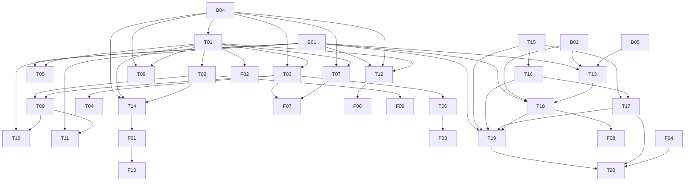

# Master Workspace Audit & 35-Task Implementation Roadmap

**Audit date:** 2026-11-06 · **Workspace:** `/home/robertsrff/Chemistry_Med/Chemistry_5` · **Mode:** inspect, verify, plan; no production edits.  
**Evidence vocabulary:** `[TESTED]` commands actually executed in this audit; `[INSPECTED]` content directly read; `[INFERRED]` interpretation from inspected structure; `[UNVERIFIED]` check not run or not conclusive. Historical evidence is explicitly labelled historical.  
**Citation provenance:** `[TEXT-VERIFIED]` supporting text directly opened; `[METADATA-VERIFIED / SCOPE-ALIGNED]` bibliography metadata and scope checked, underlying concept supported by accessible primary literature, textbook passage not claimed as read.

## Section 1 — Executive Decision Brief & First-Principles Workspace Profile

### Decision

The workspace is a mature, self-contained Latvian medical-chemistry study document with unusually strong source provenance, deterministic data ownership, numerical checks, print workflows, and a broad test harness. It is not ready for an architectural modernization pass under its own R3 contract: the shipped inline runtime is 121,642 B / 2,263 lines (UTF-8 bytes; newline count + 1, directly measured in the current master), far above the 4,096 B / 100-line / 2% cap; 77 inline `style` attributes remain; the stylesheet lacks the required cascade layers; and the proposed `verify_architecture.py`, HTML conformance gate, and TypeScript source are absent. The next implementation work should protect scientific integrity while reducing the runtime, then resolve source conflicts and strengthen release gates. Current checks in `CHECKS.md` describe a saved PASS snapshot; they are not fresh acceptance evidence for this audit.

### Discovered profile

| Dimension | Live finding and evidence |
|---|---|
| Primary discipline | Chemical kinetics and catalysis in medical chemistry: reaction rates, rate laws/order, Arrhenius behavior, mechanisms, homogeneous/heterogeneous catalysis, enzyme kinetics and inhibition. Scope is named in `AGENTS.md` §§1,3,5 and the six course PDFs. `[INSPECTED]` |
| Secondary fields | Biochemistry (enzyme mechanism), pharmacology/pharmacokinetics (appendix bridges), quantitative laboratory analysis/statistics, Latvian scientific language, accessibility and offline document engineering. Clinical examples are explicitly supplemental and conditional. `[INSPECTED]` |
| Learner/curriculum | RSU medical-chemistry topic 5; intended for medical students. Course outcomes and required lab work are in `5. temata apraksts.pdf`; prerequisites include logarithms, exponentials, line slopes, dimensional analysis and basic concentration reasoning, scaffolded in Appendix A. The exact year/semester and exam format are not established by this audit. `[INSPECTED]` / `[UNVERIFIED]` |
| Language and notation | Latvian is the instructional language; English appears in bilingual term cards and selected names. Formal notation includes SI/chemical units, reaction equations, logarithms/exponentials, derivatives, subscripts/superscripts, Greek symbols, kinetic parameters (`k`, `K_M`, `v_max`, `k_cat`, `E_a`), and HTML/SVG/JS/Python syntax. Preserve Latvian diacritics, decimal comma in prose, decimal point in data, NBSP before units, U+2212, and source notation when quoted. `[INSPECTED]` |
| Runtime architecture | One canonical offline HTML file (`Master_5_tema_kinetika_un_katalize.html`) embeds CSS, JS, SVG and content. Python tools generate/verify sections from JSON/CSV/Markdown sources. There are no live external URLs reported in historical link checks; no external scripts are allowed. The browser path is file-based/offline. `[INSPECTED]`; external URL count in `CHECKS.md` is historical. |
| State and persistence | Instrument logic is largely in one inline script. Read-only inspection finds `initInstrumentHash` serializing instrument inputs into URL fragments; `initReportMode` creates a downloadable report; `initDrill` grades radio answers; and numerous calculator handlers update outputs/SVG. This is not a complete verified trace of every control. Local storage use and URL hash persistence are architectural risks to reconcile with R3’s prohibition. `[INSPECTED]` |
| Current strengths | 18 chapters, 36 tables, 82 `<svg>` elements, 124 `
`, 11 active `.instrument` roots with 11 `<noscript>` notes, plus static `#instr-inhib.curve-drill` (12 `instr-*` IDs total), governed `termbase.json` / `numbers.json`, a six-PDF source register, clear source-vs-correction labelling, extensive generated content, and many static/dynamic checks documented in `CHECKS.md`. `[TESTED]` counts are direct regex/count observations except that `<noscript>` count and instruments use naïve pattern counts; see Section 2. |
| Top systemic risks | (1) runtime size and maintainability; (2) governance mismatch at time of audit: `AGENTS.md` is 25,365 B, above its 24,576 B hard maximum; (3) conflicting state/check snapshots; (4) unresolved K10/K17/L1 and clinical source support; (5) no fresh visual, print, cross-browser, or assistive-technology evidence in this audit. |
| Inspection limits | No full PDF page-by-page extraction or full 415-file reading was performed. Source prose, code paths, manifests, representative generators and ledgers were inspected; all workspace files were inventoried by `rg --files`. Visual capture not yet run. No screen reader, Firefox/Safari, narrow/tablet theme matrix, or timed learner study was run. `git status` is expected to fail per governance because no `.git`; this audit did not run it. |

### Immediate Wave 1 decisions

1. Resolve real state drift by rerunning `tools/build_state.py` in a demonstrably read-only mode only after inspecting its behavior, then reconcile current metrics in `STATE.md` and `AGENTS.md`; do not assume existing records are synchronized.
2. Keep the strict R3 JS contract. Build architecture and HTML gates before refactoring so each deletion/migration is measurable.
3. Start with source-conflict dossiers K10, K17 and L1, retaining the printed course statement beside any correction and requiring lecturer confirmation where the worksheet/key intent is unknowable.
4. Audit input-to-output and hash-state paths for all instruments; move native disclosure/mode behavior to HTML/CSS and leave only justified arbitrary-input arithmetic in the approved R2 hook.
5. Capture baseline falkon/falkon screenshots and a reproducible print pass under the local protocol; the current saved Chrome-based reports are historical evidence only and Chrome is disallowed by the supplied workspace policy.

## Section 2 — Workspace, Architecture & Skills Inventory + File-by-File Inspection Ledger

### Topology and inspected coverage

`Master_5_tema_kinetika_un_katalize.html` is the only live root master; 20 root `*.bak.html` files and eight archived `preF*` masters are historical snapshots. There are six course PDFs, governed term/number/inhibition data, 69 files in `tools/`, 12 direct files plus 15 fixtures in `verify/` (directory-level counts depend on inclusion), 36 physical workspace skill packages, and no standalone `.svg` files. The master’s figures are inline. `ts/`, `tsconfig.json`, and `pyproject.toml` are declared absent in the supplied governance. `[INSPECTED]` / `[TESTED]` inventory commands.

The skill collection is a reference corpus, not proof that a skill was executed. Most relevant for later implementation are `cognitive-deload-auditor`, `interactive-study-guide`, `learn-then-test`, `svg-spatial-occlusion`, `mook-visual-compendium`, `print-css-alchemist`, `pdf-vector-surgeon`, `synoptic-matrix-architect`, `state-scrubber-lab`, `lexicon-morphology-weaver`, `blueprint-spec-sheet`, `audit`, `break-ui`, `impeccable`, `design-taste-frontend`, and `review-animations`. Their integration requirements are not a license to install or run every bundled tool. This audit actively followed the cognitive-deload skill’s read-only review boundary and the workspace lite-shot visual contract.

### Inspection ledger

| File / asset path | Role | Content inspected? | Render/runtime tested? | Key evidence / finding | Coverage limit |
|---|---|---|---|---|---|
| `AGENTS.md` | Governing R3 architecture, issue ledger, source authority | Full supplied text + targeted on-disk checks | No | Hard max 24,576 B; actual `ls` size 25,365 B. Lists A01–A22 and old snapshot metrics. | Full local file not reread top-to-bottom beyond supplied instructions and targeted lines. |
| `Master_5_tema_kinetika_un_katalize.html` | Canonical offline study document | Partial: structural searches, script wiring and selected markup | Not yet | 1,556,007 B, 7,465 lines, SHA-256 `3528884dc2c1251c7c093024b5deac4f4d2eec106b524e50ee29c0c8c2629b14` from direct hash; 82 SVG tags, 77 inline styles, 3 script tags, 11 noscript tags, 36 tables, 124 details, 67 listener calls, 125 function declarations. | No complete prose read; no finished runtime/visual test in this audit. |
| Six PDFs: `5. temata apraksts.pdf`; `Kinetika.pdf`; `Kinetika_Katalize_2020.pdf`; `5LW_MCh_Kinetics_2025_LV.pdf`; `5LD_Kinetics_Laboratorijas_darbs_Atbildes_2026.pdf`; `MU_Kin_1_2015_cAB.pdf` | Scope, lecture, slide deck, lab sheet/key and question set | Metadata and `SOURCES_AUDIT.md` references; not full text | No | `pdfinfo`: 1, 18, 31, 4, 5 and 2 pages respectively. | No OCR/text extraction or page image inspection now; source claims remain limited to existing provenance ledger. |
| `DESIGN.md` | Design, typography, print and accessibility rationale | Partial; headings, F10 and test notes read | No | Captures design rationale and past QA; includes historical Chrome-specific checks and proposals. | Not every design decision revalidated against current master. |
| `CHECKS.md` | Saved verification transcript/report | Partial, summary and harness sections | No fresh rerun | Reports 23 static + 4 dynamic suites PASS and heuristic failures defended. | Hash-bound historical report; not current acceptance. Some counts conflict with direct count/current STATE. |
| `SOURCES_AUDIT.md` | Claim/source conflict ledger | Partial: K10, K17, L1 and selected resolution notes | No | K10 unit/value uncertainty, K17 example unresolved, L1 MnO₂ identity vs course key; explicit source/correction separation. | Full claims not re-opened against PDFs this run. |
| `STATE.md` | Generated workspace snapshot | Full | Not regenerated | Says 1,021 unique IDs and 12 `instr-*` IDs; master hash matches direct hash. A direct parser finds 1,011 unique IDs, 11 `.instrument` roots and one static `#instr-inhib` drill. | The remaining 1,021-vs-1,011 ID discrepancy is unresolved; likely terminology explains 12-vs-11 instruments. `build_state.py --check` not run. |
| `CHANGELOG_BUILD.md` | Build provenance/history | Partial via heading and feature excerpts | No | Records F01–F10 and prior QA claims; previous JS cap was raised above runtime, then R3 revoked approvals. | Full chronology not reconciled line by line. |
| `PLAN_20_uzdevumi_kinetika_uzlabojumi.md`, `PROMPT_master_kinetika.md` | Historical plan and build prompt | Partial headings and scope clauses | No | `AGENTS.md` explicitly marks these historical/superseded; they contain earlier task/feature decisions. | Not treated as authoritative or current approval. |
| `termbase.json`, `glossary.json/.csv`, `notation.md`, `numbers.json`, `inhib_presets.json`, `provenance_inventory.csv`, `language_log.md`, `numbers_report.md` | Governed source data and evidence logs | Partial/metadata and links | No | Single-source intentions are documented; `AGENTS.md` notes five ungoverned clinical terms (A19). | Individual records not exhaustively revalidated. |
| `tools/*.py`, `tools/*.mjs` (69 files) | Builders, numerical logic, visual and content verification | Inventory + selected call-site review | No commands run | Generator families include numbers, figures, glossary, instruments, print map, fonts and audits. `build_numbers.py --check` may write per governance; inspect first. | No universal file-by-file source audit; saved `CHECKS.md` does not substitute. |
| `verify/*.py`, `verify/fixtures/*` | Orchestration and negative fixtures | Inventory + `CHECKS.md` fixture table | No fresh run | Existing checks cover links, tables, text, numbers, provenance, terms, print and specific features. Architecture and HTML-conformance gates are target gaps. | Fixture behavior not rerun. |
| `workspace_skills/` (36 `SKILL.md`) | Local implementation reference corpus | Index and relevant skill text | Not executed except cognitive-deload instructions read | Collection includes study-guide, SVG, print, editorial and accessibility workflows; no standalone SVG assets found. | Not all 36 manifests were opened. |
| `archive/`, root `*.bak.*`, `tools/*.bak.*` | Historical snapshots and superseded generators | Inventory only | N/A | Snapshot clutter and no VCS are recorded as A21; preserve until manifest/history strategy is approved in production pass. | No content comparison/dedup run. |
| `.claude/settings.local.json`, `.qoder/settings.local.json`, `.impeccable/` | Local agent/tool configuration | Full JSON settings read; `.impeccable/` directory checked | N/A | Claude/Qoder settings contain local Bash allowlists; no nested `AGENTS.md`, `CLAUDE.md` or `QODER.md` found by hidden-file inventory. `.impeccable/` was empty. | Allowlist commands are configuration, not evidence that PDF extraction or skills were executed. |
| `fonts/` | Embedded font sources/licences | Inventory only | No | Font embedding is recorded in A22. | Licence blocks/coverage not reread. |

### End-to-end workflow map (static inspection)

| Workflow | Trigger → handler | State/calculation → persistence | View update | Evidence and confidence |
|---|---|---|---|---|
| Numeric instruments | `#instr-*` inputs → `initDistribution`, `initUnit`, `initDose`, `initArrhenius`, `initProfile`, `initOrder`, `initMM`, `initLab` listeners around lines 5826–6870 | Calculator local variables; `initInstrumentHash` reads/writes URL fragment around 6877–6897; persistence policy conflict with R3 | Outputs, plot SVG paths, status text, reset buttons | Static trace from function names and listener statements; full trace for every input not verified. `[INSPECTED]` |
| Self-check / drill | Radio inputs and `button.mc-check` → `initDrill` around 6989–7058; open/reveal controls → `initSelfCheck` around 6929–6985 | Score/selection in DOM; no durable progress is intended by R3; `initInstrumentHash` may serialize instrument values | Details open state, feedback text, exam mode | Static trace; behavior not freshly executed. `[INSPECTED]` |
| Diagnoser | Select change → `initDiagnoser` around 5747–5764 | Selection maps to local result | Answer and linked defect row | Static trace. `[INSPECTED]` |
| Document tools | Buttons `#doc-open-all`, `#doc-close-all` → `initDocTools` 6909–6926 | Mutates `
.open` | Disclosure state | Static trace, dynamic unverified. `[INSPECTED]` |
| Report export | Report-mode action → `initReportMode` 5731–5746 | Builds downloadable data URL/blob; revokes object URL | Download link | Static trace; privacy/offline behavior not runtime tested. `[INSPECTED]` |
| Static recall features | Native `
`, radio/checkbox plus `:checked` / `:target` | Browser-native transient state, no storage intended | CSS visibility / disclosure | Pattern inspected in `DESIGN.md`; current browser support and print behavior unverified. |

## Section 3 — Diagnostic Triage: Confirmed Defects vs. Suspected Risks vs. Opportunities

| ID | Class | Finding | Evidence | Immediate handling |
|---|---|---|---|---|
| D01 | Confirmed contract violation | Inline JS exceeds R3 cap by approximately 29.7× bytes and 22.6× lines; 125 functions / 67 listener calls are in the live master. | `AGENTS.md` A01; direct parser measured 121,642 script bytes and newline-count+1 2,263 lines; function/listener grep returned 125/67. `[TESTED]` | Add architecture gate before refactoring; reduce in staged migrations. |
| D02 | Confirmed contract violation | 77 inline `style` attributes, no `@layer` evidence in live CSS summary, 60 `!important` are recorded by A09/A10. | Master regex and `AGENTS.md` A09/A10. `[TESTED]` inline style count; CSS counts historical from R3. | Migrate inline size vars to generated classes and layer CSS. |
| D03 | Confirmed governance budget violation | `AGENTS.md` is 25,365 B at inventory time; hard limit is 24,576 B. | `ls -la`; supplied §11. `[TESTED]` | Compact records only after this roadmap is saved; this audit itself does not edit AGENTS. |
| D04 | Snapshot conflict | `STATE.md` (1,021 unique IDs) and `CHECKS.md` (1,011 IDs) disagree; direct parser finds 1,011 unique IDs. The 11-vs-12 instrument count is explained by 11 `.instrument` roots plus static `#instr-inhib.curve-drill`. | Read of both records; parsed all IDs and instrument roots. `[TESTED]` | Reconcile the remaining 10-ID state discrepancy; define active instrument vs `instr-*` anchor consistently. |
| D05 | Confirmed open source conflict | K10 course value/unit, K17 induced-reaction example, and L1 MnO₂ course-key intent remain unresolved or only partly resolved. | `AGENTS.md` A15; `SOURCES_AUDIT.md` lines 44, 51, 63, 76–80. `[INSPECTED]` | Preserve source, correction, and reason separately; ask lecturer only where source intent cannot be established. |
| D06 | Risk / unverified | Clinical pharmacokinetic and inhibitor statements refer to book leads without opened supporting sections. | `AGENTS.md` A18/A19 and `SOURCES_AUDIT.md`. `[INSPECTED]` | Qualify model assumptions; verify named sections or narrow claims. |
| D07 | Risk / unverified | Existing saved visual/browser/print/accessibility evidence is not a current audit rerun and uses Chrome where the present local visual policy forbids it. | `CHECKS.md`; `VISUAL_VERIFICATION.md`. `[INSPECTED]` | Run lite-shot and the authorized checks in the implementation pass; no browser claim before screenshot inspection. |
| D08 | Diagnostic investigation | Potential selectors, URL-hash persistence, output completeness, and reset behavior across 12 instrument IDs have not been tested end-to-end in this audit. | Static JS event traces; contradictory counts. `[INFERRED]` | B01/B02 tests must provide control→handler→state→render coverage before deletion. |
| D09 | Opportunity | Existing recall coverage is extensive but cognitive-deload rubric requires a deduplicated key-concept denominator before judging coverage. | 18 chapters, 39+ source questions reported by `CHECKS.md`; denominator not computed. `[INSPECTED]` / `[UNVERIFIED]` | Build a concept inventory and calculate only verified, meaningful retrieval opportunities. |
| D10 | Opportunity | 82 SVG tags include two alternate hero figures and generated/static instrument plots; content figures need a per-figure inventory tied to concepts and accessibility checks. | Direct tag count; `AGENTS.md` A14; `DESIGN.md` N20 history. `[TESTED]` count / `[INSPECTED]` records. | Use fig IDs / titles as inventory keys; do not call visual accuracy verified from DOM. |

**Honesty rule:** no reproducible interaction or factual defect was independently confirmed by running the live document during this pass. Accordingly, B01–B05 are scoped as diagnostics or conditional fixes except where the architecture/budget violation is directly established. Do not label a suspected broken control as a confirmed bug.

## Section 4 — Domain Terminology, Fact, Applicability & Warrant Verification Ledger

| Claim ID | Location | Existing workspace claim | Status | Applicability / warrant analysis | Authority | Confidence | Proposed handling |
|---|---|---|---|---|---|---|---|
| C01 | ch.1; `AGENTS.md` §3 | A measured rate may be called “reaction rate” | Over-simplified if no intermediate/side-product constraints | IUPAC’s normalized rate definition assumes constant volume and no appreciable intermediate buildup; otherwise name measured disappearance/appearance rate. This distinction matters in stepwise kinetics and the thiosulfate clock. | IUPAC Gold Book R05156 `[TEXT-VERIFIED]` | High | State the observed species and normalization; reserve general reaction rate for conditions that warrant it. |
| C02 | ch.2–3 | Rate-law exponents equal stoichiometric coefficients | Inaccurate as a general rule; workspace governance correctly distinguishes order and molecularity | Exponents are empirical for an overall reaction; stoichiometric equality is justified for an elementary step or a stated mechanism, not inferred from balanced overall equation. | IUPAC Gold Book O04322 `[TEXT-VERIFIED]`; course lecture as scope `[UNVERIFIED this pass]` | High | Keep explicit elementary-step boundary; include counterexample or source-backed prompt. |
| C03 | ch.6 | Half-life / first-order relation | Verified only under first-order decay model and constant conditions | `t½ = ln 2/k` follows from first-order integrated law; it is not a universal concentration-independent half-life for all orders. | IUPAC rate/order terminology `[TEXT-VERIFIED]`; quantitative derivation is standard and locally represented in `numbers.json` `[INSPECTED]` | High | Always name order and model; add non-first-order contrast. |
| C04 | ch.8 / hero SVG | Catalyst lowers activation barrier, preserves reactant/product energy difference | Verified as an explanatory pathway model, conditional on comparable pathway and same endpoints | A schematic barrier is not quantitative proof for a specific catalyst; equilibrium composition is unchanged for a catalyst that accelerates forward and reverse pathways without changing thermodynamics. SVG’s `desc` states same endpoint levels. | Course master SVG inspected; IUPAC catalyst entry in audit registry, not re-opened here | Medium-high | Keep “schematic, not to scale”; check reverse path and mechanistic caveats in source audit. |
| C05 | ch.10–11 | Michaelis–Menten hyperbola and `K_M`, `v_max`, `k_cat` interpretation | Over-simplified unless initial-rate, substrate-excess / quasi-steady-state or suitable rapid-equilibrium assumptions are stated | Briggs–Haldane explicitly considers `E + S ⇌ ES → E + P`, with enzyme small relative to substrate/product and quasi-steady ES after initial transient. `K_M` need not equal binding affinity generally. | Briggs & Haldane 1925, full text `[TEXT-VERIFIED]`; Lehninger 7e metadata/scope `[METADATA-VERIFIED / SCOPE-ALIGNED]` | High | Attach assumptions to derivation; distinguish `K_M` from `K_d`; report active enzyme concentration convention for `k_cat`. |
| C06 | ch.11 / presets | Competitive, uncompetitive, mixed, “noncompetitive” inhibition patterns | Over-simplified if pure noncompetitive is presented as the only meaning of noncompetitive | Textbooks often define pure noncompetitive as special mixed inhibition where substrate and inhibitor affinities to E and ES are equal; observed model and assay conditions matter. Preset curves demonstrate parameter patterns, not biochemical identification in every system. | Local `inhib_presets.json` + `verify_inhibition.py` historical checks `[INSPECTED]`; textbook passages not opened | Medium | Label idealized models and avoid diagnosing real inhibitor mechanism from one plot alone. |
| C07 | ch.12 / lab table 12 | Thiosulfate lab slope equals first-order rate constant | Warrant flaw / explicitly rejected by `AGENTS.md` | Independent-tube endpoint measures reciprocal time proxy; regression of `ln(1/t)` vs `ln C` estimates order under a common endpoint assumption, not a time-course first-order `k`. The rate proxy and dimensions differ. | Course lab PDFs available but not text-read here; `AGENTS.md` §3 directly sets this boundary `[INSPECTED]` | High for governance rule; source values unverified | Keep course method, independent-tube meaning, slope interpretation, assumptions and uncertainty adjacent. Reopen source pages before content changes. |
| C08 | ch.12 / Table 12 K10 | Catalase activation energy “23 J mol⁻¹” or candidate values | Disputed / unverified source item | A unit mismatch of J vs kJ changes magnitude by 1000; public literature measurements from different organisms, pH, temperature ranges, assays do not prove the course specimen’s value. `SOURCES_AUDIT.md` documents 12.9 ±0.7 and cited 19.7/23.5 kJ mol⁻¹ values, but exact course value remains unknown. | Miłek 2018 record and open text reported by `SOURCES_AUDIT.md`; not independently re-opened; bibliographic record must be refreshed before implementation. | Medium | Preserve printed value exactly as source; mark suspected unit error; do not substitute a literature value for missing course data. Ask lecturer to confirm intended unit/value. |
| C09 | ch.7 / K17 | Actor–acceptor–inductor terminology and example | Unverified / disputed | Mechanism-specific terms are school-/source-dependent; keyword overlap in textbooks is insufficient to validate the same example. Relevant book pages are unopened per source audit. | Laidler; Silbey–Alberty–Bawendi leads listed locally, not text-verified | Low-medium | Keep course statement labelled; do not present the canonical example as independently verified until cited passage and reaction conditions are checked. |
| C10 | lab L1 | Catalyst is MnO₂ vs MnO | Chemistry identity plausible, course-key intent unverified | MnO₂ is manganese(IV) oxide; redox equation, catalyst role, and actual reagent identity are different warrants. Correct formula depends on observed reagent and course source, not just a chemistry lookup. | IUPAC Red Book lead in local audit, not opened this pass | Medium | Confirm worksheet/key scan and lecturer intent; keep formula, oxidation state, and reaction evidence distinct. |
| C11 | Appendix A / `#appA-*` | Most listed drugs follow first-order elimination | Unverified, broad generalization | First-order elimination can be a useful one-compartment approximation over a concentration range; saturation, route, multi-compartment distribution, and drug-specific kinetics limit generalization. | Rang & Dale 9e / Goodman & Gilman 13e topic leads only; exact sections not opened | Low-medium | Rephrase as a model assumption or selected-drug example; source individual claims. |
| C12 | Appendix A / F06 | Repeated-dose accumulation and 4–5 half-life rule | Verified as idealized one-compartment, linear, first-order, regular dosing approximation; not universal | Accumulation factor depends on dosing interval and elimination constant; time to near steady state depends mainly on half-life for linear kinetics. It does not predict nonlinear/saturable kinetics or clinical dosing safely by itself. | Local derivation described in `SOURCES_AUDIT.md`; not freshly recalculated | Medium-high | Label as teaching model, state instantaneous absorption/one compartment/first-order assumptions; keep clinical disclaimer proportional and factual. |
| C13 | SVGs | Curve/axis/labels communicate scientific relationships | Unverified visually | Source geometry and accessible `title/desc` can be inspected, but visual proportions, clipping, theme and print need rendered screenshots. | Local SVG source; lite-shot required by workspace | Unknown | Do not mark figure `[RETAIN]` from markup alone; capture at desktop/mobile and print. |

## Section 5 — Authoritative Book, Standard & Literature Bibliography

Authority order for this workspace: (1) formal chemical nomenclature/kinetics standards for terms and definitions; (2) primary mechanistic research and reproducible data for specific claims; (3) current university-level biochemistry/physical chemistry/pharmacology texts for synthesis; (4) local course PDFs for scope and expected course response, not infallible factual authority. Applicability is claim-specific.

| Rank | Citation and verified metadata | Relevant scope | Provenance and limit |
|---|---|---|---|
| 1 | IUPAC, *Compendium of Chemical Terminology (the Gold Book)*, online corrected entries: [O04322 “order of reaction”](https://goldbook.iupac.org/terms/view/O04322) and [R05156 “rate of reaction”](https://goldbook.iupac.org/terms/view/R05156); DOI `10.1351/goldbook.O04322`, `10.1351/goldbook.R05156`. | Empirical reaction order, rate normalization, boundary conditions. | `[TEXT-VERIFIED]` O04322 and R05156 pages opened via IUPAC Gold Book. |
| 1 | Briggs, G. E.; Haldane, J. B. S. “A Note on the Kinetics of Enzyme Action.” *Biochemical Journal* 19(2), 338–339 (1925). [Open full text](https://pmc.ncbi.nlm.nih.gov/articles/PMC1259181/); DOI `10.1042/bj0190338`; PMCID PMC1259181. | Enzyme-substrate scheme and quasi-steady-state argument. | `[TEXT-VERIFIED]` open full text / PMC; text states reaction scheme and small-enzyme condition. |
| 2 | Nelson, D. L.; Cox, M. M. *Lehninger Principles of Biochemistry*. 7th ed. W. H. Freeman / Macmillan Learning, 2017. [NLM catalog record](https://www.ncbi.nlm.nih.gov/nlmcatalog/101703862). ISBN 9781319108243 (also 9781464126116 edition record). | Chapter 6 enzyme kinetics and catalytic principles; chapter/topic scope verified in catalog. | `[METADATA-VERIFIED / SCOPE-ALIGNED]` NLM catalog lists edition, year, publisher, ISBN; no textbook passage opened. |
| 2 | Rang, H. P.; Dale, M. M.; Ritter, J. M.; Flower, R. J.; Henderson, G. *Rang & Dale’s Pharmacology*. 9th ed. Elsevier, 2019. [Publisher record](https://www.us.elsevierhealth.com/rang-dales-pharmacology-9780702074462.html). ISBN 9780702074462 (print listing); ISBN 9780702074486 also appears for another format. | Pharmacokinetics/elimination and pharmacological enzyme inhibition. | `[METADATA-VERIFIED / SCOPE-ALIGNED]` Elsevier publisher record confirms edition, authors and ISBN; course audit identifies chapter topic. No chapter passage opened. |
| 2 | Brunton, L. L.; Hilal-Dandan, R.; Knollmann, B. C., eds. *Goodman & Gilman’s The Pharmacological Basis of Therapeutics*. 13th ed. McGraw-Hill Medical, 2018. [NLM catalog](https://www.ncbi.nlm.nih.gov/nlmcatalog/101708739). ISBN 9781259584732 (hardcover; other formats have distinct ISBNs). | Pharmacokinetics is cataloged; drug biotransformation/inhibition are topic leads, but exact supporting sections were not opened. | `[METADATA-VERIFIED / SCOPE-ALIGNED]` edition, editor list, publisher, year and ISBN verified by NLM; no supporting passage opened. Do not use as a verified claim citation. |
| 3 | Laidler, K. J. *Chemical Kinetics*. 3rd ed. Harper & Row, New York, 1987. [Library catalog](https://elib.must.ac.ug/bib/7159). ISBN 0-06-043862-2 is reported in secondary bibliographies but was not verified against a catalog record here. | General reaction kinetics; exact K17 section and example remain unverified. | `[METADATA-VERIFIED / SCOPE-ALIGNED]` edition/year/publisher verified in catalog; ISBN and K17 passage not verified. Do not attach it to a claim yet. |
| 3 | Silbey, R. J.; Alberty, R. A.; Bawendi, M. G. *Physical Chemistry*. 4th ed. John Wiley & Sons, Hoboken, 2005. [University library catalog](https://catalog.ku.edu.kw/record%3Db1143516). ISBN 0-471-21504-X. | Undergraduate physical chemistry, including reaction kinetics; exact induced-reaction section and K17 example remain unverified. | `[METADATA-VERIFIED / SCOPE-ALIGNED]` edition/year/publisher/ISBN verified in catalog; no supporting passage or page is claimed. |
| 4 | Six local course PDFs listed in Section 2. | Curriculum scope, source statements, laboratory expected answers. | `[METADATA-VERIFIED / SCOPE-ALIGNED]` page counts verified; actual passage citations in existing source audit are not re-opened this run. |

### Claim-to-source warrant rules

A bibliography entry does not establish every claim in its subject area. Each future correction must name: system and measurement; model/regime; assumptions; source passage or data; whether the source establishes the entire conclusion; and remaining uncertainty. No textbook page numbers or quotations may be added unless directly read. A literature measurement for catalase from a different organism/assay is context, not a replacement value for the course experiment.

### Claim-to-package traceability

| Claim IDs | Owning package(s) | Scope boundary |
|---|---|---|
| C01 | T04, T14 | Measured species/rate normalization; retrieval coverage. |
| C02 | T03, T07, F07 | Empirical order vs elementary-step law and mechanism warrant. |
| C03 | T06, F05 | Order-dependent half-life; assumptions visible at use site. |
| C04 | T08, T15, F05 | Catalyst pathway/unchanged endpoints; visual verification remains pending. |
| C05 | T09, T10, F05 | Briggs–Haldane conditions, parameter meanings and scope labels. |
| C06 | T11, F05 | Idealized inhibition parameters; no direct diagnosis from plot alone. |
| C07 | T12, B04 | Independent-tube endpoint, log-log slope and non-equivalence to first-order k. |
| C08–C10 | T01, T12, B04 | K10/K17/L1 source intent, separate from general literature plausibility. |
| C11–C12 | T02, T05, F06 | Clinical terminology and idealized pharmacokinetic model assumptions. |
| C13 | T04, T07–T12, T17, F04 | SVG text/curve correspondence; render gate is still unverified. |
## Section 6 — Editorial Design, Retexturing, Accessibility, Pedagogy & Complete SVG Inventory

### Editorial and learning audit

The live direction is already restrained and data-bearing: a five-size type scale, explicit plot line/marker conventions, source/correction tags, a figure index, and print-focused rules are documented in `DESIGN.md`. Keep those investments. The main editorial risk is not a generic “AI look” claim; this audit did not render and therefore makes no screenshot-based slop judgement. Concrete engineering targets are the overgrown runtime, inline style attributes, rule-layer debt, and long-form material where meaningful prose/recall coverage has not been counted against a deduplicated concept inventory. The cognitive-deload skill requires counts and visual checks before making claims about prose walls, scanability, contiguity or retrieval coverage.

| Design/pedagogy dimension | Baseline evidence | Roadmap direction |
|---|---|---|
| Typography and measure | `DESIGN.md` documents five sizes, embedded fonts, and a reading measure; no current screenshot inspected. | T15/T16 measure actual 60–75ch prose width at desktop and mobile; preserve embedded-font licence/source record. |
| Semantic colour and surface | `DESIGN.md` documents semantic colours, line dashes, markers and hatches; contrast test is a past report. | T15 semantic token ownership, WCAG recomputation per theme, non-colour series encoding and grayscale/forced-colours. |
| AI-slop patterns | No current visual verdict. Historical linter reported heuristic FAILs; `CHECKS.md` defends them. | Inspect each flagged pattern in falkon capture; retain any mark that communicates status, provenance, or data. T15 only removes non-semantic decoration after evidence. |
| Pedagogical scaffolding | Appendix A contains logarithm/exponential, slope/regression and unit bridges; 18 chapters are mapped. | T02–T06 sequence prerequisites to use; each derivation ties equation, graph, physical meaning and boundary. |
| Retrieval | `CHECKS.md` historically reports 39 source + 3 extra self-check questions, 49 answers and 72 term cards. | T14 builds a concept denominator and only credits checkable retrieval with feedback; do not count reveals as assessment. |
| Accessibility / no-JS | 11 `<noscript>` occurrences by count, 124 details, static fallbacks described in files. | T18/T19 test keyboard and no-JS workflow; AT listening test stays open until performed. |
| Print | `CHECKS.md` has saved PDF page counts and warnings; current render not done. | T20 uses local print QA, reports engine/pages, checks stranded headings, table/figure clipping, expanded answers and grayscale. |

### SVG inventory and status blueprint

The workspace has **82 inline `<svg>` elements** and no standalone `.svg` files. The figure index in master lines 4259 onward names 26 pedagogical plates and 11 instrument/statics references; duplicate wide/compact hero and static/runtime alternatives explain why SVG-element count is not the same as concept-figure count. Existing master `fig-id`/caption map should be treated as the canonical inventory key. `[INSPECTED]` structural inventory; `[UNVERIFIED]` conceptual/visual correctness until each image is captured and compared with its text and source.

| Figure group (canonical index / selector) | Concept and chapter | Audit classification | Blueprint / risk / ownership |
|---|---|---|---|
| `#fig-1`–`#fig-2`, `#instr-dist` | Catalyst energy profile and Maxwell–Boltzmann distributions, ch.4 | [RETAIN pending render] | Same endpoints and ΔH; barrier is schematic; threshold region and temperature change need non-colour labels, correct tails and print contrast. T08. |
| `#fig-4`–`#fig-5`, `#instr-order` | Half-life / reaction order, ch.6 | [CORRECT if needed] | Show zero/first/second order curves and t½ dependence only under stated rate law; axes and concentration units; T06. |
| `#fig-7`, `#instr-chain` | Chain reactions, ch.7 | [RETAIN pending claim review] | Distinguish unbranched propagation from branching; arrows must not imply conservation where chain carrier count grows. T07. |
| `#fig-8`, `#instr-cyc`, `#instr-path` | Enzyme fit/cycle/inhibition, ch.9–10 | [REDESIGN candidate] | Do not reduce enzyme specificity to literal lock/key; induced fit and reversible steps need explicit legend; inhibition binding state must match model. T09/T10. |
| `#fig-9`–`#fig-11`, `#instr-mm` | Michaelis–Menten and inhibition plots, ch.10–11 | [CORRECT / RETAIN per generated data] | Verify limits, half-max `K_M`, intercepts and units; identify idealized model; Lineweaver–Burk emphasizes reciprocal-error amplification as a caveat. T10/T11. |
| `#fig-12`, `#instr-lab` | Thiosulfate experiment and analysis, ch.12 | [REDESIGN candidate] | Three panels must keep course method, independent-tube interpretation and valid `ln(1/t)` vs `ln C` analysis visibly distinct; never label slope as first-order `k`. T12. |
| `#fig-16`–`#fig-18`, `#fig-26` | Secant/tangent, heterogeneous delivery, elementary vs overall step, collision orientation, ch.1–4 | [RETAIN pending render] | Axis sign/slope and sequence topology; elementarity must not be inferred from balanced net equation; orientation schematic not quantitative. T03/T04. |
| `#fig-19`–`#fig-20`, `#instr-arrhenius` | Arrhenius relation and two estimates, ch.5 | [RETAIN pending recomputation] | Kelvin and reciprocal-temperature units; compare two-point estimate only over a regime where Arrhenius behavior is reasonable. T05. |
| `#fig-21` | Half-life vs initial concentration, ch.6 | [RETAIN pending generated-data check] | zero/first/second order qualitative trends with correct units and finite domains. T06. |
| `#fig-22` | Heterogeneous catalyst surface cycle, ch.8 | [REDESIGN candidate] | Adsorption → surface reaction → desorption; surface sites and rate-limiting step are explanatory, not universal single sequence. T08. |
| `#fig-23` | Product progress and initial-rate tangent, ch.10 | [RETAIN pending curve check] | Distinguish initial rate from later rate and substrate depletion; tangent must match curve. T10. |
| `#fig-24` | Lineweaver–Burk inhibition lines, ch.11 | [CORRECT pending exact preset review] | Axis intercepts/slopes must follow declared ideal model; note reciprocal transform weights low-substrate errors. T11. |
| `#fig-25` | Thiosulfate clock apparatus, ch.12 | [RETAIN pending render/source check] | Beaker/tile/endpoint geometry must not invent a reagent, safety step, or observation. T12. |
| `#hero` wide + compact | Master energy profile | [RETAIN pending screen and print] | Two independent layouts; verify labels and shared definitions. Mobile compact is not evidence of responsive scaling. T15/T17. |
| Remaining inline instrument/static plots and decorative/semantic SVGs | 82 SVG elements total; exact node-to-index mapping is a future parser task. | [UNVERIFIED] | Enumerate each `svg` by nearest `figure`, title and `id`; classify [RETAIN]/[CORRECT]/[REDESIGN]/[REPLACE]. Add new SVG only for a documented misconception and no existing figure can serve it. |

### Element-level inline SVG inventory (all 82 elements)

`SVG-01` shared pattern definitions and `SVG-75`–`SVG-80` color-role swatches are structural/non-content elements; content plots/schemes have titles. This is a DOM inventory, not a visual pass. Classification decisions above remain pending screenshot inspection.

| Index | Master line | DOM id | Class | viewBox | Inline title | Provisional disposition |
|---:|---:|---|---|---|---|---|
| SVG-01 | 1113 | `—` | `shared-defs` | `—` | No inline `<title>`; decorative/support element | [RETAIN] structural/data-role reference; not a standalone content plate |
| SVG-02 | 1145 | `—` | `hero-wide` | `0 0 880 330` | Enerģijas profils ar un bez katalizatora | [RETAIN] pending screenshot and source/model review |
| SVG-03 | 1145 | `—` | `hero-compact` | `0 0 350 340` | Enerģijas profils ar un bez katalizatora (šaurais skats) | [RETAIN] pending screenshot and source/model review |
| SVG-04 | 1228 | `fig-secant` | `fig-svg` | `0 0 640 390` | 16. attēls. Vidējais un momentānais reakcijas ātrums: sekante un pieskare | [RETAIN] pending screenshot and source/model review |
| SVG-05 | 1248 | `—` | `rail-svg` | `0 0 280 170` | Koncentrācija pret laiku ar pieskari | [RETAIN] pending screenshot and source/model review |
| SVG-06 | 1291 | `fig-pipe` | `fig-svg` | `0 0 640 200` | 17. attēls. Heterogēnas reakcijas trīs secīgie posmi | [RETAIN] pending screenshot and source/model review |
| SVG-07 | 1325 | `—` | `rail-svg` | `0 0 280 170` | Augsta un zema aktivācijas barjera | [RETAIN] pending screenshot and source/model review |
| SVG-08 | 1332 | `—` | `rail-svg` | `0 0 280 170` | Ātrums pret koncentrāciju trim pakāpēm | [RETAIN] pending screenshot and source/model review |
| SVG-09 | 1349 | `fig-elem` | `fig-svg` | `0 0 640 300` | 18. attēls. Elementārstadija pret kopējo reakciju aktīvo masu likumā | [RETAIN] pending screenshot and source/model review |
| SVG-10 | 1383 | `fig-energy` | `fig-svg` | `0 0 1000 410` | 1. attēls. Eksotermiskas un endotermiskas reakcijas enerģētiskās diagrammas ar un bez katalizatora | [RETAIN] pending screenshot and source/model review |
| SVG-11 | 1392 | `fig-collision` | `fig-svg` | `0 0 760 280` | 26. attēls. Sadursmes ģeometrija: produktīva un neproduktīva orientācija | [RETAIN] pending screenshot and source/model review |
| SVG-12 | 1405 | `fig-maxwell` | `fig-svg` | `0 0 1020 420` | 2. attēls. Maksvela–Bolcmaņa enerģiju sadalījums 300 K un 310 K | [RETAIN] pending screenshot and source/model review |
| SVG-13 | 1420 | `fig-fallback-dist` | `fig-svg` | `0 0 680 360` | 3. attēls. Statisks Maksvela–Bolcmaņa sadalījums instrumentam 1 | [RETAIN] pending screenshot and source/model review |
| SVG-14 | 1438 | `dist-svg` | `—` | `0 0 680 380` | Maksvela–Bolcmaņa sadalījums | [RETAIN] pending screenshot and source/model review |
| SVG-15 | 1456 | `—` | `rail-svg` | `0 0 280 170` | Ātruma konstante pret temperatūru | [RETAIN] pending screenshot and source/model review |
| SVG-16 | 1466 | `fig-arrh` | `fig-svg` | `0 0 640 360` | 19. attēls. Arrēniusa sakarības: k pret T un ln k pret 1/T | [RETAIN] pending screenshot and source/model review |
| SVG-17 | 1533 | `fig-gamma` | `fig-svg` | `0 0 760 390` | 20. attēls. Temperatūras koeficients γ un tā atbilstība aktivācijas enerģijai | [RETAIN] pending screenshot and source/model review |
| SVG-18 | 1546 | `—` | `—` | `0 0 640 300` | Arrēniusa taisne ln k pret 1/T ar diviem punktiem | [RETAIN] pending screenshot and source/model review |
| SVG-19 | 1572 | `arr-svg` | `—` | `0 0 680 380` | Arrēniusa grafiks | [RETAIN] pending screenshot and source/model review |
| SVG-20 | 1656 | `fig-decay` | `fig-svg` | `0 0 720 390` | 4. attēls. Radioaktīvo kodolu skaita samazināšanās ar pusperiodu 2 dienas | [RETAIN] pending screenshot and source/model review |
| SVG-21 | 1665 | `fig-halflife-trend` | `fig-svg` | `0 0 760 390` | 21. attēls. Pusperiods pret sākuma koncentrāciju trim reakcijas pakāpēm | [RETAIN] pending screenshot and source/model review |
| SVG-22 | 1676 | `fig-integrated` | `fig-svg` | `0 0 1010 320` | 5. attēls. Trīs reakcijas pakāpju koncentrācijas laika gaita | [RETAIN] pending screenshot and source/model review |
| SVG-23 | 1716 | `fig-fallback-order` | `fig-svg` | `0 0 1040 876` | 6. attēls. Statisks nulles, pirmās un otrās pakāpes skats | [RETAIN] pending screenshot and source/model review |
| SVG-24 | 1733 | `ord-c-svg` | `—` | `0 0 330 260` | Koncentrācija laikā | [RETAIN] pending screenshot and source/model review |
| SVG-25 | 1734 | `ord-ln-svg` | `—` | `0 0 330 260` | Logaritmiskā koncentrācija laikā | [RETAIN] pending screenshot and source/model review |
| SVG-26 | 1735 | `ord-inv-svg` | `—` | `0 0 330 260` | Apgrieztā koncentrācija laikā | [RETAIN] pending screenshot and source/model review |
| SVG-27 | 1761 | `—` | `rail-svg` | `0 0 280 170` | Pirmās pakāpes sabrukšana un pusperiodi | [RETAIN] pending screenshot and source/model review |
| SVG-28 | 1766 | `—` | `—` | `0 0 640 320` | Vienreizēja deva un atkārtotas devas ar pirmās pakāpes elimināciju | [RETAIN] pending screenshot and source/model review |
| SVG-29 | 1778 | `dose-svg` | `—` | `0 0 680 380` | Daudzums laikā: vienreizēja deva un atkārtotas devas | [RETAIN] pending screenshot and source/model review |
| SVG-30 | 1794 | `—` | `—` | `0 0 320 80` | k vienība pēc pakāpes | [RETAIN] pending screenshot and source/model review |
| SVG-31 | 1840 | `fig-chain` | `fig-svg` | `0 0 1060 380` | 7. attēls. Nesarazotas un zarotas ķēdes reakcijas shēma | [RETAIN] pending screenshot and source/model review |
| SVG-32 | 1850 | `fig-chain-cycle` | `fig-svg` | `0 0 1040 440` | 13. attēls. Nesarazotas un zarotas ķēdes stadijas pa cikliem | [RETAIN] pending screenshot and source/model review |
| SVG-33 | 1867 | `chain-svg` | `—` | `0 0 680 300` | Ķēdes reakcijas stadijas | [RETAIN] pending screenshot and source/model review |
| SVG-34 | 1907 | `—` | `scheme-svg` | `0 0 540 240` | Reakcijas enerģētiskais profils bez katalizatora un ar katalizatoru | [RETAIN] pending screenshot and source/model review |
| SVG-35 | 1949 | `fig-hetcycle` | `fig-svg` | `0 0 760 320` | 22. attēls. Heterogēnās katalīzes cikls uz virsmas | [RETAIN] pending screenshot and source/model review |
| SVG-36 | 2049 | `fig-catalysed` | `fig-svg` | `0 0 1000 430` | 14. attēls. Nekatalizēts un divpakāpju katalizēts enerģijas ceļš | [RETAIN] pending screenshot and source/model review |
| SVG-37 | 2067 | `path-svg` | `—` | `0 0 680 293` | Katalizētais enerģijas ceļš | [RETAIN] pending screenshot and source/model review |
| SVG-38 | 2083 | `profile-fallback-svg` | `—` | `0 0 680 380` | Profila piemērs: katalizators pazemina abas barjeras vienādi | [RETAIN] pending screenshot and source/model review |
| SVG-39 | 2100 | `profile-svg` | `—` | `0 0 680 380` | Reakcijas enerģijas profils | [RETAIN] pending screenshot and source/model review |
| SVG-40 | 2150 | `fig-binding` | `fig-svg` | `0 0 1220 370` | 8. attēls. Fermenta un substrāta saistīšanās četras shēmas | [REDESIGN] proposed after content review; render and source check pending |
| SVG-41 | 2177 | `—` | `rail-svg` | `0 0 280 170` | Fermenta aktivitāte pret temperatūru | [RETAIN] pending screenshot and source/model review |
| SVG-42 | 2212 | `fig-progress` | `fig-svg` | `0 0 760 390` | 23. attēls. Produkta uzkrāšanās gaitas līkne un sākotnējais ātrums | [RETAIN] pending screenshot and source/model review |
| SVG-43 | 2230 | `—` | `rail-svg` | `0 0 280 170` | Mihaelisa–Mentenas hiperbola | [RETAIN] pending screenshot and source/model review |
| SVG-44 | 2232 | `fig-mm` | `fig-svg` | `0 0 1160 400` | 9. attēls. Mihaelisa–Mentenas līkne: avota skice un īsta hiperbola ar nolasītiem vmax un KM | [RETAIN] pending screenshot and source/model review |
| SVG-45 | 2302 | `fig-fallback-mm` | `fig-svg` | `0 0 680 370` | 10. attēls. Statiska Mihaelisa–Mentenas līkne ar konkurento inhibīciju | [RETAIN] pending screenshot and source/model review |
| SVG-46 | 2322 | `mm-svg` | `—` | `0 0 680 400` | Mihaelisa–Mentenas līkne | [RETAIN] pending screenshot and source/model review |
| SVG-47 | 2337 | `fig-cycle` | `fig-svg` | `0 0 1000 320` | 15. attēls. Fermenta cikla četri stāvokļi | [RETAIN] pending screenshot and source/model review |
| SVG-48 | 2354 | `cyc-svg` | `—` | `0 0 680 300` | Fermenta cikls | [RETAIN] pending screenshot and source/model review |
| SVG-49 | 2397 | `fig-inhib` | `fig-svg` | `0 0 760 410` | 11. attēls. Konkurentās un nekonkurentās inhibīcijas līknes | [RETAIN] pending screenshot and source/model review |
| SVG-50 | 2411 | `—` | `rail-svg` | `0 0 280 170` | Inhibīcijas tipu karte | [RETAIN] pending screenshot and source/model review |
| SVG-51 | 2414 | `fig-lb` | `fig-svg` | `0 0 760 450` | 24. attēls. Lineweaver–Burk taisnes trim inhibīcijas tipiem | [CORRECT] verify ideal-model axes/intercepts and add uncertainty caveat; retain if check passes |
| SVG-52 | 2436 | `—` | `—` | `0 0 360 300` | 1. uzdevums. Mihaelisa–Mentenas līknes bez inhibitora un ar to | [RETAIN] pending screenshot and source/model review |
| SVG-53 | 2437 | `—` | `—` | `0 0 360 300` | 1. uzdevums. Lineweaver–Burk taisnes bez inhibitora un ar to | [CORRECT] verify ideal-model axes/intercepts and add uncertainty caveat; retain if check passes |
| SVG-54 | 2462 | `—` | `—` | `0 0 360 300` | 2. uzdevums. Mihaelisa–Mentenas līknes bez inhibitora un ar to | [RETAIN] pending screenshot and source/model review |
| SVG-55 | 2463 | `—` | `—` | `0 0 360 300` | 2. uzdevums. Lineweaver–Burk taisnes bez inhibitora un ar to | [CORRECT] verify ideal-model axes/intercepts and add uncertainty caveat; retain if check passes |
| SVG-56 | 2488 | `—` | `—` | `0 0 360 300` | 3. uzdevums. Mihaelisa–Mentenas līknes bez inhibitora un ar to | [RETAIN] pending screenshot and source/model review |
| SVG-57 | 2489 | `—` | `—` | `0 0 360 300` | 3. uzdevums. Lineweaver–Burk taisnes bez inhibitora un ar to | [CORRECT] verify ideal-model axes/intercepts and add uncertainty caveat; retain if check passes |
| SVG-58 | 2514 | `—` | `—` | `0 0 360 300` | 4. uzdevums. Mihaelisa–Mentenas līknes bez inhibitora un ar to | [RETAIN] pending screenshot and source/model review |
| SVG-59 | 2515 | `—` | `—` | `0 0 360 300` | 4. uzdevums. Lineweaver–Burk taisnes bez inhibitora un ar to | [CORRECT] verify ideal-model axes/intercepts and add uncertainty caveat; retain if check passes |
| SVG-60 | 2540 | `—` | `—` | `0 0 360 300` | 5. uzdevums. Mihaelisa–Mentenas līknes bez inhibitora un ar to | [RETAIN] pending screenshot and source/model review |
| SVG-61 | 2541 | `—` | `—` | `0 0 360 300` | 5. uzdevums. Lineweaver–Burk taisnes bez inhibitora un ar to | [CORRECT] verify ideal-model axes/intercepts and add uncertainty caveat; retain if check passes |
| SVG-62 | 2566 | `—` | `—` | `0 0 360 300` | 6. uzdevums. Mihaelisa–Mentenas līknes bez inhibitora un ar to | [RETAIN] pending screenshot and source/model review |
| SVG-63 | 2567 | `—` | `—` | `0 0 360 300` | 6. uzdevums. Lineweaver–Burk taisnes bez inhibitora un ar to | [CORRECT] verify ideal-model axes/intercepts and add uncertainty caveat; retain if check passes |
| SVG-64 | 2592 | `—` | `—` | `0 0 360 300` | 7. uzdevums. Mihaelisa–Mentenas līknes bez inhibitora un ar to | [RETAIN] pending screenshot and source/model review |
| SVG-65 | 2593 | `—` | `—` | `0 0 360 300` | 7. uzdevums. Lineweaver–Burk taisnes bez inhibitora un ar to | [CORRECT] verify ideal-model axes/intercepts and add uncertainty caveat; retain if check passes |
| SVG-66 | 2618 | `—` | `—` | `0 0 360 300` | 8. uzdevums. Mihaelisa–Mentenas līknes bez inhibitora un ar to | [RETAIN] pending screenshot and source/model review |
| SVG-67 | 2619 | `—` | `—` | `0 0 360 300` | 8. uzdevums. Lineweaver–Burk taisnes bez inhibitora un ar to | [CORRECT] verify ideal-model axes/intercepts and add uncertainty caveat; retain if check passes |
| SVG-68 | 2702 | `fig-apparatus` | `fig-svg` | `0 0 900 340` | 25. attēls. Tiosulfāta pulksteņa darba uzbūve: piecas mēģenes, flīze un hronometrs | [RETAIN] pending screenshot and source/model review |
| SVG-69 | 2774 | `fig-lab` | `fig-svg` | `0 0 1040 360` | 12. attēls. Trīs tiosulfāta datu analīzes paneļi | [REDESIGN] proposed after content review; render and source check pending |
| SVG-70 | 2866 | `lab-svg-course` | `—` | `0 0 320 230` | ln C pret t | [REDESIGN] proposed after content review; render and source check pending |
| SVG-71 | 2868 | `lab-svg-valid` | `—` | `0 0 320 230` | ln(1/t) pret ln C | [REDESIGN] proposed after content review; render and source check pending |
| SVG-72 | 2896 | `autocat-svg` | `—` | `0 0 680 400` | Autokatalīzes modelis: P/A0 pret laiku | [RETAIN] pending screenshot and source/model review |
| SVG-73 | 2993 | `—` | `report-graph` | `0 0 600 240` | Tukšs 1. grafiks: koncentrācija pret laiku | [RETAIN] pending screenshot and source/model review |
| SVG-74 | 2997 | `—` | `report-graph` | `0 0 600 240` | Tukšs 2. grafiks: ln C pret laiku | [RETAIN] pending screenshot and source/model review |
| SVG-75 | 4294 | `—` | `role-swatch` | `0 0 40 10` | No inline `<title>`; decorative/support element | [RETAIN] structural/data-role reference; not a standalone content plate |
| SVG-76 | 4295 | `—` | `role-swatch` | `0 0 40 10` | No inline `<title>`; decorative/support element | [RETAIN] structural/data-role reference; not a standalone content plate |
| SVG-77 | 4296 | `—` | `role-swatch` | `0 0 40 10` | No inline `<title>`; decorative/support element | [RETAIN] structural/data-role reference; not a standalone content plate |
| SVG-78 | 4297 | `—` | `role-swatch` | `0 0 40 10` | No inline `<title>`; decorative/support element | [RETAIN] structural/data-role reference; not a standalone content plate |
| SVG-79 | 4298 | `—` | `role-swatch` | `0 0 40 10` | No inline `<title>`; decorative/support element | [RETAIN] structural/data-role reference; not a standalone content plate |
| SVG-80 | 4299 | `—` | `role-swatch` | `0 0 40 10` | No inline `<title>`; decorative/support element | [RETAIN] structural/data-role reference; not a standalone content plate |
| SVG-81 | 4554 | `sch-drills-km` | `scheme-svg` | `0 0 720 320` | Mihaelisa–Mentenas līknes 3 soļu nolasīšanas protokols un Lineweaver–Burk taisne | [CORRECT] verify ideal-model axes/intercepts and add uncertainty caveat; retain if check passes |
| SVG-82 | 4730 | `sch-drug-elim` | `scheme-svg` | `0 0 720 320` | Zāļu eliminācijas un stacionārā stāvokļa kinētika pēc pusperiodiem | [RETAIN] pending screenshot and source/model review |

**Blueprint standard for every changed/new plate:** state learning objective and misconception; map nodes, arrows, variables, orientation and dimensions; state what the diagram is not claiming; identify exact data source/model and constraints; set `viewBox`, CSS variable bindings, `title`/`desc` and text alternative; test 320/390 px, tablet and desktop; inspect light/dark/forced-colours and printed grayscale; reject clipped labels, misleading arrow direction, unsupported precision or meaning carried only by colour. Proposed additions are: (a) decision diagram separating elementary step vs overall reaction/order; (b) visual derivation of the thiosulfate endpoint proxy vs valid log-log slope; both are conditional and should be omitted if the existing indexed plates cover them after audit.

### Six-point cognitive-deload gate (audit-only)

| Criterion | Status | Evidence / limitation |
|---|---|---|
| Prose walls (>4 sentences or >65ch) | **Unknown** | No rendered prose extraction/count was run; do not infer from source length. Measure target paragraphs after browser capture. |
| Decorative noise | **Unknown** | No screenshot was captured. Existing design rules distinguish semantic plot marks from decoration; each flagged shadow/icon requires manual purpose check. |
| Three-second signalling | **Unknown** | No timed reader observation. An editorial prediction is not a measured scan. |
| Figure/prose contiguity | **Unknown** | DOM adjacency and figure index exist, but screen distance and print-page pairing require render/export inspection. |
| Retrieval coverage | **Unknown** | Saved checks describe questions/cards, but a complete deduplicated concept inventory and verified denominator are absent. T14 establishes it before any coverage claim. |
| Typography/contrast/fatigue | **Unknown for current render** | Historical static ratios are recorded in `CHECKS.md`; current composited theme/figure colors and 200% zoom were not examined. Contrast is not a comfort measure. |

### Baseline capture limitation

`lite-shot` is installed at `/home/robertsrff/.local/bin/lite-shot`; falkon is on PATH. Attempted capture: `lite-shot -e falkon -g 1280x1024 Master_5_tema_kinetika_un_katalize.html .cache/visual-checks/audit_desktop_light_falkon.png`. It exited **75** because Xvfb display `:99` could not be probed (sandbox/X11 restriction). No PNG was captured or inspected. Therefore this is a **[CODE-ONLY VISUAL AUDIT]**; every render-dependent judgment in this section remains `[UNVERIFIED]`. Required follow-up is to rerun from `codex -s danger-full-access` or outside the sandbox with lite-shot, then directly inspect the PNG; do not substitute Chrome.

## Section 7 — 20 Core Improvement Tasks (T01–T20) — Full Exhaustive Templates

The issue IDs A01–A22 are architectural findings; roadmap IDs below have distinct deliverables. Core tasks do not authorize implementation during this audit. Domain changes require Section 4 claim review and source passage reopening. Each package has exactly three macro steps and two named subtasks with exactly three atomic substeps each.
### T01 — Resolve source conflicts without erasing the course record

**Classification & Governance Block**  
Workstream: Terminology & Sourcing · Priority: P0 · Impact: 5/5 · Effort: 3/5  
Epistemic status: [INSPECTED]  
**Responsibility boundary:** For each conflict, place source wording, correction, rationale, applicability and unresolved status side by side; change no source-owned value without lecturer confirmation.

**Applicable workspace skills:** workspace source audit; cognitive-deload-auditor. Invoke them as implementation guidance only; use workspace-specific source ownership and visual rules where they differ.

**Observed problem & concrete evidence:** `SOURCES_AUDIT.md` K10/K17/L1 (lines 44, 51, 63, 76–80); master ch.7/ch.8/ch.12, Table 12. The cited lecture/lab source pages were not reopened in this audit.

**Why it matters:** A student can mistake a plausible external correction for the course answer, especially where a value, unit or reagent identity is uncertain.

**Intended end state and scope guardrails:** For each conflict, place source wording, correction, rationale, applicability and unresolved status side by side; change no source-owned value without lecturer confirmation. In scope: the cited chapter/data/generator and directly owned verification. Out of scope: unrelated copy/style changes, changes to course PDFs, deletion of evidence, or broad redesign without a measured defect.

**Authoritative source / book backing & warrant check:** C08–C10; Miłek assay conditions do not establish the course sample result; IUPAC nomenclature does not prove which reagent the course used. Consult Section 4 IDs before editing; a matching phrase or number alone is insufficient.

**THREE (3) Detailed Main Implementation Steps**

1. **Main Step 1 — Prepare the evidence and module boundary.** Reopen the exact K10/K17/L1 source pages and record page/image identity plus exact data, preserving a source snapshot.
2. **Main Step 2 — Transform the owned content or system.** Re-evaluate each scientific statement against the relevant organism, reaction and experimental method; separate typographic/unit correction from conceptual correction.
3. **Main Step 3 — Integrate and verify the release boundary.** Update only the claim ledger and paired master annotations after evidence review, then check citations and wording alignment.

**TWO Named Subtasks, each with EXACTLY THREE Executable Substeps**

**Subtask T01.1 — Subtask T01.1 — Reopen and scope evidence**

- **Substep T01.1.1:** Extract K10 table/question and source page as cited in `SOURCES_AUDIT.md`; compare the printed value and unit character by character.
- **Substep T01.1.2:** Locate both K17 passages in the lecture/slide source; capture the exact reaction context and determine whether example and terminology refer to the same process.
- **Substep T01.1.3:** Compare L1 worksheet, key and reagent list; record formula, oxidation state and instructor intent as distinct evidence fields.

**Subtask T01.2 — Subtask T01.2 — Reconcile without silent substitution**

- **Substep T01.2.1:** Revise K10 row to retain source text and label literature values as context, with organism/assay and uncertainty stated.
- **Substep T01.2.2:** Keep K17 marked unresolved unless the cited source passage establishes the example; add no invented textbook page.
- **Substep T01.2.3:** For L1, change the correction only when the course reagent is identified; retain the old variant in provenance history.

**Affected files, selectors, interfaces & data:** Master ch.7/ch.8/ch.12, Table 12; `SOURCES_AUDIT.md`; `provenance_inventory.csv`; `CHANGELOG_BUILD.md`. Existing paths are implementation targets; new architecture targets must be created only in an authorized production pass.

**Measurable acceptance criteria & regression tests:** Positive: every resolved claim links to exact source and correction rationale. Negative: a different assay value cannot be used to overwrite K10. Keyboard/print: source and correction remain adjacent.

**Dependencies, risks, rollback & Definition of Done:** No source citation is replaced by a search snippet; rollback by restoring snapshot and reverting only reviewed claim blocks. Depends on B04. Risk: ambiguous scan; DoD requires unresolved marker, not guess. Done when all criteria are evidenced, generated outputs are reproducible, only owned files changed, and remaining uncertainty is recorded rather than hidden.

### T02 — Normalize Latvian kinetics terms and notation ownership

**Classification & Governance Block**  
Workstream: Terminology & Sourcing · Priority: P1 · Impact: 4/5 · Effort: 2/5  
Epistemic status: [INSPECTED]  
**Responsibility boundary:** Review candidate clinical terms and their inflections in `termbase.json`; regenerate dependent glossary/cards through canonical builders.

**Applicable workspace skills:** lexicon-morphology-weaver; cognitive-deload-auditor. Invoke them as implementation guidance only; use workspace-specific source ownership and visual rules where they differ.

**Observed problem & concrete evidence:** `termbase.json` has 72 terms, yet A19 records five used-but-ungoverned pharmacokinetic terms; master Appendix A and ch.6/ch.11 contain these forms.

**Why it matters:** Term drift makes glossary/card output incomplete and blurs kinetic constants, equilibrium constants and clinical model assumptions.

**Intended end state and scope guardrails:** Review candidate clinical terms and their inflections in `termbase.json`; regenerate dependent glossary/cards through canonical builders. In scope: the cited chapter/data/generator and directly owned verification. Out of scope: unrelated copy/style changes, changes to course PDFs, deletion of evidence, or broad redesign without a measured defect.

**Authoritative source / book backing & warrant check:** C02, C03, C11, C12; keep clinical terms conditional on one-compartment / first-order context. Consult Section 4 IDs before editing; a matching phrase or number alone is insufficient.

**THREE (3) Detailed Main Implementation Steps**

1. **Main Step 1 — Prepare the evidence and module boundary.** Establish an inclusion policy separating core course terms, supplemental clinical terms and source spellings.
2. **Main Step 2 — Transform the owned content or system.** Add reviewed canonical LV/EN forms, grammatical variants and scope notes without changing quoted course notation.
3. **Main Step 3 — Integrate and verify the release boundary.** Regenerate dependent indexes and verify each term’s rendered context and provenance.

**TWO Named Subtasks, each with EXACTLY THREE Executable Substeps**

**Subtask T02.1 — Subtask T02.1 — Govern candidate terms**

- **Substep T02.1.1:** Search master for the five A19 candidates and collect each occurrence plus nearby definition/model assumptions.
- **Substep T02.1.2:** Add only approved canonical entries with English equivalent, aliases and source tags in `termbase.json`.
- **Substep T02.1.3:** Update `language_log.md` with accepted form, rejected variant and reason; run termbase schema validation.

**Subtask T02.2 — Subtask T02.2 — Synchronize generated views**

- **Substep T02.2.1:** Run `tools/build_glossary.py` after confirming `--check` is read-only; regenerate `glossary.json`, `.csv` and chapter cards.
- **Substep T02.2.2:** Run term/glossary/flashcard verifiers on explicit paths and compare generated outputs to source entries.
- **Substep T02.2.3:** Check LV declension, diacritics, `lang=en`, NBSP/unit style and that clinical scope note survives print output.

**Affected files, selectors, interfaces & data:** `termbase.json`; `glossary.json`; `glossary.csv`; `language_log.md`; master Appendix A; builder/verifiers. Existing paths are implementation targets; new architecture targets must be created only in an authorized production pass.

**Measurable acceptance criteria & regression tests:** Positive: every approved entry appears exactly once in each governed output. Negative: unapproved clinical synonym remains flagged; no course quote is normalized. Accessibility: card labels announced in language order and visible in print.

**Dependencies, risks, rollback & Definition of Done:** Depends on T01 for source wording; no master rewrite of unrelated prose. Roll back by restoring termbase and regenerating. Risk: inflection false positives; DoD records exclusions. Done when all criteria are evidenced, generated outputs are reproducible, only owned files changed, and remaining uncertainty is recorded rather than hidden.

### T03 — Teach empirical reaction order apart from molecularity

**Classification & Governance Block**  
Workstream: Pedagogy & Explanations · Priority: P0 · Impact: 5/5 · Effort: 3/5  
Epistemic status: [INSPECTED]  
**Responsibility boundary:** Build a short derivation from measured rate data, contrast with an elementary step, and retain order-dependent dimensions of k.

**Applicable workspace skills:** learn-then-test; interactive-study-guide; cognitive-deload-auditor. Invoke them as implementation guidance only; use workspace-specific source ownership and visual rules where they differ.

**Observed problem & concrete evidence:** `AGENTS.md` §5 requires order ≠ molecularity; master ch.2–3 and C02 define rate law and active-mass law.

**Why it matters:** Learners may infer empirical exponents from a balanced net equation, then misapply units and mechanism claims.

**Intended end state and scope guardrails:** Build a short derivation from measured rate data, contrast with an elementary step, and retain order-dependent dimensions of k. In scope: the cited chapter/data/generator and directly owned verification. Out of scope: unrelated copy/style changes, changes to course PDFs, deletion of evidence, or broad redesign without a measured defect.

**Authoritative source / book backing & warrant check:** C02; IUPAC O04322 is an empirical macroscopic definition; equality to stoichiometric coefficients applies to an elementary step, not arbitrary net equation. Consult Section 4 IDs before editing; a matching phrase or number alone is insufficient.

**THREE (3) Detailed Main Implementation Steps**

1. **Main Step 1 — Prepare the evidence and module boundary.** Map existing explanations, equations and questions to a two-column concept inventory (overall reaction vs elementary step).
2. **Main Step 2 — Transform the owned content or system.** Rewrite the causal explanation and worked example so evidence from rate data determines exponents.
3. **Main Step 3 — Integrate and verify the release boundary.** Align the graph, unit derivation, retrieval prompt and error block; verify no claim exceeds the model.

**TWO Named Subtasks, each with EXACTLY THREE Executable Substeps**

**Subtask T03.1 — Subtask T03.1 — Restructure the explanation**

- **Substep T03.1.1:** Mark the exact paragraphs and equations in `#ch2`/`#ch3` that introduce empirical exponents and stoichiometry.
- **Substep T03.1.2:** Add a source-backed contrast using one explicitly labelled elementary step and one overall reaction with no asserted rate law.
- **Substep T03.1.3:** Derive `[k]=[v]/[C]^n` with units for at least two orders, checking dimensional consistency.

**Subtask T03.2 — Subtask T03.2 — Bind explanation to retrieval**

- **Substep T03.2.1:** Place a question before the answer asking which data would establish an order and why a balanced equation alone cannot.
- **Substep T03.2.2:** Revise `.errblock` fields to follow `Students domā / Kāpēc tas vilina / Pareizi / Ātrā pārbaude`.
- **Substep T03.2.3:** Run `verify/verify_text.py`, unit checks and a link check on changed chapter; review source-vs-model labels.

**Affected files, selectors, interfaces & data:** Master `#ch2`, `#ch3`, `#fig-18`; `numbers.json`; `tools/verify_units.py`; `verify/verify_text.py`. Existing paths are implementation targets; new architecture targets must be created only in an authorized production pass.

**Measurable acceptance criteria & regression tests:** Positive: learner can infer n from a stated rate comparison and explain limits. Negative: elementary-step shortcut is rejected for a composite reaction. Keyboard: answer can be revealed without JS.

**Dependencies, risks, rollback & Definition of Done:** Depends on T01 evidence reopen and B04. T04 shares `#fig-18`; merge prose first, then figure. Roll back only chapter block. DoD includes source attribution and unit checks. Done when all criteria are evidenced, generated outputs are reproducible, only owned files changed, and remaining uncertainty is recorded rather than hidden.

### T04 — Make rate, slope and measured-species meaning contiguous

**Classification & Governance Block**  
Workstream: Pedagogy & Explanations · Priority: P1 · Impact: 4/5 · Effort: 2/5  
Epistemic status: [INSPECTED]  
**Responsibility boundary:** Keep measured species, sign, coefficient normalization, time interval and tangent interpretation beside the relevant figure.

**Applicable workspace skills:** cognitive-deload-auditor; mook-visual-compendium. Invoke them as implementation guidance only; use workspace-specific source ownership and visual rules where they differ.

**Observed problem & concrete evidence:** Figure index includes `#fig-16` (secant/tangent) and `#fig-23` (progress curve); C01 notes rate normalization conditions.

**Why it matters:** Students can confuse a measured product slope with stoichiometrically normalized reaction rate or confuse average and initial rates.

**Intended end state and scope guardrails:** Keep measured species, sign, coefficient normalization, time interval and tangent interpretation beside the relevant figure. In scope: the cited chapter/data/generator and directly owned verification. Out of scope: unrelated copy/style changes, changes to course PDFs, deletion of evidence, or broad redesign without a measured defect.

**Authoritative source / book backing & warrant check:** C01; IUPAC R05156 conditions include constant volume/no appreciable intermediate build-up for normalized rate. Consult Section 4 IDs before editing; a matching phrase or number alone is insufficient.

**THREE (3) Detailed Main Implementation Steps**

1. **Main Step 1 — Prepare the evidence and module boundary.** Map all uses of “rate” in ch.1/ch.10 to observed species and measurement.
2. **Main Step 2 — Transform the owned content or system.** Revise prose and figure captions so average, instantaneous and initial rates are not interchangeable.
3. **Main Step 3 — Integrate and verify the release boundary.** Verify the displayed units, tangent point and source/model labels as one learning unit.

**TWO Named Subtasks, each with EXACTLY THREE Executable Substeps**

**Subtask T04.1 — Subtask T04.1 — Clarify rate definitions**

- **Substep T04.1.1:** Inventory rate symbols and units in `#ch1` and `#ch10`; classify each as disappearance, appearance or normalized reaction rate.
- **Substep T04.1.2:** Add a short sign/coefficient example tied to a balanced equation only where source supports it.
- **Substep T04.1.3:** Edit captions/alt text of `#fig-16` and `#fig-23` to state what slope is shown and over which interval.

**Subtask T04.2 — Subtask T04.2 — Check graph-to-prose alignment**

- **Substep T04.2.1:** Compare tangent coordinates to the graph’s plotted curve and label the sketch explicitly non-quantitative where applicable.
- **Substep T04.2.2:** Add one retrieval item that asks when a product slope differs from normalized reaction rate.
- **Substep T04.2.3:** Run figure, caption, provenance and language checks; confirm no moved explanation separates units from the figure.

**Affected files, selectors, interfaces & data:** Master `#ch1`, `#ch10`, `#fig-16`, `#fig-23`; figure generator and verifier. Existing paths are implementation targets; new architecture targets must be created only in an authorized production pass.

**Measurable acceptance criteria & regression tests:** Positive: sign and stoichiometric factor are interpreted for a stated species. Negative: one species’ slope is not called universal rate without conditions. Screen/print: caption and axes remain adjacent.

**Dependencies, risks, rollback & Definition of Done:** Depends on T03 for shared rate notation. Keep scoped to definitions; T10 owns enzyme progress curves. Rollback figure block and associated text together. Done when all criteria are evidenced, generated outputs are reproducible, only owned files changed, and remaining uncertainty is recorded rather than hidden.

### T05 — Bound Arrhenius calculations to valid temperature regimes

**Classification & Governance Block**  
Workstream: Pedagogy & Explanations · Priority: P1 · Impact: 5/5 · Effort: 3/5  
Epistemic status: [INSPECTED]  
**Responsibility boundary:** Explain linearized and two-point forms, units, temperature conversion and regime assumptions; distinguish calculated output from measured mechanism.

**Applicable workspace skills:** state-scrubber-lab; learn-then-test; cognitive-deload-auditor. Invoke them as implementation guidance only; use workspace-specific source ownership and visual rules where they differ.

**Observed problem & concrete evidence:** Master `#ch5`, `#fig-19`, `#fig-20`, `#instr-arrhenius`; live handlers begin around 6088; C05/C04 boundaries apply.

**Why it matters:** Two-point calculations can produce a number without communicating kelvin conversion, uncertainty, or whether one Arrhenius regime applies.

**Intended end state and scope guardrails:** Explain linearized and two-point forms, units, temperature conversion and regime assumptions; distinguish calculated output from measured mechanism. In scope: the cited chapter/data/generator and directly owned verification. Out of scope: unrelated copy/style changes, changes to course PDFs, deletion of evidence, or broad redesign without a measured defect.

**Authoritative source / book backing & warrant check:** Arrhenius relation is in course materials; specific course page not reopened here. Treat any real-data interpretation as conditional, not verified by formula alone. Consult Section 4 IDs before editing; a matching phrase or number alone is insufficient.

**THREE (3) Detailed Main Implementation Steps**

1. **Main Step 1 — Prepare the evidence and module boundary.** Trace instrument inputs, range constraints and units in its generator and runtime.
2. **Main Step 2 — Transform the owned content or system.** Add a derivation that converts Celsius to kelvin before reciprocal temperature and explains the sign/slope.
3. **Main Step 3 — Integrate and verify the release boundary.** Synchronize static and interactive examples with edge-case tests and explicit model scope.

**TWO Named Subtasks, each with EXACTLY THREE Executable Substeps**

**Subtask T05.1 — Subtask T05.1 — Audit equations and inputs**

- **Substep T05.1.1:** Map `#instr-arrhenius` input IDs to `initArrhenius` parsing, validation and output fields.
- **Substep T05.1.2:** Verify formula algebra symbolically and dimensional behavior for two distinct kelvin temperatures; include equal-temperature boundary.
- **Substep T05.1.3:** Annotate `#fig-19` axes with `1/T` units and label both temperature points consistently.

**Subtask T05.2 — Subtask T05.2 — Teach model limits**

- **Substep T05.2.1:** Explain that curvature or mechanism change can invalidate a single fitted slope across a broad range.
- **Substep T05.2.2:** Add invalid-input and lower/upper-bound cases to the existing Node instrument harness.
- **Substep T05.2.3:** Compare static fallback numbers and live output for approved presets; record equation and tolerance in verification log.

**Affected files, selectors, interfaces & data:** master `#ch5`, `#fig-19`, `#fig-20`, `#instr-arrhenius`; `tools/test_instruments.mjs`; numbers data. Existing paths are implementation targets; new architecture targets must be created only in an authorized production pass.

**Measurable acceptance criteria & regression tests:** Positive: two-point Eₐ agrees with independent equation within defined rounding. Negative: zero ΔT, non-finite input and out-of-range Kelvin values are rejected with a clear status. Accessibility: output announced and fallback available.

**Dependencies, risks, rollback & Definition of Done:** Depends on T01 for citation and B01 trace. Does not implement new runtime language. Rollback generated block from snapshot. Risk: rounding tolerance; document it. Done when all criteria are evidenced, generated outputs are reproducible, only owned files changed, and remaining uncertainty is recorded rather than hidden.

### T06 — Explain order-dependent integrated laws and half-life limits

**Classification & Governance Block**  
Workstream: Pedagogy & Explanations · Priority: P1 · Impact: 5/5 · Effort: 3/5  
Epistemic status: [INSPECTED]  
**Responsibility boundary:** Show integrated forms with assumptions, compare concentration/time plots, and explicitly demonstrate which order has concentration-independent t½.

**Applicable workspace skills:** learn-then-test; synoptic-matrix-architect; cognitive-deload-auditor. Invoke them as implementation guidance only; use workspace-specific source ownership and visual rules where they differ.

**Observed problem & concrete evidence:** Master `#ch6`, `#fig-4`, `#fig-5`, `#fig-21`, `#instr-order`; C03.

**Why it matters:** A half-life mnemonic can become an invalid universal rule, and students may overlook differing units of k.

**Intended end state and scope guardrails:** Show integrated forms with assumptions, compare concentration/time plots, and explicitly demonstrate which order has concentration-independent t½. In scope: the cited chapter/data/generator and directly owned verification. Out of scope: unrelated copy/style changes, changes to course PDFs, deletion of evidence, or broad redesign without a measured defect.

**Authoritative source / book backing & warrant check:** C03; IUPAC order is empirical; first-order relation is conditional. Numeric examples must be tied to `numbers.json`. Consult Section 4 IDs before editing; a matching phrase or number alone is insufficient.

**THREE (3) Detailed Main Implementation Steps**

1. **Main Step 1 — Prepare the evidence and module boundary.** Inventory each rate law, integrated relation and graph used in chapter 6.
2. **Main Step 2 — Transform the owned content or system.** Organize a side-by-side derivation and make t½ dependence on initial concentration explicit.
3. **Main Step 3 — Integrate and verify the release boundary.** Check all numeric plots and instrument presets against canonical data and unit dimensions.

**TWO Named Subtasks, each with EXACTLY THREE Executable Substeps**

**Subtask T06.1 — Subtask T06.1 — Build the comparison**

- **Substep T06.1.1:** Extract the three order equations, initial conditions and k units from `#ch6`; reconcile with `notation.md`.
- **Substep T06.1.2:** Create a compact comparison table with rate law, integrated form, t½ expression and valid domain.
- **Substep T06.1.3:** Link each curve in `#fig-21` to the corresponding formula and identify its qualitative, not measured, status.

**Subtask T06.2 — Subtask T06.2 — Verify calculations and recall**

- **Substep T06.2.1:** Run numeric verifier against chapter figures and `numbers.json`; recompute a boundary example at C₀=0 only if model defines it.
- **Substep T06.2.2:** Add a prompt that asks how changing C₀ changes half-life for each order, with explanation.
- **Substep T06.2.3:** Check print table width and keyboard reveal of answer; record pass/fail by viewport and output mode.

**Affected files, selectors, interfaces & data:** master `#ch6`, `#fig-4/#fig-5/#fig-21`, `#instr-order`; `numbers.json`; `notation.md`. Existing paths are implementation targets; new architecture targets must be created only in an authorized production pass.

**Measurable acceptance criteria & regression tests:** Positive: learner selects correct t½ dependency from order. Negative: first-order formula is not generalized to zero/second order. Figure data match equations; print headings and units are visible.

**Dependencies, risks, rollback & Definition of Done:** Depends on T03. T17 owns responsive table mechanics; merge content before global CSS. Rollback full section if derivation/data mismatch. Done when all criteria are evidenced, generated outputs are reproducible, only owned files changed, and remaining uncertainty is recorded rather than hidden.

### T07 — Differentiate reaction mechanisms without overclaiming rate control

**Classification & Governance Block**  
Workstream: Pedagogy & Explanations · Priority: P1 · Impact: 4/5 · Effort: 3/5  
Epistemic status: [INSPECTED]  
**Responsibility boundary:** Bound the mechanism explanation to course examples and explicitly label steady-state / rate-determining simplifications.

**Applicable workspace skills:** interactive-study-guide; svg-spatial-occlusion; cognitive-deload-auditor. Invoke them as implementation guidance only; use workspace-specific source ownership and visual rules where they differ.

**Observed problem & concrete evidence:** Master `#ch7`, `#fig-7`, `#instr-chain`; A15 references unresolved K17 example.

**Why it matters:** Mechanism diagrams can imply a universal “slowest step controls everything” rule or conflate chain propagation and branching.

**Intended end state and scope guardrails:** Bound the mechanism explanation to course examples and explicitly label steady-state / rate-determining simplifications. In scope: the cited chapter/data/generator and directly owned verification. Out of scope: unrelated copy/style changes, changes to course PDFs, deletion of evidence, or broad redesign without a measured defect.

**Authoritative source / book backing & warrant check:** C09 and K17 are unresolved; no example-specific correction until source pages are opened. Consult Section 4 IDs before editing; a matching phrase or number alone is insufficient.

**THREE (3) Detailed Main Implementation Steps**

1. **Main Step 1 — Prepare the evidence and module boundary.** Catalogue mechanism categories and source examples, including any chain-carrier balance assumptions.
2. **Main Step 2 — Transform the owned content or system.** Rewrite causal text so rate-control language is tied to a stated mechanism and regime.
3. **Main Step 3 — Integrate and verify the release boundary.** Align the static and interactive chain views, labels, accessibility description and retrieval checks.

**TWO Named Subtasks, each with EXACTLY THREE Executable Substeps**

**Subtask T07.1 — Subtask T07.1 — Separate mechanism classes**

- **Substep T07.1.1:** Tag each `#ch7` example as elementary, multistep, consecutive, parallel, coupled or chain, using only verified source language.
- **Substep T07.1.2:** Add a boundary note beside the rate-limiting statement that it is a context-dependent approximation.
- **Substep T07.1.3:** Mark unresolved K17 illustration text as tentative until its source chain is reopened.

**Subtask T07.2 — Subtask T07.2 — Repair visual semantics**

- **Substep T07.2.1:** Review `#fig-7` arrows and chain stages; label initiation, propagation, termination and branching distinctly where present.
- **Substep T07.2.2:** Make `#instr-chain` static state labels match the same species/stage names and color-independent line encodings.
- **Substep T07.2.3:** Add a keyboard task that compares chain branching with unbranched propagation and verifies explanation, not recognition.

**Affected files, selectors, interfaces & data:** master `#ch7`, `#fig-7`, `#instr-chain`; generator, `SOURCES_AUDIT.md`. Existing paths are implementation targets; new architecture targets must be created only in an authorized production pass.

**Measurable acceptance criteria & regression tests:** Positive: a learner traces one carrier through a labelled propagation cycle. Negative: diagram does not assert K17 example as fact before sourcing. Reduced motion has no effect; screen-reader labels preserve stage order.

**Dependencies, risks, rollback & Definition of Done:** Depends on T01/B04. T08 shares catalyst mechanism vocabulary only. Roll back generator and block together; preserve unresolved claim status. Done when all criteria are evidenced, generated outputs are reproducible, only owned files changed, and remaining uncertainty is recorded rather than hidden.

### T08 — Clarify catalyst pathways and equilibrium invariance

**Classification & Governance Block**  
Workstream: Pedagogy & Explanations · Priority: P1 · Impact: 5/5 · Effort: 3/5  
Epistemic status: [INSPECTED]  
**Responsibility boundary:** Teach catalyst as alternate kinetic pathway while holding thermodynamic endpoints fixed; qualify examples and surface-cycle stages.

**Applicable workspace skills:** blueprint-spec-sheet; mook-visual-compendium; cognitive-deload-auditor. Invoke them as implementation guidance only; use workspace-specific source ownership and visual rules where they differ.

**Observed problem & concrete evidence:** Master `#ch8`, `#fig-1`, `#fig-22`, `#instr-profile`; C04/C10.

**Why it matters:** A lower energy profile may be misread as changing ΔH/equilibrium or as a universal pathway with exactly one intermediate.

**Intended end state and scope guardrails:** Teach catalyst as alternate kinetic pathway while holding thermodynamic endpoints fixed; qualify examples and surface-cycle stages. In scope: the cited chapter/data/generator and directly owned verification. Out of scope: unrelated copy/style changes, changes to course PDFs, deletion of evidence, or broad redesign without a measured defect.

**Authoritative source / book backing & warrant check:** C04; course/IUPAC source is registered locally but not reopened this pass; C10 constrains experimental catalyst identity. Consult Section 4 IDs before editing; a matching phrase or number alone is insufficient.

**THREE (3) Detailed Main Implementation Steps**

1. **Main Step 1 — Prepare the evidence and module boundary.** Reopen source claims about catalyst properties and separate course statements from general thermodynamic result.
2. **Main Step 2 — Transform the owned content or system.** Revise energy-profile labels and pathway narrative around fixed endpoints and lower relevant barrier.
3. **Main Step 3 — Integrate and verify the release boundary.** Check heterogeneous-cycle topology and print/contrast states against source and model.

**TWO Named Subtasks, each with EXACTLY THREE Executable Substeps**

**Subtask T08.1 — Subtask T08.1 — Bound the explanation**

- **Substep T08.1.1:** Create a claim-to-source map for each “catalyst” property in `#ch8`; mark which are definitions and which are example-specific.
- **Substep T08.1.2:** State that an ideal catalyst changes rate, not equilibrium position, under unchanged thermodynamic conditions.
- **Substep T08.1.3:** Name the limitations of the schematic profile, including multiple intermediates and unspecified reaction coordinate.

**Subtask T08.2 — Subtask T08.2 — Align catalyst plates**

- **Substep T08.2.1:** Audit `#fig-1`/`#fig-22` titles, axes, legend and arrow sequence; compare endpoints before changing geometry.
- **Substep T08.2.2:** Update figure `desc` and captions to distinguish an illustrative energy path from a measured energy diagram.
- **Substep T08.2.3:** Recompute generated profile variants and check their activation barriers preserve declared ΔH exactly.

**Affected files, selectors, interfaces & data:** master `#ch8`, `#fig-1`, `#fig-22`, `#instr-profile`; `tools/build_profile.py`; source registry. Existing paths are implementation targets; new architecture targets must be created only in an authorized production pass.

**Measurable acceptance criteria & regression tests:** Positive: forward/reverse pathway illustration has unchanged endpoints and consistent barriers. Negative: a catalyst does not shift equilibrium in stated model. Print grayscale retains path distinction.

**Dependencies, risks, rollback & Definition of Done:** Depends on T01 for catalyst sources and B04; shares tokens with T15 but content precedes them. Rollback both prose and generated profile together. Done when all criteria are evidenced, generated outputs are reproducible, only owned files changed, and remaining uncertainty is recorded rather than hidden.

### T09 — Present enzyme models with explicit mechanism assumptions

**Classification & Governance Block**  
Workstream: Pedagogy & Explanations · Priority: P1 · Impact: 5/5 · Effort: 3/5  
Epistemic status: [INSPECTED]  
**Responsibility boundary:** Use Briggs–Haldane scheme as the derivation anchor, distinguish `K_M` and `K_d`, and qualify the model conditions.

**Applicable workspace skills:** learn-then-test; svg-spatial-occlusion; cognitive-deload-auditor. Invoke them as implementation guidance only; use workspace-specific source ownership and visual rules where they differ.

**Observed problem & concrete evidence:** Master `#ch9–#ch10`, `#fig-8`, `#instr-cyc`; C05.

**Why it matters:** Lock-and-key shorthand and `K_M` interpretation may be read as literal structure or binding affinity identity.

**Intended end state and scope guardrails:** Use Briggs–Haldane scheme as the derivation anchor, distinguish `K_M` and `K_d`, and qualify the model conditions. In scope: the cited chapter/data/generator and directly owned verification. Out of scope: unrelated copy/style changes, changes to course PDFs, deletion of evidence, or broad redesign without a measured defect.

**Authoritative source / book backing & warrant check:** C05; Briggs & Haldane 1925 text opened; broader modern enzyme scope only as reviewed textbook metadata unless passage is opened. Consult Section 4 IDs before editing; a matching phrase or number alone is insufficient.

**THREE (3) Detailed Main Implementation Steps**

1. **Main Step 1 — Prepare the evidence and module boundary.** Inventory enzyme terms, species and assumptions in chapter and diagrams.
2. **Main Step 2 — Transform the owned content or system.** Rebuild explanatory sequence from E+S binding through ES turnover and steady-state relation.
3. **Main Step 3 — Integrate and verify the release boundary.** Synchronize diagram labels, equations, termbase and formative question with model boundaries.

**TWO Named Subtasks, each with EXACTLY THREE Executable Substeps**

**Subtask T09.1 — Subtask T09.1 — Derivation and nomenclature**

- **Substep T09.1.1:** Verify symbols E, S, ES, P and rate constants against the opened Briggs–Haldane scheme and local notation.
- **Substep T09.1.2:** Explain why steady-state ES concentration is an approximation after initial transient, not equilibrium by definition.
- **Substep T09.1.3:** Add a scoped note that `K_M` equals a binding constant only in appropriate limiting conditions.

**Subtask T09.2 — Subtask T09.2 — Visual model and recall**

- **Substep T09.2.1:** Redesign `#fig-8` to show induced-fit as conformational adjustment without claiming rigid lock-key geometry.
- **Substep T09.2.2:** Label enzyme cycle arrows as reversible/irreversible only where the model says so.
- **Substep T09.2.3:** Ask learners to distinguish `K_M`, `K_d`, `v_max` and `k_cat` using one explain-your-choice response.

**Affected files, selectors, interfaces & data:** master `#ch9–#ch10`, `#fig-8`, `#instr-cyc`, `termbase.json`; enzyme verifier. Existing paths are implementation targets; new architecture targets must be created only in an authorized production pass.

**Measurable acceptance criteria & regression tests:** Positive: derivation yields the declared Michaelis–Menten form under named assumptions. Negative: no unconditional affinity claim. SVG accessible text maps every state and arrow.

**Dependencies, risks, rollback & Definition of Done:** Depends on T02 terms; T10 handles curve parameters and T11 inhibitor cases. Rollback equation and figure as one unit. Done when all criteria are evidenced, generated outputs are reproducible, only owned files changed, and remaining uncertainty is recorded rather than hidden.

### T10 — Connect Michaelis–Menten parameters to measured curves

**Classification & Governance Block**  
Workstream: Pedagogy & Explanations · Priority: P1 · Impact: 5/5 · Effort: 3/5  
Epistemic status: [INSPECTED]  
**Responsibility boundary:** Make equations, initial-rate observations, asymptotic limit and parameter reading a contiguous worked pathway.

**Applicable workspace skills:** synoptic-matrix-architect; learn-then-test; cognitive-deload-auditor. Invoke them as implementation guidance only; use workspace-specific source ownership and visual rules where they differ.

**Observed problem & concrete evidence:** Master `#ch10`, `#fig-9`, `#fig-23`, `#instr-mm`; C05.

**Why it matters:** Parameters are easy to memorize without learning initial-rate conditions, saturation limits, units, active enzyme assumptions or curve read-off tolerance.

**Intended end state and scope guardrails:** Make equations, initial-rate observations, asymptotic limit and parameter reading a contiguous worked pathway. In scope: the cited chapter/data/generator and directly owned verification. Out of scope: unrelated copy/style changes, changes to course PDFs, deletion of evidence, or broad redesign without a measured defect.

**Authoritative source / book backing & warrant check:** C05; Briggs–Haldane conditions; local MU graph read-offs have fixed tolerances in `numbers.json` (not reopened here). Consult Section 4 IDs before editing; a matching phrase or number alone is insufficient.

**THREE (3) Detailed Main Implementation Steps**

1. **Main Step 1 — Prepare the evidence and module boundary.** Reconcile parameter definitions and units with local notation and source question figures.
2. **Main Step 2 — Transform the owned content or system.** Tie each graph feature to a model equation and show what data do and do not identify.
3. **Main Step 3 — Integrate and verify the release boundary.** Test preset and arbitrary-input outputs with boundary cases and readable fallback.

**TWO Named Subtasks, each with EXACTLY THREE Executable Substeps**

**Subtask T10.1 — Subtask T10.1 — Parameter interpretation**

- **Substep T10.1.1:** Check `#fig-9` axis units, plateau and half-max point against its generator equation and data source.
- **Substep T10.1.2:** Explain the operational meaning of `v_max` and `K_M` only for the initial-rate model stated.
- **Substep T10.1.3:** Place read-off tolerance next to the MU source-derived example and distinguish plotted estimate from exact parameter.

**Subtask T10.2 — Subtask T10.2 — Instrument boundary and feedback**

- **Substep T10.2.1:** Map `initMM` inputs to validation, equation and output; identify zero substrate, negative value and saturation limits.
- **Substep T10.2.2:** Update result text to report invalid domain with a meaningful accessible status rather than misleading extrapolation.
- **Substep T10.2.3:** Run enzyme verifier and numeric assertions; compare static fallback presets against generated curves.

**Affected files, selectors, interfaces & data:** master `#ch10`, `#fig-9`, `#fig-23`, `#instr-mm`; `numbers.json`; `tools/verify_enzyme.py`. Existing paths are implementation targets; new architecture targets must be created only in an authorized production pass.

**Measurable acceptance criteria & regression tests:** Positive: at `[S]=K_M`, model gives `v=vmax/2` within rounding. Negative: negative concentration is rejected; non-saturating data do not prove measured true asymptote. Print fallback contains units.

**Dependencies, risks, rollback & Definition of Done:** Depends on T09 and B01; shares runtime removal with T13. Do content first, runtime after B01 trace. Rollback generated output. Done when all criteria are evidenced, generated outputs are reproducible, only owned files changed, and remaining uncertainty is recorded rather than hidden.

### T11 — Explain inhibition models and the limits of reciprocal plots

**Classification & Governance Block**  
Workstream: Pedagogy & Explanations · Priority: P1 · Impact: 4/5 · Effort: 3/5  
Epistemic status: [INSPECTED]  
**Responsibility boundary:** Define models by binding/parameter effects, teach one explicit preset, and mark graphical inference limits.

**Applicable workspace skills:** synoptic-matrix-architect; svg-spatial-occlusion; learn-then-test. Invoke them as implementation guidance only; use workspace-specific source ownership and visual rules where they differ.

**Observed problem & concrete evidence:** Master `#ch11`, `#fig-11`, `#fig-24`, inhibition presets; C06.

**Why it matters:** Ideal-line intersections can be mistaken for direct molecular proof; reciprocal plots magnify measurement error and pure noncompetitive is a special mixed case.

**Intended end state and scope guardrails:** Define models by binding/parameter effects, teach one explicit preset, and mark graphical inference limits. In scope: the cited chapter/data/generator and directly owned verification. Out of scope: unrelated copy/style changes, changes to course PDFs, deletion of evidence, or broad redesign without a measured defect.

**Authoritative source / book backing & warrant check:** C06; preset equations in `verify/verify_inhibition.py` are local model evidence, not validation of real inhibitor identity. Consult Section 4 IDs before editing; a matching phrase or number alone is insufficient.

**THREE (3) Detailed Main Implementation Steps**

1. **Main Step 1 — Prepare the evidence and module boundary.** Verify the parameter conventions and terminology for each preset.
2. **Main Step 2 — Transform the owned content or system.** Rewrite model comparisons from state binding to predicted `vmax`/`K_M` changes.
3. **Main Step 3 — Integrate and verify the release boundary.** Recompute and annotate plots with error and inference caveats.

**TWO Named Subtasks, each with EXACTLY THREE Executable Substeps**

**Subtask T11.1 — Subtask T11.1 — Model matrix**

- **Substep T11.1.1:** Compare competitive, uncompetitive, mixed and pure noncompetitive parameter definitions to `inhib_presets.json`.
- **Substep T11.1.2:** Add a row distinguishing “pure noncompetitive” from the broader mixed model and state the equal-affinity condition.
- **Substep T11.1.3:** Keep course answer and supplemental model language separately tagged; do not merge them.

**Subtask T11.2 — Subtask T11.2 — Plot and reasoning check**

- **Substep T11.2.1:** Recompute each `#fig-24` intersection from declared equations; verify axes and intercept dimensions.
- **Substep T11.2.2:** Add a prompt asking which extra evidence beyond a reciprocal plot would support a binding mechanism.
- **Substep T11.2.3:** Test preset switching, print-selected state and no-JS fallback; capture actual rendered figures after visual gate is available.

**Affected files, selectors, interfaces & data:** master `#ch11`, `#fig-11`, `#fig-24`, `inhib_presets.json`, `verify/verify_inhibition.py`. Existing paths are implementation targets; new architecture targets must be created only in an authorized production pass.

**Measurable acceptance criteria & regression tests:** Positive: preset curve and parameter labels agree. Negative: no mechanism is diagnosed from plot alone; reciprocal uncertainty caveat present. Keyboard/native selection and print state pass.

**Dependencies, risks, rollback & Definition of Done:** Depends on T02, T09 and B01; same SVG generator as T10 is collision group G-SVG. Roll back preset and figure changes together. Done when all criteria are evidenced, generated outputs are reproducible, only owned files changed, and remaining uncertainty is recorded rather than hidden.

### T12 — Separate thiosulfate course procedure from valid order analysis

**Classification & Governance Block**  
Workstream: Terminology & Sourcing · Priority: P0 · Impact: 5/5 · Effort: 4/5  
Epistemic status: [INSPECTED]  
**Responsibility boundary:** Retain course procedure verbatim in substance, show what each measurement means, and derive the valid log-log analysis with a named endpoint assumption.

**Applicable workspace skills:** cognitive-deload-auditor; pdf-vector-surgeon; blueprint-spec-sheet. Invoke them as implementation guidance only; use workspace-specific source ownership and visual rules where they differ.

**Observed problem & concrete evidence:** Master `#ch12`, `#instr-lab`, `#fig-12`, Table 12; C07/C08/C10.

**Why it matters:** The course method, independent-tube endpoint, fitted exponent and first-order rate constant can be conflated; K10/L1 also touch this chapter.

**Intended end state and scope guardrails:** Retain course procedure verbatim in substance, show what each measurement means, and derive the valid log-log analysis with a named endpoint assumption. In scope: the cited chapter/data/generator and directly owned verification. Out of scope: unrelated copy/style changes, changes to course PDFs, deletion of evidence, or broad redesign without a measured defect.

**Authoritative source / book backing & warrant check:** C07–C10; course PDF pages must be reopened; slope `0.0374 s⁻¹` is not the first-order k per local contract. Consult Section 4 IDs before editing; a matching phrase or number alone is insufficient.

**THREE (3) Detailed Main Implementation Steps**

1. **Main Step 1 — Prepare the evidence and module boundary.** Extract both lab datasets and course-key wording from exact pages and preserve values unchanged.
2. **Main Step 2 — Transform the owned content or system.** Reconstruct the analysis from each tube’s endpoint time, including transformation and dimension interpretation.
3. **Main Step 3 — Integrate and verify the release boundary.** Redesign the three-panel figure and instrument labels to prevent the course fit from being called a kinetic constant.

**TWO Named Subtasks, each with EXACTLY THREE Executable Substeps**

**Subtask T12.1 — Subtask T12.1 — Verify source and calculations**

- **Substep T12.1.1:** Open 5LW and 5LD pages for method/data; compare each row against `numbers.json` and source PDF identity.
- **Substep T12.1.2:** Recompute the order fit as `ln(1/t)` vs `ln C` using the declared independent-tube endpoint; report uncertainty/rounding assumptions.
- **Substep T12.1.3:** Create a side-by-side “what course asks / what value means / valid inference” table without deleting either dataset.

**Subtask T12.2 — Subtask T12.2 — Repair teaching view**

- **Substep T12.2.1:** Relabel panel 1 as the course method and panel 3 as the valid order fit; include independent-tube annotation.
- **Substep T12.2.2:** Audit `initLab` and static fallback outputs so slope labels and units cannot imply first-order `k`.
- **Substep T12.2.3:** Run lab recheck, numeric verifier, accessibility labels and print panel checks; retain K10 and L1 as unresolved until independently confirmed.

**Affected files, selectors, interfaces & data:** master `#ch12`, `#instr-lab`, `#fig-12`, Table 12; `numbers.json`; `tools/recheck_lab.py`. Existing paths are implementation targets; new architecture targets must be created only in an authorized production pass.

**Measurable acceptance criteria & regression tests:** Positive: fixed source dataset reproduces declared slope/order within tolerance. Negative: slope is never labelled first-order k. Mobile panels reflow/scroll accessibly and print retains three labels.

**Dependencies, risks, rollback & Definition of Done:** Depends on T01 and B04; B01 owns runtime trace; T12 owns scientific output labels. High collision risk with Table 12; serialize edits. Rollback dataset source and generated view together. Done when all criteria are evidenced, generated outputs are reproducible, only owned files changed, and remaining uncertainty is recorded rather than hidden.

### T13 — Reduce JavaScript to the R1–R3 registry

**Classification & Governance Block**  
Workstream: Architecture & Functionality · Priority: P0 · Impact: 5/5 · Effort: 5/5  
Epistemic status: [TESTED]  
**Responsibility boundary:** Retain only approved print, arbitrary calculation and necessary fragment-opening hooks under exact cap; all other interactions become native/static or Python-generated.

**Applicable workspace skills:** interactive-study-guide; print-css-alchemist; state-scrubber-lab. Invoke them as implementation guidance only; use workspace-specific source ownership and visual rules where they differ.

**Observed problem & concrete evidence:** Master script begins line 5200; 125 functions, 67 event listener calls, 12 `innerHTML`, 9 `createElement`; 121,642 B / 2,263 lines are recorded in `STATE.md`/A01.

**Why it matters:** Runtime exceeds strict contract; disclosure, mode, plot rendering, dynamic markup and hash-state add maintenance and failure surface.

**Intended end state and scope guardrails:** Retain only approved print, arbitrary calculation and necessary fragment-opening hooks under exact cap; all other interactions become native/static or Python-generated. In scope: the cited chapter/data/generator and directly owned verification. Out of scope: unrelated copy/style changes, changes to course PDFs, deletion of evidence, or broad redesign without a measured defect.

**Authoritative source / book backing & warrant check:** R1–R3 in `AGENTS.md` §4; no additional hook is approved. Consult Section 4 IDs before editing; a matching phrase or number alone is insufficient.

**THREE (3) Detailed Main Implementation Steps**

1. **Main Step 1 — Prepare the evidence and module boundary.** Add byte/line/name/banned-pattern gates and capture function-to-control coverage before deletion.
2. **Main Step 2 — Transform the owned content or system.** Migrate native state, generated markup and precomputable plots to HTML/CSS/Python in small independently verifiable modules.
3. **Main Step 3 — Integrate and verify the release boundary.** Compile and inline strict TS emit only after behavior equivalence and no-JS fallback are established.

**TWO Named Subtasks, each with EXACTLY THREE Executable Substeps**

**Subtask T13.1 — Subtask T13.1 — Gate and inventory**

- **Substep T13.1.1:** Create `verify/verify_architecture.py` with positive/negative fixtures for bytes, lines, share, hooks, event attributes and forbidden injection APIs.
- **Substep T13.1.2:** Map every `init*` function to its selectors, user action, output and persistence side effect; store this manifest in verifier fixtures or documentation.
- **Substep T13.1.3:** Build `tools/build_states.py` only after confirming deterministic generator ownership and exact input schema.

**Subtask T13.2 — Subtask T13.2 — Migrate and cap runtime**

- **Substep T13.2.1:** Replace disclosure/mode/filter/stepper actions using semantic native controls and CSS selectors where supported.
- **Substep T13.2.2:** Pre-render instrument preset SVGs and controls; preserve only genuinely arbitrary numeric arithmetic in R2.
- **Substep T13.2.3:** Port residual code to strict `ts/runtime.ts`, compile through deterministic Python build, and prove emitted JS is 4,096 B/100 lines/2% or less.

**Affected files, selectors, interfaces & data:** master HTML; `verify/verify_architecture.py` + fixtures; `tools/build_states.py`; `ts/runtime.ts`; `tsconfig.json`. Existing paths are implementation targets; new architecture targets must be created only in an authorized production pass.

**Measurable acceptance criteria & regression tests:** Positive: only R1–R3 symbols pass cap gate and numeric fixtures agree. Negative: a fourth hook, `innerHTML`, storage/network or `Math.random` fails. JS-off disclosures, fallbacks and print work.

**Dependencies, risks, rollback & Definition of Done:** Depends on B01 and B02; major collision group G-RUNTIME, run sequentially. Roll back each migration checkpoint, not entire source. DoD includes deterministic builds and no hidden network. Done when all criteria are evidenced, generated outputs are reproducible, only owned files changed, and remaining uncertainty is recorded rather than hidden.

### T14 — Measure recall coverage against a concept inventory

**Classification & Governance Block**  
Workstream: Pedagogy & Explanations · Priority: P1 · Impact: 4/5 · Effort: 3/5  
Epistemic status: [INSPECTED]  
**Responsibility boundary:** Create a deduplicated concept-to-prompt matrix; score only meaningful retrieval with checkable answer and misconception feedback.

**Applicable workspace skills:** cognitive-deload-auditor; learn-then-test. Invoke them as implementation guidance only; use workspace-specific source ownership and visual rules where they differ.

**Observed problem & concrete evidence:** Master has 18 chapters, self-check, drill, diagnoser, 72 bilingual cards; saved `CHECKS.md` reports 39 source + 3 extra items. No verified concept denominator exists.

**Why it matters:** Question count can overstate learning coverage when prompts repeat a concept, reveal answers in advance, or have no diagnostic explanation.

**Intended end state and scope guardrails:** Create a deduplicated concept-to-prompt matrix; score only meaningful retrieval with checkable answer and misconception feedback. In scope: the cited chapter/data/generator and directly owned verification. Out of scope: unrelated copy/style changes, changes to course PDFs, deletion of evidence, or broad redesign without a measured defect.

**Authoritative source / book backing & warrant check:** Course scope from `5. temata apraksts.pdf`; source prompts and expected answers require PDF page checks before editing. Consult Section 4 IDs before editing; a matching phrase or number alone is insufficient.

**THREE (3) Detailed Main Implementation Steps**

1. **Main Step 1 — Prepare the evidence and module boundary.** Derive a concept inventory from course outcomes and chapters before counting questions.
2. **Main Step 2 — Transform the owned content or system.** Map each current prompt to one or more concepts and classify response type/feedback validity.
3. **Main Step 3 — Integrate and verify the release boundary.** Close verified gaps with source-backed questions and report screen and printable coverage separately.

**TWO Named Subtasks, each with EXACTLY THREE Executable Substeps**

**Subtask T14.1 — Subtask T14.1 — Establish denominator**

- **Substep T14.1.1:** Extract each course outcome and define atomic assessable concepts with stable IDs and aliases.
- **Substep T14.1.2:** Map current `.qa`, `.mc-item`, `.flashcards` and instrument prompts to IDs; mark duplicate or trivial recognition.
- **Substep T14.1.3:** Calculate `verified tested concepts / inventory` and list unknown source coverage without treating unknown as pass.

**Subtask T14.2 — Subtask T14.2 — Improve feedback**

- **Substep T14.2.1:** For missing high-value concepts, author one retrieval prompt and rationale using only source-backed material.
- **Substep T14.2.2:** Ensure distractor feedback names the reasoning error and points to the correct explanation.
- **Substep T14.2.3:** Run self-check/flashcard verifiers and inspect print worksheet answers/space; preserve no-storage design.

**Affected files, selectors, interfaces & data:** master ch.13–15; `tools/build_selfcheck.py`; `termbase.json`; `numbers.json`; course PDFs. Existing paths are implementation targets; new architecture targets must be created only in an authorized production pass.

**Measurable acceptance criteria & regression tests:** Positive: each credited concept has a genuine attempt and checkable explanation. Negative: duplicate cards, exposed answers and unverified concepts do not increase coverage. Keyboard and printable response paths included.

**Dependencies, risks, rollback & Definition of Done:** Depends on T01/T02 and B04. No new scoring or analytics. Rollback only new question records. Risk: scope denominator; document exclusions. Done when all criteria are evidenced, generated outputs are reproducible, only owned files changed, and remaining uncertainty is recorded rather than hidden.

### T15 — Enforce a layered semantic CSS token system

**Classification & Governance Block**  
Workstream: Anti-AI-Slop UI & Retexturing · Priority: P2 · Impact: 4/5 · Effort: 4/5  
Epistemic status: [INSPECTED]  
**Responsibility boundary:** Adopt declared layer order and primitive→semantic→component token ownership without weakening R3 design standards.

**Applicable workspace skills:** impeccable; design-taste-frontend; audit. Invoke them as implementation guidance only; use workspace-specific source ownership and visual rules where they differ.

**Observed problem & concrete evidence:** `<head><style>` around 186,820 B; A09 records no `@layer`, 60 `!important`, four `clamp()` uses and undocumented token tiers.

**Why it matters:** Global CSS edits currently have broad cascade collision risk and unclear ownership between palette, semantic role and component surfaces.

**Intended end state and scope guardrails:** Adopt declared layer order and primitive→semantic→component token ownership without weakening R3 design standards. In scope: the cited chapter/data/generator and directly owned verification. Out of scope: unrelated copy/style changes, changes to course PDFs, deletion of evidence, or broad redesign without a measured defect.

**Authoritative source / book backing & warrant check:** No domain claim changes; preserve current semantic plot encoding and source/correction roles. Consult Section 4 IDs before editing; a matching phrase or number alone is insufficient.

**THREE (3) Detailed Main Implementation Steps**

1. **Main Step 1 — Prepare the evidence and module boundary.** Inventory tokens and rule blocks, identify actual owners and dependencies before moving declarations.
2. **Main Step 2 — Transform the owned content or system.** Establish `@layer reset, tokens, base, layout, components, utilities, print` and migrate one CSS domain at a time.
3. **Main Step 3 — Integrate and verify the release boundary.** Remove `!important` only after cascade tests prove precedence, then recalculate theme contrasts.

**TWO Named Subtasks, each with EXACTLY THREE Executable Substeps**

**Subtask T15.1 — Subtask T15.1 — Define token ownership**

- **Substep T15.1.1:** Build a token report mapping every `:root` value to primitive, semantic or component consumer.
- **Substep T15.1.2:** Add palette primitives only in `tokens`; map existing names such as `--ink`, `--signal` and `--plot` to semantic roles.
- **Substep T15.1.3:** Add component tokens only for repeated instrument/plate surfaces; reject duplicate literal values with different names.

**Subtask T15.2 — Subtask T15.2 — Layer the stylesheet**

- **Substep T15.2.1:** Wrap reset, token, base, layout, component, utility and print rules in the required first-statement layer order.
- **Substep T15.2.2:** Replace approved inline color literals and `!important` overrides by layer precedence without changing visual meaning.
- **Substep T15.2.3:** Extend `tools/verify_design.py` with layer-order and token-reference rules plus a failing fixture.

**Affected files, selectors, interfaces & data:** `Master…html` stylesheet; `DESIGN.md`; `tools/verify_design.py`; architecture fixtures. Existing paths are implementation targets; new architecture targets must be created only in an authorized production pass.

**Measurable acceptance criteria & regression tests:** Positive: each token has one owner and semantic usage passes contrast. Negative: primitive referenced by a component or raw color outside token layer fails. Theme screenshots required; no visual acceptance without PNG.

**Dependencies, risks, rollback & Definition of Done:** Depends on T16/T17 decisions; avoid simultaneous work in G-CSS. T15 changes global cascade so sequential merge. Rollback stylesheet snapshot. Risk: older engine layer support; test supported browser policy. Done when all criteria are evidenced, generated outputs are reproducible, only owned files changed, and remaining uncertainty is recorded rather than hidden.

### T16 — Set readable type scale and scientific notation rhythm

**Classification & Governance Block**  
Workstream: Anti-AI-Slop UI & Retexturing · Priority: P2 · Impact: 4/5 · Effort: 3/5  
Epistemic status: [INSPECTED]  
**Responsibility boundary:** Tune prose, heading, control, figure-label and tabular numerals as distinct roles; preserve math/diacritics and licence attribution.

**Applicable workspace skills:** tufte-margin-scholar; blueprint-spec-sheet; cognitive-deload-auditor. Invoke them as implementation guidance only; use workspace-specific source ownership and visual rules where they differ.

**Observed problem & concrete evidence:** `DESIGN.md` documents five font sizes and embedded faces; A22 says embedded-font master size is 1,554,046 B; live HTML includes mathematical notation and Latvian diacritics.

**Why it matters:** Dense symbolic lines, small captions or fallback font differences can disrupt long reading and formula recognition; no current screenshot checked.

**Intended end state and scope guardrails:** Tune prose, heading, control, figure-label and tabular numerals as distinct roles; preserve math/diacritics and licence attribution. In scope: the cited chapter/data/generator and directly owned verification. Out of scope: unrelated copy/style changes, changes to course PDFs, deletion of evidence, or broad redesign without a measured defect.

**Authoritative source / book backing & warrant check:** No science changes; use source-owned symbol spelling and `notation.md`. Consult Section 4 IDs before editing; a matching phrase or number alone is insufficient.

**THREE (3) Detailed Main Implementation Steps**

1. **Main Step 1 — Prepare the evidence and module boundary.** Measure current computed type and line lengths on representative prose, table, formula and SVG contexts.
2. **Main Step 2 — Transform the owned content or system.** Specify responsive type/leading/measure tokens and reliable font fallback; keep long reading width within 60–75ch.
3. **Main Step 3 — Integrate and verify the release boundary.** Inspect diacritics, subscripts, superscripts, number columns and print font embedding in required rendered captures.

**TWO Named Subtasks, each with EXACTLY THREE Executable Substeps**

**Subtask T16.1 — Subtask T16.1 — Audit typography contexts**

- **Substep T16.1.1:** Select representative `#ch1`, `#ch10`, `.table-wrap`, `.formula`, `.plate` and flashcard nodes.
- **Substep T16.1.2:** Record font family, size, line-height and visible measure at desktop and 390 px; distinguish measured from target values.
- **Substep T16.1.3:** Check embedded font licence, glyph coverage for Latvian/Greek/math and fallback behavior in falkon/falkon.

**Subtask T16.2 — Subtask T16.2 — Apply semantic type roles**

- **Substep T16.2.1:** Define tokens for long prose, heading levels, captions/controls and monospaced/code/number columns without arbitrary local overrides.
- **Substep T16.2.2:** Adjust formula wrapping and tabular numeral alignment while retaining actual `/` and MathML annotations.
- **Substep T16.2.3:** Capture print and narrow screenshots; reject clipped diacritics, detached operators or unreadable labels.

**Affected files, selectors, interfaces & data:** master style block; `DESIGN.md`; `fonts/`; `tools/render_glyph_sheet.mjs`. Existing paths are implementation targets; new architecture targets must be created only in an authorized production pass.

**Measurable acceptance criteria & regression tests:** Positive: reading measure and type scale meet documented targets at approved viewports. Negative: no formula or accented form clips at 320–390 px. Print uses readable ink-safe text.

**Dependencies, risks, rollback & Definition of Done:** Depends on T15 tokens and visual capture availability. Changes global typography; serialize CSS merge. Rollback typography token block. No comfort/clinical claim without user study. Done when all criteria are evidenced, generated outputs are reproducible, only owned files changed, and remaining uncertainty is recorded rather than hidden.

### T17 — Harden responsive rows, tables and figure overflow

**Classification & Governance Block**  
Workstream: Accessibility & Polish · Priority: P2 · Impact: 4/5 · Effort: 3/5  
Epistemic status: [INSPECTED]  
**Responsibility boundary:** Replace inline sizing with generated class/token variants and define accessible overflow behavior for plates/tables.

**Applicable workspace skills:** break-ui; print-css-alchemist; svg-spatial-occlusion. Invoke them as implementation guidance only; use workspace-specific source ownership and visual rules where they differ.

**Observed problem & concrete evidence:** 77 inline styles include 49 `--vbw`, 26 `--minw`; `.plate-scroll` and fixed SVG viewBoxes occur in master. `DESIGN.md` has grid and print rules.

**Why it matters:** Per-element sizing is hard to govern; wide plots/tables may require deliberate scrolling and visible keyboard instructions, not shrinking.

**Intended end state and scope guardrails:** Replace inline sizing with generated class/token variants and define accessible overflow behavior for plates/tables. In scope: the cited chapter/data/generator and directly owned verification. Out of scope: unrelated copy/style changes, changes to course PDFs, deletion of evidence, or broad redesign without a measured defect.

**Authoritative source / book backing & warrant check:** No factual change. Figure axis labels remain unchanged unless related T-task owns science. Consult Section 4 IDs before editing; a matching phrase or number alone is insufficient.

**THREE (3) Detailed Main Implementation Steps**

1. **Main Step 1 — Prepare the evidence and module boundary.** Enumerate each inline width variable and actual content minimum before replacing it.
2. **Main Step 2 — Transform the owned content or system.** Create a finite sizing class vocabulary emitted by canonical generators, with no style attributes.
3. **Main Step 3 — Integrate and verify the release boundary.** Verify viewport reflow, horizontal scroll affordance, keyboard focus, print sizing and adjacent captions.

**TWO Named Subtasks, each with EXACTLY THREE Executable Substeps**

**Subtask T17.1 — Subtask T17.1 — Replace ad hoc widths**

- **Substep T17.1.1:** Map every `--vbw`/`--minw` attribute to a figure/table class and expected minimum; preserve exact SVG viewBox.
- **Substep T17.1.2:** Update figure generators to emit named variants instead of `style=` and test deterministic output.
- **Substep T17.1.3:** Add static guard that rejects inline style attributes and unknown width tokens.

**Subtask T17.2 — Subtask T17.2 — Test overflow and print**

- **Substep T17.2.1:** At 320/390/768/1280 px, inspect long labels, dense tables and wide SVGs; record horizontal overflow target by selector.
- **Substep T17.2.2:** Ensure `.plate-scroll` has keyboard focus, meaningful accessible name and persistent visible scroll affordance without JS.
- **Substep T17.2.3:** Run print checks for table widths, figure clipping and captions; use lite-shot for screen evidence and authorized print renderer for paper evidence.

**Affected files, selectors, interfaces & data:** master inline styles; `tools/build_figures.py`; `tools/build_orderfig.py`; `tools/verify_design.py`; print checks. Existing paths are implementation targets; new architecture targets must be created only in an authorized production pass.

**Measurable acceptance criteria & regression tests:** Positive: intended scroll regions remain readable and keyboard reachable. Negative: no document-level unintended overflow or cropped axis. Print fits or deliberately splits with caption repeated/retained.

**Dependencies, risks, rollback & Definition of Done:** Depends on T15/T16; shared G-CSS and G-SVG. Rollback class map and emitted blocks. Chrome forbidden for visual checks under local rule. Done when all criteria are evidenced, generated outputs are reproducible, only owned files changed, and remaining uncertainty is recorded rather than hidden.

### T18 — Make every study workflow complete without JavaScript

**Classification & Governance Block**  
Workstream: Accessibility & Polish · Priority: P1 · Impact: 5/5 · Effort: 4/5  
Epistemic status: [INSPECTED]  
**Responsibility boundary:** Ensure each instrument has meaningful static data, explanatory fallback and access to core reading/navigation without script.

**Applicable workspace skills:** interactive-study-guide; print-css-alchemist; cognitive-deload-auditor. Invoke them as implementation guidance only; use workspace-specific source ownership and visual rules where they differ.

**Observed problem & concrete evidence:** 11 `<noscript>` tags found; static fallbacks and native disclosure patterns are described in design/governance; A07 concerns print expansion and A08 is closed.

**Why it matters:** A notice alone does not prove readable content, access to plots, or answer/print state when scripts are disabled.

**Intended end state and scope guardrails:** Ensure each instrument has meaningful static data, explanatory fallback and access to core reading/navigation without script. In scope: the cited chapter/data/generator and directly owned verification. Out of scope: unrelated copy/style changes, changes to course PDFs, deletion of evidence, or broad redesign without a measured defect.

**Authoritative source / book backing & warrant check:** No new content unless validated; use existing course-backed fallback values and provenance. Consult Section 4 IDs before editing; a matching phrase or number alone is insufficient.

**THREE (3) Detailed Main Implementation Steps**

1. **Main Step 1 — Prepare the evidence and module boundary.** Disable JS in a supported local browser and traverse each instrument and chapter.
2. **Main Step 2 — Transform the owned content or system.** Repair fallback content or print instructions where a user cannot access the core explanation.
3. **Main Step 3 — Integrate and verify the release boundary.** Make fallback state part of deterministic gates and visual evidence, including keyboard and print.

**TWO Named Subtasks, each with EXACTLY THREE Executable Substeps**

**Subtask T18.1 — Subtask T18.1 — Inventory disabled-script behavior**

- **Substep T18.1.1:** Map 11 live `.instrument` roots to their 11 `<noscript>` messages, then assess static `#instr-inhib` separately.
- **Substep T18.1.2:** Check whether JS hides or replaces any content required to understand course answer or source statement.
- **Substep T18.1.3:** Define per-instrument expected output under no-JS and print in an acceptance table.

**Subtask T18.2 — Subtask T18.2 — Repair and verify fallback**

- **Substep T18.2.1:** Add static fallback labels and values in generator-owned markup; ensure users are told which values are illustrative.
- **Substep T18.2.2:** Set print CSS to expose fallback sections and all required disclosure content without relying on `beforeprint`.
- **Substep T18.2.3:** Run no-JS keyboard path and verifier fixtures; visually inspect screenshots only with permitted lite-shot.

**Affected files, selectors, interfaces & data:** master instrument markup; `tools/build_*` instrument scripts; `verify/verify_print.py`; `tools/verify_a11y.py`. Existing paths are implementation targets; new architecture targets must be created only in an authorized production pass.

**Measurable acceptance criteria & regression tests:** Positive: all 11 live instruments expose a useful static explanation and source label with JS disabled. Negative: script-hidden controls do not leave a blank figure or missing answer. Print disclosures are legible.

**Dependencies, risks, rollback & Definition of Done:** Depends on B01/B02 and T13 migration. Shares every instrument generator; sequence per instrument to avoid collisions. Rollback one instrument block at a time. Done when all criteria are evidenced, generated outputs are reproducible, only owned files changed, and remaining uncertainty is recorded rather than hidden.

### T19 — Validate keyboard, focus, contrast and assistive semantics

**Classification & Governance Block**  
Workstream: Accessibility & Polish · Priority: P1 · Impact: 5/5 · Effort: 4/5  
Epistemic status: [INSPECTED]  
**Responsibility boundary:** Combine static gates with manual keyboard/screen-reader tests, preserve no-JS paths, and document exclusions.

**Applicable workspace skills:** audit; break-ui; cognitive-deload-auditor. Invoke them as implementation guidance only; use workspace-specific source ownership and visual rules where they differ.

**Observed problem & concrete evidence:** Historical `CHECKS.md` records 78/78 browser checks, static `verify_a11y.py`, 24px target coverage with inline link exemption; no screen-reader session was run in audit.

**Why it matters:** Static labels and DOM checks cannot establish usable announcements, keyboard order, focus visibility or real assistive technology behavior.

**Intended end state and scope guardrails:** Combine static gates with manual keyboard/screen-reader tests, preserve no-JS paths, and document exclusions. In scope: the cited chapter/data/generator and directly owned verification. Out of scope: unrelated copy/style changes, changes to course PDFs, deletion of evidence, or broad redesign without a measured defect.

**Authoritative source / book backing & warrant check:** WCAG 2.2 AA is target; do not claim certification from a single browser or automated result. Consult Section 4 IDs before editing; a matching phrase or number alone is insufficient.

**THREE (3) Detailed Main Implementation Steps**

1. **Main Step 1 — Prepare the evidence and module boundary.** Establish a control/landmark/figure accessibility inventory, including output status and focus sequence.
2. **Main Step 2 — Transform the owned content or system.** Extend static checks and negative fixtures for names, contrast, focus and target dimensions.
3. **Main Step 3 — Integrate and verify the release boundary.** Perform manual keyboard and assistive technology walkthrough in available environment, recording tool/version and unresolved items.

**TWO Named Subtasks, each with EXACTLY THREE Executable Substeps**

**Subtask T19.1 — Subtask T19.1 — Static and keyboard gate**

- **Substep T19.1.1:** Compare accessibility names for every `#instr-*`, form fieldset, output, status region and SVG title/description.
- **Substep T19.1.2:** Compute text/UI contrast for each theme using actual composited colors; keep chart threshold separate from body text.
- **Substep T19.1.3:** Walk Tab/Shift+Tab and native controls for reading, drill, figure scroll and print; note every focus trap or hidden target.

**Subtask T19.2 — Subtask T19.2 — Assistive and environment tests**

- **Substep T19.2.1:** Run existing a11y tool only after checking its browser use against visual policy and explicit allowed test scope.
- **Substep T19.2.2:** Use an available screen reader if present; record exact OS/app/version and announcements rather than inferring from accessibility tree.
- **Substep T19.2.3:** Add regressions for broken label references, missing `<title>`/`<desc>`, inadequate target and no-JS fallback.

**Affected files, selectors, interfaces & data:** master; `tools/verify_a11y.py`; `tools/check_a11y.mjs`; `tools/check_grey.py`; `tools/verify_cvd.py`. Existing paths are implementation targets; new architecture targets must be created only in an authorized production pass.

**Measurable acceptance criteria & regression tests:** Positive: keyboard-only tasks and all critical controls have visible focus and meaningful names. Negative: remove a label/contrast token and fixture fails. Report screen-reader test as unrun if unavailable.

**Dependencies, risks, rollback & Definition of Done:** Depends on T15–T18 and B01. No cross-browser screenshot via Chrome. Rollback only erroneous CSS/semantic edit; no standards weakening. Done when all criteria are evidenced, generated outputs are reproducible, only owned files changed, and remaining uncertainty is recorded rather than hidden.

### T20 — Make the print artifact deterministic and evidence-backed

**Classification & Governance Block**  
Workstream: Architecture & Functionality · Priority: P1 · Impact: 5/5 · Effort: 4/5  
Epistemic status: [INSPECTED]  
**Responsibility boundary:** Create a source-hash-bound print report with page-level checks for all supported print modes and native disclosure expansion.

**Applicable workspace skills:** print-css-alchemist; pdf-vector-surgeon; cognitive-deload-auditor. Invoke them as implementation guidance only; use workspace-specific source ownership and visual rules where they differ.

**Observed problem & concrete evidence:** `verify/verify_print.py`, `tools/check_print.py`, `tools/build_printmap.py`, and saved `CHECKS.md` page counts exist; A07 notes JS-dependent print state risk.

**Why it matters:** A historical PDF PASS can become stale as master/print CSS evolves; page count alone misses clipping, split answers and attribution.

**Intended end state and scope guardrails:** Create a source-hash-bound print report with page-level checks for all supported print modes and native disclosure expansion. In scope: the cited chapter/data/generator and directly owned verification. Out of scope: unrelated copy/style changes, changes to course PDFs, deletion of evidence, or broad redesign without a measured defect.

**Authoritative source / book backing & warrant check:** No domain revision; figure/citation changes must be signed off by their owning task. Consult Section 4 IDs before editing; a matching phrase or number alone is insufficient.

**THREE (3) Detailed Main Implementation Steps**

1. **Main Step 1 — Prepare the evidence and module boundary.** Inspect print harness side effects and exact browser/tool requirements before executing it.
2. **Main Step 2 — Transform the owned content or system.** Define target print variants and deterministic page assertions tied to master hash.
3. **Main Step 3 — Integrate and verify the release boundary.** Export and inspect every produced page, separating automated geometry checks from human visual review.

**TWO Named Subtasks, each with EXACTLY THREE Executable Substeps**

**Subtask T20.1 — Subtask T20.1 — Safe reproducible print harness**

- **Substep T20.1.1:** Read `tools/check_print.py` and `verify/verify_print.py` for browser launch, outputs and overwrite behavior; run only with safe paths.
- **Substep T20.1.2:** Bind report metadata to master SHA, tool version, mode and page count rather than accepting prior `CHECKS.md` numbers.
- **Substep T20.1.3:** Add checks for open answer/disclosure state, table title row, source attribution, blank pages and stranded headings.

**Subtask T20.2 — Subtask T20.2 — Inspect artifact and close report**

- **Substep T20.2.1:** Export default, worksheet, exam and reference modes to temporary artifact directory and render page images.
- **Substep T20.2.2:** Inspect all pages for clipped SVGs, tiny labels, split answer pairs and grayscale contrast; compare only changed page regions if hash mapping allows.
- **Substep T20.2.3:** Write concise print evidence with engine, pages, source hash and known limits; do not label the whole workspace PASS on one mode.

**Affected files, selectors, interfaces & data:** `tools/check_print.py`; `verify/verify_print.py`; `tools/build_printmap.py`; master print layer; `CHECKS.md`. Existing paths are implementation targets; new architecture targets must be created only in an authorized production pass.

**Measurable acceptance criteria & regression tests:** Positive: each agreed mode exports with stable content and no blank/clipped/stranded groups. Negative: deliberately hidden answer/blank page fixture fails. Accessibility: PDF text order and tags remain separately assessed.

**Dependencies, risks, rollback & Definition of Done:** Depends on T17–T19 and any figure/content tasks. Run after page-affecting changes, serially. Roll back print CSS to captured baseline. Browser policy may block export; report blocker precisely. Done when all criteria are evidenced, generated outputs are reproducible, only owned files changed, and remaining uncertainty is recorded rather than hidden.

## Section 8 — 10 Additive Feature Proposals (F01–F10)

These are future proposals, not assertions that all features are absent. Existing F01–F10 implementation history is documented in `CHANGELOG_BUILD.md`; the following proposals avoid rebuilding those same widgets. Each verdict accounts for maintenance cost and the workspace’s offline/no-storage contract.

### F01 — Outcome-to-retrieval coverage map

**Feature ID, title & adoption verdict:** F01 — Outcome-to-retrieval coverage map; value 5/5, effort 2/5, priority P1; Adoption: [RECOMMEND ADOPT]. DoD: provenance, static links, no learner telemetry; kill if mapping requires manual duplicate maintenance or less than 80% of outcomes can be source-anchored.

**Feature type:** Learning analytics without learner tracking.

**Why useful:** Question coverage is counted by prompt totals, but a stable concept denominator and link map are not yet available (T14).

**What it accomplishes:** A learner and editor can see which course outcomes have an explanation, figure and retrieval prompt.

**Architecture and workflow:** Appendix navigation opens a native table with outcome IDs and chapter anchors; no user data is stored. State is declarative/source-controlled; no user identity, analytics, network call, or persistent learner state is introduced. Offline generation uses Python standard library and deterministic UTF-8 outputs.

**At least three implementation steps:**

1. Define stable outcome/concept IDs from course PDF.
2. Add generated mapping table from source manifest.
3. Add verifier for missing/duplicate anchors and print-safe output.

**Exact AI-agent file/code changes:** `outcomes.json` (new), Python generator, `#appA` generated matrix; no new JS.

**Interoperability:** Uses master TOC, static concept links, print stylesheet and existing theme tokens; no search-state collision.

**Failure states, edge cases & accessibility:** If mapping file is empty show “not inventoried”; corrupted JSON fails build. Keyboard table headers are scoped; 320px uses horizontal region; print repeats header.

**Acceptance of integration:** Run generator twice and compare bytes, validate every href, verify every course outcome linked, and inspect narrow/print table.

**Definition of Done and kill criterion:** DoD: provenance, static links, no learner telemetry; kill if mapping requires manual duplicate maintenance or less than 80% of outcomes can be source-anchored. Kill/strip back when the stated maintenance or evidence condition fails; do not ship a partial widget.

### F02 — Source and correction comparison reader

**Feature ID, title & adoption verdict:** F02 — Source and correction comparison reader; value 5/5, effort 3/5, priority P1; Adoption: [RECOMMEND ADOPT]. DoD: all cards carry provenance and applicability; kill if cards merely repeat prose or obscure unresolved status.

**Feature type:** Provenance / academic warrant tooling.

**Why useful:** Source statements and corrections are present but spread across chapters and defect register; unresolved K10/K17/L1 remain high risk.

**What it accomplishes:** Learner can inspect what course states, what correction proposes and why applicability differs.

**Architecture and workflow:** Open a native `
` comparison next to each `labojums`; data comes from `claims.json` generated into master. State is declarative/source-controlled; no user identity, analytics, network call, or persistent learner state is introduced. Offline generation uses Python standard library and deterministic UTF-8 outputs.

**At least three implementation steps:**

1. Model source text, page, correction, warrant and status.
2. Generate adjacent comparison markup with stable claim IDs.
3. Validate citations and open/closed print state.

**Exact AI-agent file/code changes:** `claims.json` (new), Python generator/verifier, existing `.prov/.correction` markup.

**Interoperability:** TOC and diagnostic table link to same claim anchors; no modal/popover dependency, no user state.

**Failure states, edge cases & accessibility:** Missing source page remains “unverified”; long quotations limited to permitted local course text; keyboard summary; screen-reader sequence labels source/correction/reason; print expands.

**Acceptance of integration:** Test one verified claim, one disputed claim and one missing citation fixture; check ID uniqueness, no broken link and print expansion.

**Definition of Done and kill criterion:** DoD: all cards carry provenance and applicability; kill if cards merely repeat prose or obscure unresolved status. Kill/strip back when the stated maintenance or evidence condition fails; do not ship a partial widget.

### F03 — Reaction-order equation and plot synchronizer

**Feature ID, title & adoption verdict:** F03 — Reaction-order equation and plot synchronizer; value 4/5, effort 4/5, priority P2; Adoption: [LOW-PRIORITY / DEFER]. DoD requires demonstrable explanatory gain; kill if it duplicates the existing order tool or adds >1 SVG with no new misconception addressed.

**Feature type:** Interactive conceptual scaffolding.

**Why useful:** Static figures and existing order instrument already cover order; duplicated calculation state risks A01.

**What it accomplishes:** Let a student compare one declared rate law with its integrated plot while reading a derivation.

**Architecture and workflow:** Use precomputed Python SVG states controlled by radio inputs; no new client calculations. State is declarative/source-controlled; no user identity, analytics, network call, or persistent learner state is introduced. Offline generation uses Python standard library and deterministic UTF-8 outputs.

**At least three implementation steps:**

1. Specify limited preset law schema.
2. Generate aligned formula/curve pairs.
3. Add equivalence checks to numeric fixture suite.

**Exact AI-agent file/code changes:** Potential `tools/build_states.py` plus source JSON; `#ch6` insertion.

**Interoperability:** Could duplicate `#instr-order`; implement only if a learner study shows a gap and T06 cannot close it with static table.

**Failure states, edge cases & accessibility:** Empty/malformed model fails generation; static default remains; keyboard radio group; line pattern distinguishes curves in grayscale.

**Acceptance of integration:** Compare equation values at 3 preset points and inspect mobile/print output.

**Definition of Done and kill criterion:** DoD requires demonstrable explanatory gain; kill if it duplicates the existing order tool or adds >1 SVG with no new misconception addressed. Kill/strip back when the stated maintenance or evidence condition fails; do not ship a partial widget.

### F04 — Accessible SVG label and axis explainer index

**Feature ID, title & adoption verdict:** F04 — Accessible SVG label and axis explainer index; value 4/5, effort 2/5, priority P2; Adoption: [RECOMMEND ADOPT]. DoD: all content-bearing SVGs inventoried; kill if auto-generated descriptions cannot be human-reviewed or merely duplicate captions.

**Feature type:** Accessibility / visual reference.

**Why useful:** 82 inline SVGs and historical figure index; the no-render audit cannot verify every title/description and axis unit.

**What it accomplishes:** Navigate figures by learning objective and hear concise equivalent descriptions.

**Architecture and workflow:** Generate an appendix index using each SVG `title`, `desc`, caption and figure ID; static links only. State is declarative/source-controlled; no user identity, analytics, network call, or persistent learner state is introduced. Offline generation uses Python standard library and deterministic UTF-8 outputs.

**At least three implementation steps:**

1. Parse SVG semantics and adjacent captions.
2. Flag missing or inconsistent title/axis/unit fields.
3. Generate a grouped chapter index after editorial review.

**Exact AI-agent file/code changes:** `tools/build_figures.py`, new `tools/verify_svg_index.py`, generated appendix block.

**Interoperability:** Mirrors existing figure index and anchors; shares no state with instrument interactions.

**Failure states, edge cases & accessibility:** Missing title blocks build; duplicated SVG title IDs fail; headings and list remain keyboard navigable; long descriptions available in details; print links remain visible.

**Acceptance of integration:** Run parser on all 82 SVGs, deliberately remove title in fixture, then validate live anchors and generated index.

**Definition of Done and kill criterion:** DoD: all content-bearing SVGs inventoried; kill if auto-generated descriptions cannot be human-reviewed or merely duplicate captions. Kill/strip back when the stated maintenance or evidence condition fails; do not ship a partial widget.

### F05 — Assumption badges for mathematical models

**Feature ID, title & adoption verdict:** F05 — Assumption badges for mathematical models; value 4/5, effort 2/5, priority P2; Adoption: [RECOMMEND ADOPT]. DoD: each badge has a source or derivation; kill if badge proliferation exceeds three per module or duplicates paragraphs.

**Feature type:** Model boundary signalling.

**Why useful:** One-compartment, first-order, initial-rate, constant-volume and steady-state assumptions recur across chapters and instruments.

**What it accomplishes:** Show when a formula applies before the learner transfers it to another system.

**Architecture and workflow:** Use source-authored structured model notes rendered as small adjacent semantic labels, not an app-wide filter. State is declarative/source-controlled; no user identity, analytics, network call, or persistent learner state is introduced. Offline generation uses Python standard library and deterministic UTF-8 outputs.

**At least three implementation steps:**

1. Define a small vocabulary of assumption IDs.
2. Link each formula/instrument to required assumptions.
3. Verify labels remain adjacent in screen and print.

**Exact AI-agent file/code changes:** `model_assumptions.json` (new), generator and `#formula` / `.instrument` consumers.

**Interoperability:** Integrates with current source/correction callouts and T03–T12; no global toggle.

**Failure states, edge cases & accessibility:** Unknown assumption ID blocks generation; labels are text, not color-only; labels wrap at 320px; print includes full wording.

**Acceptance of integration:** Positive: M–M formula displays initial-rate/steady-state scope. Negative: remove required label and verifier fails.

**Definition of Done and kill criterion:** DoD: each badge has a source or derivation; kill if badge proliferation exceeds three per module or duplicates paragraphs. Kill/strip back when the stated maintenance or evidence condition fails; do not ship a partial widget.

### F06 — Laboratory uncertainty and endpoint sensitivity worksheet

**Feature ID, title & adoption verdict:** F06 — Laboratory uncertainty and endpoint sensitivity worksheet; value 4/5, effort 4/5, priority P2; Adoption: [LOW-PRIORITY / DEFER]. DoD: lecturer-approved uncertainty model and measured educational value; kill if timing resolution is undocumented.

**Feature type:** Data analysis / laboratory reasoning.

**Why useful:** Thiosulfate independent-tube interpretation is high-risk; current work focuses on fixed source data and fit.

**What it accomplishes:** Explore how endpoint timing uncertainty affects the fitted order estimate.

**Architecture and workflow:** Offline precomputed scenario table with selectable uncertainty bands; defer arbitrary calculation unless R2 budget has room. State is declarative/source-controlled; no user identity, analytics, network call, or persistent learner state is introduced. Offline generation uses Python standard library and deterministic UTF-8 outputs.

**At least three implementation steps:**

1. Define error model from lab method.
2. Generate deterministic synthetic datasets with declared assumptions.
3. Compare slope shift with fixed source dataset.

**Exact AI-agent file/code changes:** New `lab_uncertainty.json`, Python generator, possible `#ch12` panel.

**Interoperability:** Must remain distinct from source worksheet and fixed course data; no persistence or random sampling.

**Failure states, edge cases & accessibility:** No claim about actual lab precision without instrument timing spec; all values marked simulated; keyboard selection and print table.

**Acceptance of integration:** Reproduce synthetic values from seedless explicit rows; verify uncertainty limits and that source data never change.

**Definition of Done and kill criterion:** DoD: lecturer-approved uncertainty model and measured educational value; kill if timing resolution is undocumented. Kill/strip back when the stated maintenance or evidence condition fails; do not ship a partial widget.

### F07 — Mechanism-to-rate-law trace table

**Feature ID, title & adoption verdict:** F07 — Mechanism-to-rate-law trace table; value 5/5, effort 3/5, priority P1; Adoption: [RECOMMEND ADOPT]. DoD: derivation reviewed by chemistry instructor; kill if mechanism assumptions cannot be sourced or table implies uniqueness.

**Feature type:** Mechanistic explanation / causal reasoning.

**Why useful:** Students need to see when an elementary-step rate expression is defensible and how a mechanism constrains observed kinetics.

**What it accomplishes:** Trace a verified mechanism through intermediate assumptions to an observable rate law.

**Architecture and workflow:** Generated three-column table: proposed steps, assumption/approximation, resulting rate expression; use only vetted examples. State is declarative/source-controlled; no user identity, analytics, network call, or persistent learner state is introduced. Offline generation uses Python standard library and deterministic UTF-8 outputs.

**At least three implementation steps:**

1. Choose source-backed mechanism and state conditions.
2. Derive symbolic elimination/quasi-steady step with review.
3. Add a boundary question comparing an alternative mechanism.

**Exact AI-agent file/code changes:** New `mechanisms.json`, Python table generator, `#ch3/#ch7`.

**Interoperability:** Complements T03/T07; does not duplicate chain scrubber and is static/printable.

**Failure states, edge cases & accessibility:** Unverified example omitted; equation spoken as MathML/alt text; no color-only arrows; narrow screen horizontal table region.

**Acceptance of integration:** Independently derive one result; test malformed stoichiometry fixture and check print table fit.

**Definition of Done and kill criterion:** DoD: derivation reviewed by chemistry instructor; kill if mechanism assumptions cannot be sourced or table implies uniqueness. Kill/strip back when the stated maintenance or evidence condition fails; do not ship a partial widget.

### F08 — No-JavaScript study readiness checklist

**Feature ID, title & adoption verdict:** F08 — No-JavaScript study readiness checklist; value 3/5, effort 1/5, priority P3; Adoption: [LOW-PRIORITY / DEFER]. DoD only if users need discovery support; kill if TOC already provides equivalent navigation.

**Feature type:** Study workflow / reliability.

**Why useful:** Workspace policy requires useful no-JS behavior, but adding a learner-facing checklist could duplicate the generated fallback already present.

**What it accomplishes:** Help a learner identify static views and instructions before offline study or print.

**Architecture and workflow:** A single short static link list in chapter 0 generated from instrument fallbacks. State is declarative/source-controlled; no user identity, analytics, network call, or persistent learner state is introduced. Offline generation uses Python standard library and deterministic UTF-8 outputs.

**At least three implementation steps:**

1. Inventory useful fallback anchors.
2. Generate one compact list.
3. Test with scripts disabled.

**Exact AI-agent file/code changes:** Potential generator change to `#ch0`, no script.

**Interoperability:** Must reuse T18 output map, not maintain a second feature registry.

**Failure states, edge cases & accessibility:** If no fallback anchor, omit item; labels distinguish “static view” from live input; print hides redundant nav.

**Acceptance of integration:** Check every link with JS off and at 320 px; negative fixture detects dead anchor.

**Definition of Done and kill criterion:** DoD only if users need discovery support; kill if TOC already provides equivalent navigation. Kill/strip back when the stated maintenance or evidence condition fails; do not ship a partial widget.

### F09 — Kinetic term morphology and bilingual contrast sheet

**Feature ID, title & adoption verdict:** F09 — Kinetic term morphology and bilingual contrast sheet; value 3/5, effort 3/5, priority P3; Adoption: [LOW-PRIORITY / DEFER]. DoD requires distinct misconception-level value; kill if it restates glossary definitions or the flashcards.

**Feature type:** Terminology learning.

**Why useful:** Existing 72 bilingual flashcards and glossary already provide term recall; a second sheet may be redundant.

**What it accomplishes:** Contrast easily confused pairs such as order/molecularity, `k`/`K`, and mixed/uncompetitive.

**Architecture and workflow:** One generated comparison sheet with morphology notes only for reviewed Latvian forms. State is declarative/source-controlled; no user identity, analytics, network call, or persistent learner state is introduced. Offline generation uses Python standard library and deterministic UTF-8 outputs.

**At least three implementation steps:**

1. Select pairs after termbase review.
2. Add contrast fields to governed data.
3. Generate one print-friendly sheet.

**Exact AI-agent file/code changes:** `termbase.json`, optional `contrast_pairs` field and glossary builder.

**Interoperability:** Reuses existing cards and term index; no new toggles or term store.

**Failure states, edge cases & accessibility:** No invented morphology; labels mark language; screen-reader table headers; print pairs do not split.

**Acceptance of integration:** Check source ID once, glossary synchronization and PDF card pairing.

**Definition of Done and kill criterion:** DoD requires distinct misconception-level value; kill if it restates glossary definitions or the flashcards. Kill/strip back when the stated maintenance or evidence condition fails; do not ship a partial widget.

### F10 — Chapter concept dependency map

**Feature ID, title & adoption verdict:** F10 — Chapter concept dependency map; value 2/5, effort 4/5, priority P3; Adoption: [DOCUMENTED REJECTION / LEAN ALTERNATIVE PREFERRED]. DoD: only if instructors confirm sequencing; reject graphical feature if it needs arbitrary layout, extra state or duplicated curriculum metadata.

**Feature type:** Navigation / concept dependency.

**Why useful:** A graph visualization might look attractive but risks adding another generated SVG and maintaining duplicate prerequisite data.

**What it accomplishes:** Expose prerequisite relationships across 18 chapters.

**Architecture and workflow:** Prefer a concise static “needed before” link line on chapter starts, sourced from F01’s outcome map. State is declarative/source-controlled; no user identity, analytics, network call, or persistent learner state is introduced. Offline generation uses Python standard library and deterministic UTF-8 outputs.

**At least three implementation steps:**

1. Add prerequisite edges to existing outcome data only if curriculum evidence supports them.
2. Render simple text links, not a force-directed graph.
3. Test anchor and reading order.

**Exact AI-agent file/code changes:** F01 `outcomes.json` only; no separate graph generator.

**Interoperability:** Use TOC, Appendix A and chapter links; no script or visual state.

**Failure states, edge cases & accessibility:** Cycles are flagged; unsupported edges omitted; focus order follows prose; print uses plain text.

**Acceptance of integration:** Check graphless link list coverage, detect cycles and ensure no inaccessible canvas/SVG.

**Definition of Done and kill criterion:** DoD: only if instructors confirm sequencing; reject graphical feature if it needs arbitrary layout, extra state or duplicated curriculum metadata. Kill/strip back when the stated maintenance or evidence condition fails; do not ship a partial widget.

## Section 9 — 5 Bug-Fixing, Wiring, Debloating & Claim-Crushing Packages (B01–B05)

B01–B05 distinguish confirmed issues from investigations. Audit-time code searches establish the architecture gap, but do not independently prove a broken user workflow. No fabricated runtime bug is claimed.

### B01 — Instrument control-to-output wiring census

**Task ID, title & classification:** Category: Broken Wiring / Diagnostic Risk Investigation; severity: High; epistemic status: [DIAGNOSTIC INVESTIGATION].

**Observed evidence & reproduction / diagnostic procedure:** The master has 12 `instr-*` IDs in current state: 11 active `.instrument` roots and one static `#instr-inhib.curve-drill`; older reports count “instruments” differently (11 vs 12). Functions `initDistribution`…`initLab` occur around lines 5826–6876 and listener calls are present. Procedure: For each instrument, enter default/edge/reset/preset values with scripts enabled; observe input parsing, handler firing, output/status and plot update; repeat invalid/empty input and keyboard interaction. Record selector-to-listener-to-output trace.

**Root-cause hypothesis and execution / propagation trace:** Hypothesis: at least one control may be orphaned or its output state may desynchronize on reset/hash restoration; no specific failure is yet confirmed. Current propagation adds event listener → local state/update → DOM output and `initInstrumentHash` URL serialization around 6877–6897.

**Surgical repair, rewiring & debloat plan:**

1. Build a selector manifest for every `#instr-*` input, output, status, button and plot; assert selectors exist and IDs are unique.
2. Execute positive, boundary, reset and preset scenarios and record expected/actual output with source hash.
3. Repair only reproduced broken paths, then add regression assertions for the exact interaction.

**Expected behavior (before vs. after):** Before: wiring completeness and count reconciliation are unknown; after: every documented control has a tested path or is removed/disabled with reason.

**Regression tests, acceptance criteria & Definition of Done:** DoD: all live control paths map to tests; no missing nodes, stale status or reset mismatch; no broad DOM rewrite; report untested browser limits. Tests must bind to live master hash and distinguish static inspection from execution.

### B02 — Remove unsupported runtime persistence and dead handlers

**Task ID, title & classification:** Category: Code & Asset Debloat / Diagnostic Risk Investigation; severity: High; epistemic status: [DIAGNOSTIC INVESTIGATION].

**Observed evidence & reproduction / diagnostic procedure:** `initInstrumentHash` reads/writes hash state around 6877–6897; helper functions and listeners are numerous (125 functions / 67 listener calls). R3 forbids storage and only permits a narrowly justified R3 hash hook. Procedure: Trace reload, hash-change, reset, print and copy-link for each instrument; search for local/session storage, URL serialization, uncalled functions and stale selector IDs; use a call graph and static reference census.

**Root-cause hypothesis and execution / propagation trace:** Hypothesis: URL persistence and overlapping mode handlers duplicate native browser state or conflict with approved R3 registry. Static script layout confirms a large central runtime, not that every helper is dead.

**Surgical repair, rewiring & debloat plan:**

1. Produce a reference and side-effect inventory including all callers and selector roots.
2. Verify intended hash semantics against R3; remove only code proven unreachable or unapproved after equivalent native/static behavior exists.
3. Add forbidden persistence checks and dead-reference report; rerun feature tests.

**Expected behavior (before vs. after):** Before: runtime ownership and URL-state necessity are not reconciled with governance; after: only approved, tested runtime remains and user state semantics are explicit.

**Regression tests, acceptance criteria & Definition of Done:** DoD: no storage/network/random/forbidden hash behavior; every removed function has a before/after behavior test and rollback snapshot. Tests must bind to live master hash and distinguish static inspection from execution.

### B03 — Verify hidden-content, CSS leakage and print-state regressions

**Task ID, title & classification:** Category: Runtime or Layout Defect / Diagnostic Risk Investigation; severity: High; epistemic status: [DIAGNOSTIC INVESTIGATION].

**Observed evidence & reproduction / diagnostic procedure:** `initPrintState` around line 5765 toggles disclosure state on before/afterprint; `DESIGN.md` and A07 note a JS-off print limitation; 77 inline style values are present. No visual capture succeeded. Procedure: Capture permitted baseline once environment allows; print with JS enabled and disabled; inspect open/closed details, `.fallback-details`, mode classes, SVG bounds and answer page breaks at defined modes.

**Root-cause hypothesis and execution / propagation trace:** Hypothesis: print presentation can depend on runtime state or CSS overrides; user impact is unverified because current lite-shot exited 75 and no PDF was created in this audit.

**Surgical repair, rewiring & debloat plan:**

1. Isolate print CSS, JS print-state listeners and inline dimension declarations that affect target elements.
2. Reproduce any clipped/hidden content in authorized engine and preserve PNG/PDF plus hash.
3. Replace only the reproduced dependency with CSS/native behavior and add fixture/page assertion.

**Expected behavior (before vs. after):** Before: current print defect status unknown; after: no-JS print reveals intended content and changed pages pass visible inspection.

**Regression tests, acceptance criteria & Definition of Done:** DoD: any claimed defect has screenshot/page evidence; otherwise retain as open investigation. Do not use Chrome; rollback print-layer edit if answer/source order changes. Tests must bind to live master hash and distinguish static inspection from execution.

### B04 — Crush unsupported chemistry and pharmacology claims

**Task ID, title & classification:** Category: False-Claim & Source Crushing / Diagnostic Risk Investigation; severity: Critical; epistemic status: [DIAGNOSTIC INVESTIGATION].

**Observed evidence & reproduction / diagnostic procedure:** C08–C11: K10 K17 L1 and clinical claims; `SOURCES_AUDIT.md` documents unresolved values/example/reagent intent and unopened pharmacology chapters. No false claim was independently proven by source-page inspection this audit. Procedure: Reopen each named PDF page, identify edition/organism/assay/model, compare printed source text and alleged correction; inspect primary or authoritative passage for a claim that exceeds course scope.

**Root-cause hypothesis and execution / propagation trace:** Hypothesis: a plausible but out-of-scope literature value or broad “first-order drug elimination” statement may be stated too generally; exact propagation is in Table 12 and Appendix A.

**Surgical repair, rewiring & debloat plan:**

1. Create claim-specific warrant cards with source location, system, assumptions and what the evidence does not prove.
2. Correct only demonstrable falsehoods; maintain course answer and provenance as separate layers.
3. Add tests for required correction fields, unresolved markers and source links; obtain instructor review where pedagogical intent is ambiguous.

**Expected behavior (before vs. after):** Before: K10/K17/L1 and clinical section retain unresolved status; after: each is verified, narrowed, corrected or explicitly left open without substituted claims.

**Regression tests, acceptance criteria & Definition of Done:** DoD: no unsupported claim strengthened; every changed statement has direct page/source evidence and applicability analysis. Roll back if source identity or assay mismatch appears. Tests must bind to live master hash and distinguish static inspection from execution.

### B05 — Reconcile counts, generated state and stale QA evidence

**Task ID, title & classification:** Category: Diagnostic Risk Investigation / Reliability; severity: High; epistemic status: [DIAGNOSTIC INVESTIGATION].

**Observed evidence & reproduction / diagnostic procedure:** `STATE.md` gives 1,021 unique IDs / 12 instruments; `CHECKS.md` gives 1,011 IDs / 11 instruments; raw pattern found 1,011 `id=` attributes. Master hash matches STATE. `AGENTS.md` actual size exceeds its stated cap. Procedure: Inspect `tools/build_state.py` and all build `--check` behavior; run only safe read-only code against explicit master; compare DOM parser counts, raw patterns, generated STATE and report hash.

**Root-cause hypothesis and execution / propagation trace:** Likely causes include changed counting semantics or stale snapshot fields; do not infer that the master changed because its hash matches state. `AGENTS.md` size is directly over limit.

**Surgical repair, rewiring & debloat plan:**

1. Document count definitions, inspect generator side effects and construct a temporary report outside canonical files.
2. Recompute IDs, instruments, bytes, SVGs and source hashes using one parser and compare to file-specific reports.
3. Add stale-report hash guard and size gate; update generated state only in approved production pass.

**Expected behavior (before vs. after):** Before: current count/release basis conflicts; after: every QA report names exact source hash and metric definition, and the 24,576 B governance limit is machine-checkable.

**Regression tests, acceptance criteria & Definition of Done:** DoD: discrepancies explained and correct live values reproduced; no master/PDF/data mutation during investigation; archive the temporary report, not the production artifact. Tests must bind to live master hash and distinguish static inspection from execution.

## Section 10 — Master 35-Package Priority & Cross-Reference Matrix

| ID | Title | Category | Priority | Epistemic / adoption status | Impact | Effort | Upstream blockers | Shared-file collision group | Primary verification gate |
|---|---|---|---|---|---:|---:|---|---|---|
| T01 | Resolve source conflicts without erasing course record | sourcing | P0 | [INSPECTED] | 5 | 3 | B04 | G-CLAIMS | Source/page warrant and provenance verifier |
| T02 | Normalize Latvian kinetics terms | terminology | P1 | [INSPECTED] | 4 | 2 | T01 | G-DATA | term/glossary/card sync |
| T03 | Order vs molecularity | pedagogy | P0 | [INSPECTED] | 5 | 3 | T01, B04 | G-CHAPTERS | derivation, units, source question check |
| T04 | Rate and slope meaning | pedagogy | P1 | [INSPECTED] | 4 | 2 | T03 | G-FIGURES | rate definitions / caption / plot alignment |
| T05 | Arrhenius boundaries | pedagogy | P1 | [INSPECTED] | 5 | 3 | T01, B01 | G-INSTRUMENTS | numerical edge tests + assumptions |
| T06 | Integrated laws and half-life | pedagogy | P1 | [INSPECTED] | 5 | 3 | T03 | G-CHAPTERS | numerical/unit/recall verification |
| T07 | Mechanism and rate control | pedagogy | P1 | [INSPECTED] | 4 | 3 | T01, B04 | G-CHAPTERS | source-bound mechanism + static stage parity |
| T08 | Catalyst and equilibrium | pedagogy | P1 | [INSPECTED] | 5 | 3 | T01, B04 | G-FIGURES | equal endpoints / barrier checks |
| T09 | Enzyme model assumptions | pedagogy | P1 | [INSPECTED] | 5 | 3 | T02 | G-FIGURES | Briggs–Haldane assumption and notation check |
| T10 | Michaelis–Menten interpretation | pedagogy | P1 | [INSPECTED] | 5 | 3 | T09, B01 | G-INSTRUMENTS | v=vmax/2, domain and output test |
| T11 | Inhibition model boundaries | pedagogy | P1 | [INSPECTED] | 4 | 3 | T09, B01 | G-FIGURES | preset equations, axes and reciprocal caveat |
| T12 | Thiosulfate method vs valid analysis | sourcing/lab | P0 | [INSPECTED] | 5 | 4 | T01, B04, B01 | G-LAB | independent dataset recomputation and labels |
| T13 | Runtime down to R1–R3 | architecture | P0 | [TESTED] | 5 | 5 | B01, B02 | G-RUNTIME | architecture gate + strict compile + behavior parity |
| T14 | Retrieval coverage denominator | pedagogy | P1 | [INSPECTED] | 4 | 3 | T01, T02, B04 | G-RETRIEVAL | concept-to-prompt matrix and feedback |
| T15 | Layered semantic CSS tokens | design system | P2 | [INSPECTED] | 4 | 4 | T16, T17 | G-CSS | layer/token/contrast gates + screenshots |
| T16 | Typography and notation rhythm | design | P2 | [INSPECTED] | 4 | 3 | T15 | G-CSS | measured 60–75ch and glyph captures |
| T17 | Responsive rows, tables and figures | responsive/print | P2 | [INSPECTED] | 4 | 3 | T15, T16 | G-CSS/G-SVG | 320/390/768/1280 and print evidence |
| T18 | Complete no-JS workflow | accessibility | P1 | [INSPECTED] | 5 | 4 | B01, B02, T13 | G-INSTRUMENTS | JS-off traversal and print fallback |
| T19 | Keyboard, focus, contrast and AT | accessibility | P1 | [INSPECTED] | 5 | 4 | T15–T18 | G-A11Y | keyboard/manual AT and negative fixtures |
| T20 | Deterministic print artifact | reliability | P1 | [INSPECTED] | 5 | 4 | T17–T19 | G-PRINT | source-hash-bound PDF/page inspection |
| F01 | Outcome-to-retrieval coverage map | navigation/assessment | P1 | [RECOMMEND ADOPT] | 5 | 2 | T14 | G-OUTCOMES | deterministic generator, anchor/coverage check |
| F02 | Source/correction comparison reader | provenance | P1 | [RECOMMEND ADOPT] | 5 | 3 | T01 | G-CLAIMS | verified/disputed/missing-source fixture set |
| F03 | Order equation/plot synchronizer | conceptual visual | P2 | [LOW-PRIORITY / DEFER] | 4 | 4 | T06 | G-CHAPTERS | preset equation/plot parity |
| F04 | SVG label/axis explainer index | accessibility/navigation | P2 | [RECOMMEND ADOPT] | 4 | 2 | T17 | G-SVG | all content SVG semantic inventory |
| F05 | Model assumption labels | conceptual scaffolding | P2 | [RECOMMEND ADOPT] | 4 | 2 | T03–T12 | G-ASSUMPTIONS | model-ID/source coverage |
| F06 | Lab uncertainty worksheet | analytical feature | P2 | [LOW-PRIORITY / DEFER] | 4 | 4 | T12, lecturer method spec | G-LAB | measured timing precision and sensitivity analysis |
| F07 | Mechanism-to-rate-law trace | derivation | P1 | [RECOMMEND ADOPT] | 5 | 3 | T03, T07 | G-MECHANISMS | independent derivation + assumption check |
| F08 | No-JS readiness checklist | offline workflow | P3 | [LOW-PRIORITY / DEFER] | 3 | 1 | T18 | G-NAV | valid static fallback anchors |
| F09 | Morphology and bilingual contrast sheet | terminology/print | P3 | [LOW-PRIORITY / DEFER] | 3 | 3 | T02 | G-DATA | no duplicate terms; print pair integrity |
| F10 | Concept dependency map | navigation | P3 | [DOCUMENTED REJECTION / LEAN ALTERNATIVE PREFERRED] | 2 | 4 | F01, instructor approval | G-OUTCOMES | prerequisite cycle and link validation |
| B01 | Instrument wiring census | diagnostic risk | P0 | [DIAGNOSTIC INVESTIGATION] | 5 | 3 | none | G-INSTRUMENTS | selector-handler-state-output trace |
| B02 | Persistence/dead-handler audit | debloat risk | P0 | [DIAGNOSTIC INVESTIGATION] | 5 | 4 | B01 | G-RUNTIME | static reference and side-effect census |
| B03 | Hidden-content/print regression audit | layout risk | P1 | [DIAGNOSTIC INVESTIGATION] | 4 | 3 | visual access | G-PRINT | lite-shot + PDF before/after reproduction |
| B04 | Chemistry/pharmacology claim audit | source risk | P0 | [DIAGNOSTIC INVESTIGATION] | 5 | 4 | source access | G-CLAIMS | exact page + applicability warrant |
| B05 | State/count/stale-QA reconciliation | reliability | P0 | [DIAGNOSTIC INVESTIGATION] | 5 | 2 | safe generator inspection | G-STATE | parser counts + hash-bound report |

## Section 11 — Dependency DAG, File-Collision Guards & Wave-by-Wave Execution Playbook

The graph uses explicit package IDs; it does not authorize every proposed feature. **Wave 1 — P0 truth and functional stability:** B01, B02, B04, B05 diagnostics first; then T01, T03, T12, T13 only after confirmed scope and safe gates. B03 requires renderer access; keep open if blocked. **Wave 2 — P1 pedagogy, structure and SVG accuracy:** T02, T04–T11, T14, T18; F01/F02/F07 only after source and denominator gates. **Wave 3 — P2 retexturing/accessibility:** T15–T20 plus F04/F05; visual gate requires falkon/falkon captures. **Wave 4 — P3 approved features and cleanup:** adopt only F01, F02, F04, F05, F07 after kill criteria pass; evaluate deferred items later; reject F10 graph in favor of static links. Debloat final generated artifacts after output parity is established.

### Collision groups and parallelization

| Group | Shared resources | Safe parallel work | Must serialize / merge checkpoint |
|---|---|---|---|
| G-CLAIMS | `SOURCES_AUDIT.md`, Table 12, provenance data | Book metadata lookup can proceed separately from local source-page extraction. | T01, T12, B04 share claim language; one claim owner/merge review at a time. |
| G-RUNTIME | Master script, TS target, instrument event/state functions | Independent selector manifests and negative fixture design. | B01→B02→T13; migrate one hook family at a time. |
| G-INSTRUMENTS | `#instr-*`, generators, `numbers.json` | Equation review by chapter where data owners differ. | T05/T10/T11/T12/T18 share runtime and instrument generator; serial code edits. |
| G-SVG | `tools/build_figures.py`, inline plates, figure index, styles | Claim review and independent text alternative drafting. | T04/T07–T12/T17/F04 share geometry/captions; regenerate and inspect before next merge. |
| G-CSS | One embedded stylesheet, `DESIGN.md` | Independent measurement reports for type, token and print baselines. | T15→T16→T17; no parallel global selector changes. |
| G-DATA | termbase, numbers, claims/outcomes JSON | Separate schemas can be drafted in isolated files. | Regenerated glossary/cards/master blocks require ordered builder execution. |
| G-PRINT | master print layer and `verify/verify_print.py` | PDF text checks can run separate from screen captures. | T17–T20 page-affecting edits must finish before final export. |
| G-OUTCOMES | proposed outcome/concept manifest | Instructor outcome review can be parallel to source mapping. | F01 and F10 share prerequisite metadata; F10 remains lean text links only. |

No task should run `tools/build_all.py` or a `--check` option until its side effects have been inspected. Every merge checkpoint records changed paths, input hashes, generated hashes, gate output and unresolved evidence.

## Section 12 — Comprehensive Verification & QA Matrix

| Gate | Evidence required | Positive check | Negative / boundary check | Status in this audit |
|---|---|---|---|---|
| Domain fact / warrant | Claim ID, exact source page, scope, assumptions, limits | Changed claim is established by source in same system/regime | Different assay/organism or textbook keyword alone cannot close claim | `[INSPECTED]` local ledger; no course PDF text reopened |
| Terminology / language | Termbase, language log, notation rules | Canonical form, inflection, unit and English language tag agree | Cyrillic look-alike, ungoverned term or wrong `k/K` rejected | Historical PASS only; not rerun |
| HTML structure | `verify/verify_html.py` target + fixtures | Unique IDs, valid anchors, headings, labels, table scope and SVG names | Missing anchor/title/scope fixture fails | Gate absent per AGENTS; create in production pass |
| Architecture | `verify/verify_architecture.py` target | JS caps, only R1–R3, zero inline style, layer order and `<noscript>` | Add forbidden API, fourth hook or inline style fixture fails | Not present / not run |
| Numerical | `numbers.json`, equation fixtures, generators | Live/static values agree within explicit tolerance | Zero denominator, invalid domain, overflow and malformed input fail safely | Saved report PASS; not rerun |
| State / persistence | input→handler→state→output trace per control | Reset/preset/input/hash semantics documented and tested | Missing selector, stale output, forbidden storage/network fixture fails | B01/B02 diagnostics open |
| Accessibility | static checks + keyboard + AT record | Names, focus, contrast, 24px exceptions documented, no-JS path | Missing label, poor contrast, hidden focus target fixture fails | Saved browser check historical; no AT listening test |
| SVG accuracy | generated data, accessible text, direct PNG review | Curve/axes/ticks match equation and source; legend adjacent | Clipping, wrong endpoint, misleading direction or color-only signal fails | `[CODE-ONLY VISUAL AUDIT]`; lite-shot exited 75 |
| Responsive | lite-shot PNG at 320/390/768/1280 px | Text and tables reflow or expose keyboard-scroll region | Unintended horizontal page overflow or clipped labels fails | Not rendered |
| Themes | light/dark/forced-colours captures and computed ratios | WCAG 2.2 AA text/UI thresholds met; line styles remain distinct | Composite contrast below threshold / semantic color collapse fails | Historical check only |
| Print | exact engine, output hash, page count, page image inspection | Answers/figures/tables/source labels fit across each approved mode | Stranded heading, blank page, hidden fallback or split recall pair fails | Not rendered during audit |
| Offline | local file start with network disabled | All content and dependencies resolve offline | External script/network request or missing local font fails | Governance says offline; not browser-tested here |
| Build determinism | safe source→output double build | Identical output hash and no unintended file writes | repeat build changes generated output or source input fails | Not rerun; inspect check-mode side effects first |
| Workspace integrity | file inventory and before/after path hashes | Only requested roadmap and permitted audit capture artifacts differ | master/PDF/data/generator hash changes fail | Baseline master hash recorded; final check below |

### Visual verification evidence

- **Engine used:** none; falkon attempt failed before capture.
- **Fallback justification:** lite-shot exited 75 under sandbox X11 restriction; Chrome/Chromium is forbidden by the current workspace visual policy.
- **Artifact path:** `.cache/visual-checks/audit_desktop_light_falkon.png` was requested but not produced.
- **Viewport/theme tested:** capture requested at 1280×1024, light/default theme; no image exists to inspect.
- **Observed visual findings:** none from rendered output. DOM-based structure only.
- **Visual status:** `[UNVERIFIED]`; classification `[CODE-ONLY VISUAL AUDIT]`.

## Section 13 — Open Questions, Unresolved Source Conflicts & Environment Inspection Limitations

1. What exact page/line in the K10 catalase source was intended, including whether the printed unit is J·mol⁻¹ or kJ·mol⁻¹? Literature values from different organisms/assays cannot answer course intent.
2. Which K17 induced-reaction example is expected, and which source passage supports the actor/acceptor/inductor labels? Exact cited textbook pages remain unopened.
3. Does the lab worksheet/key specify MnO₂, MnO, or another reagent, and is the mismatch a source typo or a different experiment? Chemistry identity and course intent must be separately resolved.
4. Which named drug examples in Appendix A have source-backed first-order elimination over the stated concentration range? What model/clinical conditions are intended?
5. Why does `STATE.md` record 1,021 unique IDs while `CHECKS.md` records 1,011 and raw matching found 1,011 `id=` attributes? Recompute definitions before updating generated state.
6. Why does the R3 on-disk `AGENTS.md` exceed its stated 24,576 B hard maximum (actual inventory 25,365 B), despite the supplied contract claiming a compacted maximum? Compact only after the roadmap is safely saved.
7. Can a lite-shot capture run outside the sandbox, and which supported browser is the acceptance authority for native disclosure/`::details-content` print behavior? The local policy excludes Chrome unless explicitly allowed.
8. Are screen-reader tools available, and which OS/browser/AT versions define the manual verification baseline? Saved accessibility tree checks do not establish speech output.
9. What exact status-element count definition should identify live instruments: `#instr-*` roots, `.instrument` elements, or generator-defined user workflows? Current records differ.
10. Full course PDF text/page imagery, all workspace nested agent files, all 36 skill manifests, all 69 tool files, and complete prose/figure semantics were not exhaustively read in this audit. There is no visual or complete scientific acceptance claim.

Environment blockers and limits: lite-shot present, falkon present, Xvfb display probe blocked (exit 75); no permitted browser fallback. The audit did not run production builders or tests, because some documented check modes may write and because a full QA rerun requires safe harness inspection. The environment reports no `.git` under workspace contract; a repository status claim was not made. No need for external package install was identified.

## Section 14 — Implementation Agent Handoff Protocol

1. **Start from the live artifact.** Recompute master SHA, byte count and mtime; reread current `AGENTS.md`, this roadmap, source audit and affected generators. A historical pass applies only if its input hash matches.
2. **Lock scope.** Select one package and list allowed paths, protected PDFs/skills and shared collision group. Do not silently combine adjacent tasks.
3. **Inspect command side effects.** Read build/check scripts before running. Use explicit paths, standard library where possible, offline mode and temporary outputs. Do not install packages or run broad builders without knowing overwrite behavior.
4. **For content work, use a warrant card.** Record Claim ID, exact source page, original course statement, correction, context/assumptions, what the source does not prove, and provenance tag. Unresolved stays unresolved.
5. **For generated content, edit canonical inputs.** Change JSON/CSV/Python/TypeScript source, regenerate the owned output, compare deterministic hashes and never hand-edit generated HTML blocks.
6. **For runtime work, prove parity in small migrations.** Map trigger→handler→state→persistence→view; keep only permitted hooks; test reset, invalid input, JS off and print before deleting old path.
7. **For visual work, use the workspace gate.** Capture via lite-shot with falkon then falkon, inspect the PNG directly, cover mobile/tablet/desktop and relevant themes. If exit 75 recurs, report `[UNVERIFIED]`; do not use Chrome absent explicit current-turn permission.
8. **For acceptance, separate evidence layers.** Report `[TESTED]`, `[INSPECTED]`, `[INFERRED]`, `[UNVERIFIED]` per gate; include commands, engine/version, viewport, source hash, output hash, failures and scope. Do not elevate old `CHECKS.md` to fresh evidence.
9. **Close only with measured evidence.** Run positive and negative fixtures, verify links/IDs, generated parity, accessibility and print where in scope; update the issue ledger only if the current owner authorizes it.
10. **Rollback safely.** Preserve pre-change path/bytes/mtime/SHA, never overwrite a snapshot, revert only the package-owned files, and record concurrent changes rather than restoring over them.
11. **Wave control.** Wave 1 facts and wiring precede figures and CSS; Wave 2 content precedes its diagram; Wave 3 global tokens and typography are serial; Wave 4 features require adoption verdict and kill-criterion review. Unendorsed feature proposals stay plans.
12. **Final handoff.** List package IDs completed/open, changed paths and hashes, verification status by gate, unresolved sources, and the next safe dependency. Do not claim roadmap completion equals implementation completion.

### Phase 6 — Structural, Cross-Reference & Adversarial Completion Gate

- [x] **14-section order:** Sections 1–14 are present in sequence on disk (confirmed in the final structural audit below).
- [x] **Package quotas:** 20 T, 10 F, 5 B packages are present; 35 unique package IDs.
- [x] **Core hierarchy:** every T package has exactly three numbered Main Steps, two named Subtasks and three numbered Substeps per Subtask; task-specific action text differs from macro-step wording.
- [x] **Feature completeness:** each F package includes verdict, type, utility, target, three implementation steps, file changes, interoperability, edge cases/accessibility, integration acceptance, DoD and kill condition.
- [x] **Warrant/citation honesty:** technical claims state applicability and warrant; inaccessible books are marked metadata/scope or unverified; no invented page citations or textbook quotations.
- [x] **Cross references:** claim IDs, figure IDs, inspection ledger and work packages are cross-linked; the 35-row matrix and DAG include all packages.
- [x] **Production integrity:** canonical master hash before and after is `3528884dc2c1251c7c093024b5deac4f4d2eec106b524e50ee29c0c8c2629b14`; no PDFs, source data, generators or master were edited. The requested roadmap is the sole authored deliverable; the screenshot was not produced.

