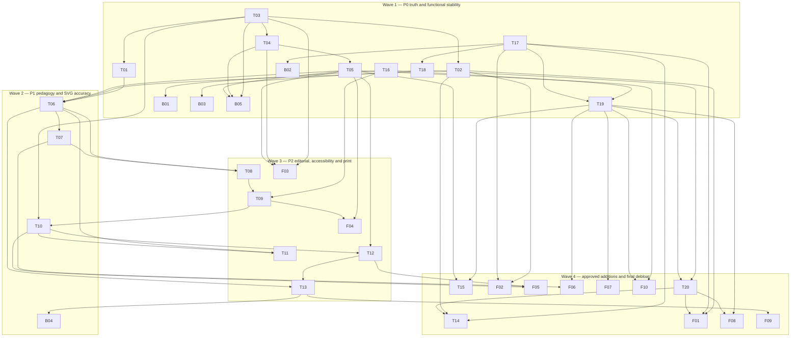

# Evidence-Led Workspace Audit & 35-Task Roadmap

Audit date: 2026-11-06. Status tags describe the evidence actually inspected in this audit. This document is a proposal for future authorized implementation; it does not authorize production edits. The work packages below are residual scope after the first 20-task programme recorded in `qa/design.md`.

## 1. Executive Decision Brief & First-Principles Workspace Profile

### Discipline, audience, and learning purpose

**[INSPECTED]** The canonical product is a Latvian study guide for Topic 13, oxidation–reduction processes, in RSU first-year medical chemistry. Its scope is general redox chemistry and electrochemistry, analytical chemistry (permanganatometry and volumetric analysis), and a bounded biomedical application (mitochondrial electron transport). `13 temata apraksts.pdf` establishes intended outcomes; lecture and laboratory materials supply local scope and procedures. This course scope is not by itself a final authority for disputed scientific or Latvian terminology claims.

**Learner baseline [INFERRED]:** first-year medical students with introductory chemical formula, charge, mole, concentration, and equation skills. Learning goals include assigning oxidation states, balancing ionic half-reactions, reasoning with electrode potentials and Nernst conditions, interpreting redox in biology, and calculating permanganate titrations. The exact examination format is **[UNVERIFIED]**; obtain the current course assessment blueprint before adding exam-specific claims.

### Language and notation matrix

| Layer | Active forms | Audit rule |
|---|---|---|
| Main natural language | Latvian (`lang="lv"`) | Student-facing prose and explanations stay Latvian; English is allowed in code and bibliographic titles. |
| Secondary language | English | Maintainer-facing implementation and source-language quotations only; visible term decisions currently contain English-dominant passages per the dated proposal evidence. |
| Chemical formula / charge | H⁺, Fe³⁺, SO₄²⁻, MnO₄⁻; states (aq)/(s)/(l)/(g) | Distinguish ionic charge from formal oxidation state; use real sub/superscript markup. |
| Formal redox notation | S(+4), E°, E°′, ΔE, n(X), c(X), V(X), M(X), z | Keep electron count and amount-of-substance symbols distinct; state temperature, medium, and potential convention. |
| Equations | e⁻, →, ⇌, ↓, ↑; decimal comma | Equations require atom/charge balance plus chemical plausibility review; a balance gate cannot establish species plausibility. |
| Latvian technical terms | oksidēšanās / oksidēšana; oksidēšanas pakāpe; titrants; analīts; ekvivalences punkts | Canonical term choices live in `tools/termbase.py`; contested external terminology stays `jāpārbauda`. |

### Architecture and decision

**[TESTED]** One generated standalone HTML is built by `tools/build_master.py` using `tools/master_data.py`, term/study data, embedded CSS/SVG/fonts, and `tools/assets/master.js`. The master is 1,456,650 bytes, SHA-256 `a081c593f56b136cc1974ef2f33e283f505a483edd562a0e3c472d9bc0258e5f`; 13 chapters plus answer section, 15 sections, 85 tables, 200 details elements, and 7 inline SVGs. CSS and JS are inlined into the final HTML; the learning document is designed to work offline and degrade when JS is disabled.

**[TESTED]** The HTML is newer than `qa/master.pdf`: HTML mtime 2026-11-03 10:20:40 +0200; PDF mtime 09:24:21 +0200 the same day. PDF release validity is therefore open. **[TESTED]** No Git worktree is available at this root (`git status` reports “not a git repository”); file hashes, timestamps, and inventories are used for integrity. The current `AGENTS.md` is 25,152 bytes, 576 above its declared 24,576-byte limit.

**Decision:** Wave 1 should address reproducible HTML defects, inaccessible labels/controls, and source-warrant conflicts before any new feature or visual expansion. Programme 2 (`qa/40_tasks_programme2.md`) is explicitly a proposal and is used here as evidence, not authorization. The first 20 tasks in `qa/design.md` are recorded as completed, but their saved reports are historical until rerun against the current artifact.

### Top systemic risks

1. **[TESTED]** Broken IDs / fragments, math labels with source syntax, hidden-state CSS, and small tap targets are recorded in the 2026-11-03 proposal measurements; repeat before any repair.
2. **[INSPECTED]** E° / E°′, chromium dichromate potential conventions, biological wording, titration endpoint wording, and lab pink-persistence criteria have unresolved or scope-sensitive warrants in `SOURCE_AUDIT.md` and `qa/verify.md`.
3. **[TESTED]** Executable JS (66,081 bytes) substantially exceeds the standing 4,096-byte registry cap; it contains banned DOM templating per `AGENTS.md` measurements. This is an architecture backlog, not an invitation to remove necessary interactions without parity.
4. **[TESTED]** The printed PDF predates the HTML; printed page count and content are not release evidence for this master revision.
5. **[TESTED]** Governance file exceeds its stated byte cap, and three expected control documents named in AGENTS are absent from the root inventory.

### Inspection limits

The audit inspected governance, source audit, relevant design history, topic plan, terminology/verification evidence, implementation inventory, and proposal details. It did not freshly render the document, run browser tests, recalculate all source claims, inspect every PDF page, or open every bundled skill. The seven SVGs were inventoried from source markup and captions, not independently validated against all original source-page rasters in this pass. Visual claims below are therefore `[INSPECTED]`/`[UNVERIFIED]`, never fresh visual acceptance.

## 2. Workspace, Architecture & Skills Inventory + File-by-File Inspection Ledger

### Architecture map

`tools/build_master.py` → consumes `tools/master_data.py`, `tools/study_data.py`, `tools/termbase.py`, `tools/tokens.json`, and `tools/assets/master.css` / `master.js` → emits `Master_oksidesanas_reducesanas_procesi.html` and rewrites `qa/numbers.csv`. `qa/` contains source extractions, claim/equation/term logs, historical screenshots/PDFs, test scripts and task reports. `archive/` contains historical HTML/master snapshots. Root PDFs and DOCX are read-only source material. `workspace_skills/` contains the skill inventory described below. There is no package manifest, `pyproject.toml`, TypeScript config, or compiler in the inspected root inventory.

### Inspection ledger

| File / asset path | Role | Content inspected? | Render/runtime tested? | Key evidence and findings | Coverage limits |
|---|---|---|---|---|---|
| `AGENTS.md` | Standing governance and issue ledger | Full | No | [TESTED] 25,152 B; cap 24,576 B. Detailed source, architecture, design and QA constraints. | Read only; exact size remeasured. |
| `SOURCE_AUDIT.md` | Source conflict ledger A–F | Full | No | [INSPECTED] Source-specific errors, notations, unresolved claims, and confirmed items. | Source excerpts not all re-opened against originals in this audit. |
| `qa/design.md` | Historical build/QA record | Targeted sections, latest tasks | Historical reports only | [INSPECTED] Tasks 01–20 outcomes and dated measurements; Task 20 records 69 claim rows and 7 browser test suites. | These are historical, not current acceptance. |
| `qa/40_tasks_programme2.md` | Residual proposal and defects | Full structural/selected detailed sections | No fresh tests | [INSPECTED] Explicitly unexecuted proposal; measures duplicate IDs, banner hidden-state issue, label and target-size issues, source conflicts, stale PDF. | Proposals are not verified current behavior until rerun. |
| `qa/20_tasks_improvement_plan.md` | First 20-task plan | Partial via design history references | Historical | [INSPECTED] Completion statement and task structure referenced in design log. | Not re-read full plan in this pass. |
| `qa/plan.md` | Topic/concept/recall plan | Targeted | No | [INSPECTED] Chapters 1–9 and concept denominator; 170 concepts referenced. | Outcome map not independently reconciled item by item. |
| `qa/trace.md` | Claim-to-source/course trace | Partial | No | [INSPECTED] Trace index exists; AGENTS cites last count 75 units / 0 unmapped, requiring recheck. | Not all rows re-audited. |
| `qa/verify.md` | External verification ledger | Full relevant entries | No | [INSPECTED] Explicit unresolved items A11, D6, A25/A26 provenance and term portal checks; potential dump values and convention notes. | Local source dumps are dated; external citations need revalidation. |
| `qa/e_registry.md`, `qa/terms_gate.md`, `qa/notation_standard.md`, `qa/notation_report.md` | Potentials, terminology, notation evidence | Partial | Historical gates | [INSPECTED] Registries/gates exist and constrain terms, symbols, E°/E°′. | Not freshly executed. |
| `Master_oksidesanas_reducesanas_procesi.html` | Canonical generated product | Inventory, IDs, source references | No fresh rendering | [TESTED] 1,456,650 B, matching SHA; 7 SVG, 85 tables, 200 details. | No live viewport, keyboard, no-JS or current PDF test this pass. |
| `tools/build_master.py` | HTML generator | Partial/inventory | Not executed | [TESTED] 251,679 B; chapters/helpers are the output source. | No code-path walk or build. |
| `tools/master_data.py` | Chemistry facts, numbers, changes | Partial/inventory | Not executed | [TESTED] 100,717 B; authoritative data home by governance. | Individual claims require linked source verification. |
| `tools/study_data.py`, `tools/termbase.py` | Recall/mistake data and canonical terms | Partial | Not executed | [INSPECTED] Existing 29 mistake items and term records described by reports. | Current counts need rerun. |
| `tools/assets/master.css`, `master.js`, `tokens.json` | Styles, runtime, tokens | Inventory/selected measurements | No | [TESTED] CSS 75,290 B; JS 66,081 B; proposed baseline records 116 `!important`, 53 listeners and 27 `innerHTML` / 9 `createElement`. | Static history values; no fresh parse/runtime. |
| `tools/{check_balance,verify_numbers,check_terms,audit_notation,lint_ox_state,test_notation,recall_matrix,extract_docx}.py` | Verification and extraction | Names/roles, selected references | Not executed | [INSPECTED] Existing gate set; some scripts write into QA. | Must inspect side effects before a future run. |
| `qa/overflow*.mjs`, `qa/t07_playwright.mjs` | Browser measurements/tests | Names only | Not run | [INSPECTED] Raw JS tooling is outside declared target stack. | Contents not reviewed in this audit. |
| `13 temata apraksts.pdf` | Curriculum scope | Metadata/name | No | [METADATA-VERIFIED / SCOPE-ALIGNED] Identified as T13 scope authority in AGENTS. | Pages not freshly read here. |
| `Oksidesanas_reducesanas procesi_2022.docx` | Lecture theory | Metadata/name | No | [METADATA-VERIFIED / SCOPE-ALIGNED] Lecture source identified. | DOCX text/images not freshly extracted in this pass. |
| `6LW_MCh_Titration_Permanganatometrija_2025.pdf` | Current titration lab | Metadata/name | No | [METADATA-VERIFIED / SCOPE-ALIGNED] Current procedure, with recorded Mora pipette drawing/text conflict. | Original page not freshly raster-inspected now. |
| `6LW_Ox-red_LV_2021.pdf`, `Oksidesana_reducesana_reakcijas_2020.pdf` | Lab and legacy worked source | Metadata/name | No | [METADATA-VERIFIED / SCOPE-ALIGNED] L21/L20 roles named. | No fresh page-by-page read. |
| `qa/master.pdf` and `qa/t01–t20` PDFs/screens | Prior output evidence | Metadata and timestamps | Historical only | [TESTED] `qa/master.pdf` predates HTML; historical screenshots evidence only their dated builds. | Not current baseline. |
| `archive/*` | Rollback snapshots | File inventory | No | [INSPECTED] 24 historical master snapshots by AGENTS inventory. | Hash map not produced this pass. |
| `workspace_skills/INDEX.md`, `COPY_MANIFEST.json` | Skill catalog/provenance | Full catalog overview | No | [INSPECTED] 36 packages, including 10 study-document skills and design/PDF/interaction packages. | Individual SKILL.md workflows not invoked in audit. |
| `workspace_skills/{cognitive-deload-auditor,polish,design-taste-frontend,lexicon-morphology-weaver,svg-spatial-occlusion,synoptic-matrix-architect,print-css-alchemist,state-scrubber-lab,pdf-vector-surgeon,blueprint-spec-sheet}/SKILL.md` | Relevant implementation guidance | Names and roles | Not invoked | [INSPECTED] Directly relevant to requested workstreams; invoke only in scoped implementation. | Full skill instructions not read during this audit. |
| `VISUAL_VERIFICATION.md` and root manifests | Visual protocol / runtime config | Partial / inventory | No | [INSPECTED] lite-shot policy; no project package/build manifest listed. | Need availability probe before visual work. |

### Skills and tools to invoke if a task is later authorized

Use `cognitive-deload-auditor` for prose density and retrieval; `polish` for Latvian sentence editing; `lexicon-morphology-weaver` for term-system design; `svg-spatial-occlusion` or `blueprint-spec-sheet` for original redox/lab diagrams; `synoptic-matrix-architect` for data comparisons; `state-scrubber-lab` only if a state visualization is approved; `print-css-alchemist` and `pdf-vector-surgeon` for print/PDF; `design-taste-frontend` as restrained UI diagnostics, subordinate to the workspace’s anti-slop rules. Relevant existing verification tools include the Python equation, number, term, notation, oxidation-state, recall and renderer gates. **None of these skills or gates was run for this audit.**

## 3. Diagnostic Triage: Confirmed Defects vs. Suspected Risks vs. Opportunities

### Confirmed / reproduced in workspace evidence

| ID | Evidence | Classification | Required response |
|---|---|---|---|
| D-01 | [TESTED] AGENTS size 25,152 B vs 24,576 B cap | Governance defect | Compact duplicate rules without weakening requirements; document before/after size and hash. |
| D-02 | [TESTED] Current HTML hash is 2026-11-03 artifact; PDF timestamp is 56 min older | Release-evidence defect | Re-export only in authorized build task; inspect all pages against current HTML. |
| D-03 | [TESTED, dated proposal] 2 duplicated IDs across 5 provenance nodes and two `#ch0` links | Markup/navigation defect | Reproduce on current artifact; unique IDs and resolvable fragments. |
| D-04 | [TESTED, dated proposal] 164 of 500 math labels contain `^`, `_`, or `->` | Accessibility defect | Generate speakable labels from structured notation, check screen-reader text. |
| D-05 | [INSPECTED, dated proposal] `.js .js-only` may override `[hidden]`, causing audit banner first-paint display | State/layout defect | Reproduce with JS on/off, delayed JS, 390px; preserve hidden semantics. |
| D-06 | [TESTED, dated proposal] 178 button targets below 24px at 390px; 295 small links were exempt in that audit | Touch-target defect | Re-measure current controls and fix buttons or document valid exception. |
| D-07 | [TESTED, AGENTS] Runtime exceeds declared JS byte/line/percent budgets and includes banned DOM templating | Architecture debt | Decompose native state patterns and pre-render data; retain only registered residual logic. |

### High-risk claims / diagnostic investigations

| ID | Evidence | Status | Investigation boundary |
|---|---|---|---|
| R-01 | [INSPECTED] Cr₂O₇²⁻ 1.33 V course value versus 1.232 V CRC dump | Disputed convention/context | Identify exact half-reaction, medium, species activity, source edition and standard/formal convention. Do not substitute by numerical match. |
| R-02 | [INSPECTED] LEC/L25 pink-persistence criteria conflict: 1–2 min, 1 min, “does not disappear” | Unverified method criterion | Find current lab SOP/instructor authority and record endpoint definition; no invented 30-second universal rule. |
| R-03 | [INSPECTED] L25 prose says 10.00 mL Mora pipette, drawing says 25 mL | Source inconsistency | Verify instrument identity/name with Latvian source and lab owner; preserve discrepancy until reconciled. |
| R-04 | [INSPECTED] O₂/haemoglobin wording and E°′ pH/temperature convention open | Scope/warrant risk | Separate oxygen transport binding from membrane electron transport; cite conditions and biochemical convention. |
| R-05 | [INSPECTED] “replaces five sources” and “every number recomputed” overclaim in hero per proposal | Unsupported meta-claim | Replace with measured scope statement tied to actual registered records. |

### Opportunities

The guide already has broad equation coverage, chapter-level recall, native details, a 29-item mistake atlas, an audit/change-log structure, a generator, and extensive historical QA. Improvements should strengthen truth, access, print freshness and architecture before adding the proposed search, matrix, simulation or export features. The product is not a marketing site; the 7 figures for 121 printed pages merit a pedagogical coverage review but not an arbitrary image quota.

## 4. Domain Terminology, Fact, Applicability & Warrant Verification Ledger

Status is limited to current inspected evidence. A checker passing balance or a number matching a dump does not establish species validity, convention, applicability, or the whole claim.

| Claim ID | Location | Existing claim / issue | Verification status | Applicability & warrant analysis | Authority / confidence | Proposed correction or next step |
|---|---|---|---|---|---|---|
| A1 | `SOURCE_AUDIT.md` §A; LEC table 2 | Element labels shifted from Cu onward; duplicate Al row | Inaccurate [INSPECTED] | Internal row/formula mismatch is sufficient to establish defect; source-page alignment still requires inspection. | LEC table 2; high internal confidence | Keep correction, preserve source wording only in provenance note. |
| A2 | `master_data.py` Br couple; `qa/verify.md` | Br₂/Br⁻ working 1.07 V vs source 0.96 V | Corrected in recorded build [INSPECTED] | CRC dump recorded 1.066 V for specified reduction couple; conditions/source edition should accompany any claim. | CRC dump [TEXT-VERIFIED in local extract]; source edition incomplete | State half-reaction and rounded value; do not claim universal value outside standard conditions. |
| A3 | PbO₂ couple / `qa/verify.md` | Lecture +1.80 V vs CRC ~1.455 V; reaction claim | Disputed / corrected [INSPECTED] | Same species labels can hide different sulfate/lead products, acid activities and medium; thermodynamic feasibility in concentrated acid is not inferred from E° comparison alone. | CRC text extract; edition/locator incomplete | Keep values tied to half-reaction; explain activity/concentration role only with calculation conditions and warrant. |
| A4 | LEC table 1 / O₂ couple | 2e⁻ oxygen-to-water equation and 0.6945 V | Inaccurate equation; value unresolved | Atom/electron imbalance is directly demonstrable. Value must be classified E°, E°′, or another conditional potential before correction. | `check_balance` historical result and source audit | Four-electron balanced reaction; do not reuse 0.6945 V without a matching convention. |
| A5 | LEC bio table; `qa/verify.md` | E° and E°′ values mixed in one comparison | Over-simplified / convention error | pH, proton stoichiometry, activities and temperature affect comparison; numerical coincidence does not make conventions comparable. | IUPAC conventions + local bio dump; medium confidence | Put comparisons in one explicitly declared convention; state pH and temperature. |
| A6–A7 | LEC P229 | “citohromkināze”; NADH⁺ | Inaccurate [INSPECTED] | Name and reduced cofactor notation conflict with established respiratory-chain terminology; verify against a current biochemistry source before claim status upgrade. | Campbell dump recorded, passage not present for exact correction | Use source-backed “citohroma c oksidāze” and NADH; cite locator when obtained. |
| A8 | LEC P250 | Iodometry uses iodide as titrant | Inaccurate [INSPECTED] | Distinguish analyte oxidant liberating iodine from excess iodide and thiosulfate titrant; iodimetry uses iodine titrant. | IUPAC titration definition supports category; local reaction warrants stoichiometry | State the reaction role for each species and link to course method. |
| A10 | LEC P244/P248/P253; L25 | Equivalence point equated with observed endpoint | Inaccurate / over-simplified | Equivalence is stoichiometric; endpoint is observed indicator/instrument signal. They may differ by method-dependent error. | IUPAC Gold Book titration entry [TEXT-VERIFIED], DOI 10.1351/goldbook.T06387 | Distinguish theoretical point and observed endpoint; cite IUPAC plus method-specific procedure. |
| A11 | LEC P253/P265; L25 p.2 | Persistent pink time differs across sources | Disputed, unresolved | Local endpoint protocol governs student’s lab; a generic duration from another method does not establish this protocol. | Local sources conflict; no authoritative lab SOP inspected | Present conflict and defer to current instructor protocol until verified. |
| A12 | LEC P254 vs LEC P097–098 / L21 | Neutral or basic medium gives MnO₂ | Inaccurate / internally inconsistent | Product depends on medium and reaction conditions; strong base permits manganate as initial product in the taught reaction. | Course half-reactions and L21; high internal confidence | Make acid/neutral/basic rows explicit; retain conditions and avoid universal endpoint claims. |
| A13 | LEC P071 / dichromate | Dichromate oxidizes chloride “in acid” | Over-simplified | Proton activity and product/reactant activities enter Nernst terms; “acidic” alone is insufficient to prove direction. | `SOURCE_AUDIT.md` A13 calculations; external conditions still needed | State bounded illustrative activities or label as qualitative only. |
| A14–A15 | `SOURCE_AUDIT.md` A-set | Balanced-looking species / sulfite under acid | Warrant flaw risk | Atom/charge balance is necessary, not sufficient for chemical species plausibility or stability. | Source audit; hand chemistry review required | Keep explicit species-plausibility review and medium-specific claim limits. |
| A18 | Numeric worked examples | Rounding and intermediate precision | Verified only where recalculated | Recompute with stated inputs and significant figures; do not round intermediate values or infer precision from displayed rounded E°. | Local arithmetic gates; not freshly rerun | Display unrounded intermediate and one final rounding; test boundary values. |
| A24–A27 | Biomolecular / SHE claims | Zn²⁺ role; Pt adsorption; SHE activity; formal oxidation states | Mixed / partly unverified | A source dump that lists potentials cannot establish enzyme role or surface adsorption; standard-state activity differs from a 1 M approximation; formal oxidation state is bookkeeping, not ionic structure. | `qa/verify.md` partial checks; IUPAC Gold Book electrode potential [TEXT-VERIFIED] | Preserve `jāpārbauda` until relevant primary/text source is inspected; mark formal charge as bookkeeping. |
| H-02 | Master `#prov-*`, `#ch0` | duplicate IDs and missing fragment target | Inaccurate [TESTED, dated] | Pure structural defect; must be reproduced on live master. | Proposal parser measurement | Unique provenance IDs; link to `#sakums`; add anchor gate. |
| H-03 | `.eq[role="math"]` | ASCII syntax in 164 labels | Accessibility defect [TESTED, dated] | Browsers may pronounce caret/underscore/arrows literally; full spoken expression depends on assistive tech. | Proposal count; screen-reader QA needed | Build speakable strings and test representative equations with screen reader. |
| H-04 | `#audit-banner` | `[hidden]` overridden by CSS | Runtime defect [INSPECTED] | Selector specificity and `.js-only` may defeat hidden semantics; computed display needs runtime confirmation. | Reported 390px CDP screenshot/measurements | Ensure `[hidden]` wins; test first paint and delayed JS. |
| H-06 | `qa/master.pdf` | PDF is older than master | Stale artifact [TESTED] | Timestamp alone proves mismatch, not actual page differences. | `stat` | Regenerate and compare pages/text to HTML. |

## 5. Authoritative Book, Standard & Literature Bibliography

Authority order: IUPAC terminology/quantities standards and relevant primary methods; primary experimental/peer-reviewed literature; current university-level analytical/physical/biochemistry texts; CRC/reference tables with exact couple conventions; local curriculum materials for scope and procedure (not infallible fact authority); search hits only as leads.

| Source | Bibliographic metadata | Relevant scope | Provenance and warrant |
|---|---|---|---|
| IUPAC, *Compendium of Chemical Terminology (the Gold Book)*, 5th ed., International Union of Pure and Applied Chemistry, 2025, online version 5.0.0. Entry “titration” DOI 10.1351/goldbook.T06387; entry “electrode potential” DOI 10.1351/goldbook.E01956; entry “oxidation” DOI 10.1351/goldbook.O04362. | [TEXT-VERIFIED] Online entries inspected via IUPAC Gold Book pages/search excerpts; current accessible text gives distinction of equivalence point and endpoint, electrode-potential definition, and oxidation definitions. No printed-page claim made. | Terminology / definitions only; does not settle Latvian translation or specific redox values. | [TEXT-VERIFIED] Official IUPAC primary nomenclature source. Link: [titration](https://goldbook.iupac.org/terms/view/T06387), [electrode potential](https://goldbook.iupac.org/terms/view/E01956), [oxidation](https://goldbook.iupac.org/terms/view/O04362). |
| IUPAC, *Compendium of Analytical Nomenclature: Definitive Rules 1997*, 3rd ed., Blackwell Science, 1998, ISBN 978-0-86542-615-6. | [METADATA-VERIFIED / SCOPE-ALIGNED] Edition/publisher/ISBN metadata needs catalog confirmation before implementation citation; IUPAC analytical compendium online chapter was inspected for titration terminology. | Titration, equivalence, endpoint vocabulary. | Online IUPAC chapter text is accessible [TEXT-VERIFIED] for the described definitions; book edition metadata is not yet independently verified. Do not cite a page until checked. |
| CRC Handbook of Chemistry and Physics, edition not established by local dump. | [UNVERIFIED] Edition, editors, year, publisher/ISBN and table locator absent from current `qa/verify.md`. | Standard electrode-potential comparison. | Local extract contains values but does not provide sufficient bibliographic identity. Must not present as complete book citation or source proof until edition and couple conditions are recovered. |
| Campbell et al., biochemistry text/table referenced as “Campbell ch. 8 sample”; exact title, edition, year, publisher, ISBN not established. | [UNVERIFIED] | Biochemical E°′, oxygen and NAD couples. | Local dump has relevant entries but bibliographic identity and applicability metadata are incomplete. |
| LibreTexts, “Standard Reduction Potentials by Element.” | [METADATA-VERIFIED / SCOPE-ALIGNED] Page identity only; page does not establish exact convention for every matching value. | Comparative standard reduction potentials. | Not the authority for replacing a disputed number without verifying reaction, medium, state and conditions. |
| Local course files T13, LEC, L25, L21, L20. | [METADATA-VERIFIED / SCOPE-ALIGNED] File identities and roles known from governance/source audit; no new book metadata applicable. | Topic scope, lecture path, current and older lab methods. | Course scope/procedure authority. Claims still require source-context checks; original pages were not freshly inspected in this audit. |

No other books are cited as having been read. Before using a textbook to correct a claim, record author/editor, exact title, edition, year, publisher, ISBN/DOI, chapter scope, accessible passage provenance, and date. Never infer page numbers from search snippets.

## 6. Editorial Design, Retexturing, Accessibility, Pedagogy & Complete SVG Diagnostics

### Design and learning-system assessment

**[INSPECTED]** The design evidence describes an editorial “electron ledger / titration bench” system, local fonts, semantic mistake categories, and multiple print-first diagrams. Preserve these explanatory structures. The evidence also identifies potential zebra-table excess, a prominent audit banner, dense long-form chapters, many small controls, 200 collapsed details, and mixed visible English in term decisions. The first three are primarily usability/design issues; collapsed details are not inherently a defect and must be evaluated by task.

Future visual direction: a restrained lab notebook/electrochemical ledger with paper-white and ink surfaces, a single rule hierarchy, tabular numerals, formula-capable text faces, 60–75ch prose measure, and semantic color paired with shape/text labels. No unmotivated gradients, glass/glow, structural emoji, generic repeated card grids, or decorative motion. Require WCAG 2.2 AA contrast, clear `:focus-visible`, keyboard operation, 24px minimum targets or documented exception, reduced-motion respect, and 390/768/1440px reflow. These are acceptance criteria, not audit measurements.

### Existing SVG inventory and disposition proposals

The figures are identified from master markup and captions. No fresh raster inspection or chemistry-to-source verification was performed; the dispositions are provisional planning decisions.

| Figure / selector | Current scene and evidence | Provisional disposition | Required audit / blueprint |
|---|---|---|---|
| `.bench` / `#bench-cap`, `viewBox="0 0 480 722"` | [INSPECTED] Titration-bench illustration, 9.4 example; caption calls 12.35 mL reading and 10.00 mL aliquot illustrative and records conflicting lab pink criterion. | [CORRECT] | Keep measured vs illustrative distinction explicit; depict burette scale direction correctly, identify meniscus and one-mark aliquot pipette, label endpoint as observed not equivalence. Use grayscale-safe patterns and text equivalents. |
| `#fig-cell-cap`, `viewBox="0 0 420 300"` | [INSPECTED] Galvanic cell, electron flow anode → cathode; caption states cell EMF as cathode minus anode reduction potentials. | [RETAIN] | Verify salt bridge ion directions and electrode signs against half-cell reaction; distinguish external electron path from ionic conduction; no unlabeled color semantics. |
| `#fig-ph-cap`, `viewBox="0 0 400 360"` | [INSPECTED] Formal Nernst lines, assumptions and dashed region past pH 3 caveat; intersection uses 0.0592 V. | [CORRECT] | Recompute all slopes/intersection from listed half-reactions and assumptions; label pH and V axes; explain formal extrapolation/aqueous species limitations; compare plot to table. |
| `#fig-ladder-cap`, `viewBox="0 0 410 620"` | [INSPECTED] Potential ladder; caption explicitly says arrow indicates ranking, not reaction direction. | [RETAIN] | Check all values share same convention/conditions; maintain text label that ranking does not alone prove feasibility under arbitrary concentrations. |
| `#fig-tubes-cap`, `viewBox="0 0 320 384"` | [INSPECTED] Expected MnO₄⁻ + sulfite observations in three media; caption says patterns and names support grayscale. | [CORRECT] | Verify species/products/conditions against L21, and distinguish expected observations from measured results; do not imply all tubes were experimentally observed. |
| `#fig-chain-cap`, `viewBox="0 0 380 650"` | [INSPECTED] Electron and proton flows in mitochondrial membrane; source attribution to LEC image. | [CORRECT] | Check membrane orientation, complex order, electron donor/acceptor, proton pumping and ATP synthase direction against a named biochemical source; avoid implying every complex pumps protons. |
| `#fig-app-cap`, `viewBox="0 0 380 540"` | [INSPECTED] L25 apparatus; caption explicitly notes 10.00 mL pipette text vs 25 mL source drawing. | [CORRECT] | Reconcile text/drawing with instructor; until then mark drawing as corrected schematic, not original procedure evidence. Label burette, flask, wash bottle, pipette distinctly. |

### New SVG candidates

`[ADD NEW SVG]` **Half-reaction balancing ledger:** 6 panels: identify medium → balance non-H/O atoms → balance O with H₂O → H with H⁺ (or OH⁻ route) → charge with e⁻ → multiply/add/cancel. Forbidden: suggesting atom/charge balance proves a plausible species or omitting final conditions.

`[ADD NEW SVG]` **Equivalence vs endpoint titration trace:** stoichiometric equivalence mark, observed color transition interval and one-drop overshoot shown as distinct labels; do not invent a universal curve or numerical endpoint error.

`[ADD NEW SVG]` **E° / E / E°′ condition map:** standard state, actual activity state, and biochemical transformed convention as separate lanes. Do not draw a single unqualified “pH 7 correction” that ignores temperature, activities, proton stoichiometry, or formal-potential assumptions.

Each figure requires responsive viewBox, `title`/`desc`/`aria-labelledby`, accessible text equivalent, semantic colors plus line patterns, print grayscale, 390px label checks, and chemistry review tied to source IDs. Skill: `svg-spatial-occlusion` for information geometry; `blueprint-spec-sheet` only where engineering-drawing conventions aid reasoning.

### Pedagogical audit

**Strengths [INSPECTED]:** 13-chapter progression, a 170-concept recall denominator, worked examples and source-linked mistakes, source-change ledger, and L20/L21/L25 lab contexts. The existing recall report claims 113/170 unique concepts (66.47%) and zero near-duplicates, but this is historical evidence. **Gaps [INFERRED]:** prerequisite graph is not freshly validated; some source disputes and hidden assumptions may undercut explanations; retrieval coverage does not itself prove feedback quality; visible English term decisions and dense metadata may impose avoidable load. Future topic review must test one claim per explanation, a “why” mechanism, worked calculation with units, an explicit misconception, and canonical Latvian term.

## 7. 20 Core Improvement Tasks (T01–T20) — Full Templates

All acceptance checks are future gates, not claims that the current artifact passes. These are residual work packages after the first 20 tasks recorded in `qa/design.md`; priorities are provisional.

### T01 — Register and falsify high-risk visible claims

**Workstream:** Terminology & Sourcing. **Priority:** P0 | **Impact:** 5 | **Effort:** 3. **Epistemic:** [INSPECTED]. **Boundary:** visible high-risk claims; T03 owns source registry, T04/T05 numeric derivations/conventions. **Skills:** `polish`; `design-taste-frontend` copy guidance.

**Observed evidence:** `qa/40_tasks_programme2.md` identifies “replaces five sources” and “every number recomputed” hero overclaims; `SOURCE_AUDIT.md` contains disputed O₂/Hb, Cr₂O₇²⁻ and potential-difference claims. **Why it matters:** unregistered absolutes imply verification beyond the actual evidence.

**End state / guardrails:** bounded `qa/claims.csv`, source/status per row and narrowed hero copy. In scope: numeric prose, absolutes and meta-claims; out of scope: rewriting every sentence or adding chemistry.

**Source/warrant:** Claim Ledger §4. A number match is not evidence of matching reaction conditions.

**Main Implementation Steps**

**Main Step 1:** Define extraction rules, taxonomy, exclusions and a reproducible baseline against the generated HTML.
**Main Step 2:** Adjudicate claims against the source registry; change only claims whose warrant fails or coverage is overstated.
**Main Step 3:** Wire deterministic claim checks and record before/after evidence in `qa/design.md`.

**Subtask T01.1 — Bounded claim ledger**

- **Substep T01.1.1:** Create `qa/claims.csv` (`claim_id,anchor,text,type,source_ids,status,action,reason`); seed from 69 change-log rows and high-risk patterns; assert unique IDs.
- **Substep T01.1.2:** Extract 120–160 rows only if the measured scan supports that range; otherwise report the actual count without padding.
- **Substep T01.1.3:** Write `qa/claims_method.md` defining included claims, exclusions, retirement and status transitions; manually reconcile ten diverse rows.

**Subtask T01.2 — Falsification and gate**

- **Substep T01.2.1:** Narrow `tools/build_master.py` ch0 language to measured source synthesis and registered-number scope; verify both overclaim phrases are absent from generated text.
- **Substep T01.2.2:** Implement `tools/check_claims.py` for broken source IDs and high-risk unregistered numbers/absolutes; allow documented quotations and headings.
- **Substep T01.2.3:** Add valid, missing-source and unsupported-universal fixtures; check expected pass/fail and QA-only output.

**Affected files:** `tools/build_master.py` ch0/ch5/ch8, `tools/master_data.py`, new `qa/claims.csv`, `qa/claims_method.md`, `tools/check_claims.py`, `qa/design.md`. **Acceptance:** cited claim passes; uncited universal fails; quote exception passes; mobile and print copy remains readable. **Dependencies / risk / rollback / DoD:** T03 before source IDs; T04/T05 own value corrections. Restore archived generator/data if gate suppresses legitimate statements; finish with source-linked ledger and build log.

### T02 — Establish Latvian terminology and remove visible maintainer English

**Workstream:** Terminology & Sourcing. **Priority:** P0 | **Impact:** 5 | **Effort:** 3. **Epistemic:** [INSPECTED]. **Boundary:** visible term decisions; T01 owns general claims. **Skills:** `lexicon-morphology-weaver`, `polish`.

**Observed evidence:** proposal `qa/40_tasks_programme2.md` reports 23/32 `.term-decision` strings English-dominant. `qa/verify.md` leaves “oksidēšanas pakāpe” and “Faradeja konstante” portal checks unresolved. **Why:** maintainer notes interrupt Latvian instruction and unsupported statuses misstate authority.

**End state / guardrails:** student-facing decisions are Latvian, stable IDs connect term to source and disputed forms remain `jāpārbauda`; do not invent Latvian terminology.

**Source/warrant:** §4 terms; IUPAC English entry does not establish a Latvian canonical form. Record portal query, URL, date and result.

**Main Implementation Steps**

**Main Step 1:** Separate learner-facing definition, maintainer note, forbidden forms and evidence status in the term schema.
**Main Step 2:** Verify contested forms against terminology authorities and course context before editing student-facing text.
**Main Step 3:** Extend language gates and review rendered glossary, keyboard use and print.

**Subtask T02.1 — Schema and decision text**

- **Substep T02.1.1:** Add `decision_lv`, `note_en`, `source_ids`, `status` to `tools/termbase.py`; preserve stable keys and assert required fields.
- **Substep T02.1.2:** Rewrite rendered `.term-decision` strings in Latvian and move maintainer nuance to `qa/termbase_notes.md`; compare all entries.
- **Substep T02.1.3:** Review gender/case and distinctions for oksidēšanās/oksidēšana, analīts/analīze, Mora pipete/sāls and jodometrija/jodimetrija.

**Subtask T02.2 — Verification and enforcement**

- **Substep T02.2.1:** Search termini.gov.lv/AkadTerm for the 13 high-risk terms; record hit, absence or ambiguity in `qa/verify.md`.
- **Substep T02.2.2:** Extend `tools/check_terms.py` with conservative Latvian-context language checks; exempt quotations, URLs, code and bibliographic titles.
- **Substep T02.2.3:** Save `qa/t22/english_hits.csv` and inspect glossary screen/print output; test one English false-positive exclusion.

**Affected files:** `tools/termbase.py`, `tools/check_terms.py`, `tools/build_master.py` ch11, `qa/verify.md`, new `qa/termbase_notes.md`, `qa/design.md`. **Acceptance:** 0 English-dominant term decisions, 0 unsourced `apstiprināts`, bad English fixture fails, term uses remain understandable at 390px and in print. **Dependencies / risk / rollback / DoD:** T03 supplies provenance format; retain unresolved statuses; do not relax term gate to pass.

### T03 — Build a bibliographic registry with applicability warrants

**Workstream:** Terminology & Sourcing. **Priority:** P0 | **Impact:** 5 | **Effort:** 4. **Epistemic:** [INSPECTED]. **Boundary:** source identity and evidence records; T04/T05 adjudicate chemistry. **Skills:** `polish` only for labels; use source logs.

**Observed evidence:** `qa/verify.md` notes incomplete CRC/Campbell identity/locator and unverified live terminology checks. **Why:** a source name or matching number cannot prove the passage, edition or applicability.

**End state / guardrails:** source records contain authors/editors, exact title, edition/year/publisher, ISBN/DOI when verified, scope, access date, provenance tag and limitations. No guessed metadata or page numbers.

**Source/warrant:** §5. IUPAC Gold Book titration entry supports equivalence/endpoint distinction but not the local pink duration or Latvian term.

**Main Implementation Steps**

**Main Step 1:** Define source schema independent of rendered bibliography and map each claim to evidence.
**Main Step 2:** Recover identity and inspect passages where accessible; keep metadata-only and unresolved evidence separate.
**Main Step 3:** Add validation for mandatory metadata and honest provenance tags.

**Subtask T03.1 — Source records**

- **Substep T03.1.1:** Create `qa/sources.csv` with immutable IDs and all required metadata fields; register T13/LEC/L25/L21/L20 as course-scope sources.
- **Substep T03.1.2:** Recover CRC and Campbell editions from title pages or reliable catalogs; leave unknown fields blank and status `[UNVERIFIED]`.
- **Substep T03.1.3:** Register inspected IUPAC Gold Book entries with direct URL/DOI and online-text provenance distinct from book metadata.

**Subtask T03.2 — Warrant and quality gate**

- **Substep T03.2.1:** Add claim fields for system scope, conditions, warrant limit and provenance; link A2–A5, A10–A13 and A24–A27.
- **Substep T03.2.2:** Add `tools/check_sources.py`: reject incomplete book citations and `[TEXT-VERIFIED]` without inspected text locator.
- **Substep T03.2.3:** Test missing-ISBN and invented-page fixtures; confirm source text never claims support beyond its scope.

**Affected files:** new `qa/sources.csv`, `tools/check_sources.py`; `qa/verify.md`, `qa/claims.csv`, `tools/master_data.py`, `tools/build_master.py`. **Acceptance:** IUPAC definitions cited within scope; incomplete CRC remains unresolved; fabricated locator fails; print has plain citations. **Dependencies / risk / rollback / DoD:** T01 defines claim IDs. Keep original evidence history; do not promote metadata-only sources to text-verified.

### T04 — Reconcile derived values, arithmetic and rounding

**Workstream:** Terminology & Sourcing. **Priority:** P0 | **Impact:** 5 | **Effort:** 3. **Epistemic:** [INSPECTED]. **Boundary:** arithmetic/precision; T05 owns potential conventions. **Skills:** `tools/verify_numbers.py`, `tools/check_balance.py`.

**Observed evidence:** `SOURCE_AUDIT.md`/proposal reports 0.35 V prose versus displayed rounded 1.80−1.46=0.34, while stored 1.455 gives 0.345; proposal names 10× aliquot/flask, 5:1 Fe:Mn, 2:5 H₂O₂:MnO₄⁻ and intermediate rounding for audit. **Why:** conclusions must be reproducible from stated inputs and units.

**End state / guardrails:** derive once from canonical inputs; show unrounded intermediates and round once. Do not change source values just to force rounded subtraction.

**Source/warrant:** `qa/e_registry.md`, reaction stoichiometry and local course examples; conditions must be explicit before interpreting potential differences.

**Main Implementation Steps**

**Main Step 1:** Inventory visible derived values and map each to expression, data and precision.
**Main Step 2:** Centralize derivations in Python and render consistent displayed values.
**Main Step 3:** Test boundary/rounding cases and compare prose, table and figure outputs.

**Subtask T04.1 — Arithmetic inventory**

- **Substep T04.1.1:** Extract numeric prose in chapters 2–9 and compare with `NUMBERS`; classify source value, derived value or illustrative example.
- **Substep T04.1.2:** Recalculate the PbO₂ difference from unrounded values and revise precision wording without erasing the source conflict.
- **Substep T04.1.3:** Recompute 10× aliquot/flask, Fe:Mn and peroxide examples from stated reaction and volume inputs; reject unsupported inputs.

**Subtask T04.2 — Precision gate**

- **Substep T04.2.1:** Add derived-value metadata (`expression,inputs,units,precision,display_rule`) to canonical data; remove duplicate hard-coded operands.
- **Substep T04.2.2:** Extend `verify_numbers.py` to compare displayed operands to differences within a stated rounding tolerance.
- **Substep T04.2.3:** Add exact and inconsistent-rounded-operands fixtures; inspect equation wrapping at 390px and in print.

**Affected files:** `tools/master_data.py`, `tools/verify_numbers.py`, `tools/build_master.py`, `qa/numbers.csv`, `qa/e_registry.md`. **Acceptance:** no arithmetic contradiction; unit-bearing results; negative inconsistent case fails; exact source/precision is visible. **Dependencies / risk / rollback / DoD:** T03 source registry; T05 conventions. Revert unsupported calculations, not the underlying audit note.

### T05 — Separate E°, E and E°′ with boundary conditions

**Workstream:** Terminology & Sourcing. **Priority:** P0 | **Impact:** 5 | **Effort:** 4. **Epistemic:** [INSPECTED]. **Boundary:** potential convention and conditions; T04 owns arithmetic. **Skills:** `synoptic-matrix-architect`; `state-scrubber-lab` only if visualization is approved.

**Observed evidence:** `SOURCE_AUDIT.md` A3–A5/A13 and `qa/verify.md` record standard/biochemical convention mixing, acidity dependencies, and conflicting dichromate values. **Why:** E° alone cannot establish reaction direction at arbitrary concentrations or pH.

**End state / guardrails:** each potential identifies reaction, convention, T, pH/activity and medium; unknowns remain disputed. No universal pH-only correction.

**Source/warrant:** IUPAC electrode-potential definition is [TEXT-VERIFIED] for definition only. CRC and biochemical applicability remain unresolved absent full source identities/conditions.

**Main Implementation Steps**

**Main Step 1:** Map every potential in chapters 2–5 and 8 to reaction and condition metadata.
**Main Step 2:** Recalculate only pairs with established source conditions; revise comparisons and boundary statements.
**Main Step 3:** Validate that generated values carry their convention and required context.

**Subtask T05.1 — Conditions matrix**

- **Substep T05.1.1:** Add `potential_type,temperature_K,pH,activities,medium,reaction_id,source_id` fields to `master_data.py` couple records.
- **Substep T05.1.2:** Reconcile O₂/H₂O E° 1.229 V and E°′ ~0.815 V only against sources with identified conditions; leave 0.6945 unresolved.
- **Substep T05.1.3:** Re-evaluate dichromate/chloride over declared activities; make example conditional or mark unresolved.

**Subtask T05.2 — Rendering and gate**

- **Substep T05.2.1:** Update chapter 2/3/4/8 renderers to distinguish E°, E and E°′ and display T/pH convention.
- **Substep T05.2.2:** Add a gate rejecting E°′ without pH/T and conditional E without named conditions.
- **Substep T05.2.3:** Test pH/activity boundary fixtures, including an intentionally mixed-convention comparison; inspect screen-reader labels and print.

**Affected files:** `tools/master_data.py`, `tools/build_master.py`, `tools/verify_numbers.py` or `tools/check_potential_conditions.py`, `qa/e_registry.md`, `qa/verify.md`. **Acceptance:** conventions distinct; invalid mixed comparison fails; examples bounded; no unsupported number adopted. **Dependencies / risk / rollback / DoD:** T03 and T04. Roll back computations lacking evidence and keep conflict visible.

### T06 — Rewrite eight high-risk explanations around mechanism and boundaries

**Workstream:** Pedagogy & Explanations. **Priority:** P1 | **Impact:** 5 | **Effort:** 4. **Epistemic:** [INSPECTED]. **Boundary:** prose and worked examples; T11/T12 own figures. **Skills:** `cognitive-deload-auditor`, `polish`, `interactive-study-guide`.

**Observed evidence:** `qa/plan.md` spans redox concepts, potentials, Nernst, balancing, manganese media, biology and titration; residual proposal flags thin explanations. **Why:** disconnected assertions do not tell a student why a result applies.

**End state / guardrails:** selected concepts each show definition, mechanism, worked example with units, misconception and canonical term; no unsupported analogy/new chemistry.

**Source/warrant:** claim ledger A3–A5/A10/A12/A13 and trace IDs; every changed claim requires source or marked supplement.

**Main Implementation Steps**

**Main Step 1:** Select eight concepts by risk and map prerequisite, misconception and evidence.
**Main Step 2:** Rewrite canonical source strings with bounded examples and clear assumption lines.
**Main Step 3:** Check source trace, retrieval prompt, diagram and screen/print reading order.

**Subtask T06.1 — Explanation map**

- **Substep T06.1.1:** Create `qa/t26/explanation_map.csv` with concept, prerequisite, claim ID, five-pillar status and anchor.
- **Substep T06.1.2:** Rewrite Nernst, reaction direction, balancing and Mn-media explanations in generator/data sources.
- **Substep T06.1.3:** Rewrite biology, endpoint, peroxide titration and concentration examples with units and conditions.

**Subtask T06.2 — Instructional checks**

- **Substep T06.2.1:** Link each concept to stable mistake IDs; preserve visible wrong-form/correct-form distinction.
- **Substep T06.2.2:** Reconcile edits to `qa/trace.md`; flag every unsupported sentence for source or `Papildinājums` status.
- **Substep T06.2.3:** Review affected sections at 390px and print; reject separated equation/rationale or paragraph-contract violations.

**Affected files:** `tools/build_master.py`, `tools/master_data.py`, `tools/study_data.py`, `qa/trace.md`, `qa/t26/explanation_map.csv`. **Acceptance:** 8/8 satisfy five pillars; positive equations balance; boundary counterexample prevents extrapolation; print/mobile preserve sequence. **Dependencies / risk / rollback / DoD:** T01–T05; T11/T12 visuals. Revert unsupported wording.

### T07 — Make recall coverage and feedback diagnostic

**Workstream:** Pedagogy & Explanations. **Priority:** P1 | **Impact:** 4 | **Effort:** 3. **Epistemic:** [INSPECTED]. **Boundary:** prompt mapping/feedback; T19 owns event wiring. **Skills:** `learn-then-test`, `interactive-study-guide`, `cognitive-deload-auditor`.

**Observed evidence:** historical `qa/design.md` claims 113/170 unique concepts (66.47%); proposal describes 118 prompts. Coverage does not prove feedback quality. **Why:** students may guess correctly without learning why a tempting answer fails.

**End state / guardrails:** every item maps to concepts; at least 30% checkable; wrong-answer feedback explains misconception; no padding or duplicate questions.

**Source/warrant:** `qa/plan.md`, T06 trace; new distractors require evidence.

**Main Implementation Steps**

**Main Step 1:** Recompute denominator and map prompts to concept IDs.
**Main Step 2:** Classify retrieval mode and add feedback for plausible errors.
**Main Step 3:** Gate coverage, duplicates and JS-off/print parity.

**Subtask T07.1 — Coverage audit**

- **Substep T07.1.1:** Regenerate `qa/recall_matrix.csv`; reconcile each denominator concept against `qa/plan.md`.
- **Substep T07.1.2:** Label prompts factual, procedural, transfer or diagnostic; merge duplicates while retaining linked concepts.
- **Substep T07.1.3:** Add wrong-answer rationales for selected M01–M29 concepts; do not invent distractors to hit a percentage.

**Subtask T07.2 — Feedback parity**

- **Substep T07.2.1:** Extend `study_data.py` with `concept_ids,answer_reason,misconception_id` and static feedback.
- **Substep T07.2.2:** Render native details/fieldset plus static transcript; preserve useful operation with JS off.
- **Substep T07.2.3:** Test duplicate, unmapped, empty and print states; check keyboard sequence and answer disclosure.

**Affected files:** `tools/study_data.py`, `tools/recall_matrix.py`, `tools/build_master.py`, `qa/plan.md`, `qa/trace.md`. **Acceptance:** denominator disclosed; unmapped fixture fails; feedback explains at least one common wrong path; ≥30% checkable and print/no-JS parity. **Dependencies / risk / rollback / DoD:** T06 before new prompts; T19 for runtime. Remove weak items rather than pad.

### T08 — Reduce avoidable fragmentation and cognitive load

**Workstream:** Pedagogy & Explanations. **Priority:** P2 | **Impact:** 4 | **Effort:** 3. **Epistemic:** [INFERRED]. **Boundary:** reading order and disclosure purpose; T09 owns visual tokens. **Skills:** `cognitive-deload-auditor`, selective `tufte-margin-scholar` review.

**Observed evidence:** 200 `
`, 85 tables and long 121–129-page historical PDFs; counts do not prove overload. **Why:** an explanation split across distant reveals or tables can obscure the reasoning chain.

**End state / guardrails:** disclosures answer a real optional/retrieval need; prose is continuous where comparison does not require a table; preserve test reveals and evidence.

**Source/warrant:** T06 concept map; no factual change in this package.

**Main Implementation Steps**

**Main Step 1:** Audit representative chapters using a fixed reading-path protocol.
**Main Step 2:** Reflow only passages where content is fragmented or a table substitutes for an argument.
**Main Step 3:** Verify concept order, keyboard path and print continuity.

**Subtask T08.1 — Measure the reading path**

- **Substep T08.1.1:** Apply `cognitive-deload-auditor` to ch1/ch3/ch6/ch9/ch11; log exact selectors and rationale in `qa/t28/audit.csv`.
- **Substep T08.1.2:** Classify disclosures as answer, optional extension, navigation or decorative wrapper; preserve genuine retrieval.
- **Substep T08.1.3:** Measure distance between worked equation, explanation and check at 390/768/1440.

**Subtask T08.2 — Editorial repair**

- **Substep T08.2.1:** Consolidate only confirmed duplicate passages in canonical generator functions.
- **Substep T08.2.2:** Convert non-comparative table prose into short explanation while preserving lookup data and citations.
- **Substep T08.2.3:** Inspect print and keyboard order; ensure answer is not exposed before a self-check prompt.

**Affected files:** `tools/build_master.py`, `tools/master_data.py`, `tools/assets/master.css`, `qa/t28/audit.csv`. **Acceptance:** each altered fragment has a learning rationale; negative fixture catches answer leakage; screen/print order intact. **Dependencies / risk / rollback / DoD:** T06/T07 before T09. Restore any removed source-linked content.

> **Executed 2026-11-09 (authorized run):** audit found zero decorative disclosures and zero duplicate prose to consolidate (T07's three-location feedback design preserved); the actual fragmentation defects were numbering/pointer defects — repaired as recorded in `qa/design.md` Task 28, `qa/verify.md` T08, `qa/t28/audit.csv`. The "negative fixture catches answer leakage" acceptance item was aimed at the wrong defect class: no reflow/answer changes were made, so the negative fixtures target stale section pointers and ambiguous 6.x labels instead. Master after T08: `a1054ec2…eeeb13`, 1,537,747 B; print PDF 141 pp in `qa/t28/`. No source-linked content removed; `master.css` untouched (T09 boundary).

### T09 — Retexture as a restrained electrochemical field guide

**Workstream:** Anti-AI-Slop UI & Retexturing. **Priority:** P2 | **Impact:** 4 | **Effort:** 4. **Epistemic:** [INSPECTED]. **Boundary:** global CSS/token hierarchy; T10 owns SVG migration; T13 owns print checks. **Skills:** `design-taste-frontend` diagnostics, `impeccable` review, selective `blueprint-spec-sheet`.

**Observed evidence:** CSS 75,290 B, 116 `!important`, 31 hex literals and no layers in AGENTS inventory; proposal notes table decoration and banner prominence. **Why:** specificity debt and competing surface styling weaken reading hierarchy.

**End state / guardrails:** layered CSS, semantic tokens, 60–75ch prose, clear formula typography and distinct semantic states. Exclude decorative gradients/glow/glass, emoji, marketing hero, arbitrary card grids and purposeless motion.

**Source/warrant:** no domain claims change; SVG literals handled by T10.

**Main Implementation Steps**

**Main Step 1:** Inventory selectors/tokens and freeze a fresh visual baseline after T16.
**Main Step 2:** Define primitive, semantic and component tiers; migrate selector families without changing semantics.
**Main Step 3:** Remove overrides in measured batches and inspect states, themes, focus and print.

**Subtask T09.1 — Token architecture**

- **Substep T09.1.1:** Restructure `tools/tokens.json` into three tiers while keeping existing semantic names stable.
- **Substep T09.1.2:** Declare `@layer reset,tokens,base,layout,components,utilities,print` first in `master.css`; assign existing rules by role.
- **Substep T09.1.3:** Replace CSS hex literals with tokens and add a gate that permits raw values only in token source.

**Subtask T09.2 — Retexture and visual QA**

- **Substep T09.2.1:** Set 60–75ch prose measure, spacing scale, tabular numerals and formula fallbacks; preserve Latvian diacritics.
- **Substep T09.2.2:** Remove `!important` outside print by component; provide focus-visible, reduced-motion and forced-colors states.
- **Substep T09.2.3:** Capture lite-shot falkon/falkon at 390/768/1440 light/dark; inspect pixels and WCAG ratios; no Chrome without explicit user authorization.

**Affected files:** `tools/tokens.json`, `tools/assets/master.css`, CSS bundling, new `tools/check_contrast.py`, `qa/t29/`. **Acceptance:** layer order exact; zero inline style; zero non-print important; normal text ≥4.5:1 and large/UI ≥3:1; bad contrast fixture fails; all widths inspected. **Dependencies / risk / rollback / DoD:** T16 baseline, T08 content and T10 SVG tokens. Archive token/CSS inputs before each migration.

### T10 — Refactor seven SVGs for accuracy, tokens and accessibility

**Workstream:** SVG & Visual Pedagogy. **Priority:** P1 | **Impact:** 5 | **Effort:** 4. **Epistemic:** [INSPECTED]. **Boundary:** existing seven figures; T11/T12 add new ones. **Skills:** `svg-spatial-occlusion`, `blueprint-spec-sheet`.

**Observed evidence:** seven inline SVGs; historical audit counted 133 hardcoded colors and nine text sizes. Captions identify `.bench`, `#fig-cell-cap`, `#fig-ph-cap`, `#fig-ladder-cap`, `#fig-tubes-cap`, `#fig-chain-cap`, `#fig-app-cap`. **Why:** inconsistent encoding can reduce legibility or mislead; current pass did not inspect pixels/source page match.

**End state / guardrails:** named figures, token colors, consistent labels, responsive scaling, grayscale meaning; no redraw without chemistry review.

**Source/warrant:** SVG inventory §6; color/style review cannot establish scientific correctness.

**Main Implementation Steps**

**Main Step 1:** Record learning objective, source, topology and forbidden misleading depiction for each figure.
**Main Step 2:** Refactor shared primitives and update figures one at a time after subject review.
**Main Step 3:** Validate names, geometry, pixels and print; preserve source linkage.

**Subtask T10.1 — SVG system**

- **Substep T10.1.1:** Add SVG semantic tokens to `tokens.json` and generator output; confirm no runtime/external dependency.
- **Substep T10.1.2:** Create helpers for `<title>`, `<desc>`, `aria-labelledby`, marker definitions, patterns and standard label classes.
- **Substep T10.1.3:** Implement `tools/check_svg.py` for viewBox, unique IDs, title/desc references and hardcoded color inventory.

**Subtask T10.2 — Figure review**

- **Substep T10.2.1:** Check bench/cell/Nernst topology, scale and stated conditions against source; correct only established defects.
- **Substep T10.2.2:** Verify ladder convention, Mn media products, respiratory-chain direction and apparatus conflict; label expected vs measured.
- **Substep T10.2.3:** Render at 320/390/768/1440 and grayscale print; inspect clipping, contrast and equivalent text.

**Affected files:** `tools/build_master.py`, `tools/assets/master.css`, `tools/tokens.json`, new `tools/check_svg.py`, `qa/t30/`. **Acceptance:** all 7 figures have names/descriptions; no clipping; missing-desc fixture fails; grayscale preserves meaning; domain review linked to source IDs. **Dependencies / risk / rollback / DoD:** T03, T09, T12. Revert individual figure on unresolved chemistry.

### T11 — Add an original half-reaction balancing sequence SVG

**Workstream:** SVG & Visual Pedagogy. **Priority:** P2 | **Impact:** 4 | **Effort:** 3. **Epistemic:** [INFERRED]. **Boundary:** static six-stage illustration, not a general parser. **Skills:** `svg-spatial-occlusion`, `interactive-study-guide`.

**Observed evidence:** Chapter 6 teaches ion-electron balancing and recurring coefficient/electron-side errors; current seven SVG inventory lacks a dedicated balancing sequence. **Why:** conservation can look like a memorized checklist without showing how constraints accumulate.

**End state / guardrails:** one sourced course reaction through medium → atoms → O/H → charge → multipliers → cancellation, with caveat that balance does not prove plausibility.

**Source/warrant:** `SOURCE_AUDIT.md` B3–B7 and checked reaction corpus; stable source ID required.

**Main Implementation Steps**

**Main Step 1:** Select and verify a canonical half-reaction pair and its medium.
**Main Step 2:** Storyboard six stages and create SVG using shared primitives.
**Main Step 3:** Integrate with transcript and test responsive/print comprehension.

**Subtask T11.1 — Chemistry and storyboard**

- **Substep T11.1.1:** Select an existing acidic/basic reaction from `master_data.py`; explain why it illustrates all required stages.
- **Substep T11.1.2:** Run balance gate and manually inspect species plausibility, electron side, multiplier and cancellation.
- **Substep T11.1.3:** Draft six labels and accessible description; distinguish ion-electron method from oxidation-number supplement.

**Subtask T11.2 — Figure build**

- **Substep T11.2.1:** Add figure to `build_master.py` near `#ch6` with source/claim ID and semantics.
- **Substep T11.2.2:** Use colors plus patterns and labels; explicitly mark conservation checks as necessary but not sufficient.
- **Substep T11.2.3:** Test 320px and grayscale print; ask reviewer to explain multiplier scaling from figure alone.

**Affected files:** `tools/build_master.py`, `tools/master_data.py` if needed, `tools/assets/master.css`, `qa/t31/`. **Acceptance:** source-balanced example; invalid electron-side case explained; six-step transcript complete; no clipping. **Dependencies / risk / rollback / DoD:** T06/T10. Kill if redundant without improving error diagnosis.

### T12 — Add condition-aware Nernst and titration figures

**Workstream:** SVG & Visual Pedagogy. **Priority:** P2 | **Impact:** 4 | **Effort:** 4. **Epistemic:** [INFERRED]. **Boundary:** two static plates; F05 would own any simulator. **Skills:** `svg-spatial-occlusion`, `synoptic-matrix-architect`, `print-css-alchemist`.

**Observed evidence:** current pH figure is a formal Nernst comparison; no dedicated figure separates equivalence from endpoint. **Why:** an unlabeled curve can imply unsupported quantitative precision.

**End state / guardrails:** condition-labeled potential comparison and equivalence/indicator transition schematic; no measured-looking data unless sourced.

**Source/warrant:** Claim Ledger A10/A13 and T05; IUPAC defines endpoint/equivalence but not this method’s curve or time.

**Main Implementation Steps**

**Main Step 1:** Establish reaction inputs, activities, units and valid domain; choose schematic presentation if data are unavailable.
**Main Step 2:** Generate and draw both figures with complete labels, captions and source link.
**Main Step 3:** Compare intended learner inference with text, keyboard/read-aloud and print output.

**Subtask T12.1 — Nernst panel**

- **Substep T12.1.1:** Specify half-reaction, proton/electron counts, temperature, activity and pH validity range.
- **Substep T12.1.2:** Generate values from canonical data and independently verify slope/crossing against calculation gate.
- **Substep T12.1.3:** Label V/pH axes, formal extrapolation and species limits; test boundary point beyond valid region.

**Subtask T12.2 — Titration panel**

- **Substep T12.2.1:** Draw stoichiometric equivalence separately from observed indicator transition and possible overshoot.
- **Substep T12.2.2:** Use L25 measurements only if source supplies them; otherwise label curve “schematic, no scale”.
- **Substep T12.2.3:** Inspect screen reader description, grayscale, 390px and print; compare definition to IUPAC and local SOP.

**Affected files:** `tools/build_master.py`, `tools/master_data.py`, `tools/assets/master.css`, `qa/verify.md`, `qa/t32/`. **Acceptance:** all plotted values reconcile; unsupported data fixture rejected; no invented precision; figures intelligible without color/runtime. **Dependencies / risk / rollback / DoD:** T03–T05/T10. Remove unsupported quantitative graph.

### T13 — Regenerate and inspect the release PDF

**Workstream:** Accessibility & Polish. **Priority:** P1 | **Impact:** 5 | **Effort:** 3. **Epistemic:** [TESTED]. **Boundary:** print CSS and fresh PDF; T09 owns screen design. **Skills:** `print-css-alchemist`, `pdf-vector-surgeon`.

**Observed evidence:** current `qa/master.pdf` predates HTML by 56 minutes; historical records cite 121 and 129 pages. **Why:** old PDFs can distribute stale material.

**End state / guardrails:** PDF manifest contains exact HTML hash, export command, timestamp and page count; all pages inspected; answers appear once and templates stay blank.

**Source/warrant:** no domain content change; PDF must correspond to exact source hash.

**Main Implementation Steps**

**Main Step 1:** Freeze HTML hash, export environment and print-state contract.
**Main Step 2:** Update print CSS only after content and figure changes settle; export current PDF.
**Main Step 3:** Inspect every page and compare extracted text/answers to the frozen HTML.

**Subtask T13.1 — Print contract**

- **Substep T13.1.1:** Apply `print-css-alchemist` checklist to details, controls, answers, templates, tables and figure break behavior.
- **Substep T13.1.2:** Adjust print rules in `master.css` for controls, rows, SVGs and pagination; preserve source/provenance text.
- **Substep T13.1.3:** Export `qa/t33/master.pdf` and record HTML hash, PDF hash, page count, time and command in manifest.

**Subtask T13.2 — Page verification**

- **Substep T13.2.1:** Run `pdfinfo`/`pdftotext`; check chapter sequence, answer appendix once, glyphs and unexpected blank pages.
- **Substep T13.2.2:** Render all pages and inspect for clipped formulas, split tables and missing SVG semantics.
- **Substep T13.2.3:** Confirm writable templates remain blank; verify stale-hash manifest fails.

**Affected files:** `tools/assets/master.css`, `tools/build_master.py` print markup, new `qa/t33/*`. **Acceptance:** manifest hash matches current HTML; every page inspected; no clipped figures/tables; answer page once. **Dependencies / risk / rollback / DoD:** after T06/T10–T12/T19; if export engine cannot run, leave status unverified and name blocker.

### T14 — Add offline search only if the budget and parity hold

**Workstream:** Architecture & Functionality. **Priority:** P3 | **Impact:** 3 | **Effort:** 4. **Epistemic:** [INFERRED]. **Boundary:** search feature; F01 verdict is governing adoption decision. **Skills:** `interactive-study-guide`, `audit`, `break-ui`.

**Observed evidence:** long guide has no recorded purpose-built search; diacritics can make browser-find less forgiving. **Why:** navigation need is plausible, but another JS controller adds maintenance and budget cost.

**End state / guardrails:** compact local index, keyboard-accessible native dialog and static A–Z fallback; decline if JS cap or usefulness threshold fails.

**Source/warrant:** term/anchor stability from T02/T17; no chemistry claims.

**Main Implementation Steps**

**Main Step 1:** Measure navigation tasks and index size before building UI.
**Main Step 2:** Generate deterministic local index and minimal dialog with no external requests.
**Main Step 3:** Verify query, focus, fallback, print and JS-budget behavior.

**Subtask T14.1 — Search index**

- **Substep T14.1.1:** Add `build_search_index()` in `tools/build_master.py` from headings, term IDs, equations and prompts.
- **Substep T14.1.2:** Normalize diacritics for query matching but preserve original Latvian result labels; test both forms.
- **Substep T14.1.3:** Add `tools/check_search.py` index-size and anchor validation; abort above 150 KB.

**Subtask T14.2 — Dialog workflow**

- **Substep T14.2.1:** Add native `<dialog id="search-dialog">` and `/`, Ctrl/Cmd+K control with visible mobile button.
- **Substep T14.2.2:** Implement arrow/Enter/Escape, focus return and live result count within approved runtime registry.
- **Substep T14.2.3:** Test 10 queries, no network, no-JS A–Z appendix, narrow viewport and print suppression.

**Affected files:** `tools/build_master.py`, `tools/assets/master.css/js`, new `tools/check_search.py`, `qa/t34/`. **Acceptance:** 10/10 cases; <150 KB; 0 external calls; missing anchor fixture fails; keyboard dialog works. **Dependencies / risk / rollback / DoD:** T02/T09/T17 and F01 adoption. Remove UI if feature breaches JS cap or duplicates browser find.

### T15 — Evaluate a bounded study bench without duplicating I4/I6

**Workstream:** Architecture & Functionality. **Priority:** P3 | **Impact:** 3 | **Effort:** 5. **Epistemic:** [INFERRED]. **Boundary:** at most one distinct extension; no general reaction parser. **Skills:** `state-scrubber-lab`, `interactive-study-guide`, `synoptic-matrix-architect`.

**Observed evidence:** existing I4 titration, I6 error drill, Nernst/pH, balancing and unsure marks; proposal notes no visual burette or weak-spot sheet. **Why:** combined dashboard may duplicate existing workflows.

**End state / guardrails:** one measured learning gap, bounded data, local state, static/print parity, no gamification or invented measurements.

**Source/warrant:** A10/A11 and L25 protocol; illustrative examples must be labeled.

**Main Implementation Steps**

**Main Step 1:** Map existing controls and select a single unmet learner outcome.
**Main Step 2:** Design schema around canonical reaction/concept IDs and reuse existing render structures.
**Main Step 3:** Test state edges, privacy, print and kill criterion before adoption.

**Subtask T15.1 — Value and boundaries**

- **Substep T15.1.1:** Map I1/I2/I3/I4/I6/audit/recall pathways in `qa/t35/workflow_map.md`.
- **Substep T15.1.2:** Compare burette visualization, coefficient validation and weak-spot sheet against existing tool-purpose; choose at most one.
- **Substep T15.1.3:** Define bounded input schema; reject arbitrary equations and unsourced lab outcomes.

**Subtask T15.2 — Conditional integration**

- **Substep T15.2.1:** Reuse `master_data.py` reaction IDs and `study_data.py` concept IDs; do not duplicate constants.
- **Substep T15.2.2:** Render static default and add optional enhancement with resettable local state only.
- **Substep T15.2.3:** Test empty, invalid, maximum and reset cases; inspect keyboard, mobile, JS-off and print behavior.

**Affected files:** conditional `tools/build_master.py`, `master_data.py`, `master.js/css`, `qa/t35/*`. **Acceptance:** bounded valid inputs pass; unsupported input refused; empty and print states useful; zero external requests. **Dependencies / risk / rollback / DoD:** T04/T05/T07/T19; F05–F07. Kill if it duplicates I4/I6 or exceeds runtime registry.

### T16 — Fix audit banner hidden semantics and first paint

**Workstream:** Accessibility & Polish. **Priority:** P0 | **Impact:** 5 | **Effort:** 2. **Epistemic:** [INSPECTED]. **Boundary:** banner hidden/open display and responsive wrap; no redesign. **Skills:** `audit`, `break-ui`.

**Observed evidence:** AGENTS H-04 says `.js .js-only{display:block}` may override `[hidden]`; proposal reports banner visible at first paint and 167px tall at 390px. **Why:** unexpected UI obscures study content.

**End state / guardrails:** hidden remains hidden until explicit audit action; open state wraps without collision.

**Source/warrant:** no factual change; state wiring only.

**Main Implementation Steps**

**Main Step 1:** Reproduce default, delayed-JS, no-JS, hash and restored states.
**Main Step 2:** Correct CSS cascade and state transition to preserve hidden semantics.
**Main Step 3:** Verify first paint, mobile, keyboard and print.

**Subtask T16.1 — Baseline**

- **Substep T16.1.1:** Measure `#audit-banner[hidden]` computed style before/after script; save `qa/b01/baseline.json`.
- **Substep T16.1.2:** Trace `#audit-mode`, `#audit-close`, inline link and `#audit` hash in `master.js`.
- **Substep T16.1.3:** Reproduce mobile collision using current 390px capture and bounding boxes.

**Subtask T16.2 — Repair**

- **Substep T16.2.1:** Make `[hidden]` map to `display:none` unless an explicit visible-state class is active.
- **Substep T16.2.2:** Synchronize banner attribute, checkbox and hash without flash of visible content.
- **Substep T16.2.3:** Test off/on/close/hash-refresh, JS off, print, focus and 390px wrap.

**Affected files:** `tools/assets/master.css/js`, banner markup in `tools/build_master.py`, `qa/b01/`. **Acceptance:** hidden has no layout box; explicit toggle shows it; injected visible-by-default test fails; no-JS content readable. **Dependencies / risk / rollback / DoD:** execute before visual baselines. Keep scope to banner; restore archive if audit semantics change.

### T17 — Repair IDs, fragments and reference integrity

**Workstream:** Accessibility & Polish. **Priority:** P0 | **Impact:** 5 | **Effort:** 2. **Epistemic:** [TESTED, dated]. **Boundary:** IDs, href fragments and ARIA references; T18 owns spoken labels. **Skills:** `audit`.

**Observed evidence:** proposal counts `prov-a22` ×3, `prov-a15` ×2 and two broken `#ch0` links. **Why:** deep links can target wrong provenance and assistive references can fail.

**End state / guardrails:** unique IDs; all local href/ARIA IDREFs resolve; `#audit` remains an explicit mode exception.

**Source/warrant:** no factual edits.

**Main Implementation Steps**

**Main Step 1:** Generate IDs, fragments and ARIA references inventory.
**Main Step 2:** Disambiguate repeated provenance instances and correct intended destinations.
**Main Step 3:** Add a failing structural gate and exercise browser navigation.

**Subtask T17.1 — Generator repair**

- **Substep T17.1.1:** Locate duplicate side-note invocations for A22/A15; use occurrence suffixes while preserving stable claim IDs.
- **Substep T17.1.2:** Replace `#ch0` with `#sakums` or correct target and scan all internal links.
- **Substep T17.1.3:** Implement `tools/check_anchors.py` for duplicate IDs, fragments and ARIA refs with explicit mode-hash registry.

**Subtask T17.2 — Navigation tests**

- **Substep T17.2.1:** Test each repeated provenance link reaches its specific note and change-log row.
- **Substep T17.2.2:** Add duplicate-ID, missing-fragment and missing-ARIA-reference fixtures; all must fail.
- **Substep T17.2.3:** Test direct URL, back/forward and keyboard focus after anchor jump; inspect mobile and print links.

**Affected files:** `tools/build_master.py`, maybe `master_data.py`, new `tools/check_anchors.py`, `qa/b02/`. **Acceptance:** zero duplicate IDs; all references resolve; mode hash exception documented; negative fixtures fail. **Dependencies / risk / rollback / DoD:** precedes T14 and interaction regression; preserve two-way claim navigation.

### T18 — Make math labels speakable and controls touch-accessible

**Workstream:** Accessibility & Polish. **Priority:** P0 | **Impact:** 5 | **Effort:** 4. **Epistemic:** [TESTED, dated]. **Boundary:** equation names, table names and target geometry; T17 owns IDs. **Skills:** `audit`, `break-ui`, `lexicon-morphology-weaver`.

**Observed evidence:** proposal reports 164/500 equation labels contain `^`, `_`, or `->`; 26 tables lack both caption/name; 178 buttons below 24px at 390px. **Why:** source syntax may be read literally and controls may be difficult to activate.

**End state / guardrails:** speakable Latvian labels generated from structured formula, every table named and every control ≥24px or documented exception; no chemical value duplication.

**Source/warrant:** formula labels are accessibility renderings of structured chemistry, not independent claims.

**Main Implementation Steps**

**Main Step 1:** Re-measure current labels, tables and target rectangles.
**Main Step 2:** Generate speech descriptions and name tables; resize controls while preserving hit semantics.
**Main Step 3:** Validate screen-reader samples, keyboard focus and target sizes at narrow width.

**Subtask T18.1 — Math and names**

- **Substep T18.1.1:** Add speakable formula token rendering for subscript, superscript, charge, state and arrows; remove source-marker speech.
- **Substep T18.1.2:** Add caption or unique contextual name to every table and descriptive title/desc to each SVG.
- **Substep T18.1.3:** Implement `tools/check_a11y_names.py`; test Fe³⁺, SO₄²⁻, e⁻ and reaction arrow cases.

**Subtask T18.2 — Touch/focus**

- **Substep T18.2.1:** Re-measure `.btn`, `.unsure-btn`, filter and drill controls at 390px; compare with historical 178-button list.
- **Substep T18.2.2:** Set component minimum block size/padding and focus indicator; document any valid spacing exception.
- **Substep T18.2.3:** Test keyboard and screen-reader path through equation, table and drill; bad 23px fixture must fail.

**Affected files:** equation/table renderer in `tools/build_master.py`, `master_data.py`, `master.css`, new `tools/check_a11y_names.py`, `qa/b03/`. **Acceptance:** zero `^ _ ->` in labels; all tables/SVGs named; buttons ≥24px or justified; bad label fixture fails. **Dependencies / risk / rollback / DoD:** T17 IDs; T09 tokens. Preserve 390/768/1440 reflow.

### T19 — Trace and validate all interaction state paths

**Workstream:** Architecture & Functionality. **Priority:** P0 | **Impact:** 5 | **Effort:** 4. **Epistemic:** [INFERRED]. **Boundary:** wiring, storage and no-JS behavior; T20 owns runtime budget migration. **Skills:** `state-scrubber-lab`, `audit`, `break-ui`.

**Observed evidence:** master JS manages I1/I2/I3/I4/I6, audit, filters, recall and copy controls; current runtime was not traced live. AGENTS permits only `markUnsure()` and `calcTitr()` raw-JS functions. **Why:** source labels do not prove trigger-to-render behavior or persistence safety.

**End state / guardrails:** end-to-end map for every interaction; native behavior where possible; schema-checked local state; useful static/print equivalent.

**Source/warrant:** calculations remain under T04/T05; this is technical wiring only.

**Main Implementation Steps**

**Main Step 1:** Trace each control through handler, computation, storage and DOM output.
**Main Step 2:** Replace browser-native candidates and harden allowed local state.
**Main Step 3:** Test reload, corrupt state, hash navigation, offline start and JS-off.

**Subtask T19.1 — Workflow map**

- **Substep T19.1.1:** Create `qa/t39/interaction_map.csv` covering I1/I2/I3/I4/I6/audit/lens/lab mode/filters/unsure.
- **Substep T19.1.2:** Inspect `master.js` for missing selectors, unreachable branches, duplicate handlers and HTML injection; record evidence before removal.
- **Substep T19.1.3:** Specify behavior for missing/corrupt localStorage, clipboard failure, no JS and absent optional element.

**Subtask T19.2 — Parity and regression**

- **Substep T19.2.1:** Move simple reveals, filters and steps to native details, inputs or `:target` only where support matches target browsers.
- **Substep T19.2.2:** Scope storage keys, validate schema and add clear/reset; prohibit analytics and network.
- **Substep T19.2.3:** Test reload/corruption/hash/back/no-JS, focus, and static transcript equivalence.

**Affected files:** `tools/assets/master.js/css`, `tools/build_master.py`, `tools/study_data.py`, `qa/t39/`. **Acceptance:** all current flows mapped; corrupt state recovers; negative missing-selector fixture reports error; zero external requests; no-JS fallback is useful. **Dependencies / risk / rollback / DoD:** T16/T17, then T20. Do not remove control before replacement passes.

### T20 — Add architecture gates and artifact provenance; compact governance

**Workstream:** Architecture & Functionality. **Priority:** P1 | **Impact:** 5 | **Effort:** 5. **Epistemic:** [TESTED]. **Boundary:** QA infrastructure, governance size and build evidence; T16/T19 own feature repairs. **Skills:** `audit`; design linter diagnostic only.

**Observed evidence:** HTML 1,456,650 B, CSS 75,290 B, JS 66,081 B; `AGENTS.md` 25,152 B >24,576 cap; no target lint scripts or TS config/compiler found. **Why:** oversized governance and absent budget gates undermine maintainability.

**End state / guardrails:** independent Python lints and aggregate report, artifact hash manifest and AGENTS under cap without weakening rules. Create TS infrastructure only if registry-approved logic survives.

**Source/warrant:** output architecture and governance §§2/4; governance-only work must prove unchanged HTML hash.

**Main Implementation Steps**

**Main Step 1:** Review side effects of existing verification scripts and define QA-only report destinations.
**Main Step 2:** Implement budget, anchor, contrast, names and aggregate gates; compact repeated governance rules.
**Main Step 3:** Run independent fixtures and record hashes/timestamps without implying unrun visual acceptance.

**Subtask T20.1 — Gate infrastructure**

- **Substep T20.1.1:** Implement `lint_js_budget.py`, `lint_agents_size.py`, `check_contrast.py`, `check_a11y_names.py`, `check_anchors.py` with nonzero failures.
- **Substep T20.1.2:** Implement `check_all.py` to report each gate, with outputs restricted to `qa/<task>/`; do not build/export implicitly.
- **Substep T20.1.3:** Add JSON report with artifact hash, command, environment and limitations; negative fixture must fail without changing master.

**Subtask T20.2 — Governance/provenance**

- **Substep T20.2.1:** Reduce `AGENTS.md` to ≤24,576 bytes by removing duplicate wording and adding § references; preserve every constraint; record before/after hash/size.
- **Substep T20.2.2:** Add build manifest for source/generator/HTML/PDF hashes and generation times.
- **Substep T20.2.3:** Verify stale PDF hash and missing-control-document inventory are reported; ensure governance-only HTML hash is unchanged.

**Affected files:** new `tools/lint_js_budget.py`, `lint_agents_size.py`, `check_contrast.py`, `check_a11y_names.py`, `check_anchors.py`, `check_all.py`; `AGENTS.md`; `qa/t40/`. **Acceptance:** budget enforced, AGENTS within cap, stale manifest fails, aggregate runner never rewrites master; a negative fixture identifies exact failing gate. **Dependencies / risk / rollback / DoD:** T16–T19 establish expected structure. Keep AGENTS backup in QA; no production HTML edits in governance-only step.

## 8. 10 Additive Feature Proposals (F01–F10)

Verdicts are adoption gates, not build authorization. All additions inherit the standalone/offline, generator-owned, privacy and JS-budget requirements. If an endorsed feature cannot fit the existing architecture, the kill criterion wins.

### F01 — Diacritic-tolerant offline study search

**Value:** 4/5 | **Effort:** 4/5 | **Priority:** P3 | **Adoption Verdict:** [RECOMMEND ADOPT] after T02/T17/T20. **Type:** Navigation and retrieval.

**Utility:** The 13-chapter, 85-table guide has no recorded custom search; students may recall a formula or Latvian term without knowing its chapter. Browser find remains the baseline. Search is useful only if it supports folded diacritics and typed results without adding an oversized runtime.

**Outcome:** A learner enters “oksidesanas”, “Fe3+” or a method name and reaches the canonical chapter, term card, equation or prompt. It teaches document structure through labeled result types, not ranking claims.

**Implementation & workflow:** User opens a visible search control or presses `/` or Ctrl/Cmd+K; types a query; local results are grouped by type; arrows move, Enter follows, Escape closes and restores focus. Python builds index from stable headings/term IDs/equation text. No network, account, analytics or remote service. Static A–Z appendix remains if JS is off. Index schema: `{id,label,type,chapter,anchor,folded}`.

1. Build `search_index` during `tools/build_master.py` from canonical content; cap at 150 KB and emit deterministic JSON.
2. Render native `<dialog>` with labeled input, result list and `aria-live` count; implement keyboard movement in registry-approved TypeScript/raw JS only.
3. Add `tools/check_search.py`, offline request check, no-JS appendix and print-hidden state; update `qa/design.md` after screenshots.

**Exact agent changes:** add `build_search_index()` and `#search-dialog` in `tools/build_master.py`; add minimal `.search-dialog` rules in `tools/assets/master.css`; add typed search function under `tools/ts/search.ts` only if TS toolchain is available, otherwise seek registry change before JS; add `tools/check_search.py`; static index listing in ch13.

**Interoperability:** search results use T17 anchor gate, T02 term IDs, preserve current browser navigation/hash, honor no-JS/print, share tokens from T09 and do not change theme state. On mobile, dialog stays within viewport and returns focus.

**Failure/accessibility:** empty query shows instructions; zero results says so; corrupted index disables enhanced search but leaves static appendix; diacritic-folded query returns original Latvian label. Keyboard and screen reader announce result count; reduced motion has no animation dependency.

**Integration acceptance:** query 10 fixture terms/formulas, both accented/unaccented; test Enter/Escape/focus, 390px, print, JS off and 0 external requests; verify index hash is deterministic.

**DoD & kill:** 10/10 queries, index ≤150 KB, no external requests, full keyboard, `qa/design.md` evidence. Kill if JS budget cannot be met, result quality below 9/10, or users already find browser search sufficient.

### F02 — In-context canonical term definition

**Value:** 3/5 | **Effort:** 4/5 | **Priority:** P3 | **Adoption Verdict:** [LOW-PRIORITY / DEFER]. **Type:** Terminology scaffolding.

**Utility:** Glossary terms live in ch11 while “analīts/analīze”, “jodometrija/jodimetrija” and E°′ appear earlier. Repeated controls could clutter prose, so first-occurrence-only behavior must be proven useful.

**Outcome:** Learner can inspect one verified term definition without losing reading position; stable canonical form and forbidden variant distinction support precise vocabulary.

**Implementation & workflow:** build-time term references link to glossary anchors. Prefer ordinary links to the authoritative glossary. A popover/dialog is optional only after native behavior and screen-reader test. State is transient and local; no persistence or network. Term record: `term_id`, canonical term, Latvian definition, source status, glossary anchor.

1. Complete T02 terminology verification and publish stable term IDs.
2. Add first-occurrence links for a small pilot set (≤10 high-value terms); compare link-only and popover prototypes.
3. Keep only the version that improves task completion without introducing JS-only semantics.

**Exact agent changes:** wrap selected term occurrences in `tools/build_master.py` via a term-reference helper; extend `tools/termbase.py` only with fields already approved in T02; add `.term-ref` styles in `master.css`; no new JS unless an approved native Popover API implementation passes support checks.

**Interoperability:** links resolve via T17; glossary search (F01) can index canonical term; theme tokens remain semantic; print reference becomes plain link/footnote; no collision with quiz controls.

**Failure/accessibility:** if term source is `jāpārbauda`, expose that status; no hover-only definition; missing record renders plain text and reports a gate failure. Keyboard focus stays visible; screen reader includes term and destination; mobile tap target ≥24px.

**Integration acceptance:** sample 10 term references, keyboard activation, no-JS, browser back, print, and glossary source status; verify term spelling identical in body and index.

**DoD & kill:** pilot improves lookup task vs direct link baseline, has zero unverified term invention, passes anchors and print. Kill popover if it requires unregistered JS or creates more interruptions than links.

### F03 — Per-value “why this number?” provenance panel

**Value:** 5/5 | **Effort:** 3/5 | **Priority:** P2 | **Adoption Verdict:** [RECOMMEND ADOPT] after T03/T04/T05. **Type:** Evidence literacy and provenance.

**Utility:** Audit mode is document-wide; a learner may need the reaction, convention and rounding warrant for one potential. Existing values are centralized in `master_data.py` and change-log IDs.

**Outcome:** Learner distinguishes source value, working rounded value, condition set and checked arithmetic. Story: “I see 1.46 V; show me which reduction reaction and why this is not a universal constant.”

**Implementation & workflow:** activate a registered number; open a static `
` or native dialog containing source title/edition/status, exact reaction, conditions, original/working value, rounding, verification date and caveat. Data comes from `NUMBERS` and source registry; no persistence/network. Schema: `number_id,source_id,reaction,conditions,source_value,display_value,rounding,check,status`.

1. Enrich all 77 registered values only where source data is available; unresolved provenance remains visible.
2. Render a static detail adjacent to each value or in one shared native panel with prebuilt content.
3. Add completeness gate and test print, JS-off, keyboard and disputed-value behavior.

**Exact agent changes:** extend `tools/master_data.py` number schema; update `e_html()` and `build_master.py` helper to emit `data-num` and a source link; add `.value-evidence` CSS; add `tools/check_value_evidence.py`; do not create dynamic HTML from JS.

**Interoperability:** claim IDs link to 13.E audit; table/search references use the same `number_id`; themes use provenance/status tokens; print includes source note; mobile details do not require sideways scroll.

**Failure/accessibility:** missing edition shows “nav verificēts”; missing source does not fabricate a panel; malformed value ID fails build. Screen reader announces source/status; contrast and focus meet AA; no color-only verification badge.

**Integration acceptance:** inspect 77/77 registered values for source state; test Br₂, PbO₂ and disputed Cr₂O₇²⁻; ensure claims never exceed `qa/verify.md`; JS-off and print show same evidence.

**DoD & kill:** all registered values have either warranted evidence or honest unresolved status; source gate passes; no numbers duplicated. Kill interactive panel if complete source metadata is unavailable—retain compact inline source text instead.

### F04 — Redox-pair comparison matrix

**Value:** 4/5 | **Effort:** 4/5 | **Priority:** P2 | **Adoption Verdict:** [RECOMMEND ADOPT] after T05/T09. **Type:** Comparative learning and analytical decision support.

**Utility:** 25 couples occur across multiple tables; comparison may help learners relate E°, electron count, medium and pH dependence. Existing tables may already suffice, so pilot against a single task before permanent integration.

**Outcome:** Learner selects a valid comparison and states why potentials are comparable only under aligned conventions/conditions.

**Implementation & workflow:** one filterable static HTML table with pair, half-reaction, E°, electron count, medium, condition dependence and source state. Filters narrow rows; no score. Data comes from `COUPLES`. No persistence/network. Schema references canonical couple IDs.

1. Normalize all 25 couple rows with T05 condition fields and decide which can be compared safely.
2. Render native table with caption, semantic headers and static fallback; add simple filters only if meaningful.
3. Validate exact-difference highlighting and print table bands, with no color-only cues.

**Exact agent changes:** extend `master_data.py` couple attributes; build `#couple-matrix` via existing `table()` in `build_master.py`; CSS sticky first column only if mobile tests pass; add filter controls using native checkbox/radio patterns; no duplicate values.

**Interoperability:** anchors and table names pass T17/T18; F01 indexes couple labels; theme semantic colors are supplementary; print emits complete table; mobile scroll region is named and keyboard-scrollable.

**Failure/accessibility:** missing condition data disables comparability claim and displays “nosacījumi nav pilnībā salīdzināti”; empty filter restores all; screen reader identifies headers and row; reduced motion unaffected.

**Integration acceptance:** all 25 couples exactly once, filters combine correctly, static print complete, 390px has no page overflow, invalid/missing-condition fixture flagged.

**DoD & kill:** validated data count 25, condition mismatch is explicit, table passes accessibility and learner comparison trial. Kill filters if the static table already supports the task or data quality is incomplete.

### F05 — Interactive visual burette simulator

**Value:** 3/5 | **Effort:** 5/5 | **Priority:** P3 | **Adoption Verdict:** [REJECT IN FAVOR OF LEAN ALTERNATIVE]. **Type:** Laboratory visualization / simulation.

**Utility:** Learners may benefit from seeing meniscus and color transition, but no validated experimental data or endpoint tolerance was inspected; existing I4 calculator plus bench illustration covers core calculation.

**Outcome:** A simulation would connect added volume to color and endpoint, but could teach invented measurement precision if not grounded in L25.

**Lean alternative:** use corrected static SVG from T10/T12 with explicit “illustrative, not measured” label and a worked L25 example.

**Implementation & workflow:** do not build simulator now. If future evidence arrives, require validated volume increments and instructor-approved endpoint protocol. Proposed state schema would include volume, concentration, reaction ID, color-state rule; entirely local.

1. Check L25 source and current lab SOP for actual titration trace data and endpoint criterion.
2. Compare learner understanding using a static SVG and existing I4 calculator.
3. Reopen adoption only if the static explanation demonstrably fails a named learning outcome.

**Exact agent changes:** (if reconsidered) `tools/master_data.py` contains source-backed curve points; `build_master.py` renders SVG; a typed bounded controller updates only predefined state; CSS shows numerical and text state. No arbitrary chemistry or free-form values.

**Interoperability:** cannot replace I4, alter `qa/numbers.csv`, or reuse an unverified endpoint duration; print must show the static schematic.

**Failure/accessibility:** if data absent, fall back to static figure; empty and out-of-range inputs rejected; color names accompany color; keyboard control and reduced-motion parity required.

**Integration acceptance (if reopened):** compare every state to a source table, test 12 boundary cases, demonstrate no false precision, and inspect JS-off/print/mobile.

**DoD & kill:** not adopted unless validated data and measurable learning gain exist. Kill immediately if any endpoint timing or color transition is invented; current disposition is retain static alternative.

### F06 — Half-reaction library and coefficient validator

**Value:** 3/5 | **Effort:** 5/5 | **Priority:** P3 | **Adoption Verdict:** [LOW-PRIORITY / DEFER]. **Type:** Practice and bounded validation.

**Utility:** Chapter 6 already teaches balancing and gates corpus equations; a lookup could aid independent practice, but a generic parser would overpromise chemistry competence.

**Outcome:** For a small set of registered equations, learner identifies atom, charge, medium or electron-coefficient mismatch and receives next-check feedback.

**Implementation & workflow:** defer until T07 tests reveal a gap. If adopted, select ≤10 vetted equations; render static equation library and coefficient inputs; validate only registered templates; state resets on page load, no network/storage. Schema: `reaction_id,allowed_species,coefficients,medium,expected_checks`.

1. Measure repeated learner errors from existing M01–M29/I6 before choosing examples.
2. Specify bounded validator checks consistent with `tools/check_balance.py` and explicit non-general scope.
3. Implement static answer ladder and keyboard form; no hidden answer in JS-only path.

**Exact agent changes:** new `tools/study_data.py` bounded exercise records; `build_master.py` renders fieldsets and static answers; `master.js` only if runtime registry amended; CSS controls; unit fixtures under `qa/f06/`.

**Interoperability:** links to Chapter 6 and M mistake IDs; no impact to I4, search or potential data; print shows problems and answer key; mobile inputs stay within viewport.

**Failure/accessibility:** invalid symbols produce specific guidance; out-of-scope equation is refused; reset clears fields; fieldset legends and error text announced; no color-only pass/fail.

**Integration acceptance:** 10 registered cases × correct/incorrect coefficients, unsupported equation rejection, JS-off transcript, keyboard-only and 390px review.

**DoD & kill:** adoption requires evidence of unmet practice need and validator precision. Kill if users mistake bounded validation for general chemistry parser or current I3 already teaches the same skill.

### F07 — Weak-spot analytics and “last 20 minutes” report

**Value:** 2/5 | **Effort:** 4/5 | **Priority:** P3 | **Adoption Verdict:** [REJECT IN FAVOR OF LEAN ALTERNATIVE]. **Type:** Study workflow / analytics.

**Utility:** unsure marks could produce a review plan, but meaningful aggregation requires persistent state and can imply performance diagnosis from sparse data.

**Outcome:** Proposed report would prioritize concepts based on user marks; current need is better met by the existing concept map and manual chapter checklist.

**Lean alternative:** provide a static one-page “choose six concepts” review sheet linked to `qa/plan.md`; no tracking or ranking.

**Implementation & workflow:** no new state store. If reconsidered, read only local unsure state, display counts without grades, and generate print sheet. No cloud, telemetry or inferred ability score.

1. Audit existing `markUnsure()` data and test whether users can already navigate to the relevant concept.
2. Prototype static checklist with six prompts and three equations, answers on separate page.
3. Only add aggregation if a learner study demonstrates a task the checklist cannot support.

**Exact agent changes:** (if reconsidered) add static report frame from `build_master.py`; reuse existing local key; add `clear` control and print CSS; export no personal data by default.

**Interoperability:** current unsure marks, chapter anchors and print; no search/audit filter mutation; empty report says no marks rather than “mastered”.

**Failure/accessibility:** empty/corrupt store yields neutral message; no rankings or streaks; keyboard/screen reader labels every count; print one page, no color dependency.

**Integration acceptance (if reopened):** test empty/full/corrupt store, explain count semantics, privacy review, one-page output, and no-JS static checklist.

**DoD & kill:** current verdict rejects analytics in favor of lean alternative. Kill any weak-spot score without validated predictive evidence or if it persists more data than needed.

### F08 — Versioned local study-state export/import

**Value:** 2/5 | **Effort:** 4/5 | **Priority:** P3 | **Adoption Verdict:** [LOW-PRIORITY / DEFER]. **Type:** Offline state portability and privacy.

**Utility:** Study state may not transfer between browsers; however persistence/export scope and JSON burden are not yet justified by user evidence.

**Outcome:** if adopted, learner backs up unsure marks and preference state without an account or server.

**Implementation & workflow:** defer until T19 validates state model. Proposed JSON `{version,unsure_ids,preferences}`; exclude attempts/grades unless justified. User clicks Export downloads Blob; Import validates size/version/IDs before replacing; data never uploaded.

1. Document current storage keys, browser persistence limits and what data has actual study value.
2. Define strict schema, size cap, migration policy and confirmation before overwrite.
3. Add export/import and clear controls only after corrupt/old-version test harness exists.

**Exact agent changes:** typed functions in `tools/ts/state.ts` if compiler exists; otherwise registry amendment; controls in `build_master.py`; styles; `qa/f08/fixtures/*.json`; no new dependency.

**Interoperability:** resume state cannot override current URL anchor, search query or print selection; theme preference may stay separate; imported IDs validated against current version.

**Failure/accessibility:** corrupt, oversized, unknown-version or invalid-ID file rejected without destroying prior state; keyboard file input; screen reader status; reduced motion irrelevant; no network.

**Integration acceptance:** round-trip, corrupt, old-version, oversized and clear cases; verify no server calls, no data loss on rejected import, print unaffected.

**DoD & kill:** defer pending evidence and T19 schema. Kill if import complexity exceeds the tiny state store or requires sensitive learner profiling.

### F09 — Custom formula-sheet composer

**Value:** 2/5 | **Effort:** 3/5 | **Priority:** P3 | **Adoption Verdict:** [REJECT IN FAVOR OF LEAN ALTERNATIVE]. **Type:** Print personalization.

**Utility:** Learners may want selected chapters on a short sheet, but the document already has a print answer/formula path; print range and browser save can satisfy most use cases.

**Outcome:** Proposed selection produces a compact reference sheet, but duplicates content and creates pagination/testing maintenance.

**Lean alternative:** maintain a stable formula appendix and give precise browser print instructions; do not add a second composition state.

**Implementation & workflow:** no composer now. If later supported, selection uses checkboxes over registered section IDs, static full sheet remains, and CSS selects sections for print. No new numerical data or PDF library.

1. Measure print tasks and identify actual repeated formula subsets.
2. Compare browser page-range workflow with a static appendix.
3. Reopen only if user study shows recurring unmet need and one-page output is achievable without duplicate values.

**Exact agent changes:** (if reconsidered) add checkboxes near `#print-answers` in `build_master.py`, print-only inclusion rules in CSS, minimal selection JS within registry, and print fixtures.

**Interoperability:** does not change answer appendix, source links, audit, or formula values; JS-off retains full static appendix; mobile view keeps ordinary content.

**Failure/accessibility:** no selection prints full reference; invalid IDs ignored/reported; keyboard toggles; formulas not clipped; grayscale unaffected.

**Integration acceptance (if reopened):** test three selections, one-page fit, JS-off fallback, print preview, and verify all values originate in `master_data.py`.

**DoD & kill:** rejected for now. Kill if it duplicates browser print ranges or creates a second hand-maintained formula source.

### F10 — Temperature, pH and activity conditions lens

**Value:** 3/5 | **Effort:** 5/5 | **Priority:** P3 | **Adoption Verdict:** [LOW-PRIORITY / DEFER]. **Type:** Conceptual manipulation / electrochemical conditions.

**Utility:** E°, E and E°′ distinctions are difficult; existing I2 Nernst/pH interaction may already address the main learning need. An additional lens risks repeating the same controller and confusing formal potentials.

**Outcome:** learner observes how one defined reaction changes under explicitly chosen conditions and can distinguish standard from biochemical transformed values.

**Implementation & workflow:** defer until T05 and T19 audit I2. If accepted, constrain to 3 verified couples and a fixed temperature/pH grid; Python precomputes all values, UI selects among rows. No free-form calculator or persistent state.

1. Map current I2 states and identify missing condition distinctions.
2. Establish verified reaction data, standard state, activity assumptions and temperature-dependent constants.
3. Build static table first; add native controls only if the table cannot teach the comparison.

**Exact agent changes:** extend canonical `master_data.py` with sourced grid, create static table in `build_master.py`, optional radio controls/CSS; no new JS unless registry amended; add `tools/check_conditions_grid.py`.

**Interoperability:** uses I2 data/anchors, no audit state collision, shares T09 tokens, prints full grid, remains readable at 390px.

**Failure/accessibility:** unsupported couple/condition falls back to “not calculated”; no extrapolation beyond grid; text names conditions; keyboard selection and screen-reader output; reduced motion no effect.

**Integration acceptance:** recompute 3×3 cases independently, reject unknown pH/T, compare E° vs E°′ labels, test JS-off/print and 390px.

**DoD & kill:** defer pending I2 gap evidence. Kill if it duplicates existing Nernst control or requires unsupported 310 K approximations.

## 9. 5 Bug-Fixing, Wiring, Debloating & False-Claim Crushing Tasks (B01–B05)

### B01 — Repair audit banner hidden-state regression

**Category:** Runtime or Layout Defect. **Severity:** Critical (P0). **Epistemic:** [CONFIRMED DEFECT, reproduced historically; current repro required].

**Observed evidence and reproduction:** AGENTS H-04 and `qa/40_tasks_programme2.md` report `#audit-banner[hidden]` computing to `display:block` due `.js .js-only{display:block}`; 390px collision reported. Reproduce with JS on and disabled: load clean URL, inspect computed display/box; then activate `#audit-mode`, close, reload `#audit`, and print.

**Root-cause hypothesis / propagation:** build emits hidden banner → JS adds `.js` to root → CSS `.js .js-only` overrides hidden attribute → banner occupies initial layout and covers study content; at 390px wrapping amplifies obstruction. Hash or toggle state may later expose same cascade issue.

**Surgical plan:**

1. Save baseline computed style, bounding rect and screenshots at 390/1440 before edits; trace all banner state mutations.
2. Change `master.css` so `[hidden]` cannot be overridden; change state code to reveal only from explicit audit activation and synchronize hash/checkbox/close.
3. Test no-JS, delayed-JS, first-paint, hash-refresh, close, print and responsive wrap; log exact results in `qa/b01/`.

**Before → after:** first paint may show a hidden-but-visible banner and consume viewport; repaired initial state has no box, while explicit audit activation reveals a wrapped banner.

**DoD / regression:** hidden state box is absent; toggle/hash state is deterministic; 390px no overlap; print hides banner; JS-off study content remains readable. Archive CSS/JS before repair.

### B02 — Repair duplicate IDs and dead internal fragments

**Category:** Broken Wiring. **Severity:** High (P0). **Epistemic:** [CONFIRMED DEFECT, dated parser measurement].

**Observed evidence and reproduction:** proposal reports `prov-a22` three occurrences, `prov-a15` two, and two `#ch0` references without a target. Re-run HTML parser to count all IDs and hrefs; click each duplicate source link and each `#ch0` link; inspect browser target and back behavior.

**Root-cause hypothesis / propagation:** claim ID is reused as DOM occurrence ID → browser `getElementById` resolves only one instance → cross-reference points to ambiguous or wrong provenance; old chapter-zero anchor remains after entry section was renamed `#sakums`.

**Surgical plan:**

1. Compare current generated IDs to occurrences in `master_data.py`/`build_master.py`; distinguish immutable claim key from per-instance DOM key.
2. Add suffixes such as `prov-a22-1` / `prov-a22-2` and update corresponding links; point obsolete `#ch0` links to correct `#sakums` location.
3. Add `tools/check_anchors.py`; fail duplicate, missing href and broken ARIA references, with explicit `#audit` mode-hash exception.

**Before → after:** duplicate targets make deep links nondeterministic; each note has a unique target and each link resolves to intended section.

**DoD / regression:** zero duplicate IDs, all fragment/ARIA references resolve, positive deep-link test and negative duplicate/missing-target fixtures; keyboard focus remains visible after navigation.

### B03 — Replace source-like equation labels and name tables/controls

**Category:** Runtime or Layout Defect (Accessibility). **Severity:** High (P0). **Epistemic:** [CONFIRMED DEFECT, dated audit counts].

**Observed evidence and reproduction:** proposal reports 164/500 math `aria-label`s include ASCII `^`, `_`, `->`; 26/85 tables lack caption or accessible name. Re-scan current HTML and test representative equation with screen reader; inspect caption/name tree and 390px target-size rectangles.

**Root-cause hypothesis / propagation:** visible formula notation is copied into `aria-label` rather than rendered to speech → screen reader voices punctuation or unclear order; generic unnamed tables leave navigation landmarks indistinguishable.

**Surgical plan:**

1. Map formula source tokens to Latvian speakable phrases and identify every unnamed table from generator helpers.
2. Generate aria-labels from structured equation tokens; add captions or unique contextual labels and SVG title/desc references.
3. Add `check_a11y_names.py` plus tests for charges, subscripts, arrows, table names and control targets; remeasure screen/keyboard.

**Before → after:** labels expose ASCII source syntax and tables may be unnamed; generated phrases speak species/charge/reaction relationships and each table is identifiable.

**DoD / regression:** no `^`, `_`, `->` in labels; all tables named; test Fe³⁺, SO₄²⁻, e⁻; buttons ≥24px or valid exception; keyboard and screen-reader sample documented. Do not treat automated name presence as pronunciation proof.

### B04 — Reconcile stale PDF and record the build that produced each artifact

**Category:** Code & Asset Debloat / Runtime or Layout Defect. **Severity:** High (P1). **Epistemic:** [CONFIRMED ARTIFACT MISMATCH].

**Observed evidence and reproduction:** `stat` gives `qa/master.pdf` 09:24:21 and HTML 10:20:40 on 2026-11-03. Compare PDF text/page count with current HTML and SHA; the existing artifact is older, regardless of whether every page differs.

**Root-cause hypothesis / propagation:** generator rebuild updates HTML without regenerating QA PDF → reviewers/users may mistake stale PDF for current release → evidence and artifact diverge.

**Surgical plan:**

1. Measure HTML and PDF hashes/times/page counts and preserve stale artifact as historical evidence, not current output.
2. Export a new PDF from exact frozen HTML after content and print fixes; inspect all pages and text extraction.
3. Add build manifest that binds PDF to HTML SHA and rejects stale pair in release validation; do not delete archival evidence.

**Before → after:** PDF predates master and cannot substantiate print acceptance; new PDF manifest names exact source hash and inspected state.

**DoD / regression:** manifest source hash equals canonical HTML hash; stale manifest negative test fails; page sequence and formulas verified; retained PDF clearly labeled historical or replaced in QA path only after new inspection.

### B05 — Investigate disputed redox/titration claims without forcing a correction

**Category:** False-Claim & Source Crushing / Diagnostic Risk Investigation. **Severity:** High (P0). **Epistemic:** [DIAGNOSTIC INVESTIGATION].

**Observed evidence and diagnostic procedure:** `SOURCE_AUDIT.md`/`qa/verify.md` leave Cr₂O₇²⁻ 1.33 vs 1.232 V, pink endpoint duration, Mora pipette naming/drawing, O₂/Hb phrasing, E°′ conditions, and Pt adsorption claims with incomplete or conflicting warrants. For each claim, inspect original source page/text and named external primary/standard source; record reaction, phase, medium, temperature, pH, activities, endpoint definition, edition, locator and date. A matching keyword/value is insufficient.

**Root-cause hypothesis / propagation:** mixed source conditions and partial source extracts were carried forward as unqualified learner statements; citation metadata is too weak to show whether conflicting values refer to same reaction or convention.

**Surgical plan:**

1. Create claim-specific evidence sheets in `qa/b05/` for each unresolved item; retrieve only authoritative text and preserve source image where extraction flattens notation.
2. Apply applicability and warrant gate; distinguish local procedure authority from scientific generality; retain unresolved items as `jāpārbauda` if source cannot be inspected.
3. Update `qa/verify.md`, source registry and visible change log only after a defensible decision; remove claims only if demonstrably false and record why.

**Before → after:** master currently contains a mixture of corrected, disputed and incomplete claims; investigation produces either a source-bounded correction or a transparent unresolved status, not an invented “verified” result.

**DoD / regression:** each claim has text-vs-metadata provenance, context, boundary conditions, warrant and exact locator; unresolved claims stay explicitly qualified; positive/negative source mismatch cases peer-reviewed by chemistry subject reviewer. No production correction from this package alone until the evidence note is complete.

## 10. Master 35-Package Priority & Cross-Reference Matrix

| ID | Title | Category | Priority | Epistemic / Adoption status | Impact | Effort | Upstream blockers | Shared-file collision group | Primary verification gate |
|---|---|---|---|---|---:|---:|---|---|---|
| T01 | High-risk claim ledger | Terminology/sourcing | P0 | [INSPECTED] | 5 | 3 | T03 | DATA-CLAIMS | `check_claims.py` |
| T02 | Latvian terminology cleanup | Terminology/sourcing | P0 | [INSPECTED] | 5 | 3 | T03 | TERMBANK | `check_terms.py`, language scan |
| T03 | Bibliographic registry/warrant | Terminology/sourcing | P0 | [INSPECTED] | 5 | 4 | — | SOURCES | `check_sources.py` |
| T04 | Derived values/rounding | Terminology/sourcing | P0 | [INSPECTED] | 5 | 3 | T03 | NUMBERS | `verify_numbers.py`, arithmetic fixtures |
| T05 | E°/E/E°′ conditions | Terminology/sourcing | P0 | [INSPECTED] | 5 | 4 | T03,T04 | NUMBERS | potential-condition gate |
| T06 | Eight mechanism explanations | Pedagogy | P1 | [INSPECTED] | 5 | 4 | T01–T05 | GENERATOR-DATA | trace + five-pillar review |
| T07 | Retrieval feedback/coverage | Pedagogy | P1 | [INSPECTED] | 4 | 3 | T06 | STUDY-DATA | `recall_matrix.py`, feedback fixtures |
| T08 | Cognitive-load pass | Pedagogy | P2 | [INFERRED] | 4 | 3 | T06,T07 | GENERATOR-CSS | reading-path/screens/print |
| T09 | Editorial retexture | Anti-slop UI | P2 | [INSPECTED] | 4 | 4 | T08,T16 | TOKENS-CSS | contrast/reflow/lite-shot |
| T10 | Seven SVG refactor | SVG | P1 | [INSPECTED] | 5 | 4 | T03,T09 | SVG-GENERATOR | `check_svg.py`, pixel/subject review |
| T11 | Balancing sequence SVG | SVG | P2 | [INFERRED] | 4 | 3 | T06,T10 | SVG-GENERATOR | balance gate + figure review |
| T12 | Nernst/titration plates | SVG | P2 | [INFERRED] | 4 | 4 | T03–T05,T10 | SVG-NUMBERS | calculation + visual review |
| T13 | Current release PDF | Accessibility/print | P1 | [TESTED] | 5 | 3 | T06,T10–T12,T19 | PRINT-OUTPUT | PDF hash/page inspection |
| T14 | Offline search core | Architecture/feature | P3 | [INFERRED] | 3 | 4 | T02,T17,T20; F01 | SEARCH-UI | `check_search.py`, keyboard/offline |
| T15 | Bounded study bench evaluation | Architecture/feature | P3 | [INFERRED] | 3 | 5 | T04,T05,T07,T19; F05–F07 | INTERACTION-STATE | state and learning-task tests |
| T16 | Audit banner hidden-state fix | Accessibility/bug | P0 | [INSPECTED] | 5 | 2 | — | GLOBAL-CSS-AUDIT | computed display/first-paint |
| T17 | IDs and fragments | Accessibility/bug | P0 | [TESTED, dated] | 5 | 2 | — | GENERATOR-ANCHORS | `check_anchors.py` |
| T18 | Speakable math/table names/targets | Accessibility/bug | P0 | [TESTED, dated] | 5 | 4 | T17 | A11Y-GENERATOR-CSS | `check_a11y_names.py`, assistive sample |
| T19 | Interaction state and parity | Architecture/bug | P0 | [INFERRED] | 5 | 4 | T16,T17 | RUNTIME-STATE | workflow tests/no-JS/offline |
| T20 | Budget gates/build manifest/AGENTS size | Architecture/governance | P1 | [TESTED] | 5 | 5 | T16–T19 | GOVERNANCE-GATES | aggregate checks/hash integrity |
| F01 | Offline search | Navigation | P3 | [RECOMMEND ADOPT] | 4 | 4 | T02,T17,T20 | SEARCH-UI | 10 queries, no network, cap |
| F02 | In-context term definition | Terminology | P3 | [LOW-PRIORITY / DEFER] | 3 | 4 | T02,T17 | TERM-UI | lookup task, no hover-only |
| F03 | Number provenance panel | Trust/evidence | P2 | [RECOMMEND ADOPT] | 5 | 3 | T03–T05 | NUMBERS-PROVENANCE | 77 values/statuses |
| F04 | Redox-pair matrix | Comparative study | P2 | [RECOMMEND ADOPT] | 4 | 4 | T05,T09 | COUPLE-TABLE | 25 rows/conditions/print |
| F05 | Burette simulator | Simulation | P3 | [REJECT IN FAVOR OF LEAN ALTERNATIVE] | 3 | 5 | T10,T12 | SVG-INTERACTION | evidence/learning gain gate |
| F06 | Coefficient validator | Practice | P3 | [LOW-PRIORITY / DEFER] | 3 | 5 | T07,T19 | INTERACTION-STATE | bounded valid/invalid cases |
| F07 | Weak-spot report | Study analytics | P3 | [REJECT IN FAVOR OF LEAN ALTERNATIVE] | 2 | 4 | T19 | LOCAL-STATE | privacy/empty-state test |
| F08 | State export/import | Portability | P3 | [LOW-PRIORITY / DEFER] | 2 | 4 | T19,T20 | LOCAL-STATE | round-trip/corrupt/no-upload |
| F09 | Formula composer | Print | P3 | [REJECT IN FAVOR OF LEAN ALTERNATIVE] | 2 | 3 | T13 | PRINT-OUTPUT | print-range comparison |
| F10 | Conditions lens | Conceptual tool | P3 | [LOW-PRIORITY / DEFER] | 3 | 5 | T05,T19 | NUMBERS-INTERACTION | condition grid recomputation |
| B01 | Audit banner regression | Runtime/layout | P0 | [CONFIRMED DEFECT] | 5 | 2 | — | GLOBAL-CSS-AUDIT | first-paint state reproduction |
| B02 | Duplicate IDs/broken anchors | Broken wiring | P0 | [CONFIRMED DEFECT] | 5 | 2 | — | GENERATOR-ANCHORS | unique IDs/all fragments |
| B03 | Math labels/table names/targets | Accessibility defect | P0 | [CONFIRMED DEFECT] | 5 | 4 | — | A11Y-GENERATOR-CSS | labels, names, 24px measure |
| B04 | Stale PDF/build evidence | Artifact defect | P1 | [CONFIRMED ARTIFACT MISMATCH] | 5 | 3 | T13 | PRINT-OUTPUT | HTML/PDF SHA manifest |
| B05 | Disputed redox/titration claims | Diagnostic investigation | P0 | [DIAGNOSTIC INVESTIGATION] | 5 | 4 | T03 | SOURCE-CLAIMS | claim-specific text/warrant audit |

### Evidence-to-package crosswalk

| Evidence family / IDs | Inspection or source location | Packages that own the response |
|---|---|---|
| SOURCE_AUDIT A1 | LEC table 2 row labels/duplicate row | T01, T03, T06 |
| A2–A5 | Br₂, PbO₂, O₂ and mixed biochemical potential claims | T01, T03, T04, T05, T06, F03, B05 |
| A6–A7 | `SOURCE_AUDIT.md` respiratory-chain names/cofactor notation | T01, T03, T06, T07, B05 |
| A8–A10 | Iodometry roles; sedimentation wording; equivalence/endpoint | T01, T02, T03, T06, T12, F03, B05 |
| A11 | Pink persistence source conflict | T01, T03, T06, T12, B05 |
| A12–A15 | Mn media, acidity conditions, species plausibility | T01, T04, T05, T06, T10, T12, B05 |
| A18 | Worked-value rounding | T01, T04, T06, B05 |
| A24–A27 | Cofactors, Pt/Pd, SHE activity, formal oxidation-state claims | T01, T03, T05, T06, B05 |
| SOURCE_AUDIT B1–B12 | Charge/state, formula-unit, coefficient, arrow, H⁺, unit, symbol and abbreviation traps | T02, T06, T07, T11, T18 |
| D-01 / AGENTS byte cap | `AGENTS.md` 25,152 B | T20 |
| D-02 / H-06 stale PDF | `qa/master.pdf` older than master | T13, T20, B04 |
| D-03 / H-02 duplicate IDs/fragments | `#prov-a22`, `#prov-a15`, `#ch0` | T17, T20, B02 |
| D-04 / H-03 math names | `.eq[role="math"]` labels | T18, B03 |
| D-05 / H-04 banner first paint | `#audit-banner[hidden]`, `.js-only` | T16, T19, B01 |
| D-06 / H-14 touch size | `.btn`, `.unsure-btn`, filters/drill controls | T09, T18, B03 |
| D-07 / JS-01..05 and INFRA-01..02 | `master.js`, `master.css`, missing lint/config | T19, T20, T14–T15 |
| H-01 / overclaims | `#sakums` copy | T01, T03 |
| H-05 / PbO₂ difference | Chapter 4.4 | T04, T05, F03 |
| H-07 / unnamed tables | All 85 tables | T18, T20, B03 |
| H-08 / visible English terms | `#ch11 .term-decision` | T02, F02 |
| H-09/H-10 / CRC vs course convention | `#avoti`, `#potentials`, `qa/verify.md` | T03, T04, T05, F03, B05 |
| H-11/H-12 / biology wording and E°′ conditions | `#ch5`, `#ch3`, `#ch8`, `#bio-table` | T03, T05, T06, T12, F03, F10, B05 |
| H-13 / SVG colors and selectors | Seven inline figures and `master.css` | T09, T10, T11, T12, F04, F05 |
| H-15 / five-pillar/recall trace | `qa/plan.md`, `qa/trace.md` | T06, T07, T08 |
| H-16 / JS-off, print, keyboard, file URL | `#templates`, all interactions | T13, T18, T19, T20 |
| H-17 / contested claims and terminology | `#ch9`, `#unverified-panel`, `qa/verify.md` | T02, T03, T05, T06, B05 |
| SVG `.bench` | `#bench-cap`, `viewBox 0 0 480 722` | T10, T12, T13; F05 rejected in favor of static plate |
| SVG `#fig-cell-cap` | Galvanic cell, `viewBox 0 0 420 300` | T10, F04 |
| SVG `#fig-ph-cap` | Nernst conditions plot, `viewBox 0 0 400 360` | T05, T10, T12, F10 |
| SVG `#fig-ladder-cap` | Potential ranking, `viewBox 0 0 410 620` | T05, T10, F04 |
| SVG `#fig-tubes-cap` | Mn media observations, `viewBox 0 0 320 384` | T06, T10, T12 |
| SVG `#fig-chain-cap` | Mitochondrial electron/proton paths, `viewBox 0 0 380 650` | T06, T10 |
| SVG `#fig-app-cap` | L25 apparatus drawing conflict, `viewBox 0 0 380 540` | T03, T10, T12, B05 |
| Proposed balancing SVG | No existing figure; derived from Chapter 6 | T11 |
| Proposed condition/endpoint plates | New, explicitly schematic absent measurements | T12; F05 is not adopted |

## 11. Dependency DAG, File-Collision Guards & Wave-by-Wave Execution Playbook

### Dependency DAG

Wave labels indicate the principal execution stage, not unconditional approval. B04 follows T13’s fresh export, so the stale artifact is handled as evidence first and replaced only after current PDF QA.

### Parallelism and collision controls

| Collision group | Packages sharing files/surface | Guard |
|---|---|---|
| GENERATOR-DATA / NUMBERS | T01–T06, T12, F03/F04/F10, B05 | Sequential edits to `master_data.py` and `build_master.py`; merge one canonical data change, rebuild, rerun number/source gates before next. |
| TERMBANK / SOURCES | T02/T03/F02/B05 | T03 schema before T02 source statuses; no concurrent edits to `termbase.py` or `qa/verify.md`. |
| GLOBAL-CSS-AUDIT / TOKENS-CSS | B01/T09/T16/T18 | B01 first; T09 owns tokens/layers; T18 target-size changes follow token merge; screenshot baseline after B01. |
| SVG-GENERATOR | T10/T11/T12/F05 | Serial generator figure changes; each figure reviewed and logged before next; avoid two agents touching shared SVG helpers. |
| GENERATOR-ANCHORS / A11Y | T17/T18/B02/B03 | T17 ID repair first, then names/targets; run anchor gate after every build helper edit. |
| RUNTIME-STATE / SEARCH-UI / LOCAL-STATE | T14/T15/T19; F01/F06/F07/F08/F10 | T19 maps and stabilizes state; one residual runtime change at a time; no concurrent JS listener edits. |
| PRINT-OUTPUT | T08/T10/T12/T13/F09/B04 | Export only after source build frozen; compare manifest hashes; do not label historical PDF current. |
| GOVERNANCE-GATES | T20 | Can prototype independent linters in isolation, but integrate only after gate side effects and output paths are audited. |

Safe parallel work is limited to read-only source research and independent claim dossiers after the source schema is fixed. Generator, central data, global CSS, shared state, and print exports are sequential with explicit rebuild/hash checkpoints. No agent should edit a generated HTML artifact.

### Wave playbook

1. **Wave 1 — Truth and functional stability:** reproduce B01–B03; conduct B05 source investigations; fix banner/IDs/labels; establish T01–T05 ledgers and conditions. No new features.
2. **Wave 2 — Explanation and figure accuracy:** complete T06/T07 from verified ledgers; audit/refactor seven SVGs in T10; B04 only after current PDF export procedure is available.
3. **Wave 3 — Design and print:** execute T08/T09; add T11/T12 figures only where pedagogy supports; regenerate PDF under T13 and inspect every page.
4. **Wave 4 — Approved additions and cleanup:** implement only adopted F01/F03/F04 after prerequisites; consider T14/T15 only with budget; finish T20 aggregate gates and artifact manifest. Deferred/rejected items remain out of production.

## 12. Comprehensive Verification & QA Matrix

| QA dimension | Required positive test | Negative/boundary test | Evidence and gate | Status in this audit |
|---|---|---|---|---|
| Chemistry / applicability / warrant | Each changed claim has exact reaction, medium, conditions and source text or honest status | Same numeric value but different product/medium must not auto-pass | `qa/claims.csv`, `qa/verify.md`, reviewer sign-off | Not freshly re-audited |
| Equation balance and plausibility | Registered equations pass atom/charge checks | A4 known unbalanced source example and wrong-species example stay distinct | `check_balance.py --corpus/--data` plus manual plausibility review | Historical gate only |
| Number/rounding | Derived result recomputes from canonical inputs with one final rounding | rounded operands contradicting prose fail | `verify_numbers.py`, derivation fixture | Not run |
| Terminology / Latvian | Student-facing terms canonical and sourced or `jāpārbauda` | Unregistered English decision and forbidden term fail | `check_terms.py`, portal log | Not run |
| Source metadata | Full book citation includes authors, title, edition, year, publisher, ISBN/DOI when verified | Incomplete metadata cannot be tagged text-verified | `check_sources.py` and source registry | Not implemented |
| HTML / anchors / names | Unique IDs, all fragments/ARIA refs resolve; tables and SVGs named | duplicate ID, `#ch0`, missing title fixture fails | `check_anchors.py`, `check_a11y_names.py` | Historical defect evidence only |
| Runtime / state | I1/I2/I3/I4/I6/audit controls complete trigger→state→view path | corrupted storage, absent selector, JS off, blocked clipboard recover | interaction map, browser workflow scripts | Not run |
| Offline | `file://` starts and no runtime network requests occur | missing optional JS does not blank chapter content | request log + no-JS captures | Not run this audit |
| Touch / keyboard / screen reader | Controls ≥24×24 or exception; visible focus; representative formulas speak sensibly | 23px control fixture and ASCII math label fail | 390px geometry, keyboard transcript, screen-reader test | Historical target-size evidence only |
| Contrast / themes | Normal text ≥4.5:1, large/UI ≥3:1 in all states/themes | low-contrast token pair fails | `check_contrast.py`; light/dark/forced-colors evidence | No fresh render |
| Responsive reflow | 390/768/1440 widths fit; named scroll regions for wide tables | unbreakable formula/long Latvian label does not cover control | falkon/falkon screenshots and overflow measurement | Code-only this pass |
| SVG scientific/topological | Text, formula, arrows and topology agree with source/warrant | wrong flow direction, clipped labels, unsupported quantitative axis fails | subject review, `check_svg.py`, pixel inspection | Markup/caption inventory only |
| Print/PDF | current PDF hash matches HTML; details/answers print once; templates blank | stale manifest, clipped table or hidden answer fails | `pdfinfo`, `pdftotext`, all-page raster review | Current PDF stale; no new PDF produced |
| Artifact integrity | master hash unchanged during audit; manifest reproducible | unexpected production file changes fail status check | `sha256sum`, `stat`, inventory | Master fingerprint measured; no Git repo available |

**Visual inspection limitation:** root `VISUAL_VERIFICATION.md` and AGENTS prescribe lite-shot with falkon or falkon; Chrome/Chromium is forbidden absent explicit user permission. lite-shot/falkon capture was attempted for the master at 390px, but exited 75 because Xvfb could not open display :99; no PNG was captured. Therefore visual claims remain code/markup/history-only `[UNVERIFIED]`. Future visual acceptance requires capture and direct pixel inspection using the prescribed engine; do not substitute Chrome.

## 13. Open Questions, Unresolved Source Conflicts & Environment Limits

1. Which exact RSU assessment blueprint and exam format currently governs Topic 13? No current blueprint was found in the inspected root inventory.
2. Which current lab SOP/instructor criterion governs persistent pink duration? LEC and L25 differ; do not choose a universal duration without authority.
3. What exact reaction, species, standard/formal convention and source edition underlie Cr₂O₇²⁻ 1.33 V versus the local CRC dump’s 1.232 V?
4. Can the original L25 drawing/text conflict be confirmed from the source raster and current lab equipment: 10.00 mL one-mark pipette versus 25 mL drawing? What is the locally accepted Latvian instrument name?
5. Which edition/page of the CRC and Campbell source produced `qa/verify_crc.txt` and `qa/verify_bio.txt`? Until recovered, do not publish complete book citations.
6. What complete source passage warrants Pt adsorption vs Pd absorption and the detailed O₂/haemoglobin wording? Existing local dumps do not prove these statements.
7. Which terminology portal version/date should govern Latvian “oksidēšanas pakāpe” and “Faradeja konstante”? Prior `qa/verify.md` explicitly says not live checked.
8. Is the top-level historical `PROMPT_master_html.md` still useful context? It is read-only and not implementation authority. `Master_Final_Perfected.md`, `MASTER_WORKSPACE_AUDIT_AND_35_TASK_ROADMAP.md` prior to this task, and `HTML_MASTER_BUILD_PROMPT.md` were not present before this audit except the new deliverable; no absent prompts were created.
9. Does the full current artifact still reproduce all 2026-11-03 proposal defects? This audit did not run browser tests or refresh CDP measurements.
10. Is `lite-shot`, falkon or falkon available and permitted by the sandbox? No visual capture tool was run here. Do not use Chrome absent explicit permission.
11. The filesystem has no usable Git worktree (`git status` failed with “not a git repository”); production integrity comparison relies on exact file fingerprints and scoped file inventory, not Git diff.
12. Root governance says HTML_MASTER_BUILD_PROMPT missing; `VISUAL_VERIFICATION.md` exists and is the visual protocol reference. Directory inventory shows no package manifest, `pyproject.toml`, TypeScript compiler configuration or compiler.

## 14. Implementation Agent Handoff Protocol

1. Read `AGENTS.md`, this roadmap, `SOURCE_AUDIT.md`, relevant `qa/design.md`, `qa/verify.md`, `qa/trace.md` and the exact package before editing. Confirm current file hash/mtime/size; prior numbers are not assumed current.
2. Treat all roadmap work as proposed; implement only the explicitly authorized package. User’s audit request authorized this document, not any production change.
3. For factual work, follow Sections 3–5: exact claim, scope, conditions, warrant and source provenance. Never turn a metadata match, search snippet or balance check into text verification.
4. For generated output, edit canonical Python/data/CSS sources only. Archive current HTML before an authorized build; inspect build script side effects because it rewrites `qa/numbers.csv`.
5. Run only gates relevant to the task after checking whether they write files, access network or launch browser. Log exact command, version, exit status and output path.
6. For visual changes, follow `VISUAL_VERIFICATION.md` and AGENTS §7: falkon/falkon via lite-shot, inspect PNG pixels at required widths/themes; do not use Chrome without explicit permission.
7. For every task, save baseline, implementation diff, tests, screenshots/PDF pages and `qa/design.md` entry. Mark unrun/restricted checks `[UNVERIFIED]` with the exact missing check.
8. Sequence shared-file work per Section 11. Do not parallel-edit `build_master.py`, `master_data.py`, global CSS, JS state, termbase or print output.
9. Never delete source evidence, historical QA, or archived master merely to make counts clean. Label stale files clearly and preserve provenance.
10. Roll back from the task archive if acceptance fails; do not leave a partially regenerated release artifact.
11. Finish with exact changed-file list, hashes, gates run/not run, unresolved issues and explicit verification limits. A green checker proves only what it checks.

### Audit completion gate (on-disk checks)

- [x] Fourteen ordered top-level sections present (this list is Section 14).
- [x] Exactly 20 core task headings T01–T20, 10 feature headings F01–F10, and 5 bug/investigation headings B01–B05 are present.
- [x] Every T package contains exactly three numbered Main Implementation Steps and two named Subtasks with three numbered substeps each.
- [x] All ten F packages state verdict, type, utility, outcome, workflow/schema, at least three implementation steps, exact agent changes, integration, failure/accessibility, acceptance, DoD and kill condition.
- [x] Five B packages contain evidence/reproduction, propagation hypothesis, three-step repair/investigation, before/after and regression/DoD.
- [x] Bibliographic text-vs-metadata provenance is distinguished; unresolved books are not given fabricated edition/page metadata.
- [x] Every package appears in the 35-row matrix and the DAG; package IDs are unique.
- [x] Production master SHA/size and mtime match inspected values; only the requested roadmap was written during this audit. Git status is unavailable because this root is not a Git worktree.

