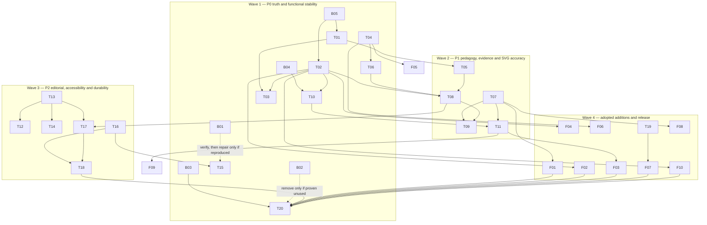

# Evidence-Led Workspace Audit & 35-Task Implementation Roadmap

**Workspace:** `/home/robertsrff/Chemistry_Med/Chemistry_7`  
**Audit date:** 2026-11-06  
**Scope:** read-only inspection and planning. This file is the only artifact created by this audit; no production source, master, tests, skills, or course files were changed.  
**Evidence tags:** `[TESTED]` means a command or tool actually ran; `[INSPECTED]` means the cited file or text was read; `[INFERRED]` means a reasoned conclusion without runtime proof; `[UNVERIFIED]` means a named check remains outstanding. Historical plans are leads, not current acceptance evidence.

## 1. Executive Decision Brief & First-Principles Workspace Profile

### Decision brief

Repair the existing source-first study guide; do not replace it. It is a Latvian medical-student learning document for absorption spectrophotometry and laboratory exercise 6B (riboflavin). Its core architecture is a single offline HTML artifact generated from 18 ordered `src/*.part` fragments with Python calculations and static/behaviour verification tools. `[INSPECTED]` `tools/README.md:1-54`; `[TESTED]` `python3 -I -B tools/build.py --check` reports byte-for-byte parity and `python3 -I -B tools/data.py` reports its numeric invariants pass.

The strongest current assets are traceable source fragments, a standalone calculation authority, explicit epistemic/source labels, 16 chapters, static fallbacks for four interactive instruments, and a real attempt to distinguish screen, print, and no-JavaScript behavior. The highest risks are quantitative overclaiming around regression diagnostics, old and new architecture contracts disagreeing, print/mobile claims without current screenshots, and a visual capture policy that is not implemented consistently by the legacy runner.

### First-principles profile

| Dimension | Discovered profile | Evidence and limit |
|---|---|---|
| Primary discipline | Analytical chemistry; molecular absorption spectrophotometry, quantitative analysis and measurement quality | Course handout and Lab 6B protocol; `[INSPECTED]` source files and `src/` chapters |
| Secondary disciplines | Introductory quantum/physical chemistry, instrumental analysis, regression and uncertainty communication | Chapters 1–10 and `tools/data.py`; not a full metrology course |
| Learner | Medical student at seminar/laboratory level, preparing before Lab 6B, interpreting its protocol data and answering Q1–Q9 | Masthead and chapter learning outcomes; curriculum level inferred from course context, no syllabus inspected |
| Prerequisite baseline | Algebra, logarithms, concentration, volume dilution, basic light/wavelength concepts | Explicitly scaffolded in chapters 0–10; assumed prior chemistry depth is not independently documented |
| Natural languages | Latvian is the instructional language (`lang="lv"`); English terms occur as translations/source terminology; German/French historical surnames are transliterated in Latvian | `src/00_head_masthead.part`; glossary in `src/13_ch12_terminologija_un_vardnica.part` |
| Formal notation | SI and common laboratory units; decimal comma; `A`, `T`, `%T`, `I`, `I₀`, `ε`, `a`, `l`, `c`, `γ`, `λ`, `ν`, `h`, `R²`, `sᵧ`, `u`, `U`; HTML/MathML/SVG and CSS/JS/Python syntax | source fragments and `tools/data.py`; typography canon `plan/style-canon.md` |
| Runtime | Self-contained HTML5, inline CSS/JS/SVG/MathML; `file://` and offline use; Python 3 stdlib build/checks; Node used for JS scan; no package manager manifest or TypeScript configuration found | `tools/README.md`, `run.sh`, repository inventory; no `package.json`, `pyproject.toml`, or `tsconfig.json` found |
| Persistence/network | Product contract bans network and browser storage; current theme and widgets use in-memory DOM state | tail JS inspected; no live privacy/network test performed |
| Render contract | Responsive screen, light/dark/contrast preferences, print/PDF, keyboard, reduced motion and no-JS | CSS declares many of these; declaration does not equal rendered verification |

### Audit status and immediate recommendation

`[TESTED]` `AGENTS.md` is 25,280 bytes, exceeding its stated 24,576-byte ceiling by 704 bytes. The HTML is 313,828 bytes and has SHA-256 `f90d552db94b5da17f2b86aed16a9e55ad66080fb72f4731b5ea1e62c2ba7a22`; mtime is 2026-11-02 22:03:22. `[TESTED]` three course-file hashes match the values in `plan/source-hashes.txt`. `[INSPECTED]` there is no `.git` repository, so source mutation status is evidenced by checksums, timestamps, and the audit's file operations rather than Git status.

`[TESTED]` `lite-shot` with falkon exited 75 (`Xvfb display probe failed`). The visual state is therefore `[UNVERIFIED]`; this is a code-only visual audit. The local lite-shot contract forbids Chrome absent explicit current-turn permission; no Chrome render was used. The current `tools/shoot.mjs` and root `VISUAL_VERIFICATION.md` contain older fallback instructions that conflict with the newer canonical `tools/visual-verification.md` contract.

## 2. Workspace, Architecture & Skills Inventory + File-by-File Inspection Ledger

### Architecture and inventory

| Path/group | Role | Inspection level | Evidence / coverage limit |
|---|---|---|---|
| `AGENTS.md` | Governing architecture, budgets, source locks, open issues, acceptance rules | Full | Read; measured 25,280 B vs 24,576 B cap; newer lite-shot addendum conflicts with older visual runner instructions |
| `Master_spektrofotometrija_SEM7_LD6B.html` | Sole generated deliverable | Partial/direct checks | Hash, size, mtime, build parity; no full text reread or rendered acceptance this turn |
| `src/00_head_masthead.part` | HTML shell, CSS tokens, nav, shared components and print styles | Partial | Read targeted selectors and visual inventory; dark/contrast/focus/reduced-motion/print CSS exists, but no `@layer`, `forced-colors`, or zero-inline-style contract |
| `src/01`–`src/16` chapter parts | Chapters 0–15, Latvian prose, tables, figures, assessments and errata | Partial | Targeted chapters/claims read; line mapping is by source part, not generated HTML, which is build output |
| `src/17_tail_scripts.part` | Four instruments, theme, masks, print behavior and JS wiring | Full/targeted | 169 source lines; exceeds newer §4 registry cap; no browser dispatch run |
| `tools/data.py` | Numeric/calculation authority | Ran | `[TESTED]` exits 0 with invariant success; inspect full formulas before implementation edits |
| `tools/build.py` | Concatenates parts and writes manifests/uncertainty output | Partial | `--check` read-only and passed; normal build mutates master and plan outputs |
| `tools/verify.py` | 37-check harness and 33 negative fixtures per README | Partial | Read orchestration and selected check implementations; self-test writes/restores source-hash file, not run |
| `tools/behaviour.py` | Instrument DOM behavior test via Chrome | Not run | Uses Chrome; browser policy blocks its use here; behavior remains unverified |
| `tools/figures.py` | SVG text sizing/layout checks; `--apply` edits source | Partial | Tool uses Chrome geometry; `--apply` is mutating; neither mode run |
| `tools/verify_js.mjs` | Static JS syntax, API, selector and wiring scan | Partial | Existing cap is older 8 KiB limit; static checks cannot establish state correctness |
| `tools/shoot.mjs` | Older capture/print runner | Read | Not run: legacy falkon `-f` and Chrome fallback conflict with current protocol |
| `tools/visual-verification.md`, `VISUAL_VERIFICATION.md` | Visual evidence protocol | Full/partial | Canonical lite-shot instruction read; duplicate root guidance is stale/conflicting |
| `run.sh` | Combined build, JS check, self-test, full harness | Read | Not run: first step writes generated outputs and self-test temporarily overwrites source hashes |
| `plan/*` | Dated plans, source/hash manifest, design/term/figure notes, saved evidence | Partial | Read selected; not fresh runtime proof; plans contain historical metrics and prior task IDs |
| Three primary course files | 2025 theory PDF, filled 2020 protocol PDF, blank 2022 DOCX | Hash/metadata/text partial | Hashes match ledger; 2025 PDF text extracted first pages; not all pages re-extracted; no source edits |
| `workspace_skills/` | Imported reference skills and templates | Inventory only | `INDEX.md` and tree inventory; all entries read or invoked: no; do not execute copied scripts or treat them as product code |
| `.claude/`, `.gitignore`, `PROMPT_master_html.md` | Local config, ignores, historical prompt | Partial/not read | Inventory only; prompt is reference-only under governance and must not be edited |

### Expanded source, tool and plan file ledger

The following names were individually inventoried. “Partial” means targeted reads, not a full line-by-line audit; the status must not be read as content approval.

| File/asset path | Role | Content inspected? | Render/runtime tested? | Evidence / limit |
|---|---|---|---|---|
| `src/00_head_masthead.part` | HTML shell, shared styles, navigation | Partial | No | Token, media and component selectors read; not full stylesheet audit |
| `src/01_ch00_ievads.part` | Chapter 0 orientation/source map | Partial | No | Inventory and targeted links only |
| `src/02_ch01_divi_postulati.part` | Chapter 1 course postulates | Partial | No | Source framing inspected via course PDF, not full fragment |
| `src/03_ch02_kvanti_un_energija.part` | Chapter 2 energy/quanta | Partial | No | Transition explanation and figure target inspected |
| `src/04_ch03_absorbcijas_spektra.part` | Chapter 3 spectra and maxima | Partial | No | Band explanation and 440/444 claims read; render unverified |
| `src/05_ch04_spektrofotometrs.part` | Chapter 4 instrument and recall masks | Partial | No | Selector/mask block and table structures read |
| `src/06_ch05_transmitance_un_absorbance.part` | Chapter 5 definitions/derivation | Partial | No | A/T definitions and intercept claim read |
| `src/07_ch06_bugera_lamberta_bera_likums.part` | Chapter 6 Beer–Lambert law and explorer | Partial | No | Units and explorer selectors read |
| `src/08_ch07_novirzes_no_likuma.part` | Chapter 7 deviations | Partial | No | 440 nm inference and regression language read |
| `src/09_ch08_kalibresanas_terminologija.part` | Chapter 8 calibration terminology | Partial | No | Blank/fit text and terminology map read |
| `src/10_ch09_kompleksu_veidosanas.part` | Chapter 9 Fe/SCN chemistry | Partial | No | Speciation note and protocol framing read |
| `src/11_ch10_laboratorijas_darbs_6b.part` | Chapter 10 Lab 6B data, instruments, worked calculations | Partial | No | Tables, calculator, uncertainty and wavelength excerpts inspected |
| `src/12_ch11_biezakas_kludas.part` | Chapter 11 common mistakes | Inventory only | No | Not fully read |
| `src/13_ch12_terminologija_un_vardnica.part` | Chapter 12 glossary | Partial | No | Key term entries and inline styles read |
| `src/14_ch13_pasparbaudes_jautajumi.part` | Chapter 13 Q1–Q9 | Inventory only | No | Answer coverage not independently run this turn |
| `src/15_ch14_atsauces_un_avoti.part` | Chapter 14 references/provenance | Partial | No | Bibliography and limits read |
| `src/16_ch15_labojumu_zurnals.part` | Chapter 15 errata/changelog | Partial | No | Selected errata and source claims read |
| `src/17_tail_scripts.part` | Inline JS | Targeted/full | No | Handler pathways inspected; no event dispatch |
| `tools/README.md` | Tool docs and side effects | Full | No | Read; identifies mutating commands and old checks |
| `tools/behaviour.py` | Browser interaction assertions | Partial | No | Driver path inspected; not run because it uses Chrome |
| `tools/build.py` | Build and manifest | Partial | `--check` run | Parity passed; normal build is mutating |
| `tools/data.py` | Science calculations | Partial | Ran | Invariants pass; not every displayed value re-extracted from source PDF |
| `tools/figures.py` | SVG dimensions/label checks | Partial | No | `--apply` mutates; Chrome geometry path not run |
| `tools/shoot.mjs` | Legacy screenshot/print capture | Partial | No | Compared with visual contract; not run due conflict |
| `tools/verify.py` | Structural, data, browser/print harness | Partial | No | Self-test writes source-hash ledger temporarily |
| `tools/verify_js.mjs` | Static JS validation | Partial | No | Existing budget mismatches current AGENTS |
| `tools/visual-verification.md` | Canonical screenshot rules | Full | N/A | lite-shot, falkon/falkon, Chrome prohibition inspected |
| `plan/DEEP_INSPECTION_TASKBOOK_2026.md` | D01–D20, F21–F30, R01–R05 historical deep audit | Partial | No | Prior evidence date 2026-11-02; not current acceptance |
| `plan/ROADMAP_T21-T40_AND_FEATURE_BACKLOG.md` | T21–T40 and F01–F10 historical roadmap | Partial | No | Existing plan; conflicts with AGENTS missing-file assertion |
| `plan/a11y-tab.txt` | Saved keyboard evidence | Not inspected | No | Historical snapshot only |
| `plan/ax-tree.txt` | Saved accessibility tree | Not inspected | No | Historical snapshot only |
| `plan/build-manifest.txt` | File hashes | Partial | Compared master | Master digest agrees with current file |
| `plan/contrast.txt` | Saved contrast report | Not inspected | No | Historical snapshot only; not recalculated |
| `plan/design-decisions.md` | Style decisions | Inventory only | No | Not fully read |
| `plan/execution-log.md` | Execution history | Inventory only | No | Not fully read; historical metrics not used as fresh proof |
| `plan/figures.md` | Figure evidence | Inventory only | No | Not fully read; no visual acceptance inferred |
| `plan/language-lint.txt` | Saved language scan | Not inspected | No | Historical snapshot only |
| `plan/numbers.csv` | Required numeric strings | Partial | Not run | Build check confirms source parity, not scientific validity |
| `plan/source-hashes.txt` | Primary source digests | Read | Compared hashes | All three hashes match |
| `plan/style-canon.md` | Typography canon | Inventory only | No | Not fully read |
| `plan/terms-source.md` | Terminology provenance | Partial | No | `kivete` status/source claims targeted |
| `plan/uncertainty.csv` | Derived uncertainty data | Inventory only | No | No independent recomputation table read this turn |
| `run.sh` | Combined build/test runner | Full | No | Read; avoid during read-only audit because it builds and self-tests |
| `7_SEM_Optika_analize_2025.pdf` | Primary theory source | Partial | N/A | Metadata/hash and first pages extracted; full pages not reviewed |
| `LD_Spektrofotometrija_Paraugs.pdf` | Filled protocol/data source | Partial | N/A | Metadata/hash; complete table transcription not rechecked this turn |
| `Absorbcija_LD_2022.docx` | Blank form | Metadata/hash only | N/A | Body not extracted this turn |
| `workspace_skills/INDEX.md` and `workspace_skills/COPY_MANIFEST.json` | Skill catalog/provenance | Inventory only | N/A | Index and root skill directories inventoried; copied scripts not executed |

**Workspace skill directory inventory (36):** `animate`, `animation-performance`, `animation-vocabulary`, `apple-design`, `audit`, `blueprint-spec-sheet`, `break-ui`, `cognitive-deload-auditor`, `design-motion-principles`, `design-taste-frontend`, `emil-design-eng`, `find-animation-opportunities`, `frontend-design`, `high-end-visual-design`, `impeccable`, `improve-animations`, `industrial-brutalist-ui`, `interactive-study-guide`, `learn-then-test`, `lexicon-morphology-weaver`, `minimalist-ui`, `mook-visual-compendium`, `pdf-beautify`, `pdf-claude`, `pdf-codex`, `pdf-vector-surgeon`, `pick-ui-library`, `playground`, `polish`, `print-css-alchemist`, `prototype`, `review-animations`, `state-scrubber-lab`, `svg-spatial-occlusion`, `synoptic-matrix-architect`, `tufte-margin-scholar`. This lists skill roots, not every nested reference/template/script; all nested skill files remain reference-only and were not fully inspected.

### End-to-end interaction map

| Trigger → handler | State/computation → persistence | View update / evidence status |
|---|---|---|
| Theme button `#theme-toggle` → tail-script click handler | Sets `documentElement.dataset.theme`; memory-only | CSS tokens update colors; code inspected, live dark/light transition unverified |
| Explorer sliders `#exp-g`, `#exp-l` → `upd()` | Clamp/parse γ,l; compute `A=k·l·γ`, `T=10^-A`, `%T`, absorbed fraction; no persistent storage | Updates `<output>`, warning, beam width/particles; source inspected, browser behavior unverified |
| Diagram recall masks → click handlers over `data-for` | Reveal label class/state; no persistence | Updates visible SVG labels/status; hidden/reveal parity and no-JS path unverified |
| Dilution fields → `upd()` | Parse V1/Vtot; calculate C1V1=C2V2 with bounds; no storage | Outputs concentration and warnings; static table fallback present, behavior unverified |
| Quality fields → `upd()` | Parse A/digits; calculate concentration and uncertainty from stated model; no storage | Updates readout/verdict; edge cases not exercised |
| Print event → beforeprint/afterprint | Opens/restores disclosure and recall state in memory | Print has JS dependency despite newer contract asking CSS-native expansion; verify with approved lite-shot/PDF method |

No inspected path uses browser storage or network APIs; this is source-level evidence, not a runtime privacy test. No dead selector or dead listener was positively proven in this audit. Missing selector checks in `verify_js.mjs` are regex/static coverage, not complete reachability analysis.

### Skills and tooling relevant to later implementation

Inventory only is not skill execution. For authorized future product work, the directly relevant workspace skills are `cognitive-deload-auditor` (instructional load), `interactive-study-guide` (single-document study UX), `learn-then-test` (retrieval practice), `svg-spatial-occlusion` (diagram recall), `print-css-alchemist` (screen/print), `blueprint-spec-sheet` (technical plates), `lexicon-morphology-weaver` (term architecture), `audit` and `break-ui` (accessibility/worst-case review), `design-taste-frontend`/`impeccable` (visual restraint), and `review-animations` (motion). They are references, not authorities for chemistry, and must be reconciled with `AGENTS.md` before use.

## 3. Diagnostic Triage: Confirmed Defects vs. Suspected Risks vs. Pedagogical/Design Opportunities

| ID | Finding | Status | Severity | Evidence and required next proof |
|---|---|---|---|---|
| D-01 | `AGENTS.md` exceeds its own size ceiling by 704 B | `[TESTED]` | P1 governance | `wc -c`; compress only duplicated governance language, retain all constraints |
| D-02 | Contradictory visual protocols: lite-shot forbids Chrome and `falkon -f`; legacy runner permits Chrome and invokes `falkon -f` | `[INSPECTED]` | P0 release evidence | `tools/visual-verification.md`, `tools/shoot.mjs`; reconcile before screenshot claims |
| D-03 | Current visual rendering not inspected; lite-shot failed Xvfb probe with exit 75 | `[TESTED]` | P0 | Must rerun outside sandbox/display-permitted environment, capture and inspect each required state |
| D-04 | Four widgets and theme/print interactions are JS-driven; tail exceeds current micro-runtime ceiling | `[INSPECTED]` | P1 architecture | 169 source lines; current compiled/minified artifact is above AGENTS 4,096 B/100 lines/2% target; count compiled bytes before claiming exact overage |
| D-05 | `run.sh` is not read-only: build writes master and plan files; `--selftest` temporarily writes `plan/source-hashes.txt` | `[INSPECTED]` | P0 audit hygiene | `tools/README.md`, `tools/verify.py:828-838`; do not re-run full command without snapshot protocol |
| D-06 | Older harness architecture conflicts with current AGENTS limits (8 KiB JS budget vs 4,096 B, expected print JS, etc.) | `[INSPECTED]` | P1 reliability | README C21 and `verify_js.mjs`; align gates to current contract and add negative fixtures |
| D-07 | 11 inline SVGs in 7 figure wrappers; semantic title/description structures present, conceptual and visual accuracy unverified | `[INSPECTED]` + `[UNVERIFIED]` | P1 | Full SVG inventory below; need source-to-figure warrant and rendered inspections |
| D-08 | No `<noscript>`, no exclusive `details[name]`, no dialog/popover, no `@layer`, no `forced-colors`, inline styles remain | `[INSPECTED]` | P1 architecture/accessibility | Match to AGENTS §§4,7 and items OI-18–25; static findings only |
| D-09 | Historical plan and current AGENTS disagree on active roadmap presence and some baselines | `[INSPECTED]` | P1 governance | `plan/DEEP_INSPECTION_TASKBOOK_2026.md`, `plan/ROADMAP_T21-T40_AND_FEATURE_BACKLOG.md` exist; their claims must be refreshed |
| D-10 | Fit, print pagination, theme contrast and widget edge behavior remain unverified today | `[UNVERIFIED]` | P0/P1 | Exact tests specified in Sections 12–14 |

No other code/runtime defect is promoted to `[CONFIRMED DEFECT]` solely because a past plan reports it. The historical taskbook records 390 px overflow, clipped print tables, narrow rails and stale claims from its 2026-11-02 inspection; validate against today's artifact before calling them current defects.

## 4. Domain Terminology, Fact, Applicability & Warrant Verification Ledger

| Claim ID | Location | Existing claim | Status | Applicability and warrant analysis | Authority | Confidence | Proposed correction |
|---|---|---|---|---|---|---|---|
| C-01 | `src/06_ch05_transmitance_un_absorbance.part:30-34`; `src/13_ch12_terminologija_un_vardnica.part:55-60` | `A=lg(I₀/I)`; distinguishes process “absorbcija” from quantity “absorbance A” | Verified with scope note | IUPAC defines absorbance for transmitted radiant power; notes cell-wall effects excluded and distinguishes absorptance. The chemistry concept is supported; Latvian preferred lexical form is not established by IUPAC | IUPAC Gold Book A00028 (absorbance) and A00035 (absorptance) | High for definition, low/medium for Latvian norm | Keep equation and explicit house choice; verify Latvian term with AkadTerm or a disciplinary Latvian authority before calling it canonical |
| C-02 | `src/04_ch03_absorbcijas_spektrs.part:36-42` | Supplied handout says bands appear from thermal broadening of discrete lines and are symmetric around λmax | Over-simplified | Molecular bands include vibronic/rotational structure, solvent/environmental broadening and instrument bandwidth; absolute-zero argument is not a sufficient general model | IUPAC spectroscopy glossary; foundational spectroscopy references needed | Medium | Preserve source quote as erratum, replace explanation with bounded molecular transition + unresolved envelope account; avoid “one exact wavelength” generalization |
| C-03 | `src/07_ch06_bugera_lamberta_bera_likums.part:25-32` | Lab handout has erroneous molar coefficient symbol/unit and overstated 10^6 bound | Verified correction needed | Epsilon unit follows concentration and path length; standard mass absorptivity is distinct from molar coefficient; handout's unit cannot represent epsilon as named | IUPAC Gold Book molar absorption coefficient; handout text | High on dimensional correction; historical wording still needs primary-source reading | Correct in teaching prose while preserving exact source error and location in errata |
| C-04 | `src/04_ch03_absorbcijas_spektrs.part:21-30`; `src/08_ch07_novirzes_no_likuma.part:28-38`; `src/11_ch10_laboratorijas_darbs_6b.part:5-14` | 440 nm is near literature's 444 nm maximum and lies on a flat peak | Warrant flaw | The filled protocol selects 440 nm; Sheraz et al. reports 444 nm for aqueous riboflavin. Neither establishes the local slope for this sample, its pH/solvent/concentration, or instrument bandwidth; nearby wavelength is not proof of flatness | Sheraz et al. 2014 open text; filled protocol | High that local-slope inference is unproven | Label 440 as protocol setting, 444 as literature value, and flatness as unverified inference unless the matching spectrum is inspected |
| C-05 | `src/06_ch05_transmitance_un_absorbance.part:65-67`; `src/09_ch08_kalibresanas_terminologija.part:52-57`; `src/11_ch10_laboratorijas_darbs_6b.part:377-398`; `tools/data.py:90-136,159-170,195-222` | High R² and near-zero intercept are used in places as validation; elsewhere R² is correctly limited | Warrant flaw / cross-section inconsistency | The data produce origin slope 30.3946, free 9-point slope 30.24/intercept +0.0017, free 8-point slope 30.150/intercept +0.0028. Sample free-fit uses 8-point variant. Residuals assess model deviations but neither R² nor intercept proves accuracy, homogeneity, monochromaticity, or compliance. IUPAC calibration guidance requires residual/model assessment | `data.py`; IUPAC calibration guidelines 2002 | High for computations; high for inference limit | Name every fit and blank inclusion. Replace “confirms/validates” language with bounded diagnostic interpretation |
| C-06 | `src/11_ch10_laboratorijas_darbs_6b.part:464-468` | Linear response good; accuracy not proven; epsilon converted assuming 1 cm | Mostly warranted, conditional | Linear fit and no certified reference support the stated limitation; converting mass slope to molar epsilon requires path length and concentration conversion assumptions | `tools/data.py`; IUPAC coefficient definition | High | Retain conditional language; explicitly state unknown cuvette path and avoid presenting ε as measured independently |
| C-07 | `src/11_ch10_laboratorijas_darbs_6b.part:455-464` | LOD=3sy/k, LOQ=10sy/k reported as simplified regression estimates | Over-simplified but labelled | These formulas are heuristics in this implementation; they do not establish blank-based decision limits, false-positive/negative rates, or validated method performance | Currie 1995 bibliography record; current data | Medium | Preserve as teaching estimate only; state model, blank and uncertainty limitations adjacent to values |
| C-08 | `src/13_ch12_terminologija_un_vardnica.part:48,60` | “kivete” preferred and “absorbance” used to distinguish quantity | Unverified Latvian norm; deliberate house style | IUPAC governs scientific concepts, not Latvian lexical preference; no Latvian terminology authority passage was inspected | OI-11; AkadTerm check required | Low/medium | Keep explicitly labelled house choice pending dictionary/terminology verification; don't misstate it as official norm |
| C-09 | `tools/data.py:20,138,217+`; source tables | 440 nm energy, slope, concentrations, percent transmittance values | Tested computationally, source provenance partial | `data.py` invariants passed and master parity holds; source protocol rows/hash were not re-extracted in full this turn | `tools/data.py`; source hashes | High for code consistency, medium for source transcription | Reconcile all displayed values against protocol pages and named regression variant during product work |
| C-10 | `src/10_ch09_kompleksu_veidosanas.part:8-20` | Fe(III)-thiocyanate forms a colored complex; mono-complex dominance is suggested as ordinary conditions | Partially verified / scope-limited | The equation is a pedagogical simplification. FeSCN²⁺/higher complexes and their proportions depend on thiocyanate concentration, acidity, ionic strength and time; course conditions must govern any dominance statement | Course material; peer-reviewed equilibrium paper DOI 10.1016/j.ica.2016.02.052 | Medium | Keep reaction as simplified scheme; remove dominance claim unless the actual Lab 6B solution conditions and applicable speciation evidence are matched |

### Warrant rule for follow-on edits

Do not “verify” a sentence because a number appears in a paper. Record the paper's system, solvent, pH, temperature, wavelength, concentration, model and scope; then show which of those match the Lab 6B claim. A measured maximum does not establish the curvature around that maximum; a regression statistic does not establish trueness; an assumed 1 cm cell does not make path length measured. Every correction touching these concepts must carry claim ID(s) from this ledger into its change record.

## 5. Authoritative Book, Standard & Literature Bibliography

Authority order for this material: (1) IUPAC terminology recommendations/Gold Book and BIPM SI guidance for quantity definitions and notation; (2) primary research for riboflavin spectral/environment scope; (3) university analytical/instrumental chemistry textbooks for pedagogical synthesis; (4) local course documents for intended procedure and assessed scope. Course sources are not automatically factual authorities.

| Record | Bibliographic metadata and topic scope | Provenance and use boundary |
|---|---|---|
| IUPAC, *Compendium of Chemical Terminology (the Gold Book)*, 5th ed. online version 5.0.0, 2025, IUPAC, DOI 10.1351/goldbook; entries A00028 absorbance, A00035 absorptance, M03972 molar absorption coefficient; https://goldbook.iupac.org/terms/view/A00028 | Official terminology definitions: absorbance, absorptance, coefficient | `[TEXT-VERIFIED]` A00028 definition inspected in search extract; direct open returned 403 on this audit. Use the official entry per claim. Do not infer Latvian preferred term from this English source |
| BIPM, *The International System of Units (SI Brochure)*, 9th ed. (2019; online updated 2026), Bureau International des Poids et Mesures, DOI 10.59161/AUEZ1291; https://www.bipm.org/en/publications/si-brochure/ | SI quantity/unit expression and dimensionless quantities | `[METADATA-VERIFIED / SCOPE-ALIGNED]` official BIPM record and edition inspected; relevant chapter/page not inspected; consult the section before exact rule edits |
| Sheraz, M. A.; Kazi, S. H.; Ahmed, S.; Anwar, Z.; Ahmad, I. “Photo, thermal and chemical degradation of riboflavin.” *Beilstein Journal of Organic Chemistry* 10 (2014), 1999–2012. DOI 10.3762/bjoc.10.208; https://doi.org/10.3762/bjoc.10.208 | Review including aqueous riboflavin absorption maxima and degradation context | `[TEXT-VERIFIED]` open full text/PDF inspected; supports reported aqueous maxima, not the Lab 6B sample spectrum or the 440 nm local slope |
| Currie, L. A. “Nomenclature in evaluation of analytical methods including detection and quantification capabilities (IUPAC Recommendations 1995).” *Pure and Applied Chemistry* 67 (1995), 1699–1723. DOI 10.1351/pac199567101699 | Detection/quantification terminology and method evaluation | `[METADATA-VERIFIED / SCOPE-ALIGNED]` identity metadata known; exact recommendation passage not read this turn; simplified values remain labelled estimates |
| IUPAC, *Guidelines for calibration in analytical chemistry. Part 1. Fundamentals and single component calibration*, *Pure and Applied Chemistry* 74 (2002), 835–855. DOI 10.1351/pac200274050835; https://publications.iupac.org/publications/pac/2002/pdf/7405x0835.pdf | Calibration model and validation guidance, including residual/model assessment | `[METADATA-VERIFIED / SCOPE-ALIGNED]` identified and scope checked from IUPAC publication record; full PDF open was blocked (403) in this audit; use as source lead, not a page-level quote |
| IUPAC, *Quantities, Units and Symbols in Physical Chemistry* (Green Book), 3rd ed., 2007, RSC Publishing, ISBN 978-0-85404-433-7 | Quantity symbols, units, spectroscopy quantities; exact chapter/section not checked | `[METADATA-VERIFIED / SCOPE-ALIGNED]` metadata from current workspace dossier; page-level passage not inspected in this turn |
| Skoog, D. A.; Holler, F. J.; Crouch, S. R., *Principles of Instrumental Analysis*, 7th ed., Cengage, year varies across catalogue records (2016/2018 conflict), ISBN 978-1-305-57721-3 | Instrumental analysis and optical methods; exact chapter/section not checked | `[UNVERIFIED]` exact publication year conflict and chapter scope/page not checked; do not cite as support until resolved |
| Atkins, P.; de Paula, J.; Keeler, J., *Atkins’ Physical Chemistry*, 12th ed., Oxford University Press, 2022, ISBN 978-0-19-884781-6 | Molecular energy transitions and spectroscopy background; exact chapter/section not checked | `[METADATA-VERIFIED / SCOPE-ALIGNED]` record carried in local dossier; exact chapter/passages not read |
| 2025 course handout, *Optiskās metodes vielu koncentrācijas noteikšanai*, 5 pp., local PDF | Curriculum scope and supplied theory; not infallible on scientific claims | `[TEXT-VERIFIED]` first pages extracted; full page-by-page review outstanding |
| 2020 filled protocol, *6B. Spektrofotometrija*, 3 pp., local PDF; 2022 blank form, same task | Procedure and source absorbance values (2020 filled protocol is the only absorbance source) | `[INSPECTED]` metadata and hashes; values and all pages require fresh extraction before correction |

No page numbers or quotations are assigned here beyond visible metadata. The local book records are not direct page-level verification. A future author must read the relevant passage or retain an honest unverified status.

## 6. Editorial Design (Anti-AI-Slop), Retexturing, Accessibility, Pedagogy & Complete SVG Inventory/Diagnostics

### Visual and editorial baseline

The current declared design is restrained: tokenized light/dark colors, system fonts, reading measure near 62–70ch, focus-visible, reduced-motion, contrast preference, print rules, and no gradients/shadows/emoji. `[INSPECTED]` `src/00_head_masthead.part`. Preserve this existing clarity. The required next step is systematic engineering, not more ornament: adopt the seven-layer CSS order in AGENTS, move inline declarations into classes, calculate all token/state contrast, add forced-colors behavior, and simplify repeated boxes only where the reading hierarchy benefits.

Pedagogical sequence should consistently move from mechanism → rule/equation → real Lab 6B number → tempting error → detection/correction. Preserve the five-pillar map (definition, mechanism, worked example, common mistake, canonical term) and add a report that identifies missing pillars without treating mere class-name presence as coverage. Q1–Q9 need reasoned answer keys that explain why plausible alternatives fail; source and illustrative claims must remain separately labelled.

### SVG inventory and disposition proposals

The inventory has 11 inline SVGs in 7 figure wrappers. Each inspected SVG has `viewBox`, `role="img"`, `aria-labelledby`, one `<title>` and one `<desc>`; captions are present. This is structural evidence only; all conceptual geometry, text collision, contrast, and print legibility remain `[UNVERIFIED]` because screenshot capture failed.

| Figure ID/topic | Source location | Initial disposition | Teaching objective / risk to inspect |
|---|---|---|---|
| V01 energy levels and photon transition | `src/03_ch02_divi_postulati.part:30-53` | `[CORRECT]` | Show ΔE=hν=hc/λ without classical orbital tracks; test level ordering and arrow direction |
| V02 discrete levels versus molecular absorption band | `src/04_ch03_absorbcijas_spektrs.part:46-82` | `[REDESIGN]` | Distinguish molecular band envelope from a single exact wavelength; avoid absolute-zero-only account |
| V03 riboflavin literature maxima (373/444 nm) | `src/04_ch03_absorbcijas_spektra.part:86-119` | `[RETAIN]` | Mark literature positions only; no synthetic curve or claim of measured Lab spectrum |
| V04 spectrophotometer optical path | `src/05_ch04_spektrofotometrs.part` figure block | `[CORRECT]` | Check source → selector → sample → detector order, monochromator labels, and detector reading semantics |
| V05 recall overlay instrument schematic | `src/05_ch04_spektrofotometrs.part:60-83` | `[REDESIGN]` | Ensure static labels remain meaningful if JS fails; masks align to components and keyboard focus |
| V06 differential slab / Beer–Lambert derivation | `src/06_ch05_transmitance_un_absorbance.part:72-114` | `[CORRECT]` | Show loss over dl and sign convention; avoid suggesting a single photon trajectory |
| V07 A/T relation | `src/06_ch05_transmitance_un_absorbance.part:91-218` | `[RETAIN]` | Verify plotted log relation, axes, sample values, and no misleading linear visual scale |
| V08 Beer-law beam intensity | `src/07_ch06_bugera_lamberta_bera_likums.part:86-123` | `[CORRECT]` | Label I₀/I and model assumptions; particle icons must not imply individual photon count measurement |
| V09 three uses of “kalibrēšana” | `src/09_ch08_kalibresanas_terminologija.part:8-33` | `[RETAIN]` | Keep distinctions and visual reading order; check labels at narrow width |
| V10 Lab 6B calibration plot, nine/fit variants | `src/11_ch10_laboratorijas_darbs_6b.part:137-260` | `[CORRECT]` | Identify blank inclusion, fit model, units, and residual evidence; never make R² a visual proof stamp |
| V11 residual/uncertainty plots | `src/11_ch10_laboratorijas_darbs_6b.part:261-333` | `[REDESIGN]` | Separate residual scale from fit scale; show measurement uncertainty only where justified |

Proposed additions are specified in T08, T09 and features F01/F03. New figures need explicit source/data provenance and a table equivalent where values carry meaning. No art asset should be generated from an invented spectrum or assumed instrument geometry.

### Accessibility and print acceptance baseline

Target WCAG 2.2 AA for text (4.5:1), large text and meaningful control boundaries (3:1 where applicable), keyboard reachability, visible focus, screen-reader name/state, 200% zoom, forced-colors, reduced motion and print pagination. All disclosures must print with their content visible using supported HTML/CSS; do not rely on a JS beforeprint mutation once OI-16 is addressed. Each scroll region needs a name and focus path; every SVG needs a concise equivalent and no meaning conveyed only by color. Capture 390, 768, 1440 px, themes and print only through the current approved lite-shot workflow and inspect images directly.

## 7. 20 Core Improvement Tasks (T01–T20) — Full Exhaustive Templates

All tasks below are proposals, not authorization to edit production. Source authority and task scope follow Sections 3–6 and `AGENTS.md` §§3–12. Every task has exactly three macro steps and two named subtasks with exactly three executable substeps each. Substeps identify atomic file/code targets and checks; macro steps define migration order.

### T01 — Reconcile the live claim ledger and repair the 440/444 nm warrant

**Classification & Governance Block:** Workstream: Terminology & Sourcing; Priority: P0; Impact: 5; Effort: 2; Epistemic Status: `[INSPECTED]`. **Responsibility Boundary:** own wavelength claims and claim/source ledger rows; T02 owns regression language, T08 owns figure representation. **Applicable Workspace Skills:** `tools/data.py`, `plan/terms-source.md`, `cognitive-deload-auditor`; source verification via Sheraz paper. **Observed Problem & Concrete Workspace Evidence:** `src/04_ch03_absorbcijas_spektra.part:21-30`, `src/08_ch07_novirzes_no_likuma.part:28-38`, `src/11_ch10_laboratorijas_darbs_6b.part:5-14` mix protocol setting 440 nm with literature 444 nm and an inference that 440 nm is flat. **Why It Matters:** nearby peak values do not prove local spectral slope under Lab 6B conditions. **Intended End State & Scope Guardrails:** distinguish protocol fact, literature fact, and bounded inference in Latvian; do not fabricate a local spectrum. **Authoritative Source / Book Backing & Warrant Check:** C-04; Sheraz aqueous context does not establish the experiment's pH, solvent or bandpass.

**Main Implementation Steps:** Main Step 1: Build a three-column evidence map for setting, literature maximum and local spectrum availability; checkpoint each statement against source scope. Main Step 2: Rewrite chapter 3 and chapter 7 claims and append the preserved source wording/correction to the errata source. Main Step 3: Align captions, glossary references and lab answer material; run source-text search and instructor review before rebuild.

**Subtask T01.1 — Separate the three wavelength statements:** Substep T01.1.1: edit `src/04_ch03_absorbcijas_spektrs.part` so 440 nm is called the course setting; verify exact numeral and label. Substep T01.1.2: attribute 444 nm to aqueous literature in `src/15_ch14_atsauces_un_avoti.part`; verify citation scope and source status. Substep T01.1.3: replace “flat peak” certainty in `src/08_ch07_novirzes_no_likuma.part`; verify no sentence implies measured sample spectrum.

**Subtask T01.2 — Reconcile claims and citations:** Substep T01.2.1: add claim ID C-04 and applicability notes to `plan/terms-source.md`; verify claim-to-source mapping. Substep T01.2.2: add exact faulty wording and corrected statement to `src/16_ch15_labojumu_zurnals.part`; verify permanent errata numbering. Substep T01.2.3: search all `440`, `444`, `flat`, `plakana` occurrences across `src/`; verify every context keeps facts and inference separate.

**Affected Files, Selectors, Interfaces & Data Structures:** existing `src/04*`, `src/08*`, `src/11*`, `src/15*`, `src/16*`, `plan/terms-source.md`; no new feature. **Measurable Acceptance Criteria & Regression Tests:** positive: source text shows distinct setting/literature/inference; negative: no unsupported flatness claim remains; accessibility/viewport: the changed note remains readable at 390 px and print. **Dependencies, Risks, Rollback & Definition of Done:** independent of T02; coordinate with T08 captions. Revert only affected source hunks if the literature scope cannot be stated; done when all wavelength references and errata agree.

### T02 — Bound regression diagnostics and reconcile three fit variants

**Classification & Governance Block:** Workstream: Terminology & Sourcing; Priority: P0; Impact: 5; Effort: 3; Epistemic Status: `[INSPECTED]`. **Responsibility Boundary:** own calibration language and model naming; T10 owns calculation-engine tests. **Applicable Workspace Skills:** `tools/data.py`, `cognitive-deload-auditor`, IUPAC calibration guidance. **Observed Problem & Concrete Workspace Evidence:** `src/06_ch05_transmitance_un_absorbance.part:65-67`, `src/09_ch08_kalibresanas_terminologija.part:52-57`, `src/11_ch10_laboratorijas_darbs_6b.part:377-398,464-477`; `tools/data.py:90-136,159-170,195-222`. **Why It Matters:** a near-zero intercept or high R² cannot prove accuracy or validate the full method; three fits differ by inclusion of blank and intercept constraint. **Intended End State & Scope Guardrails:** every value names origin 9-point, free 9-point with blank, or free 8-point without blank; no accuracy claim from fit alone. **Authoritative Source / Book Backing & Warrant Check:** C-05; IUPAC calibration guidance supports residual/model diagnostics, not trueness from R².

**Main Implementation Steps:** Main Step 1: Create a canonical regression-variant table from `data.py` and record inclusion/constraint for each fit. Main Step 2: Rewrite every prose/table/figure occurrence to distinguish diagnostic, model assumption and result. Main Step 3: Add targeted verification for variant labels and prohibited overclaims; confirm displayed values reconcile to computation.

**Subtask T02.1 — Label model variants:** Substep T02.1.1: audit `tools/data.py` result names and sample-fit selection; verify all three variants are explicit. Substep T02.1.2: edit `src/11_ch10_laboratorijas_darbs_6b.part` table captions/columns; verify blank inclusion and intercept rule are stated. Substep T02.1.3: update `plan/numbers.csv` only through its authorized canonical process; verify no number was manually substituted.

**Subtask T02.2 — Remove overclaims:** Substep T02.2.1: replace “valid/confirms” wording in `src/06_ch05_transmitance_un_absorbance.part` and `src/09_ch08_kalibresanas_terminologija.part`; verify R² and intercept are called diagnostics. Substep T02.2.2: align `src/08_ch07_novirzes_no_likuma.part` residual discussion with calculated maximum; verify it does not assert monochromaticity or chemical homogeneity. Substep T02.2.3: add negative fixture to `tools/verify.py` for an R²-as-proof claim; verify injected overclaim fails.

**Affected Files, Selectors, Interfaces & Data Structures:** `src/06*`, `src/08*`, `src/09*`, `src/11*`, `tools/data.py`, `tools/verify.py`, `plan/numbers.csv`. **Measurable Acceptance Criteria & Regression Tests:** positive: all three model labels match computation; negative: fixture rejects “R² proves accuracy”; a 390 px table and print table remain uncut. **Dependencies, Risks, Rollback & Definition of Done:** precedes T03 and T10; B04 owns harness-wide weakness. Revert text/table changes if values mismatch recomputation; done when values and warrants agree.

### T03 — Repair uncertainty, LOD/LOQ and significant-figure boundaries

**Classification & Governance Block:** Workstream: Terminology & Sourcing; Priority: P0; Impact: 4; Effort: 3; Epistemic Status: `[INSPECTED]`. **Responsibility Boundary:** own uncertainty prose and interpretation; not calibration fit choice (T02). **Applicable Workspace Skills:** `tools/data.py`, `plan/uncertainty.csv`, IUPAC Currie recommendations, `cognitive-deload-auditor`. **Observed Problem & Concrete Workspace Evidence:** `src/11_ch10_laboratorijas_darbs_6b.part:401-408,413-436,455-464`; `tools/data.py:204-209`. **Why It Matters:** simplified regression-derived limits can be mistaken for validated blank-based detection capability. **Intended End State & Scope Guardrails:** assumptions, omitted error sources and rounding are adjacent to values; no claim of validated LOD/LOQ. **Authoritative Source / Book Backing & Warrant Check:** C-06/C-07; formulas `3sy/k` and `10sy/k` are teaching estimates under a specified model, not method validation.

**Main Implementation Steps:** Main Step 1: Inventory all displayed uncertainty inputs, assumptions and rounding rules; reconcile each to data output. Main Step 2: Rewrite the calculation chain so each estimated term and excluded source is visible. Main Step 3: Add boundary checks for zero/negative inputs, output precision and caveat retention in generated HTML.

**Subtask T03.1 — Make uncertainty assumptions explicit:** Substep T03.1.1: align `src/11_ch10_laboratorijas_darbs_6b.part:401-408` with `plan/uncertainty.csv`; verify sample 2 and 5 calculations. Substep T03.1.2: revise `src/11_ch10_laboratorijas_darbs_6b.part:455-464` to label LOD/LOQ as simplified; verify missing blank evidence is stated. Substep T03.1.3: add source note to `src/15_ch14_atsauces_un_avoti.part` identifying the specific Currie scope; verify no page citation is invented.

**Subtask T03.2 — Harden reported precision:** Substep T03.2.1: inspect `src/11_ch10_laboratorijas_darbs_6b.part:413-436` calculator output rules; verify trailing zeros and decimal comma. Substep T03.2.2: inspect `tools/data.py` uncertainty formulas; add named boundary fixtures for A=0 and outside calibration range. Substep T03.2.3: verify the no-JS worked table and generated live result use the same model labels and significant figures.

**Affected Files, Selectors, Interfaces & Data Structures:** `src/11*`, `src/15*`, `tools/data.py`, `tools/verify.py`, `plan/uncertainty.csv`. **Measurable Acceptance Criteria & Regression Tests:** positive: displayed sample calculations reproduce within stated rounding; negative: zero/negative A never yields a misleading finite concentration; mobile/print preserve caveat proximity. **Dependencies, Risks, Rollback & Definition of Done:** after T02; retain existing conservative model unless data authority changes; rollback generated table with source snapshot; done when assumptions and results are auditable.

### T04 — Verify Latvian canonical terminology without overstating authority

**Classification & Governance Block:** Workstream: Terminology & Sourcing; Priority: P1; Impact: 4; Effort: 3; Epistemic Status: `[INSPECTED]`. **Responsibility Boundary:** own Latvian term decisions and terminology ledger; English international definitions stay with their source. **Applicable Workspace Skills:** `lexicon-morphology-weaver`, `plan/terms-source.md`, AkadTerm/dictionary lookup by implementation agent. **Observed Problem & Concrete Workspace Evidence:** `src/13_ch12_terminologija_un_vardnica.part:13-60,136-176`; “kivete” is explicitly a house choice, and “absorbance” is used to avoid a Latvian ambiguity. **Why It Matters:** an intentional editorial choice must not be misrepresented as an official norm. **Intended End State & Scope Guardrails:** each term has source, register, inflection and status; disputed variants are preserved as variants. **Authoritative Source / Book Backing & Warrant Check:** C-01/C-08; Gold Book supports concepts, not Latvian orthography.

**Main Implementation Steps:** Main Step 1: Create a term-source schema with canonical form, alternatives, grammar and provenance fields. Main Step 2: Verify Latvian entries with authoritative language resources and revise only claims supported by them. Main Step 3: Add a terminology lint/report that flags drift without auto-rewriting quotations or errata.

**Subtask T04.1 — Establish term authority:** Substep T04.1.1: query AkadTerm and Latvian dictionaries for `kivete`, `kuvete`, `absorbance`; record source URLs/date and exact result status. Substep T04.1.2: add findings to `plan/terms-source.md`; mark unresolved forms as house style rather than norm. Substep T04.1.3: review declensions and diacritics in `src/13_ch12_terminologija_un_vardnica.part`; verify examples are grammatical and technically unambiguous.

**Subtask T04.2 — Prevent terminology drift:** Substep T04.2.1: define canonical entries for `transmitance`, `absorbance`, `absorptance`, `ε`, `a`, `γ`, and `c`; verify distinctions in unit context. Substep T04.2.2: implement `tools/lint_html.py` terminology scan; exclude quoted errata and source quotes. Substep T04.2.3: add positive and negative fixtures for allowed historical variants vs prohibited unqualified usage.

**Affected Files, Selectors, Interfaces & Data Structures:** `src/13*`, `src/15*`, `plan/terms-source.md`, new `tools/lint_html.py`, harness. **Measurable Acceptance Criteria & Regression Tests:** positive: canonical term report has evidence/status; negative: lint detects unqualified synonym outside quote; 200% zoom and print keep diacritics legible. **Dependencies, Risks, Rollback & Definition of Done:** before broad prose edits; do not impose English lexical policy on Latvian; revert automated lint only if false positives cannot be bounded.

### T05 — Rebuild the absorption-band explanation from bounded molecular physics

**Classification & Governance Block:** Workstream: Pedagogy & Explanations; Priority: P1; Impact: 4; Effort: 3; Epistemic Status: `[INSPECTED]`. **Responsibility Boundary:** own chapter 1–3 transition and band explanation; not figure redesign, owned by T08. **Applicable Workspace Skills:** `cognitive-deload-auditor`, `interactive-study-guide`, IUPAC spectroscopy glossary. **Observed Problem & Concrete Workspace Evidence:** `src/04_ch03_absorbcijas_spektra.part:36-42` repeats the source's absolute-zero/thermal broadening story; `src/03_ch02_kvanti_un_energija.part:18-23` simplifies transition selection. **Why It Matters:** students may leave believing a molecule absorbs only one exact wavelength or that temperature alone explains observed bands. **Intended End State & Scope Guardrails:** explain energy gap plus vibrational/rotational structure, environment and instrument bandwidth at introductory depth; mark idealizations. **Authoritative Source / Book Backing & Warrant Check:** C-02 and C-08; state limits and avoid unsupported detailed mechanism.

**Main Implementation Steps:** Main Step 1: Map prerequisite sequence from photon energy through molecular states to measured band. Main Step 2: Rewrite paragraphs with one mechanism at a time and explicit scope caveat. Main Step 3: Recheck Q prompts and figure captions against the new explanation without changing measured Lab data.

**Subtask T05.1 — Correct prose model:** Substep T05.1.1: edit `src/04_ch03_absorbcijas_spektrs.part:36-42`; preserve original source claim in errata. Substep T05.1.2: qualify transition selection/line width in `src/03_ch02_kvanti_un_energija.part:18-23`; verify “allowed” is not equated with guaranteed absorption. Substep T05.1.3: add a short link from `src/01_ch00_ievads.part` prerequisites to the spectrum explanation; verify first-use term definitions.

**Subtask T05.2 — Teach and assess the boundary:** Substep T05.2.1: add one labelled schematic explanation (not data curve) in `src/04*`; verify visible “shēma” status. Substep T05.2.2: update related `
` in `src/14_ch13_pasparbaudes_jautajumi.part`; verify answer includes why “exact wavelength only” is incomplete. Substep T05.2.3: add a lint check preventing “absolute zero” passage from being repeated as current fact outside errata.

**Affected Files, Selectors, Interfaces & Data Structures:** `src/01*`, `src/03*`, `src/04*`, `src/14*`, `src/16*`; figure owned by T08. **Measurable Acceptance Criteria & Regression Tests:** positive: learner can explain band formation in own words; negative: no generic one-wavelength claim; responsive/print text and figure stay adjacent. **Dependencies, Risks, Rollback & Definition of Done:** T01 source separation first; rollback prose if subject expert rejects model; done after independent chemistry review.

### T06 — Deepen Beer–Lambert derivation and state its assumptions

**Classification & Governance Block:** Workstream: Pedagogy & Explanations; Priority: P1; Impact: 4; Effort: 3; Epistemic Status: `[INSPECTED]`. **Responsibility Boundary:** own derivation text/equation sequence; T08 owns visual derivation diagram. **Applicable Workspace Skills:** `cognitive-deload-auditor`, `blueprint-spec-sheet`, IUPAC absorbance entry. **Observed Problem & Concrete Workspace Evidence:** `src/06_ch05_transmitance_un_absorbance.part:30-114`; assumptions appear across table and prose, but the chain must be checked for sign/concentration consistency. **Why It Matters:** memorizing A=εlc without seeing differential attenuation obscures why logarithms linearize multiplicative transmission. **Intended End State & Scope Guardrails:** derive `dI/I=−κ(λ)c dl` for a uniform medium at fixed wavelength; integrate to a decadic form with explicit concentration basis, path length, coefficient and assumptions. **Authoritative Source / Book Backing & Warrant Check:** C-01; derive only for uniform absorbing medium, fixed wavelength and defined transmission geometry.

**Main Implementation Steps:** Main Step 1: Create an equation audit sheet from differential law to measured absorbance, including base-10 conversion. Main Step 2: Rewrite explanatory prose and symbol/unit definitions in source order. Main Step 3: Synchronize figure, example, and misconception prompts; verify equation dimensions and signs.

**Subtask T06.1 — Repair derivation chain:** Substep T06.1.1: inspect equations in `src/06_ch05_transmitance_un_absorbance.part:30-90`; record every symbol and assumption. Substep T06.1.2: rewrite the derivation blocks with `T=I/I₀` before `A=-lg T`; verify zero concentration yields A=0 after blank correction. Substep T06.1.3: add a worked numeric conversion using a source value and units; verify `T=10^-A`.

**Subtask T06.2 — Bind assumptions to outcomes:** Substep T06.2.1: revise the assumptions table in `src/06_ch05_transmitance_un_absorbance.part`; map each violated assumption to a bounded failure mode. Substep T06.2.2: update `src/07_ch06_bugera_lamberta_bera_likums.part:25-62`; verify slope unit depends on concentration basis. Substep T06.2.3: add equation/unit fixtures to `tools/data.py` or `tools/verify.py`; verify dimensional mismatch is caught.

**Affected Files, Selectors, Interfaces & Data Structures:** `src/06*`, `src/07*`, `src/14*`, tools fixture; T08 figure. **Measurable Acceptance Criteria & Regression Tests:** positive: derivation reproduces equation and units; negative: sign/base mutation fails; screen-reader/math and print equation order remain understandable. **Dependencies, Risks, Rollback & Definition of Done:** T01/T04 term decisions; expert review required for derivation; revert only equation rewrite if derivation check fails.

### T07 — Make Lab 6B procedure, blank and dilution steps operationally explicit

**Classification & Governance Block:** Workstream: Pedagogy & Explanations; Priority: P1; Impact: 5; Effort: 3; Epistemic Status: `[INSPECTED]`. **Responsibility Boundary:** own procedure explanation and student workflow, not source-data transcription. **Applicable Workspace Skills:** `interactive-study-guide`, `learn-then-test`, filled protocol PDF. **Observed Problem & Concrete Workspace Evidence:** `src/11_ch10_laboratorijas_darbs_6b.part:1-120,439-450`; protocol uses 440 nm, stock 0.0400 mg/mL, 10.00 mL final standards; no sample 1. **Why It Matters:** procedural omissions cause dilution, blanking and sample-number errors. **Intended End State & Scope Guardrails:** distinguish blank zeroing from calibration; show standard prep, unknown measurement, report route and safety/procedure boundary without inventing lab details. **Authoritative Source / Book Backing & Warrant Check:** C-09; verify each volume against the filled protocol before editing.

**Main Implementation Steps:** Main Step 1: Extract exact procedure/data columns from the filled 2020 protocol and map them to master steps. Main Step 2: Reorder explanation around before-lab, bench, calculation and reporting checkpoints. Main Step 3: Cross-check every new step against course source and no-JS/print rendering.

**Subtask T07.1 — Reconcile the protocol path:** Substep T07.1.1: transcribe standard concentrations/volumes from `LD_Spektrofotometrija_Paraugs.pdf`; verify table rows against `src/11*`. Substep T07.1.2: clarify blank composition and nulling in `src/11*` and `src/10*`; verify no claim assumes unlisted reagent volume. Substep T07.1.3: mark absent sample 1 and unknowns 2–5 in all tables; verify there is no invented sample value.

**Subtask T07.2 — Improve learner action sequence:** Substep T07.2.1: edit `src/11*` procedure headings into numbered actions; verify each action has observable completion criterion. Substep T07.2.2: align dilution equations with `tools/data.py`; verify 10.00 mL final volume and units. Substep T07.2.3: add a pre-lab recap link to `src/01*`; verify print can be used without interactive controls.

**Affected Files, Selectors, Interfaces & Data Structures:** `src/10*`, `src/11*`, `src/01*`, `tools/data.py` only if calculation defect found. **Measurable Acceptance Criteria & Regression Tests:** positive: a student can trace one standard and one unknown end to end; negative: protocol values absent from source cannot appear as instructions; check mobile and print. **Dependencies, Risks, Rollback & Definition of Done:** T01/02 before claims; B01 checks runtime widgets; rollback any step not supported by protocol.

### T08 — Redesign SVG language and correct scientific visual semantics

**Classification & Governance Block:** Workstream: SVG & Visual Pedagogy; Priority: P1; Impact: 5; Effort: 4; Epistemic Status: `[INSPECTED]` (current visual/render evidence remains `[UNVERIFIED]`). **Responsibility Boundary:** own 11 existing SVGs and diagram descriptions; do not add new diagrams (T09). **Applicable Workspace Skills:** `svg-spatial-occlusion`, `blueprint-spec-sheet`, `tools/figures.py` in read-only mode, lite-shot contract. **Observed Problem & Concrete Workspace Evidence:** inventory V01–V11 in §6; markup has semantic titles/descriptions, no screenshot proof. **Why It Matters:** geometry can encode false mechanisms even when captions are accurate. **Intended End State & Scope Guardrails:** common coordinate/type/token rules, accurate directionality and meaningful text equivalents; no invented data. **Authoritative Source / Book Backing & Warrant Check:** C-02/C-04/C-05/C-08; empirical plot data must come from `tools/data.py`.

**Main Implementation Steps:** Main Step 1: Create a figure register mapping each SVG to its concept, data source, unit, viewBox and misconception. Main Step 2: Correct/redesign only after content owner confirms the intended model. Main Step 3: Render each changed figure at mobile, desktop, themes and print; inspect every PNG/page before acceptance.

**Subtask T08.1 — Establish SVG standards:** Substep T08.1.1: record SVG IDs, labels and viewBoxes from `src/*.part`; verify all 11 have a named caption and data/source declaration. Substep T08.1.2: define shared type/stroke/semantic token rules in `src/00_head_masthead.part`; verify no literal hex remains inside SVG. Substep T08.1.3: improve `<title>`, `<desc>` and adjacent text for V01–V11; verify screen-reader description carries axes/units.

**Subtask T08.2 — Correct and render figures:** Substep T08.2.1: correct V02/V04/V06/V08/V10/V11 per §6 constraints; verify each arrow/axis against text and data. Substep T08.2.2: run `tools/figures.py` without `--apply` only after confirming its runtime policy; verify no source is written. Substep T08.2.3: capture lite-shot at 390/768/1440 and print; verify direct visual inspection and record artifacts.

**Affected Files, Selectors, Interfaces & Data Structures:** SVG blocks in `src/03*`, `src/04*`, `src/05*`, `src/06*`, `src/07*`, `src/09*`, `src/11*`; CSS in `src/00*`; `plan/figures.md`. **Measurable Acceptance Criteria & Regression Tests:** positive: every figure’s labels/relations match prose; negative: no figure implies measured spectrum or fit validation; render all themes and print. **Dependencies, Risks, Rollback & Definition of Done:** T05/T06/T02 precede their figure edits; T09 adds new figures separately; revert diagram individually if geometry review fails.

### T09 — Add only the missing high-value explanatory diagrams

**Classification & Governance Block:** Workstream: SVG & Visual Pedagogy; Priority: P2; Impact: 4; Effort: 4; Epistemic Status: `[INFERRED]`. **Responsibility Boundary:** new diagrams only; T08 owns existing SVG cleanup. **Applicable Workspace Skills:** `svg-spatial-occlusion`, `mook-visual-compendium`, `blueprint-spec-sheet`. **Observed Problem & Concrete Workspace Evidence:** existing figure inventory covers energy, beam, spectrum and calibration but does not clearly map dilution/blank/provenance end-to-end. **Why It Matters:** learners need visual bridges for actual lab workflow; excessive figures add cognitive clutter. **Intended End State & Scope Guardrails:** at most two static diagrams: preparation/measurement chain and model-vs-evidence map. **Authoritative Source / Book Backing & Warrant Check:** all values from protocol/data; schematic labels state “shēma, nav mērogā”.

**Main Implementation Steps:** Main Step 1: Validate unmet learning objective with instructor and five-pillar map. Main Step 2: Design viewBox/topology/text equivalent and data provenance before drawing. Main Step 3: Insert each figure adjacent to its explanation and verify screen/print/AT equivalents.

**Subtask T09.1 — Measurement-chain plate:** Substep T09.1.1: specify blank → standards → absorbance → regression → unknown with no unsupported apparatus details. Substep T09.1.2: add SVG to `src/11_ch10_laboratorijas_darbs_6b.part`; verify every step matches actual protocol. Substep T09.1.3: add caption and textual ordered list; verify same sequence in print and no-JS.

**Subtask T09.2 — Evidence-boundary plate:** Substep T09.2.1: map measured data, calculated values, literature claims and assumptions using labels rather than color alone. Substep T09.2.2: insert SVG in `src/11*` or `src/15*` only after T02/T01 claims settle; verify each value has a source. Substep T09.2.3: run SVG title/desc, viewBox, mobile and print checks; remove the figure if it duplicates adjacent prose.

**Affected Files, Selectors, Interfaces & Data Structures:** proposed SVG blocks in `src/11*`, `src/00*`, `plan/figures.md`; no external images. **Measurable Acceptance Criteria & Regression Tests:** positive: diagram shortens accurate explanation; negative: if it adds an unverified physical detail, kill; check 390 px/print text equivalent. **Dependencies, Risks, Rollback & Definition of Done:** T02/T07/T08; keep page/size budget; rollback whole addition if instruction gain is not demonstrated.

### T10 — Make the Python calculation and evidence pipeline auditable

**Classification & Governance Block:** Workstream: Architecture & Functionality; Priority: P1; Impact: 5; Effort: 4; Epistemic Status: `[INSPECTED]`. **Responsibility Boundary:** own calculation inputs/outputs and reproducibility checks; B04 owns broader harness redesign. **Applicable Workspace Skills:** Python stdlib; `tools/data.py`, `build.py`, `verify.py`; no network dependency. **Observed Problem & Concrete Workspace Evidence:** calculation source in `tools/data.py`; builder writes manifests/uncertainty output; current `--check` parity passed. **Why It Matters:** scientific tables require traceable provenance from raw protocol values to displayed output. **Intended End State & Scope Guardrails:** named fit variants, deterministic outputs, read-only check mode and per-number trace; no silent manual number edits. **Authoritative Source / Book Backing & Warrant Check:** C-05/C-09.

**Main Implementation Steps:** Main Step 1: Define structured source observations and derived result names. Main Step 2: Refactor calculations into pure functions with explicit assumptions and unit-bearing labels. Main Step 3: Connect generated values to HTML, manifest and fixtures while separating read-only verification from build writes.

**Subtask T10.1 — Make data definitions explicit:** Substep T10.1.1: annotate raw protocol rows in `tools/data.py`; verify no source value is silently normalized beyond decimal formatting. Substep T10.1.2: expose origin9/free9/free8 results with blank inclusion in names; verify expected slopes and sample concentrations. Substep T10.1.3: add unit/assumption comments for epsilon, LOD/LOQ and path-length conversion; verify calculations state conditional inputs.

**Subtask T10.2 — Strengthen build checks:** Substep T10.2.1: inspect `tools/build.py --check`; ensure it writes no output and fails when source assembly differs. Substep T10.2.2: create fixtures for altered input and mismatched rendered value; verify each fixture is caught. Substep T10.2.3: update `tools/README.md` with command side effects; verify audit-safe and mutating commands are distinct.

**Affected Files, Selectors, Interfaces & Data Structures:** `tools/data.py`, `tools/build.py`, `tools/verify.py`, `tools/README.md`, `plan/numbers.csv`, `plan/uncertainty.csv`. **Measurable Acceptance Criteria & Regression Tests:** positive: fresh-process determinism and all values reconcile; negative: changed source datum causes expected output mismatch; no data loss at build. **Dependencies, Risks, Rollback & Definition of Done:** T02/T03 first for naming; B04 coordinates harness changes. Preserve a source snapshot; done when one command can trace each published numeric claim.

### T11 — Map the five learning pillars and stage the study sequence

**Classification & Governance Block:** Workstream: Pedagogy & Explanations; Priority: P1; Impact: 4; Effort: 3; Epistemic Status: `[INSPECTED]` (current visual/render evidence remains `[UNVERIFIED]`). **Responsibility Boundary:** own learning sequence and coverage report, not prose correctness (T05–T07). **Applicable Workspace Skills:** `cognitive-deload-auditor`, `interactive-study-guide`, `learn-then-test`. **Observed Problem & Concrete Workspace Evidence:** chapters `src/01*`–`src/16*`; current classes/tags do not demonstrate concept-level completeness. **Why It Matters:** learners need definitions, mechanism, worked case, misconception repair and canonical term for major concepts. **Intended End State & Scope Guardrails:** per-concept map with deliberate exceptions and three routes (before lab, exam eve, revision). **Authoritative Source / Book Backing & Warrant Check:** course files define scope, while claim ledger determines factual warrant; labels/classes alone are not coverage evidence.

**Main Implementation Steps:** Main Step 1: Define concept IDs and five-pillar coverage schema linked to chapters and source status. Main Step 2: Reorder signposts and cross-links to reveal prerequisites before dependent tasks. Main Step 3: Generate a coverage report, review omissions and add only content that is warranted.

**Subtask T11.1 — Build concept map:** Substep T11.1.1: list core concepts from `src/01*`–`src/14*` and assign stable IDs in `plan/`; verify no Q1–Q9 concept is omitted. Substep T11.1.2: record pillar evidence locations and deliberate N/A reasons; verify each row has a real passage, example or question. Substep T11.1.3: implement report in `tools/` that flags missing coverage; verify negative fixture for a concept with no worked example.

**Subtask T11.2 — Make study routes visible:** Substep T11.2.1: add three route links in `src/00_head_masthead.part` navigation; verify targets exist. Substep T11.2.2: add before-lab and exam-eve sequences using existing chapters; verify no duplicate content is introduced. Substep T11.2.3: test route order at keyboard, mobile and print; verify current chapter remains reachable without JS.

**Affected Files, Selectors, Interfaces & Data Structures:** `src/00*`, `src/01*`–`src/14*`, new `plan/concept-coverage.csv`, new report script. **Measurable Acceptance Criteria & Regression Tests:** positive: each core concept has evidence for applicable pillars; negative: unlabeled class does not satisfy evidence row; mobile TOC wraps without overflow. **Dependencies, Risks, Rollback & Definition of Done:** content tasks T01–T07 shape coverage; B04 protects coverage check; rollback route UI if it duplicates TOC.

### T12 — Retexture the monograph without adding decorative noise

**Classification & Governance Block:** Workstream: Anti-AI-Slop UI & Retexturing; Priority: P2; Impact: 3; Effort: 3; Epistemic Status: `[INSPECTED]` (current visual/render evidence remains `[UNVERIFIED]`). **Responsibility Boundary:** semantic page surfaces, spacing and hierarchy; T13 owns CSS layers/inline styles. **Applicable Workspace Skills:** `design-taste-frontend`, `impeccable` in audit mode, `cognitive-deload-auditor`. **Observed Problem & Concrete Workspace Evidence:** existing calm palette is intentional; repeated `.note`, `.rail`, `.instrument` patterns may create template rhythm (historical design assessment, not screenshot-confirmed). **Why It Matters:** surface differentiation should encode learning function rather than decorate. **Intended End State & Scope Guardrails:** restrained semantic surfaces for definition, mechanism, worked example, caution and assessment feedback; preserve neutral reading page. **Authoritative Source / Book Backing & Warrant Check:** color never substitutes text/structure.

**Main Implementation Steps:** Main Step 1: Audit each component by pedagogical role and frequency before visual changes. Main Step 2: Define a small semantic surface token set and apply only where role improves scanning. Main Step 3: Inspect representative dense, long-form and print pages; remove changes that increase noise.

**Subtask T12.1 — Define component roles:** Substep T12.1.1: map `.note[data-role]`, `.rail`, `.mist`, `.formula`, `.qa` usages in `src/*.part`; verify roles have distinct instructional purpose. Substep T12.1.2: define semantic tokens in `src/00*`; verify light/dark/print pairings meet contrast targets. Substep T12.1.3: remove decorative-only fills/borders from one reviewed sample; verify hierarchy remains understandable in grayscale.

**Subtask T12.2 — Apply and inspect retexture:** Substep T12.2.1: apply tokens to component selectors, not inline attributes; verify no new card grid or gradient. Substep T12.2.2: compare long prose, formula, warning and figure pages at 390/768/1440 px. Substep T12.2.3: capture light/dark/print PNG/PDF via lite-shot protocol; verify directly and revert surfaces that reduce contrast or reading flow.

**Affected Files, Selectors, Interfaces & Data Structures:** `src/00*`, component markup in chapter parts, `plan/design-decisions.md`. **Measurable Acceptance Criteria & Regression Tests:** positive: semantic distinctions remain with color disabled; negative: grep finds no prohibited slop pattern; check 200% zoom and print. **Dependencies, Risks, Rollback & Definition of Done:** T13 token architecture first; T14 contrast review; revert tokens as a single commit-sized source patch.

### T13 — Layer CSS, remove inline styles and normalize design tokens

**Classification & Governance Block:** Workstream: Architecture & Functionality; Priority: P1; Impact: 4; Effort: 4; Epistemic Status: `[INSPECTED]`. **Responsibility Boundary:** CSS architecture and style attributes, not retheme decisions (T12). **Applicable Workspace Skills:** `design-taste-frontend`, `tools/lint_html.py`, static CSS scan. **Observed Problem & Concrete Workspace Evidence:** `src/00*` has unlayered CSS; `src/05*`, `src/11*`, `src/13*`, `src/17*` contain inline `style`; measured inventory found inline declarations in many source blocks. **Why It Matters:** inline styling prevents consistent theme, print and review changes. **Intended End State & Scope Guardrails:** `@layer reset,tokens,base,layout,components,utilities,print`; zero inline styles; hex literals only in primitive palette. **Authoritative Source / Book Backing & Warrant Check:** no brand or visual redesign beyond existing approved design language.

**Main Implementation Steps:** Main Step 1: Inventory cascade order and inline declarations, including SVG scoped styles and `colgroup` widths. Main Step 2: Move declarations into named classes or semantic custom properties without changing content hierarchy. Main Step 3: Add linter/negative fixture and compare computed styles across themes/print before accepting.

**Subtask T13.1 — Establish cascade and tokens:** Substep T13.1.1: wrap existing CSS in seven ordered layers in `src/00*`; verify cascade precedence is preserved. Substep T13.1.2: separate primitive, semantic and component tokens; verify no unresolved token in inline SVG. Substep T13.1.3: move figure-specific sizing into figure classes; verify `tools/figures.py` remains informative and read-only.

**Subtask T13.2 — Eliminate inline presentation:** Substep T13.2.1: convert recall mask coordinates in `src/05*` to named classes or data-driven stylesheet rules; verify all seven masks align. Substep T13.2.2: replace `colgroup` and glossary inline styles in `src/13*` with classes; verify table widths at print/mobile. Substep T13.2.3: add `lint_html.py` zero-style rule and fixture; verify any `style=` in generated body fails.

**Affected Files, Selectors, Interfaces & Data Structures:** `src/00*`, relevant chapter `.part` files, `tools/lint_html.py`, `tools/verify.py`. **Measurable Acceptance Criteria & Regression Tests:** positive: computed style parity on representative components; negative: inline attribute fixture fails; 390/768/1440, dark and print pass. **Dependencies, Risks, Rollback & Definition of Done:** T12 token decisions; coordinate with T14 and T18; rollback layer wrapping if precedence regression occurs.

### T14 — Close accessibility gaps in forced colors, keyboard and semantic controls

**Classification & Governance Block:** Workstream: Accessibility & Polish; Priority: P1; Impact: 5; Effort: 4; Epistemic Status: `[INSPECTED]` (current visual/render evidence remains `[UNVERIFIED]`). **Responsibility Boundary:** semantics and operability; not overall responsive reflow (T17). **Applicable Workspace Skills:** `audit`, `break-ui`, `workspace_skills/audit/SKILL.md`, keyboard and screen-reader manual pass. **Observed Problem & Concrete Workspace Evidence:** `src/00*` has focus-visible and contrast preference but no forced-colors; scroll regions exist, yet all controls need dynamic keyboard/name/state review. **Why It Matters:** visual contrast preferences do not cover Windows forced colors or focus loss in composite interactions. **Intended End State & Scope Guardrails:** all content/actions keyboard-accessible, named, visible and understandable in forced colors and screen reader. **Authoritative Source / Book Backing & Warrant Check:** WCAG 2.2 AA is the acceptance standard; manual assistive testing remains necessary to verify behavior.

**Main Implementation Steps:** Main Step 1: Build control/landmark/table/SVG accessibility inventory and expected name/state/value. Main Step 2: Implement forced-colors and semantic fixes using native HTML first. Main Step 3: Execute keyboard-only, zoom, screen-reader and forced-colors checks; record evidence separately from automated checks.

**Subtask T14.1 — Improve semantic controls:** Substep T14.1.1: audit `src/00*`, `src/05*`, `src/11*` controls for label/name/state; add accessible names and descriptions. Substep T14.1.2: ensure all `.tablewrap` and `.fig-scroll` regions have useful labels and focus order; verify tab stops are not excessive. Substep T14.1.3: improve MathML/SVG text equivalents in changed sections; verify units and direction remain available without visual inspection.

**Subtask T14.2 — Test access paths:** Substep T14.2.1: add `@media (forced-colors: active)` rules in `src/00*`; verify outline/border and selected state remain discernible. Substep T14.2.2: test keyboard through nav, details, mask, sliders, number inputs and buttons; record failures in `plan/a11y-tab.txt`. Substep T14.2.3: test screen-reader landmarks, labels and live results with a named AT/browser pair; record exact version and limitations.

**Affected Files, Selectors, Interfaces & Data Structures:** `src/00*`, `src/05*`, `src/11*`, SVG descriptions, `plan/a11y-tab.txt`. **Measurable Acceptance Criteria & Regression Tests:** positive: all actions operable and named; negative: remove focus style in fixture and check fails; verify 200% zoom and forced colors. **Dependencies, Risks, Rollback & Definition of Done:** after T13 foundation; B01 widget repairs; revert only conflicting selectors, not semantics.

### T15 — Suppress JavaScript to the registered residual micro-runtime

**Classification & Governance Block:** Workstream: Architecture & Functionality; Priority: P1; Impact: 4; Effort: 5; Epistemic Status: `[INSPECTED]`. **Responsibility Boundary:** runtime size and registry implementation; native behavior replacement belongs to T16. **Applicable Workspace Skills:** TypeScript strict target in AGENTS, `tools/verify_js.mjs`, `tools/budget.py`; no runtime library. **Observed Problem & Concrete Workspace Evidence:** `src/17_tail_scripts.part` has theme, mask, print and 3 calculator handlers; existing tool enforces older 8 KiB limit while current AGENTS permits J1–J5 only. **Why It Matters:** unregistered logic expands failure surface and conflicts with offline/zero-storage contract. **Intended End State & Scope Guardrails:** only required calculators compile to registered compact runtime within 4,096 B, 100 lines and 2% HTML ceiling; all other behavior native. **Authoritative Source / Book Backing & Warrant Check:** no persistent state.

**Main Implementation Steps:** Main Step 1: Separate each handler into registered vs replaceable functionality and measure compiled output. Main Step 2: Move residual code into strict TypeScript and replace nonessential behavior with CSS/native HTML. Main Step 3: Update scanner/fixtures and test behavior with no storage/network APIs.

**Subtask T15.1 — Define typed residual modules:** Substep T15.1.1: create `src/ts/` modules for J1–J5 and strict `tsconfig.json`; verify no `any` and explicit DOM null checks. Substep T15.1.2: preserve explorer/dilution/quality computation signatures; verify static fallback values reconcile. Substep T15.1.3: compile/minify inline output using pinned compiler; measure byte, line and percentage limits.

**Subtask T15.2 — Enforce registry:** Substep T15.2.1: revise `tools/verify_js.mjs` to check allowlisted functions and banned DOM/storage/network APIs. Substep T15.2.2: add negative fixtures for an unregistered handler and over-budget script; verify both fail. Substep T15.2.3: update `tools/README.md` with actual compiled limits; verify no old 8 KiB message remains.

**Affected Files, Selectors, Interfaces & Data Structures:** `src/17*`, proposed `src/ts/*.ts`, `tsconfig.json`, `tools/verify_js.mjs`, new `tools/budget.py`. **Measurable Acceptance Criteria & Regression Tests:** positive: each registered instrument works; negative: fifth widget/unregistered code fails; no-JS and screen-reader paths remain useful. **Dependencies, Risks, Rollback & Definition of Done:** T16 removes toggle/mask/print code before final budget; B01 interaction repairs; revert compiler setup if output is not reproducible.

### T16 — Replace JS-only theme, recall and print behavior with native patterns

**Classification & Governance Block:** Workstream: Architecture & Functionality; Priority: P1; Impact: 4; Effort: 4; Epistemic Status: `[INSPECTED]`. **Responsibility Boundary:** remove theme/mask/print JS only; preserve permitted calculator residuals (T15). **Applicable Workspace Skills:** `interactive-study-guide`, `svg-spatial-occlusion`, `print-css-alchemist`. **Observed Problem & Concrete Workspace Evidence:** `src/17*` theme click, recall mask events, beforeprint/afterprint; `src/00*` details and theme selectors. **Why It Matters:** essential reading/reveal/print should not depend on runtime scripts. **Intended End State & Scope Guardrails:** CSS theme checkbox or native `details`, CSS print disclosure expansion, static labels or `
` for diagram recall; no persistence. **Authoritative Source / Book Backing & Warrant Check:** user-visible parity must be established, not assumed from CSS support.

**Main Implementation Steps:** Main Step 1: Map existing JS interaction state and no-JS fallback for each feature. Main Step 2: Convert controls to native input/details patterns with accessible labels and CSS states. Main Step 3: Remove handlers after parity checks and verify print/keyboard behavior in approved engines.

**Subtask T16.1 — Native theme and recall:** Substep T16.1.1: replace theme button code in `src/17*` with CSS-controlled checkbox or system preference; verify light/dark states remain reversible in the current page. Substep T16.1.2: replace seven mask event handlers with static labelled diagram and disclosure; verify answer is available without JS. Substep T16.1.3: update `src/05*` labels/control descriptions; verify keyboard and forced-colors state.

**Subtask T16.2 — CSS print state:** Substep T16.2.1: remove beforeprint/afterprint handler only after confirming `@media print` opens disclosure content. Substep T16.2.2: test print details expansion and page order using approved capture method; inspect every page. Substep T16.2.3: revise JS scanner to reject reintroduced presentation handlers; verify fixture fails.

**Affected Files, Selectors, Interfaces & Data Structures:** `src/00*`, `src/05*`, `src/17*`, `tools/verify_js.mjs`, `tools/visual-verification.md`. **Measurable Acceptance Criteria & Regression Tests:** positive: theme/reveal/print works with JS disabled; negative: hidden answer cannot be required to access core text; mobile and print pass. **Dependencies, Risks, Rollback & Definition of Done:** precedes T15 final budget and T18; undo conversion if supported browser set lacks native behavior, then document approved residual exception.

### T17 — Resolve narrow-screen reflow and worst-case layout behavior

**Classification & Governance Block:** Workstream: Accessibility & Polish; Priority: P1; Impact: 5; Effort: 4; Epistemic Status: `[INSPECTED]` (current visual/render evidence remains `[UNVERIFIED]`). **Responsibility Boundary:** screen reflow and table/SVG scrollers; print pagination belongs T18. **Applicable Workspace Skills:** `break-ui`, `audit`, lite-shot workflow. **Observed Problem & Concrete Workspace Evidence:** `src/00*` sets scrollable SVG widths and narrow breakpoints; historical plan measured 423 px page width at 390 px, but it is not a current confirmation. **Why It Matters:** mobile users need body reflow and intentional localized overflow rather than page-level horizontal scrolling. **Intended End State & Scope Guardrails:** no page overflow at 390/768/1440 or 200% zoom; any dense visual/table scroller is named and focusable. **Authoritative Source / Book Backing & Warrant Check:** visual acceptance requires screenshot inspection.

**Main Implementation Steps:** Main Step 1: Reproduce widths using approved tool and identify exact overflowing ancestors. Main Step 2: Repair content-specific width rules without shrinking text below readable sizes. Main Step 3: Capture worst-case viewport and test keyboard scrolling/zoom with direct image inspection.

**Subtask T17.1 — Diagnose and repair reflow:** Substep T17.1.1: use lite-shot at 390 px and inspect page bounds; record exact element and screenshot. Substep T17.1.2: adjust `.page`, `.row`, `.note`, formula/table containers in `src/00*`; verify no body-level overflow. Substep T17.1.3: test long Latvian labels, formulas, decimal strings and headings; verify no clipping/overlap at 200% zoom.

**Subtask T17.2 — Harden localized scrolling:** Substep T17.2.1: review `figure.plate`, `.fig-scroll`, `.tablewrap`; add concise region names and focus ring where needed. Substep T17.2.2: change SVG scale/viewBox only when labels remain legible; verify data axes/geometry unchanged. Substep T17.2.3: capture 390/768/1440 light/dark and inspect each artifact; record `[SCREENSHOT-VERIFIED]` only after direct review.

**Affected Files, Selectors, Interfaces & Data Structures:** `src/00*`, affected SVG/table sources, `plan/visual-evidence/` (new artifacts location per ignore rules). **Measurable Acceptance Criteria & Regression Tests:** positive: page width equals viewport within 1 px at supported widths; negative: long word cannot push page wider; keyboard can reach scrollers. **Dependencies, Risks, Rollback & Definition of Done:** T08/T13 before reflow; B03 captures policy defect; revert only offending CSS if text becomes too small.

### T18 — Rebuild print hierarchy and fix pagination using direct page review

**Classification & Governance Block:** Workstream: Accessibility & Polish; Priority: P1; Impact: 5; Effort: 4; Epistemic Status: `[INSPECTED]` (current visual/render evidence remains `[UNVERIFIED]`). **Responsibility Boundary:** print-only pagination and page budget; screen reflow is T17. **Applicable Workspace Skills:** `print-css-alchemist`, `pdf-vector-surgeon`, current lite-shot protocol. **Observed Problem & Concrete Workspace Evidence:** `src/00*` print styles define A4, headers and disclosure handling; historical plan reported clipped dilution table, one-word rail and 63 pages, but current print must be recaptured. **Why It Matters:** an unusable paper version undermines pre-lab and exam study. **Intended End State & Scope Guardrails:** no clipped tables/figures, orphan lines, unreadable rails, or hidden answers; target ≤60 pages, with any 58–66 allowance documented by owner rule. **Authoritative Source / Book Backing & Warrant Check:** screenshots/PDF pages, not CSS inspection, determine acceptance.

**Main Implementation Steps:** Main Step 1: Generate current PDF through permitted route and record engine/page count. Main Step 2: Repair print-specific widths, rail behavior, breaks, table splitting and figure sizing. Main Step 3: Inspect every page and retest screen CSS after print overrides.

**Subtask T18.1 — Fix layout defects:** Substep T18.1.1: inspect all current pages for clipped tables and one-word rails; index page numbers and selectors. Substep T18.1.2: update `@layer print` rules in `src/00*` for rails, tables and headings; verify no essential content hidden. Substep T18.1.3: verify all `
` content and static instrument fallbacks print in logical order.

**Subtask T18.2 — Validate complete document:** Substep T18.2.1: render all pages using approved method; if lite-shot cannot produce PDF, record `[UNVERIFIED]` and use only a user-approved environment. Substep T18.2.2: inspect each page for minimum text size, caption adjacency, blank/orphan pages and page count. Substep T18.2.3: update print regression gate in `tools/verify.py`; verify the gate distinguishes SKIP from PASS.

**Affected Files, Selectors, Interfaces & Data Structures:** `src/00*`, print-sensitive content markup, `tools/verify.py`, `plan/execution-log.md`. **Measurable Acceptance Criteria & Regression Tests:** positive: all pages directly inspected and within agreed page range; negative: forced wide table fixture fails; screen 390/1440 remains unchanged. **Dependencies, Risks, Rollback & Definition of Done:** T13/T16/T17; avoid JS print fallback; rollback only page-break changes causing content loss.

### T19 — Replace broad bibliography labels with claim-to-source provenance

**Classification & Governance Block:** Workstream: Terminology & Sourcing; Priority: P1; Impact: 4; Effort: 4; Epistemic Status: `[INSPECTED]`. **Responsibility Boundary:** bibliography metadata and evidence linkage; T01/T02 own content corrections. **Applicable Workspace Skills:** `plan/terms-source.md`, research librarian workflow, official IUPAC/BIPM/publisher records. **Observed Problem & Concrete Workspace Evidence:** `src/15_ch14_atsauces_un_avoti.part:49-62`; book pages are unverified and Skoog publication year discrepancy is recorded. **Why It Matters:** “source says” is not enough when applicability and exact scope matter. **Intended End State & Scope Guardrails:** each non-course claim maps to a source, provenance tier, scope, conditions and claim ID. **Authoritative Source / Book Backing & Warrant Check:** direct text inspected vs metadata/scope-aligned separated; no invented pages or quotations.

**Main Implementation Steps:** Main Step 1: Normalize bibliography records and source access provenance. Main Step 2: Map claims to precise source sections and applicability conditions. Main Step 3: Remove/relabel unsupported claims and keep source review date plus limitations visible.

**Subtask T19.1 — Verify records:** Substep T19.1.1: confirm DOI/ISBN/publisher/year for every source via primary publisher or official index; resolve Skoog year conflict or mark unresolved. Substep T19.1.2: inspect open-access source passages for claim-bearing additions; record passage/topic, not invented page. Substep T19.1.3: add CSV schema for claim ID, source ID, status, scope, conditions and reviewer/date.

**Subtask T19.2 — Connect claims and bibliography:** Substep T19.2.1: map C-01–C-10 to `src/15*` bibliography entries; verify every technical claim has applicable evidence or unverified tag. Substep T19.2.2: correct `src/16*` status language when source evidence changes; preserve errata history. Substep T19.2.3: add a linter for missing source IDs and unsupported status labels; verify fixture catches dangling claim.

**Affected Files, Selectors, Interfaces & Data Structures:** `src/15*`, `src/16*`, `plan/terms-source.md`, proposed `plan/claim-ledger.csv`, linter. **Measurable Acceptance Criteria & Regression Tests:** positive: citations identify scope and provenance; negative: fabricated page/quote is rejected in review checklist; print references remain readable. **Dependencies, Risks, Rollback & Definition of Done:** T01/T02 and B05 claim checks; revert only unsupported source rows to `[UNVERIFIED]`, never delete uncertainty silently.

### T20 — Reconcile governance, evidence freshness and release handoff

**Classification & Governance Block:** Workstream: Architecture & Functionality; Priority: P1; Impact: 4; Effort: 3; Epistemic Status: `[TESTED]`. **Responsibility Boundary:** documentation/report governance and release evidence; not product implementation. **Applicable Workspace Skills:** `AGENTS.md`, `tools/README.md`, plan manifests; audit trail/checksum workflow. **Observed Problem & Concrete Workspace Evidence:** live AGENTS exceeds cap; plan taskbooks exist despite AGENTS' missing-plan claim; current README describes old C21 8 KiB limit; no Git repo. **Why It Matters:** conflicting contracts and stale measurements lead agents to run unsafe or invalid checks. **Intended End State & Scope Guardrails:** one governing protocol with fresh baseline, safe command matrix, source fingerprints and clear unverified gates. **Authoritative Source / Book Backing & Warrant Check:** current dated evidence supersedes old reports only after direct recheck.

**Main Implementation Steps:** Main Step 1: Inventory all governance statements and contradictions without changing production. Main Step 2: Propose a minimal, nonduplicative documentation reconciliation to the owner-authorized target file. Main Step 3: Record pre/post hashes, bytes, timestamps and each execution side effect; ensure handoff labels are honest.

**Subtask T20.1 — Reconcile architecture documentation:** Substep T20.1.1: update `AGENTS.md` to record this new root roadmap and distinguish it from the two historical `plan/` taskbooks; preserve their dates and evidence status. Substep T20.1.2: reconcile old/new JS ceilings and visual runner rules in `tools/README.md` and protocol files; verify one canonical rule. Substep T20.1.3: reduce `AGENTS.md` below 24,576 bytes only after no rule is lost; verify size and checksum.

**Subtask T20.2 — Prepare release evidence:** Substep T20.2.1: define read-only vs mutating command inventory in `tools/README.md`; verify `run.sh` clearly marked mutating. Substep T20.2.2: define timestamped evidence record with artifact hash, tool version, engine and viewport; verify no historical report is presented as current. Substep T20.2.3: check source hashes/master hash before and after documentation-only work; verify production files unchanged.

**Affected Files, Selectors, Interfaces & Data Structures:** `AGENTS.md`, `tools/README.md`, `VISUAL_VERIFICATION.md`, `tools/visual-verification.md`, `plan/execution-log.md`; no product fragment. **Measurable Acceptance Criteria & Regression Tests:** positive: all governance constraints agree and byte budget passes; negative: any stale metric without date/source is caught; source hashes unchanged. **Dependencies, Risks, Rollback & Definition of Done:** best after B03/B04 and T15/T18 decisions; keep minimal diffs; rollback governance edits from saved original if any protected rule disappears.

## 8. 10 Additive Feature Proposals (F01–F10) — Full Specifications & Adoption Verdicts

Every proposal is optional and independent of the core defect repair. A feature is adopted only if it survives the stated kill criterion, fits existing navigation and HTML size, and requires no network or browser persistence. “Implementation steps” below are exactly three per feature.

### F01 — One-page Lab 6B bench reference card

**Feature ID, title & verdict:** F01; *Lab 6B bench reference card*; Value 5/5, Effort 2/5, Priority P1; **[RECOMMEND ADOPT]** as a static synthesis of existing content. **Type:** accessibility/print synthesis and just-in-time procedural support. **Why It Would Be Useful to Add:** the 16-chapter guide makes 440 nm, blank, stock, final volume and unknown IDs costly to retrieve at bench. **What It Tries to Accomplish:** learner checks setup and knows which source value applies. **How It Should Be Implemented (Architecture & Workflow):** place a named anchor near chapter 10 start; static HTML `<section>` with concise table and checkboxes; no JS, no persistence, no network. **Steps:** 1. Extract only protocol-verified values and procedure from filled PDF. 2. Build a printable semantic table/checklist in source fragment. 3. Add chapter links and print page-break styling; review against source.

**What Exact Changes an AI Agent Should Make:** add `.bench-card` markup in `src/11_ch10_laboratorijas_darbs_6b.part`, class rules in `src/00_head_masthead.part`, and source references in `plan/figures.md`/execution log. **Interoperability with Existing Workspace Features:** links to existing `#n10-*`; theme uses semantic tokens; print remains one page; no search/state changes. **Failure States, Edge Cases & Accessibility:** missing source value is omitted or tagged; labels are text, checkbox is printable; narrow screen wraps; keyboard navigation follows document order; screen reader uses heading/table headers. **Acceptance of Integration:** compare every numeric item to protocol; inspect card at 390 px and print; verify page has no cutoff and all links resolve. **Definition of Done (DoD) & Kill Criterion:** DoD when exact source check, no-JS screen and print acceptance pass. Kill if it adds unsupported procedural steps or grows beyond one printable page; prefer existing chapter links.

### F02 — Calibration residual diagnosis gallery

**Feature ID/title/verdict:** F02; *Calibration residual diagnosis gallery*; Value 4, Effort 3, Priority P2; **[RECOMMEND ADOPT]** only after T02. **Type:** analytical interpretation and misconception training. **Why It Would Be Useful to Add:** current examples discuss residuals, but a learner benefits from seeing curvature, one outlier, changing variance and systematic offset distinguished. **What It Tries to Accomplish:** select a diagnostic question rather than treating R² as a verdict. **How It Should Be Implemented (Architecture & Workflow):** static SVG/HTML figures with corrected and intentionally flawed schematic patterns; no interaction/persistence/network. **Steps:** 1. Define four patterns and evidence boundaries with a data analyst. 2. Draw original SVGs from explicit synthetic labelled examples. 3. Add answer explanations and link to the real Lab 6B residuals.

**What Exact Changes an AI Agent Should Make:** add `#residual-gallery` in `src/11_ch10_laboratorijas_darbs_6b.part`; SVG/title/desc blocks generated or reviewed via `tools/figures.py`; class styles in `src/00*`; add no JS. **Interoperability with Existing Workspace Features:** anchors from T02 regression table; theme tokens; print two-column only if readable, otherwise stacked; no nav/search state. **Failure States, Edge Cases & Accessibility:** all synthetic values labelled illustrative; textual pattern table duplicates meaning; no red/green-only encoding; keyboard uses native `
`. **Acceptance of Integration:** deliberately distort one SVG axis and confirm review catches it; inspect all figures at 390/768/1440 and print. **Definition of Done (DoD) & Kill Criterion:** adopt only if explanations clearly separate visual pattern from causal diagnosis. Kill if synthetic pattern implies one unique cause or duplicates T08's corrections.

### F03 — Fold-over retrieval sheet for equations and distinctions

**Feature ID/title/verdict:** F03; *Fold-over retrieval sheet*; Value 4, Effort 2, Priority P2; **[RECOMMEND ADOPT]** as static print-first resource. **Type:** active retrieval and accessibility/print synthesis. **Why It Would Be Useful to Add:** exam review needs recall prompts for A/T, Beer–Lambert variables, dilution, calibration and common invalid inference. **What It Tries to Accomplish:** learner attempts a response before revealing a concise answer. **How It Should Be Implemented (Architecture & Workflow):** HTML `
` answers for screen, print view shows answers under prompts or a separate answer section; no storage/network. **Steps:** 1. Select prompts already aligned to Q1–Q9 and pillar map. 2. Write answer keys with units and boundary conditions. 3. Add print styling and cross-links.

**What Exact Changes an AI Agent Should Make:** add `#fold-sheet` in `src/14_ch13_pasparbaudes_jautajumi.part`; use `
`/`
`; CSS in `src/00*`; no scripts/data structures. **Interoperability with Existing Workspace Features:** linked from study routes; theme-native; print includes all answers; not a second quiz engine. **Failure States, Edge Cases & Accessibility:** no hidden-only essential content; summary focus visible; screen reader reads prompt/answer; narrow layouts stack. **Acceptance of Integration:** answer key matches data and formulas; keyboard opens disclosures; print rendering exposes answers; 390 px no overflow. **Definition of Done (DoD) & Kill Criterion:** finish when all prompts map to a concept ID and print is usable. Kill if it becomes a duplicate 16-chapter summary or page budget exceeds cap.

### F04 — Two-page student calculation worksheet

**Feature ID/title/verdict:** F04; *Lab 6B calculation worksheet*; Value 4, Effort 3, Priority P2; **[LOW-PRIORITY / DEFER]** until T02/T03 stabilize. **Type:** workflow support and formative calculation practice. **Why It Would Be Useful to Add:** calculation chain is long and error-prone, but existing chapter has worked examples and a 6-step frame. **What It Tries to Accomplish:** learner records dilution, fit variant, unknown concentration and rounding with evidence. **How It Should Be Implemented (Architecture & Workflow):** static HTML worksheet with blank fields for handwriting; no form submission, local storage or network. **Steps:** 1. Freeze correct canonical data and model labels. 2. Create print-first tables with explicit units and blank areas. 3. Validate two-page limit and align with answer key.

**What Exact Changes an AI Agent Should Make:** proposed `#worksheet-6b` section in `src/11_ch10_laboratorijas_darbs_6b.part`, `.worksheet` and print break rules in `src/00*`, answer-key cross-ref in `src/14*`; no runtime controls. **Interoperability with Existing Workspace Features:** links to `tools/data.py` outputs conceptually; theme not necessary in print; normal layout remains flow-based; no navigation state. **Failure States, Edge Cases & Accessibility:** blank values are visibly blank not zero; high contrast and print; handwriting fields are not interactive form fields; screen-reader ordered labels. **Acceptance of Integration:** manually solve one sample and compare; print inspect every page; keyboard traverses headings/links. **Definition of Done (DoD) & Kill Criterion:** two-page, source-aligned and no duplicate calculations. Kill if it competes with official protocol or adds a third redundant worksheet.

### F05 — Fe(III)–thiocyanate speciation boundary note

**Feature ID/title/verdict:** F05; *What the colored complex equation does and does not claim*; Value 3, Effort 3, Priority P2; **[LOW-PRIORITY / DEFER]** pending condition-specific source review. **Type:** conceptual scaffolding and chemical warrant boundary. **Why It Would Be Useful to Add:** `src/10*` has a teaching equation but dominance is condition dependent. **What It Tries to Accomplish:** learner understands the equation as a course model, not universal unique species. **How It Should Be Implemented (Architecture & Workflow):** short static “model boundary” note, not a speciation calculator; no storage/network. **Steps:** 1. Extract exact reagent concentrations, acidity and protocol timing. 2. Review peer-reviewed equilibrium source for matching conditions. 3. Add conditional language and source row only if applicability aligns.

**What Exact Changes an AI Agent Should Make:** revise `src/10_ch09_kompleksu_veidosanas.part:8-20`; add provenance in `src/15*` and a claim row in `plan/terms-source.md`; no SVG/JS. **Interoperability with Existing Workspace Features:** nearby Fe/SCN explanation and glossary; works in every theme/print; no state. **Failure States, Edge Cases & Accessibility:** if conditions cannot be recovered, retain “speciation not resolved” statement; use text not color code; keyboard/AT standard reading order. **Acceptance of Integration:** reviewer verifies actual protocol conditions and paper scope; negative check rejects “dominant” absent conditions; inspect note in print. **Definition of Done (DoD) & Kill Criterion:** adopt only with condition match. Kill if analysis cannot distinguish course stoichiometric shorthand from equilibrium speciation; keep current caveat.

### F06 — Searchable term index generated from canonical term data

**Feature ID/title/verdict:** F06; *Canonical term and symbol index*; Value 3, Effort 3, Priority P2; **[LOW-PRIORITY / DEFER]**. **Type:** navigation and terminology retrieval. **Why It Would Be Useful to Add:** large glossary exists, but manual index maintenance risks broken links. **What It Tries to Accomplish:** jump from term/symbol/English equivalent to defining passage. **How It Should Be Implemented (Architecture & Workflow):** generate static HTML index from a small CSV; no client-side search or persistence/network. **Steps:** 1. Define term schema and stable anchors. 2. Generate alphabetized index during Python build. 3. Add tests for duplicate terms and broken anchors.

**What Exact Changes an AI Agent Should Make:** create `plan/terms.csv` as source data; new generator or extend `tools/build.py`; insert index container in `src/13_ch12_terminologija_un_vardnica.part`; CSS in `src/00*`. **Interoperability with Existing Workspace Features:** normal anchors preserve browser history; theme tokens, print letter headings, no nav collision; no JS search. **Failure States, Edge Cases & Accessibility:** empty category omitted, duplicate canonical terms fail build; accessible definition list, focus order; narrow screen single column. **Acceptance of Integration:** generate from CSV twice and compare hash; inject nonexistent anchor and assert failure; test printable index. **Definition of Done (DoD) & Kill Criterion:** adopt if generator cuts meaningful maintenance rather than adding a parallel glossary. Kill if index duplicates chapter 12 content without reliable source data.

### F07 — Claim provenance atlas for student-facing evidence literacy

**Feature ID/title/verdict:** F07; *Measured, calculated, sourced, inferred*; Value 4, Effort 4, Priority P2; **[RECOMMEND ADOPT]** after T19. **Type:** metacognitive evidence literacy and source navigation. **Why It Would Be Useful to Add:** the guide intentionally labels claims but the audit indicates labels alone do not show why evidence applies. **What It Tries to Accomplish:** learner distinguishes protocol observation, computation, literature context and unverified inference. **How It Should Be Implemented (Architecture & Workflow):** generated static table from claim ledger with source-scope notes; no client state, storage or network. **Steps:** 1. Stabilize claim/source schema. 2. Generate concise public subset mapped to chapters. 3. validate scope summaries with subject reviewer and print.

**What Exact Changes an AI Agent Should Make:** create `plan/claim-ledger.csv`; extend `tools/build.py` to emit `<table id="claim-atlas">` near `src/15*`; CSS in `src/00*`; no scripts beyond build time. **Interoperability with Existing Workspace Features:** direct anchors to claims and bibliography; theme/print semantic table; no nav/search state. **Failure States, Edge Cases & Accessibility:** unresolved claims stay visibly unresolved; generated table has caption/`th scope`; screen reader gets scope text; responsive horizontal region named if necessary. **Acceptance of Integration:** every atlas row resolves to source and chapter; negative fixture with unsupported source ID fails; test 390/768/1440 and print. **Definition of Done (DoD) & Kill Criterion:** complete only with maintained ledger and review owner. Kill if the ledger cannot be kept current or creates false certainty via status color.

### F08 — Dilution ladder schematic with unit-preserving examples

**Feature ID/title/verdict:** F08; *From stock to standards: dilution ladder*; Value 3, Effort 3, Priority P2; **[LOW-PRIORITY / DEFER]** until T07/T10. **Type:** visual calculation scaffold. **Why It Would Be Useful to Add:** serial table entries can obscure the conservation relationship C₁V₁=C₂V₂ and final-volume distinction. **What It Tries to Accomplish:** choose aliquot and solvent volume without confusing dilution and dissolving. **How It Should Be Implemented (Architecture & Workflow):** static SVG plus table equivalent, sourced from protocol values; no interactive controls, persistence or network. **Steps:** 1. Confirm protocol's standard preparation scheme. 2. Design ladder with stock, aliquot and final volume units. 3. Add accessible description and verify each row from data authority.

**What Exact Changes an AI Agent Should Make:** add SVG and explanatory list to `src/11*`; shared `--fig-*` tokens and responsive class in `src/00*`; document source in `plan/figures.md`. **Interoperability with Existing Workspace Features:** anchor from dilution section; theme tokens, print layout, no instrument count impact. **Failure States, Edge Cases & Accessibility:** no missing step inferred; any unavailable volume is marked unknown; table duplicates all values; mobile scroller named/focusable. **Acceptance of Integration:** recompute each standard using `tools/data.py`; perturb one volume and require review; direct visual inspection at target viewports/print. **Definition of Done (DoD) & Kill Criterion:** only adopt if learners benefit beyond current table. Kill if it introduces serial dilution where protocol uses direct dilution or duplicates T09.

### F09 — CSS-only route selector for three study workflows

**Feature ID/title/verdict:** F09; *Before lab / exam eve / revision route selector*; Value 3, Effort 2, Priority P2; **[DOCUMENTED REJECTION / LEAN ALTERNATIVE PREFERRED]**. **Type:** navigation and study workflow. **Why It Would Be Useful to Add:** different study sessions need different sequence, but persistent selection and hidden primary content are prohibited. **What It Tries to Accomplish:** guide the learner to relevant sections without adding tabs. **How It Should Be Implemented (Architecture & Workflow):** use three static ordered link lists at document top; no tab state, storage, runtime or network. **Steps:** 1. Map each route to existing anchors. 2. Render as compact visible navigation list. 3. validate anchor completeness and print clarity.

**What Exact Changes an AI Agent Should Make:** use `<nav aria-label="Mācību ceļi">` in `src/00*`; optional anchor list in `src/01*`; style via existing nav tokens; no handler, data store or script. **Interoperability with Existing Workspace Features:** complements TOC; theme tokens; print all links remain visible; no search interaction. **Failure States, Edge Cases & Accessibility:** empty route removed; links have meaningful names, keyboard and AT; stacks on narrow view. **Acceptance of Integration:** each route anchor exists; a broken anchor fixture fails; print and 390 px inspection. **Definition of Done (DoD) & Kill Criterion:** the lean links are the feature. Kill any enhancement that hides chapters or remembers a route; no separate interface should be built.

### F10 — High-risk misconception check on fit interpretation

**Feature ID/title/verdict:** F10; *Can this fit prove the method is accurate?*; Value 4, Effort 3, Priority P2; **[RECOMMEND ADOPT]** after T02 and T03. **Type:** misconception diagnosis/retrieval practice. **Why It Would Be Useful to Add:** learners may equate R²≈1 with correctness and ignore residuals/intercept/range/replicate data. **What It Tries to Accomplish:** justify what the fit supports and what remains unknown. **How It Should Be Implemented (Architecture & Workflow):** static `
` prompt and explanation integrated into Q6/Q9; no quiz engine, storage or network. **Steps:** 1. Write one scenario using real Lab 6B diagnostics and explicitly named fit. 2. Draft plausible incorrect reasoning and corrective feedback. 3. Review against regression source and test print/no-JS.

**What Exact Changes an AI Agent Should Make:** extend `src/14_ch13_pasparbaudes_jautajumi.part` Q6 or Q9; link to regression section in `src/11*`; use native disclosure; no JS or data schema. **Interoperability with Existing Workspace Features:** existing Q numbering, nav anchors, theme, print; no conflict with instruments. **Failure States, Edge Cases & Accessibility:** no ambiguous one-answer quiz; explanation describes evidence and insufficiency; keyboard opens; screen reader receives full feedback; narrow layout stacks. **Acceptance of Integration:** learner answer distinguishes fit from accuracy; negative fixture asserts R²-proof wording absent; verify keyboard and printed answer. **Definition of Done (DoD) & Kill Criterion:** integrate only if it adds reasoning beyond existing Q prompts. Kill if it duplicates an existing item or claims residuals alone prove validity.

## 9. 5 Bug-Fixing, Wiring, Debloating & False-Claim Crushing Tasks (B01–B05)

These are corrective or diagnostic packages, separate from T and F. No runtime bug is called reproducible without an approved runtime reproduction. Where status is `[DIAGNOSTIC INVESTIGATION]`, the deliverable is an evidence-backed decision to repair, retain, or close as not reproduced.

### B01 — Verify and repair calculator event/state boundary behavior

**Classification:** B01; Broken Wiring / Diagnostic Risk Investigation; Severity P1; `[DIAGNOSTIC INVESTIGATION]`. **Observed evidence and reproduction/diagnostic procedure:** `src/17_tail_scripts.part:30-144` handles explorer, dilution and quality input changes; `tools/behaviour.py` claims 31 assertions and uses Chrome; it was not run because current visual policy disallows Chrome without current user allowance. Diagnostic: inspect selectors and handlers; in approved environment test empty, malformed decimal, lower/upper bounds, reversed dilution volume, reset and repeated input; record input → handler → calculation → output. **Root-cause hypothesis and propagation:** possible mismatch between input locale/decimal-comma expectations, clamp branch and stale output; hypothesis only until reproduced. Event handler reads DOM, computes, updates `<output>`/status, but no persistent state. **Surgical plan:** 1. Record expected values from `tools/data.py` for all three instruments. 2. Reproduce each edge case with a compliant DOM driver and report exact first failing assertion. 3. Patch only the failing handler in `src/17*`, add a fixture to `tools/behaviour.py`, and preserve the static fallback. **Before/after:** before, edge behavior is unverified; after, bounds and error states are tested and announced. **Regression/DoD:** valid input updates output, invalid input cannot leave plausible stale output, no storage/network, keyboard and screen-reader status work. Close without patch if all cases pass; no bug should be fabricated.

### B02 — Remove only proven dead code or orphaned assets

**Classification:** B02; Code & Asset Debloat / Diagnostic Risk Investigation; Severity P2; `[DIAGNOSTIC INVESTIGATION]`. **Observed evidence/procedure:** 11 inline SVGs and four instruments are identified; no orphaned SVG/file has yet been proven. `src/17*` includes five functional paths plus print/theme/mask code slated for native replacement. Search selector references across all source parts and scripts, build dependency graph, inspect duplicate data and check DOM consumers before removal. **Root-cause hypothesis/trace:** duplication may exist between static tables and runtime lookup constants; static fallbacks are intentionally duplicated for no-JS use and cannot be removed just because values repeat. **Surgical plan:** 1. Generate selector/function/asset references from source. 2. classify each candidate as live, build-only, fallback, duplicate or unreachable. 3. Remove only items with zero consumers and add a fixture guarding the retained dependencies. **Before/after:** before, no dead asset is confirmed; after, each removed item has reference evidence and build parity. **Regression/DoD:** no broken ID/anchor, no change to offline fallback, all remaining assets resolve, HTML size decreases. Kill removal if any no-JS/print/AT consumer remains.

### B03 — Make the screenshot runner obey the current visual contract

**Classification:** B03; Runtime or Layout Defect / Broken verification wiring; Severity P0; `[CONFIRMED DEFECT]` in tooling policy. **Observed evidence/reproduction:** `tools/visual-verification.md:1-24` requires lite-shot falkon/falkon and forbids Chrome unless user explicitly permits; it says do not use `falkon -f`. `tools/shoot.mjs:22-74` uses falkon `-f` and Chrome fallback. Running lite-shot falkon exited 75 due Xvfb probe, so screenshots were not produced. Reproduce by comparing contract to runner; do not rerun runner as-is. **Root-cause/propagation:** the old tool implementation and newer canonical policy disagree; capture task → engine selection → browser invocation → PNG/PDF; fallback can violate policy. **Surgical plan:** 1. Replace runner invocation with `lite-shot` or retire wrapper. 2. Remove forbidden fallback and `falkon -f` path; fail closed with status 75 and artifact metadata. 3. Add contract test that rejects Chrome engine unless an explicit current-turn flag is supplied by the human. **Before/after:** before, runner can violate current browser policy; after, only approved engines run and failed capture is `[UNVERIFIED]`. **Regression/DoD:** test falkon and falkon invocation construction without launching prohibited browser; verify failure logging and artifact naming; direct-inspect actual PNGs once display allowed.

### B04 — Stop the harness from passing checks it did not perform

**Classification:** B04; Broken Wiring / Diagnostic reliability defect; Severity P0; `[CONFIRMED DEFECT]` for source-hash self-test side effect and architecture mismatch; other weakness claims require check-level review. **Observed evidence/reproduction:** `run.sh:12-26` runs mutating `build.py`, then JS scan, then self-test; `tools/verify.py:828-838` temporarily writes/restores `plan/source-hashes.txt`; README documents C21 old 8 KiB cap while AGENTS now requires 4,096 B/100 lines/2%. Inspect `record/skip` semantics and fixtures; do not run full suite during audit. **Root-cause/propagation:** harness mixes mutating setup and checks; the self-test changes a protected evidence file; checks can drift from current contract. **Surgical plan:** 1. Split safe verification and mutating build workflows. 2. Move self-test temp fixture into temp directory and never touch source hash ledger. 3. Align all checks with current AGENTS, require negative fixture per check, and ensure SKIP is never PASS. **Before/after:** before, read-only intent can cause transient workspace mutation and old limits persist; after, dry verification is actually read-only and current requirements are machine-enforced. **Regression/DoD:** snapshot hash/mtime before/after selftest; simulate missing dependency → SKIP and strict failure; inject over-budget JS and assert fail; preserve source files.

### B05 — Crush unsupported chemistry and regression claims after source matching

**Classification:** B05; False-Claim & Source Crushing; Severity P0; `[CONFIRMED DEFECT]` for unsupported inference, with correction still requiring source review. **Observed evidence/reproduction:** `src/04_ch03_absorbcijas_spektra.part:21-30`, `src/08_ch07_novirzes_no_likuma.part:28-38`, `src/11_ch10_laboratorijas_darbs_6b.part:5-14` infer flatness at 440 nm from 444 nm literature maximum; `src/06_ch05_transmitance_un_absorbance.part:65-67` uses near-zero intercept to support validity; `src/10_ch09_kompleksu_veidosanas.part:8-20` leaves mono-complex dominance unverified. Reproduce by tracing each statement to protocol, paper scope, pH/solvent/concentration/bandpass and actual figure. **Root-cause/propagation:** a true component value is extended into a broader conclusion; labels and later caveats do not fully neutralize earlier assertions. **Surgical plan:** 1. Build claim/source/applicability matrix for wavelength, regression and FeSCN speciation. 2. Remove unsupported conclusion while preserving cited source and course instruction as distinct statements. 3. Add claim-lint fixtures and errata entries; review all cross-references. **Before/after:** before, literature maximum/fit result may be read as proof of local behavior; after, each claim is bounded to its studied system and remaining uncertainty is explicit. **Regression/DoD:** no “flat at 440” without matching spectrum; no R²/intercept accuracy proof; no unique complex dominance without matched conditions; values remain computationally reconciled.

## 10. Master 35-Package Priority & Cross-Reference Matrix

| ID | Title | Category | Priority | Epistemic/adoption status | Impact | Effort | Upstream blockers | Collision group | Primary verification gate |
|---|---|---|---|---|---:|---:|---|---|---|
| T01 | 440/444 nm warrant | Sourcing | P0 | INSPECTED | 5 | 2 | none | C1 source claims | claim/source scope review |
| T02 | Regression variants | Sourcing | P0 | INSPECTED | 5 | 3 | none | C2 data tables | data reconciliation + negative claim fixture |
| T03 | Uncertainty/LOD/LOQ | Sourcing | P0 | INSPECTED | 4 | 3 | T02 | C2 data tables | recomputation + boundary fixtures |
| T04 | Latvian terminology | Terminology | P1 | INSPECTED | 4 | 3 | external dictionary check | C3 glossary | documented authority/status + linter |
| T05 | Molecular absorption bands | Pedagogy | P1 | INSPECTED | 4 | 3 | C-02 source review | C4 ch.2–3 | subject review + misconception check |
| T06 | Beer–Lambert derivation | Pedagogy | P1 | INSPECTED | 4 | 3 | T04 | C5 equation/figure | equation and units fixtures |
| T07 | Lab 6B workflow | Pedagogy | P1 | INSPECTED | 5 | 3 | protocol extraction | C6 ch.10 | source-row reconciliation |
| T08 | Existing SVG system | Visual | P1 | INSPECTED / render UNVERIFIED | 5 | 4 | T02/T05/T06 | C7 all SVG sources | direct screenshot inspection |
| T09 | New explanatory diagrams | Visual | P2 | INFERRED | 4 | 4 | T07/T08 | C7 | no invented data + learner review |
| T10 | Data/build pipeline | Architecture | P1 | INSPECTED | 5 | 4 | T02/T03 | C8 tools/data | determinism + altered-input fixture |
| T11 | Five-pillar routes | Pedagogy | P1 | INSPECTED / coverage UNVERIFIED | 4 | 3 | T01–T07 | C9 nav/coverage | concept evidence map |
| T12 | Semantic retexture | UI | P2 | INSPECTED / render UNVERIFIED | 3 | 3 | T13 | C10 tokens | grayscale and direct render review |
| T13 | CSS layers/no inline style | Architecture | P1 | INSPECTED | 4 | 4 | token plan | C10 global CSS | zero-style lint + render parity |
| T14 | Accessibility hardening | Accessibility | P1 | INSPECTED / AT unverified | 5 | 4 | T13 | C11 controls | keyboard, forced colors, named AT |
| T15 | JS micro-runtime | Architecture | P1 | INSPECTED | 4 | 5 | T16 | C12 tail/TS | byte/line registry gate |
| T16 | Native theme/reveal/print | Architecture | P1 | INSPECTED | 4 | 4 | T14 | C12 tail/state | JS-off and print parity |
| T17 | Responsive reflow | Accessibility | P1 | INSPECTED / current render unverified | 5 | 4 | T08/T13 | C13 layout | 390/768/1440 screenshots |
| T18 | Print edition | Accessibility | P1 | INSPECTED / current render unverified | 5 | 4 | T13/T16/T17 | C14 print CSS | inspect every PDF page |
| T19 | Claim-source atlas | Sourcing | P1 | INSPECTED | 4 | 4 | T01/T02 | C15 refs/ledger | applicability-linked citations |
| T20 | Governance/release | Architecture | P1 | TESTED/INSPECTED | 4 | 3 | B03/B04 | C16 docs | size/hash/command-side-effect audit |
| F01 | Bench reference card | Study workflow | P1 | RECOMMEND ADOPT | 5 | 2 | T07 | C6 ch.10 | protocol match + one-page print |
| F02 | Residual gallery | Analysis | P2 | RECOMMEND ADOPT | 4 | 3 | T02/T08 | C7 figures | illustrative-label and render gate |
| F03 | Fold-over retrieval sheet | Retrieval | P2 | RECOMMEND ADOPT | 4 | 2 | T11 | C9/Q | print/no-JS answer review |
| F04 | Calculation worksheet | Workflow | P2 | LOW-PRIORITY / DEFER | 4 | 3 | T02/T03/T07 | C6/ch.10 print | two-page source check |
| F05 | FeSCN boundary note | Chemistry | P2 | LOW-PRIORITY / DEFER | 3 | 3 | condition-specific source | C17 ch.9/source | applicability match |
| F06 | Generated term index | Navigation | P2 | LOW-PRIORITY / DEFER | 3 | 3 | T04/T10 | C3/ch.12/build | generated anchor/duplicate fixture |
| F07 | Claim provenance atlas | Evidence literacy | P2 | RECOMMEND ADOPT | 4 | 4 | T19 | C15 refs | ledger-to-HTML trace |
| F08 | Dilution ladder | Visual pedagogy | P2 | LOW-PRIORITY / DEFER | 3 | 3 | T07/T10 | C7/ch.10 | protocol recomputation + visual review |
| F09 | Study route selector | Navigation | P2 | REJECT IN FAVOR OF LEAN ALTERNATIVE | 3 | 2 | none | C9/nav | static links only; no hidden tabs |
| F10 | Fit interpretation check | Retrieval | P2 | RECOMMEND ADOPT | 4 | 3 | T02/T11 | C9/Q | misconception feedback + negative fixture |
| B01 | Calculator edge behavior | Wiring investigation | P1 | DIAGNOSTIC INVESTIGATION | 4 | 3 | compliant runtime access | C12 tail | reproduce or close with trace |
| B02 | Dead asset/code review | Debloat investigation | P2 | DIAGNOSTIC INVESTIGATION | 2 | 2 | selector inventory | C18 all source assets | zero-consumer proof before deletion |
| B03 | Capture contract repair | Verification wiring | P0 | CONFIRMED DEFECT | 5 | 2 | none | C19 visual tooling | contract test + compliant capture |
| B04 | Harness safety/alignment | Verification defect | P0 | CONFIRMED DEFECT | 5 | 4 | none | C20 tools/run | before/after hashes + negative fixtures |
| B05 | Unsupported claim removal | Claim correction | P0 | CONFIRMED DEFECT | 5 | 3 | source scope check | C1/C2/C17 claims | warrant review + claim lint |

## 11. Dependency DAG, File-Collision Guards & Wave-by-Wave Execution Playbook

**Wave execution rules.** Wave 1 resolves claim warrants, calculation naming, verification safety and capture-policy conflicts. Run B01/B02 as investigations and close with evidence if no defect exists. Wave 2 makes explanations and diagrams consistent with the corrected evidence. Wave 3 serializes global style/runtime changes because they share the masthead, tokens and tail script; do not parallelize edits to `src/00*` or `src/17*`. Wave 4 adopts only F01/F02/F03/F07/F10 by default; F04/F05/F06/F08 stay deferred and F09 remains the static-link alternative unless a later review changes the decision.

**Shared-file collision groups:** C1 `src/04*`, `src/08*`, `src/11*`, `src/16*` (T01/T02/T03/B05); serialize claim edits then run `data.py`. C2 `tools/data.py`, `tools/build.py`, `tools/verify.py` (T02/T03/T10/B04); one owner, commit-sized checkpoints. C3 `src/00*` global CSS (T12–T18); serialize token/layer base, then independent component review. C4 `src/17*` and `src/ts/` (T15/T16/B01); replace state path before shrinking runtime. C5 chapter 10 and SVGs (T07–T09, F01/F02/F04/F08); split markup owners by subregion only after shared source map. C6 `src/13*`, `src/15*`, `plan/terms-source.md` (T04/T19/F06/F07); schema first, generated output second. C7 `AGENTS.md` and visual protocols (T20/B03); documentation owner only.

**Safe parallel work:** bibliographic metadata review (T19) can run with protocol extraction (T07); independent worksheet design (F04) can draft but not land before fit model freeze; SVG conceptual review (T08) can run alongside pure `data.py` audit (T10) if neither edits shared files. **Sequential checkpoints:** T02 before T03/F02/F10; T13 before T12/T14/T17; T16 before T15/T18; all generated HTML changes require source-first edit and deterministic rebuild after safety snapshots.

## 12. Comprehensive Verification & QA Matrix

| Gate | What it proves | Procedure and pass condition | Current evidence/status |
|---|---|---|---|
| Academic warrant | Claims match source scope, assumptions and boundary conditions | Review claim ledger by ID; every replacement has applicability statement; no unsupported citation | Partial claim review; C-04/C-05/C-10 warrant flaws inspected |
| Numeric science | Published values derive from source data and named model | `python3 -I -B tools/data.py`; compare generated values and fit names; all sample outputs match declared rounding | `[TESTED]` data invariants pass; complete source-page reconciliation outstanding |
| Build integrity | Master equals source fragments | `python3 -I -B tools/build.py --check`; require success and unchanged file | `[TESTED]` parity passes |
| Source integrity | Primary course inputs unchanged | SHA-256 compare to `plan/source-hashes.txt`; before/after exact match | `[TESTED]` hashes match current recorded values |
| Test harness semantics | PASS/FAIL/SKIP are truthful and non-mutating in audit mode | After B04: run each test, negative fixture, missing-tool simulation; snapshot hashes/mtime | Not run; selftest has known temporary write |
| HTML/DOM | Language, headings, IDs, anchors, tables, landmarks, SVG semantics | parse generated artifact; one h1, no skipped headings/duplicate IDs/broken anchors, all table scopes and SVG title/desc | Static checks exist; not freshly executed this turn |
| JS/API | Only registered compiled runtime, no banned APIs/handlers/storage/network | `verify_js.mjs` plus `budget.py`; exact byte/line/% limits and fixtures | Static scanner inspected; no complete current-contract pass |
| State/persistence | Inputs, boundaries, reset, outputs, no storage | approved DOM behavior runner; every widget's valid/invalid/edge cases; grep and runtime network/storage audit | `[UNVERIFIED]`; Chrome runtime not allowed by current visual protocol |
| No-JS parity | Reading, answers, calculator static fallbacks available | Disable JS in compliant engine; compare all four instruments and disclosure content | `[UNVERIFIED]`; source fallback exists |
| Responsive/reflow | 390/768/1440 px and 200% zoom | lite-shot falkon/falkon capture + direct inspect; no page overflow or clipped labels | `[UNVERIFIED]`; lite-shot exited 75 Xvfb probe |
| Themes/contrast | Light, dark, OS dark, contrast preference and forced colors | calculate computed token contrast in each state; screenshot inspect; target ≥4.5:1 body and ≥3:1 large/UI; color-independent meaning | CSS inspected; complete calculation/capture not run |
| Keyboard/AT | All controls and landmarks operable and announced | keyboard-only sequence; named screen reader + browser; verify focus, order, live output, SVG equivalents | `[UNVERIFIED]`; historical `a11y-tab.txt` is not fresh acceptance |
| SVG accuracy | Topology, units, direction, axes, text, captions and data | independent science review + table equivalent + rendered inspection each SVG | Markup structure inspected; visual/conceptual acceptance outstanding |
| Print/PDF | Page count, pagination, legibility, disclosure, clipping, orphan pages | compliant PDF capture; inspect every page; page count under agreed limit and no clipped table/one-word rail | `[UNVERIFIED]`; historical page count not current |
| Performance/size | Budget adherence and offline operation | measure HTML, CSS, JS; inspect file:// resource log; no network/storage; script within registry and HTML limit | `[TESTED]` HTML 313,828 B and old build parity; newer JS contract not met/proven |
| Release evidence | Report precisely separates fresh, historical and unverified evidence | date/version/hash/engine/artifact path on every result; never use saved PASS as current | Current source hashes and HTML hash recorded above |

## 13. Open Questions, Unresolved Source Conflicts & Environment Inspection Limitations

1. Does a Latvian terminology authority prefer `kivete`, `kuvete`, or a context-specific form? Current guide calls `kivete` a house choice; no authority was queried in this audit.
2. What are the exact Lab 6B solvent, pH, reagent concentrations, measurement timing and cuvette path length? These determine whether spectrum/speciation/ε claims apply.
3. Is the 444 nm riboflavin maximum in Sheraz et al. measured under conditions matching the course's solution? No; the cited article is aqueous literature context, not the actual lab sample spectrum.
4. Which regression model is required for grading? Protocol requests a line “from zero” but does not itself show that a constrained fit is statistically preferable. Keep protocol result and recomputed variants distinct.
5. Which edition year of Skoog et al. 7th edition is intended? The local dossier notes 2016/2018 conflict; do not choose one without reliable catalog resolution.
6. Is the current live page still 63 pages or 423 px wide at a 390 px viewport? Historical taskbook claims are dated 2026-11-02; current visual capture was blocked, so both are `[UNVERIFIED]` now.
7. Did the 2026-11-06 lite-shot addendum supersede all earlier Chrome fallback instructions? The current `tools/visual-verification.md` says yes; root duplicate and runner are inconsistent. T20/B03 must reconcile.
8. Do all four instruments behave as specified with decimal-comma entry and boundary values? No compliant runtime execution was performed. B01 must prove or close this.
9. Does the exact user-facing term `transmitance` match the course's Latvian convention and all typography? The material has a house canon; external Latvian language review is still needed.
10. Are all current source fragments and workspace skills fully inspected? No. Inventory is broad, but only targeted source/code reads and skills inventory were performed; copied skills were not executed.

**Environment limitations:** No Git repository is present. `lite-shot` was available but Xvfb display probe failed with exit 75; per protocol, Chrome was not used. `run.sh --strict` was not run because its build stage rewrites the master and plan files, and self-test temporarily overwrites the source-hash ledger. `tools/behaviour.py` and `tools/figures.py` use Chrome; neither was run. No current screen-reader or print capture evidence exists. These are limitations, not inferred passes.

## 14. Implementation Agent Handoff Protocol (Wave 1 through Wave 4)

1. **Start with a read-only snapshot.** Read this roadmap, current `AGENTS.md`, affected source parts and tool side effects. Capture source hashes, master hash/size/mtime, and confirm no concurrent change. Do not treat the plan as authorization to change files.
2. **Use source-first edits.** For HTML product work edit `src/*.part` and approved `tools/` inputs; never hand-edit generated master. Do not touch the three source documents or `workspace_skills/`. Avoid running `run.sh` until all mutating effects are understood and a recoverable snapshot exists.
3. **Wave 1 — truth and functional stability.** Execute B03/B04 and B05 as scoped; run B01/B02 investigations without presuming defects. Complete T01–T04 and T10. Recompute through `tools/data.py`, keep fit variants explicit, preserve errata, and stop if source conditions do not warrant a correction.
4. **Wave 2 — pedagogy, evidence and diagrams.** Complete T05–T11 after upstream truth is stable. For every concept, record pillar coverage and source status. For each SVG, document objective, topology, labels/units, forbidden misleading depiction, accessible equivalent and data source before editing.
5. **Wave 3 — shared architecture and durability.** Serialize T13 before T12/T14/T17; serialize T16 before T15/T18. Global files `src/00*`, `src/17*`, `tools/verify.py` require one owner at a time. Keep semantic text, no-JS, keyboard, theme and print parity while refactoring.
6. **Wave 4 — approved optional features.** Default adoption set is F01, F02, F03, F07 and F10, each still gated by its kill criterion. Keep F04/F05/F06/F08 deferred and F09 as static links only unless a later owner decision is recorded. Never add a fifth widget, persistence or network.
7. **Verification order.** Run targeted read-only calculations and checks first; then controlled mutating build; then static/negative fixtures; then runtime behavior in an approved environment; then lite-shot captures and direct inspection; then print page-by-page review; finally source/master hash reconciliation. A `SKIP` remains a skip and blocks done status where required.
8. **Evidence and rollback.** Report `[TESTED]`, `[INSPECTED]`, `[INFERRED]`, `[UNVERIFIED]` separately. For any visual claim include engine, viewport, theme, artifact path and direct observation. If a check fails, revert only the smallest owned source patch and record the unresolved issue; never weaken a gate to obtain green status.
9. **Definition of done.** The relevant claim or feature has a source/warrant, implementation in canonical inputs, passing positive and negative checks, keyboard/no-JS/responsive/print proof as applicable, updated execution log and no unapproved production mutation. Final release must satisfy current `AGENTS.md` §§4–12 and fit within its governance budgets.

