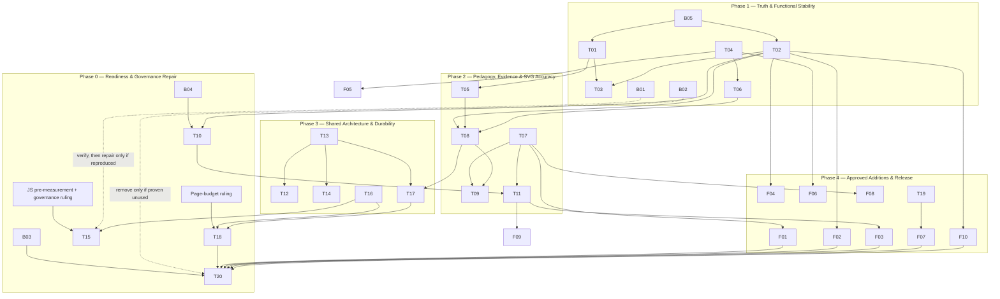

# Evidence-Led Workspace Audit & 35-Task Implementation Roadmap — Expanded Phase-by-Phase Edition (v2.0)

**Base document:** Evidence-Led Workspace Audit & 35-Task Implementation Roadmap (audit date 2026-11-06)
**Expansion date:** 2026-11-09
**Workspace:** `/home/robertsrff/Chemistry_Med/Chemistry_7`
**Expansion scope:** (1) audit the gaps in the base plan; (2) add a phase-by-phase execution layer. The original section hierarchy (§1–§14) is retained; new §0 is prepended. All base-plan evidence tags are preserved. New material is tagged `[GAP]` (gap found in the base plan) or `[NEW]` (content added by this expansion).
**Reading rule:** nothing in this edition authorizes mutation of production files. It is a plan for executing a plan.

---

## 0. Plan Gap Audit & Expansion Method

### 0.1 Method

The base plan audits the workspace rigorously but never audits itself. This edition closes that loop in four steps: (1) enumerate plan-level gaps against execution-readiness criteria (environment, gates, ownership, rollback, measurement, release); (2) classify each gap by severity and by the phase that closes it; (3) define a five-phase execution model (Phase 0–4) mapping the base plan's four waves onto gated phases with entry/exit criteria; (4) add the missing program machinery — KPIs, risk register, role model, environment checklist, snapshot/rollback protocol, reporting cadence, contingency trees, freshness policy, non-goals — and thread phase/owner/evidence columns through §1–§14.

### 0.2 Gap register

| ID | Gap in base plan | Sev | Evidence in base plan | Closed in | Closure action |
|---|---|---|---|---|---|
| G-01 | No self-audit of plan feasibility or assumptions | P1 | §1–§14 contain no plan-level validation | Phase 0 | This §0; feasibility pre-measurements become gates |
| G-02 | Waves have no formal entry/exit gates | P0 | §11 defines waves by dependency only | Phase 0 | §0.3 phase gates; §11 gate nodes |
| G-03 | No calendar, duration, or sequencing deadlines | P1 | Only audit date 2026-11-06 given | Phase 0 | §0.3 target windows; owner sets dates at entry |
| G-04 | Risks scattered per task; no consolidated register | P1 | "Dependencies, Risks, Rollback" blocks only | Phase 0 | §0.5 register with P/I/mitigation/owner |
| G-05 | No environment readiness section; lite-shot failed (exit 75, Xvfb probe) | P0 | §1 audit status; §13 limitations | Phase 0 | §0.7 checklist; capture blocker is a hard gate |
| G-06 | No role/ownership model; "one owner at a time" undefined | P1 | §11 wave rules | Phase 0 | §0.6 role model with independence rules |
| G-07 | JS budget feasibility never measured (4,096 B / 100 lines / 2%) | P1 | D-04 says "count compiled bytes before claiming exact overage" but never schedules it | Phase 1 | T15.0 pre-measurement gate before any TS work |
| G-08 | No program KPIs or definition of overall success | P1 | §12 gates exist but no roll-up | Phase 0 | §0.4 KPIs |
| G-09 | Non-goals not consolidated | P2 | Scattered ("no fifth widget", "no network") | Phase 0 | §0.12 non-goals |
| G-10 | §10 matrix lacks owner/phase/status/evidence columns | P1 | §10 table | Phase 0 | §10 expanded matrix |
| G-11 | DAG lacks phase swimlanes and gate nodes | P1 | §11 mermaid diagram | Phase 0 | §11 expanded DAG + critical path |
| G-12 | No program-level snapshot/rollback strategy; no Git repo | P0 | §1: "there is no `.git` repository" | Phase 0 | §0.8 tar + hash snapshot protocol |
| G-13 | No reporting cadence or status template | P2 | §14 handoff is procedural only | Phase 0 | §0.9 cadence + template |
| G-14 | No contingency plans for unobtainable sources/tools | P1 | §13 lists limitations, no fallbacks | Phase 0 | §0.10 decision trees |
| G-15 | Q1–Q9 answer-key coverage never explicitly verified or repaired | P1 | T11/F03/F10 touch it indirectly | Phase 2 | New subtask T11.3 (answer-key audit) |
| G-16 | 2022 blank DOCX inventoried but mapped to no task | P2 | §2 ledger | Phase 1 | T07.1.0 uses it for student-form parity |
| G-17 | Print page-budget rule undefined (≤60 vs undocumented 58–66 allowance) | P1 | T18 scope guardrails | Phase 0/3 | RO ruling recorded (T18.0) before T18 acceptance |
| G-18 | Screen-reader AT pair never named or sourced | P1 | T14.2.3 "named AT/browser pair" | Phase 0/3 | §0.7 names candidates or marks `[UNVERIFIED]` |
| G-19 | Calculator locale contract (decimal comma vs dot) unspecified | P1 | B01 hypothesis only | Phase 1 | B01.0 input-contract specification |
| G-20 | T15 proposes `src/ts/` + `tsconfig.json` without governance check | P1 | Audit found no TS config; AGENTS may prohibit new toolchains | Phase 1 | T15 pre-gate: governance ruling before adoption |
| G-21 | "Wave" vs requested "phase" terminology unmapped | P2 | §11 | Phase 0 | §0.3 explicit mapping |
| G-22 | No consolidated release GO/NO-GO checklist | P0 | §12 gates, §14 DoD prose | Phase 4 | §14.5 release checklist |
| G-23 | No evidence freshness/expiry policy | P1 | §12 "never use saved PASS as current" is a rule, not a policy | Phase 0 | §0.11 freshness policy |
| G-24 | SVG inventory lacks data-source tagging (measured/schematic/literature) | P1 | §6 inventory | Phase 2 | §6 expanded inventory; T08.1.1 gate |

### 0.3 Phase model (Wave → Phase mapping)

The base plan's four waves become five gated phases. A phase may not start until its entry gate passes; a phase is not done until its exit gate passes. Mapping: Wave 1 → Phase 1; Wave 2 → Phase 2; Wave 3 → Phase 3; Wave 4 → Phase 4; **Phase 0 is new** (readiness and governance repair).

**Phase 0 — Readiness & Governance Repair** (no production source edits)
- *Objective:* make the workspace safe to mutate and its contracts self-consistent.
- *Contents:* environment bring-up (§0.7); snapshot protocol (§0.8); B03 (capture-contract repair); B04 (harness safety/alignment); T20.1 (governance reconciliation); T15.0 (JS pre-measurement, G-07); T18.0 (page-budget ruling, G-17); gap closures G-01–G-06, G-08–G-14, G-21–G-23.
- *Entry gate:* base plan accepted; read-only snapshot taken; source hashes verified against `plan/source-hashes.txt`.
- *Exit gates:* (a) lite-shot produces ≥1 inspected PNG in a permitted environment, or capture is formally `[UNVERIFIED]` with documented blocker and RO sign-off; (b) `verify.py --selftest` proven non-mutating by before/after hash+mtime snapshot; (c) `AGENTS.md` ≤ 24,576 B with a rule-by-rule diff showing zero lost constraints; (d) exactly one canonical visual protocol (root `VISUAL_VERIFICATION.md` retired or reduced to a pointer); (e) snapshot manifest with SHA-256 values exists; (f) compiled JS size measured and recorded; (g) AT pair named or blocker documented.

**Phase 1 — Truth & Functional Stability** (Wave 1)
- *Objective:* every published claim is bounded to its source; every published number traces to the calculation authority; verification tooling is truthful.
- *Contents:* B05; T01; T02; T03; T04; T10; B01 and B02 as investigations (close with evidence if no defect); T07.1.0 (DOCX parity, G-16); B01.0 (locale contract, G-19); T15 governance pre-gate (G-20).
- *Entry gate:* Phase 0 exit gates passed.
- *Exit gates:* claim ledger C-01–C-10 bounded with applicability statements; all three regression variants named at every occurrence; uncertainty/LOD/LOQ labelled as estimates with adjacent assumptions; `tools/data.py` invariants pass and every displayed value reconciles; claim-lint negative fixtures fail on injected overclaims; B01/B02 closed with reproduce-or-close evidence; no unsupported "flat at 440", "R² proves accuracy", or "dominant complex" wording remains.

**Phase 2 — Pedagogy, Evidence & Diagram Accuracy** (Wave 2)
- *Objective:* explanations and figures teach the corrected, bounded model.
- *Contents:* T05; T06; T07; T08; T09; T11 (including new T11.3 answer-key audit); F02 drafting (lands in Phase 4).
- *Entry gate:* Phase 1 exit gates passed; chemistry reviewer available for T05/T06/T07 sign-off.
- *Exit gates:* band explanation and Beer–Lambert derivation pass subject review; Lab 6B procedure reconciles row-by-row to the filled protocol; every SVG carries a data-source tag, an accessible equivalent, and (if changed) direct visual inspection at 390/768/1440 + print; concept-coverage report shows five-pillar evidence for all core concepts and all Q1–Q9 concepts; coverage negative fixture fails for a concept with no worked example.

**Phase 3 — Shared Architecture & Durability** (Wave 3)
- *Objective:* one CSS architecture, native behavior where required, responsive and print editions verified by direct inspection.
- *Contents (strictly serialized):* T13 → {T12, T14, T17}; T16 → {T15, T18}.
- *Entry gate:* Phase 2 exit gates passed; single owner assigned to `src/00*` and `src/17*` for the whole phase; page-budget ruling recorded (G-17); AT pair named or blocker documented (G-18).
- *Exit gates:* zero inline `style=` in the generated body (lint); `@layer` cascade with preserved precedence; theme/reveal/print work with JS disabled; compiled JS within 4,096 B / 100 lines / 2% or RO-signed exception; no page overflow at 390/768/1440 or 200% zoom; forced-colors and keyboard passes; every print page inspected with no clipped table, one-word rail, or hidden answer; page count within the ruled budget.

**Phase 4 — Approved Additions & Release** (Wave 4)
- *Objective:* land only the adopted features and produce honest release evidence.
- *Contents:* F01, F02, F03, F07, F10 (each still gated by its kill criterion); T20.2 release evidence; final hash reconciliation; GO/NO-GO review.
- *Entry gate:* Phase 3 exit gates passed; deferred features (F04, F05, F06, F08) remain deferred; F09 remains static links only.
- *Exit gates:* §14.5 release checklist fully green or explicitly `[UNVERIFIED]` with RO sign-off; source/master hashes reconciled; execution log complete with dated, hashed artifacts.

### 0.4 Program KPIs

| KPI | Target | Measured by | Phase |
|---|---|---|---|
| K1 | 100% of P0 items (D-02, D-03, D-05, B03, B04, B05) closed with fresh evidence | gate records | 0–1 |
| K2 | Zero unsupported claims; claim lint clean on positive + negative fixtures | `tools/lint_html.py` (new) | 1 |
| K3 | Every published number traceable to `tools/data.py` in one command | T10 trace command | 1 |
| K4 | Visual evidence complete: 390/768/1440 × light/dark + print, every page inspected, artifacts hashed | evidence manifest | 3 |
| K5 | `AGENTS.md` ≤ 24,576 B, zero rules lost | byte count + rule diff | 0 |
| K6 | JS ≤ 4,096 B / 100 lines / 2% or documented exception | `tools/budget.py` (new) | 3 |
| K7 | No-JS, keyboard, forced-colors, 200% zoom paths pass | manual + fixtures | 3 |
| K8 | Print within ruled page budget; zero clipped tables / one-word rails | page-by-page inspection | 3 |
| K9 | Zero network/storage/persistence APIs in shipped artifact | grep + runtime audit | 3 |
| K10 | All `[UNVERIFIED]` items resolved or RO-signed as accepted risk | release checklist | 4 |

### 0.5 Consolidated risk register

| ID | Risk | P | I | Mitigation | Owner |
|---|---|---|---|---|---|
| R1 | lite-shot/Xvfb never works in the available environment; all visual gates stay `[UNVERIFIED]` | M | H | Document blocker; require owner-provided display environment; never claim visual acceptance; Chrome only with explicit current-turn permission | TO |
| R2 | 2020 protocol PDF pages unreadable; C-09 values unverifiable | M | H | Freeze dependent claims at `[UNVERIFIED]`; proceed with independent tasks; re-extract before any value correction | CR |
| R3 | JS budget unachievable with required calculators | M | M | T16 native replacements first; re-measure; exception requires RO sign-off; never silently exceed | TO |
| R4 | `AGENTS.md` compression loses a rule | M | M | Rule-by-rule before/after diff; rollback from snapshot | DO |
| R5 | Harness self-test mutates `plan/source-hashes.txt` | H (until B04) | H | B04 is a hard Phase 0 gate; snapshot before every run | TO |
| R6 | AkadTerm/dictionary access blocked | M | L | Keep explicit house-style labels; never assert official norm | CR |
| R7 | Feature scope creep beyond the adopted set | M | M | Kill criteria enforced; default adopt set only; RO approves any addition | RO |
| R8 | Print page-budget conflict unresolved | M | M | RO ruling recorded at Phase 0 exit (T18.0) | RO |
| R9 | Single-owner serialization on `src/00*`/`src/17*` bottlenecks Phase 3 | H | M | Strict one-owner rule; batch edits; no parallel edits to shared files | TO |
| R10 | Historical evidence mistaken for current acceptance | M | H | Freshness policy (§0.11); artifact hashing; dated evidence records | DO |
| R11 | Chemistry corrections rejected at review after prose landed | L | M | Subject review precedes landing (T05/T06/T07 gates); revert smallest hunk | CR |
| R12 | No Git; accidental production mutation unrecoverable | M | H | §0.8 snapshot protocol; hash reconciliation every phase | TO |

### 0.6 Role & ownership model

| Role | Owns | Independence rule |
|---|---|---|
| Release Owner (RO) | GO/NO-GO, budget exceptions, page-budget ruling, accepted-risk sign-off | May not self-approve an exception they implemented |
| Chemistry Reviewer (CR) | Claim warrants C-01–C-10; T05/T06/T07/T10 science sign-off; terminology authority status | Should differ from the author of the corrected claim where feasible |
| Tooling Owner (TO) | `tools/*`, harness, build, budgets, capture environment | — |
| Accessibility Owner (AO) | T14/T17/T18, AT testing, forced-colors/keyboard/zoom | — |
| Documentation Owner (DO) | `AGENTS.md`, visual protocols, plan manifests, execution log | — |

One person may hold multiple roles, but gates requiring independence (claim sign-off, exception approval, release GO) must name distinct individuals or record why independence was impossible.

### 0.7 Environment readiness checklist (Phase 0 entry) `[NEW]`

1. Python 3 version pinned and recorded; `python3 -I -B tools/data.py` exits 0; `python3 -I -B tools/build.py --check` passes.
2. Node version pinned and recorded; `tools/verify_js.mjs` executes.
3. Xvfb available and display probe passes (base-plan failure: exit 75 "Xvfb display probe failed" `[TESTED]`); lite-shot runnable.
4. Dillo and NetSurf installed (approved engines per `tools/visual-verification.md`).
5. Chrome availability: prohibited unless the human grants explicit current-turn permission; record the decision either way.
6. Named AT/browser pair for screen-reader testing identified (AO confirms candidates) or `[UNVERIFIED]` blocker documented (closes G-18).
7. Snapshot target with ≥2× artifact free space, outside the workspace or in an ignored path.
8. Network-free operation confirmed for all planned checks.
9. `plan/source-hashes.txt` verified against the three course files before any mutation.

### 0.8 Snapshot & rollback protocol (no Git repository) `[NEW]`

Because `[TESTED]` no `.git` exists, snapshots are filesystem-level:
1. **Phase snapshot:** before any mutating phase, `tar` `src/`, `tools/`, `plan/`, `AGENTS.md`, `run.sh`, and the master HTML into a timestamped archive; write a SHA-256 manifest; store outside the workspace or under an ignored path.
2. **Task checkpoint:** snapshot before and after each task; record both hash sets in `plan/execution-log.md` with date, task ID, and operator.
3. **Mutation rule:** never hand-edit the generated master; edit `src/*.part` and rebuild; `build.py --check` must pass after every rebuild.
4. **Rollback:** restore the nearest snapshot, re-run `build.py --check`, re-verify source hashes, and record the rollback reason. Roll back the smallest owned hunk, never a whole phase, unless the phase gate itself failed.
5. **Protected files:** the three course documents and `workspace_skills/` are read-only inputs (hashes already verified `[TESTED]`); never snapshot-for-edit.

### 0.9 Reporting cadence & status template `[NEW]`

- **Per phase:** entry report (snapshot hashes, environment state, role assignments); checkpoint status at each completed task cluster; exit report (gate results, evidence artifacts with hashes, hash reconciliation, open `[UNVERIFIED]` items).
- **Status template:** `Task ID | Status (pending/in_progress/done/blocked) | Evidence tag | Artifact path + SHA-256 | Blocker | Next action | Gate impact`.
- **Escalation:** any P0 gate failure escalates to RO within one checkpoint; any `[UNVERIFIED]` that blocks a gate is listed in the exit report with owner and accepted-risk status.

### 0.10 Contingency decision trees `[NEW]`

- **Capture unavailable (R1):** mark affected gates `[UNVERIFIED]`; escalate to RO; do not weaken gates or substitute Chrome without permission; continue with non-visual tasks.
- **Source unobtainable (R2):** freeze dependent claims at `[UNVERIFIED]`; proceed with independent tasks; re-extract before correction.
- **JS budget unachievable (R3):** complete T16 native replacements; re-measure; if still over, RO-signed exception with exact bytes/lines/percent recorded; never silent overage.
- **AT unavailable (G-18):** keyboard, forced-colors, zoom, and static-semantics checks still run; AT-dependent gates marked `[UNVERIFIED]` with blocker.
- **Harness mutation detected (R5):** stop; B04 fix is a hard blocker; restore snapshot; re-verify hashes.
- **Chemistry review rejects a correction (R11):** revert the smallest hunk; keep the claim at its prior bounded status; record the disagreement in the errata source.

### 0.11 Evidence freshness policy `[NEW]`

- **Fresh:** produced in the current phase, with date, tool version, engine/viewport (where applicable), and artifact SHA-256.
- **Historical:** dated before the current phase; may inform planning; never accepts a gate.
- **Expiry:** visual and runtime evidence expires upon any mutating change to an inspected file; re-capture required.
- **Blocking rule:** a gate that requires `[UNVERIFIED]` evidence cannot be marked done; it must be resolved or converted to an RO-signed accepted risk at release.

### 0.12 Program non-goals `[NEW]`

Consolidated from the base plan: no fifth widget or unregistered JS; no network, browser storage, or persistence; no hand-editing the generated master; no edits to the three course documents or `workspace_skills/`; no Chrome without explicit current-turn permission; no gate weakening to obtain green; no new diagrams beyond T09's two absent RO approval; no TypeScript toolchain adoption without the G-20 governance ruling; no deletion of uncertainty labels to simplify prose.

---

## 1. Executive Decision Brief & First-Principles Workspace Profile

**Phase alignment `[NEW]`:** the decision "repair, do not replace" is reaffirmed as the program charter. Phase 0 verifies the two load-bearing facts before anything else: `[TESTED]` `python3 -I -B tools/build.py --check` parity and `[TESTED]` `python3 -I -B tools/data.py` invariants. Phase 1 converts the "strongest assets" list into protected invariants (source fragments, calculation authority, epistemic labels) and the "highest risks" list into P0 work items (B03/B04/B05, T01–T03). Phases 2–4 execute against the profile's render contract, which remains `[UNVERIFIED]` until Phase 3 captures exist.

**First-principles profile (retained; phase column added):**

| Dimension | Discovered profile | Evidence and limit | Phase |
|---|---|---|---|
| Primary discipline | Analytical chemistry; molecular absorption spectrophotometry, quantitative analysis, measurement quality | Course handout and Lab 6B protocol `[INSPECTED]` | 1–2 |
| Secondary disciplines | Introductory quantum/physical chemistry, instrumental analysis, regression and uncertainty communication | Chapters 1–10, `tools/data.py` `[INSPECTED]` | 2 |
| Learner | Medical student at seminar/laboratory level, preparing before Lab 6B, interpreting protocol data, answering Q1–Q9 | Masthead and learning outcomes `[INSPECTED]`; curriculum level `[INFERRED]` | 2 |
| Prerequisite baseline | Algebra, logarithms, concentration, volume dilution, basic light/wavelength concepts | Scaffolded in chapters 0–10 `[INSPECTED]` | 2 |
| Natural languages | Latvian instructional (`lang="lv"`); English terms as translations; German/French surnames transliterated | `src/00_head_masthead.part` `[INSPECTED]` | 1 (T04) |
| Formal notation | SI and lab units; decimal comma; `A`, `T`, `%T`, `I`, `I₀`, `ε`, `a`, `l`, `γ`, `λ`, `ν`, `h`, `R²`, `sᵧ`, `u`, `U`; HTML/MathML/SVG/CSS/JS/Python | Source fragments, `tools/data.py` `[INSPECTED]`; canon `plan/style-canon.md` | 1–3 |
| Runtime | Self-contained HTML5, inline CSS/JS/SVG/MathML; `file://` offline; Python 3 stdlib; Node for JS scan; no package manifest or TS config found | `tools/README.md`, `run.sh`, inventory `[INSPECTED]` | 0, 3 |
| Persistence/network | Contract bans network and storage; in-memory DOM state only | Tail JS `[INSPECTED]`; no live privacy test `[UNVERIFIED]` | 3 (K9) |
| Render contract | Responsive screen, light/dark/contrast, print/PDF, keyboard, reduced motion, no-JS | CSS declares many `[INSPECTED]`; declaration ≠ rendered verification | 3 |

**Audit status (retained) and Phase 0 actions:** `[TESTED]` `AGENTS.md` 25,280 B > 24,576 B cap (D-01 → T20.1, Phase 0). `[TESTED]` master HTML 313,828 B, SHA-256 `f90d552db94b5da17f2b86aed16a9e55ad66080fb72f4731b5ea1e62c2ba7a22`, mtime 2026-11-02 22:03:22. `[TESTED]` three course-file hashes match `plan/source-hashes.txt`. `[TESTED]` lite-shot/Dillo exit 75 (Xvfb probe) → visual state `[UNVERIFIED]` → Phase 0 gate (a). No `.git` → §0.8 snapshot protocol.

---

## 2. Workspace, Architecture & Skills Inventory + File-by-File Inspection Ledger

**Phase alignment `[NEW]`:** the inventory is the human-readable form of the Phase 0 snapshot manifest. Two columns are added: **Phase touched** (when the file may be edited) and **Mutation risk** (what a careless edit could break). Read-only inputs are never edited.

| Path/group | Role | Phase touched | Mutation risk |
|---|---|---|---|
| `AGENTS.md` | Governance, budgets, source locks, acceptance rules | 0 (T20.1) | Losing a rule while compressing (R4) |
| `Master_spektrofotometrija_SEM7_LD6B.html` | Sole generated deliverable | never directly | Hand-edit breaks parity; rebuild only |
| `src/00_head_masthead.part` | HTML shell, CSS tokens, nav, shared components, print styles | 3 (T12–T18) | Cascade precedence regression; collision group C3 |
| `src/01`–`src/16` chapter parts | Chapters 0–15, prose, tables, figures, assessments, errata | 1–2 (claims), 3 (layout) | Claim/layout entanglement; keep hunks separate |
| `src/17_tail_scripts.part` | Four instruments, theme, masks, print behavior, JS wiring | 1 (B01), 3 (T15/T16) | Budget overage; behavior loss; collision group C4 |
| `tools/data.py` | Numeric/calculation authority | 1 (T02/T03/T10) | Silent value change; invariants must hold |
| `tools/build.py` | Concatenation, manifests, uncertainty output | 1 (T10) | `--check` must stay read-only |
| `tools/verify.py` | 37-check harness, 33 negative fixtures per README | 0 (B04) | Self-test hash-ledger write (D-05) |
| `tools/behaviour.py` | Instrument DOM behavior test via Chrome | 1 (B01) | Chrome policy; not run this audit |
| `tools/figures.py` | SVG text sizing/layout checks; `--apply` edits source | 2 (T08) | `--apply` mutates; Chrome geometry path |
| `tools/verify_js.mjs` | Static JS syntax/API/selector/wiring scan | 0/3 (B04/T15) | Old 8 KiB cap vs current 4,096 B |
| `tools/shoot.mjs` | Older capture/print runner | 0 (B03) | `dillo -f` + Chrome fallback violates policy |
| `tools/visual-verification.md`, root `VISUAL_VERIFICATION.md` | Visual evidence protocol | 0 (B03/T20) | Conflicting contracts (D-02) |
| `run.sh` | Combined build, JS check, self-test, full harness | 0 (B04) | Mutating build + self-test write |
| `plan/*` | Dated plans, hash manifest, design/term/figure notes, saved evidence | 0–4 | Historical metrics misread as current |
| Three primary course files | 2025 theory PDF, filled 2020 protocol PDF, blank 2022 DOCX | never | Hash-verified inputs; read-only |
| `workspace_skills/` | Imported reference skills and templates | never | Not product code; do not execute |

**Skills inventory (36, retained):** `animate`, `animation-performance`, `animation-vocabulary`, `apple-design`, `audit`, `blueprint-spec-sheet`, `break-ui`, `cognitive-deload-auditor`, `design-motion-principles`, `design-taste-frontend`, `emil-design-eng`, `find-animation-opportunities`, `frontend-design`, `high-end-visual-design`, `impeccable`, `improve-animations`, `industrial-brutalist-ui`, `interactive-study-guide`, `learn-then-test`, `lexicon-morphology-weaver`, `minimalist-ui`, `mook-visual-compendium`, `pdf-beautify`, `pdf-claude`, `pdf-codex`, `pdf-vector-surgeon`, `pick-ui-library`, `playground`, `polish`, `print-css-alchemist`, `prototype`, `review-animations`, `state-scrubber-lab`, `svg-spatial-occlusion`, `synoptic-matrix-architect`, `tufte-margin-scholar`. Phase mapping `[NEW]`: Phase 2 → `cognitive-deload-auditor`, `interactive-study-guide`, `learn-then-test`, `svg-spatial-occlusion`; Phase 3 → `print-css-alchemist`, `audit`, `break-ui`, `design-taste-frontend`, `impeccable`. Inventory is not execution; reconcile with `AGENTS.md` before use.

**End-to-end interaction map (retained; phase column added):** theme toggle, explorer sliders, diagram recall masks, dilution fields, quality fields, print event — all `[UNVERIFIED]` at runtime. B01 (Phase 1) specifies behavior contracts; T16 (Phase 3) replaces non-essential paths with native patterns. No inspected path uses browser storage or network APIs (source-level evidence, not a runtime privacy test). No dead selector or dead listener was positively proven.

---

## 3. Diagnostic Triage: Confirmed Defects vs. Suspected Risks vs. Opportunities

| ID | Finding | Status | Severity | Phase | Exit-gate evidence |
|---|---|---|---|---|---|
| D-01 | `AGENTS.md` exceeds its own size ceiling by 704 B | `[TESTED]` | P1 | 0 | byte count + rule-by-rule diff |
| D-02 | Contradictory visual protocols (lite-shot forbids Chrome and `dillo -f`; legacy runner permits both) | `[INSPECTED]` | P0 | 0 | one canonical protocol; runner contract test |
| D-03 | Current visual rendering not inspected; lite-shot exited 75 (Xvfb probe) | `[TESTED]` | P0 | 0/3 | PNGs inspected or RO-signed blocker |
| D-04 | Four widgets and theme/print interactions are JS-driven; tail exceeds current micro-runtime ceiling | `[INSPECTED]` | P1 | 1 (measure), 3 (fix) | compiled byte/line/% record |
| D-05 | `run.sh` is not read-only; `--selftest` temporarily writes `plan/source-hashes.txt` | `[INSPECTED]` | P0 | 0 | before/after hash+mtime snapshot |
| D-06 | Older harness architecture conflicts with current AGENTS limits (8 KiB vs 4,096 B JS budget; expected print JS) | `[INSPECTED]` | P1 | 0 | aligned gates + negative fixtures |
| D-07 | 11 inline SVGs in 7 figure wrappers; semantic title/desc present; conceptual and visual accuracy unverified | `[INSPECTED]` + `[UNVERIFIED]` | P1 | 2 | per-figure review + render |
| D-08 | No `<noscript>`, no exclusive `details[name]`, no dialog/popover, no `@layer`, no `forced-colors`, inline styles remain | `[INSPECTED]` | P1 | 3 | lint + render parity |
| D-09 | Historical plan and current AGENTS disagree on active roadmap presence and some baselines | `[INSPECTED]` | P1 | 0 | refreshed baselines with dates |
| D-10 | Fit, print pagination, theme contrast and widget edge behavior remain unverified today | `[UNVERIFIED]` | P0/P1 | 1–3 | tests specified in §12 |

**Promotion rule (retained):** no historical-plan finding is promoted to a current defect without a check against today's artifact. Phase 0 re-measures the 2026-11-02 claims (390 px overflow, clipped print tables, narrow rails, 63 pages) before Phase 3 relies on them.

---

## 4. Domain Terminology, Fact, Applicability & Warrant Verification Ledger

| ID | Location | Existing claim (abbrev.) | Status | Phase | Verification action |
|---|---|---|---|---|---|
| C-01 | `src/06*:30-34`; `src/13*:55-60` | `A=lg(I₀/I)`; distinguishes process "absorbcija" from quantity "absorbance A" | Verified with scope note | 1 | Keep equation and explicit house choice; verify Latvian term with AkadTerm or a disciplinary authority before calling it canonical |
| C-02 | `src/04*:36-42` | Handout: bands from thermal broadening of discrete lines, symmetric around λmax | Over-simplified | 2 | Preserve source quote as erratum; replace with bounded molecular-transition + unresolved-envelope account (vibronic/rotational structure, solvent/environmental broadening, instrument bandwidth); avoid "one exact wavelength" generalization |
| C-03 | `src/07*:25-32` | Handout has erroneous molar coefficient symbol/unit and overstated 10⁶ bound | Verified correction needed | 1 | Correct teaching prose while preserving exact source error and location in errata; ε unit follows concentration and path length; mass absorptivity is distinct |
| C-04 | `src/04*:21-30`; `src/08*:28-38`; `src/11*:5-14` | 440 nm near literature 444 nm maximum and on a flat peak | Warrant flaw | 1 | Label 440 as protocol setting, 444 as literature value, flatness as `[UNVERIFIED]` inference unless the matching spectrum is inspected |
| C-05 | `src/06*:65-67`; `src/09*:52-57`; `src/11*:377-398`; `tools/data.py:90-136,159-170,195-222` | High R² and near-zero intercept used in places as validation | Warrant flaw / cross-section inconsistency | 1 | Name every fit and blank inclusion; replace "confirms/validates" with bounded diagnostic interpretation; residuals assess model deviation, not trueness |
| C-06 | `src/11*:464-468` | Linear response good; accuracy not proven; ε converted assuming 1 cm | Mostly warranted, conditional | 1 | Retain conditional language; explicitly state unknown cuvette path; avoid presenting ε as independently measured |
| C-07 | `src/11*:455-464` | LOD=3sy/k, LOQ=10sy/k as simplified regression estimates | Over-simplified but labelled | 1 | Preserve as teaching estimate only; state model, blank and uncertainty limitations adjacent to values |
| C-08 | `src/13*:48,60` | "kivete" preferred; "absorbance" used to distinguish quantity | Unverified Latvian norm; deliberate house style | 1 | Keep explicitly labelled house choice pending dictionary/terminology verification; never misstate as official norm |
| C-09 | `tools/data.py:20,138,217+`; source tables | 440 nm energy, slope, concentrations, %T values | Tested computationally; source provenance partial | 1 | Re-extract all protocol pages; reconcile every displayed value against the named regression variant |
| C-10 | `src/10*:8-20` | Fe(III)-thiocyanate colored complex; mono-complex dominance suggested | Partially verified / scope-limited | 1 (bound), 2 (note) | Keep reaction as simplified scheme; remove dominance claim unless actual Lab 6B conditions and speciation evidence are matched |

**Warrant rule for follow-on edits (retained verbatim):** do not "verify" a sentence because a number appears in a paper. Record the paper's system, solvent, pH, temperature, wavelength, concentration, model and scope; then show which of those match the Lab 6B claim. A measured maximum does not establish the curvature around that maximum; a regression statistic does not establish trueness; an assumed 1 cm cell does not make path length measured. Every correction touching these concepts must carry claim ID(s) from this ledger into its change record.

---

## 5. Authoritative Book, Standard & Literature Bibliography

Authority order (retained): (1) IUPAC terminology/Gold Book and BIPM SI guidance; (2) primary research for riboflavin spectral/environment scope; (3) university analytical/instrumental textbooks; (4) local course documents. Course sources are not automatically factual authorities.

| Record | Metadata and scope | Provenance tag | Phase | Access plan / contingency |
|---|---|---|---|---|
| IUPAC Gold Book, 5th ed. online 5.0.0, 2025, DOI 10.1351/goldbook; A00028, A00035, M03972 | Absorbance, absorptance, molar absorption coefficient definitions | `[TEXT-VERIFIED]` via search extract; direct open returned 403 | 1 | Use the official entry per claim; if 403 persists, cite entry ID + access date and mark the passage `[UNVERIFIED]`; do not infer Latvian preferred term |
| BIPM SI Brochure, 9th ed. (2019; online updated 2026), DOI 10.59161/AUEZ1291 | SI quantity/unit expression; dimensionless quantities | `[METADATA-VERIFIED / SCOPE-ALIGNED]` | 1 | Consult the relevant section before exact rule edits |
| Sheraz, M. A.; Kazi, S. H.; Ahmed, S.; Anwar, Z.; Ahmad, I. "Photo, thermal and chemical degradation of riboflavin." *Beilstein J. Org. Chem.* 10 (2014), 1999–2012. DOI 10.3762/bjoc.10.208 | Aqueous riboflavin absorption maxima and degradation context | `[TEXT-VERIFIED]` open full text inspected | 1 | Supports reported aqueous maxima only; not the Lab 6B sample spectrum or the 440 nm local slope (C-04) |
| Currie, L. A. "Nomenclature in evaluation of analytical methods… (IUPAC Recommendations 1995)." *Pure Appl. Chem.* 67 (1995), 1699–1723. DOI 10.1351/pac199567101699 | Detection/quantification terminology and method evaluation | `[METADATA-VERIFIED / SCOPE-ALIGNED]` | 1 | Exact passage not read this turn; simplified values remain labelled estimates (C-07) |
| IUPAC, *Guidelines for calibration in analytical chemistry. Part 1*, *Pure Appl. Chem.* 74 (2002), 835–855. DOI 10.1351/pac200274050835 | Calibration model and validation guidance; residual/model assessment | `[METADATA-VERIFIED / SCOPE-ALIGNED]`; PDF open blocked (403) | 1 | Source lead, not a page-level quote (C-05) |
| IUPAC, *Quantities, Units and Symbols in Physical Chemistry* (Green Book), 3rd ed., 2007, RSC, ISBN 978-0-85404-433-7 | Quantity symbols, units, spectroscopy quantities | `[METADATA-VERIFIED / SCOPE-ALIGNED]` | 1 | Check exact chapter/section before symbol/unit edits |
| Skoog, D. A.; Holler, F. J.; Crouch, S. R., *Principles of Instrumental Analysis*, 7th ed., Cengage, ISBN 978-1-305-57721-3 | Instrumental analysis and optical methods | `[UNVERIFIED]` year conflict 2016/2018 | 1 (T19) | Resolve via publisher catalog or mark unresolved; do not cite as support until resolved |
| Atkins, P.; de Paula, J.; Keeler, J., *Atkins' Physical Chemistry*, 12th ed., OUP, 2022, ISBN 978-0-19-884781-6 | Molecular energy transitions and spectroscopy background | `[METADATA-VERIFIED / SCOPE-ALIGNED]` | 2 | Read relevant chapter before mechanism edits (T05) |
| 2025 course handout *Optiskās metodes vielu koncentrācijas noteikšanai*, 5 pp.; 2020 filled protocol *6B. Spektrofotometrija*, 3 pp.; 2022 blank form | Curriculum scope; procedure and source absorbance values (2020 filled protocol is the only absorbance source) | `[TEXT-VERIFIED]` first pages; `[INSPECTED]` metadata/hashes | 1–2 | Full page-by-page extraction before value corrections; 2022 DOCX mapped via T07.1.0 (G-16) |

No page numbers or quotations are assigned beyond visible metadata. Local book records are not direct page-level verification; a future author must read the relevant passage or retain an honest unverified status.

---

## 6. Editorial Design (Anti-AI-Slop), Retexturing, Accessibility, Pedagogy & Complete SVG Inventory/Diagnostics

**Phase alignment `[NEW]`:** §6 is the design charter. Phase 2 owns figure semantics; Phase 3 owns CSS architecture and rendered acceptance. The base plan's restrained visual baseline is retained (tokenized light/dark colors, system fonts, ~62–70ch measure, focus-visible, reduced-motion, contrast preference, print rules, no gradients/shadows/emoji). The expansion adds the missing data-source tagging (G-24) and per-figure phase assignment. Pedagogical sequence retained: mechanism → rule/equation → real Lab 6B number → tempting error → detection/correction; five-pillar map (definition, mechanism, worked example, common mistake, canonical term) with a coverage report that does not treat class-name presence as coverage.

**SVG inventory (retained V01–V11; + Data source and Phase columns):**

| ID | Topic | Source location | Disposition | Data source | Phase |
|---|---|---|---|---|---|
| V01 | Energy levels and photon transition | `src/03_ch02_kvanti_un_energija.part:30-53` | `[CORRECT]` | schematic | 2 |
| V02 | Discrete levels vs molecular absorption band | `src/04_ch03_absorbcijas_spektra.part:46-82` | `[REDESIGN]` | schematic | 2 |
| V03 | Riboflavin literature maxima (373/444 nm) | `src/04_ch03_absorbcijas_spektra.part:86-119` | `[RETAIN]` | literature (Sheraz) | 2 |
| V04 | Spectrophotometer optical path | `src/05_ch04_spektrofotometrs.part` figure block | `[CORRECT]` | schematic | 2 |
| V05 | Recall overlay instrument schematic | `src/05_ch04_spektrofotometrs.part:60-83` | `[REDESIGN]` | schematic | 2 |
| V06 | Differential slab / Beer–Lambert derivation | `src/06_ch05_transmitance_un_absorbance.part:72-114` | `[CORRECT]` | schematic | 2 |
| V07 | A/T relation | `src/06_ch05_transmitance_un_absorbance.part:91-218` | `[RETAIN]` | computed (`tools/data.py`) | 2 |
| V08 | Beer-law beam intensity | `src/07_ch06_bugera_lamberta_bera_likums.part:86-123` | `[CORRECT]` | schematic | 2 |
| V09 | Three uses of "kalibrēšana" | `src/09_ch08_kalibresanas_terminologija.part:8-33` | `[RETAIN]` | schematic | 2 |
| V10 | Lab 6B calibration plot, nine/fit variants | `src/11_ch10_laboratorijas_darbs_6b.part:137-260` | `[CORRECT]` | measured (protocol) + computed | 2 |
| V11 | Residual/uncertainty plots | `src/11_ch10_laboratorijas_darbs_6b.part:261-333` | `[REDESIGN]` | computed (`tools/data.py`) | 2 |

Each inspected SVG has `viewBox`, `role="img"`, `aria-labelledby`, one `<title>`, one `<desc>`, and a caption — structural evidence only; all conceptual geometry, text collision, contrast, and print legibility remain `[UNVERIFIED]` because screenshot capture failed. Proposed additions are specified in T09 and features F01/F03. New figures need explicit source/data provenance and a table equivalent where values carry meaning. No art asset may be generated from an invented spectrum or assumed instrument geometry.

**Accessibility and print acceptance baseline (retained):** WCAG 2.2 AA for text (4.5:1), large text and meaningful control boundaries (3:1), keyboard reachability, visible focus, screen-reader name/state, 200% zoom, forced-colors, reduced motion, print pagination. All disclosures must print with content visible using supported HTML/CSS; no reliance on a JS beforeprint mutation once OI-16/T16 is addressed. Each scroll region needs a name and focus path; every SVG needs a concise equivalent and no meaning conveyed only by color. Capture 390, 768, 1440 px, themes and print only through the approved lite-shot workflow, with direct image inspection.

---

## 7. 20 Core Improvement Tasks (T01–T20) — Templates + Phase Execution Cards

**Expansion note `[NEW]`:** each task retains its base-plan template (problem, why, end state, authority, three macro steps, two subtasks × three substeps, affected files, acceptance, dependencies, rollback). Execution cards add Phase, Entry gate, Exit gate, Evidence artifact, Owner role, and Rollback trigger. Subtasks introduced by the gap audit are marked `[NEW]`.

### T01 — Reconcile the live claim ledger and repair the 440/444 nm warrant
*Terminology & Sourcing · P0 · Impact 5 / Effort 2 · `[INSPECTED]` · **Phase 1** · Owner: CR (content), DO (errata)*
**Problem:** `src/04*:21-30`, `src/08*:28-38`, `src/11*:5-14` mix protocol setting 440 nm with literature 444 nm and an inference that 440 nm is flat. **Why:** nearby peak values do not prove local spectral slope under Lab 6B conditions. **End state:** protocol fact, literature fact, and bounded inference are distinct in Latvian; no fabricated local spectrum. **Authority:** C-04; Sheraz aqueous context does not establish pH, solvent, or bandpass.
**Main steps:** 1) build a three-column evidence map (setting / literature maximum / local spectrum availability) with per-statement scope checkpoints; 2) rewrite chapter 3 and chapter 7 claims and append the preserved source wording/correction to errata; 3) align captions, glossary references and lab answer material; run source-text search and instructor review before rebuild.
**T01.1 Separate the three wavelength statements:** .1 edit `src/04_ch03_absorbcijas_spektrs.part` so 440 nm is the course setting; verify exact numeral and label. .2 attribute 444 nm to aqueous literature in `src/15_ch14_atsauces_un_avoti.part`; verify citation scope and source status. .3 replace "flat peak" certainty in `src/08_ch07_novirzes_no_likuma.part`; verify no sentence implies a measured sample spectrum.
**T01.2 Reconcile claims and citations:** .1 add claim ID C-04 and applicability notes to `plan/terms-source.md`; verify claim-to-source mapping. .2 add exact faulty wording and corrected statement to `src/16_ch15_labojumu_zurnals.part`; verify permanent errata numbering. .3 search all `440`, `444`, `flat`, `plakana` occurrences across `src/`; verify every context keeps facts and inference separate.
**Files:** `src/04*`, `src/08*`, `src/11*`, `src/15*`, `src/16*`, `plan/terms-source.md`. **Acceptance:** positive — distinct setting/literature/inference; negative — no unsupported flatness claim; changed note readable at 390 px and in print. **Dependencies:** independent of T02; coordinate T08 captions. **Rollback:** revert affected hunks if literature scope cannot be stated.
**`[NEW]` Execution card:** Entry — Phase 0 gates passed; Sheraz passage located and scope recorded. Exit — claim-lint wavelength fixtures pass; errata entry present; instructor review recorded in execution log. Evidence — `plan/terms-source.md` diff, errata hunk hash, grep output artifact. Rollback trigger — literature scope unstateable or CR rejects.

### T02 — Bound regression diagnostics and reconcile three fit variants
*Terminology & Sourcing · P0 · Impact 5 / Effort 3 · `[INSPECTED]` · **Phase 1** · Owner: CR + TO*
**Problem:** `src/06*:65-67`, `src/09*:52-57`, `src/11*:377-398,464-477`; `tools/data.py:90-136,159-170,195-222`. **Why:** a near-zero intercept or high R² cannot prove accuracy; three fits differ by blank inclusion and intercept constraint (origin 9-point slope 30.3946; free 9-point slope 30.24 / intercept +0.0017; free 8-point slope 30.150 / intercept +0.0028; sample free-fit uses the 8-point variant). **End state:** every value names origin 9-point, free 9-point with blank, or free 8-point without blank; no accuracy claim from fit alone. **Authority:** C-05; IUPAC calibration guidance supports residual/model diagnostics, not trueness from R².
**Main steps:** 1) create a canonical regression-variant table from `data.py` recording inclusion/constraint for each fit; 2) rewrite every prose/table/figure occurrence to distinguish diagnostic, model assumption and result; 3) add targeted verification for variant labels and prohibited overclaims; confirm displayed values reconcile to computation.
**T02.1 Label model variants:** .1 audit `tools/data.py` result names and sample-fit selection; verify all three variants are explicit. .2 edit `src/11*` table captions/columns; verify blank inclusion and intercept rule are stated. .3 update `plan/numbers.csv` only through its authorized canonical process; verify no number was manually substituted.
**T02.2 Remove overclaims:** .1 replace "valid/confirms" wording in `src/06*` and `src/09*`; verify R² and intercept are called diagnostics. .2 align `src/08*` residual discussion with the calculated maximum; verify it does not assert monochromaticity or chemical homogeneity. .3 add a negative fixture to `tools/verify.py` for an R²-as-proof claim; verify the injected overclaim fails.
**Files:** `src/06*`, `src/08*`, `src/09*`, `src/11*`, `tools/data.py`, `tools/verify.py`, `plan/numbers.csv`. **Acceptance:** positive — all three model labels match computation; negative — fixture rejects "R² proves accuracy"; 390 px table and print table uncut. **Dependencies:** precedes T03 and T10; B04 owns harness-wide weakness. **Rollback:** revert text/table changes if values mismatch recomputation.
**`[NEW]` Execution card:** Entry — `data.py` invariants pass; variant table drafted. Exit — every occurrence labelled; negative fixture fails on injection; displayed values reconcile. Evidence — variant table artifact, fixture run log, numbers.csv diff. Rollback trigger — recomputation mismatch.

### T03 — Repair uncertainty, LOD/LOQ and significant-figure boundaries
*Terminology & Sourcing · P0 · Impact 4 / Effort 3 · `[INSPECTED]` · **Phase 1** · Owner: CR + TO*
**Problem:** `src/11*:401-408,413-436,455-464`; `tools/data.py:204-209`. **Why:** simplified regression-derived limits can be mistaken for validated blank-based detection capability. **End state:** assumptions, omitted error sources and rounding adjacent to values; no validated LOD/LOQ claim. **Authority:** C-06/C-07; `3sy/k` and `10sy/k` are teaching estimates under a specified model.
**Main steps:** 1) inventory all displayed uncertainty inputs, assumptions and rounding rules; reconcile each to data output; 2) rewrite the calculation chain so each estimated term and excluded source is visible; 3) add boundary checks for zero/negative inputs, output precision and caveat retention in generated HTML.
**T03.1 Make uncertainty assumptions explicit:** .1 align `src/11*:401-408` with `plan/uncertainty.csv`; verify sample 2 and 5 calculations. .2 revise `src/11*:455-464` to label LOD/LOQ as simplified; verify missing blank evidence is stated. .3 add a source note to `src/15*` identifying the specific Currie scope; verify no page citation is invented.
**T03.2 Harden reported precision:** .1 inspect `src/11*:413-436` calculator output rules; verify trailing zeros and decimal comma. .2 inspect `tools/data.py` uncertainty formulas; add named boundary fixtures for A=0 and outside calibration range. .3 verify the no-JS worked table and generated live result use the same model labels and significant figures.
**Files:** `src/11*`, `src/15*`, `tools/data.py`, `tools/verify.py`, `plan/uncertainty.csv`. **Acceptance:** positive — displayed sample calculations reproduce within stated rounding; negative — zero/negative A never yields a misleading finite concentration; mobile/print preserve caveat proximity. **Dependencies:** after T02. **Rollback:** restore generated table with source snapshot.
**`[NEW]` Execution card:** Entry — T02 variant labels frozen. Exit — boundary fixtures pass; caveats adjacent in generated HTML; rounding verified. Evidence — uncertainty.csv diff, fixture log, HTML caveat-location check. Rollback trigger — displayed value fails recomputation.

### T04 — Verify Latvian canonical terminology without overstating authority
*Terminology & Sourcing · P1 · Impact 4 / Effort 3 · `[INSPECTED]` · **Phase 1** · Owner: CR*
**Problem:** `src/13*:13-60,136-176`; "kivete" is explicitly a house choice; "absorbance" avoids a Latvian ambiguity. **Why:** an intentional editorial choice must not be misrepresented as an official norm. **End state:** each term has source, register, inflection and status; disputed variants preserved as variants. **Authority:** C-01/C-08; Gold Book supports concepts, not Latvian orthography.
**Main steps:** 1) create a term-source schema (canonical form, alternatives, grammar, provenance); 2) verify Latvian entries with authoritative language resources and revise only supported claims; 3) add a terminology lint/report that flags drift without auto-rewriting quotations or errata.
**T04.1 Establish term authority:** .1 query AkadTerm and Latvian dictionaries for `kivete`, `kuvete`, `absorbance`; record source URLs/date and exact result status. .2 add findings to `plan/terms-source.md`; mark unresolved forms as house style rather than norm. .3 review declensions and diacritics in `src/13*`; verify examples are grammatical and technically unambiguous.
**T04.2 Prevent terminology drift:** .1 define canonical entries for `transmitance`, `absorbance`, `absorptance`, `ε`, `a`, `γ`, `c`; verify distinctions in unit context. .2 implement `tools/lint_html.py` terminology scan; exclude quoted errata and source quotes. .3 add positive and negative fixtures for allowed historical variants vs prohibited unqualified usage.
**Files:** `src/13*`, `src/15*`, `plan/terms-source.md`, new `tools/lint_html.py`, harness. **Acceptance:** positive — canonical term report has evidence/status; negative — lint detects unqualified synonym outside quote; 200% zoom and print keep diacritics legible. **Dependencies:** before broad prose edits. **Rollback:** revert automated lint only if false positives cannot be bounded.
**`[NEW]` Execution card:** Entry — dictionary access confirmed or blocker recorded (R6). Exit — term report complete with statuses; lint fixtures pass. Evidence — term-source.md entries with URLs/dates, lint run log. Rollback trigger — authority access blocked (keep house-style labels).

### T05 — Rebuild the absorption-band explanation from bounded molecular physics
*Pedagogy & Explanations · P1 · Impact 4 / Effort 3 · `[INSPECTED]` · **Phase 2** · Owner: CR*
**Problem:** `src/04*:36-42` repeats the source's absolute-zero/thermal-broadening story; `src/03*:18-23` simplifies transition selection. **Why:** students may believe a molecule absorbs only one exact wavelength or that temperature alone explains bands. **End state:** energy gap plus vibrational/rotational structure, environment and instrument bandwidth at introductory depth; idealizations marked. **Authority:** C-02; state limits, avoid unsupported detailed mechanism.
**Main steps:** 1) map the prerequisite sequence from photon energy through molecular states to measured band; 2) rewrite paragraphs with one mechanism at a time and explicit scope caveat; 3) recheck Q prompts and figure captions against the new explanation without changing measured Lab data.
**T05.1 Correct prose model:** .1 edit `src/04*:36-42`; preserve the original source claim in errata. .2 qualify transition selection/line width in `src/03*:18-23`; verify "allowed" is not equated with guaranteed absorption. .3 add a short link from `src/01*` prerequisites to the spectrum explanation; verify first-use term definitions.
**T05.2 Teach and assess the boundary:** .1 add one labelled schematic explanation (not a data curve) in `src/04*`; verify visible "shēma" status. .2 update related `
` in `src/14*`; verify the answer includes why "exact wavelength only" is incomplete. .3 add a lint check preventing the "absolute zero" passage from being repeated as current fact outside errata.
**Files:** `src/01*`, `src/03*`, `src/04*`, `src/14*`, `src/16*`; figure owned by T08. **Acceptance:** positive — learner can explain band formation; negative — no generic one-wavelength claim; responsive/print text and figure stay adjacent. **Dependencies:** T01 source separation first. **Rollback:** revert prose if subject expert rejects the model.
**`[NEW]` Execution card:** Entry — T01 done; CR available. Exit — subject review signed; lint check active; Q answer updated. Evidence — review sign-off record, lint fixture, errata hunk. Rollback trigger — CR rejects model.

### T06 — Deepen Beer–Lambert derivation and state its assumptions
*Pedagogy & Explanations · P1 · Impact 4 / Effort 3 · `[INSPECTED]` · **Phase 2** · Owner: CR*
**Problem:** `src/06*:30-114`; assumptions appear across table and prose, but the chain must be checked for sign/concentration consistency. **Why:** memorizing A=εlc without differential attenuation obscures why logarithms linearize multiplicative transmission. **End state:** derive `dI/I=−κ(λ)c dl` for a uniform medium at fixed wavelength; integrate to a decadic form with explicit concentration basis, path length, coefficient and assumptions. **Authority:** C-01; uniform absorbing medium, fixed wavelength, defined transmission geometry.
**Main steps:** 1) create an equation audit sheet from differential law to measured absorbance including base-10 conversion; 2) rewrite explanatory prose and symbol/unit definitions in source order; 3) synchronize figure, example and misconception prompts; verify equation dimensions and signs.
**T06.1 Repair derivation chain:** .1 inspect equations in `src/06*:30-90`; record every symbol and assumption. .2 rewrite derivation blocks with `T=I/I₀` before `A=-lg T`; verify zero concentration yields A=0 after blank correction. .3 add a worked numeric conversion using a source value and units; verify `T=10^-A`.
**T06.2 Bind assumptions to outcomes:** .1 revise the assumptions table in `src/06*`; map each violated assumption to a bounded failure mode. .2 update `src/07*:25-62`; verify slope unit depends on concentration basis. .3 add equation/unit fixtures to `tools/data.py` or `tools/verify.py`; verify dimensional mismatch is caught.
**Files:** `src/06*`, `src/07*`, `src/14*`, tools fixture; T08 figure. **Acceptance:** positive — derivation reproduces equation and units; negative — sign/base mutation fails; screen-reader/math and print equation order understandable. **Dependencies:** T01/T04 term decisions; expert review required. **Rollback:** revert only the equation rewrite if the derivation check fails.
**`[NEW]` Execution card:** Entry — T04 term decisions recorded. Exit — CR sign-off; unit/sign fixtures fail on mutation. Evidence — equation audit sheet, fixture log, review record. Rollback trigger — derivation check fails.

### T07 — Make Lab 6B procedure, blank and dilution steps operationally explicit
*Pedagogy & Explanations · P1 · Impact 5 / Effort 3 · `[INSPECTED]` · **Phase 2** · Owner: CR*
**Problem:** `src/11*:1-120,439-450`; protocol uses 440 nm, stock 0.0400 mg/mL, 10.00 mL final standards; no sample 1. **Why:** procedural omissions cause dilution, blanking and sample-number errors. **End state:** distinguish blank zeroing from calibration; show standard prep, unknown measurement, report route and safety/procedure boundary without inventing lab details. **Authority:** C-09; verify each volume against the filled protocol before editing.
**Main steps:** 1) extract exact procedure/data columns from the filled 2020 protocol and map them to master steps; 2) reorder explanation around before-lab, bench, calculation and reporting checkpoints; 3) cross-check every new step against course source and no-JS/print rendering.
**T07.1 Reconcile the protocol path:** .1 transcribe standard concentrations/volumes from `LD_Spektrofotometrija_Paraugs.pdf`; verify table rows against `src/11*`. .2 clarify blank composition and nulling in `src/11*` and `src/10*`; verify no claim assumes unlisted reagent volume. .3 mark absent sample 1 and unknowns 2–5 in all tables; verify there is no invented sample value.
**T07.2 Improve learner action sequence:** .1 edit `src/11*` procedure headings into numbered actions; verify each action has an observable completion criterion. .2 align dilution equations with `tools/data.py`; verify 10.00 mL final volume and units. .3 add a pre-lab recap link to `src/01*`; verify print can be used without interactive controls.
**`[NEW]` T07.1.0 (G-16):** extract the 2022 blank DOCX form fields and verify the guide's student-facing tables match the form's row/column structure; record any divergence as errata, never as silent correction.
**Files:** `src/10*`, `src/11*`, `src/01*`, `tools/data.py` only if a calculation defect is found. **Acceptance:** positive — a student can trace one standard and one unknown end to end; negative — protocol values absent from source cannot appear as instructions; mobile and print checked. **Dependencies:** T01/T02 before claims; B01 checks runtime widgets. **Rollback:** roll back any step not supported by protocol.
**`[NEW]` Execution card:** Entry — full protocol extraction complete (R2 resolved or blocker recorded). Exit — row-by-row reconciliation artifact; DOCX parity recorded; CR sign-off. Evidence — extraction transcript, reconciliation table, DOCX field map. Rollback trigger — source pages unreadable (freeze at `[UNVERIFIED]`).

### T08 — Redesign SVG language and correct scientific visual semantics
*SVG & Visual Pedagogy · P1 · Impact 5 / Effort 4 · `[INSPECTED]` (render `[UNVERIFIED]`) · **Phase 2** · Owner: AO + CR*
**Problem:** inventory V01–V11 in §6; markup has semantic titles/descriptions, no screenshot proof. **Why:** geometry can encode false mechanisms even when captions are accurate. **End state:** common coordinate/type/token rules, accurate directionality, meaningful text equivalents; no invented data. **Authority:** C-02/C-04/C-05/C-08; empirical plot data must come from `tools/data.py`.
**Main steps:** 1) create a figure register mapping each SVG to concept, data source, unit, viewBox and misconception; 2) correct/redesign only after the content owner confirms the intended model; 3) render each changed figure at mobile, desktop, themes and print; inspect every PNG/page before acceptance.
**T08.1 Establish SVG standards:** .1 record SVG IDs, labels and viewBoxes from `src/*.part`; verify all 11 have a named caption and data/source declaration (closes G-24). .2 define shared type/stroke/semantic token rules in `src/00*`; verify no literal hex remains inside SVG. .3 improve `<title>`, `<desc>` and adjacent text for V01–V11; verify screen-reader description carries axes/units.
**T08.2 Correct and render figures:** .1 correct V02/V04/V06/V08/V10/V11 per §6 constraints; verify each arrow/axis against text and data. .2 run `tools/figures.py` without `--apply` only after confirming its runtime policy; verify no source is written. .3 capture lite-shot at 390/768/1440 and print; verify direct visual inspection and record artifacts.
**Files:** SVG blocks in `src/03*`, `src/04*`, `src/05*`, `src/06*`, `src/07*`, `src/09*`, `src/11*`; CSS in `src/00*`; `plan/figures.md`. **Acceptance:** positive — every figure's labels/relations match prose; negative — no figure implies measured spectrum or fit validation; render all themes and print. **Dependencies:** T05/T06/T02 precede their figure edits; T09 adds new figures separately. **Rollback:** revert diagram individually if geometry review fails.
**`[NEW]` Execution card:** Entry — T02/T05/T06 content frozen; capture environment ready (Phase 0 gate a). Exit — figure register complete with data-source tags; changed figures rendered and inspected; artifacts hashed. Evidence — figure register, PNG/PDF artifact hashes, inspection notes. Rollback trigger — geometry review fails or capture unavailable (mark `[UNVERIFIED]`, do not claim acceptance).

### T09 — Add only the missing high-value explanatory diagrams
*SVG & Visual Pedagogy · P2 · Impact 4 / Effort 4 · `[INFERRED]` · **Phase 2** · Owner: AO + CR*
**Problem:** existing inventory covers energy, beam, spectrum and calibration but does not clearly map dilution/blank/provenance end-to-end. **Why:** learners need visual bridges for actual lab workflow; excessive figures add clutter. **End state:** at most two static diagrams — preparation/measurement chain and model-vs-evidence map. **Authority:** all values from protocol/data; schematic labels state "shēma, nav mērogā".
**Main steps:** 1) validate the unmet learning objective with instructor and five-pillar map; 2) design viewBox/topology/text equivalent and data provenance before drawing; 3) insert each figure adjacent to its explanation and verify screen/print/AT equivalents.
**T09.1 Measurement-chain plate:** .1 specify blank → standards → absorbance → regression → unknown with no unsupported apparatus details. .2 add SVG to `src/11*`; verify every step matches the actual protocol. .3 add caption and textual ordered list; verify same sequence in print and no-JS.
**T09.2 Evidence-boundary plate:** .1 map measured data, calculated values, literature claims and assumptions using labels rather than color alone. .2 insert SVG in `src/11*` or `src/15*` only after T02/T01 claims settle; verify each value has a source. .3 run SVG title/desc, viewBox, mobile and print checks; remove the figure if it duplicates adjacent prose.
**Files:** proposed SVG blocks in `src/11*`, `src/00*`, `plan/figures.md`; no external images. **Acceptance:** positive — diagram shortens accurate explanation; negative — kill if it adds an unverified physical detail; 390 px/print text equivalent. **Dependencies:** T02/T07/T08. **Rollback:** roll back the whole addition if instruction gain is not demonstrated.
**`[NEW]` Execution card:** Entry — T08 register exists; instructor validation recorded. Exit — ≤2 figures added, each with provenance and text equivalent; rendered and inspected. Evidence — figure register entries, artifact hashes, instructor note. Rollback trigger — duplication or unverified detail.

### T10 — Make the Python calculation and evidence pipeline auditable
*Architecture & Functionality · P1 · Impact 5 / Effort 4 · `[INSPECTED]` · **Phase 1** · Owner: TO*
**Problem:** calculation source in `tools/data.py`; builder writes manifests/uncertainty output; current `--check` parity passed. **Why:** scientific tables require traceable provenance from raw protocol values to displayed output. **End state:** named fit variants, deterministic outputs, read-only check mode and per-number trace; no silent manual number edits. **Authority:** C-05/C-09.
**Main steps:** 1) define structured source observations and derived result names; 2) refactor calculations into pure functions with explicit assumptions and unit-bearing labels; 3) connect generated values to HTML, manifest and fixtures while separating read-only verification from build writes.
**T10.1 Make data definitions explicit:** .1 annotate raw protocol rows in `tools/data.py`; verify no source value is silently normalized beyond decimal formatting. .2 expose origin9/free9/free8 results with blank inclusion in names; verify expected slopes and sample concentrations. .3 add unit/assumption comments for epsilon, LOD/LOQ and path-length conversion; verify calculations state conditional inputs.
**T10.2 Strengthen build checks:** .1 inspect `tools/build.py --check`; ensure it writes no output and fails when source assembly differs. .2 create fixtures for altered input and mismatched rendered value; verify each fixture is caught. .3 update `tools/README.md` with command side effects; verify audit-safe and mutating commands are distinct.
**Files:** `tools/data.py`, `tools/build.py`, `tools/verify.py`, `tools/README.md`, `plan/numbers.csv`, `plan/uncertainty.csv`. **Acceptance:** positive — fresh-process determinism and all values reconcile; negative — changed source datum causes expected output mismatch; no data loss at build. **Dependencies:** T02/T03 first for naming; B04 coordinates harness changes. **Rollback:** preserve a source snapshot.
**`[NEW]` Execution card:** Entry — T02/T03 naming frozen. Exit — one command traces each published numeric claim (K3); altered-input fixtures fail correctly. Evidence — trace command output, fixture log, README diff. Rollback trigger — determinism failure.

### T11 — Map the five learning pillars and stage the study sequence
*Pedagogy & Explanations · P1 · Impact 4 / Effort 3 · `[INSPECTED]` (coverage `[UNVERIFIED]`) · **Phase 2** · Owner: CR + DO*
**Problem:** chapters `src/01*`–`src/16*`; current classes/tags do not demonstrate concept-level completeness. **Why:** learners need definitions, mechanism, worked case, misconception repair and canonical term for major concepts. **End state:** per-concept map with deliberate exceptions and three routes (before lab, exam eve, revision). **Authority:** course files define scope; claim ledger determines factual warrant; labels/classes alone are not coverage evidence.
**Main steps:** 1) define concept IDs and five-pillar coverage schema linked to chapters and source status; 2) reorder signposts and cross-links to reveal prerequisites before dependent tasks; 3) generate a coverage report, review omissions and add only warranted content.
**T11.1 Build concept map:** .1 list core concepts from `src/01*`–`src/14*` and assign stable IDs in `plan/`; verify no Q1–Q9 concept is omitted. .2 record pillar evidence locations and deliberate N/A reasons; verify each row has a real passage, example or question. .3 implement a report in `tools/` that flags missing coverage; verify a negative fixture for a concept with no worked example.
**T11.2 Make study routes visible:** .1 add three route links in `src/00*` navigation; verify targets exist. .2 add before-lab and exam-eve sequences using existing chapters; verify no duplicate content is introduced. .3 test route order at keyboard, mobile and print; verify the current chapter remains reachable without JS.
**`[NEW]` T11.3 (G-15):** audit Q1–Q9 answer keys for (a) existence, (b) reasoned justification of why plausible alternatives fail, (c) consistency with corrected claims from T01–T03; record gaps in the coverage report and repair only warranted items.
**Files:** `src/00*`, `src/01*`–`src/14*`, new `plan/concept-coverage.csv`, new report script. **Acceptance:** positive — each core concept has evidence for applicable pillars; negative — an unlabeled class does not satisfy an evidence row; mobile TOC wraps without overflow. **Dependencies:** content tasks T01–T07 shape coverage; B04 protects the coverage check. **Rollback:** roll back route UI if it duplicates the TOC.
**`[NEW]` Execution card:** Entry — T01–T07 content stable. Exit — coverage report shows all core + Q1–Q9 concepts; negative fixture fails; routes reachable without JS. Evidence — concept-coverage.csv, report output, Q1–Q9 audit table. Rollback trigger — route UI duplicates TOC.

### T12 — Retexture the monograph without adding decorative noise
*Anti-AI-Slop UI & Retexturing · P2 · Impact 3 / Effort 3 · `[INSPECTED]` (render `[UNVERIFIED]`) · **Phase 3** · Owner: AO*
**Problem:** existing calm palette is intentional; repeated `.note`, `.rail`, `.instrument` patterns may create template rhythm (historical design assessment, not screenshot-confirmed). **Why:** surface differentiation should encode learning function rather than decorate. **End state:** restrained semantic surfaces for definition, mechanism, worked example, caution and assessment feedback; preserve the neutral reading page. **Authority:** color never substitutes text/structure.
**Main steps:** 1) audit each component by pedagogical role and frequency before visual changes; 2) define a small semantic surface token set and apply only where role improves scanning; 3) inspect representative dense, long-form and print pages; remove changes that increase noise.
**T12.1 Define component roles:** .1 map `.note[data-role]`, `.rail`, `.mist`, `.formula`, `.qa` usages in `src/*.part`; verify roles have distinct instructional purpose. .2 define semantic tokens in `src/00*`; verify light/dark/print pairings meet contrast targets. .3 remove decorative-only fills/borders from one reviewed sample; verify hierarchy remains understandable in grayscale.
**T12.2 Apply and inspect retexture:** .1 apply tokens to component selectors, not inline attributes; verify no new card grid or gradient. .2 compare long prose, formula, warning and figure pages at 390/768/1440 px. .3 capture light/dark/print PNG/PDF via lite-shot protocol; verify directly and revert surfaces that reduce contrast or reading flow.
**Files:** `src/00*`, component markup in chapter parts, `plan/design-decisions.md`. **Acceptance:** positive — semantic distinctions remain with color disabled; negative — grep finds no prohibited slop pattern; 200% zoom and print checked. **Dependencies:** T13 token architecture first; T14 contrast review. **Rollback:** revert tokens as a single commit-sized source patch.
**`[NEW]` Execution card:** Entry — T13 layers/tokens landed. Exit — grayscale hierarchy verified; rendered captures inspected; no slop pattern. Evidence — token diff, artifact hashes, grayscale inspection note. Rollback trigger — contrast/reading-flow regression.

### T13 — Layer CSS, remove inline styles and normalize design tokens
*Architecture & Functionality · P1 · Impact 4 / Effort 4 · `[INSPECTED]` · **Phase 3** · Owner: TO (single owner for `src/00*`)*
**Problem:** `src/00*` has unlayered CSS; `src/05*`, `src/11*`, `src/13*`, `src/17*` contain inline `style`. **Why:** inline styling prevents consistent theme, print and review changes. **End state:** `@layer reset,tokens,base,layout,components,utilities,print`; zero inline styles; hex literals only in the primitive palette. **Authority:** no brand or visual redesign beyond the existing approved design language.
**Main steps:** 1) inventory cascade order and inline declarations including SVG-scoped styles and `colgroup` widths; 2) move declarations into named classes or semantic custom properties without changing content hierarchy; 3) add linter/negative fixture and compare computed styles across themes/print before accepting.
**T13.1 Establish cascade and tokens:** .1 wrap existing CSS in seven ordered layers in `src/00*`; verify cascade precedence is preserved. .2 separate primitive, semantic and component tokens; verify no unresolved token in inline SVG. .3 move figure-specific sizing into figure classes; verify `tools/figures.py` remains informative and read-only.
**T13.2 Eliminate inline presentation:** .1 convert recall mask coordinates in `src/05*` to named classes or data-driven stylesheet rules; verify all seven masks align. .2 replace `colgroup` and glossary inline styles in `src/13*` with classes; verify table widths at print/mobile. .3 add a `lint_html.py` zero-style rule and fixture; verify any `style=` in the generated body fails.
**Files:** `src/00*`, relevant chapter `.part` files, `tools/lint_html.py`, `tools/verify.py`. **Acceptance:** positive — computed style parity on representative components; negative — inline attribute fixture fails; 390/768/1440, dark and print pass. **Dependencies:** T12 token decisions; coordinate with T14 and T18. **Rollback:** roll back layer wrapping if a precedence regression occurs.
**`[NEW]` Execution card:** Entry — Phase 2 gates passed; single owner assigned. Exit — zero-style lint passes; computed-style parity recorded; render captures inspected. Evidence — lint log, parity snapshot, artifact hashes. Rollback trigger — precedence regression.

### T14 — Close accessibility gaps in forced colors, keyboard and semantic controls
*Accessibility & Polish · P1 · Impact 5 / Effort 4 · `[INSPECTED]` (AT unverified) · **Phase 3** · Owner: AO*
**Problem:** `src/00*` has focus-visible and contrast preference but no forced-colors; scroll regions exist, yet all controls need dynamic keyboard/name/state review. **Why:** visual contrast preferences do not cover Windows forced colors or focus loss in composite interactions. **End state:** all content/actions keyboard-accessible, named, visible and understandable in forced colors and screen reader. **Authority:** WCAG 2.2 AA; manual assistive testing remains necessary.
**Main steps:** 1) build a control/landmark/table/SVG accessibility inventory with expected name/state/value; 2) implement forced-colors and semantic fixes using native HTML first; 3) execute keyboard-only, zoom, screen-reader and forced-colors checks; record evidence separately from automated checks.
**T14.1 Improve semantic controls:** .1 audit `src/00*`, `src/05*`, `src/11*` controls for label/name/state; add accessible names and descriptions. .2 ensure all `.tablewrap` and `.fig-scroll` regions have useful labels and focus order; verify tab stops are not excessive. .3 improve MathML/SVG text equivalents in changed sections; verify units and direction remain available without visual inspection.
**T14.2 Test access paths:** .1 add `@media (forced-colors: active)` rules in `src/00*`; verify outline/border and selected state remain discernible. .2 test keyboard through nav, details, mask, sliders, number inputs and buttons; record failures in `plan/a11y-tab.txt`. .3 test screen-reader landmarks, labels and live results with a named AT/browser pair; record exact version and limitations (G-18).
**Files:** `src/00*`, `src/05*`, `src/11*`, SVG descriptions, `plan/a11y-tab.txt`. **Acceptance:** positive — all actions operable and named; negative — removing a focus style in a fixture fails the check; 200% zoom and forced colors verified. **Dependencies:** after T13 foundation; B01 widget repairs. **Rollback:** revert only conflicting selectors, not semantics.
**`[NEW]` Execution card:** Entry — T13 landed; AT pair named or blocker documented. Exit — keyboard/forced-colors/zoom pass; AT results recorded (or `[UNVERIFIED]` with blocker). Evidence — a11y-tab.txt, AT version record, forced-colors captures. Rollback trigger — semantic regression.

### T15 — Suppress JavaScript to the registered residual micro-runtime
*Architecture & Functionality · P1 · Impact 4 / Effort 5 · `[INSPECTED]` · **Phase 3** · Owner: TO*
**Problem:** `src/17*` has theme, mask, print and 3 calculator handlers; existing tool enforces an older 8 KiB limit while current AGENTS permits J1–J5 only. **Why:** unregistered logic expands failure surface and conflicts with the offline/zero-storage contract. **End state:** only required calculators compile to a registered compact runtime within 4,096 B, 100 lines and 2% HTML ceiling; all other behavior native. **Authority:** no persistent state.
**Main steps:** 1) separate each handler into registered vs replaceable functionality and measure compiled output; 2) move residual code into strict TypeScript and replace nonessential behavior with CSS/native HTML; 3) update scanner/fixtures and test behavior with no storage/network APIs.
**T15.1 Define typed residual modules:** .1 create `src/ts/` modules for J1–J5 and a strict `tsconfig.json`; verify no `any` and explicit DOM null checks. .2 preserve explorer/dilution/quality computation signatures; verify static fallback values reconcile. .3 compile/minify inline output using a pinned compiler; measure byte, line and percentage limits.
**T15.2 Enforce registry:** .1 revise `tools/verify_js.mjs` to check allowlisted functions and banned DOM/storage/network APIs. .2 add negative fixtures for an unregistered handler and an over-budget script; verify both fail. .3 update `tools/README.md` with actual compiled limits; verify no old 8 KiB message remains.
**`[NEW]` T15.0 (G-07/G-20, Phase 1 pre-gate):** before any TypeScript work, (a) measure the current compiled/minified inline JS in bytes, lines and percent of HTML; (b) obtain a governance ruling on whether `src/ts/` + `tsconfig.json` are permitted under current `AGENTS.md` (the audit found no TS configuration); if prohibited, implement the residual runtime in plain JS with the same registry and budget gates.
**Files:** `src/17*`, proposed `src/ts/*.ts`, `tsconfig.json`, `tools/verify_js.mjs`, new `tools/budget.py`. **Acceptance:** positive — each registered instrument works; negative — a fifth widget/unregistered code fails; no-JS and screen-reader paths remain useful. **Dependencies:** T16 removes toggle/mask/print code before the final budget; B01 interaction repairs. **Rollback:** revert compiler setup if output is not reproducible.
**`[NEW]` Execution card:** Entry — T16 native replacements landed; T15.0 measurements and ruling recorded. Exit — budget within limits or RO-signed exception (K6); registry fixtures fail on injection. Evidence — budget.py output, fixture log, README diff. Rollback trigger — non-reproducible build.

### T16 — Replace JS-only theme, recall and print behavior with native patterns
*Architecture & Functionality · P1 · Impact 4 / Effort 4 · `[INSPECTED]` · **Phase 3** · Owner: TO*
**Problem:** `src/17*` theme click, recall mask events, beforeprint/afterprint; `src/00*` details and theme selectors. **Why:** essential reading/reveal/print should not depend on runtime scripts. **End state:** CSS theme checkbox or native `details`, CSS print disclosure expansion, static labels or `
` for diagram recall; no persistence. **Authority:** user-visible parity must be established, not assumed from CSS support.
**Main steps:** 1) map existing JS interaction state and no-JS fallback for each feature; 2) convert controls to native input/details patterns with accessible labels and CSS states; 3) remove handlers after parity checks and verify print/keyboard behavior in approved engines.
**T16.1 Native theme and recall:** .1 replace theme button code in `src/17*` with a CSS-controlled checkbox or system preference; verify light/dark states remain reversible in the current page. .2 replace seven mask event handlers with a static labelled diagram and disclosure; verify the answer is available without JS. .3 update `src/05*` labels/control descriptions; verify keyboard and forced-colors state.
**T16.2 CSS print state:** .1 remove the beforeprint/afterprint handler only after confirming `@media print` opens disclosure content. .2 test print details expansion and page order using the approved capture method; inspect every page. .3 revise the JS scanner to reject reintroduced presentation handlers; verify a fixture fails.
**Files:** `src/00*`, `src/05*`, `src/17*`, `tools/verify_js.mjs`, `tools/visual-verification.md`. **Acceptance:** positive — theme/reveal/print works with JS disabled; negative — a hidden answer cannot be required to access core text; mobile and print pass. **Dependencies:** precedes T15 final budget and T18. **Rollback:** undo conversion if the supported browser set lacks native behavior, then document an approved residual exception.
**`[NEW]` Execution card:** Entry — T14 semantics in place. Exit — JS-off parity demonstrated for theme/reveal/print; scanner rejects presentation handlers. Evidence — JS-off captures, fixture log, parity notes. Rollback trigger — native behavior unsupported (document exception).

### T17 — Resolve narrow-screen reflow and worst-case layout behavior
*Accessibility & Polish · P1 · Impact 5 / Effort 4 · `[INSPECTED]` (current render unverified) · **Phase 3** · Owner: AO*
**Problem:** `src/00*` sets scrollable SVG widths and narrow breakpoints; the historical plan measured 423 px page width at 390 px, but it is not a current confirmation. **Why:** mobile users need body reflow and intentional localized overflow rather than page-level horizontal scrolling. **End state:** no page overflow at 390/768/1440 or 200% zoom; any dense visual/table scroller is named and focusable. **Authority:** visual acceptance requires screenshot inspection.
**Main steps:** 1) reproduce widths using the approved tool and identify exact overflowing ancestors; 2) repair content-specific width rules without shrinking text below readable sizes; 3) capture worst-case viewport and test keyboard scrolling/zoom with direct image inspection.
**T17.1 Diagnose and repair reflow:** .1 use lite-shot at 390 px and inspect page bounds; record the exact element and screenshot. .2 adjust `.page`, `.row`, `.note`, formula/table containers in `src/00*`; verify no body-level overflow. .3 test long Latvian labels, formulas, decimal strings and headings; verify no clipping/overlap at 200% zoom.
**T17.2 Harden localized scrolling:** .1 review `figure.plate`, `.fig-scroll`, `.tablewrap`; add concise region names and focus ring where needed. .2 change SVG scale/viewBox only when labels remain legible; verify data axes/geometry unchanged. .3 capture 390/768/1440 light/dark and inspect each artifact; record `[SCREENSHOT-VERIFIED]` only after direct review.
**Files:** `src/00*`, affected SVG/table sources, `plan/visual-evidence/` (new artifacts location per ignore rules). **Acceptance:** positive — page width equals viewport within 1 px at supported widths; negative — a long word cannot push the page wider; keyboard can reach scrollers. **Dependencies:** T08/T13 before reflow; B03 captures policy defect. **Rollback:** revert only offending CSS if text becomes too small.
**`[NEW]` Execution card:** Entry — T13 landed; capture environment ready. Exit — no overflow at all widths/zoom; scrollers named and focusable; artifacts inspected. Evidence — width measurements, artifact hashes, inspection notes. Rollback trigger — text becomes unreadable.

### T18 — Rebuild print hierarchy and fix pagination using direct page review
*Accessibility & Polish · P1 · Impact 5 / Effort 4 · `[INSPECTED]` (current render unverified) · **Phase 3** · Owner: AO*
**Problem:** `src/00*` print styles define A4, headers and disclosure handling; the historical plan reported a clipped dilution table, one-word rail and 63 pages, but current print must be recaptured. **Why:** an unusable paper version undermines pre-lab and exam study. **End state:** no clipped tables/figures, orphan lines, unreadable rails, or hidden answers; target ≤60 pages, with any 58–66 allowance documented by owner rule (G-17). **Authority:** screenshots/PDF pages, not CSS inspection, determine acceptance.
**Main steps:** 1) generate the current PDF through the permitted route and record engine/page count; 2) repair print-specific widths, rail behavior, breaks, table splitting and figure sizing; 3) inspect every page and retest screen CSS after print overrides.
**T18.1 Fix layout defects:** .1 inspect all current pages for clipped tables and one-word rails; index page numbers and selectors. .2 update `@layer print` rules in `src/00*` for rails, tables and headings; verify no essential content is hidden. .3 verify all `
` content and static instrument fallbacks print in logical order.
**T18.2 Validate complete document:** .1 render all pages using the approved method; if lite-shot cannot produce PDF, record `[UNVERIFIED]` and use only a user-approved environment. .2 inspect each page for minimum text size, caption adjacency, blank/orphan pages and page count. .3 update the print regression gate in `tools/verify.py`; verify the gate distinguishes SKIP from PASS.
**`[NEW]` T18.0 (G-17, Phase 0):** obtain and record the RO's page-budget ruling (hard ≤60, or ≤60 with a documented 58–66 allowance and its rationale) before any print acceptance decision.
**Files:** `src/00*`, print-sensitive content markup, `tools/verify.py`, `plan/execution-log.md`. **Acceptance:** positive — all pages directly inspected and within the agreed range; negative — a forced wide-table fixture fails; screen 390/1440 unchanged. **Dependencies:** T13/T16/T17. **Rollback:** roll back only page-break changes causing content loss.
**`[NEW]` Execution card:** Entry — T18.0 ruling recorded; T13/T16/T17 done. Exit — every page inspected; page count within ruling; print gate distinguishes SKIP from PASS. Evidence — PDF artifact hash, page-index notes, gate log. Rollback trigger — content loss from page-break changes.

### T19 — Replace broad bibliography labels with claim-to-source provenance
*Terminology & Sourcing · P1 · Impact 4 / Effort 4 · `[INSPECTED]` · **Phase 1** (metadata) / **Phase 4** (atlas) · Owner: CR + DO*
**Problem:** `src/15*:49-62`; book pages are unverified and the Skoog publication-year discrepancy is recorded. **Why:** "source says" is not enough when applicability and exact scope matter. **End state:** each non-course claim maps to a source, provenance tier, scope, conditions and claim ID. **Authority:** direct text inspected vs metadata/scope-aligned separated; no invented pages or quotations.
**Main steps:** 1) normalize bibliography records and source access provenance; 2) map claims to precise source sections and applicability conditions; 3) remove/relabel unsupported claims and keep source review date plus limitations visible.
**T19.1 Verify records:** .1 confirm DOI/ISBN/publisher/year for every source via primary publisher or official index; resolve the Skoog year conflict or mark it unresolved. .2 inspect open-access source passages for claim-bearing additions; record passage/topic, not invented page. .3 add a CSV schema for claim ID, source ID, status, scope, conditions and reviewer/date.
**T19.2 Connect claims and bibliography:** .1 map C-01–C-10 to `src/15*` bibliography entries; verify every technical claim has applicable evidence or an unverified tag. .2 correct `src/16*` status language when source evidence changes; preserve errata history. .3 add a linter for missing source IDs and unsupported status labels; verify a fixture catches a dangling claim.
**Files:** `src/15*`, `src/16*`, `plan/terms-source.md`, proposed `plan/claim-ledger.csv`, linter. **Acceptance:** positive — citations identify scope and provenance; negative — a fabricated page/quote is rejected in the review checklist; print references remain readable. **Dependencies:** T01/T02 and B05 claim checks. **Rollback:** revert only unsupported source rows to `[UNVERIFIED]`; never delete uncertainty silently.
**`[NEW]` Execution card:** Entry — T01/T02 claims bounded. Exit — claim-ledger.csv complete; dangling-claim fixture fails; Skoog year resolved or marked. Evidence — claim-ledger.csv, linter log, bibliography diff. Rollback trigger — provenance cannot be established (mark `[UNVERIFIED]`).

### T20 — Reconcile governance, evidence freshness and release handoff
*Architecture & Functionality · P1 · Impact 4 / Effort 3 · `[TESTED]`/`[INSPECTED]` · **Phase 0** (T20.1) / **Phase 4** (T20.2) · Owner: DO + RO*
**Problem:** live AGENTS exceeds cap; plan taskbooks exist despite AGENTS' missing-plan claim; current README describes the old C21 8 KiB limit; no Git repo. **Why:** conflicting contracts and stale measurements lead agents to run unsafe or invalid checks. **End state:** one governing protocol with fresh baseline, safe command matrix, source fingerprints and clear unverified gates. **Authority:** current dated evidence supersedes old reports only after direct recheck.
**Main steps:** 1) inventory all governance statements and contradictions without changing production; 2) propose a minimal, nonduplicative documentation reconciliation to the owner-authorized target file; 3) record pre/post hashes, bytes, timestamps and each execution side effect; ensure handoff labels are honest.
**T20.1 Reconcile architecture documentation:** .1 update `AGENTS.md` to record this root roadmap and distinguish it from the two historical `plan/` taskbooks; preserve their dates and evidence status. .2 reconcile old/new JS ceilings and visual runner rules in `tools/README.md` and protocol files; verify one canonical rule. .3 reduce `AGENTS.md` below 24,576 bytes only after no rule is lost; verify size and checksum.
**T20.2 Prepare release evidence:** .1 define a read-only vs mutating command inventory in `tools/README.md`; verify `run.sh` is clearly marked mutating. .2 define a timestamped evidence record with artifact hash, tool version, engine and viewport; verify no historical report is presented as current. .3 check source hashes/master hash before and after documentation-only work; verify production files unchanged.
**Files:** `AGENTS.md`, `tools/README.md`, `VISUAL_VERIFICATION.md`, `tools/visual-verification.md`, `plan/execution-log.md`; no product fragment. **Acceptance:** positive — all governance constraints agree and the byte budget passes; negative — any stale metric without date/source is caught; source hashes unchanged. **Dependencies:** best after B03/B04 and T15/T18 decisions. **Rollback:** roll back governance edits from a saved original if any protected rule disappears.
**`[NEW]` Execution card:** Entry — B03/B04 complete. Exit — AGENTS ≤ cap with rule diff; one canonical visual protocol; command matrix published. Evidence — byte count, rule diff, checksums, protocol diff. Rollback trigger — any protected rule lost.

---

## 8. 10 Additive Feature Proposals (F01–F10) — Specifications & Adoption Verdicts

**Expansion note `[NEW]`:** every proposal remains optional and independent of core defect repair. Adoption requires surviving the kill criterion, fitting existing navigation and HTML size, and requiring no network or browser persistence. Execution cards add Phase, Entry gate, and Evidence artifact. Default adoption set: F01, F02, F03, F07, F10. Deferred: F04, F05, F06, F08. F09 remains the static-link alternative.

### F01 — One-page Lab 6B bench reference card · **RECOMMEND ADOPT** · P1 · Value 5 / Effort 2 · **Phase 4**
Static synthesis of existing content; the 16-chapter guide makes 440 nm, blank, stock, final volume and unknown IDs costly to retrieve at bench. **Steps:** 1) extract only protocol-verified values and procedure from the filled PDF; 2) build a printable semantic table/checklist in `src/11*` (`.bench-card` + class rules in `src/00*`); 3) add chapter links and print page-break styling; review against source. **Failure states:** missing source value omitted or tagged; labels are text; checkbox printable; narrow screen wraps; keyboard follows document order. **Acceptance:** every numeric item compared to protocol; card inspected at 390 px and print; no cutoff; all links resolve. **Kill:** unsupported procedural steps or growth beyond one printable page. **`[NEW]` Card:** Entry — T07 done. Evidence — protocol comparison table, print artifact hash.

### F02 — Calibration residual diagnosis gallery · **RECOMMEND ADOPT (after T02)** · P2 · Value 4 / Effort 3 · **Phase 4**
Static SVG/HTML figures with corrected and intentionally flawed schematic patterns (curvature, one outlier, changing variance, systematic offset); no interaction/persistence/network. **Steps:** 1) define four patterns and evidence boundaries with a data analyst; 2) draw original SVGs from explicit synthetic labelled examples in `src/11*` (`#residual-gallery`); 3) add answer explanations and link to the real Lab 6B residuals. **Failure states:** all synthetic values labelled illustrative; textual pattern table duplicates meaning; no red/green-only encoding; keyboard uses native `
`. **Acceptance:** deliberately distort one SVG axis and confirm review catches it; inspect all figures at 390/768/1440 and print. **Kill:** synthetic pattern implies one unique cause or duplicates T08's corrections. **`[NEW]` Card:** Entry — T02/T08 done. Evidence — distortion-review record, artifact hashes.

### F03 — Fold-over retrieval sheet for equations and distinctions · **RECOMMEND ADOPT** · P2 · Value 4 / Effort 2 · **Phase 4**
Print-first retrieval resource; HTML `
` answers for screen, print view shows answers under prompts or a separate answer section; no storage/network. **Steps:** 1) select prompts already aligned to Q1–Q9 and the pillar map; 2) write answer keys with units and boundary conditions in `src/14*` (`#fold-sheet`); 3) add print styling and cross-links. **Failure states:** no hidden-only essential content; summary focus visible; screen reader reads prompt/answer; narrow layouts stack. **Acceptance:** answer key matches data and formulas; keyboard opens disclosures; print rendering exposes answers; 390 px no overflow. **Kill:** becomes a duplicate 16-chapter summary or exceeds page budget. **`[NEW]` Card:** Entry — T11 done (incl. T11.3). Evidence — answer-key reconciliation, print artifact hash.

### F04 — Two-page student calculation worksheet · **LOW-PRIORITY / DEFER** · P2 · Value 4 / Effort 3 · **Phase 4 (deferred)**
Deferred until T02/T03 stabilize. Static HTML worksheet with blank handwriting fields; no form submission, local storage or network. **Steps:** 1) freeze correct canonical data and model labels; 2) create print-first tables with explicit units and blank areas in `src/11*` (`#worksheet-6b`); 3) validate the two-page limit and align with the answer key. **Kill:** competes with the official protocol or adds a third redundant worksheet.

### F05 — Fe(III)–thiocyanate speciation boundary note · **LOW-PRIORITY / DEFER** · P2 · Value 3 / Effort 3 · **Phase 2 (note) / Phase 4 (deferred)**
Short static "model boundary" note, not a speciation calculator. **Steps:** 1) extract exact reagent concentrations, acidity and protocol timing; 2) review the peer-reviewed equilibrium source (DOI 10.1016/j.ica.2016.02.052) for matching conditions; 3) add conditional language and a source row only if applicability aligns. **Kill:** analysis cannot distinguish course stoichiometric shorthand from equilibrium speciation; keep the current caveat.

### F06 — Searchable term index generated from canonical term data · **LOW-PRIORITY / DEFER** · P2 · Value 3 / Effort 3 · **Phase 4 (deferred)**
Generate a static HTML index from a small CSV; no client-side search or persistence. **Steps:** 1) define term schema and stable anchors (`plan/terms.csv`); 2) generate an alphabetized index during the Python build; 3) add tests for duplicate terms and broken anchors. **Kill:** index duplicates chapter 12 content without reliable source data.

### F07 — Claim provenance atlas for student-facing evidence literacy · **RECOMMEND ADOPT (after T19)** · P2 · Value 4 / Effort 4 · **Phase 4**
Generated static table from the claim ledger with source-scope notes; no client state, storage or network. **Steps:** 1) stabilize the claim/source schema (`plan/claim-ledger.csv`); 2) generate a concise public subset mapped to chapters (`<table id="claim-atlas">` near `src/15*`); 3) validate scope summaries with a subject reviewer and print. **Failure states:** unresolved claims stay visibly unresolved; generated table has caption/`th scope`; screen reader gets scope text; responsive horizontal region named if necessary. **Kill:** the ledger cannot be kept current or creates false certainty via status color. **`[NEW]` Card:** Entry — T19 done. Evidence — ledger-to-HTML trace, anchor fixture, print artifact.

### F08 — Dilution ladder schematic with unit-preserving examples · **LOW-PRIORITY / DEFER** · P2 · Value 3 / Effort 3 · **Phase 4 (deferred)**
Static SVG plus table equivalent sourced from protocol values. **Steps:** 1) confirm the protocol's standard preparation scheme; 2) design a ladder with stock, aliquot and final volume units in `src/11*`; 3) add an accessible description and verify each row from the data authority. **Kill:** introduces serial dilution where the protocol uses direct dilution, or duplicates T09.

### F09 — CSS-only route selector for three study workflows · **DOCUMENTED REJECTION / LEAN ALTERNATIVE PREFERRED** · P2 · Value 3 / Effort 2 · **Phase 2 (lean links)**
Use three static ordered link lists at document top (`<nav aria-label="Mācību ceļi">` in `src/00*`); no tab state, storage, runtime or network. **Steps:** 1) map each route to existing anchors; 2) render as a compact visible navigation list; 3) validate anchor completeness and print clarity. **Kill:** any enhancement that hides chapters or remembers a route; no separate interface.

### F10 — High-risk misconception check on fit interpretation · **RECOMMEND ADOPT (after T02/T03)** · P2 · Value 4 / Effort 3 · **Phase 4**
Static `
` prompt and explanation integrated into Q6/Q9; no quiz engine, storage or network. **Steps:** 1) write one scenario using real Lab 6B diagnostics and an explicitly named fit; 2) draft plausible incorrect reasoning and corrective feedback in `src/14*`; 3) review against the regression source and test print/no-JS. **Failure states:** no ambiguous one-answer quiz; explanation describes evidence and insufficiency; keyboard opens; screen reader receives full feedback. **Kill:** duplicates an existing item or claims residuals alone prove validity. **`[NEW]` Card:** Entry — T02/T11 done. Evidence — negative fixture (R²-proof wording absent), print artifact.

---

## 9. 5 Bug-Fixing, Wiring, Debloating & False-Claim Crushing Tasks (B01–B05)

**Expansion note `[NEW]`:** no runtime bug is called reproducible without an approved runtime reproduction. Execution cards add Phase, Investigation protocol, and Close condition. Where status is `[DIAGNOSTIC INVESTIGATION]`, the deliverable is an evidence-backed decision to repair, retain, or close as not reproduced.

### B01 — Verify and repair calculator event/state boundary behavior · P1 · `[DIAGNOSTIC INVESTIGATION]` · **Phase 1** · Owner: TO
**Evidence:** `src/17*:30-144` handles explorer, dilution and quality input changes; `tools/behaviour.py` claims 31 assertions and uses Chrome; not run because current visual policy disallows Chrome without current-turn allowance. **Hypothesis:** mismatch between input locale/decimal-comma expectations, clamp branch and stale output — hypothesis only until reproduced. **Surgical plan:** 1) record expected values from `tools/data.py` for all three instruments; 2) reproduce each edge case with a compliant DOM driver and report the exact first failing assertion; 3) patch only the failing handler in `src/17*`, add a fixture to `tools/behaviour.py`, preserve the static fallback.
**`[NEW]` B01.0 (G-19):** specify the input contract before testing — accepted decimal separators (comma and/or dot), thousands separators, empty/malformed handling, clamp bounds, reset semantics — and encode it as fixtures.
**Before/after:** before, edge behavior unverified; after, bounds and error states tested and announced. **DoD:** valid input updates output; invalid input cannot leave plausible stale output; no storage/network; keyboard and screen-reader status work. Close without patch if all cases pass; no bug should be fabricated. **`[NEW]` Card:** Entry — B01.0 contract written; compliant runtime available. Evidence — reproduction log or close-with-trace record, fixture additions.

### B02 — Remove only proven dead code or orphaned assets · P2 · `[DIAGNOSTIC INVESTIGATION]` · **Phase 1** · Owner: TO
**Evidence:** 11 inline SVGs and four instruments identified; no orphaned SVG/file yet proven. **Plan:** 1) generate selector/function/asset references from source; 2) classify each candidate as live, build-only, fallback, duplicate or unreachable; 3) remove only items with zero consumers and add a fixture guarding retained dependencies. **Note:** static fallbacks are intentionally duplicated for no-JS use and cannot be removed just because values repeat. **DoD:** no broken ID/anchor; no change to offline fallback; all remaining assets resolve; HTML size decreases. Kill removal if any no-JS/print/AT consumer remains. **`[NEW]` Card:** Entry — selector inventory complete. Evidence — reference graph, classification table, removal diff with build parity.

### B03 — Make the screenshot runner obey the current visual contract · P0 · `[CONFIRMED DEFECT]` (tooling policy) · **Phase 0** · Owner: TO
**Evidence:** `tools/visual-verification.md:1-24` requires lite-shot Dillo/NetSurf and forbids Chrome unless the user explicitly permits; says do not use `dillo -f`. `tools/shoot.mjs:22-74` uses Dillo `-f` and a Chrome fallback. lite-shot Dillo exited 75 (Xvfb probe), so no screenshots were produced. **Surgical plan:** 1) replace runner invocation with `lite-shot` or retire the wrapper; 2) remove the forbidden fallback and `dillo -f` path; fail closed with status 75 and artifact metadata; 3) add a contract test that rejects the Chrome engine unless an explicit current-turn flag is supplied by the human. **DoD:** test Dillo and NetSurf invocation construction without launching a prohibited browser; verify failure logging and artifact naming; direct-inspect actual PNGs once display is allowed. **`[NEW]` Card:** Entry — none (first task). Exit — contract test passes; runner fails closed; one PNG inspected or RO-signed blocker. Evidence — contract test log, runner diff, artifact hash.

### B04 — Stop the harness from passing checks it did not perform · P0 · `[CONFIRMED DEFECT]` (self-test side effect + architecture mismatch) · **Phase 0** · Owner: TO
**Evidence:** `run.sh:12-26` runs mutating `build.py`, then JS scan, then self-test; `tools/verify.py:828-838` temporarily writes/restores `plan/source-hashes.txt`; README documents the old C21 8 KiB cap while AGENTS requires 4,096 B/100 lines/2%. **Surgical plan:** 1) split safe verification and mutating build workflows; 2) move the self-test temp fixture into a temp directory and never touch the source-hash ledger; 3) align all checks with current AGENTS, require a negative fixture per check, and ensure SKIP is never PASS. **DoD:** snapshot hash/mtime before/after selftest; simulate a missing dependency → SKIP and a strict failure; inject over-budget JS and assert fail; preserve source files. **`[NEW]` Card:** Entry — snapshot taken. Exit — selftest proven non-mutating; old-limit messages gone; negative fixtures present. Evidence — before/after hash snapshot, fixture log, README diff.

### B05 — Crush unsupported chemistry and regression claims after source matching · P0 · `[CONFIRMED DEFECT]` (unsupported inference) · **Phase 1** · Owner: CR
**Evidence:** `src/04*:21-30`, `src/08*:28-38`, `src/11*:5-14` infer flatness at 440 nm from the 444 nm literature maximum; `src/06*:65-67` uses a near-zero intercept to support validity; `src/10*:8-20` leaves mono-complex dominance unverified. **Surgical plan:** 1) build a claim/source/applicability matrix for wavelength, regression and FeSCN speciation; 2) remove the unsupported conclusion while preserving the cited source and course instruction as distinct statements; 3) add claim-lint fixtures and errata entries; review all cross-references. **DoD:** no "flat at 440" without a matching spectrum; no R²/intercept accuracy proof; no unique complex dominance without matched conditions; values remain computationally reconciled. **`[NEW]` Card:** Entry — T01/T02 claim maps drafted. Exit — claim-lint fixtures fail on injection; errata entries present; CR sign-off. Evidence — claim matrix, lint log, errata hashes.

---

## 10. Master Priority & Cross-Reference Matrix (expanded)

| ID | Title | Category | Priority | Status | Impact | Effort | Phase | Owner | Upstream blockers | Collision group | Primary verification gate |
|---|---|---|---|---|---:|---:|---|---|---|---|---|---|
| T01 | 440/444 nm warrant | Sourcing | P0 | INSPECTED | 5 | 2 | 1 | CR | none | C1 | claim/source scope review |
| T02 | Regression variants | Sourcing | P0 | INSPECTED | 5 | 3 | 1 | CR+TO | none | C2 | data reconciliation + negative claim fixture |
| T03 | Uncertainty/LOD/LOQ | Sourcing | P0 | INSPECTED | 4 | 3 | 1 | CR+TO | T02 | C2 | recomputation + boundary fixtures |
| T04 | Latvian terminology | Terminology | P1 | INSPECTED | 4 | 3 | 1 | CR | dictionary check | C3 | documented authority/status + linter |
| T05 | Molecular absorption bands | Pedagogy | P1 | INSPECTED | 4 | 3 | 2 | CR | C-02 source review | C4 | subject review + misconception check |
| T06 | Beer–Lambert derivation | Pedagogy | P1 | INSPECTED | 4 | 3 | 2 | CR | T04 | C5 | equation and units fixtures |
| T07 | Lab 6B workflow | Pedagogy | P1 | INSPECTED | 5 | 3 | 2 | CR | protocol extraction | C6 | source-row reconciliation |
| T08 | Existing SVG system | Visual | P1 | INSPECTED / render UNVERIFIED | 5 | 4 | 2 | AO+CR | T02/T05/T06 | C7 | direct screenshot inspection |
| T09 | New explanatory diagrams | Visual | P2 | INFERRED | 4 | 4 | 2 | AO+CR | T07/T08 | C7 | no invented data + learner review |
| T10 | Data/build pipeline | Architecture | P1 | INSPECTED | 5 | 4 | 1 | TO | T02/T03 | C8 | determinism + altered-input fixture |
| T11 | Five-pillar routes | Pedagogy | P1 | INSPECTED / coverage UNVERIFIED | 4 | 3 | 2 | CR+DO | T01–T07 | C9 | concept evidence map |
| T12 | Semantic retexture | UI | P2 | INSPECTED / render UNVERIFIED | 3 | 3 | 3 | AO | T13 | C10 | grayscale and direct render review |
| T13 | CSS layers/no inline style | Architecture | P1 | INSPECTED | 4 | 4 | 3 | TO | token plan | C10 | zero-style lint + render parity |
| T14 | Accessibility hardening | Accessibility | P1 | INSPECTED / AT unverified | 5 | 4 | 3 | AO | T13 | C11 | keyboard, forced colors, named AT |
| T15 | JS micro-runtime | Architecture | P1 | INSPECTED | 4 | 5 | 3 | TO | T16 (+T15.0) | C12 | byte/line registry gate |
| T16 | Native theme/reveal/print | Architecture | P1 | INSPECTED | 4 | 4 | 3 | TO | T14 | C12 | JS-off and print parity |
| T17 | Responsive reflow | Accessibility | P1 | INSPECTED / render unverified | 5 | 4 | 3 | AO | T08/T13 | C13 | 390/768/1440 screenshots |
| T18 | Print edition | Accessibility | P1 | INSPECTED / render unverified | 5 | 4 | 3 | AO | T13/T16/T17 (+T18.0) | C14 | inspect every PDF page |
| T19 | Claim-source atlas | Sourcing | P1 | INSPECTED | 4 | 4 | 1/4 | CR+DO | T01/T02 | C15 | applicability-linked citations |
| T20 | Governance/release | Architecture | P1 | TESTED/INSPECTED | 4 | 3 | 0/4 | DO+RO | B03/B04 | C16 | size/hash/command-side-effect audit |
| F01 | Bench reference card | Study workflow | P1 | RECOMMEND ADOPT | 5 | 2 | 4 | CR | T07 | C6 | protocol match + one-page print |
| F02 | Residual gallery | Analysis | P2 | RECOMMEND ADOPT | 4 | 3 | 4 | AO+CR | T02/T08 | C7 | illustrative-label and render gate |
| F03 | Fold-over retrieval sheet | Retrieval | P2 | RECOMMEND ADOPT | 4 | 2 | 4 | CR | T11 | C9/Q | print/no-JS answer review |
| F04 | Calculation worksheet | Workflow | P2 | DEFER | 4 | 3 | — | — | T02/T03/T07 | C6 | two-page source check |
| F05 | FeSCN boundary note | Chemistry | P2 | DEFER | 3 | 3 | 2/— | CR | condition-specific source | C17 | applicability match |
| F06 | Generated term index | Navigation | P2 | DEFER | 3 | 3 | — | — | T04/T10 | C3 | generated anchor/duplicate fixture |
| F07 | Claim provenance atlas | Evidence literacy | P2 | RECOMMEND ADOPT | 4 | 4 | 4 | DO+CR | T19 | C15 | ledger-to-HTML trace |
| F08 | Dilution ladder | Visual pedagogy | P2 | DEFER | 3 | 3 | — | — | T07/T10 | C7 | protocol recomputation + visual review |
| F09 | Study route selector | Navigation | P2 | REJECT / LEAN ALTERNATIVE | 3 | 2 | 2 | DO | none | C9 | static links only; no hidden tabs |
| F10 | Fit interpretation check | Retrieval | P2 | RECOMMEND ADOPT | 4 | 3 | 4 | CR | T02/T11 | C9/Q | misconception feedback + negative fixture |
| B01 | Calculator edge behavior | Wiring investigation | P1 | DIAGNOSTIC | 4 | 3 | 1 | TO | compliant runtime | C12 | reproduce or close with trace |
| B02 | Dead asset/code review | Debloat investigation | P2 | DIAGNOSTIC | 2 | 2 | 1 | TO | selector inventory | C18 | zero-consumer proof before deletion |
| B03 | Capture contract repair | Verification wiring | P0 | CONFIRMED DEFECT | 5 | 2 | 0 | TO | none | C19 | contract test + compliant capture |
| B04 | Harness safety/alignment | Verification defect | P0 | CONFIRMED DEFECT | 5 | 4 | 0 | TO | none | C20 | before/after hashes + negative fixtures |
| B05 | Unsupported claim removal | Claim correction | P0 | CONFIRMED DEFECT | 5 | 3 | 1 | CR | source scope check | C1/C2/C17 | warrant review + claim lint |

---

## 11. Dependency DAG, File-Collision Guards & Phase-by-Phase Execution Playbook

### 11.1 Dependency DAG (retained, with phase swimlanes)

### 11.2 Phase gates (entry/exit) `[NEW]`

Defined in full in §0.3. Summary: **Phase 0** entry = snapshot + hash verification; exit = capture working or RO-signed blocker, selftest non-mutating, AGENTS ≤ cap with rule diff, one canonical visual protocol, snapshot manifest, JS measured, AT pair named/blocked. **Phase 1** entry = Phase 0 exit; exit = claims bounded, variants named, values reconciled, B01/B02 closed. **Phase 2** entry = Phase 1 exit + CR available; exit = subject review, SVG data-source tags + renders, coverage report complete. **Phase 3** entry = Phase 2 exit + single owner for shared files + rulings recorded; exit = zero-style lint, JS-off parity, budget, reflow, a11y, print pages. **Phase 4** entry = Phase 3 exit; exit = release checklist green or RO-signed.

### 11.3 Critical path `[NEW]`

B03/B04 → T20.1 → (B05 → T01/T02 → T03/T10) → T05/T06/T07 → T08 → T13 → T16 → T15/T18 → F01/F02/F03/F07/F10 → T20.2. The longest chain runs through the visual/print gates; if capture remains blocked (R1), Phase 3 exit cannot be fully green and the release carries RO-signed `[UNVERIFIED]` items.

### 11.4 Shared-file collision groups (retained)

C1 `src/04*`, `src/08*`, `src/11*`, `src/16*` (T01/T02/T03/B05) — serialize claim edits, then run `data.py`. C2 `tools/data.py`, `tools/build.py`, `tools/verify.py` (T02/T03/T10/B04) — one owner, commit-sized checkpoints. C3 `src/00*` global CSS (T12–T18) — serialize token/layer base, then independent component review. C4 `src/17*` and `src/ts/` (T15/T16/B01) — replace the state path before shrinking the runtime. C5 chapter 10 and SVGs (T07–T09, F01/F02/F04/F08) — split markup owners by subregion only after a shared source map. C6 `src/13*`, `src/15*`, `plan/terms-source.md` (T04/T19/F06/F07) — schema first, generated output second. C7 `AGENTS.md` and visual protocols (T20/B03) — documentation owner only.

### 11.5 Parallelization and sequencing rules (retained + expanded)

Safe parallel work: bibliographic metadata review (T19) with protocol extraction (T07); worksheet design (F04) may draft but not land before fit-model freeze; SVG conceptual review (T08) alongside pure `data.py` audit (T10) if neither edits shared files. Sequential checkpoints: T02 before T03/F02/F10; T13 before T12/T14/T17; T16 before T15/T18; T15.0 before any TS adoption; T18.0 before print acceptance. All generated HTML changes require source-first edit and deterministic rebuild after safety snapshots. **`[NEW]`** No two tasks in the same collision group may be in_progress simultaneously; the todo registry must reflect this.

---

## 12. Comprehensive Verification & QA Matrix (expanded)

| Gate | What it proves | Procedure and pass condition | Phase | Evidence artifact | Freshness rule |
|---|---|---|---|---|---|
| Academic warrant | Claims match source scope, assumptions, boundary conditions | Review claim ledger by ID; every replacement has an applicability statement; no unsupported citation | 1 | claim-ledger.csv + review record | expires on claim edit |
| Numeric science | Published values derive from source data and named model | `python3 -I -B tools/data.py`; compare generated values and fit names; all sample outputs match declared rounding | 1 | trace command output | expires on data.py or source edit |
| Build integrity | Master equals source fragments | `python3 -I -B tools/build.py --check`; require success and unchanged file | all | check exit + master hash | re-run after every rebuild |
| Source integrity | Primary course inputs unchanged | SHA-256 compare to `plan/source-hashes.txt`; before/after exact match | all | hash manifest | re-run every phase |
| Test harness semantics | PASS/FAIL/SKIP truthful and non-mutating in audit mode | After B04: run each test, negative fixture, missing-tool simulation; snapshot hashes/mtime | 0 | before/after snapshot | expires on harness edit |
| HTML/DOM | Language, headings, IDs, anchors, tables, landmarks, SVG semantics | Parse generated artifact; one h1, no skipped headings/duplicate IDs/broken anchors, all table scopes and SVG title/desc | 1–3 | parse report | expires on master rebuild |
| JS/API | Only registered compiled runtime; no banned APIs/handlers/storage/network | `verify_js.mjs` + `budget.py`; exact byte/line/% limits and fixtures | 3 | budget + fixture log | expires on tail edit |
| State/persistence | Inputs, boundaries, reset, outputs, no storage | Approved DOM behavior runner; every widget's valid/invalid/edge cases; grep and runtime network/storage audit | 1/3 | behaviour log | expires on handler edit |
| No-JS parity | Reading, answers, calculator static fallbacks available | Disable JS in a compliant engine; compare all four instruments and disclosure content | 3 | JS-off captures | expires on markup/script edit |
| Responsive/reflow | 390/768/1440 px and 200% zoom | lite-shot Dillo/NetSurf capture + direct inspect; no page overflow or clipped labels | 3 | artifact hashes + inspection notes | expires on CSS/SVG edit |
| Themes/contrast | Light, dark, OS dark, contrast preference, forced colors | Calculate computed token contrast per state; screenshot inspect; ≥4.5:1 body, ≥3:1 large/UI; color-independent meaning | 3 | contrast report + captures | expires on token edit |
| Keyboard/AT | All controls and landmarks operable and announced | Keyboard-only sequence; named screen reader + browser; verify focus, order, live output, SVG equivalents | 3 | a11y-tab.txt + AT record | expires on control edit |
| SVG accuracy | Topology, units, direction, axes, text, captions, data | Independent science review + table equivalent + rendered inspection of each SVG | 2 | figure register + review record | expires on figure edit |
| Print/PDF | Page count, pagination, legibility, disclosure, clipping, orphan pages | Compliant PDF capture; inspect every page; page count under the ruled limit; no clipped table/one-word rail | 3 | PDF hash + page index | expires on print CSS edit |
| Performance/size | Budget adherence and offline operation | Measure HTML, CSS, JS; inspect `file://` resource log; no network/storage; script within registry and HTML limit | 3 | size report | expires on any size-affecting edit |
| Release evidence | Report separates fresh, historical and unverified evidence | Date/version/hash/engine/artifact path on every result; never use saved PASS as current | 4 | release checklist | per release |

---

## 13. Open Questions, Unresolved Source Conflicts & Environment Limitations (expanded)

| # | Question | Owner | Phase | Contingency if unresolved |
|---|---|---|---|---|
| 1 | Does a Latvian terminology authority prefer `kivete`, `kuvete`, or a context-specific form? | CR | 1 | Keep explicit house-style label; never assert norm (R6) |
| 2 | Exact Lab 6B solvent, pH, reagent concentrations, timing, cuvette path length? | CR | 1–2 | Mark dependent claims `[UNVERIFIED]`; do not infer |
| 3 | Is the 444 nm maximum in Sheraz et al. measured under conditions matching the course solution? | CR | 1 | Treat as aqueous literature context only (C-04) |
| 4 | Which regression model is required for grading? | CR + RO | 1 | Keep protocol result and recomputed variants distinct |
| 5 | Which edition year of Skoog et al. 7th ed. is intended (2016/2018 conflict)? | DO | 1 | Mark unresolved; do not cite until resolved |
| 6 | Is the live page still 63 pages / 423 px wide at 390 px? | AO | 0/3 | Historical claims are `[UNVERIFIED]`; re-measure in Phase 0/3 |
| 7 | Did the 2026-11-06 lite-shot addendum supersede all earlier Chrome fallback instructions? | DO | 0 | Canonical protocol wins; retire duplicates (B03/T20) |
| 8 | Do all four instruments behave as specified with decimal-comma entry and boundary values? | TO | 1 | B01.0 contract + reproduction or close-with-trace |
| 9 | Does the user-facing term `transmitance` match the course's Latvian convention and typography? | CR | 1 | External Latvian review or house-style label |
| 10 | Are all current source fragments and workspace skills fully inspected? | DO | 0 | Inventory is broad; targeted reads only; copied skills not executed |

**Environment limitations (retained):** no Git repository; lite-shot available but Xvfb display probe failed (exit 75); Chrome not used per protocol; `run.sh --strict` not run because its build stage rewrites master and plan files and self-test temporarily overwrites the source-hash ledger; `tools/behaviour.py` and `tools/figures.py` use Chrome and were not run; no current screen-reader or print capture evidence. These are limitations, not inferred passes. **`[NEW]`** Each limitation maps to a Phase 0 checklist item (§0.7) and a contingency tree (§0.10).

---

## 14. Implementation Agent Handoff Protocol (expanded, phase-by-phase)

### 14.1 Universal rules (all phases)

1. **Start read-only.** Read this roadmap, current `AGENTS.md`, affected source parts and tool side effects. Capture source hashes, master hash/size/mtime; confirm no concurrent change. The plan is not authorization to change files.
2. **Source-first edits.** Edit `src/*.part` and approved `tools/` inputs; never hand-edit the generated master. Do not touch the three source documents or `workspace_skills/`. Avoid `run.sh` until all mutating effects are understood and a recoverable snapshot exists.
3. **Snapshot per §0.8** before any mutation; reconcile hashes after.
4. **Evidence discipline.** Report `[TESTED]`, `[INSPECTED]`, `[INFERRED]`, `[UNVERIFIED]` separately. For any visual claim include engine, viewport, theme, artifact path and direct observation.
5. **No gate weakening.** If a check fails, revert only the smallest owned source patch and record the unresolved issue.

### 14.2 Phase 0 — Readiness & Governance Repair

1. Take the phase snapshot; verify source hashes; record environment versions (§0.7).
2. Execute B03 (capture contract) and B04 (harness safety) as scoped repairs; prove selftest non-mutation with before/after snapshots.
3. Execute T20.1: reconcile `AGENTS.md`, `tools/README.md`, and the two visual-protocol files into one canonical contract; compress `AGENTS.md` under 24,576 B with a rule-by-rule diff.
4. Run T15.0 (JS measurement + governance ruling) and T18.0 (page-budget ruling); record both.
5. Close gap items G-01–G-06, G-08–G-14, G-21–G-23 by adopting §0 machinery into the working record.
6. **Checkpoint:** exit gates (a)–(g) of §0.3; entry report + exit report filed.

### 14.3 Phase 1 — Truth & Functional Stability

1. Execute B05 as scoped; build the claim/source/applicability matrix for wavelength, regression and FeSCN speciation.
2. Complete T01–T04 and T10; recompute through `tools/data.py`; keep fit variants explicit; preserve errata; stop if source conditions do not warrant a correction.
3. Run B01/B02 as investigations (B01.0 contract first); close with reproduce-or-close evidence; do not fabricate bugs.
4. Complete T07.1.0 (DOCX parity) and the T15 governance pre-gate outcome.
5. **Checkpoint:** Phase 1 exit gates; claim-lint fixtures demonstrated; hash reconciliation.

### 14.4 Phase 2 — Pedagogy, Evidence & Diagrams

1. Complete T05–T09 after upstream truth is stable; record pillar coverage and source status per concept.
2. For each SVG, document objective, topology, labels/units, forbidden misleading depiction, accessible equivalent and data source before editing.
3. Complete T11 including the new T11.3 Q1–Q9 answer-key audit.
4. **Checkpoint:** Phase 2 exit gates; subject-review sign-offs; figure register with data-source tags.

### 14.5 Phase 3 — Shared Architecture & Durability

1. Serialize T13 before T12/T14/T17; serialize T16 before T15/T18. Global files `src/00*`, `src/17*`, `tools/verify.py` require one owner at a time.
2. Keep semantic text, no-JS, keyboard, theme and print parity while refactoring.
3. Capture and directly inspect all required visual states; record artifact hashes.
4. **Checkpoint:** Phase 3 exit gates; any `[UNVERIFIED]` listed with owner.

### 14.6 Phase 4 — Approved Additions & Release

1. Land F01, F02, F03, F07, F10, each gated by its kill criterion. Keep F04/F05/F06/F08 deferred and F09 as static links only unless a later owner decision is recorded. Never add a fifth widget, persistence or network.
2. Complete T20.2 release evidence; run final source/master hash reconciliation.
3. **Verification order:** targeted read-only calculations → controlled mutating build → static/negative fixtures → runtime behavior in an approved environment → lite-shot captures and direct inspection → print page-by-page review → hash reconciliation. A SKIP remains a skip and blocks done status where required.

### 14.7 Release GO/NO-GO checklist `[NEW]` (closes G-22)

| # | Item | Pass condition | Status |
|---|---|---|---|
| 1 | Source integrity | Three course-file hashes match `plan/source-hashes.txt` | ☐ |
| 2 | Build integrity | `build.py --check` passes; master hash recorded | ☐ |
| 3 | Numeric trace | One command traces every published number to `data.py` | ☐ |
| 4 | Claim warrants | C-01–C-10 bounded; claim lint clean on positive + negative fixtures | ☐ |
| 5 | Governance | `AGENTS.md` ≤ 24,576 B, rule diff clean; one canonical visual protocol | ☐ |
| 6 | Harness truthfulness | Selftest non-mutating; SKIP ≠ PASS; negative fixtures per check | ☐ |
| 7 | JS budget | ≤ 4,096 B / 100 lines / 2% or RO-signed exception | ☐ |
| 8 | No-JS parity | Reading, answers, static fallbacks available with JS disabled | ☐ |
| 9 | Responsive | No overflow at 390/768/1440 and 200% zoom; scrollers named/focusable | ☐ |
| 10 | Themes/contrast | ≥4.5:1 body, ≥3:1 large/UI; forced-colors discernible | ☐ |
| 11 | Keyboard/AT | All actions operable and named; AT results recorded or `[UNVERIFIED]` | ☐ |
| 12 | SVG accuracy | Register complete; science review signed; renders inspected | ☐ |
| 13 | Print | Every page inspected; within ruled page budget; no clipped table/one-word rail/hidden answer | ☐ |
| 14 | Offline/privacy | Zero network/storage/persistence APIs | ☐ |
| 15 | Evidence honesty | Every result dated, hashed, engine/viewport-noted; no historical PASS reused | ☐ |
| 16 | Open risks | All `[UNVERIFIED]` resolved or RO-signed accepted risk | ☐ |

**GO** requires items 1–6 and 14–16 green, and items 7–13 green or RO-signed with recorded rationale. **NO-GO** otherwise; record the blocking items, owners and next actions in `plan/execution-log.md`.

### 14.8 Definition of done (retained)

The relevant claim or feature has a source/warrant, implementation in canonical inputs, passing positive and negative checks, keyboard/no-JS/responsive/print proof as applicable, an updated execution log, and no unapproved production mutation. Final release must satisfy current `AGENTS.md` §§4–12 and fit within its governance budgets.
